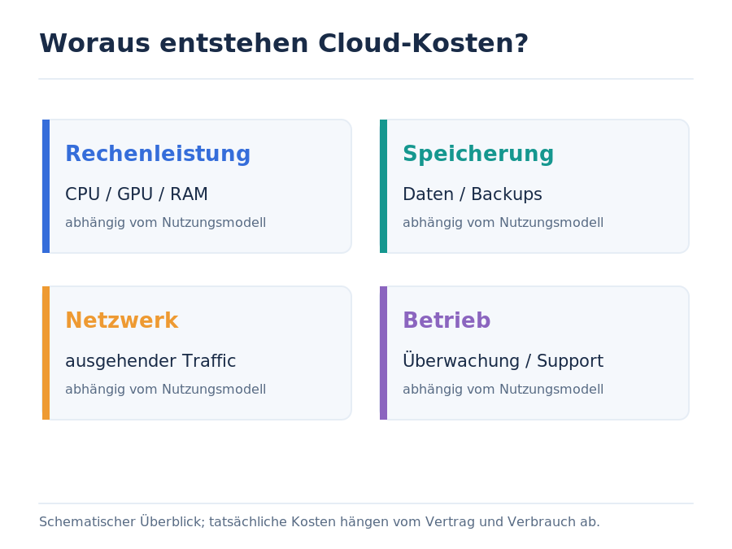

# M4-L4 – Kosten verstehen {#L4}

**Kursbereich:** M4 – Bachelor / Übergang: Cloud-Betrieb

**Niveau:** Bachelor / Master-Brücke

**Vorwissen:** Keine festen Voraussetzungen angegeben.

## Ausgangsproblem: Eine funktionierende Architektur ist noch keine wirtschaftliche Architektur {#S1}

Ein selbst entwickeltes Online-Werkzeug kann technisch hervorragend funktionieren und trotzdem unwirtschaftlich sein. Eine kleine Anwendung benötigt möglicherweise nur einen einzigen Server. Betreibt man dafür zusätzlich einen verwalteten Datenbankcluster, einen Load Balancer, mehrere Containerknoten, einen externen Logdienst und ein aufwendiges Netzwerk, bezahlen die Nutzer für die Funktion nicht automatisch mehr – die Betriebskosten steigen aber.

Umgekehrt kann eine sehr günstige Lösung teuer werden, wenn sie ständig ausfällt und viel Handarbeit verursacht. Bei einem eigenen Online-Dienst muss deshalb nicht nur gefragt werden: **„Was kostet der Server?“**, sondern: **„Was kostet die vollständige, zuverlässig nutzbare Funktion pro Monat und pro tatsächlichem Auftrag?“**

*Kostenmodell* bedeutet hier eine vereinfachte, nachvollziehbare Rechnung, die verwendete Ressourcen mit ihrer Abrechnung und dem geschäftlichen Nutzen verbindet. Es ist keine Beschreibung eines bestimmten Anbieters. Gerade bei Cloud-Diensten können Kosten entstehen, obwohl gerade niemand die Webseite besucht: für reservierte Kapazität, gespeicherte Daten, Backups, IP-Adressen oder Netzwerkkomponenten.

``` text
Nutzer / Aufträge
       │
       ▼
Anwendung + Datenbank + Dateien
       │
       ├── Rechenzeit und Arbeitsspeicher
       ├── Speicherplatz und Sicherungen
       ├── Netzwerke und Datenübertragung
       ├── externe APIs / KI-Modelle
       └── Überwachung, Wartung, Support
                        │
                        ▼
           Gesamtkosten des Dienstes
                        │
                        ▼
              Kosten pro Leistung
```

**Welches Problem löst Kostenrechnung?** Sie macht Ausgaben sichtbar, erlaubt einen fairen Vergleich und deckt riskante Annahmen auf. **Wann ist eine ausgefeilte Finanzverwaltung unnötig?** Bei einem einzelnen privaten Server reicht zunächst oft eine einfache Tabelle oder Liste mit monatlichen Kostenpositionen. Ein aufwendiges Finanzmanagementsystem wäre zusätzliche Arbeit ohne entsprechenden Erkenntnisgewinn.

## Zwei grundlegende Kostenarten: fix und nutzungsabhängig {#S2}

**Fixkosten** fallen in einer bestimmten Betrachtungsperiode auch bei geringer oder fehlender Nutzung an. Typische Beispiele sind eine monatlich gemietete virtuelle Maschine, ein fester Webhostingtarif, eine Domain, ein bezahltes Monitoringpaket oder die Abschreibung angeschaffter Hardware. „Fix“ bedeutet nicht lebenslang unveränderlich: Ein Tarif oder ein Vertrag kann später angepasst werden.

**Variable Kosten** steigen mit einer erfassten Nutzung: etwa pro ausgeführter Funktion, gespeicherter Gigabyte-Monat, verarbeitetem Datenvolumen, Rechenstunde oder Modellaufruf. Ein Dienst kann beide Modelle kombinieren. Beispielsweise kostet ein gemanagtes Datenbankangebot einen Grundbetrag für die dauerhaft laufende Instanz und zusätzlich Speicher- oder Backupplatz.

**Grenzkosten** bezeichnen die zusätzlichen Kosten eines weiteren Auftrags oder Kunden. Sind freie Kapazitäten auf einem bereits bezahlten Server verfügbar, können die unmittelbaren Mehrkosten eines kleinen Auftrags sehr gering sein. Muss für den nächsten Lastschritt jedoch eine zweite Maschine zugeschaltet werden, steigen die Kosten sprunghaft. Auch ein Tarif mit festen Stufen verhält sich nicht wie ein vollständig lineares Preismodell.

Eine hilfreiche Näherung lautet:

``` text
Monatskosten = laufende Grundkosten
             + Nutzungsentgelte
             + sonstige Betriebs- und Supportkosten

Kosten je erledigtem Auftrag = zurechenbare Gesamtkosten
                              / erfolgreich erledigte Aufträge
```

Dabei gehören fehlgeschlagene Versuche, Wiederholungen und Abbruchaufträge in die Gesamtkosten. Bei einem Dienst, der 10.000 Aufträge versucht, aber nur 8.000 erfolgreich abschließt, sollte der Preis eines nutzbaren Ergebnisses nicht durch 10.000 geteilt werden. Genau deshalb reicht eine reine „Kosten pro API-Aufruf“-Kennzahl oft nicht aus.

## Wo Cloud-Anbieter tatsächlich abrechnen {#S3}

### Prozessorzeit, Instanzlaufzeit und Arbeitsspeicher {#31-prozessorzeit-instanzlaufzeit-und-arbeitsspeicher}

{alt="Cloud-Kostenblöcke ohne fiktive Prozentangaben"}


Eine **CPU** (*Central Processing Unit*, Hauptprozessor) führt die allgemeinen Berechnungen aus. Manche Anbieter berechnen die reservierte Rechenkapazität einer Maschine über ihre Laufzeit, unabhängig davon, ob sie permanent zu 100 Prozent arbeitet. Andere Dienste rechnen tatsächliche Laufzeit oder aufgerufene Funktionen nach einem eigenen Tarifmodell ab.

**RAM** (*Random Access Memory*, Arbeitsspeicher) wird häufig zusammen mit einer Maschinenklasse gebucht. Bei manchen serverlosen Diensten beeinflusst der gewählte Speicher die berechnete Leistungseinheit. Zusätzlicher RAM kann bei einer speicherlastigen Anwendung nötig sein, aber ein langsames Datenbankdesign nicht automatisch reparieren.

Eine gemietete virtuelle Maschine kann beispielsweise fortlaufend abgerechnet werden, solange sie existiert oder läuft – die genaue Regel bestimmt der Tarif. Bei einer kurzlebigen Funktion wird dagegen häufig nur eine messbare Ausführung in Rechnung gestellt, zuzüglich weiterer Komponenten. „Bezahlung nach Nutzung“ heißt nicht, dass das gesamte System im Leerlauf zwingend kostenlos ist.

### GPU-Zeit und KI-Verarbeitung {#32-gpu-zeit-und-ki-verarbeitung}

Eine **GPU** (*Graphics Processing Unit*, ursprünglich Grafikprozessor) kann große parallele Rechnungen durchführen und ist für zahlreiche KI-Modelle besonders wichtig. Sie verursacht oft deutlich höhere Stundensätze als eine kleine CPU-Instanz. Entscheidend ist deshalb nicht nur der Stundenpreis, sondern **wie lange eine teure GPU tatsächlich gebunden bleibt**.

Ein Beispiel mit einem rein hypothetischen Stundensatz von 8 Euro:

$$
\begin{aligned}
\text{3 Stunden pro Tag, 30 Tage:}\quad&3\times30\times8\,\text{€}=720\,\text{€}\\
\text{24 Stunden pro Tag, 30 Tage:}\quad&24\times30\times8\,\text{€}=5\,760\,\text{€}
\end{aligned}
$$

Die Rechnung zeigt den Unterschied zwischen zeitweiser und dauerhafter Vorhaltung. Sie sagt *nicht*, dass GPU-Angebote derzeit acht Euro kosten, und berücksichtigt noch keine CPU-, RAM-, Speicher-, Netzwerk-, Daten- oder Lizenzkosten. Selbst eine abgeschaltete GPU-Instanz kann je nach Angebot weiter Kosten für Festplatten, bereitgestellte Adressen oder Speicher verursachen.

Bei **Inferenz** – der Ausführung eines bereits trainierten Modells – kann man lokal rechnen, eine dedizierte GPU mieten oder eine externe **API** (*Application Programming Interface*, Programmierschnittstelle) verwenden. Externe Textmodell-APIs können beispielsweise nach Eingabe- und Ausgabetoken abrechnen. Ein *Token* ist eine Verarbeitungseinheit eines Sprachmodells; es ist nicht immer identisch mit einem ganzen Wort. Andere KI-Dienste rechnen nach Bildern, Sekunden, Rechenzeit oder anderen Einheiten ab. **Die Einheit muss vor jeder Kalkulation aus dem konkreten Angebot abgelesen werden.**

### Datenträger, Datenbank und Backups {#33-datenträger-datenbank-und-backups}

Gespeicherte Daten können nach Kapazität und Dauer abgerechnet werden. Eine typische Maßeinheit lautet **GB-Monat**: ein Gigabyte, das ungefähr einen Monat lang belegt wird. Nicht jede Rechnung benutzt allerdings dieselbe Definition von Gigabyte; Tarife können dezimale GB oder binäre GiB unterscheiden.

Neben Speicherplatz zählen häufig weitere Faktoren:

- Anzahl der Lese- und Schreiboperationen sowie bereitgestellte Ein-/Ausgabeleistung.
- Art des Speichers, etwa schneller Blockspeicher oder günstigerer Objektspeicher.
- Datenbankspeicher, Transaktionsprotokolle und verwalteter Datenbankbetrieb.
- Snapshots, vollständige Sicherungen, Versionierung und Aufbewahrung.
- Abruf- und Wiederherstellungsentgelte aus bestimmten Speicherklassen.

**Ein Backup ist kein kostenloses Abfallprodukt der Datenbank.** Wenn täglich neue Sicherungen entstehen, können Datenvolumen und Aufbewahrungsdauer relevant werden. Eine vermeintlich billige Speicherklasse ist bei häufigen Abrufen oder hoher Mindesthaltedauer nicht unbedingt die wirtschaftlichste. Die Sicherheit der Daten wird dennoch nicht allein anhand ihres Speicherpreises beurteilt (siehe M3-L6).

### Datenverkehr und Egress {#34-datenverkehr-und-egress}

**Egress** bezeichnet ausgehenden Datenverkehr aus einem definierten Netz oder Dienst. Insbesondere die Übertragung von Cloud-Daten an Nutzer im öffentlichen Internet kann je nach Tarif Kosten auslösen. Manche Anbieter unterscheiden zwischen eingehenden und ausgehenden Daten, zwischen Regionen und Verfügbarkeitszonen sowie zwischen internen und externen Transfers.

Beispiel: Ein Online-Dienst liefert monatlich viele Bilder mit jeweils mehreren Megabyte aus. Seine CPU-Kosten sind gering, doch die Summe der übertragenen Dateien kann hoch sein. Ein **CDN** (*Content Delivery Network*, verteiltes Auslieferungsnetz) kann Daten näher am Nutzer zwischenspeichern, aber auch ein CDN besitzt ein eigenes Kostenmodell – es macht die Dateiübertragung nicht automatisch kostenlos.

Bei verteilten Architekturen kommt zusätzlicher Ost-West-Verkehr hinzu: Datenbankreplikation, Synchronisation zwischen Zonen und Datenbewegungen zwischen Diensten. Deshalb sollten möglichst zusammengehörige Dienste sinnvoll platziert werden; unnötige, große Datenbewegungen können teurer sein als ihre eigentliche Verarbeitung.

### Kleinere Posten, die sich summieren {#35-kleinere-posten-die-sich-summieren}

Zusätzlich können Kosten entstehen für Domain und Zertifikatsdienste, DNS-Anfragen (*Domain Name System*, Namensauflösung), Load Balancer, **NAT-Gateway** (*Network Address Translation*, vermittelter ausgehender Netzwerkzugang), IP-Adressen, Logs, Messwerte, Benachrichtigungen, Secret-Verwaltung oder besondere Supporttarife.

Ein Beispiel aus der Herstellerdokumentation: AWS weist ausdrücklich darauf hin, dass NAT-Gateways sowohl zeit- als auch datenbezogene Gebühren verursachen können und ungenutzte Gateways Kostensparpotenzial darstellen. Das bedeutet nicht, dass jeder Betreiber ein NAT-Gateway benötigt. Es zeigt vielmehr, warum die Architektur **vor** der Einrichtung unnötiger Komponenten vereinfacht werden sollte.

## Wie die Bereitstellungsmodelle die Rechnung verändern {#S4}

Die folgenden Modelle wurden in M2-L3 und M2-L4 technisch erklärt. Hier betrachten wir dieselben Modelle wirtschaftlich. Die Tabelle enthält bewusst **keine aktuellen Marktpreise**.

  Modell                                                               Typische Abrechnung                                        Was leicht übersehen wird                                           Geeignet, wenn …
  -------------------------------------------------------------------- ---------------------------------------------------------- ------------------------------------------------------------------- -----------------------------------------------------------
  Klassischer Webhoster                                                Monatlicher Tarif                                          Ausführungsgrenzen, Datenbanklimits, Leistungsgrenzen               PHP-Seite oder kleiner Webdienst einfach bleiben darf
  **VPS** (*Virtual Private Server*, virtueller privater Server)       Meist gemietete Maschinenkapazität                         Updates, Backup, Ausfälle, Administration                           Eine überschaubare Anwendung dauerhaft läuft
  **PaaS** (*Platform as a Service*, verwaltete Anwendungsplattform)   Instanz, Nutzung, Zusatzdienste                            Datenbank, Speicher, Transfer, Limits                               Weniger eigener Serverbetrieb gewünscht ist
  **Serverless**                                                       Aufrufe, Ausführungszeit und weitere Verbrauchswerte       Nebenleistungen, Mindestlaufzeiten, Spitzenlast, Startverzögerung   Unregelmäßige, kurze, unabhängige Aufgaben anfallen
  Containerplattform                                                   Knoten/Container plus Infrastruktur                        Clustergrundkosten, Netzwerk, Observability                         Mehrere Dienste einheitlich verwaltet werden müssen
  Kubernetes-Cluster                                                   Maschinen, Steuerung je nach Angebot, Netzwerk, Speicher   Betriebsaufwand und Leerkapazität                                   Größenordnung und Anforderungen Komplexität rechtfertigen
  Eigene Hardware                                                      Anschaffung plus laufender Betrieb                         Strom, Alterung, Ersatz, Standort, Erreichbarkeit                   Lokale Kontrolle oder gleichmäßige Auslastung wichtig ist

Ein **VPS** ist keine veraltete Technik. Für eine kleine PHP-Anwendung oder eine kompakte API kann er oft das beste Verhältnis zwischen Kosten und Kontrolle liefern. Ein **PaaS** kann teurer wirken, reduziert aber bestimmte administrative Tätigkeiten. Ein serverloses Modell kann bei unregelmäßiger Nutzung wirtschaftlich sein, während ein ständig stark ausgelasteter Dienst möglicherweise mit reservierter Kapazität günstiger betrieben wird. Für beide Richtungen gibt es Ausnahmen.

Kubernetes kann die Verwaltung vieler Anwendungsinstanzen vereinheitlichen. **Es löst aber kein wirtschaftliches Problem allein durch seine Existenz.** Gerade ein kleiner Ein-Personen-Dienst kann durch Clustertechnik unnötige Komplexität, Hintergrundverbrauch und Fehlersuche erhalten.

## Drei durchgerechnete Modelle – ausdrücklich keine Anbieterangebote {#S5}

Die folgenden **fiktiven Modellpreise** zeigen nur die Rechenweise. Sie taugen nicht als unmittelbare Kaufentscheidung; eine echte Rechnung muss Preise, Freikontingente, Regionen, Steuern, Laufzeiten und tatsächliche Lasten neu ermitteln.

### Beispiel A: Kleines dauerhaft erreichbares Online-Werkzeug

Angenommen, eine PHP-Anwendung benötigt einen kleinen virtuellen Server und eine lokale Datenbank. Wir setzen willkürlich an:

  Position                        Fiktive Monatskosten
  ----------------------------- ----------------------
  VPS                                             12 €
  Externe Backup-Aufbewahrung                      5 €
  Domain, anteilig pro Monat                       1 €
  Kleine Zusatzkostenreserve                       3 €
  **Summe**                                   **21 €**

Bei 700 erfolgreich abgeschlossenen Analysen im Monat entspricht das **$\frac{21}{700}=0{,}03\,\text{Euro}$** direktem Technikaufwand je Ergebnis. Die Rechnung enthält keine Arbeitszeit für Wartung, Sicherheitsupdates, Kundenservice, Entwicklung und kaufmännische Abwicklung. Auch eine zweite Maschine für Ausfallsicherheit fehlt.

Wenn die Anwendung zuverlässig auf einem einzelnen Server läuft, besteht kein wirtschaftlicher Grund, sofort sechs unabhängige Dienste daraus zu machen. Bei absehbar höherer Last sollte zunächst untersucht werden, ob Indizes, Caching und ressourcenschonende Software Verbesserungen bringen.

### Beispiel B: Dieselbe Funktion auf einer gemanagten Plattform

Fiktive Monatsannahmen:

  Position                          Fiktive Monatskosten
  ------------------------------- ----------------------
  Anwendungsplattform                               18 €
  Verwaltete Datenbank                              11 €
  Dateispeicher und Sicherungen                      5 €
  Datenverkehr und Protokolle                        4 €
  **Summe**                                     **38 €**

Die Plattform kostet in dieser Modellrechnung 17 Euro mehr als der einzelne VPS. Daraus darf man **nicht** folgern, dass sie um 17 Euro schlechter ist. Möglicherweise spart sie Betriebspersonalzeit, Updates und manuelle Wiederherstellungsschritte; möglicherweise besitzt sie aber auch zusätzliche Einschränkungen. Ein fairer Vergleich muss denselben Umfang an Sicherheit, Verfügbarkeit und Datensicherung betrachten.

### Beispiel C: Seltene Rechenaufträge als serverlose Funktion

Angenommen, eine Plattform würde rein hypothetisch 0,40 Euro je Million Aufrufe und 0,000020 Euro je berechneter **GB-Sekunde** verlangen. Die Einheit GB-Sekunde verknüpft zugeordneten Speicher und Ausführungszeit. Ein Auftrag benötigt hier modellhaft 0,5 GB für 0,2 Sekunden; monatlich gibt es eine Million Aufträge.

$$
\begin{aligned}
\text{Speicherzeit:}\quad&1\,000\,000\times0{,}5\,\mathrm{GB}\times0{,}2\,\mathrm{s}
   =100\,000\,\text{GB-Sekunden}\\
\text{Rechenanteil:}\quad&100\,000\times0{,}000020\,\text{€}=2{,}00\,\text{€}\\
\text{Aufrufanteil:}\quad&\frac{1\,000\,000}{1\,000\,000}\times0{,}40\,\text{€}=0{,}40\,\text{€}\\
\text{Modellhafte Funktionskosten insgesamt:}\quad&2{,}40\,\text{€}
\end{aligned}
$$

Diese **2,40 Euro sind keine vollständigen Systemkosten**. Die Funktion benötigt eventuell Datenbank, Netzverkehr, Authentifizierung, Logs und einen dauerhaften Datenspeicher. Manche Plattformen haben Mindestabrechnungseinheiten, feste Entgelte, Freikontingente oder Speicher- und Laufzeitgrenzen. Und eine Funktion, die zehn Sekunden statt 0,2 Sekunden arbeitet, erzeugt bei gleichem fiktiven linearen Satz das 50-Fache an Rechenkosten. Bei dauerhaft hoher Last kann das Kostenprofil daher kippen.

Das Beispiel zeigt den Vorteil und die Falle verbrauchsbasierter Abrechnung zugleich: Im Leerlauf können Kosten gering sein; ohne Begrenzung kann eine Lastspitze die Rechnung erhöhen.

## Eigene Hardware: Kosten sind mehr als die Stromrechnung {#S6}

Ein Heimcomputer, Mini-PC oder eigener KI-Rechner kann vorhandene Rechenleistung kostengünstig nutzen – besonders für private Verarbeitung ohne permanente öffentliche Erreichbarkeit. Bei wirtschaftlichen Vergleichen zählen aber auch **Anschaffung, Abschreibung, Strom, Verschleiß und Betriebsrisiken**.

Fiktives Beispiel: Ein Rechner verbraucht im betrachteten Dauerbetrieb durchschnittlich 90 Watt, also 0,09 Kilowatt. Bei 30 Tagen und einem ausdrücklich nur angenommenen Strompreis von 0,30 Euro je Kilowattstunde ergibt sich:

$$
\begin{aligned}
0{,}09\,\mathrm{kW}\times24\,\text{Stunden}\times30\,\text{Tage}&=64{,}8\,\mathrm{kWh}\\
64{,}8\,\mathrm{kWh}\times0{,}30\,\text{€/kWh}&=19{,}44\,\text{€ Strom/Monat}
\end{aligned}
$$

Hat das Gerät hypothetisch 600 Euro gekostet, kann man für eine einfache Wirtschaftlichkeitsübersicht $\frac{600\,\text{Euro}}{36\,\text{Monate}}\approx16{,}67\,\text{Euro pro Monat}$ ansetzen. Zusammen wären das schon etwa 36,11 Euro monatlich, **ohne** Netzwerk, Ersatzteile, Backups, Ausfallvorsorge, Wartung und Arbeitszeit. Eine kalkulatorische Verteilung der Anschaffungskosten ist kein tatsächlicher monatlicher Zahlungsabfluss; sie macht nur die langfristigen Gesamtkosten vergleichbar.

Besitzt man den Rechner bereits und hätte ihn ohnehin eingeschaltet, kann der **zusätzliche** Aufwand für einzelne lokale Aufgaben deutlich kleiner sein. Soll dagegen ein kommerzieller Onlinedienst permanent darüber erreichbar sein, kommen weitere Fragen hinzu: Internetanschluss, öffentliche Erreichbarkeit, Stromausfälle, Geräusch und Wärme, Datenschutz sowie Trennung privater und öffentlich angebotener Systeme. Ein heimischer Rechner ersetzt nicht automatisch die Infrastruktur eines Rechenzentrums.

**Wann ist Eigenbetrieb sinnvoll?** Wenn Kontrolle, bereits vorhandene Hardware, Datenschutzanforderungen oder eine gut ausgelastete GPU den Aufwand rechtfertigen. **Wann ist er unnötig?** Wenn ein Dienst nur gelegentlich aufgerufen wird und die verlässliche öffentliche Erreichbarkeit wichtiger ist als die Einsparung einzelner Nutzungsgebühren.

## KI-Kosten: Drei grundsätzlich verschiedene Wege {#S7}

Bei KI-Anwendungen sollte man mindestens drei Verfahren auseinanderhalten:

**Externe Modell-API:** Ein Anbieter verarbeitet Aufträge. Bezahlt wird je nach Modell etwa nach Token, Bild, Minute oder Ausführungszeit. Vorteil: keine eigene GPU und weniger Modellbetrieb. Nachteil: Anbieterabhängigkeit, Preise und Grenzen können sich ändern; Datenschutz, Latenz und maximale Nutzung müssen geprüft werden.

**Gemietete GPU für eigene Modellinferenz:** Das eigene Modell läuft auf einer GPU-Instanz. Vorteil: mehr Kontrolle über Modell, Datenfluss und Rechenverfahren. Nachteil: Kosten für Laufzeit, Modellspeicher, Startvorgänge und Betrieb, auch wenn die Maschine nicht ausgelastet ist.

**Lokale GPU:** Die Inferenz findet auf vorhandener Hardware statt. Vorteil: keine nutzungsabhängige Modellanbieterrechnung und bei lokalem Betrieb meist kein notwendiger Versand der Eingaben an eine externe Modell-API. Nachteil: Energiebedarf, begrenzter Grafikspeicher, Hardwareverschleiß, Wartung und möglicherweise zu geringe Verfügbarkeit für externe Kunden.

Die entscheidende Kennzahl lautet nicht einfach „Preis pro GPU-Stunde“, sondern zum Beispiel **Kosten pro fertig erzeugtem, brauchbarem Bild** oder **Kosten je erfolgreich abgeschlossenem Videoauftrag**. Bei einem langsamen Modell können niedrige Stundensätze durch lange Verarbeitung wettgemacht werden. Umgekehrt kann ein teureres, schnelleres System bei hoher Auslastung pro Ergebnis günstiger sein.

``` text
KI-Auftrag
   │
   ├── externe API: Abrechnung nach Dienstmodell
   │
   ├── gemietete GPU: Laufzeit + Daten + Betrieb
   │
   └── lokale GPU: Strom + Hardware + Wartung
   │
   ▼
Erfolgreiches Ergebnis
   │
   ▼
Kosten je brauchbarem Ergebnis
```

Bei einer KI-Pipeline können zudem mehrere Modellaufrufe nötig sein: Bild erstellen, bewerten, verbessern, Video ableiten, speichern. Auch verworfene Zwischenergebnisse kosten Rechenzeit und möglicherweise API-Gebühren. **Ein Geschäftsmodell muss den erwarteten Ausschuss mit einkalkulieren.**

## Kostenfallen und unerwartete Rechnungen {#S8}

Nicht jede Kostensteigerung bedeutet mehr zahlende Nutzer. Typische Ursachen sind:

1.  **Dauerhaft laufende ungenutzte Ressourcen:** vergessene Testinstanzen, Datenbanken oder Clusterknoten.
2.  **Automatische Skalierung ohne praktische Obergrenze:** mehr Instanzen bei missbräuchlicher oder fehlerhafter Last.
3.  **Wiederholungsschleifen:** Worker oder Agenten lösen wegen eines Fehlers unendlich viele neue Aufgaben aus.
4.  **Unterschätzter Datenverkehr:** große Bilder, Videodateien, Backups oder Transfers zwischen Regionen.
5.  **Unbegrenzte Log- und Backup-Aufbewahrung:** aus kleinen Mengen werden langfristig große Speicherbestände.
6.  **Kostenpflichtige Zusatzdienste:** Load Balancer, NAT-Gateways, Monitoring, Netzkomponenten oder verwaltete Datenbanken.
7.  **Freikontingent falsch verstanden:** Nach Überschreitung des freien Rahmens wird eine Nutzung möglicherweise kostenpflichtig; das genaue Verhalten ist anbieterspezifisch.
8.  **Ressourcen nicht vollständig beendet:** Stoppen einer Maschine löscht nicht automatisch alle Platten, Snapshots oder Adressen.
9.  **Anwendungsfehler und Missbrauch:** unberechtigte API-Nutzung oder fremde Aufträge können trotz geringer legitimer Nachfrage Gebühren verursachen.

Kostenkontrolle ist daher auch eine Frage der **Softwarearchitektur und Sicherheit** (siehe M4-L1 und M4-L3), nicht nur der Buchhaltung.

## Budgets, Warnungen, Quoten und harte Grenzen {#S9}

Ein **Budget** kann zunächst eine geplante Höchstsumme sein. Bei Cloud-Anbietern gibt es dafür meist Abrechnungsansichten und Benachrichtigungen. Ein **Kostenalarm** informiert darüber, dass ein Grenzwert erreicht oder voraussichtlich erreicht wird. Er ist **nicht grundsätzlich eine automatische Ausgabensperre**.

Dieser Unterschied ist wichtig und lässt sich anhand der offiziellen Quellen präzisieren:

- Microsoft beschreibt, dass Azure-Cost-Management-Budgets Benachrichtigungen auslösen, Ressourcen aber **nicht von selbst stoppen**.
- AWS weist darauf hin, dass Abrechnungsdaten und Budgetmeldungen verzögert eintreffen können; auch nach einer Warnung können weitere Kosten entstehen. Bestimmte gesonderte Budgetaktionen oder Spend-Limit-Funktionen sind anbieterspezifisch zu prüfen.
- Google Cloud unterscheidet zwischen reinen Warnbudgets und für bestimmte Dienste verfügbaren **Spend-Cap-Budgets**. Ein Warnbudget allein begrenzt die Rechnung nicht. Auch echte Spend-Caps können zu einer Unterbrechung des Dienstes führen und haben ihren jeweiligen Geltungsbereich. **Stand 05.11.2026:** Google beschreibt solche Grenzen für jeweils einen unterstützten Dienst in einem Projekt, unter anderem Gemini API, Agent Platform, Cloud Run und Cloud Run functions. Wird die Grenze erreicht, pausiert die Plattform neue Nutzung des betroffenen Dienstes; bereits laufende Anfragen dürfen noch Kosten verursachen. Andere Dienste, persistente Ressourcen und feste Kosten laufen gegebenenfalls weiter. Die Durchsetzung ist nicht sofortig und ein Überschreiten kann berechnet werden. Ein Spend-Cap ist daher **keine Gesamtpreisobergrenze für das gesamte Cloud-Projekt**. [Google Cloud – Spend Cap Budgets](https://docs.cloud.google.com/billing/docs/how-to/budgets-spend-caps).

Damit gibt es unterschiedliche Schutzebenen:

``` text
Kostenprognose / Budget          → frühzeitig erkennen
Benachrichtigungen              → Betreiber informieren
Technische Quoten / Rate Limits → Nutzung begrenzen
Auftrags- und Kundenkontingente → einzelne Verursacher begrenzen
Automatische Abschaltlogik      → falls real verfügbar und getestet
Rechnungsprüfung                → Ergebnisse nachvollziehen
```

Beispiele für technische Grenzen sind eine maximal erlaubte Zahl von gleichzeitigen GPU-Aufträgen, eine begrenzte Dateigröße, ein monatliches API-Kontingent je Nutzer, eine feste Obergrenze für Worker und ein Abbruch nach zu vielen Wiederholungsversuchen. Solche Maßnahmen können verhindern, dass ein Programmierfehler unbegrenzt Rechenaufträge erzeugt. **Sie garantieren trotzdem keine absolut begrenzte Rechnung**, wenn andere Kostenpositionen oder Verzögerungen unberücksichtigt bleiben.

Für einen kleinen Dienst genügt häufig eine überschaubare Kontrollroutine: Kostenstellen identifizieren, Warnschwellen vor dem gewünschten Maximalbetrag setzen, tatsächliche Rechnungen vergleichen und technische Limits bereits in der Anwendung vorsehen. Zusätzliche Zahlungspflichten oder Steuerfragen müssen bei einem realen Angebot separat geprüft werden.

## Eine brauchbare Kostenplanung in drei Stufen {#S10}

### Stufe 1: Minimaler Monatsbedarf

Zunächst reicht die Frage: Welche **Dienste müssen tatsächlich immer laufen**? Beispielsweise eine Webanwendung, eine Datenbank und eine Sicherung. Alle weiteren Komponenten werden zunächst als optional betrachtet. So entsteht eine verständliche Grundkostenliste.

### Stufe 2: Drei Lastszenarien

Statt eine einzige optimistische Zahl zu verwenden, sind drei Szenarien sinnvoll:

- **Wenig Nutzung:** nur einige Aufträge, aber Grundkosten laufen weiter.
- **Erwartete Nutzung:** durchschnittliche Zahl erfolgreicher Arbeiten mit normalem Datenvolumen.
- **Hohe oder ungewöhnliche Nutzung:** viele gleichzeitige Arbeiten, größere Dateien, zusätzliche Fehler- und Wiederholungsversuche.

Ein Preisvergleich ist nur sinnvoll, wenn diese Szenarien unter den Alternativen **vergleichbar** sind. Ein Kubernetes-Cluster mit Hochverfügbarkeit und ein einzelner VPS ohne externes Backup liefern nicht dieselbe Dienstqualität.

### Stufe 3: Vollkosten und Nutzen je Auftrag

Für eine eigene kommerzielle Anwendung ergänzen wir die direkt abgerechnete Cloud um die tatsächlichen oder kalkulatorischen Kosten für Pflege, Entwicklung, Support, Softwarelizenzen, Zahlungsabwicklung und gegebenenfalls Steuern. Daraus entstehen **Vollkosten** beziehungsweise eine **Total-Cost-of-Ownership-Betrachtung (TCO)**: nicht nur der Erwerb oder die Miete, sondern die wirtschaftliche Last über den betrachteten Zeitraum.

Die **FinOps Foundation** (*Financial Operations*, gemeinsame Steuerung von Technologieausgaben und deren Nutzen) empfiehlt, Ausgaben auf sinnvolle Leistungseinheiten zu beziehen. Das nennt man *Unit Economics*. Für ein eigenes Analysewerkzeug wäre das zum Beispiel „Kosten pro erfolgreicher Analyse“. Für KI-Bilder wäre es „Kosten pro verwendbarem Ergebnis“, nicht bloß „Kosten pro Token“ oder „Kosten pro Minute Serverzeit“.

``` text
Technische Ressourcen
        │
        ▼
Direkte Betriebskosten
        │
        + Pflege / Support / Ersatz / weitere Pflichten
        │
        ▼
Gesamtkosten über einen Zeitraum
        │
        ▼
Auf erfolgreich erbrachte Leistungen verteilen
        │
        ▼
Kosten je Analyse, Datei, Kunde oder KI-Ergebnis
```

**Welches Problem löst diese Kennzahl?** Sie hilft zu erkennen, ob steigende Umsätze von noch schneller steigenden technischen Kosten aufgezehrt werden. **Wann ist sie unnötig aufwendig?** Bei einem rein privaten, nicht monetarisierten Skript genügt meist die Kontrolle von Strom, Speicher und gegebenenfalls monatlichem Hostingbetrag.

## Welche Lösung ist in welchem Fall wirtschaftlich sinnvoll? {#S11}

### Beispiel 1: Dokumentationswebsite und kleinere PHP-Werkzeuge

Für eine relativ statische Website mit wenigen dynamischen Funktionen reicht gewöhnlich ein klassischer Webhoster oder kleiner VPS. Der Betreiber benötigt Domain, Webserver, sichere Konfiguration, ggf. Datenbank, Backup und Updates. Ein eigener Kubernetes-Cluster oder GPU-Server würde voraussichtlich keinen Mehrwert schaffen. Entscheidend ist, welche Funktionen wirklich benötigt werden, nicht welche Cloud-Begriffe besonders modern wirken.

### Beispiel 2: Online-Datenanalyse mit unregelmäßigen Aufträgen {#beispiel-2-online-datenanalyse-mit-unregelmässigen-aufträgen}

Eine ständig laufende kleine Webanwendung kann Anfragen entgegennehmen und Analyseaufträge in eine Warteschlange stellen. Bei geringer Nachfrage könnte ein einzelner Worker genügen; bei Lastspitzen können zusätzliche Worker wirtschaftlich werden. Alternativ ist eine serverlose Verarbeitung interessant, wenn die Aufgaben kurz und die Grenzen des jeweiligen Anbieters passend sind. Man muss dann jedoch die vollständige Kostenkette aus Aufruf, Speicherung, Laufzeit und Datenausgabe betrachten.

``` text
Browser → kleine Webanwendung → Auftragsdatenbank
                                     │
                                     ▼
                              Warteschlange
                                     │
                                     ▼
                            1 Worker, später mehr
                                     │
                                     ▼
                               Ergebnisdatei
```

### Beispiel 3: Eigener KI-Verarbeitungsdienst

Hier kann ein günstiger Webserver teuer eingekaufte GPU- oder API-Arbeit auslösen. Die Steuerung muss daher an den **eigentlichen Kostentreibern** ansetzen: Auftragstyp, maximale Auflösung, zulässige Laufzeit, Auslastung, Wiederholungen und parallele Jobs. Ein System, das unkontrollierte Nachberechnungen zulässt, kann bei wenigen Nutzern bereits unwirtschaftlich sein.

Ein vernünftiges Anfangsmodell ist oft eine kleine Steuerungs-API mit transparent begrenzter Verarbeitung. Eigene lokale KI-Hardware kann zunächst zum Ausprobieren und für private Batch-Arbeiten dienen. Erst wenn reale Nachfrage und Lastprofile bekannt sind, lohnt ein genauer Vergleich mit gemieteten GPUs oder externen Modell-APIs.

## Preislisten, Kalkulatoren und Anbieterbindung {#S12}

Cloud-Anbieter stellen Preislisten und Kalkulatoren bereit. Ein **Preiskalkulator** erlaubt, Konfiguration und erwartete Nutzung zu schätzen – er garantiert nicht die spätere Rechnung. Microsoft dokumentiert etwa, dass der Azure Pricing Calculator nach Region, Größe, Dienstmodell und Nutzungsmenge unterscheidet. Preise können zudem durch individuelle Verträge, Rabatte, Reservierungen und Währungen abweichen.

Wirtschaftlich relevant ist auch **Vendor Lock-in**, also die Abhängigkeit von anbieterspezifischen Funktionen. Eine proprietäre Datenbank oder ein nur dort nutzbarer Dienst kann langfristig Zeit für Migration und Anpassungen kosten. Das bedeutet nicht, dass jeder Managed Service abzulehnen wäre; die Betriebsersparnis kann den Wechselaufwand durchaus rechtfertigen.

Vor einer realen Entscheidung sind deshalb mindestens folgende Punkte zu prüfen: aktueller Tarif und Region, Abrechnungseinheit, Einrichtungs- oder Mindestkosten, freies Kontingent, Speicher und Datenverkehr, Ausstiegs- und Datenexportkosten, Sicherheitsverantwortung, Kündigungsbedingungen sowie die Verfügbarkeit tatsächlich benötigter Funktionen.

## Zusammenfassung und Übergang zu M4-L5 {#S13}

**Cloud-Kosten bestehen selten nur aus „dem Server“.** Rechenzeit, Arbeitsspeicher, Speicherdauer, Datenübertragung, Datenbanken, Backups, externe APIs, Monitoring und Betriebspflege bilden zusammen die tatsächliche wirtschaftliche Last. Die entscheidenden Unterschiede sind fixe gegenüber variablen Kosten, Leerlauf gegenüber Auslastung und direkter Rechenpreis gegenüber Kosten je brauchbarem Ergebnis.

Ein klassischer Webhoster oder kleiner VPS kann für eine kleine Anwendung genügen. PaaS reduziert bestimmte Betriebsaufgaben, Serverless passt unter Umständen gut zu unregelmäßigen Aufträgen, Clusterplattformen helfen bei entsprechendem Umfang – doch keine dieser Techniken ist grundsätzlich die billigste oder beste. Ein Budgetalarm ist nicht automatisch ein hartes Limit; technische Obergrenzen und Kontrolle der Rechnung sind eigenständige Aufgaben.

**In M4-L5 – Eigene Software- und Cloud-Angebote** verbinden wir dieses Kostenwissen mit Geschäftsmodellen: Was könnte man anbieten, wie prüft man Nachfrage, welche minimalen ersten Versionen wären denkbar und wann sind Support, Sicherheit und laufende Gebühren höher als der realistische Nutzen?


## Quellen {#S14}

**Letzte Quellenprüfung:** 04.11.2026

**Geprüft am 04.11.2026.** Die nachfolgenden Quellen beschreiben Anbieterfunktionen beziehungsweise Kostenmethoden. Sie sind **keine Preiszusage**; diese Lektion enthält absichtlich keine aktuellen Listenpreise.

1.  Microsoft Learn, *Estimate costs with the Azure pricing calculator*: [https://learn.microsoft.com/en-us/azure/cost-management-billing/costs/pricing-calculator](https://learn.microsoft.com/en-us/azure/cost-management-billing/costs/pricing-calculator) – Einfluss von Region, Konfiguration, Nutzungsmenge und Verträgen auf Kostenschätzungen.
2.  Microsoft Learn, *Tutorial: Create and manage budgets*: [https://learn.microsoft.com/en-us/azure/cost-management-billing/costs/tutorial-acm-create-budgets](https://learn.microsoft.com/en-us/azure/cost-management-billing/costs/tutorial-acm-create-budgets) – Budgetmeldungen stoppen Ressourcen nicht automatisch; verzögerte Abrechnungsdaten.
3.  Google Cloud, *Create, edit, or delete budgets and budget alerts*: [https://docs.cloud.google.com/billing/docs/how-to/budgets](https://docs.cloud.google.com/billing/docs/how-to/budgets) – Warnbudgets gegenüber unterstützten harten Ausgabenbegrenzungen.
4.  Google Cloud, *Manage spend cap budgets*: [https://docs.cloud.google.com/billing/docs/how-to/budgets-spend-caps](https://docs.cloud.google.com/billing/docs/how-to/budgets-spend-caps) – mögliche Ausgabensperren für unterstützte Dienste und Folgen für die Erreichbarkeit.
5.  AWS, *Managing your costs with AWS Budgets*: [https://docs.aws.amazon.com/de_de/cost-management/latest/userguide/budgets-managing-costs.html](https://docs.aws.amazon.com/de_de/cost-management/latest/userguide/budgets-managing-costs.html) – Budgetarten, Warnungen und Aktionen.
6.  AWS, *Best practices for AWS Budgets*: [https://docs.aws.amazon.com/cost-management/latest/userguide/budgets-best-practices.html](https://docs.aws.amazon.com/cost-management/latest/userguide/budgets-best-practices.html) – Verzögerungen und Aktualisierungshäufigkeit der Kostendaten.
7.  AWS, *Cost optimization checks*: [https://docs.aws.amazon.com/awssupport/latest/user/cost-optimization-checks.html](https://docs.aws.amazon.com/awssupport/latest/user/cost-optimization-checks.html) – ungenutzte Netzwerkkomponenten und zusätzliche Datentransferkosten.
8.  FinOps Foundation, *Unit Economics*: [https://www.finops.org/framework/capabilities/unit-economics/](https://www.finops.org/framework/capabilities/unit-economics/) – Kosten auf technisch und geschäftlich sinnvolle Leistungseinheiten beziehen.
9.  FinOps Foundation, *Introduction to Cloud Unit Economics*: [https://www.finops.org/wg/introduction-cloud-unit-economics/](https://www.finops.org/wg/introduction-cloud-unit-economics/) – Definition, Vollkosten und Zusammenhang zwischen Nutzung und Wert.

**Nicht geprüft:** Konkrete aktuelle VPS-, GPU-, CDN-, API-, Strom- oder Speicherlistenpreise für einen bestimmten Anbieter oder Vertrag. Diese müssten bei einer realen Kaufentscheidung mit Datum, Region und Tarif gesondert erhoben werden.
