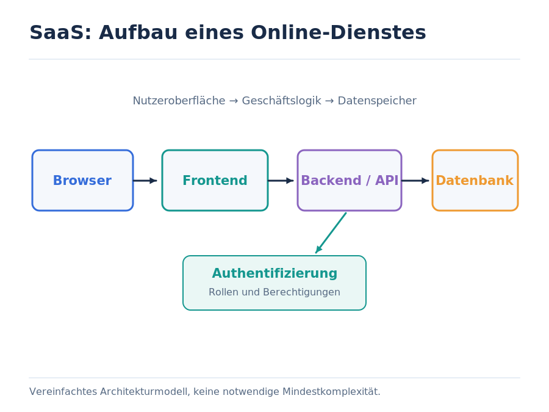

# M4-L5 – Mögliche eigene Software- und Cloud-Angebote {#L5}

**Kursbereich:** M4 – Bachelor / Übergang: Cloud-Betrieb

**Niveau:** Bachelor / Master-Brücke

**Vorwissen:** Keine festen Voraussetzungen angegeben.

## Ausgangsproblem: Eine technisch mögliche Lösung ist noch kein Produkt {#S1}

Nach den Lektionen über Server, Cloud, Datenbanken, Zuverlässigkeit und Kosten stellt sich eine neue Frage: **Was könnte man mit dieser Infrastruktur anbieten, wofür andere Menschen oder Unternehmen freiwillig bezahlen?** Ein Entwickler kann eine Datenbank, einen Webserver oder einen KI-Worker betreiben. Daraus entsteht aber noch kein sinnvoller Dienst. Erst wenn ein Angebot ein reales, ausreichend wichtiges Problem löst und zuverlässig nutzbar ist, kann daraus ein Produkt werden.

Dabei müssen drei Ebenen getrennt werden:

1.  **Technisches Konzept:** Eine Datei auswerten, einen Bericht erzeugen, Daten synchronisieren oder einen KI-Auftrag abarbeiten.
2.  **Bereitstellungsform:** Das Programm läuft lokal, auf einem gemieteten Server oder auf einer verwalteten Cloud-Plattform.
3.  **Geschäftsmodell:** Menschen bezahlen einmalig, monatlich, pro Aufruf, pro Benutzer oder für einen betreuten Service.

Dieselben Algorithmen lassen sich unter verschiedenen Geschäftsmodellen anbieten. Ein PDF-Analyseprogramm könnte als Desktop-Software verkauft, als Webwerkzeug vermietet oder als Programmierschnittstelle für andere Anwendungen bereitgestellt werden. Umgekehrt kann dasselbe monatliche Abonnement sowohl eine einfache Anwendung als auch einen aufwendigen Cloud-Dienst finanzieren. **Software as a Service (SaaS)** bezeichnet die Bereitstellung von Software als nutzbaren Dienst; ein Abonnement ist eine verbreitete, aber keine zwingende Eigenschaft davon.

``` text
Konkretes Problem eines Nutzers
             │
             ▼
      Nützliche Funktion
             │
     ┌───────┴─────────┐
     ▼                 ▼
Desktop-Programm   Online-Dienst
     │                 │
Einmallizenz      Abo / Aufruf / Kontingent
     │                 │
     └───────┬─────────┘
             ▼
   Betreuung, Updates, Kosten,
   Nachfrage und Verantwortung
```

**Welches Problem löst diese Unterscheidung?** Sie verhindert, dass Hosting-Technik vorschnell mit einem Geschäftsmodell gleichgesetzt wird. **Wann braucht man das nicht?** Wer ein Werkzeug ausschließlich für sich selbst entwickelt oder kostenlos veröffentlicht, muss kein kommerzielles Modell erfinden. Technische Lösungen dürfen auch ohne Einnahmeabsicht nützlich sein.

## Modell 1: Ein kleines Online-Werkzeug als SaaS {#S2}

Ein **SaaS-Angebot** stellt eine Anwendung über das Netzwerk bereit. Der Anbieter betreibt und aktualisiert die Software; Kunden nutzen sie beispielsweise im Browser. Der wesentliche Kundennutzen liegt nicht darin, dass die Software „in der Cloud“ läuft, sondern darin, dass ein Problem ohne eigene Installation und häufig von mehreren Geräten aus gelöst werden kann.

{alt="Schematische SaaS-Architektur mit Frontend, API, Datenbank und Berechtigungsprüfung"}


Stellen wir uns einen Dienst vor, der große CSV-Dateien (*Comma-Separated Values*, einfache tabellarische Textdateien) einliest, auf Fehler prüft und einen Bericht erzeugt. Die erste technische Umsetzung kann sehr schlicht sein:

``` text
Kunde im Browser
       │
       ▼
Webanwendung: Datei hochladen
       │
       ▼
Prüf- und Analysemodul
       │
       ├── Ergebnis anzeigen
       └── Bericht herunterladen
```

Wenn keine Konten und keine dauerhafte Speicherung benötigt werden, kann bereits dies das vollständige Produkt sein. Später könnten ein Benutzerkonto, wiederkehrende Berichte und getrennte Kundenbereiche hinzugefügt werden. **Mandantenfähigkeit** bedeutet dabei, dass mehrere Kunden dieselbe Anwendung nutzen können, ohne die vertraulichen Daten anderer Kunden zu sehen. Die AWS-SaaS-Dokumentation behandelt hierfür eigene Konzepte wie Mandantenisolierung, Kunden-Onboarding und nutzerbezogene Kostenmessung; es gibt jedoch nicht die eine richtige SaaS-Architektur für alle Produkte.

Eine erste Version müsste deshalb keineswegs aus Microservices, Kubernetes oder einem Datenbankcluster bestehen. Ein einzelner Webserver mit einem sauber abgesicherten Programm und einer überschaubaren Datenbank kann reichen.

**Sinnvoll**, wenn Nutzer ein wiederkehrendes Problem haben, auf mehreren Geräten arbeiten oder Updates nicht selbst installieren möchten. **Unnötig**, wenn eine einmalige lokale Dateiumwandlung völlig ausreicht und keinerlei gemeinsamer Betrieb nötig ist. **Nachteil:** Der Anbieter übernimmt Erreichbarkeit, Kontensicherheit, Datenlöschung, Fehlerbehebung und möglicherweise dauerhaften Kundensupport.

## Modell 2: API-as-a-Service – Eine Funktion statt einer Oberfläche verkaufen {#S3}

**API** steht für *Application Programming Interface*, eine Programmierschnittstelle. **API-as-a-Service** bedeutet, dass Kunden eine Funktion aus ihrer eigenen Software heraus aufrufen können. Sie wollen vielleicht gar kein Dashboard und keine zusätzliche Webseite bedienen: Ihr eigenes System soll automatisch Daten annehmen, verarbeiten und ein Ergebnis zurückgeben.

Beispiel: Ein Dienst analysiert die Struktur einer Datei und meldet typische Fehler als maschinenlesbare Daten zurück.

``` text
Software des Kunden
        │
        ▼
API-Aufruf mit Daten und Zugangsschlüssel
        │
        ▼
Authentifizierung + Berechtigungsprüfung
        │
        ▼
Analysefunktion
        │
        ▼
Strukturierte Antwort an die Kundensoftware
```

Die Schnittstelle benötigt eine stabile Beschreibung von Eingaben, Ergebnissen und Fehlerzuständen. Sie muss Versionen, Zugriffsbeschränkungen und Missbrauchsschutz berücksichtigen. Eine API kann nach Monaten von Kundenprogrammen automatisiert aufgerufen werden; eine unbedachte Änderung ihres Datenformats kann zahlreiche Integrationen beschädigen. Deshalb können dokumentierte Versionen und klare Änderungen wichtiger sein als eine hübsche Oberfläche.

Mögliche Abrechnungen sind: festes monatliches Aufrufkontingent, nutzungsabhängige Gebühren oder vorab gekaufte Guthaben. Bei sehr rechenintensiven Aufträgen muss die Abrechnung die tatsächlich verbrauchten Ressourcen berücksichtigen. Ein Aufruf, der 20 Millisekunden benötigt, kostet möglicherweise erheblich weniger als eine Bildverarbeitung mit mehreren Minuten GPU-Rechenzeit (*Graphics Processing Unit*, Grafikprozessor).

Ein Sicherheitsproblem sind **unbegrenzte Ressourcenanforderungen**. Selbst formal gültige Anfragen können einen Dienst durch Masse, große Dateien oder teure Berechnungen überlasten. Die OWASP (*Open Worldwide Application Security Project*) führt unbeschränkten Ressourcenverbrauch in der API-Sicherheitsliste als eigenes Risiko. Gegenmaßnahmen sind Zugangsprüfung, Kontingente, Dateigrößenlimits, Zeitlimits, Warteschlangen und gegebenenfalls manuelle Freigaben teurer Aktionen.

**Sinnvoll** bei klar definierbaren Funktionen, die andere Programme wiederholt benötigen. **Unnötig** bei einem Werkzeug, das nur mit viel menschlicher Einordnung bedient werden kann. **Nachteil:** Schnittstellenänderungen und Support für Fremdintegrationen erzeugen langfristige Verpflichtungen.

## Modell 3: Managed Automations – Wiederkehrende Arbeit als betreuter Dienst {#S4}

Bei **Managed Automations** verkauft man nicht nur ein Stück Software, sondern die verlässlich erledigte Aufgabe. Beispielsweise soll ein kleiner Betrieb regelmäßig Daten aus mehreren Systemen zusammenführen, Fehler erkennen und einen Wochenbericht erhalten.

``` text
Zeitplan oder Ereignis
          │
          ▼
   Automatisierungsdienst
          │
   ┌──────┴──────┐
   ▼             ▼
Daten abholen  Eingänge prüfen
   └──────┬──────┘
          ▼
       Auswertung
          │
          ▼
Bericht + Fehlermeldung + Protokoll
```

Dazu können ein **Scheduler** (zeitlicher Aufgabenplaner), Worker (ausführende Hintergrundprogramme) und eine kleine Datenbank genügen. Künstliche Intelligenz ist optional: Eine feste Regel kann für Rechnungsdateien, Verzeichnisse oder Tabellen zuverlässiger, günstiger und besser nachvollziehbar sein. KI eignet sich eher dort, wo unstrukturierte Texte, Klassifikationen oder unscharfe Muster verarbeitet werden müssen. Bei kritischen Ergebnissen braucht es Kontrollmechanismen und gegebenenfalls menschliche Freigabe.

Der Kunde bezahlt häufig für das Ergebnis, die Einrichtung und die fortlaufende Betreuung. Das kann einen höheren wahrgenommenen Nutzen haben als eine reine Lizenz. Gleichzeitig steigt die Supportverantwortung: Externe Datenformate ändern sich, Zugangsdaten laufen ab, Schnittstellen werden umgestellt und ein Fehler kann eine notwendige Geschäftsaufgabe unterbrechen.

**Sinnvoll** bei wenigen Kunden mit wiederkehrenden, klar beschriebenen Arbeitsabläufen. **Unnötig**, wenn eine einfache Anleitung oder ein lokales Skript beim Kunden ausreicht. **Nachteil:** Ein stark individuell angepasster Dienst skaliert nicht automatisch; jeder weitere Kunde kann zusätzliche persönliche Arbeit erfordern.

## Modell 4: Gehostete Open-Source-Software mit Mehrwert {#S5}

**Open Source** bedeutet, dass Software unter einer Lizenz veröffentlicht wird, welche bestimmte Nutzungs-, Einsichts-, Änderungs- und Weitergaberechte gewährt. Je nach Lizenz kann man darauf aufbauend einen gehosteten Dienst betreiben und etwa Einrichtung, Updates, Wartung oder Support verkaufen.

Der Kundennutzen entsteht dann beispielsweise dadurch, dass Menschen einen leistungsfähigen freien Dienst nutzen können, ohne ihn selbst zu installieren oder zu administrieren.

``` text
Vorhandenes Open-Source-Projekt
             │
             ▼
Rechtlich zulässige Bereitstellung
             │
             ▼
Hosting + Einrichtung + Updates
             │
             ▼
Kunde erhält betreute Nutzung
```

Hier muss die **konkrete Softwarelizenz** vor jeder kommerziellen Nutzung geprüft werden. „Der Quellcode steht im Internet“ ist nicht gleichbedeutend mit „alle Verwertungsformen sind erlaubt“. Bei permissiven Lizenzen, klassischen Copyleft-Lizenzen und Lizenzen mit Netzwerkregelungen unterscheiden sich Bedingungen erheblich. Insbesondere die GNU Affero General Public License, Version 3 (**AGPLv3**), enthält unter bestimmten Voraussetzungen Verpflichtungen, Nutzern bei Interaktion über ein Netzwerk den korrespondierenden Quellcode einer modifizierten Version anzubieten. Daraus darf man weder ableiten, dass jedes Open-Source-Projekt diese Regel besitzt, noch dass jeglicher Hostingbetrieb generell verboten wäre.

Auch Markenrechte, Bildmaterial, beigefügte Datensätze und Lizenzen von Erweiterungen können getrennt zu beachten sein. **Sinnvoll** bei einem funktionierenden, legal nutzbaren Projekt mit tatsächlichem Wartungsbedarf. **Unnötig**, wenn Kunden das Angebot problemlos selbst betreiben oder überhaupt keine Nachfrage nach Betreuung besteht. **Nachteil:** Man übernimmt Verantwortung für Software, deren technische Entwicklung man nicht vollständig kontrolliert.

## Modell 5: Datenauswertung, Monitoring, Medien und KI-Workflows {#S6}

Eine Reihe von Angeboten kombiniert die zuvor besprochenen Modelle. Der Fachnutzen ist entscheidend, nicht die Einordnung in eine Marketingkategorie.

  Angebotsidee         Fachliches Problem                            Kleiner möglicher Einstieg              Typischer Kostentreiber
  -------------------- --------------------------------------------- --------------------------------------- ------------------------------------------
  Datenprüfung         Fehlerhafte Tabellen oder Importe             Datei prüfen und Bericht erzeugen       Rechenzeit, Support bei Sonderformaten
  Monitoring           Ausfälle oder Veränderungen zu spät bemerkt   Wenige Quellen regelmäßig prüfen        Abfragehäufigkeit, Benachrichtigungen
  Medienverarbeitung   Viele Bilder/Videos einheitlich umwandeln     Ein Dateityp, ein Verarbeitungsprofil   Speicher, Datenverkehr, CPU/GPU
  KI-Textanalyse       Freitexte zuordnen oder zusammenfassen        Ein klar abgegrenzter Dokumenttyp       API-Aufrufe, Modellprüfung, Datenschutz
  KI-Bildworkflow      Wiederholbare Generierung oder Bearbeitung    Ein standardisierter Auftragstyp        GPU-Zeit, Fehlversuche, Dateispeicherung

Nehmen wir einen bildverarbeitenden Dienst. Kunden laden Bilder hoch und wählen eine definierte Verarbeitung. Ein Webserver nimmt den Auftrag entgegen; ein Worker führt die rechenintensive Arbeit aus und stellt das Ergebnis zum Abruf bereit.

``` text
Browser / API
      │
      ▼
Auftragseingang mit Größenlimit
      │
      ▼
Auftragsdatenbank + Warteschlange
      │
      ▼
CPU-/GPU-Worker
      │
      ▼
Ergebnisdatei mit begrenzter Aufbewahrung
      │
      ▼
Status und Download für berechtigten Kunden
```

Der Engpass kann dabei die Berechnungsdauer, die GPU-Verfügbarkeit oder der ausgehende Datenverkehr sein. Es entstehen außerdem Fragen nach Upload-Rechten, zulässigen Inhalten, Speicherdauer, Wiederholungen, Datenschutz, Manipulation und dem Umgang mit fehlerhaften Ergebnissen. Ein lokaler KI-Rechner kann für eigene Produktion wirtschaftlich sinnvoll sein, ist aber nicht allein deshalb als öffentlicher Dienst geeignet: Nutzer erwarten Verfügbarkeit, Schutz ihrer Dateien und zuverlässige Bearbeitungszeiten.

**Sinnvoll** für gut eingrenzbare Prozesse mit wiederholbarem Ergebnis. **Unnötig** für einen Dienst, der jeden Auftrag individuell interpretieren muss und keinen klaren Qualitätsmaßstab besitzt. **Nachteil:** KI-Aufträge können unvorhersehbar lange dauern, scheitern oder Ergebnisse liefern, die vor weiterer Verwendung geprüft werden müssen.

## Modell 6: Desktop-Lizenz mit optionalem Cloud-Abgleich {#S7}

Nicht jede Anwendung muss eine Webanwendung werden. Eine lokal installierte Desktop-Software kann weiterhin viele Vorteile haben: Daten bleiben auf dem eigenen Rechner, die Oberfläche reagiert ohne Internet, und die Grundfunktionen verursachen keine laufenden Serverkosten.

Eine **hybride Architektur** verbindet diese lokale Stärke mit einzelnen optionalen Online-Funktionen. Denkbar wären lizenzierte Software, optionale Gerätesynchronisation, verschlüsselte Sicherungskopien oder ein gemeinsames Benutzerkonto für mehrere Rechner.

``` text
Desktop-Anwendung
    │
    ├── Lokale Datenbank (Hauptbetrieb)
    ├── Lokale Bearbeitung (offline möglich)
    │
    └── Optionaler Sync-Dienst
                 │
                 ▼
           Remote-Speicher
```

Die Synchronisation ist allerdings eine eigene technische Aufgabe. Was passiert, wenn dieselbe Datei oder derselbe Datensatz auf zwei Geräten gleichzeitig verändert wird? Dafür braucht es Regeln für Konflikte und unter Umständen Versionen, Zeitstempel oder einen Abgleich auf Datensatzebene. Außerdem muss klar sein, ob der entfernte Speicher lediglich zusätzliche Kopien hält oder als führende Datenquelle fungiert.

Eine **Einmallizenz** und ein **zusätzliches Cloud-Abonnement** können getrennte Produkte sein. Ein solches Modell kann zu Nutzern passen, die unabhängig bleiben möchten, aber für bestimmte Komfortfunktionen zahlen würden.

**Sinnvoll** bei datenintensiven lokalen Anwendungen und einem nur gelegentlichen Synchronisationsbedarf. **Unnötig**, wenn mehrere Nutzer gleichzeitig in einer gemeinsamen Datenbasis arbeiten müssen und ohnehin eine rein serverseitige Anwendung benötigen. **Nachteil:** Windows-, Linux- oder andere Desktop-Versionen, Offline-Probleme und Cloud-Komponenten müssen möglicherweise parallel gepflegt werden.

## Abrechnung: Wofür genau bezahlt ein Kunde? {#S8}

Der Preis sollte zum wahrgenommenen Nutzen und zur technischen Kostenstruktur passen. Typische Modelle sind:

  Modell               Was wird bezahlt?                                     Geeignet, wenn …                              Problem
  -------------------- ----------------------------------------------------- --------------------------------------------- -------------------------------------------------
  Einmalkauf           Eine dauerhaft nutzbare Softwareversion oder Lizenz   Produkt überwiegend lokal funktioniert        Folgeupdates und Support brauchen Finanzierung
  Abonnement           Wiederkehrender Zugang zum Dienst                     kontinuierlicher Nutzen entsteht              Nutzer erwarten dauerhafte Verfügbarkeit
  Pro Benutzer         Anzahl berechtigter Personen                          Zusammenarbeit im Mittelpunkt steht           Geteilte Konten und Rollen werden relevant
  Pro Aufruf/Auftrag   Tatsächliche Nutzung                                  Kosten ungefähr mit Nutzung wachsen           Missbrauch und Kostenüberraschungen möglich
  Guthabenpaket        Vorab bezahlte Nutzungseinheiten                      Rechenintensive Aufträge stattfinden          Restguthaben, Erstattung und Buchführung klären
  Betreuungsvertrag    Einrichtung, Kontrolle und Unterstützung              Kunden Ergebnisse und Erreichbarkeit kaufen   Zeitaufwand begrenzt die Skalierung

Ein **Freemium-Modell** bietet eine kostenlose Grundversion und kostenpflichtige Zusatzfunktionen. Das kann den Zugang erleichtern, ist aber kein Selbstläufer: Kostenlose Nutzer können Rechenleistung, Datenverkehr und Support beanspruchen. Daher müssen Gratis-Kontingente ebenso begrenzt werden wie kostenpflichtige.

Abrechnungssysteme wie Stripe bieten laut offizieller Dokumentation Abonnements und auch verbrauchsabhängige Verfahren mit Nutzungsmessung an. Dies ist ein Beispiel für ein konkretes Produkt, **keine technische Notwendigkeit**, keine Empfehlung zur Kontoeröffnung und kein Beleg für aktuelle Konditionen eines bestimmten Tarifs. Ein Zahlungsanbieter übernimmt nicht automatisch Produktlogik, Zugriffskontrolle, Steuerpflichten und Fehlerbehandlung im eigenen System.

Wichtig ist die Trennung zweier Wahrheiten: **„Ein Zahlungsvorgang wurde bestätigt“** und **„Der Kunde darf eine bestimmte Leistung nutzen“**. Die Anwendung muss nach verifizierten Zahlungsereignissen den passenden Nutzungsanspruch eintragen; wiederholte Benachrichtigungen dürfen nicht mehrfach Leistung gutschreiben. Dazu gehören eindeutige Ereigniskennungen, nachvollziehbare Buchungen und Korrekturverfahren (vgl. M3-L5).

## Die eigentliche Prüfung einer Produktidee {#S9}

Eine technische Idee wird wirtschaftlich erst interessant, wenn mehrere Fragen zusammenpassen. Als Orientierung kann man ein gedankliches Prüfschema verwenden – **nicht als Hausaufgabe**, sondern als Modell dafür, wie ein Entwickler Möglichkeiten bewertet.

### Wer braucht die Lösung? {#91-wer-braucht-die-lösung}

„Alle Menschen, die Daten haben“ ist keine präzise Zielgruppe. „Kleine Betriebe, die jeden Monat Lieferantendateien in einem unpassenden Tabellenformat erhalten“ beschreibt ein konkreteres Problem. Je klarer der Nutzer und seine Situation, desto leichter lässt sich ein geeignetes Minimalangebot bestimmen.

### Welches Problem löst sie messbar? {#92-welches-problem-löst-sie-messbar}

Ein Werkzeug kann Zeit sparen, Fehler verhindern, eine gesetzliche Dokumentationspflicht unterstützen oder die Qualität einer wiederkehrenden Ausgabe verbessern. Entscheidend ist, ob der Vorteil gegenüber vorhandenen Lösungen erkennbar ist. „Nutzt künstliche Intelligenz“ ist zunächst nur eine technische Eigenschaft und kein selbstständiger Kundennutzen.

### Was ist die kleinste glaubwürdige Version? {#93-was-ist-die-kleinste-glaubwürdige-version}

Ein **Minimum Viable Product (MVP)** ist ein minimales, tatsächlich nutzbares Produkt, mit dem der zentrale Nutzen überprüft werden kann. Es ist nicht einfach „irgendetwas Unfertiges“: Sicherheit und korrekte Ergebnisse dürfen nicht fehlen. Ein Datenprüfer könnte beispielsweise einen einzigen häufig vorkommenden Dateityp sicher verarbeiten, statt bereits 40 Formate unzuverlässig zu unterstützen.

### Warum sollte jemand bezahlen? {#94-warum-sollte-jemand-bezahlen}

Bezahlbereitschaft folgt nicht allein aus technisch interessanten Funktionen. Kunden können schon eine kostenlose Alternative nutzen, das Problem nur selten haben oder den Nutzen nicht ausreichend einschätzen. Ein Dienst ist nur dann dauerhaft tragfähig, wenn die Einnahmen bei realistischem Nutzungs- und Betreuungsaufwand seinen Betrieb rechtfertigen. Große technische Skalierbarkeit beweist weder Nachfrage noch Wirtschaftlichkeit.

### Was bleibt auch bei wenigen Kunden zu tun? {#95-was-bleibt-auch-bei-wenigen-kunden-zu-tun}

Domain, Hosting, Updates, Backups, Überwachung, Fehlersuche, Lizenzfragen, Anfragen, Rechnungen und Datenschutz entstehen häufig bereits beim ersten zahlenden Kunden. Ein System mit wenigen zahlenden Nutzern kann deshalb betreuungsintensiver sein als angenommen.

## Modellrechnung: Einnahmen sind nicht Gewinn {#S10}

Das folgende Beispiel ist **vollständig fiktiv**. Es beschreibt keine Marktpreise, keine realen Dienstkosten und keine Gewinnaussichten.

Angenommen, ein kleines Online-Werkzeug wird von 40 Kunden zu jeweils 15 Euro pro Monat verwendet:

  Position pro Monat                                             Beispielbetrag
  ------------------------------------------------------------ ----------------
  $40\times15\,\text{Euro}$ Kundenerlöse                               600 Euro
  Variable Verarbeitungskosten: $40\times2\,\text{Euro}$               −80 Euro
  Server, Backups und technische Grundkosten                           −90 Euro
  Zahlungsabwicklung als Modellpauschale                               −20 Euro
  **Rechnerischer Rest vor Arbeitszeit und weiteren Kosten**       **410 Euro**

Dieser Rest ist **nicht der Gewinn**. Nehmen wir zusätzlich fünf Stunden Support und Wartung zu einem rein rechnerischen Zeitwert von 30 Euro pro Stunde an, sinkt der verbleibende Betrag auf 260 Euro. Steuern, mögliche Rückerstattungen, Buchführung, Entwicklung und andere Kosten sind damit noch nicht berücksichtigt. Wird der Zeitaufwand größer oder die Kundenzahl kleiner, kann der Dienst unrentabel sein.

Ein nützliches Konzept sind **Stückkosten** (*Unit Economics*): Wie viel kostet eine erfolgreich erbrachte Leistung – einschließlich eines angemessenen Anteils gemeinsamer Kosten? Bei einem KI-Dienst kann eine hohe Fehlversuchsquote diesen Wert deutlich verändern. Bei einem Managed-Service-Angebot kann dagegen die persönliche Betreuungszeit dominieren.

Auch die Zahl der Kunden allein reicht nicht zur Bewertung. Entscheidend sind unter anderem tatsächliche Nutzung, Kündigungen, notwendiger Support und die Kosten, neue Kunden zu gewinnen. Ein kleiner Dienst kann technisch jederzeit auf das Zehnfache wachsen und dennoch wirtschaftlich schlechter werden, wenn die Aufträge teurer sind als die dafür erzielten Einnahmen.

## Sicherheit, Datenschutz, Verträge und Lizenzen {#S11}

Sobald andere Personen einen Dienst nutzen, entstehen weitere Verantwortungen. Die wichtigsten hängen vom konkreten Angebot ab:

- **Sicherheit:** Benutzerkonten, getrennte Kundendaten, Dateiuploads, Zugangsschlüssel, Missbrauchsschutz, Sicherheitsupdates und wiederherstellbare Backups.
- **Datenschutz:** Verarbeitung personenbezogener Daten, Löschung, Aufbewahrung, Zugriffsberechtigungen und Rolle als Verantwortlicher oder Auftragsverarbeiter nach der Datenschutz-Grundverordnung (DSGVO). Die Zuordnung hängt von den tatsächlichen Entscheidungen über Zwecke und Mittel der Verarbeitung ab, nicht vom Werbenamen „Cloud“.
- **Vertrags- und Verbraucherfragen:** Verständliche Leistungsbeschreibung, Kündigung, gegebenenfalls Widerrufsrechte, Rechnungen, Support und zugesagte Verfügbarkeit. Welche Pflichten gelten, hängt unter anderem von Kundentyp, Land und konkreter Vertragsgestaltung ab.
- **Steuern:** Die Abrechnung digitaler Leistungen über Ländergrenzen kann Umsatzsteuerfragen auslösen. Das EU-Verfahren **One Stop Shop (OSS)** kann unter seinen gesetzlichen Voraussetzungen bestimmte grenzüberschreitende Umsätze gegenüber Verbrauchern vereinfachen; es ist keine pauschale Steuerbefreiung.
- **Lizenzen und Inhalte:** Rechte an Quellcode, Modellen, Trainingsdaten, Bildern, Musik, Schriften und zusätzlichen Bibliotheken separat prüfen.
- **KI-spezifische Folgen:** Risiken durch unzutreffende Ergebnisse, vertrauliche Eingaben, manipulierte Anweisungen und ungeprüfte automatische Aktionen berücksichtigen. Sicherheitsrelevante Entscheidungen brauchen eine passende Kontrolle.

Auch ein sehr kleiner Anbieter kann personenbezogene Daten verarbeiten und entsprechend verpflichtet sein. Umgekehrt sind nicht sämtliche Vorgaben bei jedem Produkt identisch. Die hier genannten Punkte ersetzen **keine rechtsverbindliche Beratung**. Aktuelle gesetzliche Pflichten sind bei einem konkreten Vorhaben gesondert zu überprüfen.

## Sechs Ideen als technische Entscheidungshilfe {#S12}

Die folgende Tabelle bewertet **Möglichkeitsräume**, keine realen Marktchancen. Zu keiner Idee wird eine Nachfrage oder spätere Einnahme unterstellt.

  Beispiel                           Wer hätte den möglichen Nutzen?                 Minimaler technischer Kern                   Hauptbelastung                               Wann nicht sinnvoll?
  ---------------------------------- ----------------------------------------------- -------------------------------------------- -------------------------------------------- ----------------------------------------
  Tabellendaten-Prüfer als SaaS      Menschen mit wiederkehrenden Importfehlern      Upload, Prüfung, Bericht                     Datenschutz, Support bei Formaten            Seltene Einmalnutzung genügt lokal
  Analyse-API                        Entwickler mit festem Analysebedarf             Endpunkt, Authentifizierung, klare Antwort   Schnittstellenpflege, Kontingente            Keine automatisierte Integration nötig
  Betreute Berichtautomatisierung    Kleine Teams mit Routineberichten               Datenimport, Zeitplan, Ergebnis              Fremdsysteme und persönliche Betreuung       Jeder Auftrag bleibt individuell
  Gehostetes Open-Source-Werkzeug    Nutzer ohne eigene IT-Betreuung                 rechtmäßiges Hosting, Updates, Hilfe         Betrieb fremder Software und Lizenzprüfung   Self-Hosting ist schon mühelos
  KI-Medienverarbeitung              Teams mit regelmäßig gleichen Medienaufträgen   Jobannahme, Worker, Ergebnisdatei            GPU-Kosten, Ergebnisqualität                 Kein standardisierbarer Vorgang
  Desktop-Tool mit optionalem Sync   Einzelanwender mit mehreren Geräten             lokale Datenbank und freiwilliger Abgleich   Sync-Konflikte, zwei Produktteile            Rein lokal oder rein webbasiert genügt

Zu jeder Idee lassen sich aus den bisherigen Lektionen passende Bausteine auswählen: **M2-L1–M2-L3** für die Bereitstellung, **M2-L4–M2-L5** für Container und Skalierung, **M3-L1–M3-L6** für Daten und Datensicherheit, **M4-L1–M4-L2** für Aufträge und zuverlässigen Betrieb sowie **M4-L3–M4-L4** für Sicherheit und Kosten.

## Von der Einzelanwendung zum Dienst – ohne voreilige Komplexität {#S13}

Ein sinnvoller Anfang kann technisch sehr schlicht sein:

``` text
Version 1: Lokales Werkzeug
    Datei → Programm → Ergebnis

Version 2: Einfacher Online-Dienst
    Browser → Webserver/Anwendung → Datenbank

Version 3: Mehrere parallele Aufträge
    Browser/API → Anwendung → Queue → Worker
                                 │
                                 ▼
                           Ergebnisspeicher

Version 4: Bedarfsgerechte Erweiterung
    zusätzliche Worker / Datenbankreplikate /
    gesonderte Kundenbereiche – nur bei Bedarf
```

Die Reihenfolge ist **keine Pflichtentwicklung**. Viele Produkte bleiben sinnvollerweise jahrelang bei Version 1 oder 2. Ein eigener VPS (*Virtual Private Server*, virtueller privater Server), klassisches Hosting oder eine einfache verwaltete Plattform können genügen. Kubernetes, große Datenbankcluster und mehrere Cloud-Regionen sind keine Zeichen größerer geschäftlicher Reife, wenn sie kein echtes Problem lösen.

Bei KI-Angeboten lohnt zusätzlich eine Trennung zwischen **Modell**, **Anwendung** und **Dienstleistung**. Ein öffentlich verfügbares Sprach- oder Bildmodell ist noch kein eigenes Produkt. Eine klar definierte Verarbeitung, nachvollziehbare Qualitätsprüfung, passende Bedienung und zuverlässige Ausführung können den eigentlichen Nutzen schaffen. Dabei sollte die Leistung nicht auf Fähigkeiten beruhen, die das Modell nicht zuverlässig erbringen kann.

## Zusammenfassung und Übergang zum KI-Teil {#S14}

Die im Kurs erlernte Server- und Cloud-Technik eröffnet einen großen technischen Möglichkeitsraum: lokale Software, bezahlte Webwerkzeuge, APIs, betreute Automatisierung, gehostete Open-Source-Projekte, datenintensive Dienste und hybride Desktop-/Cloud-Produkte. Nicht jede dieser Möglichkeiten benötigt einen Cloud-Anbieter, einen großen Serververbund oder künstliche Intelligenz.

Die entscheidenden Fragen bleiben: **Für wen ist die Leistung nützlich? Was ist der kleinste technisch zuverlässige Umfang? Warum wäre jemand bereit, dafür zu bezahlen? Welche Verpflichtungen und realen Kosten entstehen daraus?** Die Fähigkeit, ein System zu skalieren, sagt nichts darüber aus, ob es ausreichende Nachfrage besitzt.

Damit ist der Kursabschnitt **D – Cloud-Betrieb und wirtschaftliche Anwendung** abgeschlossen. Der nächste Abschnitt **E – Künstliche Intelligenz und Robotik** beginnt bei den historischen Ideen und erforscht, wie aus formalen Neuronenmodellen moderne neuronale Netze, Transformer, große Sprachmodelle, Agenten und schließlich Systeme mit Wahrnehmung und Handlung entstehen.


## Quellen {#S15}

**Letzte Quellenprüfung:** 04.11.2026

**Stand der fachlichen Quellenprüfung: 04.11.2026.** Die folgenden Quellen belegen technische und rechtliche Grundlagen. Die Produktbeispiele und fiktiven Zahlen sind didaktische Modelle, keine Aussagen über reale Preise, tatsächliche Nachfrage oder Gewinnchancen.

1.  AWS: *Well-Architected SaaS Lens – Definitions* (Mandanten, Isolation, Pool-/Silo-Modelle). [https://docs.aws.amazon.com/wellarchitected/latest/saas-lens/definitions.html](https://docs.aws.amazon.com/wellarchitected/latest/saas-lens/definitions.html)
2.  AWS: *SaaS Lens – General Design Principles* (kein universelles SaaS-Muster; Onboarding und mandantenbezogene Messung). [https://docs.aws.amazon.com/wellarchitected/latest/saas-lens/general-design-principles.html](https://docs.aws.amazon.com/wellarchitected/latest/saas-lens/general-design-principles.html)
3.  Stripe: *Billing Features* (Abonnements und nutzungsabhängige Abrechnung als konkretes Produktbeispiel). [https://stripe.com/billing/features](https://stripe.com/billing/features)
4.  OWASP: *API Security Top 10 – 2023* (Ressourcenmissbrauch, Zugriffskontrolle und API-Risiken). [https://api-security.owasp.org/](https://api-security.owasp.org/)
5.  GNU-Projekt: *GNU Affero General Public License Version 3*, insbesondere Abschnitt 13 (Netzwerkinteraktion und korrespondierender Quellcode bei bestimmten modifizierten Programmen). [https://www.gnu.org/licenses/agpl-3.0.de.html](https://www.gnu.org/licenses/agpl-3.0.de.html)
6.  Europäische Kommission: *Application of the GDPR* (Verantwortliche/Auftragsverarbeiter, Besonderheiten bei kleinen Unternehmen). [https://commission.europa.eu/law/law-topic/data-protection/information-business-and-organisations/application-gdpr_en](https://commission.europa.eu/law/law-topic/data-protection/information-business-and-organisations/application-gdpr_en)
7.  Europäischer Datenschutzausschuss (EDPB): *Data controller or data processor* (Rollen und Pflichten). [https://www.edpb.europa.eu/sme/learn-the-basics/data-controller-or-data-processor_en](https://www.edpb.europa.eu/sme/learn-the-basics/data-controller-or-data-processor_en)
8.  Europäische Union, Your Europe: *Mehrwertsteuer – One Stop Shop* (grenzüberschreitende Umsatzsteuerabwicklung unter Voraussetzungen). [https://europa.eu/youreurope/business/finance-and-tax/vat/one-stop-shop/index_de.htm](https://europa.eu/youreurope/business/finance-and-tax/vat/one-stop-shop/index_de.htm)
9.  FinOps Foundation: *Unit Economics* (Kosten pro Geschäftseinheit). [https://www.finops.org/framework/capabilities/unit-economics/](https://www.finops.org/framework/capabilities/unit-economics/)

**Abgrenzung:** Die Kurslektion vermittelt technische und wirtschaftliche Grundprinzipien, keine individuelle Unternehmens-, Steuer-, Lizenz- oder Rechtsberatung.
