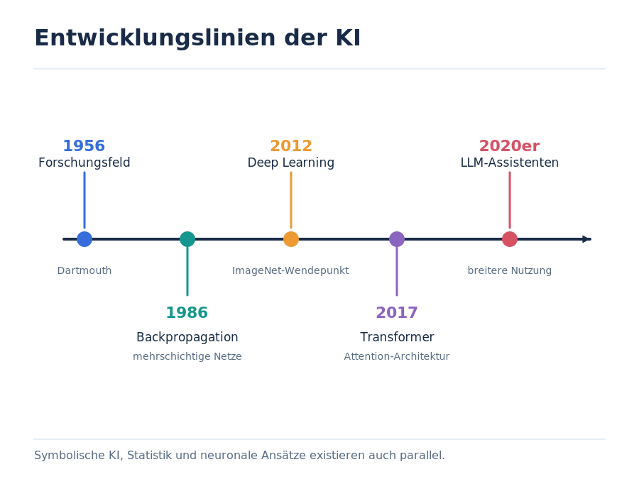

# M5-L1 – Woher kommt die künstliche Intelligenz? {#L1}

**Kursbereich:** M5 – Bachelor: KI-Grundlagen

**Niveau:** Bachelor

**Vorwissen:** Keine festen Voraussetzungen angegeben.

## Überblick: Nicht eine Erfindung, sondern mehrere Forschungstraditionen {#S1}

Die heutige künstliche Intelligenz entstand nicht durch eine einzelne bahnbrechende Entdeckung. Sie ist das Ergebnis mehrerer über Jahrzehnte verfolgter Ideen: Maschinen sollen **mit Regeln schlussfolgern**, **aus Beispielen lernen**, **große Mengen möglicher Lösungen durchsuchen** oder **Wahrnehmungsmuster erkennen**. Zunächst standen diese Ansätze oft nebeneinander oder konkurrierten miteinander. Erst später entstanden Systeme, die mehrere Methoden miteinander kombinieren.

Der heutige Eindruck, künstliche Intelligenz sei vor allem ein Chatfenster, ist daher historisch sehr verkürzt. Schachprogramme, medizinische Expertensysteme, Bilderkennung, Suchmaschinen, Robotik, Statistik und Sprachverarbeitung gehören ebenfalls zur Geschichte des Fachs. Viele KI-Systeme haben überhaupt keine Gesprächsoberfläche.

Die zentrale Frage dieser Lektion lautet: **Welche technischen Probleme mussten Forscher nacheinander lösen, bis leistungsfähige Sprach-, Bild- und KI-Assistenzsysteme möglich wurden?** Die folgenden Lektionen M5-L2–M6-L7 behandeln dann die Technik dieser Systeme im Detail.

## Was bedeutet künstliche Intelligenz? {#S2}

**Künstliche Intelligenz (KI)** bezeichnet ein Forschungs- und Anwendungsgebiet, in dem Computersysteme Fähigkeiten realisieren sollen, die bei Menschen mit intelligentem Verhalten verbunden werden: beispielsweise Muster erkennen, Sprache verarbeiten, Entscheidungen vorbereiten, Probleme lösen oder aus Erfahrungen lernen. Das ist eine Arbeitsdefinition, kein allgemeingültiger Test für Bewusstsein oder menschliches Verstehen.

Fünf Begriffe sollten wir von Anfang an auseinanderhalten:

  Begriff                                                 Grundidee                                                                                               Beispiel
  ------------------------------------------------------- ------------------------------------------------------------------------------------------------------- -------------------------------------------
  **Symbolische KI**                                      Wissen als ausdrücklich formulierte Regeln und Symbole verarbeiten                                      Expertensystem mit Wenn-dann-Regeln
  **Maschinelles Lernen** (*Machine Learning*, ML)        Regeln oder Muster aus Beispieldaten statistisch ableiten, statt alle Fälle von Hand zu programmieren   Erkennung unerwünschter E-Mails
  **Deep Learning** (tiefes Lernen)                       Maschinelles Lernen mit meist mehrschichtigen neuronalen Netzen                                         Erkennung von Gegenständen in Bildern
  **Generative KI**                                       Neue Texte, Bilder, Töne oder andere Inhalte erzeugen                                                   Ein Sprachmodell formuliert einen Bericht
  **Großes Sprachmodell** (*Large Language Model*, LLM)   Sprach-/Tokenfolgen mit einem umfangreich trainierten Modell verarbeiten und erzeugen                   Ein dialogfähiges Sprachmodell

Diese Begriffe sind **keine gleichgeordneten Alternativen**. Deep Learning gehört zum maschinellen Lernen; viele moderne Sprachmodelle verwenden Deep Learning und können generativ arbeiten. Symbolische Verfahren können wiederum zusammen mit einem LLM in einer Anwendung eingesetzt werden.

Eine übersichtliche Verwandtschaftsskizze:

``` text
Künstliche Intelligenz (KI)
│
├── Symbolische Verfahren
│   └── Regeln, Logik, Planung, Suche
│
├── Maschinelles Lernen (ML)
│   ├── klassische statistische Verfahren
│   └── neuronale Netze / Deep Learning
│       ├── Bild- und Tonmodelle
│       └── Sprachmodelle, darunter viele LLMs
│
└── Kombinationen
    └── z. B. Sprachmodell + Werkzeugaufruf + feste Sicherheitsregeln
```

Die Skizze zeigt Forschungsrichtungen, keine vollständige oder strikt trennscharfe Taxonomie. Insbesondere Such- und Planungsverfahren können mit Lernen kombiniert werden.

**Wozu braucht man die Unterscheidung?** Sie verhindert, dass man ein starres Regelprogramm und ein datengetriebenes neuronales Netz für dasselbe technische Prinzip hält. **Wann ist das zweitrangig?** Für den Anwender eines einfachen Dateifilters zählt zuerst die korrekte Funktion; eine KI-Komponente ist nicht allein deshalb sinnvoll, weil sie moderner klingt.

## Die Vorgeschichte: Logik, Rechenmaschinen und das künstliche Neuron {#S3}

Lange bevor man von künstlicher Intelligenz sprach, untersuchten Mathematik und Logik, ob sich Denken zumindest teilweise in Regeln ausdrücken lässt. Formale Logik beschreibt, welche Aussagen aus welchen Voraussetzungen folgen. Die Informatik zeigte später, wie sich solche Regeln maschinell verarbeiten lassen.

### 1943 – McCulloch und Pitts {#31-1943-mcculloch-und-pitts}

Warren McCulloch und Walter Pitts veröffentlichten 1943 *A Logical Calculus of the Ideas Immanent in Nervous Activity*. Sie stellten die Idee vor, einfache nervenzellenähnliche Einheiten als logische Schaltungen zu modellieren. Der Ausgang einer Einheit hängt im Modell von ihren Eingängen und einer festgelegten Regel ab.

**Wichtig:** Das war ein theoretisches Modell, kein heutiges lernfähiges Sprachmodell. Die wesentliche Errungenschaft lag darin, biologische Inspiration und formale Berechenbarkeit zusammenzudenken. Das heutige künstliche Neuron ist ebenfalls **kein vollständiges Abbild einer biologischen Nervenzelle**, sondern eine stark vereinfachte mathematische Recheneinheit.

``` text
Eingang A ──┐
            ├──> formales Neuronenmodell ──> Ausgang
Eingang B ──┘         (Regel/Schwelle)
```

Die spätere Entwicklung ergänzte insbesondere anpassbare Verbindungsgewichte und Lernverfahren. Wie die Zahlenrechnung in einem solchen künstlichen Neuron aussieht, folgt in M5-L2.

### 1950 – Alan Turing verschiebt die Frage {#32-1950-alan-turing-verschiebt-die-frage}

Alan Turing veröffentlichte 1950 den Aufsatz *Computing Machinery and Intelligence*. Statt sich in der schwierigen Definition des Wortes „Denken“ festzufahren, schlug er das sogenannte **Imitation Game** vor: Eine Maschine wird über ihre sprachlich vermittelten Antworten und das Urteil eines menschlichen Gegenübers betrachtet.

Später wurde daraus in vereinfachter Form der Begriff **Turing-Test**. Dabei ist Vorsicht nötig: Turing schlug eine bestimmte Untersuchungsform für maschinelles Verhalten vor. **Ein erfolgreicher Dialog beweist weder Bewusstsein noch allgemeine Zuverlässigkeit, Wahrheitstreue oder menschliches Verständnis.** Umgekehrt sagt ein nicht bestandener Dialogtest nicht, dass das System in anderen Aufgaben nutzlos wäre.

Die historische Bedeutung liegt darin, dass man maschinelles Verhalten experimentell prüfen kann, statt ausschließlich über philosophische Begriffe zu streiten.

## 1955/1956 – Dartmouth und die Gründung eines Forschungsfelds {#S4}

Am **31. August 1955** formulierten John McCarthy, Marvin Minsky, Nathaniel Rochester und Claude Shannon den Vorschlag für das *Dartmouth Summer Research Project on Artificial Intelligence*. Der gemeinsame Forschungsaufenthalt fand **1956** statt. Der Ausdruck *Artificial Intelligence* wurde durch dieses Vorhaben als Name eines eigenständigen Forschungsprogramms etabliert.

Der ursprüngliche Vorschlag war erstaunlich ambitioniert: Sprache, Begriffsbildung, Problemlösen und die Fähigkeit von Maschinen, sich zu verbessern, sollten untersucht werden. Die Autoren hielten bedeutsame Fortschritte in kurzer Zeit für erreichbar. Mit dem heutigen Abstand erkennen wir daran eine häufige Spannung der KI-Forschung: Ein prinzipiell plausibles Ziel kann technisch erheblich schwerer sein als zunächst angenommen.

Die frühen Forscher interessierten sich nicht nur für künstliche Neuronen. Auch **symbolische Logik, Suchverfahren und die Darstellung von Wissen** spielten eine zentrale Rolle.

``` text
Mathematik + Logik + Informationsverarbeitung
                    │
                    ▼
          Forschungsprogramm KI
                    │
       ┌────────────┴────────────┐
       ▼                         ▼
Symbolische Programme       Lernende Modelle
(Regeln, Beweise, Suche)    (Muster aus Daten)
```

Die Zweiteilung ist didaktisch: Es gab von Beginn an Überschneidungen, weitere Ansätze und unterschiedliche Vorstellungen von „Intelligenz“.

## Zwei konkurrierende Grundideen: Regeln oder Lernen? {#S5}

### Symbolische KI – Das Wissen ausdrücklich aufschreiben {#51-symbolische-ki-das-wissen-ausdrücklich-aufschreiben}

Ein symbolisches System speichert Begriffe, Fakten und Regeln in einer Form, die ein Programm direkt bearbeiten kann. Beispiel: Eine interne Regel zur Dokumentenverarbeitung besagt: *Wenn eine Datei das Merkmal X besitzt und ein bestimmter Zugriff erlaubt ist, dann darf sie in Kategorie Y eingeordnet werden.* Das System prüft die Bedingungen und wendet die Regel an.

**Problem, das dieser Ansatz löst:** Eindeutige Regeln können nachvollziehbar, prüfbar und reproduzierbar sein. Wenn Gesetze, Geschäftsregeln oder definierte technische Zustände maßgeblich sind, ist diese Klarheit oft ein großer Vorteil.

**Grenze:** Wer beliebige Bilder, umgangssprachliche Formulierungen oder nahezu unendlich viele Ausnahmesituationen erfassen will, kann nicht jede sinnvolle Regel im Voraus auflisten. Schon kleine Änderungen der Welt können große Regelwerke schwer wartbar machen.

### Lernen – Das Verhalten aus Beispielen ableiten {#52-lernen-das-verhalten-aus-beispielen-ableiten}

Ein lernendes System bekommt Beispielmaterial und ein Lernverfahren, das interne Zahlenwerte anpasst. Statt die Regel „So sieht eine Katze aus“ in tausenden Sätzen festzuschreiben, lässt man ein Modell aus geeigneten Bildbeispielen statistische Merkmale erlernen.

``` text
Beispiele + Lernziel
         │
         ▼
   Lernverfahren
         │
         ▼
angepasste Modellparameter
         │
         ▼
neue Eingabe -> Vorhersage
```

**Problem, das dieser Ansatz löst:** Muster lassen sich erfassen, für die niemand eine vollständige Liste verständlicher Regeln angeben kann.

**Grenze:** Ein gelerntes statistisches Muster ist nicht automatisch richtig, kausal erklärt oder außerhalb der Trainingsverteilung zuverlässig. Die Qualität hängt unter anderem von Daten, Lernverfahren, Modell und Evaluation ab.

Beide Ansätze sind bis heute relevant. Bei einer Dokumentenplattform kann ein gelerntes Modell Themen vorschlagen, während eindeutige Regeln weiterhin Benutzerrechte und Löschfristen durchsetzen.

## 1958 – Das Perzeptron und die Hoffnung auf lernende Maschinen {#S6}

Frank Rosenblatt stellte 1958 das **Perzeptron** als Modell lernfähiger Informationsverarbeitung vor. Eine einfache Variante verknüpft Eingabewerte mit Gewichten, summiert ihre Beiträge und entscheidet anhand einer Schwelle über den Ausgang. Beim Lernen können die Gewichte angepasst werden.

``` text
Merkmal 1 --(Gewicht 1)--┐
Merkmal 2 --(Gewicht 2)--┼--> Summe + Schwelle --> Entscheidung
Merkmal 3 --(Gewicht 3)--┘
                         ▲
                     Gewichte werden
                     anhand von Beispielen verändert
```

Damit trat ein grundlegender Unterschied zur reinen Regelprogrammierung hervor: Die relevanten Zahlen werden nicht nur vom Programmierer festgelegt, sondern können durch Training entstehen.

Ein einfaches Perzeptron kann jedoch nur bestimmte Entscheidungsmuster darstellen, insbesondere **linear trennbare** Klassen. Berühmt wurde das Problem, dass ein einschichtiges lineares Modell die **exklusive Oder-Verknüpfung (XOR)** nicht korrekt darstellen kann. Das ist kein Beweis, dass neuronale Netze grundsätzlich untauglich wären: Mehrschichtige Netze mit geeigneten nichtlinearen Funktionen können komplexere Muster abbilden.

Die praktische Schwierigkeit war damals, solche mehrschichtigen Modelle zuverlässig und effizient zu trainieren. Die Kritik an begrenzten Modellen darf nicht mit einer pauschalen Widerlegung aller neuronalen Netze verwechselt werden.

## 1960er bis 1980er: Expertensysteme, Hoffnungen und KI-Winter {#S7}

Frühe Erfolge in streng eingegrenzten Aufgaben führten zu hohen Erwartungen. Programme konnten logische Beweise finden, einzelne Problemstellungen durch Suche lösen oder fachliche Regeln anwenden. Die offene Alltagswelt ist aber nicht so übersichtlich wie eine wohldefinierte Spielregel oder ein kleiner künstlicher Aufgabenraum.

### Was war ein Expertensystem? {#71-was-war-ein-expertensystem}

**Expertensysteme** versuchten, das Fachwissen von Spezialisten ausdrücklich abzubilden. Sie bestanden typischerweise aus einer **Wissensbasis** mit Fakten und Regeln sowie einer **Inferenzmaschine**, die Regeln auf einen konkreten Fall anwendete. Bekannte Forschungsfelder waren etwa chemische Strukturanalyse und medizinische Entscheidungsunterstützung.

``` text
Benutzereingabe
      │
      ▼
Inferenzmaschine <----> Wissensbasis (Fakten und Regeln)
      │
      ▼
Ergebnis oder Empfehlung
```

Diese Architektur kann sehr wirkungsvoll sein, solange der Sachbereich klar abgegrenzt und die Regeln gepflegt werden können.

**Betriebsproblem:** Wissen muss erfasst, laufend geprüft und aktualisiert werden. Änderungen von Fachpraxis, Technik oder Vorschriften können viele Regeln betreffen. Das System weiß zudem nur, was in seiner Wissensbasis und Schlussfolgerungslogik abgebildet ist.

### Warum spricht man von „KI-Wintern“? {#72-warum-spricht-man-von-ki-wintern}

Als **KI-Winter** bezeichnet man Phasen, in denen das Interesse, die Finanzierung und die kommerzielle Zuversicht für bestimmte KI-Ansätze zurückgingen. Häufig werden die **1970er Jahre** und die **späten 1980er/frühen 1990er Jahre** genannt. Die genauen Grenzen hängen von Land, Branche und Forschungszweig ab.

Eine Ursache war die Lücke zwischen Vorhersagen und tatsächlich erreichbarer Leistung: Rechner waren langsam, Speicher begrenzt, Daten schwer verfügbar und viele scheinbar einfache Probleme erwiesen sich als sehr schwierig. Auch umfangreiche Regelwerke waren teuer zu erstellen und zu pflegen.

**Historische Vorsicht:** „Winter“ bedeutet nicht, dass weltweit jede KI-Forschung eingestellt wurde oder keine Fortschritte mehr stattfanden. Viele Ideen, die später wichtig wurden, entstanden oder reiften gerade in weniger beachteten Phasen.

### Eine Lehre aus den frühen Rückschlägen {#73-eine-lehre-aus-den-frühen-rückschlägen}

Aus einem überzeugenden Demonstrationsbeispiel folgt noch keine zuverlässige, wirtschaftliche Anwendung. Man muss untersuchen, ob ein Verfahren mit neuen Daten, häufigen Änderungen, realen Fehlerfällen und vertretbaren Betriebskosten zurechtkommt. Diese Erkenntnis bleibt für heutige KI-Systeme aktuell.

## 1986 – Backpropagation macht mehrschichtige Netze besser trainierbar {#S8}

1986 veröffentlichten David Rumelhart, Geoffrey Hinton und Ronald Williams die einflussreiche Arbeit *Learning Representations by Back-Propagating Errors*. Sie beschrieben ein Verfahren, bei dem die Abweichung zwischen gewünschtem und berechnetem Ergebnis dazu verwendet wird, die Gewichte eines mehrschichtigen Netzes gezielt anzupassen.

Vereinfacht ist der Ablauf:

``` text
Trainingsbeispiel
       │
       ▼
Netz berechnet eine Ausgabe
       │
       ▼
Vergleich mit gewünschtem Ergebnis
       │
       ▼
Fehlerinformation wird rückwärts verteilt
       │
       ▼
Gewichte werden angepasst
       │
       └──────── nächste Trainingsrunde ────────┐
```

Die englische Bezeichnung **Backpropagation** bedeutet ungefähr *Rückwärtsweitergabe des Fehlers*. Präziser ist gemeint, dass Ableitungsinformationen durch das Netz rückwärts berechnet werden; anschließend kann ein Optimierungsverfahren die Gewichte verändern.

**Wichtige historische Differenzierung:** Die zugrunde liegenden mathematischen Ideen und verwandte Verfahren reichen weiter zurück. Das Papier von 1986 war ein besonders einflussreicher Schritt zur praktischen Verbreitung, **nicht die erstmalige Erfindung jeder Form von Gradientenrechnung oder automatischer Differentiation**.

Backpropagation allein schuf noch keine heutigen Sprachmodelle. Dafür fehlten weiterhin sehr große geeignete Datensätze, leistungsfähige Rechner und zusätzliche Architekturideen. Aber eine zentrale Hürde war kleiner geworden: Ein Netz konnte lernen, interne Zwischenmerkmale selbst anzupassen, statt nur die letzte Entscheidungsschicht zu verändern.

M5-L2 wird das Verfahren mit einer übersichtlichen Zahlenrechnung erklären.

## Von Spezialprogrammen zu statistisch lernenden Systemen {#S9}

Ab den 1990er Jahren nahmen statistische Lernverfahren einen immer größeren Platz in praktischen Anwendungen ein. Automatische Klassifikation, Sprachverarbeitung, Suche und Mustererkennung konnten von mehr Daten und wachsender Rechenleistung profitieren.

Das bedeutete nicht, dass alle Programme neuronale Netze verwendeten. Viele klassische Verfahren, etwa Entscheidungsbäume oder andere statistische Modelle, sind gerade bei überschaubaren Datenmengen weiterhin zweckmäßig. Auch heuristische Suche und ausdrücklich programmierte Regeln blieben wichtig.

Ein historisch markantes Beispiel ist **IBM Deep Blue**, das 1997 den amtierenden Schachweltmeister Garri Kasparow in einem Wettkampf besiegte. Deep Blue nutzte hoch spezialisierte Suche, Bewertungsverfahren, Rechnerleistung und Schachwissen. **Es war kein modernes großes Sprachmodell**. Sein Erfolg verdeutlicht, dass anspruchsvolles Verhalten mit sehr unterschiedlichen Architekturen entstehen kann.

Eine zweite Entwicklung war, dass Daten als wichtige Ressource erkannt wurden. Für manche Aufgaben lässt sich der Fortschritt stärker durch bessere und vielfältigere Trainingsdaten steigern als durch zusätzliche handgeschriebene Regeln. Daten allein genügen aber nicht: Sie können verzerrt, unvollständig, fehlerhaft oder rechtlich problematisch sein.

## Warum 2012 als Wendepunkt des Deep Learning gilt {#S10}

Schon lange vor 2012 existierten mehrschichtige neuronale Netze. Doch das Training großer Modelle war aufwendig, und die verfügbaren Daten sowie die Hardware begrenzten die praktische Leistung.

Mit **AlexNet**, der Bildklassifikationsarbeit von Alex Krizhevsky, Ilya Sutskever und Geoffrey Hinton aus **2012**, wurde deutlich, wie wirksam tiefe Faltungsnetze bei großen Bilddatensätzen sein konnten. Die Arbeit kombinierte eine geeignete Architektur, große gelabelte Trainingsdaten, Verbesserungen am Training und die parallele Rechenleistung von **Graphics Processing Units (GPUs)**, also Grafikprozessoren. Sie erzielte bei der ImageNet-Bildklassifikation ein auffälliges Ergebnis.

Damit war nicht plötzlich „allgemeine Intelligenz“ erfunden. Die Leistung betraf zunächst eine konkrete visuelle Aufgabe. Die Bedeutung lag in der nachgewiesenen praktischen Wirksamkeit einer ganzen technischen Richtung und ihrem Potenzial für weitere Aufgaben.

**Warum gerade GPUs?** Viele Netzoperationen bestehen aus großen Mengen ähnlicher numerischer Berechnungen. GPUs können solche Berechnungen parallel durchführen. Das beschleunigte Training und später auch Ausführung vieler Modelle erheblich. Allerdings hängen Leistung und Kosten weiterhin von Architektur, Datentransfer, Speichergröße, Energie und Auslastung ab.

``` text
Große Trainingsdaten
         +
Geeignete Netzarchitektur
         +
Trainingsverfahren
         +
Parallele Hardware (GPU)
         │
         ▼
Praktisch leistungsfähigere tiefe Netze
```

Diese Bausteine verstärkten sich gegenseitig. Es wäre deshalb falsch, den Erfolg allein einer Grafikkarte oder allein einem Lernalgorithmus zuzuschreiben.

## 2017 – Die Transformer-Architektur {#S11}

Sprachverarbeitung war lange von regelbasierten Verfahren, statistischen Modellen und später **rekurrenten neuronalen Netzen** geprägt. Rekurrente Netze bearbeiten Sequenzen in einer Form, bei der vorherige Verarbeitungsschritte die folgenden beeinflussen. Für lange Texte kann das Lernen über weit auseinanderliegende Positionen schwierig und die Verarbeitung schwer parallelisierbar sein.

2017 veröffentlichten Ashish Vaswani und Mitautoren die Arbeit *Attention Is All You Need*. Der vorgeschlagene **Transformer** nutzte Aufmerksamkeitsmechanismen als zentrales Mittel, um Beziehungen zwischen Teilen einer Sequenz zu verarbeiten, ohne in der ursprünglichen Architektur auf die bisher verbreitete rekurrente Sequenzverarbeitung angewiesen zu sein.

**Attention** lässt sich als *Aufmerksamkeitsgewichtung* verstehen: Bei der Verarbeitung einer Position werden andere relevante Positionen unterschiedlich stark berücksichtigt. In modernen Modellen ist dies eine mathematische Operation auf Zahlenvektoren, kein menschliches Bewusstsein oder bewusstes Aufpassen.

``` text
Text -> Teilstücke (Tokens) -> numerische Darstellungen
                                    │
                                    ▼
                          Transformer-Schichten
                      Beziehungen zwischen Positionen
                                    │
                                    ▼
                          weitere numerische Ausgabe
```

Die Architektur erleichterte bestimmte Formen parallelen Trainings und bildete eine wichtige Grundlage zahlreicher späterer Sprach- und Multimodalmodelle. Sie wurde über das ursprüngliche Einsatzgebiet maschineller Übersetzung hinaus weiterentwickelt.

Eine Unterscheidung ist entscheidend: **Nicht jeder Transformer ist ein Chatbot**, und nicht jedes Transformer-Modell sagt ausschließlich das nächste Wort vorher. Es gibt unter anderem Encoder-, Decoder- und Encoder-Decoder-Varianten. Diese Unterschiede werden in M6-L1 ausführlich erklärt.

## 2020er – Große Sprachmodelle und dialogfähige Assistenten {#S12}

Ein **Large Language Model (LLM)** verarbeitet sprachähnliche Symbolfolgen, meist **Tokens**. Tokens sind Einheiten einer vom Modell verwendeten Zerlegung, beispielsweise Wortteile, ganze Wörter oder Satzzeichenfolgen. Bei vielen generativen LLMs besteht eine zentrale Trainingsaufgabe darin, aus bisherigen Tokens das nächste Token vorherzusagen. Aus sehr vielen solchen Vorhersagen und Parameteranpassungen entstehen Modelle, die komplexe sprachliche Muster nutzen können.

Das Forschungsfeld entwickelte sich in mehreren Schritten: Umfangreiches **Vortraining** (*Pretraining*) auf großen Datenmengen schuf vielseitige Basismodelle. Verfahren zur Anpassung an Anweisungen und menschliche Präferenzen machten sie für Gespräche und Assistenzzwecke besser nutzbar. Eine wichtige Station war die Forschung zu **Few-Shot Learning**: Ein Modell kann anhand weniger Beispiele im Eingabetext die beabsichtigte Aufgabe oft erkennen, ohne dass jedes Mal seine Gewichte geändert werden.

Die öffentliche Wahrnehmung verlagerte sich dadurch von einzelnen Spezialanwendungen zu generalisierbaren Benutzeroberflächen: Menschen konnten mit einem System über sehr unterschiedliche Aufgaben sprechen, statt für jede Aufgabe ein eigenes Werkzeug öffnen zu müssen.

Aber der Eindruck einer einzigen intelligenten Maschine täuscht über mehrere technische Ebenen hinweg:

``` text
Benutzerfrage
    │
    ▼
Anwendung: Gesprächsverwaltung, Regeln, ggf. Werkzeugzugriffe
    │
    ▼
LLM: Kontextverarbeitung und Tokenvorhersage
    │
    ▼
Ausgabetext
    │
    └── bei Bedarf: Prüfung, Quellen, Datenbank oder externe Werkzeuge
```

Das Modell besitzt gelernte Parameter; eine Chat-Anwendung kann zusätzlich Gesprächskontext, abrufbare Dokumente, Suchfunktionen oder echte Programmaktionen verwenden. **Ein LLM ist deshalb nicht mit der gesamten Assistenzsoftware identisch.** Auch ist das Erzeugen eines plausiblen Satzes keine Garantie dafür, dass die Aussage richtig ist.

Begriffe wie „Wissen“, „Verstehen“, „Schlussfolgern“ und „Bewusstsein“ sind bei KI unterschiedlich operationalisiert und teilweise wissenschaftlich oder philosophisch umstritten. Für die praktische Technikbeurteilung ist zunächst wichtiger, welche Aufgabe ein System unter welchen Bedingungen nachweisbar zuverlässig erfüllt.

## Entwicklungslinie auf einen Blick {#S13}

  Zeitpunkt                  Station                                     Was sich technisch änderte
  -------------------------- ------------------------------------------- --------------------------------------------------------------------------------
  **1943**                   McCulloch und Pitts                         Nervenzellenähnliche logische Recheneinheiten formalisiert
  **1950**                   Turing                                      Maschinelles Sprachverhalten als prüfbares Forschungsproblem diskutiert
  **1955/1956**              Dartmouth-Vorschlag und Workshop            KI als eigenständiges Forschungsprogramm sichtbar gemacht
  **1958**                   Rosenblatt und Perzeptron                   Lernende gewichtete Verbindungen als konkrete Modellidee
  **1960er–1980er**          Symbolische Systeme und Expertensysteme     Explizite Regeln und Wissensbasen für Fachaufgaben
  **1970er, späte 1980er**   KI-Winter                                   Grenzen ambitionierter Versprechen und hohe Entwicklungskosten wurden deutlich
  **1986**                   Einflussreiche Backpropagation-Arbeit       Mehrschichtige Netze gezielter trainierbar; ältere Grundlagen weiterentwickelt
  **1997**                   Deep Blue                                   Spezialisierte Suche und große Rechenleistung auf Spitzenniveau im Schach
  **2012**                   AlexNet                                     Leistungsfähige tiefe Bildnetze mit großen Daten und GPUs
  **2017**                   Transformer                                 Effektive Aufmerksamkeitsarchitektur für Sequenzverarbeitung
  **2020er**                 Großskalige Sprachmodelle und Assistenten   Vielseitige Textverarbeitung, generative Modelle und zusätzliche Werkzeuge

{alt="Historischer Zeitstrahl ausgewählter KI-Entwicklungen"}


**Hinweis:** Diese Tabelle ist eine Orientierung. Viele Entwicklungslinien liefen gleichzeitig, und die Zeitpunkte sind keine exklusiven Erfindungsdaten aller jeweiligen Verfahren.

## Was moderne KI-Systeme tatsächlich können – und wo Grenzen bleiben {#S14}

Moderne Modelle können unter geeigneten Bedingungen Texte schreiben, übersetzen, zusammenfassen, Informationen aus Dokumenten strukturieren, Muster in Bildern erkennen, Programme erklären oder neue Medieninhalte generieren. Mit geeigneter Software können sie außerdem Werkzeuge verwenden, beispielsweise eine Datenbank durchsuchen, ein Skript aufrufen oder einen mehrstufigen Ablauf unterstützen.

Dabei bleiben Grenzen relevant:

1.  **Faktische Zuverlässigkeit:** Ein überzeugend formulierter Text kann sachlich falsch sein. Bei aktuellen, rechtlichen, medizinischen oder finanziellen Fragen sind Quellen- und Plausibilitätsprüfungen nötig.
2.  **Training und Gegenwart:** Ein Modell kann nur mit dem arbeiten, was seine Gewichte, der aktuelle Kontext und gegebenenfalls angebundene Informationsquellen ermöglichen. Sprachgewandtheit ersetzt keinen Live-Datenzugriff.
3.  **Robustheit:** Kleine Änderungen im Eingang, ungewöhnliche Fälle oder gezielte Manipulationen können Ergebnisse verschlechtern.
4.  **Datenschutz und Sicherheit:** Hochgeladene Kundendaten, API-Schlüssel oder persönliche Dokumente benötigen geeignete Zugriffs- und Verarbeitungskontrollen.
5.  **Kosten und Betrieb:** Große Modelle benötigen Rechenleistung und Speicher; auch lokal betriebene Modelle verbrauchen Energie und erfordern Pflege ihrer Softwareumgebung.
6.  **Verantwortung:** Wenn KI eine Entscheidung vorbereitet oder eine Aktion auslöst, muss geklärt sein, wer sie kontrolliert, prüft und im Fehlerfall verantwortet.

**Besonders bei Robotern** ist die Grenze zwischen sprachlicher Empfehlung und unmittelbarer physischer Aktion wichtig. Ein Sprachmodell kann einen Arbeitsplan vorschlagen; sicherheitskritische Motorsteuerung benötigt aber zusätzlich verlässliche Regelung, Sensorprüfung, Begrenzungen und Notabschaltung. Das behandeln wir in M6-L7.

## Drei Anwendungsbeispiele: Vom alten Prinzip zur modernen Lösung {#S15}

### Lokaler Medienkatalog {#151-lokaler-medienkatalog}

**Klassisch:** Dateien und Metadaten werden anhand fester Dateinamenmuster, Tags und Datenbankabfragen geordnet. Das ist bei eindeutigen Regeln schnell, kostengünstig und kontrollierbar.

**Mit KI:** Ein Modell schlägt Themen oder Beschreibungen für bisher unstrukturierte Medien vor. Die Ergebnisse werden als Vorschläge gespeichert, nicht als unfehlbare Tatsachen. Benutzerrechte, Dateizugriffe und endgültige Freigaben bleiben deterministische Softwarefunktionen.

**Wann unnötig?** Wenn alle Dateien bereits zuverlässig benannt und kategorisiert sind, wäre ein großes neuronales Netz nur zusätzlicher Aufwand.

### Online-Analysewerkzeug {#152-online-analysewerkzeug}

**Klassisch:** Berechnungen, Formatprüfungen und Datenbankoperationen folgen fest implementierten Regeln. Die Ergebnisse sind reproduzierbar.

**Mit KI:** Eine natürliche Spracheingabe kann einen Analysewunsch in strukturierte Parameter übersetzen oder einen Bericht formulieren. Die eigentliche Zahlenberechnung wird weiterhin von prüfbarer Software ausgeführt.

**Risiko:** Ohne klare Trennung könnte ein Modell Zahlen erfinden oder einen unzulässigen Datenzugriff vorschlagen. Die Software muss Zugriffsrechte und Eingabevalidierung unabhängig vom Modell prüfen.

### KI-Aufträge in einer Serverarchitektur {#153-ki-aufträge-in-einer-serverarchitektur}

**Klassisch:** Ein Webdienst nimmt Aufträge entgegen, speichert sie in einer Datenbank und verteilt sie über eine Warteschlange an Worker.

**Mit KI:** Ein Worker lädt ein trainiertes Modell, verarbeitet die Eingabe und legt ein Ergebnis ab. Die übrige Infrastruktur überwacht Aufträge, begrenzt Ressourcen und stellt Wiederholungs- und Abrechnungslogik bereit.

``` text
Benutzer -> Webanwendung -> Auftragsdatenbank / Warteschlange
                                  │
                                  ▼
                         Worker mit KI-Modell
                                  │
                                  ▼
                          Ergebnis + Status
                                  │
                                  ▼
                              Benutzer
```

Diese Darstellung verbindet den KI-Teil mit B (Server), C (Datenbanken) und D (Cloud-Betrieb). Das KI-Modell ist **eine Komponente innerhalb eines betriebenen Softwaresystems**, nicht automatisch dessen gesamte Architektur.

## Wann ist welcher Ansatz sinnvoll? {#S16}

  Aufgabe                                        Oft naheliegender Ansatz                     Warum nicht automatisch ein großes LLM?
  ---------------------------------------------- -------------------------------------------- ----------------------------------------------------------------------
  Ein fester Dateiname soll umgewandelt werden   Klar definierte Regeln                       Schnell, nachvollziehbar, ohne Modellkosten
  Berechnung einer Rechnungssumme                Deterministischer Algorithmus                Exakte Arithmetik sollte nicht von Textwahrscheinlichkeiten abhängen
  Freitext thematisch sortieren                  Klassisches ML oder Sprachmodell             Wahl hängt von Datenumfang, Qualität und Kosten ab
  Ein Bildinhalt beschreiben                     Geeignetes Bild-/Multimodalmodell            Bedarf an Wahrnehmungsmustern statt nur Regeln
  Dokumente durchsuchen                          Suchindex, ggf. ergänzt durch KI             Quellen müssen abrufbar und kontrollierbar bleiben
  Ein Roboter navigiert                          Sensorik, Lokalisierung, Regelung, Planung   Sprachgenerierung ersetzt keine sichere Bewegungskontrolle

Die historische Betrachtung macht sichtbar: Unterschiedliche KI-Ansätze lösen unterschiedliche Probleme. Ein KI-System wird nicht dadurch besser, dass möglichst viele moderne Komponenten eingebaut werden.

## Zusammenfassung und Übergang zu M5-L2 {#S17}

Die KI-Geschichte lässt sich als wiederkehrende Bewegung zwischen drei Fragen lesen:

- **Wie kann man Wissen und Schlussregeln ausdrücklich beschreiben?** Das führte zu symbolischer KI, Suchverfahren und Expertensystemen.
- **Wie können Programme Regeln aus Beispielen lernen?** Daraus entwickelten sich statistische Lernverfahren, Perzeptrons und mehrschichtige neuronale Netze.
- **Wie kann man komplexe Modelle mit großen Datenmengen praktisch trainieren und betreiben?** Dazu trugen neue Lernverfahren, geeignete Architekturideen, GPUs, Dateninfrastruktur und verteilte Systeme bei.

Heutige Sprachmodelle stehen am Ende dieser Entwicklungslinie, nicht außerhalb von ihr. Sie sind leistungsfähige statistisch trainierte Komponenten. Ihre praktische Nützlichkeit entsteht häufig erst durch eine geeignete Anwendung, geprüfte Daten, Werkzeuge, Sicherheitsregeln und Betriebskonzepte.

**Nächste Lektion: [M5-L2 – Was ist ein neuronales Netz?](M5-L2.md)** Dort betrachten wir das künstliche Neuron, Gewichte, Aktivierungsfunktionen und Schichten mit einer nachvollziehbaren Zahlenrechnung. Außerdem erklären wir, wie ein Netz aus Fehlern lernen kann und warum mehr Schichten nicht automatisch bessere Ergebnisse bedeuten.


## Quellen {#S18}

**Letzte Quellenprüfung:** 04.11.2026

**Fachliche Quellenprüfung: 04.11.2026.** Schwerpunkt sind historische Originalarbeiten und etablierte Forschungsarchive. Die didaktischen Beispiele, Architekturskizzen und Vergleiche sind eigene vereinfachte Darstellungen, keine Zitate aus den Quellen. Aktuelle Produktfunktionen oder Anbieterpreise werden nicht behauptet.

1.  **McCulloch, W. S.; Pitts, W. (1943):** *A Logical Calculus of the Ideas Immanent in Nervous Activity*. *Bulletin of Mathematical Biophysics*. [https://doi.org/10.1007/BF02478259](https://doi.org/10.1007/BF02478259)
2.  **Turing, A. M. (1950):** *Computing Machinery and Intelligence*. *Mind*, 59(236), 433–460. [https://doi.org/10.1093/mind/LIX.236.433](https://doi.org/10.1093/mind/LIX.236.433)
3.  **McCarthy, J.; Minsky, M.; Rochester, N.; Shannon, C. (1955; Nachdruck 2006):** *A Proposal for the Dartmouth Summer Research Project on Artificial Intelligence*. [https://doi.org/10.1609/aimag.v27i4.1904](https://doi.org/10.1609/aimag.v27i4.1904)
4.  **Rosenblatt, F. (1958):** *The Perceptron: A Probabilistic Model for Information Storage and Organization in the Brain*. *Psychological Review*, 65(6), 386–408. [https://doi.org/10.1037/h0042519](https://doi.org/10.1037/h0042519)
5.  **Stanford AI100:** Zeitleiste der KI-Entwicklung, unter anderem Dartmouth, DENDRAL und Deep Blue. [https://ai100.stanford.edu/about/history](https://ai100.stanford.edu/about/history)
6.  **KU Leuven:** Überblick zur KI-Geschichte, Expertensystemen und KI-Wintern (ergänzende Einordnung). [https://ai.kuleuven.be/aivooriedereen/en/history](https://ai.kuleuven.be/aivooriedereen/en/history)
7.  **Rumelhart, D. E.; Hinton, G. E.; Williams, R. J. (1986):** *Learning Representations by Back-Propagating Errors*. *Nature*, 323, 533–536. [https://doi.org/10.1038/323533a0](https://doi.org/10.1038/323533a0)
8.  **IBM:** Historische Darstellung und technische Hintergründe zu Deep Blue (1997). [https://www.ibm.com/history/deep-blue](https://www.ibm.com/history/deep-blue)
9.  **Krizhevsky, A.; Sutskever, I.; Hinton, G. (2012):** *ImageNet Classification with Deep Convolutional Neural Networks*. *NeurIPS 2012*. [https://papers.nips.cc/paper_files/paper/2012/hash/c399862d3b9d6b76c8436e924a68c45b-Abstract.html](https://papers.nips.cc/paper_files/paper/2012/hash/c399862d3b9d6b76c8436e924a68c45b-Abstract.html)
10. **Vaswani, A. u. a. (2017):** *Attention Is All You Need*. [https://arxiv.org/abs/1706.03762](https://arxiv.org/abs/1706.03762)
11. **Brown, T. B. u. a. (2020):** *Language Models are Few-Shot Learners*. [https://arxiv.org/abs/2005.14165](https://arxiv.org/abs/2005.14165)
12. **Ouyang, L. u. a. (2022):** *Training Language Models to Follow Instructions with Human Feedback*. [https://arxiv.org/abs/2203.02155](https://arxiv.org/abs/2203.02155)

**Einordnung:** Die Forschungsgeschichte ist nicht auf zwölf Arbeiten reduzierbar. Diese Quellen sind überprüfbare Eckpunkte, keine Behauptung, sämtliche Vorläufer, Alternativen oder Mitwirkenden vollständig abzudecken.
