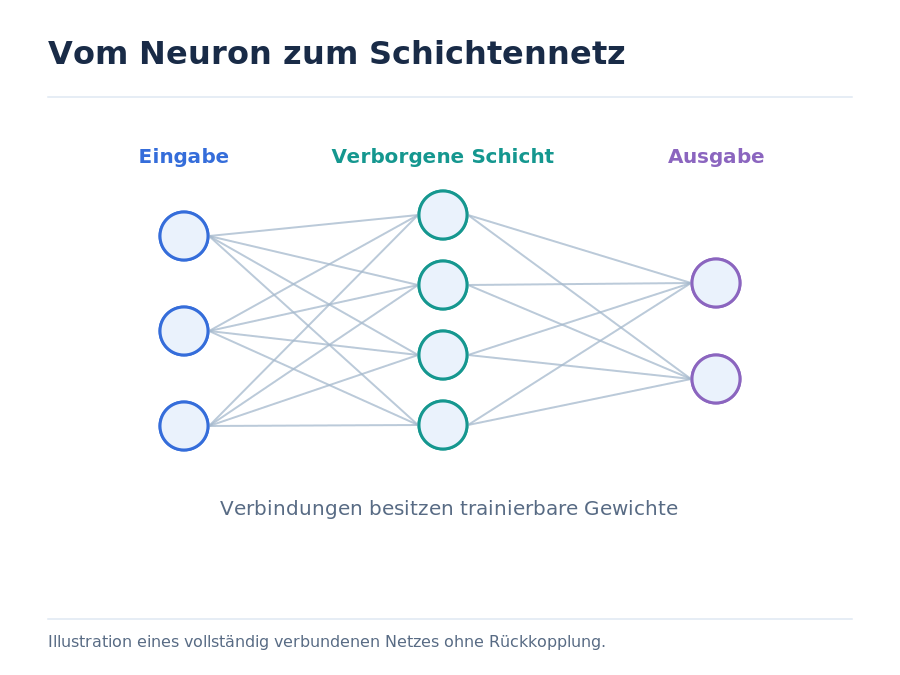
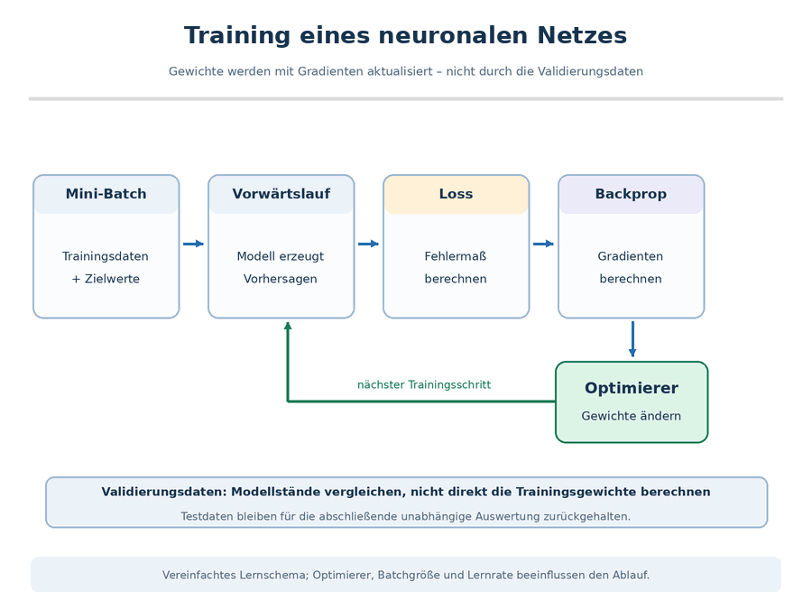

# M5-L2 – Was ist ein neuronales Netz? {#L2}

**Kursbereich:** M5 – Bachelor: KI-Grundlagen

**Niveau:** Bachelor

**Vorwissen:** Keine festen Voraussetzungen angegeben.

## Ausgangsfrage: Wie kann eine Maschine aus Beispielen eine Regel finden? {#S1}

Ein klassisches Programm verarbeitet Daten nach ausdrücklich formulierten Anweisungen. Ein Fotoarchiv könnte zum Beispiel anhand des Dateinamens oder eines vom Benutzer gesetzten Schlagworts entscheiden, ob eine Datei zu einer bestimmten Kategorie gehört. Aber welche feste Regel soll erkennen, ob auf einem bislang unbekannten Foto eine Katze abgebildet ist? Fellfarbe, Kopfhaltung, Beleuchtung und Bildausschnitt verändern sich ständig. Eine endlose Liste von Sonderfällen hilft wenig.

Ein **künstliches neuronales Netz** ist ein mathematisches Modell, dessen viele einstellbare Zahlen aus Beispieldaten angepasst werden. Es bekommt Eingaben, rechnet daraus eine Ausgabe und vergleicht diese während des Trainings mit einem Lernziel. Anschließend verändert ein Lernverfahren seine internen Zahlen so, dass die Ausgabe bei den Trainingsbeispielen möglichst besser passt. Im Idealfall erkennt es auch bei unbekannten Daten relevante Muster. Das heißt **Generalisierung**.

Entscheidend ist: Ein neuronales Netz *wird nicht selbstständig intelligent*, nur weil es künstliche Neuronen verwendet. Es berechnet eine Funktion mit sehr vielen Parametern. Welche Aufgabe diese Funktion erfüllt, hängt von Architektur, Daten, Trainingsziel und Anwendung ab. Bilderkennung, Sprachverarbeitung und Vorhersagen verwenden ähnliche Grundbausteine, aber nicht notwendigerweise dieselbe Gesamtarchitektur.

Diese Lektion macht den inneren Rechenweg sichtbar. Wir betrachten erst eine einzelne künstliche Recheneinheit, dann zwei Schichten, danach **einen vollständig ausgerechneten Lernschritt**. Die späteren Lektionen M5-L3–M6-L3 erklären ausführlicher, wie die daraus entstehenden Systeme trainiert und zu Sprachmodellen ausgebaut werden.

## „Neuron“ ist eine Metapher, keine kleine Gehirnzelle {#S2}

Die historischen Arbeiten von McCulloch und Pitts (1943) und später Rosenblatt sowie Rumelhart, Hinton und Williams liefern wichtige Anknüpfungspunkte (siehe M5-L1). Dennoch ist ein heutiges künstliches Neuron keine detailgetreue Computersimulation einer biologischen Nervenzelle. Biologische Neuronen sind elektrochemische, zeitabhängige und miteinander rückgekoppelte Zellen. Die hier behandelte Recheneinheit besteht im Wesentlichen aus **Multiplikationen, Additionen und einer mathematischen Aktivierungsfunktion**.

Die Analogie ist begrenzt: Viele Eingänge beeinflussen ein Ergebnis; die Stärke ihres Einflusses lässt sich verändern. Das genügt für ein nützliches Rechenmodell. Aussagen über menschliches Bewusstsein, Gefühle oder Denkprozesse lassen sich daraus nicht ableiten.

``` text
Biologische Inspiration:             Mathematische Umsetzung:

mehrere Eingangssignale              Zahlen x1, x2, ...
         │                                    │
         ▼                                    ▼
Verarbeitung in einer Zelle           gewichtete Summe + Bias
         │                                    │
         ▼                                    ▼
weitergegebenes Signal                Aktivierungsfunktion
                                              │
                                              ▼
                                          Zahl als Ausgabe
```

Die moderne Bezeichnung **Deep Learning** (tiefes Lernen) meint vor allem das Trainieren von Modellen mit mehreren verarbeitenden Schichten. „Tief“ ist eine Eigenschaft der mathematischen Architektur, keine Aussage über Tiefe im philosophischen Sinn.

## Die kleinste Rechnung: Eingaben, Gewichte und Bias {#S3}

Angenommen, eine Recheneinheit soll aus zwei Messwerten eine Zahl bestimmen. Die Eingaben heißen `x1` und `x2`. Jede hat ein **Gewicht** (`w1`, `w2`), das ihren Einfluss auf das Zwischenergebnis festlegt. Hinzu kommt ein **Bias** (`b`), ein veränderbarer Grundwert beziehungsweise Versatz.

Die grundlegende Formel lautet:

$$
z=x_1\times w_1+x_2\times w_2+b
$$

Für zwei Eingaben `x1 = 2` und `x2 = 3`, die Gewichte `w1 = 0,5`, `w2 = −0,2` sowie $b = 0{,}1$ ergibt sich:

$$
\begin{aligned}
z&=2\times0{,}5+3\times(-0{,}2)+0{,}1\\
 &=1{,}0-0{,}6+0{,}1\\
 &=0{,}5
\end{aligned}
$$

Die **Eingaben** stammen aus den zu bearbeitenden Daten. Die **Gewichte und Bias-Werte** gehören zum Modell und werden beim Training verändert. Ein Gewicht kann positiv oder negativ sein: Bei gleichem Vorzeichen der Eingabe verstärkt ein positives Gewicht die Summe; ein negatives verringert sie. Der Bias erlaubt es, das Verhalten zu verschieben, ohne die Eingabedaten zu verändern.

Ist das alles schon Lernen? Nein. Bisher ist nur eine Rechenvorschrift festgelegt. Erst die gezielte Veränderung der Parameter auf Grundlage eines Fehlers macht daraus einen Trainingsvorgang.

### Was ist ein Merkmal? {#31-was-ist-ein-merkmal}

Ein **Merkmal** (*Feature*) ist ein Zahlenwert, den das Modell als Eingabe erhält. Für eine einfache Abschätzung könnten das eine Temperatur und eine Tageszeit sein. Bei Bildern sind es beispielsweise Pixelwerte; bei komplexeren Netzen werden auch interne Repräsentationen als Merkmale weitergereicht.

Reale Eingangsdaten müssen passend vorbereitet werden. Eine Temperatur von `20` und ein Umsatz von `2.000.000` besitzen sehr verschiedene Größenordnungen. Ohne geeignete **Skalierung oder Normalisierung** können manche Merkmale die Optimierung unnötig erschweren. Die Vorverarbeitung gehört deshalb zur Modellarchitektur, auch wenn sie nicht selbst ein Neuron ist.

## Warum eine Aktivierungsfunktion nötig ist {#S4}

Auf die gewichtete Summe `z` folgt häufig eine **Aktivierungsfunktion**. Sie bildet die Zahl auf einen neuen Wert ab. Ein verbreitetes Beispiel ist die **Rectified Linear Unit (ReLU)**:

$$
\begin{aligned}
\operatorname{ReLU}(z)&=\max(0,z)\\
z=1{,}5&\quad\Rightarrow\quad\operatorname{ReLU}(z)=1{,}5\\
z=-0{,}8&\quad\Rightarrow\quad\operatorname{ReLU}(z)=0\\
z=0&\quad\Rightarrow\quad\operatorname{ReLU}(z)=0
\end{aligned}
$$

ReLU lässt positive Werte passieren und setzt negative auf null. Andere Funktionen sind beispielsweise **Sigmoid** (liefert einen Wert zwischen 0 und 1) und `tanh` (liefert einen Wert zwischen −1 und 1). Die geeignete Funktion hängt von Aufgabe, Schicht und Trainingsverfahren ab. Nicht jeder Ausgabeneuronentyp benötigt dieselbe Aktivierungsfunktion wie eine verborgene Schicht.

Warum genügt nicht einfach eine lange Kette aus gewichteten Summen? Weil mehrere unmittelbar aufeinanderfolgende lineare beziehungsweise affine Berechnungen ohne zwischengeschaltete Nichtlinearität zu **einer einzigen solchen Berechnung** zusammengefasst werden können. Mehr Schichten würden dann keine grundlegende zusätzliche Ausdruckskraft für nichtlineare Zusammenhänge schaffen. Die Aktivierung durchbricht diese Einschränkung.

Ein berühmtes Denkbeispiel ist die **XOR-Verknüpfung** (*Exclusive Or*, exklusives Oder): Die Ausgabe ist genau dann 1, wenn bei zwei binären Eingaben genau einer den Wert 1 besitzt. Eine einzelne lineare Entscheidung kann die vier Fälle nicht korrekt trennen. Mehrere geeignete Recheneinheiten und nichtlineare Aktivierungen können das dagegen darstellen. Das heißt nicht, dass ein Netz jede gewünschte Regel zuverlässig aus beliebig wenig Daten *erlernt*.

## Aus Neuronen werden Schichten und ein Netz {#S5}

Eine **Schicht** enthält mehrere solcher Recheneinheiten, die aus den vorherigen Ergebnissen neue Zahlen berechnen. Typischerweise unterscheidet man Eingabeschicht, eine oder mehrere **verborgene Schichten** (*Hidden Layers*) und eine Ausgabeschicht.

{alt="Feedforward-Netz mit Eingaben, verborgener Schicht und Ausgabe"}


``` text
Eingabedaten                 verborgene Schicht                Ausgabe

 x1 ───┬─────────────────> [h1: Summe + ReLU] ────┐
       │                                          ├──> [Ausgabeneuron] → y_vorhergesagt
       └─────┐                                    │
             │                                    │
 x2 ─────────┴───────────> [h2: Summe + ReLU] ────┘

   zwei Merkmale                zwei Neuronen                   ein Zahlenwert
```

In dieser Skizze erhält jedes der beiden verborgenen Neuronen *beide* Eingabewerte; der Zeichnung zuliebe sind nicht alle Verbindungen einzeln dargestellt. Das nennt man eine **vollständig verbundene Schicht** (*Dense Layer*). Die interne Schicht muss nicht zwingend einem menschlich benennbaren Konzept wie „Katzenohr“ oder „Satzbedeutung“ entsprechen. Welche Zwischenmuster sie tatsächlich darstellt, ist eine empirische und oft schwer interpretierbare Frage.

Die Berechnung von links nach rechts heißt **Vorwärtsdurchlauf** (*Forward Pass*). Er ist der normale Rechenweg bei einer Vorhersage und gleichzeitig der erste Teil jedes Trainingsschritts.

Wie viele anpassbare Zahlen hat unser Mini-Netz? Jedes der zwei verborgenen Neuronen besitzt zwei Gewichte und einen Bias: $2 \times  3 = 6$. Die Ausgabe benötigt zwei weitere Gewichte und einen Bias: `3`. Zusammen also **neun trainierbare Parameter**. Die Eingabewerte selbst sind keine trainierbaren Parameter.

Bei großen Modellen steigt die Parameterzahl stark an. Mehr Parameter erhöhen oft die Darstellungsfähigkeit, aber auch Speicherbedarf, Rechenaufwand und das Risiko der Überanpassung. Die Anzahl allein sagt weder etwas Verlässliches über die Qualität noch über das Verständnis eines Modells aus.

## Das vollständige Zahlenbeispiel – die erste Vorhersage {#S6}

Jetzt rechnen wir *dieses konkrete Netz* vollständig durch. Alle Zahlen sind didaktisch erfunden; sie stammen nicht aus einem echten trainierten Modell.

**Gegeben:**

- Eingaben: `x1 = 1`, `x2 = 2`.
- Neuron `h1`: Gewichte `0,5` und `0,25`, Bias `−0,5`.
- Neuron `h2`: Gewichte `−0,4` und `0,6`, Bias `0`.
- Beide verborgenen Neuronen nutzen ReLU.
- Ausgabeneuron: Gewichte `0,8` für `h1` und `−0,25` für `h2`, Bias `0,1`.
- Das Ausgabeneuron verwendet **keine zusätzliche Aktivierung**: Es liefert eine beliebige reelle Zahl. Unsere Übungsaufgabe ist eine sehr einfache Zahlenvorhersage, keine Wahrscheinlichkeitsschätzung.
- Der gewünschte **Zielwert** für dieses eine Beispiel ist $y = 1{,}0$.

### Erste verborgene Einheit {#61-erste-verborgene-einheit}

$$
\begin{aligned}
z_1&=1\times0{,}5+2\times0{,}25-0{,}5\\
   &=0{,}5+0{,}5-0{,}5\\
   &=0{,}5\\
h_1&=\operatorname{ReLU}(0{,}5)=0{,}5
\end{aligned}
$$

### Zweite verborgene Einheit {#62-zweite-verborgene-einheit}

$$
\begin{aligned}
z_2&=1\times(-0{,}4)+2\times0{,}6+0\\
   &=-0{,}4+1{,}2\\
   &=0{,}8\\
h_2&=\operatorname{ReLU}(0{,}8)=0{,}8
\end{aligned}
$$

### Ausgabeneuron {#63-ausgabeneuron}

$$
\begin{aligned}
y_{\mathrm{vorhergesagt}}&=h_1\times0{,}8+h_2\times(-0{,}25)+0{,}1\\
 &=0{,}5\times0{,}8+0{,}8\times(-0{,}25)+0{,}1\\
 &=0{,}4-0{,}2+0{,}1\\
 &=0{,}3
\end{aligned}
$$

Damit hat das Netz mit den derzeitigen neun Parametern auf die Eingaben `(1, 2)` die Vorhersage **`0,3`** berechnet. Der Zielwert lautet aber **`1,0`**. Das Modell liegt also um `0,7` zu niedrig.

Wer bis hierher folgt, kennt bereits den wesentlichen Rechenvorgang einer Vorhersage: *Jede Einheit berechnet eine gewichtete Summe, wendet gegebenenfalls eine Aktivierung an und gibt das Ergebnis an die nächste Schicht weiter.* Ein großes Netz wiederholt dieses Prinzip in aufwendigerer Form und mit vielen Spezialbausteinen.

## Wie ein Fehler messbar wird: Die Verlustfunktion {#S7}

Beim Training reicht es nicht zu wissen, *dass* die Vorhersage falsch ist. Ein Optimierungsverfahren benötigt eine Zahl, die ausdrückt, wie weit das Ergebnis vom Ziel entfernt ist. Das ist die **Verlustfunktion** (*Loss Function*). Für unsere Zahlenvorhersage wählen wir aus mathematischen Gründen eine halbe quadrierte Abweichung:

$$
\begin{aligned}
\mathrm{Loss}&=\frac12\times{(\text{Vorhersage}-\text{Zielwert})}^2\\
 &=\frac12\times{(0{,}3-1{,}0)}^2\\
 &=\frac12\times{(-0{,}7)}^2\\
 &=\frac12\times0{,}49\\
 &=0{,}245
\end{aligned}
$$

Der Wert **`0,245`** beschreibt allein den Fehler bei unserem einen Beispiel und unserer frei gewählten Loss-Funktion. Er ist kein allgemeiner Gütemaßstab für neuronale Netze. Andere Aufgaben brauchen andere Verlustfunktionen: Klassifikation verwendet häufig Varianten der **Kreuzentropie** (*Cross-Entropy*), Zahlenvorhersagen oft quadratische oder absolute Fehler.

Ein Modell mit geringem Trainingsverlust ist noch kein gutes Produkt. Es könnte die Trainingsbeispiele auswendig beziehungsweise zu genau angepasst haben und bei neuen Daten versagen. Darum sind getrennte Prüfdatensätze unverzichtbar; dazu später mehr.

## Die entscheidende Frage: Welche Zahl müssen wir ändern? {#S8}

Unsere neun Parameter beeinflussen das Ergebnis auf unterschiedliche Weise. Wir könnten blind irgendein Gewicht verändern. Das wäre jedoch gerade bei Millionen Parametern extrem ineffizient. Stattdessen berechnen wir für jeden Parameter, **wie sich eine kleine Veränderung auf den Fehler auswirkt**.

Eine solche lokale Änderungsrate heißt **Ableitung**. Alle Ableitungen der Verlustfunktion nach allen Parametern zusammen ergeben den **Gradienten**. Man kann sich die Verlustfunktion als Höhenlandschaft vorstellen: Die Parameter legen fest, wo man steht; der Gradient zeigt lokal in die Richtung des stärksten Anstiegs. Für eine Verringerung des Fehlers gehen wir in die entgegengesetzte Richtung.

Dieses Grundverfahren heißt **Gradientenabstieg** (*Gradient Descent*). Die Größe des Schritts wird durch die **Lernrate** bestimmt. Eine hohe Lernrate kann zu instabilen Sprüngen führen; eine zu geringe Lernrate kann das Training stark verlangsamen. Der Gradient sagt nur etwas über die lokale Umgebung aus. Er garantiert **nicht**, dass wir das globale Optimum finden oder dass jeder einzelne Schritt den Loss verringert.

Damit die Ableitungen in einem mehrschichtigen Netz effizient ermittelt werden können, nutzt man **Backpropagation**: die Rückwärtsweitergabe von Ableitungsinformationen über die bereits bekannten Rechenschritte. Das mathematische Werkzeug ist die **Kettenregel**. Mit „Rückwärts“ ist die *Rechnung der Gradienten* gemeint; die Eingabedaten oder Informationen laufen dabei nicht wie bei einem Film rückwärts.

## Backpropagation vollständig und ohne Zahlenlücke {#S9}

Wir verwenden genau die Parameter und Zwischenwerte aus Abschnitt 6. Die Verlustfunktion lautet weiterhin $L=\frac12\times{(\hat y-y)}^2$. Für den Ausgang ergibt sich als Ableitung des Loss nach der Vorhersage:

$$
\frac{\mathrm{d}L}{\mathrm{d}\hat y}=\hat y-y=0{,}3-1{,}0=-0{,}7
$$

Das Symbol `dL/dŷ` bedeutet: Wie verändert sich der Verlust bei einer kleinen Veränderung der Vorhersage? Das Minuszeichen zeigt hier, dass eine größere Vorhersage den Fehler zunächst verringern würde.

### Die drei Parameter der Ausgabeschicht {#91-die-drei-parameter-der-ausgabeschicht}

Die Ausgabe berechnet sich aus $\hat y=0{,}8\times h_1-0{,}25\times h_2+0{,}1$. Mithilfe der Kettenregel folgen:

$$
\begin{aligned}
\text{Ableitung nach Ausgabengewicht 1:}\quad
 \frac{\mathrm{d}L}{\mathrm{d}w_{\mathrm{out1}}}
 &=(-0{,}7)\times h_1=(-0{,}7)\times0{,}5=-0{,}35\\
\text{Ableitung nach Ausgabengewicht 2:}\quad
 \frac{\mathrm{d}L}{\mathrm{d}w_{\mathrm{out2}}}
 &=(-0{,}7)\times h_2=(-0{,}7)\times0{,}8=-0{,}56\\
\text{Ableitung nach Ausgabebias:}\quad
 \frac{\mathrm{d}L}{\mathrm{d}b_{\mathrm{out}}}
 &=-0{,}7
\end{aligned}
$$

Ein negativer Gradient besagt: Wenn wir den jeweiligen Parameter ein kleines Stück *erhöhen*, sinkt der Verlust zunächst. Deshalb subtrahiert der Gradientenabstieg einen negativen Wert – die Zahl wird größer.

### Was passiert mit den verborgenen Einheiten? {#92-was-passiert-mit-den-verborgenen-einheiten}

Jetzt wird der Fehler durch die Verbindungen zurückgerechnet. Für `h1` ergibt sich:

$$
\frac{\mathrm{d}L}{\mathrm{d}h_1}=(-0{,}7)\times0{,}8=-0{,}56
$$

Für `h2` gilt wegen des negativen Ausgangsgewichts:

$$
\frac{\mathrm{d}L}{\mathrm{d}h_2}=(-0{,}7)\times(-0{,}25)=+0{,}175
$$

Die Aktivierung beider verborgener Neuronen war positiv (`0,5` und `0,8`). Bei ReLU ist die Ableitung im positiven Bereich **1**. Die Rückwärtsinformation kann deshalb hier ohne zusätzliche Veränderung weitergegeben werden. Wäre die jeweilige Voraktivierung negativ, wäre die ReLU-Ableitung **0** und über diese Einheit käme für das betrachtete Beispiel kein Gradient zurück. Genau dieser Unterschied erklärt einen Teil der Schwierigkeiten beim Training tiefer Netze.

Für `h1` mit den Eingaben `(1, 2)` erhalten wir nun:

$$
\begin{aligned}
\frac{\mathrm{d}L}{\mathrm{d}w_{\mathrm{h1x1}}}&=-0{,}56\times1=-0{,}56\\
\frac{\mathrm{d}L}{\mathrm{d}w_{\mathrm{h1x2}}}&=-0{,}56\times2=-1{,}12\\
\frac{\mathrm{d}L}{\mathrm{d}b_{\mathrm{h1}}}&=-0{,}56
\end{aligned}
$$

Für `h2`:

$$
\begin{aligned}
\frac{\mathrm{d}L}{\mathrm{d}w_{\mathrm{h2x1}}}&=+0{,}175\times1=+0{,}175\\
\frac{\mathrm{d}L}{\mathrm{d}w_{\mathrm{h2x2}}}&=+0{,}175\times2=+0{,}350\\
\frac{\mathrm{d}L}{\mathrm{d}b_{\mathrm{h2}}}&=+0{,}175
\end{aligned}
$$

Damit sind die Gradienten **aller neun Parameter** bekannt. Wir haben weder eine Rückkopplung „erraten“ noch einfach das Vorzeichen des Fehlers auf jedes Gewicht übertragen. Das Rechenverfahren berücksichtigt den jeweiligen Weg eines Parameters bis zur Ausgabe.

### Eine Lernrate, neun gleichzeitige Änderungen {#93-eine-lernrate-neun-gleichzeitige-änderungen}

Wir wählen die Lernrate `0,1`. Die Aktualisierungsregel lautet für jeden Parameter:

$$
\text{neuer Parameter}=\text{alter Parameter}-0{,}1\times\text{sein Gradient}
$$

Wichtig: Alle neun Gradienten wurden anhand **derselben alten Parameterwerte** berechnet. Erst danach werden die neuen Werte gesetzt. Man darf in diesem Beispiel nicht bereits aktualisierte Ausgangsgewichte in die zuvor berechneten Gradienten der verborgenen Schicht einsetzen.

  Parameter                     Vorher    Gradient     Nachher
  ------------------------ ----------- ----------- -----------
  Gewicht `x1 → h1`           `0,5000`   `−0,5600`    `0,5560`
  Gewicht `x2 → h1`           `0,2500`   `−1,1200`    `0,3620`
  Bias `h1`                  `−0,5000`   `−0,5600`   `−0,4440`
  Gewicht `x1 → h2`          `−0,4000`   `+0,1750`   `−0,4175`
  Gewicht `x2 → h2`           `0,6000`   `+0,3500`    `0,5650`
  Bias `h2`                   `0,0000`   `+0,1750`   `−0,0175`
  Gewicht `h1 → Ausgabe`      `0,8000`   `−0,3500`    `0,8350`
  Gewicht `h2 → Ausgabe`     `−0,2500`   `−0,5600`   `−0,1940`
  Bias Ausgabe                `0,1000`   `−0,7000`    `0,1700`

Damit ist **ein kompletter Trainingsschritt** abgeschlossen. Ein wirkliches Training besteht aus vielen solcher Schritte über viele Beispiele, nicht aus einem einzigen Zahlenpaar.

## Kontrolle: Ist die Vorhersage jetzt besser? {#S10}

Setzen wir die neun aktualisierten Werte ein – wieder mit den **gleichen** Eingaben `(1, 2)`:

$$
\begin{aligned}
h_{1,\mathrm{neu}}&=\operatorname{ReLU}(1\times0{,}556+2\times0{,}362-0{,}444)\\
 &=\operatorname{ReLU}(0{,}836)=0{,}836\\
h_{2,\mathrm{neu}}&=\operatorname{ReLU}(1\times(-0{,}4175)+2\times0{,}565-0{,}0175)\\
 &=\operatorname{ReLU}(0{,}695)=0{,}695\\
\hat y_{\mathrm{neu}}&=0{,}836\times0{,}835+0{,}695\times(-0{,}194)+0{,}170\\
 &=0{,}69806-0{,}13483+0{,}170\\
 &=0{,}73323
\end{aligned}
$$

Der neue Verlust beträgt:

$$
\begin{aligned}
L_{\mathrm{neu}}&=\frac12\times{(0{,}73323-1{,}0)}^2\\
 &=\frac12\times{(-0{,}26677)}^2\\
 &\approx0{,}03558
\end{aligned}
$$

  Zustand              Vorhersage        Ziel                  Loss
  ------------------ ------------ ----------- ---------------------
  Vor dem Schritt       `0,30000`   `1,00000`             `0,24500`
  Nach dem Schritt      `0,73323`   `1,00000`  $\approx  0{,}03558$

**Der Fehler dieses einen Beispiels ist kleiner geworden.** Das demonstriert den Mechanismus, aber beweist weder allgemeine Lernfähigkeit noch gute Vorhersagen für unbekannte Fälle. Wir haben ein einzelnes Beispiel verwendet und neun Parameter darauf abgestimmt; ein Modell könnte dadurch leicht auf dieses eine Beispiel zugeschnitten werden. Bei ungünstiger Lernrate könnte sogar ein anderer Trainingsschritt den Fehler vergrößern. Die Zahlen wurden unabhängig arithmetisch nachgerechnet.

Das wichtigste Ergebnis der Lektion liegt hier: **Training bedeutet die wiederholte systematische Veränderung von Modellparametern auf Grundlage des gemessenen Fehlers – nicht, dass ein Programm seine eigenen Regeln als Text umschreibt.**

## Wie aus einem Beispiel ein realistischer Trainingsprozess wird {#S11}

Ein brauchbares Netz bekommt nicht nur einen Datenpunkt, sondern zahlreiche Beispiele. Ein üblicher Ablauf sieht vereinfacht so aus:

``` text
Trainingsbeispiele
      │
      ▼
Vorverarbeitung / Merkmalsdarstellung
      │
      ▼
Vorwärtsdurchlauf: aktuelle Gewichte erzeugen Vorhersagen
      │
      ▼
Loss: Vergleich mit Lernzielen
      │
      ▼
Backpropagation: Ableitungen für Modellparameter
      │
      ▼
Optimierer: Gewichte und Bias-Werte aktualisieren
      │
      └────────────── wiederholen ──────────────┐
                                                 │
               Validierung / Tests <────────────┘
```



*Abbildung: Vereinfachter Trainingszyklus: Ein Mini-Batch liefert Vorhersagefehler, daraus entstehen Gradienten, und ein Optimierer verändert die Gewichte für spätere Schritte. Validierungsdaten dienen der Modellauswahl, nicht der direkten Gradientenberechnung; Testdaten bleiben zurückgehalten.*

Bei der **stochastischen Gradientenmethode** (*Stochastic Gradient Descent*, SGD) werden die Modellparameter anhand kleiner Ausschnitte aus den Trainingsdaten aktualisiert. Ein solcher Ausschnitt heißt **Mini-Batch**; die Anzahl der enthaltenen Beispiele heißt **Batchgröße** (*Batch Size*). Ein vollständiger Durchlauf durch den vorgesehenen Trainingsdatensatz heißt **Epoche** (*Epoch*). Beim **Batch-Gradientenabstieg** würde man dagegen für einen Schritt die gesamte Trainingsmenge verwenden. Im Alltag werden diese Verfahren sprachlich nicht immer streng auseinandergehalten.

Ein **Optimierer** ist die Methode, mit der die Parameter anhand der Gradienten angepasst werden. Der einfache Gradientenabstieg ist das Grundmodell; Verfahren wie Adam verwenden zusätzliche Informationen aus früheren Gradienten. Diese sind keine magischen Lernverfahren: Sie können die Optimierung erleichtern, beseitigen aber schlechte Daten oder falsche Lernziele nicht.

Die Gewichte werden meist zunächst geeignet **initialisiert**. Wenn alle gleich beginnen, können symmetrische Neuronen unter Umständen dieselben Muster lernen und ihre zusätzliche Kapazität nicht nutzen. Geeignete Zufallsinitialisierung und die Skalierung der Aktivierungen sind deshalb praktische Bestandteile moderner Netzarchitekturen.

### Parameter und Hyperparameter {#111-parameter-und-hyperparameter}

**Parameter** sind die im Training veränderten Zahlen, etwa die neun Gewichte und Bias-Werte im Beispiel. **Hyperparameter** sind Vorgaben des Trainingsverfahrens oder der Architektur: Lernrate, Anzahl der Schichten, Batchgröße oder Regularisierungsstärke. Sie werden nicht durch denselben einfachen Gradientenabstieg auf die Modellgewichte gelernt, sondern durch Auswahl-, Such- oder übergeordnete Optimierungsverfahren festgelegt.

### Training ist nicht Inferenz {#112-training-ist-nicht-inferenz}

Nach dem Training wird das Modell meist zur **Inferenz** verwendet, also zum Anwenden auf neue Daten. Dabei durchläuft eine Eingabe die gelernten Schichten und erzeugt eine Ausgabe; die Gewichte bleiben für diese einzelne Anwendung in der Regel unverändert. Ein Foto klassifizieren ist Inferenz, das Netz aus Fotos anpassen ist Training. Bei bestimmten Systemen sind spätere Anpassungen oder Lernen im Betrieb möglich, aber nicht automatisch Teil jedes normalen Aufrufs.

## Generalisierung: Nicht nur Trainingsbeispiele treffen {#S12}

Die Kernfrage lautet: **Was geschieht, wenn neue Daten anders aussehen als die bisherigen?** Ein Netz kann die Trainingsdaten sehr gut treffen und trotzdem draußen schlecht funktionieren. Dafür gibt es zwei klassische Ursachenkomplexe.

**Overfitting (Überanpassung):** Das Modell lernt zufällige Eigenheiten der Trainingsdaten mit, die in neuen Fällen nicht gelten. Ein Beispiel wäre ein Katzenbilder-Modell, das unbemerkt die Farbe des Bildhintergrunds statt Merkmale der Katze verwendet.

**Underfitting (Unteranpassung):** Das Modell ist zu einfach, unpassend trainiert oder mit unzureichenden Merkmalen ausgestattet, um selbst die Grundzusammenhänge der Trainingsdaten zu erfassen. Ein rein lineares Netz kann beispielsweise manche nichtlinearen Aufgaben grundsätzlich nicht lösen.

  Beobachtung                                                  Mögliche Deutung                               Was man zunächst prüfen sollte
  ------------------------------------------------------------ ---------------------------------------------- ---------------------------------------------
  Trainings- und Validierungsfehler hoch                       Unteranpassung oder schwierige Daten           Merkmale, Architektur, Training, Messfehler
  Trainingsfehler niedrig, Validierungsfehler deutlich höher   Überanpassung oder Verteilungsunterschiede     Datenaufteilung, Leckage, Modellkomplexität
  Beide Fehler niedrig und stabil                              Erfreulich, aber kein vollständiger Nachweis   Repräsentativität, neue Daten, Randfälle

### Drei getrennte Datenrollen {#121-drei-getrennte-datenrollen}

Eine saubere Entwicklung trennt die Daten konzeptionell:

- **Trainingsdaten** dienen zur Berechnung der Gradienten und zur Anpassung der Modellparameter.
- **Validierungsdaten** helfen bei Architektur- und Hyperparameterentscheidungen, der Überwachung des Trainings und der Auswahl zwischen Modellständen.
- **Testdaten** dienen möglichst erst am Ende einer unabhängigen Bewertung auf zuvor nicht benutzten Beispielen.

Diese Aufteilung ist keine bloße Formalität. Wenn dieselben nahezu identischen Fotos in Training und Test auftauchen, wirkt die Testleistung zu gut. Bei zeitabhängigen Daten kann zufälliges Mischen Informationen über die Zukunft in die Vergangenheit verschleppen. Bei medizinischen Daten könnten mehrere Messungen derselben Person in verschiedenen Teilmengen landen. Man spricht allgemein von **Datenleckage** (*Data Leakage*). Wie man Daten trennt, hängt daher von der späteren Nutzung ab.

Ein Testdatensatz garantiert auch nicht dauerhaft dieselbe Qualität. Wenn sich die reale Umgebung ändert – andere Kamera, anderes Nutzerverhalten, neue Sprache, neue Datenquellen –, spricht man von **Verteilungsverschiebung** (*Distribution Shift*). Modelle müssen dann erneut beobachtet und gegebenenfalls angepasst werden.

### Wie Überanpassung reduziert werden kann {#122-wie-überanpassung-reduziert-werden-kann}

Dazu gehören beispielsweise aussagekräftigere und vielfältigere Daten, angemessen kleine Modelle, vorzeitiges Beenden des Trainings (*Early Stopping*) sowie **Regularisierung**. Darunter versteht man Verfahren, die das Modell daran hindern sollen, seine Parameter beliebig stark auf einzelne Trainingsfälle auszurichten. Beispiele sind Gewichtsregularisierung und **Dropout** – das zeitweise zufällige Ausblenden bestimmter Aktivierungen während des Trainings. Diese Methoden verbessern nicht automatisch jedes Modell; ihre Wirksamkeit muss anhand geeigneter Validierungsdaten geprüft werden.

## Warum gibt es unterschiedliche Netzarchitekturen? {#S13}

Unser Beispiel ist ein **Feedforward-Netz**: Informationen werden in der gezeigten Berechnung von den Eingängen zu den Ausgängen weitergereicht. Das eignet sich als Grundlage für strukturierte Zahlenwerte und viele andere Aufgaben. Andere Datenarten bringen andere Anforderungen mit.

### Convolutional Neural Networks (CNN) {#131-convolutional-neural-networks-cnn}

Ein **Convolutional Neural Network**, kurz CNN, verarbeitet räumlich strukturierte Daten häufig mit **Faltungen** (*Convolutions*). Dabei werden dieselben kleinen trainierbaren Filtergewichte an vielen Positionen eines Bildes angewendet. Man spricht von **Gewichtsteilung** (*Weight Sharing*). Das reduziert gegenüber einer vollständig verbundenen Verarbeitung aller Bildpositionen die Zahl unabhängiger Gewichte und nutzt die räumliche Nähe benachbarter Bildpunkte.

``` text
Bild (Pixelraster)
      │
      ▼
kleiner Filter prüft nacheinander verschiedene Ausschnitte
      │
      ▼
Merkmalskarten (Feature Maps)
      │
      ▼
weitere Verarbeitung → Klassifikation / Erkennung
```

Ein CNN besitzt keine eingebaute vollständige Vorstellung von Gegenständen. Es lernt Filter, deren spätere Kombinationen für die Aufgabe nützlich sein können. Historisch waren CNNs besonders wichtig für die moderne Bilderkennung; nicht jedes heutige Bildmodell verwendet diese Architektur.

### Rekurrente neuronale Netze (RNN) {#132-rekurrente-neuronale-netze-rnn}

Ein **Recurrent Neural Network** (RNN), auf Deutsch rekurrentes neuronales Netz, besitzt einen Zustand, der bei der Verarbeitung einer Folge von Elementen in den nächsten Schritt einfließt. Das war lange ein wichtiger Ansatz für Text, Sprache und Zeitreihen. **Long Short-Term Memory (LSTM)** ist eine bekannte Erweiterung, die bestimmte Schwierigkeiten bei längerfristigen Abhängigkeiten mindern soll.

``` text
Wort 1 → [Netzzustand] → Wort 2 → [Netzzustand] → Wort 3
            │                        │
            └──── Information ───────┘
```

Diese Skizze vereinfacht das rekurrente Prinzip stark. Für längere Folgen können Gradienten instabil oder zu klein werden; zudem erschwert die schrittweise Abhängigkeit bestimmte Arten paralleler Berechnung. Das gehört zu den Gründen, aus denen Transformer für zahlreiche Sprachaufgaben besonders wichtig wurden. Sie ersetzen jedoch nicht jede rekurrente Architektur in jedem Anwendungsgebiet.

### Transformer als spätere Vertiefung {#133-transformer-als-spätere-vertiefung}

Ein **Transformer** verarbeitet Beziehungen zwischen Eingabeelementen unter anderem mithilfe von **Attention** (Aufmerksamkeit beziehungsweise mathematischer Gewichtung von Beziehungen). Er besteht ebenfalls aus vielen trainierbaren Rechenschritten, darunter linearen Transformationen und nichtlinearen Verarbeitungseinheiten. Das Prinzip aus unserem Beispiel – Parameter, Vorwärtsdurchlauf, Loss, Gradienten und Aktualisierung – bleibt erhalten. Nur die Architektur und die Rechenwege werden komplexer. Die Details folgen in M6-L1.

## Warum Grafikkarten oft helfen – und wo die Grenzen liegen {#S14}

Die Rechnung eines einzelnen Neurons ist einfach. Ein großes Netz führt jedoch sehr viele Multiplikationen und Additionen aus. Viele davon lassen sich zu **Matrixoperationen** bündeln: Statt jede Verbindung einzeln zu berechnen, verarbeitet eine Rechenbibliothek ganze Zahlenfelder gemeinsam.

Eine **Central Processing Unit (CPU)**, die allgemeine Hauptrecheneinheit, kann solche Aufgaben ausführen. Eine **Graphics Processing Unit (GPU)**, ursprünglich stark auf Grafikberechnungen ausgerichtet, verfügt über viele parallele Recheneinheiten und kann geeignete Matrixoperationen oft besonders effizient verarbeiten. Der konkrete Vorteil hängt von Modellgröße, Speicherzugriff, Parallelisierbarkeit und eingesetzter Hardware ab. Eine GPU ist keine Bedingung dafür, dass das Prinzip eines neuronalen Netzes funktioniert.

Der verfügbare Arbeitsspeicher und bei GPUs der **Videospeicher (VRAM, Video Random Access Memory)** begrenzen, welche Modelle und Batchgrößen sinnvoll ausgeführt werden können. Training braucht typischerweise zusätzlich Speicher für Zwischenwerte, Gradienten und Optimiererzustände. Deshalb kann es wesentlich aufwendiger sein als die spätere Inferenz desselben Modells.

Nicht alle Zeit geht für mathematische Operationen verloren: Das Einlesen von Daten, die Übertragung zwischen Prozessor und Grafikspeicher und die Kommunikation zwischen mehreren Rechnern können die Geschwindigkeit begrenzen. Ein größerer GPU-Verbund ist daher nicht automatisch wirtschaftlicher als ein einzelner geeigneter Rechner.

## Drei reale Einsatzbilder – und wann ein neuronales Netz unnötig ist {#S15}

### Lokales Fotoarchiv {#151-lokales-fotoarchiv}

Ein Nutzer möchte Fotos nach Motiven sortieren. Ein bereits trainiertes Netz kann Bildinhalte in Klassen oder Merkmale übersetzen. **Inferenz** findet auf dem lokalen Computer statt; das Netz benötigt beim Sortieren nicht zwingend Internetzugang. Wo die Bilddaten bleiben, hängt aber von der tatsächlich verwendeten Anwendung ab.

``` text
lokaler Bildordner → Vorverarbeitung → trainiertes Bildmodell
                                              │
                                              ▼
                                      Merkmale / Vorschläge
                                              │
                                              ▼
                                   lokale Suche und Korrektur
```

**Vorteil:** Suche kann auch ohne manuell gepflegte Schlagwörter funktionieren. **Grenze:** Das Modell kann Motive verwechseln, Personen oder seltene Gegenstände falsch einordnen und Daten aus einer anderen Bilderwelt schlechter verstehen. **Kosten:** Einmalige Hardware, Strom, Speicher und Modellupdates; gegebenenfalls Lizenzbedingungen des verwendeten Modells. **Alternative:** Für Dateinamen, EXIF-Daten und ausdrücklich gesetzte Tags genügt oft eine gewöhnliche Datenbankabfrage.

### Kleiner Online-Analysedienst {#152-kleiner-online-analysedienst}

Ein Online-Dienst soll ungewöhnliche Messwerte erkennen. Ein neuronales Netz könnte komplexe Muster lernen. Es braucht jedoch genügend verlässliche Beispiele, ein passendes Fehlermaß, gute Tests und Überwachung von Fehlalarmen. Einfache statistische Schwellenwerte oder robuste Regeln können bei überschaubaren Daten genauso zweckmäßig und deutlich leichter zu erklären sein.

``` text
Kunde → HTTPS/API → Prüfung und Normalisierung → Modell → Ergebnis
                                                      │
                                                      ▼
                                              Protokoll / Überwachung
```

**Betriebsfolgen:** Authentifizierung, Aufbewahrungsdauer von Eingaben, Datenschutz, Modellversionen, Rückmeldungen über Fehlentscheidungen und Kosten pro Anfrage. Rechenlast und Antwortzeit müssen zum gebuchten Dienst passen. Wird ein Modell aktualisiert, dürfen frühere Entscheidungen nicht einfach als unverändert nachvollziehbar gelten; geeignete Versionierung und Dokumentation helfen dabei.

### Umfangreiche Sprach- oder Medienverarbeitung {#153-umfangreiche-sprach--oder-medienverarbeitung}

Ein komplexerer Dienst kombiniert mehrere Modelle: zunächst Sprach- oder Bildanalyse, danach Klassifikation und schließlich gegebenenfalls eine Textausgabe. Nicht jede Stufe muss ein großes neuronales Netz sein. Ein regelbasierter Prüfschritt kann beispielsweise bestimmte unzulässige Dateiformate viel günstiger abweisen.

``` text
Auftrag → Warteschlange → Vorprüfung → Modell A → Modell B → Ergebnisablage
             │                          │         │
             └── Status/Retry           └── Messung von Fehlern und Laufzeiten
```

Hier werden die Konzepte aus M4-L1 (Worker und Warteschlangen), M4-L2 (Monitoring) sowie M4-L3 (Sicherheit und Datenschutz) relevant. Wiederholte Aufträge benötigen eindeutige Kennungen; Modellfehler dürfen nicht mit Transportfehlern verwechselt werden. **Kosten:** Rechenzeit, GPU-Verfügbarkeit, Datentransfer, Speicher, Modellbetrieb und fachliche Qualitätskontrolle. Es ist durchaus möglich, mit einem externen Modell-API zu beginnen, statt eine eigene Trainingsinfrastruktur aufzubauen; das bringt jedoch Vertrags-, Datenschutz- und Abhängigkeitsfragen mit sich.

## Grenzen, Risiken und Verantwortung {#S16}

Ein neuronales Netz bildet Muster aus Trainingsdaten und Trainingsziel ab. Darin liegt eine Stärke, aber auch eine Begrenzung.

**Datenqualität:** Falsche Labels, unvollständige Daten oder einseitige Beispiele können die Vorhersage verzerren. Ein mathematisch korrekter Trainingsprozess garantiert keine faire oder fachlich richtige Entscheidung. Für sensible Anwendungen ist die Frage, *welche* Daten verwendet werden dürfen, genauso wichtig wie das Rechenverfahren.

**Erklärbarkeit:** Auch wenn jeder einzelne Rechenschritt mathematisch nachvollziehbar ist, kann die Bedeutung von Millionen miteinander wechselwirkenden Parametern schwer zu interpretieren sein. „Das Modell hat einen hohen Zahlenwert ausgegeben“ ist noch keine belastbare Begründung für einen Kreditentscheid oder eine medizinische Einschätzung.

**Sicherheit:** Eingabedaten können absichtlich manipuliert sein. Bei öffentlich erreichbaren Diensten kommen missbräuchliche Anfragen und Kostenangriffe hinzu. Datenschutz und Löschbarkeit müssen schon bei der Sammlung und Aufbewahrung von Trainingsdaten bedacht werden. Insbesondere Trainingsdaten dürfen nicht ungeprüft in frei zugängliche Logs oder externe Services gelangen.

**Wartung:** Das Modell kann durch neue Daten oder veränderte Bedingungen an Qualität verlieren. Deshalb sind eine geeignete Erfolgsmessung, Modell- und Datensatzversionen, Alarmierung und gegebenenfalls erneute Evaluation wichtig. Modelle benötigen nicht nur Rechenleistung beim Training, sondern ein dauerhaftes Betriebskonzept.

**Wirtschaftlichkeit:** Ein neuronales Netz ist nicht automatisch die beste oder günstigste Lösung. Wenn ein Problem durch ein SQL-Filter, eine reguläre Expression, eine klar definierte Geschäftsregel oder ein einfaches statistisches Modell zuverlässig lösbar ist, verursacht eine KI-Komponente möglicherweise nur höhere Kosten, zusätzliche Fehlermöglichkeiten und mehr Wartungsaufwand.

## Die Grundbegriffe auf einen Blick {#S17}

  Begriff                Bedeutung in einem Satz
  ---------------------- --------------------------------------------------------------------
  Neuron                 Recheneinheit, die Eingaben gewichtet und einen Ausgabewert bildet
  Gewicht                Trainierbarer Einfluss eines Eingangs
  Bias                   Trainierbarer Versatz einer Recheneinheit
  Aktivierungsfunktion   Oft nichtlineare Umwandlung eines Neuronenergebnisses
  Schicht                Gruppe von Recheneinheiten einer Verarbeitungsstufe
  Parameter              Durch Training angepasste Zahl des Modells
  Forward Pass           Berechnung von Eingaben zur Vorhersage
  Loss                   Zahl, die den Fehler gemäß der gewählten Aufgabe misst
  Gradient               Lokale Ableitungen des Loss nach den Parametern
  Backpropagation        Effiziente Rückwärtsberechnung dieser Ableitungen
  Lernrate               Schrittweite der Parameteraktualisierung
  Inferenz               Anwendung der gelernten Parameter auf eine Eingabe
  Generalisierung        Nützliche Leistung bei zuvor unbekannten Daten

## Fazit und Übergang zu M5-L3 {#S18}

Ein neuronales Netz ist eine **verkettete, trainierbare mathematische Funktion**. Mit Eingaben, Gewichten, Bias-Werten und Aktivierungsfunktionen berechnet es im Vorwärtsdurchlauf eine Ausgabe. Beim Training wird diese mit einem Lernziel verglichen. Backpropagation berechnet, wie die Parameter den Fehler beeinflussen; ein Optimierer passt die Zahlen an. Unser vollständig gerechnetes Beispiel zeigt, dass ein Fehler von `0,245` nach einem einzelnen Lernschritt auf ungefähr `0,03558` sinken *kann* – ohne dass damit schon gute Leistung auf neuen Beispielen bewiesen wäre.

Das Verfahren erklärt den Kern vieler moderner KI-Modelle. Es erklärt aber noch nicht, **woher geeignete Lernbeispiele kommen, welche Arten von Lernzielen es gibt oder weshalb ein Sprachmodell ohne ausdrücklich beschriftete Sätze trainiert werden kann**. Darauf baut die nächste Lektion **M5-L3 – Wie Maschinen lernen** auf. Sie behandelt überwachtes, unüberwachtes, selbstüberwachtes und bestärkendes Lernen sowie Trainingsdaten und Evaluation.


## Quellen {#S19}

**Letzte Quellenprüfung:** 04.11.2026

**Technische Quellen geprüft am 04.11.2026.** Die hier vollständig durchgerechneten Zahlen sind selbst gewählte Lehrwerte und keine externen Leistungsangaben. Die folgenden Quellen erläutern die grundlegende Architektur sowie die Trainings- und Generalisierungsverfahren; Herstellerbeispiele werden nicht als Beleg für allgemeine Leistungsversprechen verwendet.

1.  **Rumelhart, Hinton und Williams (1986), „Learning representations by back-propagating errors“.** Forschungsoriginal zu Backpropagation und internen Repräsentationen. *Nature* 323, 533–536. [https://doi.org/10.1038/323533a0](https://doi.org/10.1038/323533a0)
2.  **Google, Machine Learning Crash Course – „Neural networks: Nodes and hidden layers“.** Einfache Netzknoten, Gewichte, Bias, versteckte Schichten und lineare Grenzen. [https://developers.google.com/machine-learning/crash-course/neural-networks/nodes-hidden-layers](https://developers.google.com/machine-learning/crash-course/neural-networks/nodes-hidden-layers)
3.  **Google, Machine Learning Crash Course – „Neural networks: Activation functions“.** Nichtlinearität, Sigmoid und ReLU. [https://developers.google.com/machine-learning/crash-course/neural-networks/activation-functions](https://developers.google.com/machine-learning/crash-course/neural-networks/activation-functions)
4.  **Google, Machine Learning Crash Course – „Neural Networks: Training using backpropagation“.** Gradientenberechnung, vanishing/exploding gradients, ReLU und Dropout. [https://developers.google.com/machine-learning/crash-course/neural-networks/backpropagation](https://developers.google.com/machine-learning/crash-course/neural-networks/backpropagation)
5.  **PyTorch, „Build the Neural Network“.** Schichten, Parametermatrizen, Vorwärtsverarbeitung und Ausgaben. [https://docs.pytorch.org/tutorials/beginner/basics/buildmodel_tutorial](https://docs.pytorch.org/tutorials/beginner/basics/buildmodel_tutorial)
6.  **PyTorch, „Automatic Differentiation with torch.autograd“.** Rechengraphen und automatische Ableitungen für Gradienten. [https://docs.pytorch.org/tutorials/beginner/basics/autogradqs_tutorial.html](https://docs.pytorch.org/tutorials/beginner/basics/autogradqs_tutorial.html)
7.  **Google, Machine Learning Crash Course – „Overfitting“.** Trainings-/Validierungsfehler und Grenzen der Generalisierung. [https://developers.google.com/machine-learning/crash-course/overfitting/overfitting](https://developers.google.com/machine-learning/crash-course/overfitting/overfitting)
8.  **TensorFlow, „Overfit and underfit“.** Unteranpassung, Überanpassung und Regularisierung. [https://www.tensorflow.org/tutorials/keras/overfit_and_underfit](https://www.tensorflow.org/tutorials/keras/overfit_and_underfit)

Die grundlegende Arithmetik aus den Abschnitten 6–10 wurde unabhängig nachvollzogen. Lehrtext und Architekturzeichnungen sind eigenständig verfasst; es sind keine fremden Abbildungen oder Trainingsdatensätze im Archiv enthalten.
