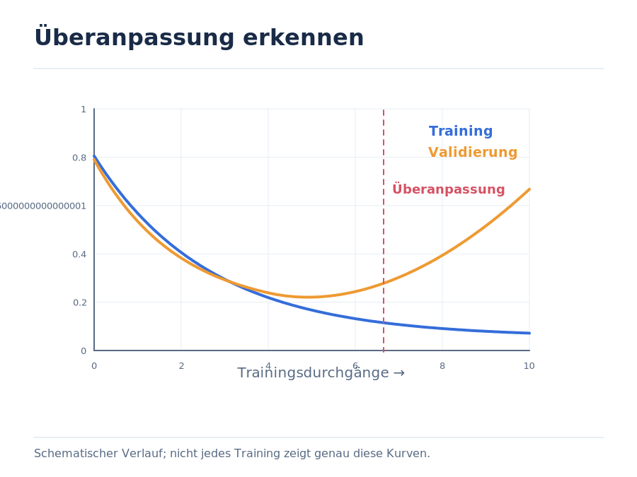
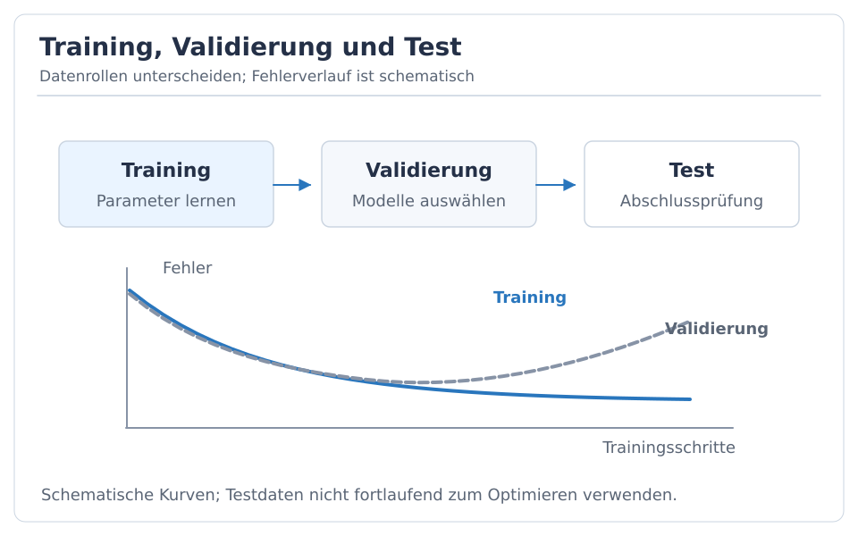

# M5-L3 – Wie Maschinen lernen {#L3}

**Kursbereich:** M5 – Bachelor: KI-Grundlagen

**Niveau:** Bachelor

**Vorwissen:** Keine festen Voraussetzungen angegeben.

## Eine neue Frage nach M5-L2: Wer sagt dem Netz, was es lernen soll? {#S1}

In M5-L2 wurde gezeigt, wie ein neuronales Netz Zahlen verarbeitet und wie der Fehler einer Vorhersage auf seine Gewichte zurückwirkt. Ein beispielhafter Trainingsschritt verringerte eine Verlustzahl. Aber damit ist noch nicht geklärt, **woher das richtige Ergebnis stammt**, mit dem das Netz verglichen wird. Muss jemand jedes einzelne Bild von Hand beschriften? Kann ein Modell ohne solche Beschriftungen etwas lernen? Und wie lernt ein System, das nicht nur Bilder klassifizieren, sondern Handlungen auswählen soll?

Das sind Fragen nach der **Lernaufgabe**, nicht allein nach dem Aufbau des Netzes. *Maschinelles Lernen* (englisch *Machine Learning*, kurz **ML**) umfasst Verfahren, die Muster, Zusammenhänge oder Handlungsstrategien aus Daten und Rückmeldungen gewinnen, anstatt sämtliche Entscheidungsregeln direkt einzuprogrammieren. Ein neuronales Netz ist eine mögliche Modellfamilie. Es gibt auch Entscheidungsbäume, lineare Modelle, Nachbarschaftsverfahren und andere Methoden. Nicht jedes ML-Verfahren benötigt Deep Learning.

Die zentrale Unterscheidung lautet:

- Beim **überwachten Lernen** kennt man für Lernbeispiele ein vorgegebenes Zielergebnis.
- Beim **unüberwachten Lernen** sucht man ohne solche Zielbeschriftungen nach Strukturen.
- Beim **selbstüberwachten Lernen** erzeugt man Lernziele aus den vorhandenen Daten selbst.
- Beim **bestärkenden Lernen** bewertet man Folgen von Handlungen durch Belohnungssignale.

Diese Einteilung beschreibt **Arten des Lernsignals**. Sie ist keine Liste zwingend getrennter Produkte. Ein großes KI-System kann mehrere Verfahren nacheinander oder gemeinsam einsetzen.

## Klassische Programmregeln gegen gelernte Zusammenhänge {#S2}

Eine traditionelle Anwendung kann entscheiden: „Wenn die Dateiendung `.jpg` lautet, behandle die Datei als Bild.“ Das ist eine ausdrücklich programmierte Regel. Eine andere Aufgabe lautet: „Welche Bilder zeigen einen Hund?“ Größe, Farben und Form reichen einzeln nicht aus. An dieser Stelle kann Lernen aus Beispielen sinnvoll sein.

``` text
Klassische Regel:
Eingabe → feste, menschlich formulierte Regel → Ausgabe

Gelerntes Modell:
Trainingsdaten → Lernverfahren → Modellparameter
                                      │
Neue Eingabe ──────────────────────────┤
                                      ▼
                              Vorhersage/Entscheidung
```

Beim Lernen sind die **Modellparameter** die eingestellten Zahlen: etwa Gewichte eines Netzes. Bei der späteren Verwendung werden diese Parameter normalerweise nicht bei jeder Anfrage geändert. Die Anwendung eines trainierten Modells heißt **Inferenz**. Ein Bilderkennungsprogramm kann also tausend Fotos nacheinander klassifizieren, ohne dabei automatisch dazuzulernen. Ein Chat mit einem Sprachmodell ist ebenfalls nicht gleichbedeutend mit einem neuen Training seiner Gewichte. Die Unterschiede werden in M6-L2 ausführlich behandelt.

ML ist besonders dann attraktiv, wenn viele Varianten auftreten, die sich schwer durch explizite Regeln erfassen lassen. Es ist dagegen nicht automatisch besser für deterministische Berechnungen. Die Umsatzsteuerregel eines klar definierten Abrechnungssystems gehört gewöhnlich in nachvollziehbaren Anwendungscode, nicht in ein statistisches Vorhersagemodell.

## Woraus ein Lerndatensatz besteht: Beispiele, Merkmale, Labels {#S3}

Ein **Datensatz** ist zunächst nur eine geordnete Sammlung von Beobachtungen: Messwerten, Bildern, Texten, Tonaufnahmen, Ereignissen oder bereits aufbereiteten Zahlen. Ein **Trainingsbeispiel** ist eine Einheit, die ein Lernverfahren verarbeitet, etwa ein Foto mit zugehörigen Angaben oder eine einzelne Zeile in einer Tabelle.

Die beschreibenden Eingaben heißen **Merkmale** (englisch *features*). Beim Gebrauchtwagenpreis könnten sie Alter, Kilometerstand und Modell sein. Das gesuchte Ergebnis heißt **Zielwert** oder **Label**, zum Beispiel der tatsächlich erzielte Verkaufspreis. Ein Label muss keine Kategorie sein: Auch eine Zahl, ein Textabschnitt oder ein gemessenes Ereignis kann als Lernziel dienen.

  Beispiel            Merkmale                          Mögliches Ziel
  ------------------- --------------------------------- ---------------------------------
  Gebrauchtwagen      Baujahr, Kilometer, Modell        Verkaufspreis
  E-Mail              Inhalt, Absendermerkmale          „Spam“ oder „kein Spam“
  Foto                Bildpunkte, Bildausschnitt        „Hund“, „Katze“, „andere“
  Produktionsanlage   Sensorwerte der letzten Minuten   Störung im nächsten Zeitfenster

Die Zeilen einer Tabelle sind nicht schon deshalb sinnvolle Trainingsdaten, weil sie zahlreich sind. Sie können Messfehler, Dubletten, zufällige Zusammenhänge oder verzerrte Ausschnitte der Wirklichkeit enthalten. Bereits hier wird eine häufige Verwechslung sichtbar: **Mehr Daten bedeuten nicht automatisch bessere Daten.**

Für Sprachmodelle kommt ein zusätzlicher Begriff hinzu: Ein **Token** ist eine Einheit, in die ein Tokenizer Text zerlegt. Das kann ein Wort, Teil eines Wortes, ein Satzzeichen oder eine andere Zeichenfolge sein. Tokens sind keine von Menschen gesetzten Bedeutungslabels. Sie dienen der rechnerischen Darstellung und – je nach Lernziel – auch als Ziel für Vorhersagen. Die detaillierte Tokenisierung folgt in M6-L1.

## Überwachtes Lernen: An Beispielen mit bekannten Antworten üben {#S4}

**Überwachtes Lernen** (*Supervised Learning*) verwendet Eingaben mit zugehörigen Zielwerten. Das System soll eine Beziehung lernen, die auch auf neue, bisher unbekannte Eingaben anwendbar ist.

``` text
Trainingsbeispiel A: Foto A + Label "Katze" ─┐
Trainingsbeispiel B: Foto B + Label "Hund"  ──┼→ Modelltraining
Trainingsbeispiel C: Foto C + Label "Hund"  ──┘       │
                                                     ▼
                                             gelernte Parameter
                                                     │
Neues Foto (ohne bekanntes Label) ────────────────────┘
                                                     ▼
                                          vorhergesagte Klasse
```

Die beiden verbreiteten Grundaufgaben sind **Klassifikation** und **Regression**. Eine Klassifikation wählt eine Kategorie oder schätzt Wahrscheinlichkeiten für Kategorien: Ist eine E-Mail Spam? Gehört ein Bild zu „Hund“ oder „Katze“? Eine Regression schätzt einen Zahlenwert: Welche Temperatur ist zu erwarten? Wie hoch ist ungefähr der Verbrauch?

Im Training wird die Vorhersage mit dem bekannten Ziel verglichen. Eine **Verlustfunktion** (*loss function*) drückt die Abweichung als Zahl aus. Je nach Modell und Optimierungsverfahren werden die Parameter so angepasst, dass dieser Verlust auf Trainingsdaten sinkt. Die Rechenidee aus M5-L2 – Vorwärtsdurchlauf, Fehler, Gradienten, Parameteränderung – passt unmittelbar hierher. Nicht alle überwachten ML-Verfahren benutzen jedoch Backpropagation.

**Woher kommen Labels?** Sie können durch Menschen vergeben, aus Messungen stammen, aus verlässlichen Geschäftsprozessen abgeleitet oder automatisch mit Regeln erzeugt werden. Die Herkunft ist entscheidend. Wenn zwei Personen dieselbe Aufnahme unterschiedlich bewerten, ist das kein Problem, das ein Netz allein wegzaubern kann. Das Modell lernt dann auch Unschärfen und Widersprüche dieser Beschriftungen.

Ein gut passendes Modell erkennt statistische Muster. Es beweist nicht, dass seine Kategorien philosophisch eindeutig oder seine Entscheidungen kausal richtig sind. Für medizinische, rechtliche oder sicherheitskritische Anwendungen reicht eine hohe Zahl in einer allgemeinen Testtabelle deshalb nicht aus.

## Unüberwachtes Lernen: Struktur ohne vorgegebene Zielklassen {#S5}

Beim **unüberwachten Lernen** (*Unsupervised Learning*) gibt es keinen separat bereitgestellten Zielwert für jedes Beispiel. Gesucht werden wiederkehrende Strukturen, Ähnlichkeiten, Gruppen oder kompakte Darstellungen.

Ein anschaulicher Fall ist ein Musikarchiv mit Titeln, für die keine Genrebezeichnungen hinterlegt sind. Aus Tempo, Klangmerkmalen und anderen Eigenschaften lassen sich möglicherweise Gruppen ähnlicher Stücke bilden. Ein verbreitetes Verfahren dafür ist **Clustering**, also die algorithmische Bildung von Gruppen.

``` text
Viele Titel mit Merkmalen
        │
        ▼
Ähnlichkeitsmaß festlegen
        │
        ▼
Clustering-Verfahren
        │
        ├── Gruppe A: ähnliche Merkmalsprofile
        ├── Gruppe B: andere Merkmalsprofile
        └── Gruppe C: weitere Ähnlichkeiten
```

Beim bekannten **k-Means-Verfahren** legt man eine Anzahl `k` von Gruppen fest. Das Verfahren ordnet Punkte anhand ihrer Nähe zu Gruppenzentren zu und passt diese Zentren wiederholt an. Das funktioniert nur im Rahmen des gewählten Abstandsmaßes, der Merkmalsdarstellung und der Annahmen des Verfahrens. Eine Gruppe ist nicht automatisch ein musikalisch „wahres“ Genre. Ein schlecht gewähltes Merkmal kann die Gruppierung verzerren: So würden Dateien mit gleicher Bitrate womöglich nahe beieinanderliegen, obwohl sie musikalisch wenig gemeinsam haben.

Weitere unüberwachte Anwendungen sind **Dimensionsreduktion** – eine große Zahl von Merkmalen durch weniger zusammenfassende Zahlen ersetzen – und das Erkunden ungewöhnlicher Muster. Nicht jede Anomalieerkennung ist unüberwacht; manche Verfahren werden gezielt anhand beschrifteter Fehlerfälle trainiert.

Unüberwachtes Lernen hat eine wichtige Grenze: Ohne vorgegebene Zielkategorien lässt sich eine gefundene Gruppierung nicht einfach als „95 Prozent richtig“ bewerten. Man untersucht die Gruppenqualität, Stabilität, fachliche Plausibilität und ihren Nutzen für den eigentlichen Zweck. *Unüberwacht* heißt also nicht *ohne Bewertung*.

## Selbstüberwachtes Lernen: Wenn die Daten selbst Trainingsfragen liefern {#S6}

Bei vielen Aufgaben wäre eine menschliche Beschriftung aller Beispiele unerschwinglich. Große Textmengen liegen beispielsweise ohne Tabellen vor, die für jeden Satz eine gewünschte Antwort enthalten. Dennoch enthalten sie eine natürliche Struktur: Wörter und Token stehen in einer Reihenfolge und in einem Zusammenhang.

**Selbstüberwachtes Lernen** (*Self-Supervised Learning*) nutzt diese Struktur, um Lernziele **aus den Daten selbst** abzuleiten. Es ist eine Form des Lernens ohne externe, für jede Aufgabe von Menschen vorgegebene Labels. „Selbst“ bedeutet nicht, dass das Modell eigene Ziele frei auswählt: Die Trainingsaufgabe wird von Entwicklern festgelegt.

Ein einfaches Beispiel ist das Vorhersagen verdeckter Textbestandteile:

``` text
Original:       "Der kleine Hund schläft im Garten."
Trainingstext:  "Der kleine [VERDECKT] schläft im Garten."
Lernziel:       ursprünglichen verdeckten Token vorhersagen
```

Die Antwort stammt aus dem Originaltext, nicht aus einer separat erstellten Beschriftung. Diese Idee wird unter anderem beim **Masked Language Modeling** benutzt. Das Forschungsmodell **BERT** machte vortrainierte Textrepräsentationen mit verdeckten Token zu einem wichtigen Ansatz.

Ein anderes verbreitetes Trainingsziel besteht darin, das **nächste Token** einer Folge vorherzusagen:

``` text
Gesehene Folge:  "Der kleine Hund"
Gesuchtes Ziel: nächstes Token der ursprünglichen Folge
```

Bei der großen Menge von möglichen Fortsetzungen kann die Aufgabe anspruchsvoll sein. Das Modell wird deshalb zum Erlernen vieler sprachlicher Regelmäßigkeiten gezwungen. Es lernt aber nicht automatisch, welche Aussage in der Außenwelt wahr ist. Ein statistisch plausibler Satz kann sachlich falsch sein. Genau deshalb darf Tokenvorhersage nicht mit überprüftem Faktenwissen gleichgesetzt werden.

Selbstüberwachte Verfahren sind nicht auf Sprache begrenzt. Bildmodelle können Teile einer Aufnahme rekonstruieren oder aus unterschiedlich veränderten Ansichten derselben Aufnahme vergleichbare Repräsentationen lernen. Auch bei Audio und Video lassen sich Lernsignale aus Reihenfolgen oder teilweise verdeckten Inhalten bilden. Das konkrete Trainingsziel entscheidet, was die Repräsentation bevorzugt erfasst.

## Bestärkendes Lernen: Handeln und aus Folgen lernen {#S7}

Bisher waren die Trainingsbeispiele im Wesentlichen vorgegebene Daten. Beim **bestärkenden Lernen** (*Reinforcement Learning*, **RL**) beeinflusst ein handelndes System seine nächste Beobachtung durch eigene Aktionen. Ein **Agent** wählt in einer **Umgebung** (*environment*) eine **Aktion**. Daraufhin folgt ein neuer Zustand beziehungsweise eine neue Beobachtung und eine **Belohnung** (*reward*).

``` text
            ┌───────────────────────┐
            │ Agent                 │
            │ Strategie / Policy    │
            └───────────┬───────────┘
                        │ Aktion
                        ▼
            ┌───────────────────────┐
            │ Umgebung              │
            │ z. B. Spiel/Simulation│
            └───────────┬───────────┘
                        │ Beobachtung + Belohnung
                        └───────────────────► Agent
```

Die **Policy** ist die Handlungsstrategie: Welche Aktion soll in einer beobachteten Situation gewählt werden? Das Ziel ist typischerweise nicht nur die Belohnung des nächsten Schritts, sondern eine gute **kumulative Belohnung** über eine Folge von Schritten. Manchmal lohnt es sich, kurzfristig auf einen Vorteil zu verzichten, um später ein besseres Ergebnis zu erzielen.

**Erkunden** (*exploration*) bedeutet, auch noch nicht gut bekannte Aktionen auszuprobieren. **Ausnutzen** (*exploitation*) heißt, eine bisher vielversprechende Aktion zu wählen. Ein System, das ausschließlich Bekanntes wiederholt, lernt womöglich keine bessere Strategie; ein System, das nur experimentiert, handelt womöglich ineffizient oder gefährlich.

Beispiel: Ein simuliertes Lagerfahrzeug bekommt Punkte für korrekt erreichte Ziele und Abzüge für unnötige Wege. Es kann verschiedene Routen testen. Aber eine schlecht formulierte Belohnung kann zu absurden Strategien führen. Bekommt es nur Punkte für „möglichst viele Fahrten“, könnte es unnötige Fahrten erzeugen. Dieses Phänomen heißt **Reward Hacking**: Das System optimiert das Messsignal statt das eigentlich gemeinte Ziel.

In der realen Robotik ist unkontrolliertes Ausprobieren physisch riskant. Deshalb nutzen Entwickler Simulation, Sicherheitsregeln, Eingriffsgrenzen und klassische Regelungstechnik. Reinforcement Learning ist kein Freibrief, bei dem ein Sprachmodell unmittelbar gefährliche Motorbefehle erteilen sollte. Die Aufgabenverteilung zwischen KI und sicherheitskritischer Steuerung folgt in M6-L7.

## Transfer Learning: Vorwissen in eine neue Aufgabe mitnehmen {#S8}

Beim **Transfer Learning** werden Fähigkeiten oder Repräsentationen aus einer früheren Lernphase für eine neue Aufgabe verwendet. Ein bereits trainiertes Bildmodell kann zum Beispiel als Ausgangspunkt für die Erkennung bestimmter Maschinenteile dienen. Dadurch muss nicht unbedingt jede visuelle Struktur von Null gelernt werden.

**Vortraining** (*pretraining*) erzeugt allgemeiner nutzbare Parameter. **Feinabstimmung** (*fine-tuning*) passt ein bestehendes Modell mit weiteren Trainingsdaten für einen engeren Zweck an. Je nach Verfahren werden alle Gewichte, nur ausgewählte Gewichte oder zusätzliche kleine Parametergruppen angepasst.

``` text
Breiter Ausgangsdatensatz
           │
           ▼
    allgemeines Vortraining
           │
           ▼
    vorhandenes Grundmodell
           │
   zusätzliche passende Beispiele
           ▼
    Feinabstimmung / Fine-Tuning
           │
           ▼
    Modell für einen engeren Zweck
```

Transfer Learning ist keine Garantie: Ein auf gewöhnlichen Tageslichtbildern vortrainiertes Modell kann bei Wärmebildern, medizinischer Bildgebung oder stark abweichenden Produktionsumgebungen ungeeignet sein. Es kann unerwünschte Verzerrungen aus der Ausgangsdomäne übernehmen. Und es unterscheidet sich von bloßem **Prompting**: Eine neue Frage oder Anweisung verändert nicht schon die gespeicherten Modellgewichte. Diese Unterschiede werden in M6-L3 systematisch vertieft.

## Warum Embeddings eine zentrale Rolle spielen {#S9}

Maschinen können Wörter, Bilder oder Kunden nicht unmittelbar als „Bedeutung“ verrechnen. Sie benötigen eine numerische Darstellung. Eine einfache Darstellung einer Kategorie verwendet für jeden möglichen Eintrag einen eigenen Platz: die **One-Hot-Kodierung**. Bei sehr vielen Kategorien werden solche Vektoren groß und dünn besetzt; außerdem drücken sie keine Nähe zwischen ähnlichen Begriffen aus.

Ein **Embedding** ist eine gelernte oder anderweitig berechnete Darstellung als Zahlenvektor in einem oft kompakteren Raum. Der Vektor kann Eigenschaften erfassen, die für das Trainingsziel nützlich sind. Eine stark vereinfachte, ausdrücklich erfundene Darstellung lautet:

``` text
"Katze"   → [0,8;  0,3; -0,1]
"Hund"    → [0,7;  0,2; -0,2]
"Tabelle" → [-0,4; 0,9;  0,6]
```

Die drei Werte sind **keine realen Modellwerte und keine feste Bedeutungsnorm**. In echten Modellen können Vektoren viele Dimensionen haben. Ihr Abstand oder Winkel kann unter einer bestimmten Modell- und Trainingsdefinition etwas über Ähnlichkeit ausdrücken. Das ist für Suchsysteme, Empfehlungen und spätere Retrieval-Augmented-Generation-Systeme (RAG, *abrufgestützte Textgenerierung*) nützlich.

Wichtig sind drei Grenzen. Erstens hängt „Ähnlichkeit“ vom Lernziel ab: „Bank“ kann ein Geldinstitut oder eine Sitzgelegenheit meinen. Zweitens erzeugt ein passender Vektor noch keine zuverlässige logische Schlussfolgerung. Drittens können Embeddings sensible Merkmale oder Rückschlüsse enthalten; ihre Speicherung ist nicht automatisch unbedenklich. In M6-L1 wird gezeigt, wie Token-Embeddings zu Eingaben eines Transformers werden, in M6-L4 ihre Rolle für Dokumentensuche.

## Der Trainingsablauf: Nicht ein einzelnes Beispiel, sondern viele Durchgänge {#S10}

Ein typisches Training beginnt lange vor der ersten Gewichtsänderung. Daten müssen ausgewählt, aufbereitet, überprüft und in einen für das Modell passenden Zahlenraum überführt werden. Bei überwachtem Lernen folgt der wiederholte Vergleich mit den Zielwerten.

``` text
Datenquellen
    │
    ▼
Rechte, Qualität und Zweck prüfen
    │
    ▼
Trainings-, Validierungs- und Testdaten sinnvoll trennen
    │
    ▼
Merkmale/Token aufbereiten
    │
    ▼
Modelltraining auf Trainingsdaten
    │
    ├─ Vorhersage
    ├─ Verlust berechnen
    ├─ Parameter anpassen
    └─ nächste Beispiele
    │
    ▼
Modellauswahl mit Validierungsdaten
    │
    ▼
Abschließender Test auf unberührten Testdaten
    │
    ▼
Betrieb, Überwachung und gegebenenfalls neues Training
```

Bei neuronalen Netzen werden Beispiele häufig in **Mini-Batches** verarbeitet: Gruppen mehrerer Beispiele, aus denen ein Optimierungsschritt berechnet wird. Eine **Epoche** (*epoch*) bedeutet gewöhnlich, dass die für eine Trainingsrunde vorgesehenen Beispiele einmal durchlaufen wurden. Nicht jeder Trainingsaufbau ist epochenbasiert; bei fortlaufenden Datenströmen oder sehr großen Textsammlungen sind andere Zählweisen üblich.

Ein **Optimierer** wählt die Art, wie Gewichte anhand des Fehlers geändert werden. Die **Lernrate** beeinflusst die Schrittgröße. **Hyperparameter** sind Einstellungen des Lernverfahrens oder der Architektur – beispielsweise Lernrate, Batchgröße oder Zahl der Schichten – und werden im üblichen Training nicht selbst auf dieselbe Weise wie die Modellgewichte gelernt.

Beispiel mit frei gewählten Zahlen: Bei 1.000 Trainingsbeispielen und einer Batchgröße von 100 wären für einen vollständigen Durchlauf zehn Batches nötig, sofern kein besonderer Rest oder Wegfall von Beispielen zu berücksichtigen ist. Fünf solche Epochen entsprächen 50 Batch-Durchgängen. Das ist eine **Rechenillustration**, keine Empfehlung für ein bestimmtes Modell. Große Modelle können völlig andere Datenmengen, Batchdefinitionen und Trainingspläne benutzen.

## Warum Trainings-, Validierungs- und Testdaten getrennt werden {#S11}

Eine gute Trainingsleistung beweist nicht, dass das Modell neue Situationen bewältigt. Man kann eine Prüfungsantwort auswendig kennen und trotzdem das Thema nicht beherrschen. Ähnlich kann ein Modell viele Trainingsbeispiele reproduzieren, ohne auf neue Daten sinnvoll zu reagieren. Deshalb unterscheidet man:

{alt="Trainings- und Validierungsfehler bei möglicher Überanpassung"}


{alt="Drei getrennte Datensätze zum Trainieren, zur Modellwahl und zur abschließenden Prüfung, darunter schematische Fehlerverläufe für Training und Validierung."}

Training, Validierung und Test haben unterschiedliche Aufgaben; Fehlerkurven schematisch.

- **Trainingsdaten:** Daran werden Parameter gelernt.
- **Validierungsdaten:** Daran vergleicht man während der Entwicklung Varianten und Hyperparameter.
- **Testdaten:** Sie bleiben möglichst bis zur abschließenden Bewertung unberührt.

Eine oft gezeigte Aufteilung ist 70/15/15; sie ist **kein Naturgesetz und keine generelle Vorschrift**. Eine sinnvolle Trennung hängt von Datenmenge, Zeitabhängigkeit, seltenen Ereignissen und dem realen Einsatz ab.

Ein Fotoarchiv kann zwanzig fast identische Aufnahmen desselben Tieres enthalten. Landen fünfzehn im Training und fünf im Test, misst man womöglich vor allem die Wiedererkennung dieser Fotoserie. Für die Erkennung fremder Tiere wäre es besser, zusammengehörige Bildserien oder Tiere nicht über beide Datenmengen zu verteilen. Bei Zeitreihen sollte ein Testzeitraum aus der Zukunft häufig nicht mit Informationen vermischt werden, die bei einer früheren Vorhersage noch gar nicht vorlagen.

Dieses Problem heißt **Datenleckage** (*data leakage*): Informationen aus dem späteren Test oder aus der Zukunft fließen unbemerkt in Training oder Auswahl ein. Auch eine Normierung, die ihren Mittelwert aus *allen* Beispielen einschließlich des Tests berechnet, kann bereits Informationen verraten. Dasselbe gilt, wenn nach dem Betrachten eines enttäuschenden Testergebnisses so lange nachgebessert wird, bis der Test gut aussieht. Dann ist der vermeintlich unabhängige Test faktisch Teil der Entwicklung geworden.

**Generalisierung** bedeutet, dass ein Modell für neue Beispiele aus dem vorgesehenen Anwendungsbereich zuverlässig funktioniert. Das muss mit realistisch getrennten Daten nachgewiesen werden; es folgt nicht automatisch aus großem Modellumfang oder geringem Trainingsfehler.

## Ein Zahlenbeispiel: Warum 99 Prozent Genauigkeit täuschen können {#S12}

Angenommen, ein Dienst soll aus 1.000 fiktiven Vorgängen die zehn tatsächlich betrügerischen Fälle erkennen. Ein völlig nutzloses System, das alles als unverdächtig meldet, liegt **990-mal richtig**, also bei **99 Prozent Genauigkeit** (*accuracy*). Es erkennt jedoch **keinen einzigen Betrugsfall**.

Nun betrachten wir ein anderes, ebenfalls frei erfundenes Modell:

  Tatsächlicher Fall          Modell meldet „Betrug“   Modell meldet „kein Betrug“
  ------------------------- ------------------------ -----------------------------
  Betrug (10 Fälle)                8 richtig positiv              2 falsch negativ
  Kein Betrug (990 Fälle)          12 falsch positiv           978 richtig negativ

Die vier Felder bilden eine **Konfusionsmatrix** (auch Verwechslungsmatrix genannt). Aus ihr lassen sich verschiedene Maße berechnen:

- **Genauigkeit (Accuracy):** $\frac{8+978}{1\,000}=98{,}6\,\%$.
- **Präzision (Precision):** $\frac8{8+12}=40\,\%$. Von allen als verdächtig markierten Fällen sind 40 Prozent tatsächlich betrügerisch.
- **Trefferquote (Recall):** $\frac8{8+2}=80\,\%$. Von allen wirklichen Betrugsfällen findet das Modell 80 Prozent.
- **F1-Wert:** harmonischer Mittelwert aus Präzision und Recall; hier $\frac{2\cdot0{,}4\cdot0{,}8}{0{,}4+0{,}8}\approx53{,}3\,\%$.

Das zweite Modell hat **weniger Accuracy** als das nutzlose erste, entdeckt aber acht von zehn relevanten Fällen. Welche Lösung besser ist, hängt davon ab, was übersehene Betrugsfälle und Fehlalarme kosten. Fehlalarme können Personen zu Unrecht belasten; übersehene Fälle können Schaden verursachen. Deshalb braucht man zusätzlich menschliche Prüfabläufe und passende Schwellenwerte. **Ein einzelner Bewertungswert sagt niemals alles.**

Bei Regression betrachtet man andere Kennzahlen, beispielsweise mittlere absolute Fehler. Bei Sprachmodellen kommen unter anderem Vorhersageverluste, aufgabenspezifische Tests und menschliche Bewertungen hinzu. Ein Sprachmodell, das im Trainingsziel eine gute Zahl erreicht, muss deshalb weder verlässlich rechnen noch alle Quellen korrekt wiedergeben.

## Benchmarks und die Schwierigkeit fairer Vergleiche {#S13}

Ein **Benchmark** ist ein standardisierter Test oder eine Sammlung von Aufgaben, die Modelle vergleichbar machen soll. Benchmarks sind hilfreich, weil bloße Werbeaussagen wie „intelligent“ oder „versteht alles“ keine überprüfbaren Leistungsbeschreibungen sind. Die Zahl eines Benchmarks gilt aber nur unter seinen konkreten Bedingungen.

Fragen bei einer Bewertung sind unter anderem: Welche Daten wurden verwendet? Ist der Test repräsentativ? Welche Sprachen und Nutzergruppen kommen vor? Wurden Lösungen oder nahe Duplikate schon zum Training verwendet? Wie viele Versuche durfte das System unternehmen? Wurden externe Werkzeuge benutzt? War die Rechenzeit begrenzt?

Wird ein Benchmark während der Entwicklung immer wieder betrachtet, kann ein Modell indirekt auf ihn zugeschnitten werden. Die Kennzahl verliert dann einen Teil ihrer Aussagekraft über wirklich unbekannte Fälle. Das gilt sowohl für klassische ML-Modelle als auch für große Sprachmodelle.

Wichtige Fehlerbilder sind **Overfitting** (Überanpassung), **Underfitting** (Unteranpassung) und **Verteilungsverschiebung** (*distribution shift*). Letztere entsteht, wenn sich die neuen Fälle von den Daten unterscheiden, auf denen das Modell gelernt oder getestet wurde: andere Kameras, geänderte Sprache, neue Abläufe, geänderte Kundschaft oder seltene Ausnahmesituationen.

Besonders im Betrieb kann ein **Training-Serving-Skew** auftreten: Daten werden beim Training anders aufbereitet als bei der tatsächlichen Inferenz. Wenn ein Vorhersagedienst zum Beispiel Datumsangaben im Training als Tage und im Betrieb als Sekunden interpretiert, helfen gut trainierte Parameter nicht. Unterschiedliche Modellversionen, fehlende Werte und verschobene Datenverteilungen müssen daher überwacht werden.

## Was bedeutet Lernen – und was ausdrücklich nicht? {#S14}

Die Bezeichnung „lernen“ führt leicht zu falschen Vorstellungen. Ein neuronales Netz sammelt keine menschlichen Erlebnisse, aus denen automatisch Verständnis entsteht. Es passt Zahlen gemäß einem Optimierungsziel an. Bei klassischen ML-Verfahren kann es andere Formen der Parameterschätzung oder Regelbildung geben; dennoch bleibt das Ziel mathematisch definiert.

Drei Abgrenzungen sind besonders wichtig:

**Korrelation ist nicht Kausalität.** Wenn in Trainingsdaten viele Heizungsstörungen im Winter auftreten, kann ein Modell die Jahreszeit als starken Hinweis benutzen. Daraus folgt nicht, dass der Kalender die Störung verursacht. Die eigentlichen Ursachen können Temperatur, Wartung oder Belastung sein. Wird die Anlage in einer anderen Umgebung eingesetzt, kann der Zusammenhang verschwinden.

**Mustererkennung ist nicht automatisch faktisches Wissen.** Ein Sprachmodell kann eine häufige Formulierung sicher fortsetzen, obwohl die Aussage falsch ist. Sprachliche Flüssigkeit und sachliche Korrektheit sind unterschiedliche Kriterien.

**Feedback bei der Nutzung ist nicht automatisch Training.** Ein Sternchen, Daumen oder korrigierter Chattext kann in einem separaten Prozess als späteres Trainingssignal dienen – abhängig von Anwendung und Datenregelung. Die gegenwärtige Inferenz berechnet jedoch zunächst mit den vorhandenen Modellparametern.

Diese Unterscheidungen helfen, übertriebene Erwartungen zu vermeiden und sinnvolle Kontrollmaßnahmen zu planen.

## Drei Praxisbeispiele mit verschiedenen Lernverfahren {#S15}

### Beispiel A: Lokales Foto- und Medienarchiv

Ein lokales Archiv enthält viele Bilder, die nach Ähnlichkeit durchsuchbar sein sollen. Statt sämtliche Kategorien vorab festzulegen, könnte ein bereits trainiertes Bildmodell **Embeddings** für die Bilder erzeugen. Ein Suchwerkzeug findet dann nahe Vektoren. Für die automatische Vergabe selbst gewählter Kategorien könnten zusätzlich einige beschriftete Beispiele und ein überwachtes Modell hilfreich sein.

``` text
Private Bilddateien → lokaler Bild-Encoder → Embedding-Vektoren
                                                │
Suchbild ──────────→ lokaler Bild-Encoder ────────┤
                                                ▼
                                         ähnliche Bilder
```

**Wann reicht weniger?** Wenn lediglich Dateinamen, Aufnahmeorte und einfache Schlagwörter gesucht werden, ist ein herkömmlicher lokaler Index viel leichter zu betreiben. Ein KI-Modell benötigt Rechenzeit, Speicherplatz und passende Nutzungsrechte. Bei privaten Fotos ist lokal verarbeitete Information oft leichter kontrollierbar als ein ungeprüfter externer Upload. Das System muss auch falsche Ähnlichkeiten und irreführende Kategorien kenntlich machen.

### Beispiel B: Kleiner Online-Analysedienst

Ein Dienst soll erkennen, ob technische Messwerte auf einen bevorstehenden Geräteausfall hinweisen. Sind verlässliche Störungsprotokolle vorhanden, bietet sich ein **überwachter Klassifikator** an. Fehlen solche Labels, kann eine Anomalieerkennung auf ungewöhnliche Muster hinweisen – allerdings nicht beweisen, dass diese Muster echte Ausfälle sind.

``` text
Gerätemesswerte → Bereinigung → Modell → Risikohinweis
                      │                   │
                      │                   ▼
                      │            menschliche Prüfung
                      ▼
           Training + Bewertung
           auf getrennten Daten
```

Messdaten aus demselben Gerät und derselben Zeit dürfen nicht so in Test und Training verstreut werden, dass die Bewertung künstlich gut erscheint. Ein Modellwechsel braucht Versionierung, Überwachung und die Möglichkeit, auf einen bewährten Stand zurückzugehen. Fehlalarme kosten Aufmerksamkeit; übersehene Ausfälle können teure Unterbrechungen verursachen. Der Betrieb bleibt daher ein **Software- und Organisationsproblem**, nicht nur eine Frage neuronaler Netze.

### Beispiel C: Sprachmodell für Dokumente und KI-Aufträge

Ein Anbieter besitzt viele Dokumente, deren Inhalte er mit einem Sprachmodell erschließen möchte. Ein großes Sprachmodell kann zuvor auf sehr vielen Textfolgen mittels selbstüberwachter Tokenvorhersage **vortrainiert** worden sein. Es muss für die betriebliche Dokumentensuche keineswegs noch einmal von Grund auf trainiert werden.

Eine schlankere Lösung kann ein bestehendes Modell mit einer dokumentierten Suchfunktion verbinden: Ein Index findet passende Textstellen und übergibt sie dem Modell zum Formulieren einer Antwort. Dieses Verfahren heißt *Retrieval-Augmented Generation* (**RAG**) und wird in M6-L4 detailliert erklärt. Es verändert nicht automatisch die Modellgewichte.

``` text
Eigene Dokumente → berechtigter Index ──┐
                                        ▼
Nutzerfrage → Suche → passende Textstellen → bestehendes Sprachmodell
                                               │
                                               ▼
                                   Antwort mit Quellenbezug
```

Die Architektur muss Zugriffsrechte der Dokumente respektieren, Einwilligungen beziehungsweise tragfähige Rechtsgrundlagen prüfen, Speicher- und API-Kosten begrenzen und die Quellenzuordnung sichtbar machen. Fine-Tuning wäre eine andere, begründungspflichtige Entscheidung; es garantiert weder die Aktualität von Dokumenten noch die Korrektheit einzelner Antworten. Für kleine Bestände kann sogar eine klassische Volltextsuche die beste Lösung sein.

## Kosten, Umwelt, Rechte und Verantwortung beim Training {#S16}

Training verursacht Ressourcenverbrauch: Rechenzeit auf einer **Central Processing Unit (CPU)** oder **Graphics Processing Unit (GPU)**, Arbeitsspeicher beziehungsweise Grafikspeicher, Datenübertragung, Speichermedien, Strom und Kühlung. Wie teuer ein Verfahren ist, hängt massiv von Modellgröße, Datenmenge, Algorithmus, Hardware und Wiederholungen ab. Ein kleines Tabellenmodell kann lokal in kurzer Zeit trainierbar sein; das Vortraining eines großen Sprachmodells ist eine ganz andere Größenordnung. Aus dem Begriff „KI“ allein lassen sich **keine seriösen Kosten oder Energiezahlen** ableiten.

Es entstehen zudem indirekte Aufwände: Datenqualität prüfen, fehlerhafte Labels korrigieren, Modellversionen verwalten, Tests durchführen, Ergebnisse erklären, Beschwerden bearbeiten und unerwünschte Entscheidungen untersuchen. Hinzu kommt die laufende **Inferenz** – auch ein bereits trainiertes Modell verbraucht bei jeder Nutzung Ressourcen. Die wirtschaftliche Frage lautet deshalb nicht nur „Wie viel kostet das Training?“, sondern auch „Welchen nachgewiesenen Nutzen liefert ein korrekt bearbeiteter Fall?“ Die allgemeinen Kostenmodelle aus M4-L4 gelten hier weiter.

**Datenschutz:** Trainingsdaten können personenbezogene Informationen enthalten. Die Datenschutz-Grundverordnung (DSGVO) verlangt je nach Verarbeitung unter anderem eine tragfähige Rechtsgrundlage, Zweckbindung, Datenminimierung und geeignete Schutzmaßnahmen. Öffentlich zugängliche Daten sind nicht schon deswegen frei von Datenschutzanforderungen. Auch ein Embedding kann Informationen über einen Menschen verraten; Zahlenform allein macht Daten nicht automatisch anonym.

**Urheber- und Nutzungsrechte:** Die Berechtigung, Daten zu speichern, bedeutet nicht automatisch, dass jede Art von Modelltraining damit zulässig ist. Verträge, Datenbankrechte, Lizenzen, urheberrechtliche Regeln und gegebenenfalls Ausnahmen für Text- und Data-Mining sind gesondert zu beurteilen. Die konkreten Rechtsfragen hängen von Rechtsordnung, Datenart und Nutzung ab; diese Lektion ist keine Rechtsberatung.

**Fairness und Repräsentativität:** Wenn Trainingsdaten bestimmte Nutzergruppen, Dialekte oder Geräte kaum enthalten, kann die Modellleistung bei diesen Gruppen deutlich schlechter sein. Sensible Anwendungen erfordern deshalb passende Teilgruppenanalysen und sorgfältige fachliche Prüfung. Ein formal hoher Durchschnittswert beseitigt dieses Problem nicht.

**Sicherheit und Wartung:** Daten und Modelle sind wertvolle Ressourcen. Trainingsdaten können manipuliert werden (*Data Poisoning*), gespeicherte Modelle kompromittiert, Schnittstellen missbraucht und vertrauliche Inhalte versehentlich ausgegeben werden. Zugriffe, Quellen, Modellstände und Wiederherstellungswege sind deshalb zu sichern. Diese Verantwortung verschwindet weder durch selbstüberwachtes Lernen noch durch die Nutzung einer externen Modell-API.

## Welche Lernart passt wann – und wann gar keine? {#S17}

  Ziel                                             Naheliegender Ansatz              Typische Schwierigkeit
  ------------------------------------------------ --------------------------------- ---------------------------------------------------
  Bekannte Kategorie oder Zahl vorhersagen         Überwachtes Lernen                Gute Labels, repräsentative Daten
  Ähnliche Objekte gruppieren                      Unüberwachtes Lernen              Wahl sinnvoller Merkmale und Gruppen
  Allgemeine Repräsentationen aus Rohtext lernen   Selbstüberwachtes Lernen          Große Daten-/Rechenmengen, Qualität des Lernziels
  Folgen von Handlungen optimieren                 Bestärkendes Lernen               Sichere Exploration, Belohnungsdesign
  Vorhandene Modellfähigkeiten spezialisieren      Transfer Learning / Fine-Tuning   Unterschiede zwischen Ausgangs- und Zielbereich
  Exakte Rechnungsregel anwenden                   Klassischer Programmcode          Regel korrekt modellieren und testen
  In eigenen Textdateien suchen                    Volltextsuche, ggf. RAG           Rechte, Aktualität, Quellenbezug

Diese Tabelle ist eine **Entscheidungshilfe**, keine feste Zuordnung. Ein Bildmodell kann beispielsweise selbstüberwacht vortrainiert und anschließend überwacht feinabgestimmt werden. Ein Robotiksystem kann eine gelernte Wahrnehmung, eine trainierte Bewegungsstrategie und zugleich fest programmierte Sicherheitsgrenzen kombinieren.

Besonders für kleine Projekte gilt: Erst nach dem Problem fragen, dann die Technik wählen. Ein gutes Suchfeld, ein SQL-Index, eine übersichtliche Benutzeroberfläche oder eine einfache Statistik kann mehr praktischen Nutzen bringen als ein eigens trainiertes neuronales Netz.

## Zusammenfassung und Übergang zu M6-L1 {#S18}

Maschinen lernen nicht auf eine einzige Art. Entscheidend ist, **welches Signal eine Modelländerung steuert**: bekannte Zielwerte, unbeschriftete Strukturen, aus Daten erzeugte Vorhersageaufgaben oder die Folgen von Handlungen. Transfer Learning kann bereits trainierte Parameter weiterverwenden. Das erklärt, weshalb moderne KI-Systeme häufig mehrstufig entstehen: auf breiten Daten vortrainieren, für eine Aufgabe anpassen, getrennt prüfen und anschließend kontrolliert einsetzen.

Zu jedem Lernverfahren gehören Fragen nach Datenqualität, Rechenaufwand, fairer Evaluation, Leckage, Sicherheit und Nutzungsrechten. Embeddings verbinden Daten mit Zahlenräumen; Benchmarks helfen beim Vergleich, ersetzen aber keine realitätsnahe Prüfung. Gute Trainingswerte sind noch keine Zusage, dass ein Modell die Welt kausal versteht oder unter neuen Bedingungen zuverlässig handelt.

Die nächste Lektion **M6-L1 – Von Sprachverarbeitung zu Transformer und LLM** zeigt, wie aus Token, Embeddings und Sequenzmodellen die Transformer-Architektur entsteht. Darauf aufbauend erklärt M6-L2 Schritt für Schritt, wie ein großes Sprachmodell während eines Gesprächs seine Ausgabe berechnet.


## Quellen {#S19}


**Geprüft am 04.11.2026.** Die verlinkten Quellen sind Primärdokumentationen und Forschungsoriginale; Beispiele, Diagramme, Kennzahlen und illustrative Trainingsdaten dieser Lektion sind selbst erstellt. Die angegebenen fiktiven Fallzahlen sind keine Modellbenchmarks oder Anbieterleistungen.

1.  [Google, Machine Learning Crash Course](https://developers.google.com/machine-learning/crash-course/) · Offizielle Einführung in ML-Aufgaben, Datensätze, Klassifikation, neuronale Netze, Embeddings und Modellbetrieb · Zuletzt abgerufen: 2026-11-22
2.  [Google, „Datasets: Dividing the original dataset“](https://developers.google.com/machine-learning/crash-course/overfitting/dividing-datasets) · Trainings-, Validierungs- und Testmengen, Trennung und Generalisierung · Zuletzt abgerufen: 2026-11-22
3.  [scikit-learn, „Common pitfalls and recommended practices“](https://scikit-learn.org/stable/common_pitfalls.html) · Data Leakage, Vorverarbeitung, Cross-Validation und sichere Testtrennung · Zuletzt abgerufen: 2026-11-22
4.  [Google, „Introduction to clustering“](https://developers.google.com/machine-learning/clustering) · Unüberwachtes Clustering, Ähnlichkeitsmaße und k-Means · Zuletzt abgerufen: 2026-11-22
5.  [Hugging Face, „Masked language modeling“](https://huggingface.co/docs/transformers/tasks/masked_language_modeling) · Das Lernziel, verdeckte Tokens aus Textkontext vorherzusagen · Zuletzt abgerufen: 2026-11-22
6.  [Devlin, Chang, Lee und Toutanova (2018), „BERT: Pre-training of Deep Bidirectional Transformers for Language Understanding“](https://arxiv.org/abs/1810.04805) · Forschungsoriginal zu vortrainierten Textrepräsentationen · Zuletzt abgerufen: 2026-11-22
7.  [OpenAI, „Spinning Up – Key Concepts and Terminology“](https://spinningup.openai.com/en/latest/spinningup/rl_intro.html) · Agent, Umgebung, Aktionen, Policy, Reward und kumulative Belohnung · Zuletzt abgerufen: 2026-11-22
8.  [Google, „Embeddings“](https://developers.google.com/machine-learning/crash-course/embeddings) · Zahlenvektoren, One-Hot-Kodierung und Grenzen großer dünn besetzter Repräsentationen · Zuletzt abgerufen: 2026-11-22
9.  [Google, „Embeddings: Obtaining embeddings“](https://developers.google.com/machine-learning/crash-course/embeddings/obtaining-embeddings) · Gelernte Vektoren, statische und kontextuelle Darstellungen · Zuletzt abgerufen: 2026-11-22
10. [Google, „Classification: Accuracy, recall, precision, and related metrics“](https://developers.google.com/machine-learning/crash-course/classification/accuracy-precision-recall) · Definitionen und Grenzen der Klassifikationskennzahlen · Zuletzt abgerufen: 2026-11-22
11. [Google, „Production ML systems: Monitoring pipelines“](https://developers.google.com/machine-learning/crash-course/production-ml-systems/monitoring) · Prüfung auf Training-Serving-Skew und Produktionsveränderungen · Zuletzt abgerufen: 2026-11-22
12. [Google, „Production ML systems: When to transform data?“](https://developers.google.com/machine-learning/crash-course/production-ml-systems/transforming-data) · Vergleich von Vorverarbeitung während Training und Inferenz · Zuletzt abgerufen: 2026-11-22

**Abgrenzung:** Die technischen Lehrquellen begründen keine konkrete datenschutzrechtliche Einzelfallbewertung. Für rechtliche Pflichten sind das konkrete Vorhaben und die jeweils einschlägigen Vorschriften gesondert zu prüfen.
