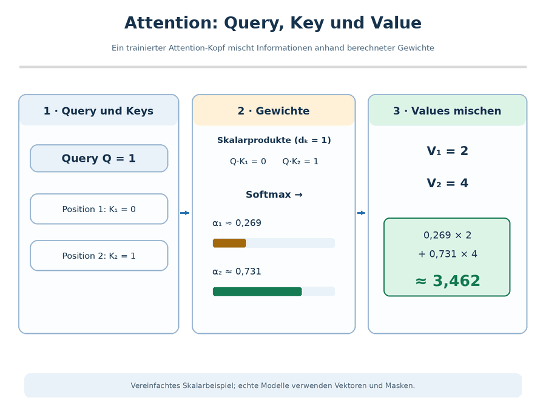

# M6-L1 – Von Sprachverarbeitung zu Transformer und LLM {#L1}

**Kursbereich:** M6 – Schwerpunkt: KI und Robotik

**Niveau:** Bachelor / Master (Wahl)

**Vorwissen:** Keine festen Voraussetzungen angegeben.

## Weshalb Sprache für Computer ein schwieriges Problem ist {#S1}

In M5-L2 haben wir gesehen, wie neuronale Netze mit Zahlen rechnen; M5-L3 hat erklärt, mit welchen Lernzielen sie trainiert werden. Nun geht es darum, warum sich insbesondere **Sprache** so schwer verarbeiten lässt. Ein Satz besteht nicht aus einem einzigen, fest geordneten Merkmalsvektor. Er ist eine Folge von Zeichen und Wörtern, die aufeinander Bezug nehmen. Ein Wort kann sich je nach Umgebung auf Verschiedenes beziehen. Eine Verneinung verändert die Aussage, obwohl nur ein kleines Wort hinzukommt. Und eine Frage kann Informationen aus weit voneinander entfernten Teilen eines langen Textes miteinander verknüpfen.

Beispiel: „Der Schlüssel liegt auf dem Tisch. Nachdem Anna das Zimmer verlassen hatte, nahm Paul **ihn** an sich.“ Damit wir „ihn“ richtig verstehen, brauchen wir nicht nur die letzten zwei Wörter. Wir müssen frühere Satzteile und ihren Zusammenhang berücksichtigen. Gleichzeitig darf die Reihenfolge nicht beliebig sein: „Hund beißt Mensch“ und „Mensch beißt Hund“ bestehen aus ähnlichen Wörtern, behaupten aber Unterschiedliches.

**Natural Language Processing (NLP)** bedeutet *Verarbeitung natürlicher Sprache*. Es umfasst nicht nur die Erzeugung von Text, sondern auch Suche, Klassifikation, Übersetzung, Informationsextraktion und Spracherkennung. Ein **Sprachmodell** im engeren Sinne schätzt statistische Eigenschaften von Wort- oder Tokenfolgen. Ein modernes **Large Language Model (LLM)** ist ein großes trainiertes Sprachmodell; viele heute verbreitete LLMs basieren auf Varianten der Transformer-Architektur. Transformer sind aber nicht zwangsläufig Sprachmodelle, und nicht jedes NLP-Verfahren braucht einen Transformer.

Die Leitfrage dieser Lektion lautet: **Wie kam die Forschung von einfachen Wahrscheinlichkeiten für Wortfolgen zu Netzen, in denen jedes Textelement andere Textelemente gewichtet berücksichtigen kann?**

## Die erste Idee: Sprachmodelle mit Wortfolgen zählen {#S2}

Stellen wir uns eine Sammlung von Zeitungsartikeln vor. Wenn häufig die Wortfolge „Guten Morgen“ vorkommt, kann ein Programm lernen, dass nach „Guten“ das Wort „Morgen“ wahrscheinlich ist. Für eine kurze Fortsetzung kann das nützlich sein. Historisch verbreitet waren **n-Gramm-Modelle**: Sie betrachten Folgen von *n* Einheiten, etwa Wörtern.

Ein **Bigramm** umfasst zwei aufeinanderfolgende Einheiten, ein **Trigramm** drei. Das Modell verwendet Häufigkeiten, um Wahrscheinlichkeiten zu schätzen. Eine stark vereinfachte Regel für ein Bigramm wäre:

> Wahrscheinlichkeit für „Morgen“ nach „Guten“ = Anzahl „Guten Morgen“ / Anzahl aller beobachteten Wortfolger nach „Guten“.

Die Rechnung ist leicht nachzuvollziehen. Eine kleine Sammlung mit 80 Vorkommen von „Guten Morgen“ und 100 Vorkommen von „Guten“ mit einem Folgewort ergäbe einen unbereinigten Schätzwert von $\frac{80}{100}=0{,}8$. Reale Systeme brauchen zusätzliche Verfahren zur **Glättung** (*Smoothing*), damit seltene oder nicht beobachtete Wortfolgen nicht pauschal als unmöglich gelten.

``` text
Korpus mit vielen Texten
        │
        ▼
Häufigkeiten von Wortfolgen zählen
        │
        ▼
Tabelle: Wie oft folgt B auf A?
        │
        ▼
Wahrscheinlichkeit für ein Folgewort schätzen
```

Die Einschränkung ist die **begrenzte Vergangenheit**. Ein Trigramm verwendet nur wenige unmittelbar benachbarte Einheiten. Bei einem langen Satz kann es eine wichtige Information vom Anfang nicht direkt berücksichtigen. Erhöht man *n*, wächst die Zahl möglicher Kombinationen stark; viele kommen kaum oder nie in den Trainingsdaten vor. Das ist ein Beispiel für **Datenknappheit in hochdimensionalen Räumen**: Fast identische Aussagen können wegen eines einzigen Wortwechsels als völlig unterschiedliche Tabellenfälle auftreten.

Trotzdem sind n-Gramme nicht „falsch“ oder überholt im Sinn von nutzlos. Für überschaubare Vorhersagen, einfache Autovervollständigung, Analyse von Zeichenfolgen oder als Vergleichsmaßstab können solche Verfahren genügen. Entscheidend ist, dass ein statistisches Zählverfahren noch keine frei lernbare, kontextabhängige Vektordarstellung besitzt.

## Von Tabellen zu Vektoren: Wörter in Zahlen übersetzen {#S3}

Neuronale Netze benötigen Zahlen. Deshalb wird Text zunächst in Einheiten zerlegt und numerisch dargestellt. Eine frühe Methode wäre die **One-Hot-Kodierung**: Für jedes Wort gibt es einen Platz in einem langen Vektor; genau ein Platz ist auf 1 gesetzt. „Katze“ und „Kätzchen“ liegen dann nicht automatisch nahe beieinander, obwohl sie semantisch verwandt sein können.

**Embeddings** sind dagegen gelernte Zahlenvektoren. Ihre Koordinaten werden beim Training so angepasst, dass sie für die Aufgabe nützlich sind. Die Vektoren können Ähnlichkeiten und Beziehungen abbilden. Dabei gilt: Ein Embedding ist keine Wörterbuchdefinition und kein Beweis, dass ein Wort eine bestimmte Bedeutung hat. Es ist eine modellabhängige mathematische Darstellung.

``` text
Text: "Die Katze schläft."
      │
      ▼
Tokenisierung: [Die] [Katze] [schläft] [.]
      │
      ▼
Token-IDs:      [ 8 ] [ 217 ] [ 904 ] [ 3 ]   (frei erfundene IDs)
      │
      ▼
Embedding-Tabelle: Zu jeder ID gehört ein Zahlenvektor
      │
      ▼
Sequenz von Vektoren → neuronales Netz
```

Die aufgeschriebenen Token-Grenzen sind **nur ein Beispiel**. Ein bestimmter Tokenizer könnte „schläft“ in mehrere Teile zerlegen oder die Leerzeichen anders berücksichtigen. Die Zahlen 8, 217, 904 und 3 sind ausgedacht und entsprechen keinem behaupteten realen Modell.

### Warum nicht einfach jedes Wort als eine Einheit? {#31-warum-nicht-einfach-jedes-wort-als-eine-einheit}

Eine Sprache hat neue Eigennamen, Schreibvarianten, Fachbegriffe und Zusammensetzungen. Ein riesiges Wörterbuch ganzer Wörter wäre schwer vollständig zu halten. Die **Subword-Tokenisierung** zerlegt seltene Wörter in häufigere Bestandteile. Bei **Byte Pair Encoding (BPE)** werden vereinfacht gesagt häufig gemeinsam vorkommende Zeichenfolgen zu Einheiten zusammengefasst. Andere Tokenizer wählen andere Regeln. So können Modelle auch Wörter verarbeiten, die nie als einzelne vollständige Token im Vokabular stehen.

Die Idee wurde in der neuronalen Übersetzung unter anderem von Sennrich, Haddow und Birch (2016) bekannt gemacht; **SentencePiece** von Kudo und Richardson (2018) ist eine bekannte Methode und Implementierung zur Tokenisierung aus Rohtext. \[1\]\[2\]

Ein Token ist deshalb **nicht immer ein Wort**. Das hat Folgen für Textlänge, Speicherbedarf und Kosten: Ein langer deutscher Fachbegriff kann mehr Tokens ergeben als ein kurzes englisches Wort. Eine feste Zeichenanzahl ist kein verlässlicher Ersatz für die Tokenzahl eines konkreten Modells.

## Rekurrente neuronale Netze: Sprache Schritt für Schritt lesen {#S4}

Die nächste grundlegende Idee war, Texte **nacheinander** zu verarbeiten. Ein **Recurrent Neural Network (RNN)**, auf Deutsch rekurrentes neuronales Netz, besitzt einen internen Zustand. Bei jedem neuen Token kombiniert es den aktuellen Eingabevektor mit dem Zustand aus dem vorherigen Schritt. Daraus berechnet es einen neuen Zustand.

``` text
Token 1 ──► [RNN-Schritt] ── Zustand 1
                                   │
Token 2 ─────────────────► [RNN-Schritt] ── Zustand 2
                                                    │
Token 3 ───────────────────────────────► [RNN-Schritt] ── Zustand 3
```

Man kann sich diesen Zustand als eine **laufend überarbeitete Zusammenfassung** vorstellen. Das System verarbeitet „Die“, dann „Katze“, dann „schläft“ und passt seine interne Darstellung an. Anders als beim einfachen n-Gramm muss die Information nicht auf exakt zwei oder drei vorherige Wörter begrenzt sein.

Die Schwierigkeit steckt in der Praxis: Das Netz muss lernen, welche Details es viele Schritte lang behalten soll. Beim Training wird der Fehler über die zeitlich entfalteten Netzschritte zurückberechnet, oft **Backpropagation Through Time (BPTT)** genannt. Über viele Schritte können Gradienten sehr klein (*vanishing gradients*) oder sehr groß (*exploding gradients*) werden. Besonders die langfristige Zuordnung von Ursachen zu späteren Vorhersagen wird schwer.

### LSTM: Ein gezielterer Umgang mit Erinnerungszuständen {#41-lstm-ein-gezielterer-umgang-mit-erinnerungszuständen}

**Long Short-Term Memory (LSTM)** bezeichnet eine 1997 von Sepp Hochreiter und Jürgen Schmidhuber beschriebene rekurrente Architektur. Sie arbeitet mit speziellen Zustands- und **Gate**-Mechanismen, die steuern, welche Information gespeichert, weitergegeben oder vergessen wird. Dadurch können bestimmte längere Abhängigkeiten leichter gelernt werden als mit einem einfachen RNN. \[3\]

Ein LSTM ist nicht bloß ein größerer Speicherblock. Die Gates selbst sind trainierbare Berechnungen. Es ist auch nicht garantiert, dass es beliebig lange Texte vollständig und fehlerfrei erinnert. Zudem bleibt in der klassischen rekurrenten Verarbeitung eine Abhängigkeit zwischen den Schritten: Der Zustand für Schritt 50 setzt die Berechnung vorheriger Zustände voraus. Das erschwert die Parallelisierung über die Textpositionen hinweg.

Für überschaubare Zeitreihen, Sensorfolgen oder bestimmte lokale Aufgaben können RNNs und LSTMs weiterhin passend sein. Für sehr große Sprachmodelle hat sich dagegen eine andere Architektur als besonders einflussreich erwiesen.

## Encoder und Decoder: Einen Satz in einen anderen übertragen {#S5}

Bevor wir den Transformer erklären, brauchen wir zwei Rollen: **Encoder** und **Decoder**. Ein Encoder verarbeitet eine Eingabe und erzeugt eine innere Darstellung. Ein Decoder verwendet Informationen, um daraus eine Ausgabe zu erzeugen. Das muss keine Übersetzung sein; eine Zusammenfassung oder eine andere Textfolge passt ebenfalls.

Ein frühes neuronales **Sequence-to-Sequence-Modell (Seq2Seq)** für Übersetzung verwendete beispielsweise zwei LSTMs: Das erste las den Quellsatz, das zweite generierte den Zielsatz. Die Originalarbeit von Sutskever, Vinyals und Le (2014) gehört zu den frühen, wegweisenden Beispielen. \[4\]

``` text
Quelltext: "The cat sleeps"
          │
          ▼
      [Encoder]
          │
    Zwischenrepräsentation
          │
          ▼
      [Decoder]
          │
          ▼
Zieltext: "Die Katze schläft"
```

Bei frühen Ansätzen mit **einem einzigen festen Zwischenvektor** musste dieser den ganzen Quellsatz zusammenfassen. Bei kurzen Sätzen kann das funktionieren. Wird der Text länger, entsteht ein **Informationsengpass**: Einzelne Details können in der komprimierten Darstellung untergehen. Die Lösung war nicht einfach nur, diesen einen Vektor immer größer zu machen.

## Attention: Nicht alles gleich stark berücksichtigen {#S6}

**Attention**, hier als Aufmerksamkeitsmechanismus übersetzt, erlaubt einem Modell, bei einer Berechnung unterschiedlich stark auf verschiedene Teile einer Sequenz zuzugreifen. Bei einer Übersetzung könnte die Erzeugung eines deutschen Wortes besonders stark von bestimmten englischen Wörtern abhängen.

Bahdanau, Cho und Bengio beschrieben 2014 einen einflussreichen Mechanismus für neuronale Übersetzung: Statt allein auf einen festen Zwischenvektor zu vertrauen, kann der Decoder mehrere Zustände des Encoders unterschiedlich gewichten. \[5\]

``` text
Quellwörter:     The      cat     sleeps
                  │        │        │
Encoder-Zustände: E1       E2       E3
                  │        │        │
                  └──┬─────┼───┬────┘
                     │ Gewichtung
                     ▼
Decoder erzeugt:   "Katze"   (beispielhaft starker Bezug auf "cat")
```

Die Gewichte entstehen aus trainierten Berechnungen; der Programmierer muss nicht für jedes Wortpaar eine feste Zuordnungsregel schreiben. Wichtig ist: **Attention ist keine bewusste Aufmerksamkeit** und liefert allein auch keinen sicheren Beleg für eine menschlich interpretierbare Begründung. Es ist eine mathematische Methode, Relevanzen innerhalb einer Rechenoperation zu gewichten.

Die Architektur von 2017 übernahm nicht einfach nur diese Idee, sondern setzte sie in einer weitgehend neuen Anordnung ein.

## 2017: Der Transformer verändert die Architektur {#S7}

Vaswani und Mitautoren veröffentlichten 2017 die Arbeit **„Attention Is All You Need“**. Darin schlugen sie einen **Transformer** für Sequenz-zu-Sequenz-Aufgaben vor, der auf rekurrente Schichten und Faltungsschichten im Kern verzichtet und stattdessen Aufmerksamkeitsmechanismen verwendet. Das Originalmodell besaß sowohl Encoder als auch Decoder. \[6\]

Der wichtige technische Vorteil: **Während des Trainings können viele Positionen einer vorhandenen Sequenz innerhalb einer Schicht gleichzeitig verarbeitet werden.** Es muss nicht wie beim klassischen RNN für jede Position erst der vorherige Zustand berechnet werden. Die Berechnungen lassen sich als Matrixoperationen formulieren, wofür parallel arbeitende Hardware wie **Graphics Processing Units (GPUs)** gut geeignet ist.

Damit verschwindet aber nicht jede Sequenzialität. Ein autoregressiver Decoder, der einen Text erzeugt, muss weiterhin die bereits erzeugten Tokens als Grundlage für das jeweils nächste verwenden. Transformer sind deshalb beim Training und bei der Verarbeitung gegebener Eingaben oft gut parallelisierbar, aber die **Erzeugung einer Ausgabe Token für Token** bleibt grundsätzlich schrittweise.

Vereinfachtes Prinzip eines Transformer-Blocks:

``` text
Vektoren für alle Tokens
          │
          ▼
 Positionsinformation berücksichtigen
          │
          ▼
   Mehrköpfige Attention
          │
   Residualpfad + Normalisierung
          │
          ▼
 Positionsweise Feedforward-Netze
          │
   Residualpfad + Normalisierung
          │
          ▼
 Aktualisierte Vektoren für alle Positionen
          │
       weitere Blöcke ...
```

Diese Skizze ist **konzeptionell**. Im ursprünglichen Transformer wurden Layer-Normalisierungen anders angeordnet als bei vielen späteren Varianten; moderne Modelle unterscheiden sich in Details. Maßgeblich sind die gemeinsamen Funktionsideen, nicht eine unveränderliche Blockschablone für jedes heutige Produkt.

## Self-Attention: Ein Wort berücksichtigt andere Wörter desselben Texts {#S8}

Das Besondere an **Self-Attention** ist, dass die Informationen, die verglichen und gewichtet werden, aus **derselben Sequenz** stammen. Bei einem Satz können die Darstellungen von „Schlüssel“, „Tisch“ und „ihn“ miteinander in Beziehung gesetzt werden. Anders als bei einem starren n-Gramm sind die möglichen Beziehungen nicht grundsätzlich auf wenige direkt benachbarte Positionen begrenzt.

Für jede Position entstehen drei trainiert berechnete Vektoren:

- **Query (Q)** – eine mathematische Anfrage: Welche Informationen wären für diese Position relevant?
- **Key (K)** – ein Schlüssel zum Vergleichen: Wie gut passt eine andere Position zu dieser Anfrage?
- **Value (V)** – der Wert, dessen Information in das gewichtete Ergebnis eingeht.

Diese Wörter sind **Metaphern für drei Zahlenvektoren**. Eine Query ist keine fertige Nutzerfrage, und ein Key ist kein Datenbankschlüssel wie in Modul M3. Alle drei Vektoren entstehen durch trainierte lineare Projektionen der Eingabedarstellungen. Es ist möglich, dass die drei Projektionen unterschiedliche Zahlen ergeben, obwohl sie aus demselben Tokenvektor stammen.

``` text
                    Tokenvektoren
                           │
             ┌─────────────┼─────────────┐
             ▼             ▼             ▼
           Q-Vektoren    K-Vektoren    V-Vektoren
             │             │             │
             └─────► Vergleich ◄──────────┘
                         │
               Gewichtung pro Position
                         │
                         ▼
             gewichtete Summe der V-Vektoren
                         │
                         ▼
               neue Darstellungen
```

Für einen Attention-Kopf berechnet man aus Query und Keys zunächst Ähnlichkeitswerte, meist durch **Skalarprodukte**. Anschließend werden diese Werte skaliert und mit **Softmax** in nichtnegative Gewichte umgewandelt, die zusammen 1 ergeben. Mit diesen Gewichten wird eine Summe der Value-Vektoren gebildet.

Für den Fall mehrdimensionaler Vektoren heißt die Standardformel:

$\operatorname{Attention}(Q,K,V)=\operatorname{softmax}\!\left(\frac{Q\cdot K^{\mathrm T}}{\sqrt{d_k}}\right)\cdot V$

Dabei ist $d_{k}$ die Anzahl der Dimensionen der Key-Vektoren. Die Division durch $\sqrt{d_k}$ verhindert, dass große Skalarprodukte mit wachsender Vektordimension zu extrem stark zugespitzten Softmax-Werten führen. Die Softmax-Berechnung erfolgt zeilenweise über die jeweils erlaubten Schlüsselpositionen. Mathematisch nicht erlaubte Positionen werden vorher **maskiert** und erhalten damit Gewicht 0. \[6\]

Das sieht auf den ersten Blick kompliziert aus. Im Kern bedeutet es: **Vergleiche verschiedene Informationen, verwandle die Vergleichswerte in Gewichte und mische die Inhalte entsprechend diesen Gewichten.**

## Vollständig nachvollziehbares Zahlenbeispiel zu Attention {#S9}

Wir betrachten nur zwei Textpositionen und genau **einen eindimensionalen Attention-Kopf**. Alle Zahlen sind frei erfunden, damit sich die Rechnung von Hand prüfen lässt. Das ist kein realistischer trainierter Transformer und keine echte Sprachinterpretation.

Angenommen, die betrachtete zweite Position darf auf die erste und auf sich selbst zugreifen. Für sie gilt:

  Größe         Position 1   Position 2
  ----------- ------------ ------------
  Key `K`                0            1
  Value `V`              2            4

Der Query-Wert der zweiten Position sei **$Q = 1$**. Da die Key-Dimension $d_{k} = 1$ beträgt, ist $\sqrt{d_k}=1$.

**Schritt 1 – Vergleichswerte berechnen:**

- Für Position 1: $1 \times  0 = 0$.
- Für Position 2: $1 \times  1 = 1$.

**Schritt 2 – Softmax anwenden:**

Softmax verwendet die Exponentialfunktion `exp`. Für unsere Werte ergibt sich:

- $\text{Gewicht }1=\frac{\exp(0)}{\exp(0)+\exp(1)}=\frac1{1+2{,}71828\ldots}\approx0{,}26894$.
- $\text{Gewicht }2=\frac{\exp(1)}{\exp(0)+\exp(1)}\approx0{,}73106$.

Die beiden Gewichte ergeben zusammen ungefähr 1. Position 2 wird in diesem Beispiel stärker berücksichtigt.

**Schritt 3 – Values gewichtet mischen:**

$0{,}26894 \times  2 + 0{,}73106 \times  4 \approx  3{,}46212$

Das Ergebnis der Attention-Rechnung für die zweite Position ist also ungefähr **3,46212**. Es ist weder der Key noch eine Kopie des Value-Werts 4. Es ist die aus den Values zusammengesetzte, gewichtete Darstellung.

**Was dieses Beispiel zeigt:** Attention mischt Informationen anhand eines gelernten Vergleichs. Es zeigt **nicht**, dass das Modell „versteht“, warum die zweite Position die erste berücksichtigen sollte. In echten Netzen sind Q, K und V viel größer, entstehen aus trainierten Matrizen und werden für alle Positionen berechnet. Die Rechenoperation ist dieselbe Grundidee.



*Abbildung: Die Grafik stellt **genau das frei erfundene Zahlenbeispiel aus Abschnitt 9** dar: $Q = 1$, $K = (0, 1)$, $V = (2, 4)$, $d_{k} = 1$. Die Gewichte sind gerundet, daher kann die gerundete Rechnung minimal vom genaueren Ergebnis abweichen. Die Darstellung erklärt eine mathematische Operation, keine menschliche Aufmerksamkeit und kein vollständig trainiertes Modell.*

## Warum mehrere Attention-Köpfe sinnvoll sind {#S10}

**Multi-Head Attention** (mehrköpfige Attention) verwendet mehrere unterschiedlich gelernte Q-, K- und V-Projektionen parallel. Jeder **Head** erzeugt seine eigenen Gewichtungen und ein eigenes Ergebnis. Danach werden die Ergebnisse zusammengeführt und durch eine weitere trainierte Projektion verarbeitet.

Man kann sich vorstellen, dass verschiedene Köpfe unterschiedliche Beziehungen erlernen: etwa lokale Syntax, wiederkehrende Namen oder Hinweise aus früheren Abschnitten. Das ist eine **anschauliche Möglichkeit**, keine fest eingebaute Rollenverteilung. Ein Kopf wird nicht von Hand als „Grammatik-Kopf“ bezeichnet und ist nicht notwendigerweise eindeutig interpretierbar.

``` text
Tokenvektoren
  ├──► Attention-Kopf 1 ──┐
  ├──► Attention-Kopf 2 ──┼──► Zusammenführen ──► Projektion
  └──► Attention-Kopf 3 ──┘
```

Mehrere Köpfe erweitern die Möglichkeiten für unterschiedliche Beziehungen, kosten aber Rechenleistung und Speicher. Ein Kopf ist auch kein unabhängiges vollständiges Sprachmodell. Die Köpfe werden als Teile eines gemeinsamen Modells trainiert.

## Positionsinformationen: Die Reihenfolge darf nicht verschwinden {#S11}

Die Self-Attention-Rechnung allein kennt keine natürliche Leserichtung. Wenn man die Positionen einer Folge nur gemeinsam vertauscht, würden sich ohne zusätzliche Informationen wesentliche Beziehungen lediglich entsprechend mitvertauschen. Das Netz braucht daher **Positionsinformationen**, um „Mensch beißt Hund“ anders zu behandeln als „Hund beißt Mensch“.

Im Transformer von 2017 wurden sogenannte **Positional Encodings** verwendet, die den Token-Embeddings hinzugefügt wurden. Die Originalarbeit beschrieb auch sinusförmige Muster. Andere Transformer-Varianten verwenden trainierte Positionsvektoren oder relative beziehungsweise rotierende Positionsinformationen. Für das Verständnis genügt:

``` text
Token-ID ──► Token-Embedding ──┐
                              ├──► positionsbewusster Vektor
Position ─► Positionsinformation ┘
```

Die Position ist jedoch nicht dasselbe wie die Wortbedeutung. Erst die Kombination aus Tokeninformation, Positionsinformation und mehrfacher kontextabhängiger Verarbeitung lässt das Modell Beziehungen zwischen entfernten Textteilen bilden.

## Feedforward-Schichten, Residualpfade und Normalisierung {#S12}

Attention allein bildet noch kein vollständiges Transformer-Netz. Ein typischer Block enthält außerdem ein **Feedforward-Netz**: ein kleines neuronales Teilnetz, das auf die jeweilige Position angewandt wird. Es verarbeitet die durch Attention ausgetauschten Informationen weiter; meist steckt darin eine nichtlineare Aktivierungsfunktion. „Positionsweise“ bedeutet, dass dieselbe Art von Teilrechnung über die Positionen angewandt wird – auch wenn jede Position andere Eingabewerte hat.

**Residual Connections** (Residualpfade oder Restverbindungen) führen Eingaben um Teilblöcke herum und addieren sie wieder hinzu. So können Informationen und Gradienten auch durch viele Schichten leichter weiterfließen. **Layer Normalization** (Schichtnormalisierung) stabilisiert Zahlenbereiche innerhalb des Netzes. \[6\]

Mehrere solcher Blöcke werden gestapelt. Das Modell aktualisiert die Repräsentationen einer Position mehrfach. Während frühe Schichten vielleicht engere lokale Beziehungen erfassen, können spätere Schichten aus bereits verarbeiteten Darstellungen weitere Beziehungen zusammensetzen. Das ist keine starre, garantierte Hierarchie: Die tatsächlich gelernten Muster hängen vom Training und der konkreten Architektur ab.

## Die drei grundlegenden Transformer-Familien {#S13}

Nicht jeder Transformer besteht aus demselben vollständigen Encoder-Decoder-Doppel. Der Unterschied ist entscheidend für die Frage, wofür ein Modell besonders gut geeignet ist.

  Variante              Was darf eine Position berücksichtigen?                                                                    Typische Aufgaben                                  Beispiel aus der Forschung
  --------------------- ---------------------------------------------------------------------------------------------------------- -------------------------------------------------- ----------------------------
  **Encoder-only**      Bei bidirektionalem Attention-Muster auch linke und rechte Eingabepositionen                               Klassifikation, Extraktion, Darstellungen          BERT
  **Decoder-only**      Bei kausaler Attention nur gegenwärtige und frühere Positionen der erzeugten Folge                         Fortlaufende Textgenerierung                       GPT-Familie
  **Encoder-Decoder**   Encoder sieht die Eingabe; Decoder erzeugt Ausgabe schrittweise und kann Encoderzustände berücksichtigen   Übersetzung, Zusammenfassung, Texttransformation   Original-Transformer, T5

Diese Einteilung ist nützlich, aber nicht vollständig. Es gibt Mischformen, abweichende Attention-Muster und Modellfamilien, die Funktionen über mehrere Modalitäten kombinieren. Auch „Encoder = verstehen, Decoder = schreiben“ ist nur eine **grobe Merkhilfe**. Ein Decoder-only-Modell kann Fragen beantworten und Text analysieren; es ist nicht auf das Schreiben von Fantasiegeschichten beschränkt.

### Encoder-only: BERT als Beispiel {#131-encoder-only-bert-als-beispiel}

**Bidirectional Encoder Representations from Transformers (BERT)** wurde 2018 vorgestellt. Die bidirektionale Verarbeitung erlaubt einer Eingabeposition, beim Aufbau der Repräsentation Informationen von links und rechts zu berücksichtigen. Beim Vortraining wurde unter anderem ein **Masked-Language-Modeling**-Ziel verwendet: Verdeckte Texteinheiten sollen aus ihrem Umfeld vorhergesagt werden. Das eignet sich insbesondere zum Lernen von Darstellungen und zum Anpassen an nachgelagerte Aufgaben. \[7\]

Ein BERT-artiger Encoder ist nicht automatisch das ideale Modell für das freie, fortlaufende Erzeugen längerer Texte. Seine Vortrainingsaufgabe und sein Attention-Muster unterscheiden sich von einem kausal trainierten Decoder.

### Decoder-only: GPT-artige Textgenerierung {#132-decoder-only-gpt-artige-textgenerierung}

**Generative Pre-trained Transformer (GPT)** bezeichnet eine wichtige Familie autoregressiver Sprachmodelle. *Autoregressiv* bedeutet in diesem Zusammenhang: Das Modell lernt, aus einer bisherigen Tokenfolge eine Verteilung für das **nächste** Token zu berechnen. Ein **kausales Attention-Muster** verhindert dabei, dass eine Position während des Trainings auf spätere, noch nicht vorherzusagende Zielpositionen zugreift.

``` text
Eingabe / bisherige Ausgabe:
  [Die] [Katze] [schläft]
           │
           ▼
  Decoder-only-Transformer
           │
           ▼
  Wahrscheinlichkeiten für das nächste Token
           │
           ▼
  ausgewähltes Folgetoken: [.]  (frei erfunden)
           │
           ▼
  nächste Runde mit [Die] [Katze] [schläft] [.]
```

Diese vereinfachte Skizze lässt die internen Zwischenspeicher weg. Wie **Prefill**, einzelne Ausgabeschritte, Logits, Temperatur und Sampling im Gespräch zusammenspielen, ist das Kernstück von M6-L2. Bereits jetzt ist wichtig: Beim normalen Antworten **werden die Gewichte nicht allein dadurch neu trainiert**, dass ein Benutzer einen Satz eingibt.

### Encoder-Decoder: Spezialisierte Abbildung von Eingabe auf Ausgabe {#133-encoder-decoder-spezialisierte-abbildung-von-eingabe-auf-ausgabe}

Bei einem Encoder-Decoder-Modell verarbeitet der Encoder eine vollständige Eingabe, und der Decoder erzeugt daraus die Ausgabe. Die Attention im Decoder kann neben den bereits erzeugten Ausgabepositionen auch auf die Zustände des Encoders zugreifen. Letzteres wird oft **Cross-Attention** genannt: Q stammt dann aus dem Decoder, während K und V aus Encoderzuständen kommen.

``` text
Quelltext ─► [Encoder: Self-Attention] ─► Encoderzustände
                                             │
                                             ▼ (Cross-Attention)
Starttoken ─► [Decoder: kausale Self-Attention] ─► Zieltoken 1
                                                         │
                                                   Zieltoken 2 ...
```

Eine bekannte Forschungsarchitektur dieser Familie ist **T5 (Text-to-Text Transfer Transformer)**. Sie behandelt zahlreiche Sprachaufgaben als Umformung von Text in Text. Das macht die Architektur anschaulich für Übersetzung, Umformulierung und Zusammenfassung. \[8\]

## Warum „Transformer“ und „LLM“ nicht dasselbe bedeuten {#S14}

Ein **Transformer** ist zunächst eine Architektur für ein neuronales Netz. Sie lässt sich mit unterschiedlichen Daten und Zielen trainieren, etwa für Bildverarbeitung, Sprachverständnis, Übersetzung oder Generierung. Ein **LLM** beschreibt dagegen ein umfangreiches, an Sprachdaten trainiertes Modell mit entsprechenden Fähigkeiten. Viele LLMs beruhen auf Transformern, aber der Begriff Transformer schließt weitaus mehr Anwendungen ein.

Auch „groß“ hat keine universell verbindliche Parametergrenze. Die Zahl trainierbarer **Parameter** ist eine wichtige Größenangabe, aber nicht das einzige Qualitätsmerkmal. Weitere Faktoren sind Datenqualität, Datenmenge, Architektur, Trainingsverfahren, verfügbare Rechenleistung, Zielaufgabe und die Art der Evaluation. „Mehr Parameter“ bedeutet nicht automatisch „in jeder Aufgabe besser“.

Im **Pretraining** (Vortraining) werden sehr viele Modellparameter anhand einer umfangreichen Lernaufgabe angepasst. Bei autoregressiven Sprachmodellen ist das häufig die Vorhersage des nächsten Tokens in einer Textfolge. Die Zielwerte entstehen aus den vorhandenen Texten selbst – eine Form des selbstüberwachten Lernens aus M5-L3.

Beispielhaft:

``` text
Trainingstext:    Die Katze schläft auf dem Sofa.
Lernpaar 1:       [Die]                  → [Katze]
Lernpaar 2:       [Die, Katze]           → [schläft]
Lernpaar 3:       [Die, Katze, schläft]  → [auf]
...                (nur didaktische Darstellung)
```

Das reale Training verwendet effiziente Verfahren, um viele Positionen parallel als Lernziele auszuwerten. Der sichtbare Satz ist nur ein kleines Beispiel; die Qualität und rechtliche Zulässigkeit riesiger Trainingskorpora kann man daraus nicht beurteilen. Die Forschung zu GPT-3 zeigte 2020, wie sich ein großer autoregressiver Transformer durch Vortraining und Eingabebeispiele für unterschiedliche Aufgaben verwenden lässt. \[9\]

## Worin das „Wissen“ eines Sprachmodells besteht – und worin nicht {#S15}

Nach dem Training liegen in den Parametern zahlreiche gelernte statistische Zusammenhänge. Das Modell kann Fakten wiedergeben, Syntax nutzen, Muster abstrahieren und in vielen Fällen sinnvolle Schlussfolgerungen formulieren. Dennoch enthält es **keine klassische Datenbank**, in der jeder gelernte Satz als eigener, direkt abrufbarer Datensatz mit einem verlässlichen Herkunftsvermerk liegt.

Der Unterschied ist praktisch bedeutsam:

- Eine Datenbank kann eine konkrete Buchung anhand einer Kennung gezielt und unter definierten Konsistenzregeln lesen.
- Ein Sprachmodell berechnet aus seinem aktuellen Kontext und seinen gelernten Parametern eine passende Ausgabe. Diese kann richtig, unvollständig oder falsch sein.
- Ein Sprachmodell kann zusätzlich eine Datenbank oder Suchfunktion **als externes Werkzeug** benutzen; das ist eine separate Systemarchitektur und wird in M6-L4 erklärt.

Ein LLM kann Zahlen, Werktitel oder Namen mit großer sprachlicher Sicherheit behaupten, ohne sie verlässlich belegen zu können. Dieses Problem wird oft als **Halluzination** bezeichnet. Es folgt nicht aus einem einzigen mathematischen Mechanismus; auch Trainingsdaten, Lernziele, Evaluation, Eingabekontext und Systemgestaltung spielen eine Rolle. Daher ersetzt ein gut klingender Text keine überprüfbare Quelle.

### Kontext ist nicht identisch mit dauerhafter Erinnerung {#151-kontext-ist-nicht-identisch-mit-dauerhafter-erinnerung}

Ein Modell kann Informationen aus einem übergebenen Text im **Kontextfenster** verwenden. Diese Informationen beeinflussen seine Antwort im aktuellen Rechendurchlauf, ohne dass die Modellgewichte verändert werden müssen. Externe gespeicherte Gesprächsnotizen, Datenbanken oder Dokumente sind wiederum ein weiterer, getrennter Bestandteil eines KI-Produkts. Den Unterschied zwischen Gewichten, Kontext und externer Erinnerung behandelt M6-L2 ausführlich.

## Rechenaufwand: Der Preis möglicher Beziehungen {#S16}

Bei einer einfachen dichten Self-Attention über eine Sequenz mit `n` Positionen werden Vergleiche zwischen sehr vielen Positionspaaren berechnet. Die reine Zahl dieser Paarbeziehungen wächst im Standardfall ungefähr wie **$n^{2}$**. Bei einer Verdopplung der Sequenzlänge kann der Aufwand für die paarweisen Attention-Vergleiche damit etwa vervierfacht werden. Der gesamte Modellaufwand hängt zusätzlich von Vektordimensionen, Schichtzahl, Batchgröße, Implementierung und Hardware ab; die Kurzformel **beschreibt nicht sämtliche Kosten des Systems**.

Ein weiteres Betriebsmittel ist der **Videospeicher (VRAM)** von GPUs. Dort liegen gegebenenfalls Modellgewichte und temporäre Rechenwerte. Bei der Generierung langer Texte können zusätzlich zwischengespeicherte Attention-Zustände Speicher benötigen. Moderne Implementierungen verbessern die Speichereffizienz und verwenden teils andere Attention-Muster, sodass man aus einer theoretischen $n^{2}$-Beziehung **keinen aktuellen GPU-Preis oder verbindlichen Speicherbedarf** ableiten kann.

Nicht jeder Dienst braucht ein großes Modell auf einer eigenen GPU. Ein kleiner Textklassifikator auf einem Server oder lokale Stichwortsuche kann günstiger, schneller und besser kontrollierbar sein. Umgekehrt verursachen sehr lange Kontexte, viele gleichzeitige Nutzer und große Modelle höhere Anforderungen an Durchsatz, Latenz und Betrieb. Die eigentlichen Hardware- und Inferenzarchitekturen werden in M6-L6 vertieft.

## Drei Praxisfälle: Welche Technik wäre sinnvoll? {#S17}

### Lokales Medienarchiv: Kategorien und Metadaten finden {#171-lokales-medienarchiv-kategorien-und-metadaten-finden}

Eine Person verwaltet viele lokale Bilder und dazugehörige Beschreibungen. Ziel ist, die Texte nach Themen zu sortieren und ähnliche Beschreibungen zu finden.

``` text
Lokale Dateiliste → Metadaten und Beschreibungen
                          │
                          ▼
              Text-Encoder / Embedding-Modell
                          │
                          ▼
             Vektoren + lokale Suchfunktion
                          │
                          ▼
                 Ähnliche Einträge anzeigen
```

Hier kann ein Encoder-artiges Modell oder ein spezialisiertes Embedding-Modell reichen. Ein generatives LLM ist für reine Ähnlichkeitssuche **nicht zwingend nötig**. Das spart potenziell Hardware, Kosten und Risiken frei erfundener Texte. Beim lokalen Betrieb bleiben Daten einfacher unter eigener Kontrolle; allerdings müssen Modellpakete, Metadaten, Indizes und Backups gepflegt werden.

### Online-Übersetzungs- oder Zusammenfassungsdienst {#172-online-übersetzungs--oder-zusammenfassungsdienst}

Ein kleiner Dienst nimmt einen Text an und erzeugt eine gekürzte oder übersetzte Fassung. Dafür kommt ein Encoder-Decoder-Modell oder ein geeignetes generatives Decoder-Modell infrage.

``` text
Browser → HTTPS/API → Anwendungsserver
                          │
                          ▼
                 Auftragswarteschlange
                          │
                          ▼
                  Modell-Worker
                          │
                          ▼
              Ergebnis + Statusspeicher
                          │
                          ▼
                     Browser
```

Der Modelltyp ist nur eine Entscheidung. Auch Fehlerwiederholungen, Datenschutz, maximale Textlänge, Rate-Limits, Nutzungsrechte und nachvollziehbare Abrechnung sind notwendig. Bei vertraulichen Dokumenten muss der Betreiber wissen, **welche Texte an welchen externen Anbieter gelangen**. Für sehr kleine Mengen kann eine kontrollierte bestehende API wirtschaftlicher sein als eigene GPU-Server; bei anderen Mengen und Anforderungen kann lokale Verarbeitung Vorteile haben. Das lässt sich ohne konkrete Lastdaten nicht pauschal entscheiden.

### Dokumentengestützter KI-Assistent für technische Handbücher {#173-dokumentengestützter-ki-assistent-für-technische-handbücher}

Ein Unternehmen will Fragen zu einem internen Handbuch beantworten. Ein LLM kann sprachlich passende Antworten erzeugen, aber das ist nicht dieselbe Leistung wie ein nachgewiesener Zugriff auf den aktuellen Handbuchstand.

``` text
Interne Dokumente ─► Aufbereitung/Indexierung ──┐
                                                ▼
Benutzerfrage ─► Suche nach passenden Abschnitten
                                                │
                                                ▼
                                Gefundene Texte als Kontext
                                                │
                                                ▼
                                Generatives Sprachmodell
                                                │
                                                ▼
                           Antwort mit überprüfbaren Quellen
```

Dies ist die Grundidee von **Retrieval-Augmented Generation (RAG)**, auf Deutsch Generierung mit nachgelagerter Suche. RAG ist kein besonderer Attention-Kopf und keine automatische Garantie für Wahrheit. Die Suche kann falsche Textstellen liefern, das Modell kann die Stelle falsch deuten, und unberechtigte Zugriffe auf interne Inhalte müssen weiterhin verhindert werden. Die konkrete Architektur folgt in M6-L4.

## Wann ein Transformer überdimensioniert ist {#S18}

Der historische Weg über n-Gramme, RNNs, Attention und Transformer bedeutet **nicht**, dass man bei jeder Textaufgabe die neueste oder größte Architektur verwenden muss. Die Aufgabe entscheidet:

- Für eine **feste Wortliste** oder eine klar definierte Rechtschreibregel kann ein einfaches Programm ausreichen.
- Für **Stichwortsuche** können klassische Suchindizes eine präzise und kostengünstige Lösung sein.
- Für **strukturierte Daten mit eindeutigen Regeln** ist ein Datenbanksystem aus Modul M3 oft richtiger als ein Sprachmodell.
- Für **viele variable Textformen** kann ein trainierter Encoder zweckmäßig sein.
- Für **freie Textgenerierung und offene Fragen** ist ein geeigneter generativer Transformer häufig sinnvoll, benötigt aber Qualitätskontrollen.

Bei der Bewertung sollten nicht nur die Ausgabebeispiele zählen, sondern auch **Fehlerquote, Nachvollziehbarkeit, Latenz, Datenschutz, Wartungsaufwand, Energiebedarf und Gesamtkosten**. Wenn eine Antwort rechtliche, medizinische oder andere folgenreiche Entscheidungen beeinflusst, reicht „klingt überzeugend“ als Qualitätsmaßstab nicht aus. Auch lange Eingaben können Fehlerquellen darstellen, selbst wenn sie technisch innerhalb eines erlaubten Kontextfensters liegen.

## Häufige Missverständnisse präzise korrigiert {#S19}

**„Transformer lesen jedes Wort nacheinander wie ein Mensch.“** Nein. Viele Teile vorhandener Eingabesequenzen können parallel berechnet werden. Schrittweise ist insbesondere die autoregressive Ausgabe neuer Tokens.

**„Attention beweist, was das Modell gedacht hat.“** Nein. Attention-Gewichte sind Rechenwerte, keine allgemeine Erklärung der Ursache einer Entscheidung.

**„Jedes Token entspricht genau einem Wort.“** Nein. Ein Token kann je nach Tokenizer ein Wortteil, Zeichen, Satzzeichen oder anderes Element sein.

**„Encoder verstehen, Decoder können nur schreiben.“** Zu grob. Die Modelle sind auf unterschiedliche Lernziele und Informationsflüsse ausgerichtet. Auch Decoder-only-Systeme können Texte analysieren.

**„Beim Chat lernt das Modell automatisch neue Fakten in seine Gewichte.“** Nein. Die unmittelbare Kontextverarbeitung ist vom gezielten Training zu unterscheiden.

**„Eine gute Vervollständigung ist eine Datenbankabfrage.“** Nein. Ein LLM kann ohne aktuelle externe Quellen plausible, aber falsche Aussagen produzieren.

**„Transformer benötigen nie wieder sequenzielle Verarbeitung.“** Nein. Die nächste Ausgabeposition hängt bei autoregressiven Modellen weiterhin von den bisher erzeugten Tokens ab.

**„Mehr Parameter bedeuten immer bessere Antworten.“** Nein. Es kommt auf Training, Daten, Architektur, Aufgaben und Messverfahren an.

## Gesamtbild: Die Entwicklung in einer einzigen Skizze {#S20}

``` text
n-Gramm-Modell
  │  zählt begrenzte Wortfolgen
  ▼
Wortvektoren + neuronale Sprachmodelle
  │  lernen Merkmale aus Daten
  ▼
RNN / LSTM
  │  trägt internen Zustand Schritt für Schritt weiter
  ▼
Seq2Seq-Encoder/Decoder
  │  wandelt Eingabefolgen in Ausgabefolgen um
  ▼
Attention
  │  gewichtet relevante Zustände statt nur einen festen Vektor
  ▼
Transformer (2017)
  │  baut auf Self-Attention, Positionen und Feedforward-Blöcken
  ├── Encoder-only: Repräsentationen / Klassifikation
  ├── Decoder-only: autoregressive Textgenerierung
  └── Encoder-Decoder: Eingabe-zu-Ausgabe-Aufgaben
         │
         ▼
Große vortrainierte Sprachmodelle und spezialisierte KI-Systeme
```

Diese Zeitleiste ist ein didaktischer Zusammenhang und keine Aussage, dass alle älteren Verfahren verschwunden wären. Die Architekturen existieren für unterschiedliche Zwecke nebeneinander. Auch ein LLM besteht nicht nur aus „Attention“: Tokenizer, Embeddings, Positionsverfahren, viele trainierte Schichten, Lernziele, Daten, Betriebssysteme und Hardware sind Teil der vollständigen Lösung.

## Zusammenfassung und Brücke zu M6-L2 {#S21}

Wir haben gesehen, warum Sprache sowohl **Reihenfolge** als auch **weitreichende Beziehungen** verlangt. n-Gramm-Modelle schätzen Wahrscheinlichkeiten anhand kurzer Folgestücke. RNNs und LSTMs tragen einen Zustand entlang der Sequenz weiter. Encoder-Decoder-Netze können Texte in andere Texte umwandeln; frühe Varianten litten unter dem Engpass fester Zwischenvektoren. Attention erlaubt den gewichteten Zugriff auf verschiedene Positionen. Der Transformer von 2017 verarbeitete solche Beziehungen ohne rekurrente Kernschichten und wurde zur Grundlage vieler späterer Sprachmodelle.

Die wichtigsten Begriffe sind nun voneinander trennbar: **Tokenisierung** zerlegt Text in Recheneinheiten; **Embeddings** stellen sie als Vektoren dar; **Positionsinformationen** kennzeichnen die Reihenfolge; **Self-Attention** mischt Informationen kontextabhängig; **Encoder** und **Decoder** unterscheiden sich in Informationsfluss und Lernaufgabe; **Pretraining** passt Modellgewichte an große Datenmengen an.

**Nächste Lektion [M6-L2 – Was passiert, wenn man mit einem LLM spricht?](M6-L2.md)** M6-L2 verfolgt eine konkrete Anfrage von der Eingabe über Tokenizer, Kontextfenster und Vorberechnung (*Prefill*) bis zur wiederholten Auswahl von Ausgabetokens (*Decoding*). Dann werden **Logits, Sampling, Temperatur, Top-p, Key-Value-Cache, Quantisierung und GPU-Speicher** miteinander verknüpft. M6-L1 hat die Architektur erklärt; M6-L2 zeigt ihren Ablauf bei einer echten Anwendung.


## Quellen {#S22}


**Fachliche Prüfung: 04.11.2026.** Historische Aussagen beziehen sich auf die jeweils genannten Veröffentlichungsjahre; die verlinkte technische Dokumentation kann sich später verändern. Der Text ist eine eigene didaktische Zusammenfassung, keine Übersetzung der Quellen. Kleine Rechenwerte und Ablaufszenarien wurden für diese Lektion erstellt.

1.  [Sennrich, Haddow & Birch (2016), „Neural Machine Translation of Rare Words with Subword Units“. Original bei der Association for Computational Linguistics (ACL)](https://aclanthology.org/P16-1162/) · Subword-Einheiten und BPE in neuronaler Übersetzung. · Zuletzt abgerufen: 2026-11-22
2.  [Kudo & Richardson (2018), „SentencePiece: A simple and language independent subword tokenizer and detokenizer for Neural Text Processing“. ACL](https://aclanthology.org/D18-2012/) · Verfahren zur Tokenisierung aus Rohtext. · Zuletzt abgerufen: 2026-11-22
3.  [Hochreiter / Schmidhuber (1997) – Long Short-Term Memory](https://people.idsia.ch/~juergen/lstm1997-2024head.pdf) · Abstract und § 1: langfristige Abhängigkeiten und Fehlerfluss; Autorenfassung, Neural Computation 9(8), 1735–1780, DOI 10.1162/neco.1997.9.8.1735 · Zuletzt abgerufen: 2026-11-25
4.  [Sutskever, Vinyals & Le (2014), „Sequence to Sequence Learning with Neural Networks“. NeurIPS](https://papers.neurips.cc/paper_files/paper/2014/hash/5a18e133cbf9f257297f410bb7eca942-Abstract.html) · LSTM-basierter Encoder-Decoder für Sequenzen. · Zuletzt abgerufen: 2026-11-22
5.  [Bahdanau, Cho & Bengio (2014, veröffentlicht 2015), „Neural Machine Translation by Jointly Learning to Align and Translate“](https://arxiv.org/abs/1409.0473) · Aufmerksamkeitsgewichtung über Encoderzustände · Zuletzt abgerufen: 2026-11-22
6.  [Vaswani et al. (2017) – Attention Is All You Need (arXiv)](https://arxiv.org/abs/1706.03762) · Transformer, Scaled Dot-Product Attention, Multi-Head Attention, Positionskodierung und Encoder-Decoder-Struktur; PDF nicht geprüft · Zuletzt abgerufen: 2026-11-22
6.  [Vaswani et al. (2017) – Attention Is All You Need (Google Research)](https://research.google/pubs/attention-is-all-you-need/) · Publikationsübersicht zum Transformer (Abruf der Übersichts-/Metadatenseite) · Zuletzt abgerufen: 2026-11-22
7.  [Devlin u. a. (2018), „BERT: Pre-training of Deep Bidirectional Transformers for Language Understanding“](https://arxiv.org/abs/1810.04805) · bidirektionale Encoder und Vortrainingsaufgabe · Zuletzt abgerufen: 2026-11-22
8.  [Raffel u. a. (2020), „Exploring the Limits of Transfer Learning with a Unified Text-to-Text Transformer“. Journal of Machine Learning Research](https://www.jmlr.org/papers/v21/20-074.html) · T5 und das Text-zu-Text-Prinzip. · Zuletzt abgerufen: 2026-11-22
9.  [Brown u. a. (2020), „Language Models are Few-Shot Learners“. NeurIPS](https://papers.neurips.cc/paper/2020/hash/1457c0d6bfcb4967418bfb8ac142f64a-Abstract.html) · GPT-3 als autoregressives Sprachmodell. · Zuletzt abgerufen: 2026-11-22
10. [Hugging Face – How do Transformers work?](https://huggingface.co/learn/llm-course/en/chapter1/4) · Fortlaufend gepflegte Lehrdokumentation zum Transformer · Zuletzt abgerufen: 2026-11-22
10. [Hugging Face – Transformer Architectures](https://huggingface.co/docs/course/chapter1/6) · Fortlaufend gepflegte Lehrdokumentation zu Encoder-, Decoder- und Encoder-Decoder-Modellen · Zuletzt abgerufen: 2026-11-22
