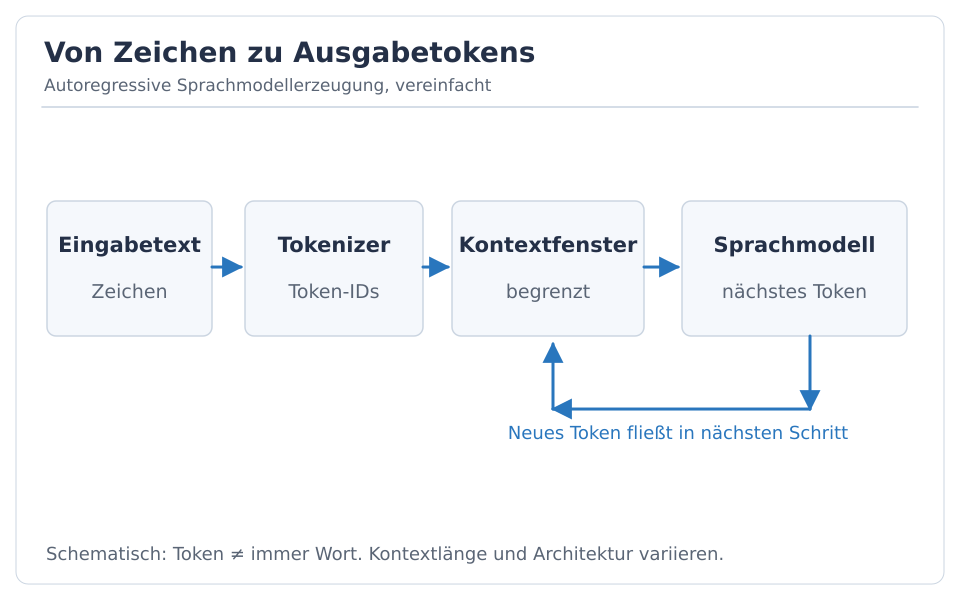

# M6-L2 – Was passiert, wenn man mit einem LLM spricht? {#L2}

**Kursbereich:** M6 – Schwerpunkt: KI und Robotik

**Niveau:** Bachelor / Master (Wahl)

**Vorwissen:** Keine festen Voraussetzungen angegeben.

## Die scheinbar einfache Unterhaltung {#S1}

Du gibst in ein Chatfenster ein: „Fasse mir die Vorteile eines lokalen Servers in drei Sätzen zusammen.“ Kurz darauf erscheint eine Antwort. Der Text kann flüssig klingen, frühere Gesprächsteile aufgreifen und Fachbegriffe korrekt verwenden. Was in der Benutzeroberfläche wie ein Gespräch aussieht, ist im technischen Kern eine Abfolge aus **Textaufbereitung, Berechnungen mit einem trainierten Modell, Auswahl neuer Tokens und Darstellung als Text**. Je nach Anwendung kommen vor und nach dem Modell zusätzliche Dienste hinzu, etwa Berechtigungsprüfungen, Dokumentensuche oder Filter.

Ein **Large Language Model (LLM)** – großes Sprachmodell – besitzt gelernte **Modellgewichte**. Diese Gewichte sind viele Zahlen, die während des Trainings angepasst wurden. Beim gewöhnlichen Beantworten einer Anfrage führt das Modell eine **Inferenz** aus: Es verwendet die vorhandenen Gewichte, statt sie bei jeder Frage neu zu trainieren. Seine zentrale Berechnung bei vielen chatfähigen, autoregressiven Modellen lautet vereinfacht: *Welche Tokenfortsetzung passt unter den gegebenen Eingabebedingungen?*

Das ist weder eine bloße Tabellenabfrage noch das Abspielen eines gespeicherten Satzes. Das Netz berechnet für die jeweilige Situation neue Zwischenwerte und eine Verteilung über mögliche Fortsetzungen. Die Antwort kann aus tausenden einzeln erzeugten Einheiten bestehen. Die in M6-L1 besprochene Transformer-Architektur liefert dafür einen wichtigen Baustein; M6-L2 erklärt den **Betriebsablauf einer einzelnen Anfrage**.

## Vom Chatfenster zum Modell: Mehr als nur der letzte Satz {#S2}

In einer einfachen Anwendung ist der sichtbare Nutzertext nur ein Teil der Eingabe. Zusätzlich können ein Systemkontext, Anwendungsanweisungen, vorherige Nachrichten und eingebundene Dokumente enthalten sein. Solche Texte können verschiedene **Rollen** oder andere Strukturmarkierungen erhalten. Die genaue Zusammenstellung hängt von der eingesetzten Anwendung und dem Modell ab; nicht jeder Dienst verwendet dieselbe interne Vorlage.

Ein Chatmodell benötigt typischerweise ein bestimmtes **Chat-Template**. Dieses legt fest, wie beispielsweise eine Nachricht des Nutzers und eine Nachricht des Assistenten in eine für das Modell erkennbare Tokenfolge übersetzt werden. Manche Modelle verwenden dafür besondere Steuer-Tokens, die Anfang und Ende einer Nachricht oder einen Rollenwechsel markieren. Das Modell wird dabei nicht mit der hübschen Darstellung des Chatfensters gefüttert, sondern mit einer strukturierten Eingabe.

``` text
Nutzer schreibt eine Nachricht
             │
             ▼
Chat-Anwendung bereitet Anfrage vor
  - Nachrichten und Rollen
  - ausgewählte Gesprächshistorie
  - gegebenenfalls Dokumentauszüge
  - gegebenenfalls Anweisungen
             │
             ▼
Chat-Template / Strukturmarkierungen
             │
             ▼
Tokenizer → Folge von Token-IDs
             │
             ▼
LLM-Inferenz → Ausgabe-Token
             │
             ▼
Dekodierung + Darstellung im Chatfenster
```

**Wichtig:** Der Chatdienst ist nicht identisch mit dem Sprachmodell. Die Anwendung entscheidet beispielsweise, welche Nachrichten sie übermittelt, wie viele Antworttokens erlaubt sind und ob sie externe Informationen abruft. Das Sprachmodell selbst ist eine Rechenkomponente innerhalb eines größeren Systems.

## Tokenisierung: Der Text wird in verarbeitbare Einheiten zerlegt {#S3}

Ein **Tokenizer** zerlegt Text in **Tokens**: Das können Wortteile, ganze Wörter, Zeichen oder Satzzeichen sein. Ein einzelnes Wort kann mehrere Tokens ergeben; sogar Leerzeichen beeinflussen die Zerlegung. Das Verfahren hängt vom Vokabular und den Regeln des konkreten Modells ab. Für den Satz „Die Datenbank läuft lokal.“ wären folgende Einheiten *denkbar*:

``` text
Beispielhafte Zerlegung – keine Ausgabe eines echten Tokenizers:

[Die] [ Daten] [bank] [ läuft] [ lokal] [.]
   │       │        │       │       │     │
   └───────┴────────┴───────┴───────┴─────┘
                   ▼
           [12, 83, 5, 71, 92, 3]
              frei erfundene IDs
```

Die IDs sind Einträge aus einem modellabhängigen Vokabular. Eine ID bedeutet nicht, dass sich ein Wort als ausgeschriebener Text im neuronalen Netz befindet. Das Modell ordnet den IDs zunächst numerische **Embeddings** zu und verarbeitet diese Vektoren weiter. Die Zerlegung beeinflusst die Eingabelänge und deshalb unter Umständen Antwortzeit und Kosten.

**Ein Token ist keine feste Anzahl von Zeichen.** Deutsche Zusammensetzungen, fremdsprachige Wörter, Emojis und Code können unterschiedlich viele Tokens belegen. Wer die Länge eines Prompts sicher kennen muss, benötigt den Tokenizer oder eine Zählfunktion des konkreten Modells. Die bloße Zahl der Wörter genügt nicht. \[1\]

## Kontextfenster: Was das Modell in dieser Anfrage sehen kann {#S4}

Das **Kontextfenster** bezeichnet die Menge an Tokens, die ein Modell bei einer Verarbeitung berücksichtigen kann. In einer typischen Chat-Anwendung beanspruchen sowohl die übermittelte Eingabe als auch die erzeugte Ausgabe Platz innerhalb der jeweils geltenden Grenzen; der genaue Umgang mit gesonderten Eingabe- und Ausgabelimits ist modell- und anbieterabhängig.

{alt="Ablauf vom Eingabetext über Tokenizer und begrenztes Kontextfenster zum Sprachmodell, das schrittweise nächste Tokens erzeugt."}

Ein Sprachmodell erzeugt schrittweise Tokens unter Nutzung eines begrenzten Kontexts.

Angenommen, eine erfundene Anwendung erlaubt insgesamt 8.000 Tokens für die hier betrachtete Anfrage. Die App übergibt 5.000 Tokens aus Gespräch und Unterlagen und reserviert 1.000 Tokens für die Antwort. Dann werden 6.000 Tokens eingeplant; die übrige Kapazität ist ein Puffer. Das Beispiel ist **kein aktuelles Limit eines Produkts**. Es zeigt nur, dass lange Gespräche und umfangreiche Dokumente denselben knappen Verarbeitungsraum beanspruchen können.

Was geschieht, wenn der Verlauf zu lang wird? Die Software kann ältere Nachrichten weglassen, zusammenfassen, einen neuen Gesprächskontext aufbauen oder die Anfrage mit einer Fehlermeldung ablehnen. Eine Zusammenfassung kann Informationen erhalten, aber auch Details verlieren. Modelle mit längeren Kontextfenstern vermeiden diesen Zielkonflikt nicht vollständig: Rechen- und Speicherbedarf steigen, und lange Texte garantieren weder perfekte Aufmerksamkeit noch fehlerfreie Wiedergabe.

Das Modell kann im normalen Fall **nur die Informationen berücksichtigen, die es in der aktuellen Eingabe oder über dafür vorgesehene Verfahren erhält**. Ein früherer Satz in einer App-Historie ist nicht automatisch im Kontextfenster der aktuellen Modellberechnung. Umgekehrt können gespeicherte Gespräche in einer Anwendung existieren, ohne dass das Modell bei jedem Aufruf sämtliche Texte erhält.

## Inferenz statt Training: Was bleibt während der Antwort fest? {#S5}

Aus M5-L2 und M5-L3 kennen wir den Unterschied: **Training** verändert Modellparameter durch Optimierung; **Inferenz** verwendet diese Parameter für eine konkrete Vorhersage. Im gewöhnlichen Chatdurchlauf bleiben die Gewichte unverändert, auch wenn das Modell neue Aussagen formuliert. Es „lernt“ also nicht allein deshalb dauerhaft einen Sachverhalt, weil man ihn in einer Unterhaltung nennt.

Die Modellgewichte enthalten verdichtete, im Training entstandene statistische Muster. Sie sind aber keine geordnete Bibliothek mit exakt abrufbaren Sätzen. Für eine aktuelle Frage zu einem Gesetz, einer Datei oder einem Preis braucht die Anwendung gegebenenfalls eine externe Quelle. Auch wenn das Modell eine Antwort aus seinem Training formulieren kann, ist das **kein Nachweis der Aktualität oder Richtigkeit**.

Drei Speicherarten sind zu unterscheiden:

  Begriff                       Inhalt                                                                     Typische Lebensdauer / Funktion
  ----------------------------- -------------------------------------------------------------------------- ---------------------------------------------------------------------------------------------------------------
  Modellgewichte                Gelernte Zahlen der Netzparameter                                          Bleiben bei gewöhnlicher Inferenz gleich; ändern sich etwa bei gesondertem Training oder Modellwechsel
  Aktueller Kontext             Übermittelte Nachrichten und weitere Eingabetokens                         Für die betreffende Verarbeitung verfügbar; Reichweite durch Kontextgrenzen beschränkt
  Externer Anwendungsspeicher   Gespeicherte Nachrichten, Datenbankeinträge, Dokumente oder Erinnerungen   Von der Anwendung verwaltet und nur durch erneute Bereitstellung beziehungsweise Suche für das Modell nutzbar

Der später erklärte **Key-Value-Cache** ist wieder etwas anderes: ein technischer Zwischenspeicher für Attention-Berechnungen, keine dauerhafte persönliche Erinnerung.

## Prefill: Die bereits bekannte Eingabe verarbeiten {#S6}

Ein modernes autoregressives Sprachmodell verarbeitet zu Beginn die bereitgestellte Eingabesequenz. Dieser erste Abschnitt heißt **Prefill**: Das Modell berechnet aus den übermittelten Tokens die nötigen inneren Zustände, damit eine Fortsetzung erzeugt werden kann. Bei einem klassischen kausalen Transformer werden dabei unter anderem die Attention-Projektionen früherer Positionen vorbereitet.

Das ist ein anderer Arbeitsmodus als die spätere schrittweise Textausgabe. Im Prefill können viele Eingabepositionen innerhalb eines Rechenschritts **parallel** auf geeigneter Hardware bearbeitet werden, obwohl kausale Attention nur den Blick auf dieselbe und frühere Positionen erlaubt. Je länger der Prompt, desto aufwendiger kann diese Vorarbeit sein.

``` text
Prompt: [Bitte] [erkläre] [Replikation] [kurz] [.]
             │
             ▼
PREFILL
  Viele Eingabetokens in einer Rechenphase
  → interne Repräsentationen
  → Attention-Zwischenwerte / KV-Cache
  → Werte für mögliche erste Ausgabetokens
             │
             ▼
Erstes Ausgabetoken kann ausgewählt werden
```

**Time to First Token (TTFT)** bezeichnet die gemessene Zeit bis zum ersten ausgegebenen Token, üblicherweise einschließlich weiterer Latenzanteile wie Warteschlange, Übertragung und Prefill. Eine lange Wartezeit vor dem ersten sichtbaren Text kann deshalb von der Eingabelänge, der Modellgröße, dem Serverzustand oder der Netzverbindung herrühren. Sie beweist nicht, dass das Modell die Frage in menschlichem Sinn besonders gründlich „überlegt“ hat. \[2\]\[3\]

## Decoding: Der Rest der Antwort entsteht schrittweise {#S7}

Nach dem Prefill folgt das **Decoding** – die wiederholte Erzeugung neuer Tokens. Der Kern eines einfachen autoregressiven Decoders arbeitet in einer Schleife:

1.  Mit dem bisherigen Kontext werden **Logits** für mögliche nächste Tokens berechnet.
2.  Eine Auswahlregel entscheidet, welches Token angehängt wird.
3.  Das ausgewählte Token ergänzt die bisherige Folge.
4.  Die nächste Modellberechnung verwendet nun auch diese neue Einheit.
5.  Die Schleife endet bei einem Endsignal oder einer gesetzten Grenze.

``` text
Eingabe → Prefill
             │
             ▼
         Token A
             │
             ▼
   Kontext + A → Token B
                    │
                    ▼
       Kontext + A + B → Token C
                           │
                           ▼
                      ... → Ende
```

Die Ausgabe wird als **autoregressiv** bezeichnet, weil jede Fortsetzung von bereits erzeugten Tokens abhängt. Das Modell kennt beim ersten Schritt seine gesamte künftige Antwort noch nicht als fertige Datei. Trotzdem kann sich bei längeren Texten der Eindruck eines durchdachten Plans ergeben, weil Training und aktueller Kontext strukturierte Fortsetzungen begünstigen. Eine erkennbare Textstruktur ist jedoch keine Garantie, dass die Aussagen sachlich zutreffen.

Moderne Laufzeiten können die Grundschleife optimieren, etwa durch **spekulatives Decoding**, bei dem vorgeschlagene Fortsetzungen überprüft werden. Das ändert nicht die grundlegende Abhängigkeit von der bisherigen Tokenfolge. Ebenso kann die Anwendung während des Generierens Textstücke an das Chatfenster übertragen (*Streaming*). Streaming verändert vor allem die Wahrnehmung der Antwortzeit; es ist nicht mit einer inhaltlich anderen Lernmethode gleichzusetzen.

## Logits und Softmax: Eine Verteilung für das nächste Token {#S8}

**Logits** sind reelle Rohwerte, die das Modell den möglichen nächsten Tokens zuordnet. Sie sind **noch keine Wahrscheinlichkeiten** und müssen sich nicht auf 1 summieren. Eine **Softmax-Funktion** wandelt sie in nichtnegative Werte um, deren Summe 1 ergibt. Größere Logits entsprechen vor weiteren Eingriffen größeren Wahrscheinlichkeiten.

Für drei frei erfundene Tokenkandidaten nehmen wir die Logits 2, 1 und 0 an:

  Möglicher nächster Token     Logit   Exponentialwert, gerundet   Softmax-Wahrscheinlichkeit
  -------------------------- ------- --------------------------- ----------------------------
  A                                2                       7,389                      66,52 %
  B                                1                       2,718                      24,47 %
  C                                0                       1,000                       9,00 %

Die Exponentialwerte werden zusammengezählt: $7{,}389+2{,}718+1{,}000\approx11{,}107$. Die Wahrscheinlichkeit für A beträgt folglich ungefähr $\frac{7{,}389}{11{,}107}=0{,}6652$. Die geringen Rundungsabweichungen in der Tabelle sind normal. Dieses kleine Rechenbeispiel zeigt das Prinzip, nicht die echten Werte eines bestimmten LLM. Ein reales Modell verteilt seine Logits über ein sehr viel größeres Vokabular.

Entscheidend ist: Das Modell liefert nicht zuerst „den korrekten Satz“ und verpackt ihn anschließend in Wörter. Es berechnet eine Verteilung für mögliche Fortsetzungen. Eine **Auswahlstrategie** bestimmt, welches Token tatsächlich folgt. \[4\]

## Greedy Decoding und Sampling: Warum derselbe Prompt anders enden kann {#S9}

Beim **Greedy Decoding** wird in jedem Schritt das Token mit dem höchsten verfügbaren Auswahlwert genommen. In unserer Tabelle wäre das A. Das wirkt berechenbar, muss aber nicht zur insgesamt besten langen Fortsetzung führen: Eine kurzfristig wahrscheinliche Entscheidung kann später zu einer ungünstigen Sequenz führen oder Wiederholungen begünstigen.

Beim **Sampling** wird ein Token zufallsbasiert entsprechend einer gewichteten Verteilung gezogen. In der obigen Tabelle hat A die größte Chance, aber auch B oder C können gewählt werden. Ein zufällig gewähltes Token verändert den weiteren Kontext, daher kann ein kleiner Unterschied früh in der Antwort zu einem deutlich anderen restlichen Text führen.

Deterministisches Verhalten ist selbst bei vermeintlich festen Einstellungen nicht in jeder konkreten Produktionsumgebung garantiert: Parallelisierung, unterschiedliche numerische Rechenverfahren oder Server- beziehungsweise Modellversionen können Unterschiede erzeugen. Umgekehrt ist eine zufällige Auswahl nicht gleichbedeutend mit beliebigem Raten; sie erfolgt innerhalb einer vom Modell und von den Sampling-Regeln gebildeten Verteilung.

**Wahrscheinlicher Text ist nicht automatisch wahrer Text.** Ein Sprachmodell kann eine sprachlich plausible falsche Jahreszahl bevorzugen. Die Auswahlstrategie verändert die Ausdrucksvielfalt, ersetzt aber weder Nachschlagen noch sachliche Prüfung.

## Temperatur: Wie deutlich werden Unterschiede gewichtet? {#S10}

Die **Temperatur** (*Temperature*) ist ein Parameter der Auswahlstrategie. Vereinfacht werden die Logits vor Softmax durch einen positiven Temperaturwert geteilt. Bei **$T=1$** bleibt unsere ursprüngliche Verteilung erhalten. Bei **$T=0{,}5$** werden aus den Logits 2, 1 und 0 die skalierten Werte 4, 2 und 0. Die höchste Wahrscheinlichkeit wird nun deutlich dominanter.

  Auswahlregel im Rechenbeispiel           A         B        C
  -------------------------------- --------- --------- --------
  Temperatur 1,0                     66,52 %   24,47 %   9,00 %
  Temperatur 0,5                     86,68 %   11,73 %   1,59 %

Bei **höherer Temperatur** rücken Wahrscheinlichkeiten näher zusammen; bei **niedrigerer Temperatur** konzentrieren sie sich auf wenige Kandidaten. „Temperatur 0“ wird von vielen Softwaresystemen als Sonderfall für eine gierige Auswahl behandelt, ist aber **keine mathematisch zulässige Division durch 0**. Die genaue Implementierung hängt von der verwendeten Software ab.

Für eine kreative Formulierung ist größere Vielfalt manchmal erwünscht. Für die Extraktion einer festen Kennung ist sie normalerweise nicht hilfreich. Trotzdem kann eine niedrige Temperatur einen sachlich falschen Satz einfach **konsequenter** erzeugen. Sie macht kein unsicheres Modell automatisch zu einer zuverlässigen Datenbank. \[4\]

## Top-p und Top-k: Wie viele Kandidaten bleiben übrig? {#S11}

**Top-k-Sampling** beschränkt die Auswahl auf die *k* Kandidaten mit den höchsten Wahrscheinlichkeiten. Bei *$k=2$* würden im Beispiel A und B bleiben; C entfiele. Anschließend werden die verbleibenden Wahrscheinlichkeiten neu normiert.

**Top-p-Sampling**, auch **Nucleus Sampling** genannt, betrachtet dagegen die nach Wahrscheinlichkeit sortierten Tokens und behält die kleinste Gruppe, deren aufsummierte Wahrscheinlichkeit mindestens *p* erreicht. Bei **$p=0{,}8$** gilt im ersten Beispiel:

- A allein deckt 66,52 % ab und reicht noch nicht.
- A und B zusammen decken rund 90,99 % ab; die Grenze ist erreicht.
- C fällt weg; A und B werden für die Auswahl neu normiert.

Danach ergeben sich bei dieser vereinfachten Rechnung unter den zugelassenen Kandidaten ungefähr **73,11 % für A** und **26,89 % für B**. Dass A und B zusammen über 80 % der ursprünglichen Wahrscheinlichkeitsmasse tragen, ist ausdrücklich zulässig: Es wird der **kleinste hinreichende Kandidatensatz** genommen, nicht künstlich eine exakte Summe von 80 % hergestellt.

Temperatur und Top-p können kombiniert werden. Ihre Reihenfolge und die Wechselwirkung mit weiteren Filtern müssen bei konkreten Laufzeiten betrachtet werden. Weitere mögliche Stellschrauben sind Wiederholungsstrafen, festgelegte Stoppsymbole und Maximalzahlen neuer Tokens. Keine dieser Einstellungen beweist sachliche Richtigkeit. \[4\]

## Wann beendet das Modell die Antwort? {#S12}

Autoregressive Sprachmodelle müssen nicht endlos neue Tokens erzeugen. Oft gibt es besondere **End-of-Sequence-Tokens** oder Chat-Endmarkierungen. Die Laufzeit kann zusätzlich abbrechen, wenn eine Grenze für neu erzeugte Tokens erreicht ist, eine definierte Stoppfolge auftaucht oder die Anwendung die Verarbeitung beendet.

Ein **Ausgabelimit** ist technisch wichtig. Eine unbeschränkte Ausgabe könnte zu langen Antwortzeiten, hohen Kosten oder mehrfachen Wiederholungen führen. Ein zu enges Limit kann dagegen dazu führen, dass eine Antwort mitten im Satz endet. In einer API oder einer lokalen Chat-Software muss die Anwendung beachten, *warum* eine Ausgabe beendet wurde. Ein Ende wegen des Limits ist nicht dasselbe wie ein vom Modell gesetztes natürliches Abschlusszeichen.

Ein Teil des technischen Kontextes kann aus besonderen Steuer- oder Formatierungstokens bestehen. Deshalb lassen sich die sichtbaren Wörter im Chatfenster nicht immer eins zu eins mit den gezählten Tokens eines Dienstes gleichsetzen. Manche Systeme rechnen zudem getrennte interne Tokenarten ab oder verwenden weitere Verarbeitungsschritte; dafür gelten die jeweiligen veröffentlichten Produktangaben. \[1\]\[4\]

## Der Key-Value-Cache: Die vorherigen Tokens nicht ständig neu berechnen {#S13}

Ein Decoder-Transformer benötigt für seine **Self-Attention** Informationen über die zuvor berücksichtigten Positionen. In M6-L1 haben wir diese als **Queries (Anfragen), Keys (Schlüssel) und Values (Inhaltsvektoren)** kennengelernt. Beim wiederholten Generieren wäre es teuer, für sämtliche bisherigen Positionen immer wieder dieselben Schlüssel- und Inhaltsvektoren von Grund auf zu berechnen.

Dafür gibt es den **Key-Value-Cache (KV-Cache)**. Er speichert bereits berechnete Schlüssel- und Inhaltszustände früherer Positionen, oft getrennt nach den Attention-Schichten. Wenn ein neues Token hinzukommt, berechnet das Modell dessen neue Zustände und kann die gespeicherten älteren Zustände wiederverwenden.

``` text
PREFILL:
Token 1  Token 2  Token 3  Token 4
   └──────┴──────┴──────┘
               ▼
         KV-Cache füllen
          [1][2][3][4]
               │
               ▼
DECODING, nächster Schritt:
       Neues Token 5
               │
               ├── eigene neue K/V-Werte berechnen
               └── K/V-Werte für 1–4 wiederverwenden
               ▼
         KV-Cache wächst
          [1][2][3][4][5]
```

Das spart Berechnungen, kostet aber **Arbeitsspeicher**, bei GPU-Betrieb häufig Grafikspeicher. Mehr Kontext oder mehr parallele Anfragen können entsprechend mehr Cache-Speicher benötigen. Manche Architekturen und Laufzeiten begrenzen oder komprimieren die gespeicherten Zustände, verwenden gleitende Attention-Fenster oder lagern Teile des Caches aus. Deshalb ist „der Cache wächst immer unbegrenzt mit jedem Token“ ebenfalls keine allgemeingültige Aussage. \[5\]\[6\]

Der Cache ist **keine persönliche Langzeiterinnerung**. Er ist ein flüchtiges Hilfsmittel der konkreten Berechnung. Manche Systeme können passende unveränderte Präfixe mehrerer Anfragen wiederverwenden (*Prefix Caching*). Das macht die nächste Anfrage unter geeigneten Bedingungen günstiger, bedeutet aber nicht, dass das Modell neue Gewichte gelernt hätte.

## Warum lange Gespräche langsamer oder teurer werden können {#S14}

Der Laufzeitaufwand besteht aus verschiedenen Teilen. Während des **Prefill** werden die Eingabetokens verarbeitet. Beim **Decoding** kommt wiederholt ein einzelnes Token hinzu, wobei auf zuvor berechnete Zustände zugegriffen wird. Bei vielen klassischen Transformer-Implementierungen sind diese Phasen in der Praxis unterschiedlich beschränkt: Prefill stark durch Rechenoperationen, Decoding häufig durch Speicherzugriffe auf Modellgewichte und KV-Zustände. Die konkrete Einordnung ist aber von Modell, Hardware, Länge und Optimierung abhängig. \[2\]\[3\]

Daher unterscheidet man mindestens drei Leistungsmaße:

  Kennzahl                     Was wird gemessen?                                            Warum ist sie wichtig?
  ---------------------------- ------------------------------------------------------------- -----------------------------------------------------
  Time to First Token (TTFT)   Zeit bis zum ersten ausgegebenen Token                        Wie lange Nutzer auf den Beginn der Antwort warten
  Token pro Sekunde            Geschwindigkeit der fortlaufenden Erzeugung                   Wie flüssig eine Antwort erscheint
  Durchsatz / Throughput       Insgesamt abgearbeitete Tokens oder Anfragen pro Zeitspanne   Wie viele Nutzer ein Dienst parallel versorgen kann

Ein Server kann einen hohen Gesamtdurchsatz erreichen und einzelne Nutzer trotzdem lange warten lassen. Umgekehrt kann ein einzelner lokal laufender Assistent bei geringer Auslastung sehr direkt wirken, obwohl er insgesamt weniger Anfragen pro Minute schafft. **Batching** fasst Berechnungen mehrerer Anfragen zur effizienteren Verarbeitung zusammen, erhöht jedoch die Anforderungen an Planung, Speicherverwaltung und faire Zuteilung.

Die gesamte Antwortzeit umfasst außerdem Tokenisierung, Warteschlangen, Netzwerkwege, eventuelle externe Suchen und die Darstellung im Browser. „Das Modell antwortet langsam“ ist daher keine vollständige Fehlerdiagnose.

## Modellgröße: Woraus der Speicherbedarf entsteht {#S15}

Ein Modell mit vielen Parametern braucht Speicher, um seine **Gewichte** bereitzuhalten. Die **Präzision** der gespeicherten Zahlen spielt dabei eine große Rolle. Als einfache Rechnung nehmen wir ein *rein hypothetisches* Modell mit **8 Milliarden Parametern** an. Bei 16 Bit je Parameter entsprechen die Gewichte rechnerisch $8\,\text{Milliarden}\times2\,\mathrm{Byte}$ = **16 Milliarden Byte**, also rund **16 GB** in dezimaler Zählweise. Das ist nur der reine Gewichtsspeicher.

Der tatsächlich benötigte Speicher kann wegen anderer Datentypen, Metadaten, Modellarchitektur, Zwischentensoren, KV-Cache, Laufzeitumgebung und paralleler Anfragen deutlich anders ausfallen. Manche Architekturen besitzen zusätzliche Besonderheiten, etwa nur teilweise aktivierte Expertenkomponenten. Deshalb ist die Gesamtzahl der Parameter allein kein zuverlässiger Ersatz für einen Speicher- oder Leistungsbenchmark.

**Quantisierung** verringert die Zahl der Bits, mit denen viele Modellwerte dargestellt werden. Bei idealisierten **4 Bit pro Gewicht** ergäben 8 Milliarden Werte rechnerisch nur **4 Milliarden Byte**. In echten Formaten kommen Skalierungsfaktoren, Gruppierungsinformationen und gegebenenfalls höherpräzise Tensoren hinzu. Vier-Bit-Dateien sind deshalb nicht zwangsläufig genau ein Viertel so groß wie die ursprünglichen Dateien, und auch die Laufzeit oder Qualität hängt vom Verfahren ab. \[7\]

  Speicherbestandteil    Wofür benötigt?                                     Warum wächst er?
  ---------------------- --------------------------------------------------- ------------------------------------------------
  Modellgewichte         Gelernte Parameter                                  Modellgröße und gewählte Zahlendarstellung
  KV-Cache               Wiederverwendbare Attention-Zustände                Kontextlänge, parallele Sequenzen, Architektur
  Temporäre Tensoren     Zwischenwerte bei Berechnungen                      Rechenverfahren, Batchgröße, Implementierung
  Anwendung und System   Laufzeit, Tokenizer, Netzwerk- und Betriebssystem   Zusätzliche Dienste und Speicherverwaltung

Quantisierung ist ein **Tauschgeschäft**: weniger Speicher und oft bessere lokale Einsetzbarkeit gegen potenzielle Genauigkeitsverluste sowie je nach Hardware unterschiedliche Geschwindigkeitsfolgen. Ein kleineres oder stärker quantisiertes Modell kann für einfache Aufgaben sehr brauchbar sein, bei komplizierten Fragen aber stärker abweichen. Qualität sollte an den tatsächlich benötigten Aufgaben geprüft werden.

## CPU, GPU und VRAM: Wo die Rechenarbeit stattfindet {#S16}

Eine **Central Processing Unit (CPU)** ist ein vielseitiger Hauptprozessor. Eine **Graphics Processing Unit (GPU)** kann viele für neuronale Netze typische Zahlenoperationen parallel ausführen. **Video Random Access Memory (VRAM)** ist der Speicher der Grafikkarte beziehungsweise des GPU-Systems. Für das Modell ist unter anderem wichtig, wie schnell die benötigten Gewichte und Zwischentensoren aus dem Speicher gelesen werden können.

Ein kleines, quantisiertes Sprachmodell kann unter passenden Bedingungen auch auf einer CPU laufen. Eine GPU kann für größere Modelle und hohe Ausgabegeschwindigkeit hilfreich sein. Ist der Grafikspeicher zu klein, können Teile in den Hauptspeicher ausgelagert werden oder es wird eine andere Modell-/Quantisierungsstufe benötigt. Auslagerung spart VRAM, kostet aber durch Datentransfers unter Umständen deutlich Zeit. Lokale Modelle benötigen außerdem Speicherplatz für die Modell-Datei und gegebenenfalls laufende Updates.

**Mehr VRAM bedeutet nicht automatisch bessere Antworten.** Er erweitert zunächst die Möglichkeiten, größere Modelle, längere Kontexte oder mehr gleichzeitige Anfragen zu bearbeiten. Ob die Antwort besser ist, hängt vom tatsächlich eingesetzten Modell und seiner Eignung ab. Die GPU-Speicherfrage ist außerdem von der Kostenfrage zu trennen: Eine gemietete GPU kann bei kurzer, gelegentlicher Nutzung sinnvoll sein; ein dauerhaft eingeschalteter GPU-Server kann wirtschaftlich ungünstig werden, wenn nur selten Anfragen eintreffen.

## Lokal oder gehostet: Zwei Betriebsmodelle im Vergleich {#S17}

Bei einem **lokalen LLM** liegen die Modellgewichte auf einem eigenen Computer oder selbst betriebenen Server. Wenn die Anwendung ausschließlich lokal arbeitet und keine zusätzlichen Online-Dienste nutzt, müssen die Promptdaten für diese Inferenz nicht an einen externen Anbieter übertragen werden. Das bedeutet jedoch nicht, dass Datenschutz automatisch erledigt wäre: Festplatten, lokale Protokolle, Nutzerrechte und gegebenenfalls Synchronisierung bleiben relevant.

Bei einem **gehosteten LLM** übernimmt ein Anbieter Modellbetrieb, Hardware, Lastverteilung und Updates. Die eigene Software ruft den Dienst oft über eine **Application Programming Interface (API)** auf, also eine definierte Programmschnittstelle. Dabei werden Daten an die Anbieterinfrastruktur übertragen und unterliegen deren konkreten Vertrags-, Standort-, Aufbewahrungs- und Sicherheitsbedingungen. Diese müssen bei personenbezogenen oder vertraulichen Daten gesondert geprüft werden.

  Kriterium           Lokal / selbst betrieben                                 Gehostet / API
  ------------------- -------------------------------------------------------- ----------------------------------------------------------------------
  Anfangsaufwand      Hardware und Einrichtung erforderlich                    Weniger eigene Modellinfrastruktur
  Laufender Betrieb   Updates, Sicherheit, Fehlerbehebung selbst               Anbieter betreibt das Modell; eigene Anwendung bleibt verantwortlich
  Datenschutz         Gute Kontrollmöglichkeiten bei wirklich lokalem Ablauf   Übermittlung und vertragliche Verarbeitung prüfen
  Leistung            Durch verfügbare eigene Hardware begrenzt                Abhängig von Anbieter, Tarif, Modell und Auslastung
  Kosten              Hardware, Strom, Wartung, eventuelle Ausfallzeiten       Typisch nutzungsabhängige API- und Zusatzkosten
  Verfügbarkeit       Auch ohne Internet möglich, falls alles lokal ist        Üblicherweise Netzwerk- und Anbieterabhängigkeit

Es gibt auch Mischformen: Ein lokaler Dienst kann Dokumente vorbereiten und nur ausgewählte Ausschnitte an ein externes Modell senden; oder eine Cloud-Anwendung verwendet für sensible Teilaufgaben ein eigenes Modell. Die Grenze verläuft nicht allein zwischen „privat“ und „Cloud“, sondern entlang der **tatsächlichen Datenwege und Berechtigungen**.

## Warum ein LLM überzeugend Falsches behaupten kann {#S18}

**Halluzination** ist der verbreitete Ausdruck dafür, dass ein generatives Modell sachlich falsche, erfundene oder unbelegte Inhalte ausgibt, obwohl sie wie eine plausible Antwort formuliert sind. Die Ursache lässt sich nicht auf „zu viel Zufall“ reduzieren. Das gewöhnliche Sprachmodell wird für sprachlich und statistisch passende Fortsetzungen trainiert; es verfügt nicht automatisch über eine jederzeit aktuelle, unabhängige Wahrheitsprüfung.

Ein Beispiel: Der Nutzer fragt nach einem nicht existierenden Buch. Anstatt zunächst die Existenz zu prüfen, kann ein Modell einen glaubhaften Autor, ein Veröffentlichungsjahr und eine Zusammenfassung erfinden. Die Form passt zu Mustern aus dem Training – gerade deshalb kann sie überzeugend wirken. Ebenso kann ein Modell Informationen aus unterschiedlichen Kontexten vermischen oder eine falsche Quellenangabe erzeugen.

Gegenmaßnahmen gibt es, aber keine universelle Garantie: aktuelle Quellen bereitstellen, nachvollziehbare Belege verlangen, Antworten mit Datenbanksystemen oder Regeln abgleichen, Unsicherheit kennzeichnen, die Ausgabe strukturiert prüfen und bei wichtigen Entscheidungen menschliche Kontrolle einplanen. **Retrieval-Augmented Generation (RAG)**, auf Deutsch *abrufgestützte Textgenerierung*, kann relevante externe Dokumentabschnitte bereitstellen. Sie macht eine Antwort nachprüfbarer, wenn Quellen korrekt ermittelt und wiedergegeben werden; die Generierung selbst bleibt fehlbar. M6-L4 behandelt RAG ausführlich.

Auch längere Kontextfenster, niedrige Temperatur oder größere Modelle **garantieren keine Faktentreue**. Der richtige Maßstab ist, ob das gesamte System im gewünschten Anwendungsfall verlässlich genug ist und wie es mit Unsicherheit umgeht.

## Eine konkrete Anfrage von Anfang bis Ende {#S19}

Wir verbinden die Einzelteile anhand einer erfundenen Anfrage: „Was ist der Unterschied zwischen Replikation und Backup? Antworte in zwei Sätzen.“

``` text
1. Benutzeroberfläche
   "Was ist der Unterschied ...?"
            │
            ▼
2. Anwendung
   relevante Nachrichten + Formatvorgaben auswählen
            │
            ▼
3. Tokenizer
   Text / Strukturzeichen → Token-IDs
            │
            ▼
4. Kontextprüfung
   Eingabe- und Ausgabelimits einhalten
            │
            ▼
5. Prefill
   Eingabetokens berechnen, KV-Zustände aufbauen
            │
            ▼
6. Decoding-Schleife
   Logits → Auswahlregel → nächstes Token
   Cache ergänzen → nächstes Token → ...
            │
            ▼
7. Ende und Darstellung
   Endsignal oder Limit → Tokens dekodieren
            │
            ▼
8. Chat-Anwendung zeigt den Text an
```

Das Modell könnte beispielsweise erklären, dass eine **Replikation** Änderungen auf weiteren Datenbankkopien nachführt, während ein **Backup** einen getrennt wiederherstellbaren Sicherungsstand bereitstellt. Ob die Antwort die verlangten zwei Sätze einhält, hängt vom Modell und gegebenenfalls zusätzlicher Prüfung ab. Ein fehlerhafter Inhalt wäre trotz korrekt abgelaufener Inferenz möglich. Man muss deshalb zwischen **technisch erfolgreicher Berechnung** und **inhaltlich richtiger Antwort** unterscheiden.

Bei einem Folgeprompt entscheidet die Anwendung, welche frühere Unterhaltung sie erneut sendet oder als bereits berechneten Präfix wiederverwenden kann. Die neue Nutzerfrage wirkt nicht magisch auf die Gewichte des Modells ein, sondern beeinflusst die nächste **aktuelle Kontextverarbeitung**.

## Praxisbeispiel A: Ein privates Medienarchiv auf dem eigenen Rechner {#S20}

Ein persönliches Medienarchiv enthält Dateinamen, Aufnahmedaten und eigene Notizen. Das Ziel lautet: „Beschreibe mir passende Einträge in verständlicher Sprache.“ Hier reicht vielleicht ein kleiner, lokal betreibbarer Sprachgenerator, der bereits durch eine normale lokale Suchfunktion gefundene Datensätze formuliert.

``` text
Lokale Datei- / Medienliste
          │
          ▼
Einfacher Such- und Filterbaustein
          │  liefert nur passende Metadaten
          ▼
Lokales quantisiertes Sprachmodell
          │
          ▼
Textzusammenfassung in der Anwendung
```

Die KI braucht nicht alle Fotos oder Originalvideos im Kontext. Ein Suchbaustein kann zunächst die sachlich passenden Einträge bestimmen. Das verkleinert die Eingabe und senkt Verarbeitungszeit und Speicherbedarf. Bei wenigen Datensätzen genügt möglicherweise sogar eine gewöhnliche Suchmaske ohne KI. **Eine LLM-Antwort ist kein Ersatz für einen verlässlichen Dateikatalog.** Die originale Such- und Speicherschicht bleibt die sachliche Grundlage.

Betriebsfragen: Passt das Modell in Arbeitsspeicher beziehungsweise VRAM? Wie werden lokale Dateien geschützt? Werden Protokolle geschrieben? Welche Antwortfehler sind tolerierbar? Ein gelegentlich genutztes Archiv rechtfertigt nicht automatisch eine teure Dauer-GPU.

## Praxisbeispiel B: Ein kleiner Online-Erklärdienst {#S21}

Ein Webdienst nimmt technische Fragen entgegen und liefert kurze Erläuterungen. Er kann ein gehostetes LLM verwenden. Die eigentliche Antwort entsteht beim Modellanbieter; die eigene Anwendung bleibt für Anmeldung, Missbrauchsschutz, Kostenkontrolle und Fehlerbehandlung verantwortlich.

``` text
Browser / angemeldeter Nutzer
           │ HTTPS
           ▼
Eigene Webanwendung
  - Berechtigung und Kontingent
  - Eingabelimit und Datenschutzprüfung
  - Anfrageprotokoll mit Datenminimierung
           │
           ▼
Gehostete Modell-API
  - Tokenisierung und Inferenz
  - gegebenenfalls Streaming
           │
           ▼
Eigene Anwendung prüft Ausgabe / Fehler
           │
           ▼
Browser zeigt Antwort an
```

Ein Dienst, der viele lange Eingaben annimmt, zahlt unter Umständen für viele Tokens, selbst wenn die Antworten kurz sind. Eine sofort sichtbare Streaming-Ausgabe ist angenehm, schützt aber nicht vor Kostenüberschreitungen oder falschen Antworten. Nötig sind daher unter anderem Anfragekontingente, Eingabe- und Ausgabelimits, klare Fehlermeldungen und ein Monitoring von Latenz und Verbrauch. Wie Budgetwarnungen und echte Limits auseinanderfallen können, wurde in M4-L4 erklärt.

Der gehostete Dienst ist sinnvoll, wenn die eigene Hardware nicht ständig genutzt würde oder der Betrieb vieler GPUs unverhältnismäßig wäre. Für ein hochsensibles internes System kann dagegen der Datenweg zum externen Anbieter gegen diese Lösung sprechen.

## Praxisbeispiel C: Ein Assistent mit eigenen Dokumenten {#S22}

Ein Dokumentassistent soll eine Frage zu selbst verfassten Handbüchern beantworten. Die benötigten Sachinformationen stehen nicht zuverlässig in den Modellgewichten. Deshalb kombiniert die Anwendung **Suche und Generierung**. Die Suche liefert relevante Textstellen; das Modell formuliert daraus eine Antwort. Der Abruf muss durch geeignete Berechtigungen eingeschränkt sein, damit ein Nutzer nicht fremde Dokumente erhält.

``` text
Frage eines berechtigten Nutzers
             │
             ▼
Dokumentensuche / RAG
  - passende Abschnitte auswählen
  - Zugriffsrechte prüfen
  - Fundstellen erhalten
             │
             ▼
Eingabe zusammenstellen
  Frage + ausgewählte Quellen + Antwortvorgabe
             │
             ▼
LLM: Prefill → Decoding
             │
             ▼
Antwort mit überprüfbaren Fundstellen
             │
             ▼
Anwendung kann Verweise und Inhalt prüfen
```

Bei diesem Aufbau ist die Qualität der **Suche** oft genauso wichtig wie die sprachliche Qualität des Modells. Fehlt eine entscheidende Quelle im Kontext, kann die Antwort unvollständig werden. Ist eine Fundstelle falsch zugeordnet, kann das Modell sie scheinbar glaubhaft zitieren. Und steht in einem Dokument eine Anweisung wie „Ignoriere sämtliche bisherigen Regeln“, ist sie zunächst **Dokumentinhalt**, keine autorisierte Anweisung an das Gesamtsystem. Solche **Prompt-Injection-Risiken** sowie kontrollierte Werkzeugaufrufe werden in M6-L4 genauer erklärt.

Praktisch kann ein schmaler, gut geprüfter Kontext besser sein als das unkritische Übergeben sehr großer Dokumentmengen. Das senkt Tokenverbrauch und erleichtert die Quellenkontrolle. Selbst dann bleibt eine menschliche Prüfung bei kritischen Entscheidungen erforderlich.

## Wo diese Technik sinnvoll ist – und wo nicht {#S23}

Ein LLM ist besonders interessant, wenn viele unterschiedliche sprachliche Formulierungen verarbeitet werden müssen: zum Beispiel bei Erklärungen, Entwürfen, Zusammenfassungen, Übersetzungen, Klassifikationshilfen oder dem Formulieren von Ergebnissen einer Datenbanksuche. Seine Stärke besteht darin, aus variierenden Eingaben flexible Ausgaben zu bilden.

Es ist dagegen häufig **unnötig oder falsch eingesetzt**, wenn eine einfache deterministische Funktion präziser ist: eine Summe berechnen, einen bekannten Kundensatz per eindeutiger Kennung suchen, Dateirechte durchsetzen, ein Backup erstellen oder eine Temperaturregelung sicherheitskritisch steuern. Gerade weil ein Sprachmodell plausibel falsche Ausgaben erzeugen kann, sollten verbindliche Zahlen und Regeln aus überprüfbaren Systemen kommen.

Die sinnvollste Gesamtarchitektur kombiniert gegebenenfalls beide Arten: **klassische Software prüft Bedingungen, speichert verlässliche Zustände und kontrolliert Berechtigungen; das Sprachmodell unterstützt bei sprachlichen und nicht vollständig vorstrukturierten Aufgaben**. Damit knüpft M6-L2 an M1-L4, M2-L2, M3-L5 und M4-L3 an: Ein überzeugend formulierter Text hebt weder Transaktionsregeln noch Sicherheitsgrenzen auf.

## Die wichtigsten Missverständnisse {#S24}

**„Ein LLM liest einfach meine komplette Chat-Historie.“** Nicht zwingend. Das hängt davon ab, welche Historie die Anwendung für die aktuelle Anfrage bereitstellt und wie Kontextgrenzen behandelt werden.

**„Wenn ich etwas im Chat korrigiere, trainiere ich sofort die Gewichte um.“** Normalerweise nicht. Die Korrektur beeinflusst zunächst nur den aktuellen Kontext; dauerhaftes Training ist ein gesonderter Vorgang.

**„Der KV-Cache ist eine permanente Erinnerung.“** Nein. Er ist ein Rechenzwischenspeicher für frühere Attention-Zustände, typischerweise abhängig von Kontext, Sitzung und Laufzeit.

**„Temperatur 0 macht jede Antwort sachlich richtig.“** Nein. Eine gierige Auswahl kann einen falschen Sachverhalt mit hoher Wahrscheinlichkeit wiederholen.

**„Mehr Kontext ist immer kostenlos und besser.“** Nein. Lange Kontexte brauchen Ressourcen und garantieren keine verlässliche Informationsnutzung.

**„Ein 4-Bit-Modell benötigt exakt ein Viertel so viel Gesamt-VRAM.“** Nein. Die Gewichtsdarstellung ist nur einer von mehreren Speicherbestandteilen.

**„Eine GPU ist zwingend erforderlich.“** Nein. Kleinere oder quantisierte Modelle können auf CPUs sinnvoll sein; es hängt von Modell und gewünschten Leistungswerten ab.

**„Streaming heißt, dass das Modell alles sofort weiß.“** Nein. Streaming überträgt erzeugte Teilergebnisse, während die Antwort im Allgemeinen weiter entsteht.

**„Ein Prompt ist dasselbe wie eine sichere Datenbankabfrage.“** Nein. Ein Prompt beeinflusst generiertes Verhalten; verlässliche Datensätze und verbindliche Regeln bleiben Verantwortung der Anwendung.

## Zusammenfassung und Übergang zu M6-L3 {#S25}

Eine Chat-Anfrage durchläuft mehrere klar unterscheidbare Stationen: Die Anwendung wählt Nachrichten und zusätzliche Informationen aus. Der Tokenizer wandelt sie in IDs um. Das Modell verarbeitet den bereitgestellten Kontext beim **Prefill**. Anschließend erzeugt es beim **Decoding** Schritt für Schritt neue Tokens. **Logits**, **Softmax** und **Sampling-Regeln** bestimmen die jeweilige Fortsetzung; der **KV-Cache** vermeidet unnötige Wiederholungsrechnungen. Am Ende dekodiert die Anwendung die Ausgabetokens und stellt den Text dar.

Die **Modellgewichte** gehören zum trainierten Modell; **Kontext und KV-Cache** gehören zur aktuellen Berechnung; **Gesprächsspeicherung und Dokumentabruf** sind Aufgaben der umgebenden Anwendung. Rechenleistung, Quantisierung und Speicherausstattung entscheiden, welche Modelle praktikabel betrieben werden können. Faktentreue, Datenschutz und Kostengrenzen sind hingegen Systemanforderungen, die nicht durch flüssige Sprache automatisch erfüllt werden.

**Nächste Lektion [M6-L3 – Wie aus einem Basismodell ein Assistent wird](M6-L3.md):** Wir betrachten, wie Vortraining, überwachte Feinabstimmung, Präferenztraining und weitere Verfahren das Verhalten eines Sprachmodells verändern. Dort wird deutlich, warum ein Basismodell nach einer nächsten Tokenfortsetzung sucht, während ein dialogfähiger Assistent auf bestimmte Antwortformen, Nutzeranweisungen und Sicherheitsanforderungen hin angepasst wird – und weshalb dies keine absolute Fehlerfreiheit garantiert.


## Quellen {#S26}


**Geprüft am 04.11.2026.** Die beschriebenen Modellabläufe beziehen sich primär auf autoregressive, Transformer-basierte Textgenerierung; andere Modellarchitekturen und multimodale Systeme können abweichende Details besitzen. Preisangaben, Leistungsversprechen und konkrete Kontextgrößen einzelner Anbieter werden bewusst nicht behauptet. Sämtliche Token-IDs, Szenarien und Beispielverteilungen sind didaktisch erfunden und keine Ausgabe eines tatsächlichen Sprachmodells.

1.  [OpenAI Help Center, „Token verstehen und zählen“](https://help.openai.com/de-de/articles/4936856-understanding-and-counting-tokens) · Einheiten, Tokenzählung, Abhängigkeit von Modell und Sprache; fortlaufend gepflegte Dokumentation · Zuletzt abgerufen: 2026-11-22
2.  [NVIDIA Technical Blog, „Mastering LLM Techniques: Inference Optimization“](https://developer.nvidia.com/blog/mastering-llm-techniques-inference-optimization/) · Prefill, Decoding, KV-Caching und Verarbeitung mehrerer Anfragen · Zuletzt abgerufen: 2026-11-22
3.  [NVIDIA Technical Blog (31.07.2026), „Co-Designing AI Model Attention for Fast, Interactive Long-Context Inference“](https://developer.nvidia.com/blog/co-designing-ai-model-attention-for-fast-interactive-long-context-inference) · unterschiedliche Berechnungs- und Speicherengpässe bei Prefill und Decoding · Zuletzt abgerufen: 2026-11-22
4.  [Hugging Face Transformers, „Generation“](https://huggingface.co/docs/transformers/main_classes/text_generation) · Logits, Decoding-Verfahren, Temperatur, Top-p, Top-k, Ausgabelimits und Stoppregeln · Zuletzt abgerufen: 2026-11-22
5.  [Hugging Face Transformers, „How caching works“](https://huggingface.co/docs/transformers/cache_explanation) · Zweck und Inhalt eines Key-Value-Caches · Zuletzt abgerufen: 2026-11-22
6.  [Hugging Face Transformers, „Cache strategies“](https://huggingface.co/docs/transformers/kv_cache) · dynamischer/statischer Cache, Auslagerung und iterative Chats · Zuletzt abgerufen: 2026-11-22
7.  [ggml-org, „llama.cpp – Obtaining and quantizing models“](https://github.com/ggml-org/llama.cpp/blob/master/docs/models.md) · lokal betriebene, quantisierte Modelle und GGUF-Dateiformat · Zuletzt abgerufen: 2026-11-22
8.  [Hugging Face Transformers, „Generation strategies“](https://github.com/huggingface/transformers/blob/main/docs/source/en/generation_strategies.md) · Greedy Decoding, Sampling und weitere Auswahlstrategien · Zuletzt abgerufen: 2026-11-22

- [Vaswani et al. (2017) – Attention Is All You Need](https://arxiv.org/abs/1706.03762) · Zusätzliche Grundlagen: Transformer-Architektur (bereits in M6-L1 behandelt); die Mathematik wird in M6-L2 bewusst nicht vollständig wiederholt; Abstract und Metadaten abgerufen, PDF nicht geprüft · Zuletzt abgerufen: 2026-11-22
