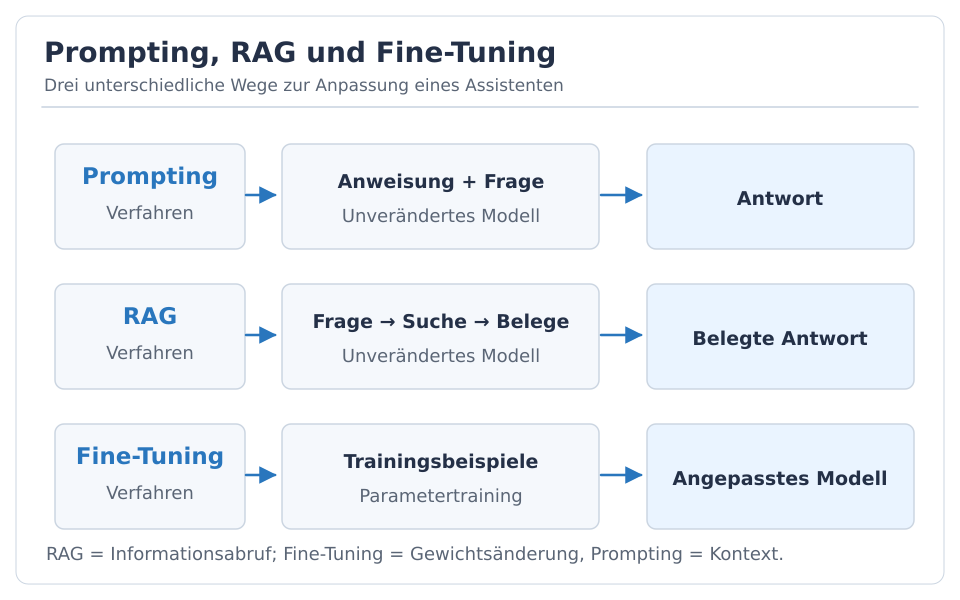

# M6-L3 – Wie aus einem Basismodell ein Assistent wird {#L3}

**Kursbereich:** M6 – Schwerpunkt: KI und Robotik

**Niveau:** Bachelor / Master (Wahl)

**Vorwissen:** Keine festen Voraussetzungen angegeben.

**Lernziel:** Verstehen, warum ein großes Sprachmodell nach dem Vortraining noch kein zuverlässiger Gesprächsassistent ist; welche Daten und Optimierungsverfahren sein Verhalten verändern; worin sich Supervised Fine-Tuning, Reinforcement Learning from Human Feedback und Direct Preference Optimization unterscheiden; wann eine günstige Adapteranpassung genügt und welche Sicherheits- und Qualitätsprüfungen notwendig bleiben.

**Einordnung:** M6-L1 beschrieb die Transformer-Architektur, M6-L2 den Ablauf einer Chat-Anfrage beim Betrieb. M6-L3 blickt auf einen anderen Zeitpunkt: **Wie wird ein Modell vor seiner Verwendung ausgebildet und nachträglich angepasst?** Später in M6-L4 folgt die Frage, wie eine Anwendung Dokumente und Werkzeuge bereitstellt, ohne das Modell jedes Mal neu zu trainieren.

## Ausgangsproblem: Ein Sprachmodell kann Text fortsetzen, aber nicht automatisch gut helfen {#S1}

Stellen wir uns eine Person vor, die Millionen Bücher, Webseiten und Gesprächsausschnitte gelesen hat, aber nie ausdrücklich gelernt hat, wie sie einem Ratsuchenden antworten soll. Sie könnte Sprache ausgezeichnet imitieren und trotzdem auf die Bitte „Fasse diesen Text in drei Sätzen zusammen“ mit einer Fortsetzung der Aufgabenstellung reagieren. Genau diese Unterscheidung ist für Sprachmodelle wichtig.

Ein **Basismodell** (*Base Model* oder *Foundation Model*, je nach Kontext) ist ein bereits trainiertes Modell, das beispielsweise passende Textfortsetzungen berechnen kann. Es verfügt über statistisch gelernte Muster, Formulierungen und Zusammenhänge. Das bedeutet nicht, dass es Anweisungen zuverlässig befolgt, Fakten immer richtig wiedergibt, Quellen überprüft oder zwischen erlaubten und unerlaubten Aufgaben unterscheiden kann.

Ein **Assistenzmodell** (*Assistant Model*, oft *Instruct Model*) ist ein Modell, dessen Verhalten zusätzlich auf Aufgaben, Dialoge und gewünschte Antwortweisen angepasst wurde. Beispielsweise soll es:

- eine Frage beantworten, statt unkontrolliert ähnliche Fragen weiterzuschreiben;
- den gewünschten Umfang, die Sprache und das Ausgabeformat beachten;
- bei Unsicherheit angemessene Vorbehalte nennen und erforderlichenfalls nachfragen;
- problematische Anforderungen erkennen und Grenzen einhalten;
- bei einer mehrteiligen Unterhaltung Anschluss an die vorigen Nachrichten halten.

Die wichtigste Einsicht lautet: **Vortraining vermittelt vor allem eine allgemeine Fähigkeit zur Sprachmodellierung; Nachtraining beeinflusst, wie diese Fähigkeit in Antworten eingesetzt wird.** Dieser Unterschied ist didaktisch hilfreich, auch wenn reale moderne Modellpipelines viele weitere Stufen kombinieren und nicht jede Firma dasselbe Verfahren verwendet.

### Zwei unterschiedliche Antworten auf denselben Anfang

Der Text „Die Hauptstadt von Frankreich ist“ kann für ein Basismodell einfach der Beginn eines zu vervollständigenden Satzes sein. Bei einer Nutzereingabe „Wie heißt die Hauptstadt Frankreichs?“ wird von einem Assistenten dagegen eine direkte Antwort erwartet: „Paris.“

Diese Gegenüberstellung ist eine **schematische Veranschaulichung**, kein gemessener Vergleich zweier konkreter Modelle. Auch Basismodelle lassen sich durch geeignete Prompts zu hilfreichen Antworten bewegen; auch Assistenzmodelle können missverstehen, falsche Tatsachen behaupten oder eine Anweisung nur teilweise erfüllen.

## Überblick: Die Ausbildung in mehreren Stufen {#S2}

Eine häufig anzutreffende Grundarchitektur sieht so aus:

``` text
Rohdaten: Bücher, Webseiten, Fachtexte, Code, Dialoge ...
                         |
                         v
       Rechteprüfung, Auswahl, Filter, Aufbereitung
                         |
                         v
               Tokenisierung + Vortraining
                         |
                         v
                   BASISMODELL
                         |
                         +----------------------+
                         |                      |
                         v                      v
        Gute Beispielantworten       Bewertete Antwortpaare
                 |                            |
                 v                            v
       Überwachtes Nachtraining      Präferenzoptimierung
                 |                            |
                 +------------+---------------+
                              |
                              v
                      ASSISTENZMODELL
                              |
                              v
              Evaluation, Tests, Freigaben
                              |
                              v
             Anwendung: Chat, API, lokaler Dienst
                              |
                              v
           Laufendes Monitoring und Verbesserungen
```

Der Ablauf muss nicht linear sein. Eine Organisation kann beispielsweise zunächst unter Aufsicht trainieren, dann mit Präferenzen weiterarbeiten und einzelne Schritte wiederholen. Andere Verfahren nutzen automatische oder regelbasierte Rückmeldungen, weitere Trainingsziele oder ganz andere Optimierungsstrategien. **Es gibt keine verbindliche Einheitsrezeptur für alle heutigen LLMs.**

Hier hilft eine zeitliche Trennung:

- **Vortraining:** umfangreiche Grundausbildung auf vielen Texten und gegebenenfalls anderen Datentypen.
- **Nachtraining oder Post-Training:** gezieltere Verhaltensanpassung, etwa für hilfreiche Anweisungsbefolgung oder bestimmte Fähigkeiten.
- **Inferenz:** das fertige Modell verarbeitet einen konkreten Prompt und erzeugt eine Antwort; normalerweise werden seine Gewichte dabei nicht verändert.
- **Betriebliche Verbesserung:** spätere, getrennt geplante Modell- oder Systemupdates nach Evaluation und Freigabe.

Ein gewöhnlicher Chat verändert daher nicht automatisch die trainierten Modellparameter. Ob Gesprächsinhalte überhaupt für künftiges Training verwendet werden, hängt vom jeweiligen Dienst, seinen Einstellungen und rechtlichen Rahmenbedingungen ab und darf nicht pauschal unterstellt werden.

## Die Rohdaten: Umfang allein genügt nicht {#S3}

**Trainingsdaten** sind die Beispiele, anhand derer das Modell seine Gewichte verändert. Bei großen Sprachmodellen können das Texte aus unterschiedlichen Quellen sein. Noch vor einer einzigen Trainingsrechnung stehen schwierige Entscheidungen: Welche Daten dürfen verwendet werden? Welche Sprachen und Themen sind enthalten? Welche Qualitätsprobleme oder personenbezogenen Daten stecken darin? Wie stark sind einzelne Perspektiven vertreten?

Typische Aufbereitungsschritte sind:

1.  **Herkunft und Berechtigung klären.** Datenquellen, Nutzungsrechte, Lizenzen, Einwilligungen und Datenschutzanforderungen prüfen. Öffentlich zugänglich bedeutet nicht automatisch rechtlich beliebig nutzbar.
2.  **Qualität filtern.** Offensichtlichen Spam, maschinell vervielfältigte Textmuster, leere Dokumente und stark beschädigte Inhalte soweit möglich erkennen.
3.  **Duplikate reduzieren.** Mehrfach vorkommende Texte können einzelne Inhalte übergewichten und Datenaufteilung oder Evaluation verfälschen.
4.  **Sensible Informationen behandeln.** Personenbezogene Angaben, Geheimnisse oder vertrauliche Unterlagen erfordern geeignete Schutz- und Ausschlussverfahren.
5.  **Datenmischung gestalten.** Unterschiedliche Sprachen, Fachgebiete, Stile und Schwierigkeitsgrade beeinflussen später die Fähigkeiten des Modells.
6.  **Trainings- und Testmaterial auseinanderhalten.** Ein späterer Vergleich ist weniger aussagekräftig, wenn dessen Aufgaben bereits im Training enthalten waren.

Aufbereitung ist nicht unfehlbar: Filter können wertvolle Minderheitensprachen entfernen, unerwünschte Inhalte übersehen oder vorhandene gesellschaftliche Verzerrungen verstärken. Mehr Daten sind daher nicht automatisch bessere Daten.

**Aus Sicht eines kleinen Softwareprojekts** besteht ein großer Unterschied zwischen Millionen allgemeinen Textdokumenten für das Grundtraining und einigen Hundert sorgfältig erstellten Beispielen für eine sehr spezielle Aufgabe. Das erste ist typischerweise ein umfangreiches Forschungs- und Infrastrukturvorhaben; das zweite kann unter passenden Voraussetzungen für eine gezielte Anpassung ausreichen – aber Erfolg und notwendige Datenmenge lassen sich nicht pauschal garantieren.

## Vortraining: Das Modell lernt Wahrscheinlichkeitsmuster {#S4}

Bei **autoregressiven** Sprachmodellen ist ein grundlegendes Lernziel die Vorhersage des nächsten Tokens. Ein *Token* ist eine Verarbeitungseinheit, die ein Wort, ein Wortteil oder ein Zeichenmuster repräsentieren kann. Das Modell sieht eine Folge früherer Tokens und berechnet Wahrscheinlichkeiten für eine Fortsetzung.

Eine einfache Modellrechnung:

``` text
Trainingsbeispiel:  "Die Sonne geht im Osten ..."
Bisheriger Kontext: "Die Sonne geht im Osten"
Erwartetes Token:   "auf"   (hier stark vereinfacht)
Modellschätzung:    P("auf") = 0,20

Fehlersignal:       Verlust = -ln(0,20) ≈ 1,609
```

Die **Verlustfunktion** (*Loss Function*) bewertet, wie gut das Modell die erwartete Fortsetzung vorhersagt. Nach Anpassungen seiner Gewichte könnte es in einem hypothetischen nächsten Versuch für dasselbe Token die Wahrscheinlichkeit 0,50 vergeben:

``` text
Neue Schätzung:    P("auf") = 0,50
Neuer Verlust:     -ln(0,50) ≈ 0,693
```

Ein kleinerer Verlust bedeutet in diesem Lehrbeispiel, dass das richtige Token wahrscheinlicher geworden ist. Die Zahlen sind **frei gewählt und rechnerisch überprüfbar**; sie sind weder Messungen an einem realen LLM noch eine Zusage, dass ein einzelner Optimierungsschritt solche Änderungen verursacht.

Die eigentliche Trainingsarbeit erledigen **Backpropagation** (Rückwärtsberechnung der Gradienten) und ein Optimierungsverfahren, das Gewichte in kleinen Schritten verändert. M5-L2 behandelt diese Grundlage ausführlich. Über viele Texte hinweg können dabei Grammatik, Fachbegriffe, wiederkehrende Problemlösungen und statistische Weltzusammenhänge gelernt werden.

Trotzdem bleibt das Lernziel entscheidend: Die gute Vorhersage von Text ist **nicht identisch mit der Verpflichtung, einen Auftrag wahrheitsgemäß, sicher und im richtigen Format auszuführen**. Ein Modell kann eine überzeugende Fortsetzung erzeugen, obwohl die Aussage falsch ist. Genau hier setzt das Nachtraining an.

## Supervised Fine-Tuning: Gute Antworten vormachen {#S5}

**Fine-Tuning** bedeutet, ein vorhandenes Modell durch zusätzliches Training gezielt anzupassen. Eine verbreitete Variante heißt **Supervised Fine-Tuning (SFT)**, auf Deutsch etwa *überwachtes Nachtraining*.

Dabei erhält das Modell Beispiele mit einer Eingabe und einer erwünschten Ausgabe. Solche Demonstrationen können von Fachleuten verfasst, sorgfältig ausgewählt oder unter kontrollierten Bedingungen erzeugt und überprüft werden.

``` text
Eingabe:
  "Erkläre einer Einsteigerin den Unterschied zwischen
   Backup und Replikation in drei Sätzen."

Gute Zielantwort:
  "Ein Backup ist eine gesonderte Sicherungskopie, mit der
   man frühere Daten wiederherstellen kann. Replikation
   hält eine weitere Datenbankkopie für den laufenden Betrieb
   aktuell. Ein replizierter Löschfehler kann beide Kopien
   treffen; deshalb ersetzt Replikation kein Backup."
```

Das SFT-Training erhöht vereinfacht gesagt die Wahrscheinlichkeit der Zielantwort-Tokens unter dem jeweiligen Kontext. Dabei kann die Software so eingerichtet werden, dass der Trainingsverlust nur über die **Assistentenantwort** und nicht über die Eingabe berechnet wird. Wie das umgesetzt wird, hängt von Modell, Gesprächsformat und Trainingssoftware ab; die Hugging-Face-TRL-Dokumentation beschreibt diese Varianten ausdrücklich.

### Instruction Tuning und SFT sind verwandt, aber nicht gleichbedeutend

**Instruction Tuning** betont den *Zweck der Trainingsbeispiele*: Das Modell soll Aufgabenanweisungen verstehen und befolgen, beispielsweise „erkläre“, „übersetze“, „vergleiche“ oder „antworte als Tabelle“.

**SFT** bezeichnet das *Lernverfahren*: überwachte Anpassung anhand erwünschter Ausgaben. Instruction Tuning wird häufig als SFT auf Anweisungs-Antwort-Paaren durchgeführt. SFT kann aber genauso für Fachstile, strukturierte Ausgaben oder andere konkrete Zielaufgaben verwendet werden.

Gute Beispieldaten zeigen nicht nur korrekte Fakten, sondern auch **angemessene Antwortformen**. Ein Lehrassistent benötigt beispielsweise kurze Begriffsdefinitionen und verständliche Analogien; eine Maschine für standardisierte Rechnungsdaten dagegen exakt definierte Felder. Dasselbe Basismodell kann durch unterschiedliche Daten zu sehr unterschiedlichen Verhaltensmustern tendieren.

### Grenzen des bloßen Vormachens {#grenzen-des-blossen-vormachens}

Zwei Antworten können beide sachlich vertretbar sein, aber in Höflichkeit, Vorsicht, Klarheit oder Nützlichkeit stark voneinander abweichen. SFT mit nur einer Musterantwort sagt nicht unmittelbar, wie ein Modell **zwischen zwei plausiblen Alternativen** wählen soll. Es kann zudem unerwünschte Stilkonventionen aus Beispieldaten übernehmen und seltene Situationen übersehen. Dafür gibt es Präferenzverfahren.

## Präferenzdaten: Nicht nur richtig oder falsch, sondern besser oder schlechter {#S6}

Stellen wir uns die Anfrage vor: „Wie sichere ich ein kleines Kundenverzeichnis?“ Das Modell erzeugt zwei Kandidaten:

- **Antwort A:** „Eine tägliche Kopie reicht immer. Bewahre sie auf demselben Server auf.“
- **Antwort B:** „Lege regelmäßige, getrennt aufbewahrte Sicherungen an und prüfe die Wiederherstellung. Die Häufigkeit hängt davon ab, wie viel Datenverlust akzeptabel ist.“

In einem sorgfältig gestalteten Datensatz würden Bewertende vermutlich Antwort B bevorzugen. Sie ist präziser und berücksichtigt mögliche Fehler. Entscheidend ist jedoch, **warum** sie bevorzugt wird: nicht bloß wegen längerer Formulierungen, sondern aufgrund eines definierten Bewertungsmaßstabs.

Ein Präferenzbeispiel enthält typischerweise:

``` text
Prompt:       "Wie sichere ich ein kleines Kundenverzeichnis?"
Bevorzugt:    Antwort B
Abgelehnt:    Antwort A
Prüfgrund:    B behandelt externes Backup und Wiederherstellung.
```

Menschen können mehrere Antworten ordnen oder paarweise vergleichen. Es gibt auch maschinell erzeugte und verifizierte Bewertungen. Solche Signale enthalten **Werturteile und Aufgabenannahmen**, keine objektive Formel für Wahrheit. Welche Antworten als gut gelten, hängt von Sprache, Nutzungskontext, Sicherheitsanforderungen und den Bewertenden ab.

Ein Modell darf nicht einfach lernen: „Lange Antworten sind immer besser.“ Deshalb müssen Bewertungen auf Verzerrungen wie bevorzugte Länge, selbstbewusste Formulierungen, unberechtigte Zustimmung und mangelnde fachliche Prüfung untersucht werden.

## RLHF: Lernen mithilfe menschlicher Rückmeldungen {#S7}

**Reinforcement Learning from Human Feedback (RLHF)** heißt *bestärkendes Lernen mit menschlicher Rückmeldung*. Eine klassische, vielfach zitierte Variante wurde in der Arbeit zu **InstructGPT** (Ouyang u. a., 2022) beschrieben.

Das Verfahren kann so aussehen:

``` text
                  Viele Prompts
                       |
                       v
              Vortrainiertes Modell
                       |
                       v
                 SFT-Modell
                       |
                       v
            Mehrere Antwortvorschläge
                       |
                       v
              Menschliche Vergleiche
                       |
                       v
                Belohnungsmodell
                       |
                       v
        RL-Optimierung des Sprachmodells
                       |
                       v
              Angepasstes Modell
```

Ein **Belohnungsmodell** (*Reward Model*) ist selbst ein trainiertes System. Es soll aus den Vergleichen eine Bewertung schätzen, die mit menschlichen Präferenzen zusammenhängt. Anschließend verändert eine Methode des **bestärkenden Lernens** (*Reinforcement Learning*, RL) das Sprachmodell so, dass seine Antworten im Mittel günstiger bewertet werden.

Eine verwendbare Optimierungsfamilie ist **Proximal Policy Optimization (PPO)**. *Policy* bezeichnet dabei die Strategie des Modells, also seine Wahrscheinlichkeitsverteilung über mögliche Antworten. Die Optimierung muss aufpassen, das Modell nicht zu stark von einer brauchbaren Ausgangsversion wegzubewegen. In der Literatur wird das häufig durch eine Begrenzung der Abweichung zur Referenzverteilung, beispielsweise über die Kullback-Leibler-Divergenz (KL-Divergenz), umgesetzt.

Warum ist eine solche Begrenzung sinnvoll? Ein auf eine einzelne Belohnungskennzahl trainiertes System könnte Wege finden, die Kennzahl zu erhöhen, **ohne Menschen tatsächlich besser zu helfen**. Dieses Problem wird oft **Reward Hacking** oder **Goodhart-Effekt** genannt: Wenn ein Messwert zum Trainingsziel wird, kann er seine Aussagekraft verlieren.

**Wichtig:** RLHF ist keine Behauptung, dass alle Modellantworten von Menschen einzeln freigegeben werden. Es geht um Trainingsrückmeldungen, die das spätere Verhalten statistisch beeinflussen. Und nicht jeder moderne Assistenzdienst nutzt genau die ältere InstructGPT-Pipeline; die Verfahren entwickeln sich weiter.

## DPO: Direkte Optimierung auf bevorzugte Antworten {#S8}

**Direct Preference Optimization (DPO)**, auf Deutsch *direkte Präferenzoptimierung*, wurde 2023 von Rafailov und Mitautoren vorgestellt. Sie greift dasselbe Grundproblem auf: Das Modell soll bevorzugte Antworten wahrscheinlicher machen als weniger erwünschte Antworten.

Der didaktisch wichtigste Unterschied zur oben beschriebenen klassischen RLHF-Pipeline ist:

- Bei der **klassischen RLHF-Variante** trainiert man zunächst ein separates Belohnungsmodell und optimiert das Sprachmodell anschließend mithilfe eines RL-Verfahrens.
- Bei **DPO** nutzt man bevorzugte und abgelehnte Antwortpaare unmittelbar in einer besonderen Trainingsverlustfunktion. Ein separates Belohnungsmodell und eine separate RL-Schleife sind für das Grundverfahren nicht erforderlich.

``` text
Prompt + Antwort A + Antwort B + Präferenz "B besser"
                           |
                           v
                      DPO-Loss
                           |
                           v
             Anpassung der Modellgewichte
                           |
                           v
         Modell bevorzugt künftig eher B-ähnliches
          Verhalten in vergleichbaren Situationen
```

DPO ist also **nicht** dasselbe wie SFT mit der bevorzugten Antwort. Die mathematische Zielfunktion vergleicht die relativen Wahrscheinlichkeiten beider Antworten und bezieht eine **Referenzpolitik** ein, um die gewünschte Anpassung zu steuern. Der Detailbeweis ist für den Lesekurs nicht erforderlich; er ist in der Originalarbeit dokumentiert.

### Ein nachvollziehbares Präferenzbeispiel

Angenommen, 16 fachkundige Personen vergleichen zwei Antwortvorschläge. Zwölf wählen B, vier A. Dann bevorzugen in diesem **fiktiven Beispiel** 12 von 16, also **75 Prozent**, Antwort B.

Das ist zunächst nur eine Beobachtung über diese Bewertungen. Es bedeutet **nicht**, dass das Modell nach DPO mit 75-prozentiger Wahrscheinlichkeit B ausgeben wird, dass B in allen Situationen richtig ist oder dass mit 16 Stimmen ausreichende Trainingsqualität erreicht wäre. Die tatsächliche Anpassung hängt unter anderem von Modell, Trainingsverfahren, Datenmischung und Referenzverteilung ab.

DPO und RLHF sind **Verfahrensfamilien mit unterschiedlichen technischen Kosten und Eigenschaften**, keine pauschale Rangliste. DPO vereinfacht insbesondere bestimmte Trainingsschritte, ersetzt aber nicht sorgfältige Daten, Tests und Nachkontrollen. Auch neuere Verfahren kombinieren überwachtes Training, Präferenzoptimierung und weitere Lernsignale.

## Full Fine-Tuning, LoRA und parameterarme Anpassung {#S9}

Beim **vollständigen Fine-Tuning** (*Full Fine-Tuning*) dürfen im Prinzip alle oder sehr viele Modellgewichte aktualisiert werden. Das bietet Anpassungsspielraum, benötigt aber Speicher für Parameter, Gradienten und häufig zusätzliche Optimiererzustände. Außerdem muss die Modellversion passend gesichert und im Betrieb bereitgestellt werden.

**Parameter-Efficient Fine-Tuning (PEFT)** bedeutet *parameter-effiziente Feinabstimmung*. Hier werden nur relativ wenige neue oder ausgewählte Parameter trainiert. Eine bekannte Methode heißt **Low-Rank Adaptation (LoRA)**, auf Deutsch etwa *Anpassung durch Matrizen niedrigen Ranges*.

Vereinfacht:

``` text
Große, vortrainierte Gewichtsmatrix W
            |
            +--> bleibt unverändert (eingefroren)
            |
            +--> kleine trainierbare Matrizen A und B
                          |
                          v
                wirksame Änderung ΔW = B × A
                          |
                          v
                angepasste Berechnung W + ΔW
```

Statt jeden Eintrag einer großen Matrix zu verändern, lernt LoRA eine kompakte Korrektur. Das ist nicht nur eine ZIP-Kompression, sondern eine **veränderte Lernarchitektur**: Die Basismatrix bleibt eingefroren, während zusätzliche Matrizen trainiert werden. Daher kann man auf derselben Grundversion verschiedene Adapter für unterschiedliche Aufgaben besitzen.

Ein **didaktisches Dimensionsbeispiel** erklärt die Idee, ohne echte Modellgrößen zu behaupten:

- Eine quadratische Matrix mit 1.000 Zeilen und 1.000 Spalten besitzt **1.000.000** Einträge.
- Zwei LoRA-Matrizen mit Rang 8 benötigen zusammen **$1\,000\times8+8\times1\,000=16\,000$** Einträge.
- Das sind für diesen **einen modellierten Matrixblock** nur **1,6 Prozent** der Einträge einer vollständig trainierbaren Millionenmatrix.

Diese Zahl ist **keine Gesamt-VRAM-Ersparnis eines echten Modells**. Weitere Modellschichten, die Zahl der angepassten Matrizen, Aktivierungen, Optimiererzustände, Datenaufbereitung und Laufzeit bestimmen den tatsächlichen Bedarf. Parameter-effizient bedeutet auch nicht automatisch, dass eine neue Fähigkeit ohne Qualitätsverlust erlernt wird.

### QLoRA als verwandte Idee

Bei **QLoRA** wird die Speicherlast der eingefrorenen Basismodellgewichte durch **Quantisierung**, also eine kompaktere numerische Darstellung, reduziert, während ein LoRA-artiger Adapter gelernt wird. Der Zweck ist, Anpassungen größerer Modelle auf begrenzter Hardware zu erleichtern. Die Bedingungen und möglichen Qualitätsverluste hängen von Implementierung, Modell und Aufgabe ab. Quantisierung während der Anpassung ist dabei von der Quantisierung beim späteren Modellbetrieb zu unterscheiden (siehe M6-L2).

## Was soll angepasst werden – und was nicht? {#S10}

Hier werden in Projekten häufig vier sehr verschiedene Techniken verwechselt.

  Verfahren                                                                   Was verändert sich?                                                 Wofür geeignet?                                                            Wofür nicht automatisch geeignet?
  --------------------------------------------------------------------------- ------------------------------------------------------------------- -------------------------------------------------------------------------- ---------------------------------------------------------------------
  **Prompting**                                                               Nur die aktuelle Anweisung und ihr Kontext                          Ton, Ziel, Format, einzelne Beispiele                                      Dauerhafte Gewichtsänderung
  **Retrieval-Augmented Generation (RAG)**, *Generierung mit Dokumentabruf*   Die Anwendung liefert bei Bedarf externe, gefundene Informationen   Aktuelle Handbücher, interne Dokumente, nachvollziehbare Quellen           Neue Modellgewichte oder automatisch korrekte Quelleninterpretation
  **SFT / LoRA**                                                              Modellparameter oder Adaptergewichte                                Stabiles Antwortformat, Fachstil, definierte wiederkehrende Aufgaben       Stets aktuelle Wissensbestände garantieren
  **Präferenztraining (z. B. RLHF/DPO)**                                      Trainiertes Antwortverhalten                                        Zwischen hilfreichen und weniger hilfreichen Antwortformen unterscheiden   Wahrheit, Sicherheit und Fairness garantieren

Beispiel: Ein Dokumentationsdienst erhält morgen eine neue Bedienungsanleitung. Muss man sein Modell nachtrainieren? **Normalerweise nicht.** Die aktuelle Anleitung kann durch einen kontrollierten Dokumentabruf zur Anfrage bereitgestellt werden. Wenn der Dienst dagegen dauerhaft Daten in einer sehr spezifischen Struktur ausgeben soll, könnte eine gezielte Anpassung sinnvoll sein – vorausgesetzt, Prompting und strenge programmgesteuerte Validierung reichen nicht.

**Ein guter Grundsatz:** Für **wechselnde Fakten** meist zuerst Dokumentabruf und Datenbankzugriff prüfen; für **wiederkehrendes Verhalten** zunächst gute Prompts, Beispiele und feste Programmregeln, dann gegebenenfalls Fine-Tuning. Diese Unterscheidung ist eine Entwurfsheuristik, kein Naturgesetz.

## Evaluation: Wie merkt man, ob das Modell tatsächlich besser geworden ist? {#S11}

**Evaluation** bezeichnet die systematische Beurteilung von Modellantworten anhand vorher festgelegter Kriterien. Eine neue Modellversion kann schöner formulieren und gleichzeitig wichtige Aufgaben schlechter lösen. Deshalb ist ein „klingt gut“ als alleiniger Qualitätsmaßstab ungeeignet.

Ein nachvollziehbarer Prüfprozess trennt mindestens vier Dimensionen:

1.  **Aufgabenerfolg.** Stimmen Fakten, Berechnungen, Klassifikationen und Ausgabeformate?
2.  **Verhalten.** Befolgt das Modell passende Anweisungen, erkennt Mehrdeutigkeiten und benennt Unsicherheit?
3.  **Sicherheit und Verantwortung.** Beachtet es sensible Daten, Zugriffsgrenzen, missbräuchliche Anfragen und gefährliche Fehlinformationen?
4.  **Betrieb.** Wie hoch sind Antwortzeit, Ressourcenbedarf, Robustheit und Kosten im relevanten Lastprofil?

Die Daten sollten in **Training**, **Validierung** und **Test** getrennt bleiben. Der Testsatz dient idealerweise als unabhängige Prüfung, nicht als versteckte Optimierungsanleitung. Wenn ein Modell die Testaufgaben oder sehr ähnliche Varianten schon kennt, entsteht **Datenkontamination** (*Data Contamination*). Hohe Testergebnisse können dann ein falsches Bild der Verallgemeinerungsfähigkeit zeichnen.

### Mini-Beispiel: Bessere Durchschnitte können Probleme verdecken

Ein Team prüft zwei fiktive Assistenten an 100 Anfragen:

  Testgruppe              Anzahl   Modell alt korrekt   Modell neu korrekt
  -------------------- --------- -------------------- --------------------
  Standardfragen              80                   70                   76
  Seltene Fachfragen          20                   16                   13
  **Gesamt**             **100**               **86**               **89**

Das neue Modell verbessert den Gesamtwert von **86 auf 89 Prozent**. Gleichzeitig verschlechtert es sich bei seltenen Fachfragen von **$\frac{16}{20}=80\,\%$** auf **$\frac{13}{20}=65\,\%$**. Für einen Dienst, der gerade bei Spezialfällen zuverlässig sein muss, kann dieser Rückschritt schwerer wiegen als die Gesamtverbesserung.

Die Zahlen sind erfunden und dienen nur der Rechenillustration. Für eine belastbare Bewertung müssten zudem Stichprobengröße, Unsicherheit, Kategorien und konkrete Fehlerursachen untersucht werden. Ein kleines zufälliges Set reicht nicht für weitreichende Sicherheitszusagen.

### Modelle miteinander vergleichen

Eine mögliche Methode ist die **Blindbewertung**: Menschen sehen Antworten ohne Kenntnis des Modellnamens und beurteilen sie nach einheitlichen Kriterien. Automatische Prüfungen können strukturierte Ausgaben, Rechenwerte oder das Vorkommen wichtiger Fakten testen. Für offene Antworten lassen sich zusätzliche menschliche Fachprüfungen einsetzen.

**LLM-as-a-Judge** bezeichnet den Einsatz eines Sprachmodells als Bewerter anderer Modellausgaben. Das kann Bewertungen skalieren, ist aber selbst fehleranfällig und von denselben Problemen wie andere LLMs betroffen: Stilvorlieben, Verzerrungen, übersehene Fachfehler und Instabilität. Ein solcher Bewerter ersetzt keine unabhängige fachliche Kontrolle.

## Red Teaming, Guardrails und Modellkarten {#S12}

**Red Teaming** ist die gezielte Suche nach Schwachstellen. Bei KI-Systemen testet man beispielsweise widersprüchliche Anweisungen, manipulierte Texte, Versuche zur Preisgabe geschützter Informationen, falsche Quellenangaben und missbräuchliche Aufgaben. Ziel ist es, Fehler **vor** dem produktiven Einsatz zu entdecken.

**Guardrails** bezeichnet zusätzliche Schutzmechanismen rund um ein Modell. Dazu können gehören:

- eine Anwendung, die Zugriffe auf Kundendaten unabhängig vom Modell prüft;
- feste Schemaprüfungen für Rechnungen, Kennzahlen und Programmschnittstellen;
- Schranken für Kosten, Anzahl von Werkzeugaufrufen und Laufzeiten;
- Inhaltsprüfungen oder Filter vor beziehungsweise nach einer Antwort;
- menschliche Freigaben vor riskanten oder irreversiblen Aktionen;
- Überwachung, Protokollierung mit Datenschutz und ein Abschaltweg bei Auffälligkeiten.

Guardrails sind **nicht mit Modelltraining identisch**. Ein gutes Sicherheitsverhalten des Modells hilft, darf aber keine technische Zugriffskontrolle ersetzen. Ein Sprachmodell sollte nicht allein entscheiden, ob ein Benutzer die Daten eines anderen Kunden lesen darf; diese Entscheidung gehört in überprüfbare Software und Berechtigungssysteme (siehe M4-L3).

Eine **Modellkarte** (*Model Card*) dokumentiert Zweck, Herkunft und Eigenschaften einer Modellversion: vorgesehene Nutzung, ungeeignete Anwendungen, Testmethoden, bekannte Grenzen, betrachtete Sprachen und gegebenenfalls Sicherheitsinformationen. Modellkarten machen aus einem Modell kein garantiert gutes Produkt, erleichtern aber eine nachvollziehbare Auswahl und Verantwortung.

Die **Generative-AI-Ergänzung zum AI Risk Management Framework** des US-amerikanischen National Institute of Standards and Technology (NIST) beschreibt systematisches Risikomanagement für generative Systeme. Eine solche Orientierung ersetzt weder die Prüfung des konkreten Einsatzfalls noch geltendes Recht.

## Warum auch ein trainierter Assistent falsche Dinge behaupten kann {#S13}

Das Nachtraining ändert die Wahrscheinlichkeiten für bestimmte Verhaltensweisen. Es verwandelt das Modell aber nicht in ein System, das jede Tatsachenbehauptung automatisch gegen eine verlässliche Datenbank prüft.

Mehrere Fehlerquellen bleiben:

**Veraltete Informationen:** Trainingsdaten spiegeln einen bestimmten Stand wider. Neue Preise, Gesetzesänderungen oder aktuelle Ereignisse erscheinen nicht von selbst in den Gewichten.

**Widersprüchliche Quellen:** Schon Trainingsdaten können unterschiedliche Aussagen enthalten; das Modell muss nicht erkennen, welche davon richtig ist.

**Fehlerhafte Präferenzen:** Menschen bevorzugen manchmal eine selbstbewusste, schön formulierte, aber sachlich falsche Antwort.

**Verallgemeinerungsfehler:** In ungewohnten Aufgaben oder Sprachen können Fähigkeiten schwächer ausfallen als auf bekannten Tests.

**Überanpassung und Vergessen:** Bei zusätzlichem Training kann ein Modell gewünschte Beispiele zu stark reproduzieren oder bisherige Fähigkeiten teilweise verlieren (*Catastrophic Forgetting*). Maßnahmen dagegen sind möglich, aber nicht automatisch wirksam.

**Unvollständige Sicherheitsgrenzen:** Auch sorgfältiges Post-Training kann durch neue oder ungewöhnliche Eingaben an Grenzen gelangen. Die Anwendung muss ihre unabhängigen Kontrollmechanismen behalten.

**Fazit dieses Abschnitts:** Höhere Wahrscheinlichkeit guter Antworten bedeutet nicht hundertprozentige Zuverlässigkeit. In wichtigen Anwendungen müssen Erkenntnisse, Berechnungen und Freigaben durch geeignete externe Verfahren überprüfbar sein.

## Was Training technisch und wirtschaftlich kostet {#S14}

Großes **Vortraining** ist häufig eines der ressourcenintensivsten Vorhaben der KI-Entwicklung: Datensammlung, Rechteklärung, Speicher, Rechencluster, Grafikprozessoren, Netzwerke, verteilte Optimierung, Energie und technische Ausfallbehandlung müssen organisiert werden. Die einmal erzeugten Modellgewichte können später auf anderer Hardware zur Inferenz genutzt werden.

**SFT auf einem vorhandenen Modell** ist konzeptionell deutlich kleiner, kann aber bei großen Modellen immer noch kostspielig werden. Der benötigte Speicher umfasst neben Gewichten auch Aktivierungen, Gradienten, Optimiererzustände und Trainingsdaten. Vollständiges Fine-Tuning benötigt häufig mehr Ressourcen als eine LoRA-Anpassung. Präferenztraining fügt Bewertungen, Kandidatengenerierung, Vergleichsdaten und weitere Rechenschritte hinzu.

In die Wirtschaftlichkeit gehören nicht nur GPU-Stunden, sondern auch:

- Qualitätssicherung und fachkundige Bewertung von Trainingsbeispielen;
- Rechteklärung, Datenbereinigung und sichere Aufbewahrung;
- Wiederholungen fehlgeschlagener Trainingsläufe;
- unabhängige Testdatensätze und Sicherheitsevaluation;
- Verwaltung und Versionierung der Modellstände;
- regelmäßige Nachprüfung bei neuen Aufgaben, Anforderungen und Angriffsmustern;
- Kosten des anschließenden Produktivbetriebs.

Ein vermeintlich günstiger Trainingslauf ist wirtschaftlich unsinnig, wenn die damit erzeugten Antworten unkontrollierbar sind oder sehr viel Nachbearbeitung erfordern. Umgekehrt kann eine kleine, klar abgegrenzte Aufgabe ohne zusätzliches Training durch Regeln, Prompting oder Dokumentabruf besser gelöst werden. **Aktuelle konkrete GPU-Preise oder Pauschalkosten lassen sich aus dieser Lektion nicht ableiten**; sie hängen von Anbieter, Modell und Last ab.

## Drei praktische Szenarien {#S15}

### Szenario A: Lokales Medienarchiv mit verständlichen Erklärungen

Ein lokal betriebenes Programm kennt bereits Fotos, Dateinamen und eigene Schlagworte. Die Eigentümerin möchte dazu natürlichsprachliche Erklärungen: „Warum wurde dieses Bild als möglicherweise doppelt eingeordnet?“

Die einfachste Lösung ist zunächst **keine neue Modellschulung**. Die Anwendung liefert die relevanten Metadaten in einem Prompt und lässt ein passendes Modell eine verständliche Formulierung erzeugen. Die eigentliche Dublettenprüfung bleibt eine nachvollziehbare Softwarefunktion. Wenn regelmäßig ein sehr bestimmter Schreibstil gewünscht wird, kann ein kleiner Adapter später erwogen werden. Für sensible Privatdaten sind Zugriffsgrenzen, lokaler Betrieb oder bewusst gewählte Verarbeitungspfade wichtiger als beeindruckende Trainingsverfahren.

``` text
Lokale Dateien -> Analyseprogramm -> geprüfte Metadaten
                                            |
                                            v
                                   Prompt mit Kontext
                                            |
                                            v
                                Sprachmodell -> Erklärung
```

**Warum hier kein RLHF-Projekt?** Der Nutzen wäre für einen überschaubaren lokalen Anwendungsfall wahrscheinlich gering gegenüber dem Aufwand, verlässliche Bewertungen und Trainingsprozesse aufzubauen.

### Szenario B: Fachassistent für einen kleinen Online-Dienst

Ein SaaS-Dienst (*Software as a Service*, online bereitgestellte Software) beantwortet Fragen zu seinem eigenen Produkt. Nutzer benötigen korrekte Informationen über Funktionen und aktuelle Bedienungsabläufe.

Die Texte ändern sich regelmäßig. Deshalb sind **geprüfte Dokumente mit RAG** häufig die bessere Grundlage als das Eintrainieren jeder Handbuchänderung. Das Modell soll Quellenstellen nennen und Unsicherheit ausweisen. SFT kann ergänzend sinnvoll sein, wenn der Dienst dauerhaft exakt strukturierte Schritt-für-Schritt-Antworten erzeugen soll.

``` text
Kundenfrage -> Berechtigungsprüfung
                     |
                     v
          Suche in aktuellen Handbüchern
                     |
                     v
          relevante geprüfte Textstellen
                     |
                     v
          Assistenzmodell -> Antwortentwurf
                     |
                     v
          Quellen-/Regelprüfung -> Ausgabe
```

Ein Fehler im Modell darf nicht dazu führen, dass Kundendaten aus einem fremden Konto in den Kontext gelangen. Das wird **vor dem Modell** durch Softwarezugriffsrechte abgesichert. Für den Dienst müssen außerdem Quellenaktualität, Datenschutz, Fehlerraten und Kosten pro Anfrage beobachtet werden.

### Szenario C: Wiederkehrende KI-Auswertung als Dienstleistung

Ein Anbieter möchte Berichte zu Dokumenten oder Mediendateien erzeugen. Die Ausgabe muss ein bestimmtes Schema einhalten, zum Beispiel `Kategorie`, `Begründung`, `Fundstelle` und `Prüfstatus`.

Hier bietet sich zuerst ein **kleines Referenzset** aus echten, rechtmäßig nutzbaren Fällen an. Damit lassen sich Prompting und ein unverändertes Modell messen. Wenn das Format trotz Programmkontrollen häufig nicht eingehalten wird, kann **SFT oder LoRA** auf geprüften Beispielen sinnvoll werden. Ein Präferenzverfahren wäre eine spätere Option, falls sich die Unterschiede zwischen guten und schlechten Begründungen zuverlässig bewerten lassen.

Der Anbieter darf die Ergebnisse dennoch nicht ohne Prüfung als rechtlich, medizinisch oder finanziell verbindliche Tatsachen verkaufen. Die richtige Betriebsarchitektur kombiniert klar definierte Anwendungskriterien, geordnete Auftragsverarbeitung (M4-L1), Datenhaltung (C), Sicherheitsmaßnahmen (M4-L3) und messbare Produktqualität (M4-L2).

``` text
Auftrag -> Queue -> Worker -> Modell -> Schemaprüfung
                                        |
                           ungültig ---+---> Fehler-/Nachbearbeitung
                                        |
                           gültig -----+---> Datenbank + Ergebnisanzeige
```

**Kostenfalle:** Mehr Training bedeutet nicht zwangsläufig geringere Gesamtbetriebskosten. Verbesserte Fehlerraten können Aufwand sparen; zusätzliche Modellversionen, Prüfungen und Wartung können ihn erhöhen.

## Entscheidungshilfe: Welche Stufe benötigt ein Projekt wirklich? {#S16}

Die kleinste sinnvolle Lösung beginnt selten mit dem anspruchsvollsten Trainingsverfahren.

{alt="Vergleich der Verfahren Prompting, Retrieval Augmented Generation und Fine-Tuning mit getrennten Datenflüssen."}

Prompting, RAG und Fine-Tuning greifen an unterschiedlichen Stellen ein.

  Ausgangsfrage                                                                    Naheliegender erster Schritt
  -------------------------------------------------------------------------------- --------------------------------------------------------------------------
  „Ich möchte einen anderen Ton und eine knappe Antwort.“                          Besseren Prompt und klare Ausgabevorgaben versuchen
  „Die neuesten Handbücher sollen berücksichtigt werden.“                          Dokumentabruf/RAG und Aktualisierungsprozess
  „Der Assistent soll immer dieselben Datenfelder liefern.“                        Anwendungsschema und Validierung, bei Bedarf SFT
  „Ich habe viele überprüfte Fachantworten und ein stabiles Muster.“               SFT oder LoRA erwägen, unabhängig evaluieren
  „Mehrere mögliche Antworten sind korrekt, aber eine ist deutlich hilfreicher.“   Präferenzdaten und gegebenenfalls DPO/RLHF prüfen
  „Nur berechtigte Nutzer dürfen Daten ändern.“                                    Verbindliche Zugriffsprüfung in der Anwendung, nicht nur Modelltraining
  „Eine fachliche Entscheidung muss garantiert richtig sein.“                      Modell allein reicht nicht; regelbasierte/fachliche Prüfung erforderlich

Die Entscheidung hängt außerdem von der **Modelllizenz**, verfügbaren Gewichten, Hardware, Schulungsdaten, Datenschutz, der Fähigkeit zur Qualitätssicherung und dem Verhältnis zwischen Fehlerkosten und Betriebsaufwand ab. Nicht jeder Modellanbieter stellt Fine-Tuning oder Gewichte für eine eigene Anpassung zur Verfügung.

## Häufige Missverständnisse {#S17}

**„Ein Instruct-Modell enthält alle Antworten als geprüfte Fakten.“** Nein. Es hat gelernt, auf bestimmte Weise zu antworten; die Aussagen bleiben überprüfungsbedürftig.

**„SFT ist dasselbe wie RLHF.“** Nein. SFT lernt aus demonstrierten Zielantworten; klassisches RLHF kann Bewertungen über ein Belohnungsmodell und eine RL-Optimierung ausnutzen.

**„DPO ist gewöhnliches SFT mit besseren Beispielen.“** Nein. DPO vergleicht bevorzugte und abgelehnte Antwortwahrscheinlichkeiten relativ zu einer Referenz.

**„LoRA reduziert jede Speichergröße auf 1,6 Prozent.“** Nein. Die zuvor berechneten 1,6 Prozent betreffen nur ein frei gewähltes Matrixbeispiel, nicht die komplette Trainings- oder Inferenzhardware.

**„Ein Nutzerhinweis verändert sofort die Modellgewichte.“** Normalerweise nicht. Inferenz, Chatkontext, Anwendungserinnerung und Modelltraining sind getrennte Vorgänge.

**„Wenn eine Antwort in menschlichen Tests bevorzugt wird, ist sie fachlich wahr.“** Nein. Präferenz und Faktentreue müssen separat bewertet werden.

**„Gute Modell-Sicherheitsregeln ersetzen Zugriffsrechte.“** Nein. Datenbanken, APIs und Werkzeuge müssen Berechtigungen eigenständig durchsetzen.

**„Jedes Projekt braucht sein eigenes Basismodell.“** Nein. Oft sind ein vorhandenes Modell, gute Daten und eine solide Anwendung wirtschaftlich sinnvoller.

## Zusammenfassung und Übergang zu M6-L4 {#S18}

Das **Vortraining** vermittelt einem Sprachmodell breite Muster über Texte. **Supervised Fine-Tuning** zeigt ihm erwünschte Antwortweisen; **Instruction Tuning** ist ein typischer Einsatz solcher Beispiele zum Befolgen von Anweisungen. **Präferenztraining** nutzt Bewertungen zwischen mehreren Antworten. Bei einer klassischen **RLHF**-Pipeline dienen diese Bewertungen zunächst zum Lernen eines Belohnungsmodells, das anschließend eine RL-Optimierung steuert. **DPO** nutzt Präferenzpaare direkt für die Gewichtsoptimierung, ohne dass die Grundmethode eine gesonderte Belohnungsmodell- und RL-Schleife benötigt.

**LoRA** und andere PEFT-Verfahren reduzieren die Menge trainierbarer Parameter und können Anpassung erschwinglicher machen. Doch keine dieser Methoden macht ein Modell automatisch zu einer nachweislich korrekten Wissensquelle. Datenherkunft, unabhängige Tests, Risikoanalyse, Modellkarten, Guardrails, laufende Qualitätskontrolle und klassische Softwareberechtigungen bleiben wichtig.

Die nächste Lektion **M6-L4 – KI mit Wissen, Werkzeugen und Agenten** wechselt von der **Anpassung des Modells** zur **Architektur des Gesamtsystems**. Dort betrachten wir, wie eine Anwendung aktuelle Dokumente findet, Suchergebnisse als Kontext bereitstellt, Programmschnittstellen aufruft und Aufgaben kontrolliert ausführt – ohne dafür zwangsläufig Modellgewichte verändern zu müssen.


## Quellen {#S19}


**Technische Primärquellen geprüft am 04.11.2026.** Die Stufen sind als verbreitete Konzepte dargestellt, nicht als Offenlegung der nichtöffentlichen Trainingspipeline eines bestimmten aktuellen Anbietermodells. Die Beispiele, Zahlenwerte, Verteilungen und Architekturentscheidungen sind didaktisch konstruiert; es handelt sich nicht um empirische Modellmessungen oder Preisangebote.

1.  [Ouyang u. a. (2022), „Training language models to follow instructions with human feedback“, NeurIPS 35](https://papers.neurips.cc/paper_files/paper/2022/hash/b1efde53be364a73914f58805a001731-Abstract-Conference.html) · historisches Beispiel für SFT, Präferenzbewertungen, Belohnungsmodell und RLHF; Evaluationsgrenzen · Zuletzt abgerufen: 2026-11-22
2.  [Rafailov u. a. (2023), „Direct Preference Optimization: Your Language Model is Secretly a Reward Model“, NeurIPS 36](https://papers.neurips.cc/paper_files/paper/2023/hash/a85b405ed65c6477a4fe8302b5e06ce7-Abstract-Conference.html) · DPO-Zielfunktion und Abgrenzung von Reward-Model/RL-Pipelines · Zuletzt abgerufen: 2026-11-22
3.  [Hu u. a. (2021/2022), „LoRA: Low-Rank Adaptation of Large Language Models“](https://arxiv.org/abs/2106.09685) · eingefrorene Basismatrizen und trainierbare niedrig-rangige Korrekturmatrizen · Zuletzt abgerufen: 2026-11-22
4.  [Dettmers u. a. (2023), „QLoRA: Efficient Finetuning of Quantized LLMs“](https://arxiv.org/abs/2305.14314) · quantisierte, eingefrorene Gewichte mit LoRA-Adaptern; technische Originalarbeit · Zuletzt abgerufen: 2026-11-22
5.  [Hugging Face, „LoRA – PEFT Conceptual Guide“](https://huggingface.co/docs/peft/main/en/conceptual_guides/lora) · Verfahren und Adapterprinzip; fortlaufend gepflegte Softwaredokumentation · Zuletzt abgerufen: 2026-11-22
6.  [Hugging Face TRL, „SFT Trainer“](https://huggingface.co/docs/trl/en/sft_trainer) · Formate für Anweisungs-/Antwortdaten, Lernen an Assistentenausgaben, PEFT-Unterstützung · Zuletzt abgerufen: 2026-11-22
7.  [Hugging Face TRL, „DPO Trainer“](https://huggingface.co/docs/trl/dpo_trainer) · DPO anhand bevorzugter und abgelehnter Antwortpaare; Referenzmodell und Training · Zuletzt abgerufen: 2026-11-22
8.  [Mitchell u. a. (2019), „Model Cards for Model Reporting“](https://research.google/pubs/model-cards-for-model-reporting/) · transparente Dokumentation von Einsatzzweck, Qualität und Grenzen · Zuletzt abgerufen: 2026-11-22
9.  [US National Institute of Standards and Technology (NIST, 2024), „Artificial Intelligence Risk Management Framework: Generative Artificial Intelligence Profile“](https://www.nist.gov/publications/artificial-intelligence-risk-management-framework-generative-artificial-intelligence) · Risikomanagement und systematische Evaluation generativer KI · Zuletzt abgerufen: 2026-11-22
10. [OpenAI, „Aligning language models to follow instructions“ (2022)](https://openai.com/index/instruction-following/) · historische Einordnung von Instruction-Following und Grenzen von InstructGPT · Zuletzt abgerufen: 2026-11-22

**Anschlussstellen im Kurs:** M5-L2 (Gradienten/Backpropagation), M5-L3 (Lernformen/Tests), M6-L1 (Transformer), M6-L2 (Inferenz/Kontext), M4-L2 (Betriebsqualität), M4-L3 (Sicherheit/Datenschutz) und M6-L4 (RAG/Werkzeuge/Agenten).
