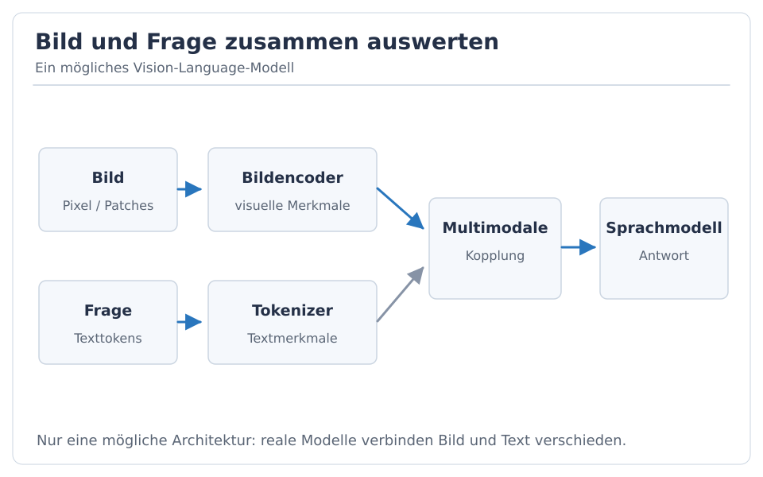

# M6-L5 – Multimodale KI: Bilder, Video und Audio {#L5}

**Kursbereich:** M6 – Schwerpunkt: KI und Robotik

**Niveau:** Bachelor / Master (Wahl)

**Vorwissen:** Keine festen Voraussetzungen angegeben.

## Lernziel: Wie ein Computer unterschiedliche Medien versteht und erzeugt {#S1}

In M6-L1 und M6-L2 haben wir gelernt, wie Textmodelle Wörter in *Tokens* zerlegen und schrittweise Vorhersagen erzeugen. M6-L4 hat gezeigt, wie sich ein Sprachmodell durch Dokumentensuche und Werkzeuge ergänzen lässt. Jetzt erweitern wir die Perspektive: Ein KI-System soll nicht bloß einen Satz lesen, sondern vielleicht auch ein Foto beschreiben, einen Film zusammenfassen, gesprochene Sprache verstehen oder aus einem Textentwurf eine Szene mit Bild und Ton erzeugen.

Dafür gibt es den Begriff **multimodal**. Eine *Modalität* ist eine Form von Information: Text, Standbild, Ton, Video oder beispielsweise Sensordaten eines Roboters. **Multimodale künstliche Intelligenz** verbindet mindestens zwei solcher Formen – als Eingabe, Ausgabe oder beides.

Das Entscheidende ist nicht, dass „alles dasselbe“ wird. Ein Foto besteht aus räumlichen Farbwerten, Ton aus zeitlich veränderlichen Schwingungen und Video aus einer zeitlich geordneten Bildfolge. Jede Modalität hat eigene Eigenschaften, Kodierungen, Fehlerquellen und Anforderungen an die Hardware. Moderne Anwendungen verwenden deshalb entweder mehrere spezialisierte Modelle oder Modelle mit gemeinsamen beziehungsweise miteinander verbundenen Repräsentationen.

Wir betrachten fünf Fragen: Wie werden Medien als Zahlen dargestellt? Wie findet ein Modell Beziehungen zwischen Bild und Text? Wie erzeugt ein Diffusionsmodell neue Bilder? Was ändert sich für Video und Audio? Und wie fügt man diese Bausteine zu einem brauchbaren, sicheren Produktionssystem zusammen?

## Ein Bild ist nicht einfach ein Satz mit anderen Wörtern {#S2}

Ein Computer erhält Bilder zunächst als Dateien, nicht als Bedeutungen. Eine Bilddatei kann beispielsweise komprimierte Informationen enthalten, aus denen ein Decoder ein Raster von Bildpunkten rekonstruiert. Bei einem RGB-Bild steht RGB für **Rot, Grün und Blau**. Jeder Bildpunkt hat gewöhnlich drei Farbkomponenten. Die Darstellung $1024 \times  1024 \times  3$ bedeutet: 1.024 Bildspalten, 1.024 Zeilen und drei Farbkanäle.

Wenn man je Kanal ein Byte annimmt, ergibt sich im unkomprimierten Fall:

$$
1\,024\times1\,024\times3=3\,145\,728\,\mathrm{Byte}=3\,\mathrm{MiB}
$$

*MiB* ist ein Mebibyte, also 1.048.576 Byte. Die Rechnung bezieht sich nur auf die reinen Bildwerte. Eine JPEG-Datei kann durch verlustbehaftete Kompression wesentlich kleiner sein. Auch Alpha-Kanal, Farbtiefe und Metadaten verändern die Größe.

Ein Netz könnte theoretisch jeden Farbwert einzeln verarbeiten. Für viele Bildaufgaben ist das jedoch unpraktisch. Stattdessen werden Bilder oft in kleinere **Patches** zerlegt oder mit Faltungsoperationen verarbeitet. Ein Patch ist ein kleines rechteckiges Bildstück. Ein *Vision Transformer* überführt solche Patches in numerische Vektoren und verarbeitet ihre Beziehungen mit Attention, wie wir sie aus M6-L1 kennen.

``` text
Bilddatei
   |
   v
Dateidecoder und Vorverarbeitung
   |
   v
Bildraster -> Patches / visuelle Merkmale
   |
   v
Bild-Encoder -> Merkmalsvektoren
   |
   +--> Bildsuche / Klassifikation
   +--> Sprachmodell für Bildfragen
```

Ein **Encoder** wandelt hier Eingaben in interne Darstellungen um. Er „liest“ das Bild nicht so wie ein Mensch, sondern berechnet Merkmale, die während des Trainings für eine Aufgabe nützlich geworden sind. Ob eine kleine Aufschrift, ein ungewöhnlicher Gegenstand oder ein feines Detail erhalten bleibt, hängt unter anderem von der Auflösung, der Vorverarbeitung und dem Modell ab. Ein hoher Modellwert für „Katze“ beweist nicht, dass tatsächlich eine Katze im Bild ist.

## Von Bildmerkmalen zu einer gemeinsamen Bedeutung mit Text {#S3}

Wie kann eine Texteingabe „rote Lokomotive vor einem Bahnhof“ zu einem passenden Bild führen, obwohl die Frage aus Wörtern und die Antwort aus Pixeln besteht? Eine wichtige Idee ist, Text und Bilder so zu trainieren, dass ihre numerischen Darstellungen **vergleichbar** werden.

Die Forschungsarbeit **CLIP** (*Contrastive Language–Image Pre-training*) führte einen verbreiteten Ansatz vor: Ein Text-Encoder und ein Bild-Encoder werden mit zusammengehörigen und nicht zusammengehörigen Bild-Text-Paaren trainiert. Die Darstellungen passender Paare sollen im gemeinsamen Vektorraum näher beieinander liegen als unpassende. Das Trainingsverfahren heißt *kontrastives Lernen*.

``` text
Text: „ein rotes Fahrrad“ -> Text-Encoder ----> Vektor T
                                                   |
                                                   v
                                          Ähnlichkeit vergleichen
                                                   ^
                                                   |
Foto eines Fahrrads -------> Bild-Encoder ----> Vektor B
```

So kann ein Programm zu einer Textsuche die ähnlichsten Bildvektoren finden. Das ist dem Retrieval aus M6-L4 verwandt – nur dass die Abfrage aus Text bestehen und das Ergebnis ein Bild sein kann. Die Ähnlichkeit ist statistisch gelernt. Zwei semantisch nahe Medien können einander im Vektorraum ähneln, aber das garantiert keine vollständige Beschreibung, keine Wahrheit und keine rechtliche Erlaubnis zur Nutzung.

Ein **gemeinsamer Embedding-Raum** ist auch nicht zwingend für jedes multimodale System nötig. Manche Anwendungen haben getrennte Verarbeitungswege und verbinden erst später ihre Ergebnisse. Andere nutzen gemeinsame oder aufeinander abgestimmte Komponenten. Ein einzelnes Produkt kann verschiedene Modelle hinter einer einheitlichen Oberfläche verbergen.

Besonders wichtig ist die Grenze zwischen *Erkennen* und *Verstehen*: Wenn ein Modell eine Katze zuverlässig erkennt, folgt daraus nicht, dass es die Absicht des Fotografen, den Kontext einer Szene oder die Echtheit des Bildes bestimmen kann. Ein Beleg aus dem Bild muss von einer plausiblen Ergänzung aus den Trainingsmustern getrennt werden.

## Vision-Language-Modelle: Bilder befragen statt nur klassifizieren {#S4}

Ein **Vision-Language-Modell (VLM)** ist auf gemeinsame Aufgaben mit Bildern und Sprache ausgelegt. Es kann beispielsweise eine Szene beschreiben, Fragen zu Diagrammen beantworten oder visuelle Elemente in einem Dokument auswerten. Dabei kommen mehrere technische Bauweisen vor.



Bild- und Texteingaben benötigen unterschiedliche Vorverarbeitung; das Schema zeigt nur eine mögliche Architektur.

Eine anschauliche Variante verbindet einen Bild-Encoder mit einem großen Sprachmodell (*Large Language Model*, LLM). Ein **Projektor** oder eine **Brückenkomponente** bringt die Bildmerkmale in eine Form, die das Sprachmodell als zusätzliche Eingabe verwenden kann. Forschungsarchitekturen wie **BLIP-2** und **LLaVA** zeigen unterschiedliche Varianten solcher Verbindungen.

``` text
Bild ----> Bild-Encoder ----> Bildmerkmale ----+
                                               |
                                 Projektor / multimodale Kopplung
                                               |
Frage --> Text-Tokenizer ----------------------+--> Sprachmodell --> Antwort
```

Die Zeichnung ist ein Denkmodell, kein universeller Bauplan. Manche Systeme verwenden besondere *Cross-Attention*-Schichten, andere führen visuelle Tokens direkt gemeinsam mit Texttokens durch ein Modell; wieder andere sind stärker vereinheitlicht. Wichtig ist: Das Sprachmodell kann nur mit den Merkmalen arbeiten, die es aus dem Bildpfad tatsächlich erhält.

Ein Beispiel: Auf einem Foto steht ein handgeschriebenes Etikett neben einer Medizinpackung. Eine Bild-KI könnte die Packung erkennen, die Handschrift aber falsch lesen. Ein sprachlich überzeugender Satz erzeugt noch keine sichere Texterkennung. Bei Rechnungen, Sicherheitswarnungen oder medizinischen Dokumenten können falsche Details bedeutsam sein. Solche Aufgaben benötigen gegebenenfalls spezielle **Optical Character Recognition (OCR)** – optische Zeichenerkennung –, zusätzliche Prüfregeln oder einen menschlichen Abgleich.

Ein zweites Problem ist die **räumliche Zuordnung**. „Links neben dem roten Gegenstand“ ist keine reine Wortfrage. Das Modell muss Objekte und Positionen korrekt erfassen. Bei vielen kleinen Elementen, überlappenden Gegenständen oder ungewohnter Perspektive können Lagebeziehungen verwechselt werden. Bildverständnis lässt sich deshalb nicht allein mit schönen Bildbeschreibungen bewerten.

### Bildverständnis, Bildsuche und Bildgenerierung unterscheiden

Ein Bilderkennungssystem beantwortet eine Frage zu einem bereits vorhandenen Bild. Eine Bildsuche findet passende Medien in einem Index. Ein generatives Bildmodell erschafft dagegen Bilddaten, die im Ausgangsbild nicht vorhanden sein müssen. Ein einzelner Dienst kann alle drei Funktionen anbieten, doch die zugrunde liegenden Aufgaben sind verschieden.

  Aufgabe              Eingabe                            Ausgabe               Typischer Prüfpunkt
  -------------------- ---------------------------------- --------------------- ----------------------------------------------------
  Bildsuche            Text oder Referenzbild             Vorhandene Dateien    Sind die gefundenen Bilder wirklich relevant?
  Bildbeschreibung     Bild und Frage                     Text                  Ist die Aussage durch das Bild gedeckt?
  Bildklassifikation   Bild                               Kategorie und Score   Sind Fehlklassifikationen akzeptabel?
  Bildgenerierung      Text und optionale Vorgaben        Neues Bild            Entspricht es den Vorgaben und Nutzungsrechten?
  Bildbearbeitung      Ausgangsbild und Änderungswunsch   Verändertes Bild      Bleiben geschützte, unveränderte Bereiche korrekt?

## Diffusion: Ein Bild entsteht aus schrittweiser Verfeinerung {#S5}

Bei Textmodellen entsteht eine Antwort häufig autoregressiv: Ein Token folgt auf das nächste. Für Bilder ist ein anderes Verfahren wichtig geworden: **Diffusionsmodelle**. Die grundlegende Idee ist zunächst ungewöhnlich: Während des Trainings werden Bilddaten schrittweise verrauscht. Das Modell lernt, wie man aus einem gestörten Zustand in Richtung plausibler Bilddaten zurückkommt.

Beim Erzeugen beginnt ein vereinfachter Diffusionsablauf mit einem Rauschmuster. Das trainierte Modell schätzt wiederholt, welcher Anteil des Rauschens beziehungsweise welcher sauberere Zustand zum angestrebten Ergebnis passt. Ein **Sampler** organisiert diese Schritte. Das Resultat ist ein neues Bild, nicht eine aus dem Internet kopierte Datei – wobei unerwünschtes Auswendiglernen bestimmter Trainingsbeispiele oder Rechteprobleme damit nicht grundsätzlich ausgeschlossen sind.

``` text
Textvorgabe --> Text-Encoder ------------------------+
                                                      |
zufälliger Startzustand ------------------------------+-->
                                                      |
                wiederholte Entrauschungsschritte      |
                     Rauschen -> weniger Rauschen     |
                                                      v
                                                  Bilddaten
```

Die Grafik lässt viele mathematische Details weg. In einem konkreten System wird nicht notwendigerweise direkt auf allen Pixeln entrauscht. Die Arbeit von **Rombach und Kollegen** zu *Latent Diffusion Models* zeigt, wie der aufwendige Generationsprozess in einen komprimierten Merkmalsraum verlagert werden kann.

### Der latente Raum und der Autoencoder

Ein **latenter Raum** besteht aus gelernten numerischen Darstellungen, die gegenüber dem vollständigen Bildraster oft kompakter sind. Ein **Autoencoder** hat zwei Teile: Ein Encoder verdichtet eine Eingabe; ein Decoder rekonstruiert daraus wieder die geeignete Ausgabeform. Die Verdichtung ist nicht dasselbe wie ein verlustfreies ZIP-Archiv: Details können verloren gehen.

Für eine latente Diffusion lautet die vereinfachte Architektur:

``` text
                     Trainingsbild
                          |
                          v
                  Bild-Encoder (VAE)
                          |
                          v
                    Latenter Raum
                          |
              Rauschen und Lernprozess
                          |
                       Modell
                          ^
                          |
                   Textbedingungen

Generierung: Zufall im latenten Raum
       -> viele modellgesteuerte Schritte
       -> Bild-Decoder
       -> fertiges Bild
```

**VAE** bedeutet *Variational Autoencoder*, also variationaler Autoencoder; nicht jedes Verfahren muss genau dieselbe Autoencoder-Architektur verwenden. Die Textbedingung gelangt je nach Architektur beispielsweise über *Cross-Attention* in die Bildverarbeitung. „Conditioning“ heißt allgemein, dass die Erzeugung durch zusätzliche Informationen beeinflusst wird. Diese Informationen können auch ein Referenzbild, eine Maske, eine Skizze oder eine Tiefenkarte sein.

### Text-zu-Bild und Bild-zu-Bild

Bei **Text-zu-Bild** beschreibt ein Textprompt die erwünschte Szene. Das Modell erstellt eine plausible Darstellung. Bei **Bild-zu-Bild** kommt eine vorhandene Vorlage hinzu; der Grad der Änderung bestimmt, wie stark das neue Bild vom Original abweicht. Bei **Inpainting** wird ein begrenzter Bildbereich neu erzeugt. Bei **Outpainting** wird der sichtbare Bildraum über die ursprüngliche Begrenzung hinaus erweitert.

Die Begriffe werden in Produkten nicht immer einheitlich verwendet. Wichtig ist die Frage, *welche Informationen das Modell behalten soll*. Ein Werbebild könnte einen exakt vorgegebenen Produktnamen oder ein Logo enthalten. Ein generatives Verfahren kann Farben und Formen gut annähern und trotzdem einzelne Buchstaben oder Proportionen verändern. Für exakte Logos, gesetzlich relevante Aufdrucke oder technische Zeichnungen kann klassische Bildbearbeitung verlässlicher sein.

Die **Anzahl der Generationsschritte** ist außerdem kein universeller Qualitätswert. Sie hängt vom Modell und vom Sampler ab. Mehr Schritte bedeuten nicht unter allen Umständen ein besseres Bild. Auch „Seed“ – ein Startwert für den Zufallsgenerator – macht Ergebnisse nur unter hinreichend gleichen Modell-, Software- und Hardwarebedingungen reproduzierbar. Ein Seed ist keine zuverlässige Sicherung des fertigen Mediums.

## Warum Diffusion nicht mit jeder Bild-KI gleichgesetzt werden darf {#S6}

Nicht jedes generative Bildmodell arbeitet per Diffusion. Frühere und weiterhin relevante Familien sind **Generative Adversarial Networks (GANs)**, auf Deutsch etwa gegeneinander trainierte Erzeuger- und Prüfernetze. Es gibt außerdem autoregressive Bildmodelle, die visuelle Tokens vorhersagen, und andere generative Konstruktionen. „Bild-KI“ benennt die Aufgabe, nicht die zwingende Architektur.

Die Gemeinsamkeit besteht darin, dass die Modelle aus Trainingsdaten statistische Strukturen lernen und daraus neue Beispiele ableiten. Keine dieser Methoden besitzt dadurch automatisch eine vollständige physikalische Simulation der dargestellten Welt. Ein Bild eines mechanischen Getriebes kann fotorealistisch sein, ohne dass die Zahnräder tatsächlich richtig ineinandergreifen. Für die Beurteilung der technischen Funktion wären zusätzliche Modellierung, Regeln oder Simulation notwendig.

Ebenso gilt: Ein Training mit vielen Fotos macht die generierten Bilder nicht zu Foto-Belegen. Ein authentisches Foto und ein synthetisches Bild können ähnlich aussehen. Die Herkunft muss unabhängig vom visuellen Eindruck beurteilt werden.

## Video: Nicht nur viele einzelne Bilder {#S7}

Video enthält zeitlich geordnete Bilder – sogenannte **Frames**. Ein Film mit 24 Frames pro Sekunde enthält 24 Bildzustände pro Sekunde. Aber die Einzelbilder können nicht beliebig erzeugt werden. Die Zuschauer erwarten, dass eine Person in der nächsten Einstellung dieselbe Person bleibt, dass die Kamera sich nachvollziehbar bewegt und Gegenstände nicht grundlos verschwinden.

Würden wir für jeden Frame unabhängig denselben Textprompt an ein Bildmodell senden, könnten Kleidung, Gesichter, Schatten oder Raumanordnung ständig wechseln. Das nennt man **zeitliche Inkonsistenz**. Video-KI muss deshalb nicht nur räumliche Bildstrukturen, sondern auch *Beziehungen über die Zeit* lernen.

``` text
Beschreibung / Startbild / eventuell Bewegungsvorgaben
                          |
                          v
                  Videogenerationsmodell
                Raum + Zeit gemeinsam
                          |
                          v
              Frames mit zeitlichem Bezug
                          |
                          v
                 Videodatei mit Codec
```

Die Forschungsarbeit **Video Diffusion Models** zeigt einen frühen Ansatz, Bilddiffusion um zeitliche Dimensionen und zusammenhängende Videosequenzen zu erweitern. Andere Systeme arbeiten mit räumlich-zeitlichen Tokens, aufeinanderfolgenden Blöcken oder eigenen Bewegungskomponenten. Es ist nicht erforderlich, dass alle Frames in einem einzigen Rechenschritt generiert werden.

### Warum Video so datenintensiv sein kann

Ein anschauliches *theoretisches* Speicherbeispiel mit dem unkomprimierten RGB-Bild aus Abschnitt 1:

$$
\begin{aligned}
\text{1 Frame:}\quad&1\,024\times1\,024\times3\,\mathrm{Byte}=3\,\mathrm{MiB}\\
\text{1 Sekunde:}\quad&24\,\text{Frames}\times3\,\mathrm{MiB}=72\,\mathrm{MiB}\\
\text{1 Minute:}\quad&60\times72\,\mathrm{MiB}=4\,320\,\mathrm{MiB}\approx4{,}22\,\mathrm{GiB}
\end{aligned}
$$

Das sind **keine Angaben zur Dateigröße eines generierten Videos oder zur Belegung des Grafikspeichers**. Reale Videodateien sind typischerweise stark komprimiert; interne Modellzustände, latente Daten, Aufmerksamkeitsspeicher, Ton und Zwischenschritte folgen wiederum anderen Größenordnungen. Das Zahlenbeispiel zeigt allein, warum die Zeitdimension zusätzliche Daten und Berechnungen mitbringt.

### Was zeitliche Konsistenz konkret bedeutet

Vier Arten von Zusammenhängen sind zu unterscheiden:

1.  **Identität:** Eine Figur soll über mehrere Einstellungen erkennbare Merkmale behalten.
2.  **Objektbeständigkeit:** Ein abgelegter Gegenstand soll nicht ohne Ursache verschwinden.
3.  **Bewegung:** Position und Richtung sollen sich über die Zeit sinnvoll verändern.
4.  **Szenenlogik:** Beleuchtung, Perspektive, Ereignisse und Ursache-Wirkung sollen zusammenpassen.

Ein Modell kann für wenige Sekunden beeindruckende Bewegungen erzeugen und dennoch bei komplexer Handinteraktion, langen Geschichten oder genauen Bewegungsabläufen scheitern. Ein *Prompt* ist keine Garantie für kontinuierliche Geometrie oder Physik. Für Produktdemonstrationen, reale Messungen oder sicherheitskritische Simulationen darf eine visuell plausible Sequenz nicht ungeprüft als technische Referenz dienen.

Video kann außerdem **Eingabe** einer KI sein: Ein System sucht Szenen, erstellt Untertitel, erkennt Bewegungsereignisse oder fasst eine Besprechung zusammen. Häufig nutzt es dazu ausgewählte Frames, Audiospuren und gegebenenfalls Zeitstempel. Welche Teile des Videos tatsächlich berücksichtigt werden, ist für die Aussagekraft entscheidend. Wer nur jedes zehnte Bild betrachtet, kann kurze Ereignisse verpassen.

## Audio: Warum Ton noch eine andere Art von Signal ist {#S8}

**Audio** ist eine Folge zeitlich veränderlicher Messwerte. Ein Mikrofon zeichnet vereinfacht den Luftdruckverlauf als elektrische Spannung auf; ein Analog-Digital-Wandler macht daraus Zahlenwerte. Die **Abtastrate** sagt, wie viele Messwerte pro Sekunde aufgenommen werden. Bei 16.000 Samples pro Sekunde entstehen 16.000 zeitliche Werte pro Kanal und Sekunde, bevor Kompression oder andere Verarbeitung eingreifen.

Bei Audiofragen ist es wichtig, drei Funktionen auseinanderzuhalten:

- **Automatische Spracherkennung**, englisch *Automatic Speech Recognition (ASR)*: Ton wird in geschriebenen Text umgewandelt.
- **Sprachsynthese**, englisch *Text-to-Speech (TTS)*: Text wird in gesprochene Sprache überführt.
- **Audioverstehen / Audioerzeugung**: Das System erkennt beispielsweise Musik, Geräusche oder Sprecherwechsel beziehungsweise erzeugt Ton auch ohne vorgegebenen Wortlaut.

Ein Spracherkennungssystem kann aus einer gesprochenen Frage Text machen, der anschließend an ein Sprachmodell geht. Ein anderes System kann Klangmerkmale direkt mit sprachlichen oder anderen Repräsentationen verbinden. Beides sind multimodale Anwendungen – aber technisch nicht zwingend dasselbe.

### Von Schwingungen zu Merkmalen

Sprach- und Audionetze bekommen oft nicht einfach lange Listen roher Messwerte. Für viele Modelle werden die Werte in zeitlich kurze Abschnitte geteilt, Frequenzanteile berechnet und in einem **Spektrogramm** dargestellt. Ein Spektrogramm zeigt, welche Frequenzanteile zu welchen Zeitpunkten auftreten. Eine Mel-Skala orientiert sich näher an bestimmten Eigenschaften menschlicher Tonhöhenwahrnehmung; ein **Mel-Spektrogramm** ist deshalb eine häufig verwendete auditive Zwischendarstellung.

``` text
Mikrofon / Audiodatei
         |
         v
   Samples und Vorverarbeitung
         |
         v
Spektrogramm oder Audio-Encoder
         |
         +----> ASR -> Text
         +----> Geräuschklassifikation
         +----> multimodale Analyse
```

Das Beispiel **Whisper**, dokumentiert in der Arbeit *Robust Speech Recognition via Large-Scale Weak Supervision*, veranschaulicht einen leistungsfähigen Ansatz zur Sprachtranskription. Allerdings können Namen, Zahlen, Fachwörter, Akzente und überlappende Sprecher weiterhin falsch erkannt werden. Für Zitate, Verträge oder medizinische Entscheidungen sollte man die Aufnahme mit der Abschrift abgleichen.

### Text-zu-Sprache: Es muss eine Stimme entstehen, nicht nur ein Satz

**Sprachsynthese** verbindet linguistischen Inhalt mit Rhythmus, Aussprache, Stimme und Klang. Bei einem klassischen neuronalen Aufbau sagt ein Modell zunächst akustische Merkmale voraus. Ein **Vocoder** erzeugt daraus eine hörbare Wellenform. Das bekannte Forschungsmodell **Tacotron 2** verwendet diese Zweiteilung: Text → Mel-Spektrogramm → Waveform.

``` text
Text
  |
  v
Aussprache, Pausen und akustische Merkmale
  |
  v
Mel-Spektrogramm
  |
  v
Vocoder / Audiogenerator
  |
  v
Sprachausgabe
```

Modernere Verfahren können andere Zwischendarstellungen oder direktere Token-zu-Audio-Verfahren verwenden. Die Architektur ist daher ein Lehrbeispiel und keine Behauptung, dass alle modernen Stimmen so erzeugt werden.

Aussprache ist nicht alles. Für eine glaubwürdige Stimme gehören **Prosodie** (Betonung, Pausen, Melodie), Sprachtempo, Intonation und teilweise Emotion zum Ergebnis. Eine freundlich klingende Stimme sagt allerdings nichts über die Richtigkeit des gesprochenen Inhalts. Stimme und inhaltliche Antwort sind getrennte Qualitätsmerkmale.

Die **Erzeugung nichtsprachlichen Tons** – Musik, Hintergrundgeräusche, akustische Szenen – hat weitere Anforderungen. Ein Tonmodell kann kurze Klangfragmente überzeugend erzeugen und trotzdem eine lange musikalische Form oder genaue zeitliche Synchronisierung nicht einhalten. Forschungsansätze wie **AudioLM** behandeln Audiodaten mit Sprachmodell-inspirierten Verfahren; „Sprachmodell“ bedeutet hier nicht, dass die Audiosamples einfach geschriebene Wörter wären.

## Echtzeitgespräche brauchen eine eigene Systemarchitektur {#S9}

Stellen wir uns eine sprachgesteuerte Anwendung vor. Die Nutzerin fragt: „Was zeigt die Kamera gerade?“ Der Dienst muss Audio und Bildsignale verarbeiten, eine Antwort erzeugen und vielleicht sprechen. Mehrere Arbeitsschritte stehen hinter einer scheinbar einzigen Konversation:

``` text
Mikrofon ----------> Spracherkennung ---+
                                         |
Kamera ------------> visuelle Merkmale --+--> Dialoglogik
                                         |       |
Kontext / Daten ----> Wissensabruf -------+       v
                                           multimodales Modell
                                                  |
                                                  v
                                             Antworttext
                                                  |
                                                  v
                                            Sprachsynthese
                                                  |
                                                  v
                                               Lautsprecher
```

Das ist eine **Pipeline** aus Spezialkomponenten. Andere Systeme können Sprache und Bild enger zusammen verarbeiten und Antwort-Audio direkt generieren. Für die Planung eines eigenen Dienstes ist die Trennung trotzdem hilfreich: Jede Komponente hat eine eigene Fehlerrate, Laufzeit, Berechtigung und Datenspeicherung.

Die **Latenz** ist die Wartezeit, bis die erste verwertbare Reaktion entsteht. Ein längerer interner Schritt kann die gesamte Konversation verzögern. **Streaming** bedeutet, dass Zwischenergebnisse – zum Beispiel erste Transkriptteile oder erste Audiostücke – bereits weitergegeben werden, bevor die gesamte Aufgabe beendet ist. Das verbessert unter Umständen das Nutzergefühl, kann aber Korrekturen erschweren, wenn eine vorläufige Transkription später verändert wird.

Echtzeit ist deshalb keine bloße Eigenschaft des KI-Modells. Sie hängt von Mikrofon, Netzwerk, Komprimierung, Modellhardware, Warteschlangen, Ausgabe und Abbruchlogik ab. In einem lokalen Offline-System entfällt die Netzwerkrundreise, doch die vorhandene Hardware kann zu langsam sein. Ein Cloud-Dienst hat möglicherweise leistungsfähigere GPUs, braucht aber Netzanbindung und verarbeitet gegebenenfalls sensible Medien außerhalb des Geräts.

## Produktionspipeline: mehrere Medien, mehrere Verantwortlichkeiten {#S10}

Eine Medienproduktion kann aus vielen einzelnen KI-Schritten bestehen. Nehmen wir ein kurzes Informationsvideo. Ein Textmodell erstellt einen Entwurf; eine Bild- oder Videogenerierung erzeugt Szenen; eine Sprachsynthese spricht den Text; eine separate Anwendung setzt Ton und Bild zusammen. Die Qualität hängt nicht nur vom Modell ab, sondern von den Schnittstellen und der Prüfung zwischen den Schritten.

``` text
Redaktioneller Text / Storyboard
             |
             +----> Szenenbeschreibung -> Bild-/Videomodell --+
             |                                                |
             +----> Sprechertext -------> TTS / Audiodatei ---+
             |                                                |
             +----> Zeitplan, Rechte, Quellen ----------------+
                                                              |
                                                              v
                                                    Videoschnitt / Muxing
                                                              |
                                                              v
                                              Sichtprüfung und Freigabe
                                                              |
                                                              v
                                              Export + Herkunftshinweise
```

*Muxing* bedeutet, mehrere Medienströme – etwa Bild und Ton – in einen gemeinsamen Container zu packen. Eine Produktionspipeline darf fehlgeschlagene Schritte wiederholen können, ohne fertige Ergebnisse versehentlich zu überschreiben. Sie benötigt eindeutige Auftragskennungen, Versionsangaben, Zwischenspeicher und eine nachvollziehbare Zuordnung von Prompt, Quelldatei, Modellversion und Endergebnis. Diese betrieblichen Fragen verbinden M6-L5 mit der Job- und Worker-Architektur aus M4-L1.

### Welche Fehler auftreten können

Ein Bildmodell liefert die falsche Auflösung. Ein Videomodell erzeugt eine Szene, in der die Figur plötzlich andere Kleidung trägt. Die Sprachsynthese betont einen Eigennamen falsch. Eine neue Untertitelversion stimmt zeitlich nicht mehr mit der Tonspur überein. Werden die Schritte ohne Kontrolle verkettet, kann das Gesamtergebnis formal als Datei existieren und inhaltlich trotzdem unbrauchbar sein.

Es hilft, **Zwischenergebnisse getrennt zu archivieren**: freigegebener Text, Bildreferenzen, generierte Varianten, Audiospuren, Untertitel, Projektdatei und finale Fassung. Ein Modellwechsel verändert unter Umständen die Resultate, obwohl der ursprüngliche Prompt gleich bleibt. Reproduzierbarkeit ist daher ein eigener Qualitätsaspekt, nicht automatisch gegeben.

## Drei ausführliche Anwendungsbeispiele {#S11}

### Beispiel A: Lokales Medienarchiv

Eine private Bild- und Videosammlung soll anhand von Begriffen durchsucht werden: „Alle Fotos mit einer Dampflok“ oder „Der Clip, in dem die Kamera über eine Brücke schwenkt.“ Eine relativ einfache Architektur kann Metadaten und visuelle Embeddings in einem lokalen Index speichern. Das eigentliche Bild bleibt auf der eigenen Festplatte. Bei Videos werden gegebenenfalls Vorschaubilder und Zeitstempel gespeichert.

``` text
Lokale Mediendateien -> Metadaten / Vorschaubilder
                              |
                              v
                       Bild-Encoder
                              |
                              v
                          Suchindex
                              ^
                              |
                       Suchbegriff
```

Vorteil: Die Originaldateien müssen nicht an einen externen Dienst übertragen werden. Nachteil: Eine große Sammlung braucht Platz für Indexe und teils lange Erstverarbeitung; auf einem normalen PC kann das dauern. Für exakte Dateinamen oder Aufnahmedaten reicht häufig eine klassische Datenbankabfrage ohne KI. Für semantische Suche können Embeddings hilfreich sein. Eine visuelle Beschreibung bleibt dennoch fehlbar.

Das Projekt kann getrennt nach privaten und freigegebenen Medien suchen und Rechte vor der Anzeige prüfen. Ein KI-Modell darf die Zugriffskontrolle nicht ersetzen. Auch Face Recognition, also Gesichtserkennung, sollte nicht beiläufig zur Pflichtfunktion werden: Sie verarbeitet besonders sensible Merkmale und kann weitreichende Datenschutzfolgen haben.

### Beispiel B: Online-Dienst zur Audio- und Bildanalyse

Eine kleine Webanwendung nimmt von Kunden hochgeladene Medien entgegen. Ein Worker erstellt Transkripte, Bildbeschreibungen und eine durchsuchbare Zusammenfassung. Die Kundin sieht den Bearbeitungsstand und kann das Ergebnis korrigieren.

``` text
Kunden-Upload -> Rechteprüfung -> privater Objektspeicher
                                      |
                                      v
                                Auftragswarteschlange
                                      |
                                      v
                             CPU-/GPU-Worker
                            /        |        \
                           /         |         \
                        ASR      Bildanalyse   Zusammenfassung
                           \         |         /
                            \        |        /
                             Ergebnisprüfung
                                     |
                                     v
                            Kundenspezifischer Abruf
```

Der Dienst braucht Dateigrößenlimits, Aufbewahrungsregeln, Protokollierung, sichere Löschung und Schutz gegen übermäßige Nutzung. Werden Medien an einen externen Modellanbieter gesendet, gehören die Datenflüsse, Vertragsbedingungen, Aufbewahrungsfragen und eventuelle Datenübermittlungen zur Architekturentscheidung. Ein nicht erfolgreicher Auftrag darf nicht endlos erneut hohe GPU-Kosten verursachen; Wiederholungen brauchen Grenzen.

Geschäftlich ist die Frage: Was kostet ein erfolgreich bearbeitetes Audiominuten- oder Videominutenpaket einschließlich Hosting, Speicherung, Modellnutzung und Support? Hier verbinden sich die Grundlagen mit M4-L4 über Cloud-Kosten. Eine einzige feste Zahl wäre unseriös, weil Modellgröße, Datentyp, Auflösung, Last und Anbieter stark variieren.

### Beispiel C: Kreative Bild-, Video- und Audioproduktion

Ein kleines Produktionsteam will aus einem redaktionellen Entwurf ein kurzes animiertes Erklärstück gestalten. Es benötigt eine freigegebene Bildsprache, wiedererkennbare Figuren, einen konsistenten Sprecher und genaue Textinhalte. Ein mögliches System verwendet für jede Szene ein Storyboard und überprüfte Referenzbilder, daraus kurze Videoabschnitte und getrennte Audioelemente.

Der scheinbar einfachste Plan – „ein Prompt, ein fertiger Film“ – ist für kontrollierte Arbeit nicht immer der verlässlichste. Änderungen an einer einzigen Textzeile könnten ansonsten große Teile der Ausgabe unvorhersehbar verändern. Eine modulare Pipeline ermöglicht gezielte Nachbearbeitung, manuelle Schnitte und die Wiederverwendung einzelner freigegebener Szenen. Gleichzeitig entstehen mehr Koordinationsaufwand und Zwischendateien.

Die Qualitätsprüfung betrifft drei Ebenen: **inhaltliche Richtigkeit** (stimmt die Aussage?), **visuelle und akustische Kontinuität** (passt alles zusammen?) sowie **Rechte und Herkunft** (dürfen Vorlagen, Musik, Stimme und Motive so verwendet werden?). Erst nach diesen Prüfungen ist das Projekt veröffentlichungsreif.

## Rechenbedarf, Speicher und Betrieb {#S12}

Multimodale Systeme können besonders ressourcenintensiv sein. Ein Modell für Bildanalyse muss hochauflösende Eingaben verarbeiten; Bildgenerierung führt häufig viele iterative Rechenschritte aus; Video vergrößert die zeitliche Dimension; Audio in Echtzeit muss mit wenig Verzögerung ankommen. Dabei sind drei Ressourcen zu unterscheiden:

- **Rechenleistung:** Viele Matrixoperationen laufen effizient auf Grafikprozessoren (*Graphics Processing Units*, GPUs).
- **Speicher:** Die Modellgewichte, Eingabedaten und Zwischenergebnisse müssen in Arbeits- oder Grafikspeicher passen. *VRAM* bezeichnet den Grafikspeicher.
- **Datentransport und Speicherung:** Originalmedien, Zwischendateien, Indexe und Exporte belegen Plattenplatz und verursachen gegebenenfalls Netzübertragungen.

Ein stärker quantisiertes Modell kann weniger Speicher benötigen, dafür sind Qualität und unterstützte Rechenwege zu prüfen. Bei Videomodellen können zusätzlich die Zahl der Frames, die Bildauflösung und die Länge der Sequenz stark ins Gewicht fallen. Ein bloßes Hochzählen der Modellparameter erklärt die realen Kosten daher nicht.

Ein **Batch** verarbeitet mehrere Aufträge gebündelt. Das kann den Durchsatz verbessern, führt unter Umständen aber zu zusätzlichen Wartezeiten. Für interaktive Sprache ist eine kurze Latenz häufig wichtiger als maximaler Batch-Durchsatz. Für eine nächtliche Bildindizierung ist eher der Gesamtdurchsatz entscheidend. Diese unterschiedlichen Ziele verhindern eine einzige optimale Betriebsarchitektur.

Ein pragmatischer Vergleich:

  Betrieb                           Nutzen                                                    Grenze
  --------------------------------- --------------------------------------------------------- ----------------------------------------------------------
  Lokaler Computer                  Direkte Kontrolle über Dateien, Offline-Nutzung möglich   Leistung und Speicher begrenzt, Wartung selbst
  Einzelner gemieteter GPU-Server   Leistungsfähiger, planbare Entwicklungsumgebung           Kosten können auch im Leerlauf entstehen
  Gehostete KI-API                  Kein eigener Modellbetrieb nötig                          Preis- und Nutzungsmodell sowie Datenfluss des Anbieters
  Mehrere spezialisierte Worker     Unterschiedliche Aufträge skalierbar verteilen            Komplexere Koordination, Monitoring und Zugriffsrechte

Nicht jeder kleine Medienkatalog benötigt ein großes multimodales Modell. Oft sind die Kombination aus klassischer Suchdatenbank, Bildvorschau und einer gelegentlichen KI-Analyse günstiger und einfacher.

## Datenqualität, Konsistenz, Rechte und Kennzeichnung {#S13}

Ein Modell wird durch seine Trainingsdaten und sein Evaluationsverfahren geprägt. Unvollständig beschriftete Bilder, fehlerhafte Transkripte, verzerrte Datenzusammensetzungen oder schlecht aufeinander abgestimmte Bild-Text-Paare können die Qualität beeinträchtigen. Bei visuellen Modellen spielen außerdem ungewöhnliche Beleuchtung, unscharfe Fotos, kleine Objekte und Bildausschnitte eine Rolle. Audioverarbeitung kann durch Dialekte, Hall, Hintergrundlärm und Sprecherwechsel scheitern. Bei Video entstehen zusätzliche Probleme durch Verdeckung, Kamerabewegung und Zeitsprünge.

**Rechte und Einwilligung** sind davon zu unterscheiden. Die technische Möglichkeit, ein Bild, eine Stimme oder einen Filmstil nachzubilden, ist keine allgemeine Erlaubnis zur Verwendung. Urheberrechte, Persönlichkeitsrechte, Datenschutz, vertragliche Lizenzbedingungen und der Nutzungskontext müssen vor der Produktion geklärt werden. Gerade bei der Imitation einer realen Stimme oder Person ist besondere Vorsicht angebracht. Diese Lektion bietet technische Orientierung, keine individuelle Rechtsberatung.

### Herkunftsnachweise: Was C2PA leisten kann

Die **Coalition for Content Provenance and Authenticity (C2PA)** entwickelt technische Spezifikationen für maschinenprüfbare Informationen zu Ursprung und Bearbeitung digitaler Medien. Entsprechende **Content Credentials** können Herkunfts- oder Bearbeitungsaussagen enthalten, die kryptografisch gebunden und überprüft werden. Das ist hilfreich für die Transparenz einer Produktionskette.

Es gibt zwei Grenzen: Ein vorhandener Herkunftsnachweis beweist nicht von sich aus die faktische Wahrheit des Bildinhalts. Und wenn kein Herkunftsnachweis vorhanden ist, beweist das nicht, dass das Medium unverändert oder authentisch wäre. Metadaten können bei Umwandlungen oder Veröffentlichungswegen fehlen; auch ein korrekt signiertes Medium kann einen inszenierten oder irreführenden Inhalt zeigen.

### Europäische Transparenzanforderungen – aktualisiert am 05.11.2026 {#europäische-transparenzanforderungen-aktualisiert-am-05112026}

Artikel 50 der **EU-KI-Verordnung** (*AI Act*, Verordnung (EU) 2024/1689) enthält unterschiedliche Transparenzpflichten für **Anbieter** und **Betreiber** bestimmter KI-Systeme. Nach der Europäischen Kommission gelten die entsprechenden Pflichten grundsätzlich seit **2. August 2026**. Dazu zählen unter den jeweiligen gesetzlichen Voraussetzungen beispielsweise die Information über die direkte Interaktion mit KI, maschinenlesbare Kennzeichnungen synthetischer Inhalte durch Anbieter sowie Offenlegungspflichten für bestimmte Deepfakes und veröffentlichte KI-Texte über Angelegenheiten von öffentlichem Interesse durch Betreiber. Auch Ausnahmen – etwa für bestimmte redaktionell verantwortete Texte – sind gesondert zu prüfen.

**Präzise Übergangsgrenze:** Laut FAQ der Europäischen Kommission gilt die befristete Schonfrist bis **2. Dezember 2026** ausschließlich für die **Kennzeichnungs- und Erkennbarkeitspflicht nach Artikel 50 Absatz 2** und nur für KI-Systeme, die **vor dem 2. August 2026 in Verkehr gebracht** wurden. Das ist **keine allgemeine Verlängerung sämtlicher Transparenzpflichten**. Vor dem 2. August 2026 erzeugte Inhalte müssen nach der FAQ nicht rückwirkend gekennzeichnet werden. Für einen realen Anwendungsfall sind der aktuelle konsolidierte Verordnungstext, die konkreten Rollen sowie die einschlägigen Ausnahmen zu prüfen.

Ein technischer Herkunftsstandard wie C2PA ist nicht automatisch gleichbedeutend mit der vollständigen Erfüllung aller gesetzlichen Pflichten. Umgekehrt bedeutet eine technische Kennzeichnung nicht, dass Nutzung, Einwilligung oder Urheberrecht geklärt wären. Bei Veröffentlichung eines eigenen Dienstes sind die jeweils aktuellen Regelungen und die konkrete Rolle des Betreibers zu prüfen.

### Sicherheit und Missbrauch

Multimodale Daten können nicht nur falsch, sondern auch manipulativ sein. Ein Bild mit eingeblendeter Aufforderung „Ignoriere alle vorherigen Regeln“ oder eine Audioaufnahme mit verstecktem Handlungsauftrag kann eine Form von **Prompt Injection** darstellen. Wenn die KI daraus Werkzeugaktionen ableiten soll, gelten dieselben Schutzprinzipien wie in M6-L4: Fremdinhalte sind Daten, nicht automatisch autorisierte Anweisungen. Nur die Anwendung legt Berechtigungen fest; kritische Aktionen benötigen gegebenenfalls menschliche Freigaben.

Zusätzlich können hochgeladene Dateien schädlich oder technisch fehlerhaft sein. Ein sicheres System begrenzt Formate, Dateigrößen, Verarbeitungslaufzeit und Zugriffsrechte und verarbeitet unbekannte Medien möglichst isoliert. Das ist normale Software-Sicherheit – selbst wenn die eigentliche Medienanalyse mit modernster KI erfolgt.

## Wie man Qualität sinnvoll bewertet {#S14}

Eine pauschale Aussage „Das Modell macht gute Bilder“ reicht nicht. Die Messgröße hängt von der Aufgabe ab:

- **Bildsuche:** Sind die gewünschten Dateien unter den ersten Treffern? Wie viele relevante Bilder werden übersehen?
- **Bildfragen:** Stimmt die Antwort mit sichtbaren, überprüfbaren Details überein? Wird Unsicherheit korrekt angegeben?
- **Spracherkennung:** Welche Wörter werden ausgelassen, ersetzt oder hinzugefügt? Wie steht es um Eigennamen und verschiedene Sprechweisen?
- **Sprachsynthese:** Sind Aussprache, Verständlichkeit, Prosodie und gewünschte Stimme passend?
- **Video:** Bleiben Identität, zeitliche Bewegung und Szenenzusammenhang über längere Folgen erhalten?
- **Generierung insgesamt:** Werden Vorgaben erfüllt, ohne gegen Freigaben, Rechte oder Sicherheitsvorgaben zu verstoßen?

Eine repräsentative Testmenge sollte reale Problemfälle enthalten: unscharfe Bilder, seltene Objekte, kurze Einblendungen, undeutliche Sprache, Hintergrundgeräusche und unterschiedliche Akzente. Menschliche Bewertungen können nützlich sein, sind aber subjektiv; automatisierte Kennzahlen allein erfassen nicht alle Fehler. Insbesondere die technische Machbarkeit eines Outputs darf nicht mit dessen tatsächlicher Verwendbarkeit verwechselt werden.

Bei einem eigenen Dienst wäre ein getrenntes Fehlerprotokoll sinnvoll: *falscher Inhalt, beschädigtes Medium, zu hohe Verzögerung, unpassende Rechte, fehlende Kennzeichnung, abgebrochene Verarbeitung*. So wird sichtbar, ob ein Problem im Modell, im Ablauf oder im Betrieb liegt.

## Brücke zur Mathematik und zu den Wahlthemen {#S15}

Zur Vertiefung können passende mathematische Themen wie Fourier-Analysis, lineare Algebra, Wahrscheinlichkeit und Optimierung herangezogen werden.

- **Lineare Algebra:** Vektoren und Matrizen für Bild-Text-Embeddings, Attention und latente Räume.
- **Wahrscheinlichkeit und Statistik:** Rauschverteilungen, Modelltraining, Fehlerquoten und Evaluation.
- **Analysis und Optimierung:** Ableitungen, Gradienten, Verlustfunktionen und Training.
- **Signalverarbeitung:** Zeitdiskrete Signale, Frequenzanalyse und Spektrogramme.
- **Numerik:** Approximationen, Genauigkeit und Speicherbedarf von Modellrechnungen.

Für die Informatik-Wahlthemen kann es später zwei unterschiedliche Tiefen geben: **Bachelor-Wahlthemen (M8–M10)** zu Computer Vision, Audiosignalverarbeitung und Medieninformatik sowie **mögliche zusätzliche Master-Wahlthemen** zu probabilistischer Generierung, multimodaler Repräsentation, Modellbewertung und Forschungsarchitekturen. Die genannten Themen sind didaktische Anschlussmöglichkeiten; nicht jedes besitzt eine eigene Lektion. Der Master-Kern M7 bleibt organisatorisch getrennt.

## Zusammenfassung und Übergang {#S16}

Multimodale KI verbindet unterschiedliche Datenarten, aber sie macht deren Unterschiede nicht bedeutungslos. Bild-Encoder, Embeddings und Vision-Language-Modelle helfen beim Erkennen und Verknüpfen visueller Inhalte mit Text. Diffusionsmodelle erzeugen Bilder schrittweise und können dabei in einem komprimierten latenten Raum arbeiten. Videogenerierung ergänzt räumliche um zeitliche Zusammenhänge; Sprachverarbeitung unterscheidet Transkription, Sprachsynthese und allgemeine Audiosignale.

Eine reale Anwendung benötigt meist mehr als ein Modell: Dateidecoder, Vorverarbeitung, Auftragssteuerung, Zwischenablage, Qualitätsprüfung, Berechtigungen, Rechteprüfung und gegebenenfalls nachvollziehbare Herkunftsangaben. Häufig entscheidet gerade diese Softwareumgebung darüber, ob ein technisch beeindruckendes Modell zuverlässig eingesetzt werden kann.

**Nächster Schritt [M6-L6 – KI-Infrastruktur und verteilte Berechnung](M6-L6.md):** Wir untersuchen, wann CPU und GPU ausreichen, wie Modelle auf Grafikspeicher, einzelne Rechner und mehrere Knoten verteilt werden und weshalb Durchsatz, Antwortzeit, Datenverkehr und Kosten die Architektur eines KI-Dienstes bestimmen. Danach folgt [M6-L7](M6-L7.md) zur Robotik.


## Quellen {#S17}

**Letzte Quellenprüfung:** 04.11.2026

**Technische Quellen am 04.11.2026 auf fachliche Grundannahmen und öffentlich zugängliche Primärpublikationen geprüft.** Die Rechenbeispiele und Architekturskizzen sind selbst formuliert. Keiner der genannten Forschungsansätze ist mit der Implementierung sämtlicher aktueller Anbieterprodukte gleichzusetzen.

1.  Radford u. a. (2021), **„Learning Transferable Visual Models From Natural Language Supervision“ (CLIP):** [https://arxiv.org/abs/2103.00020](https://arxiv.org/abs/2103.00020) – kontrastive Bild-Text-Repräsentationen.
2.  Li u. a. (2023), **„BLIP-2: Bootstrapping Language-Image Pre-training with Frozen Image Encoders and Large Language Models“:** [https://proceedings.mlr.press/v202/li23q.html](https://proceedings.mlr.press/v202/li23q.html) – Kopplung von Bild-Encoder und Sprachmodell.
3.  Liu u. a. (2023), **„Visual Instruction Tuning“ (LLaVA):** [https://arxiv.org/abs/2304.08485](https://arxiv.org/abs/2304.08485) – bildgestützte Instruktionsverarbeitung.
4.  Ho, Jain & Abbeel (2020), **„Denoising Diffusion Probabilistic Models“:** [https://arxiv.org/abs/2006.11239](https://arxiv.org/abs/2006.11239) – Diffusion und schrittweise Entrauschung.
5.  Rombach u. a. (CVPR 2022), **„High-Resolution Image Synthesis With Latent Diffusion Models“:** [https://openaccess.thecvf.com/content/CVPR2022/html/Rombach_High-Resolution_Image_Synthesis_With_Latent_Diffusion_Models_CVPR_2022_paper.html](https://openaccess.thecvf.com/content/CVPR2022/html/Rombach_High-Resolution_Image_Synthesis_With_Latent_Diffusion_Models_CVPR_2022_paper.html) – latente Räume, Autoencoder, Textbedingung.
6.  Ho u. a. (ICLR 2022), **„Video Diffusion Models“:** [https://openreview.net/forum?id=BBelR2NdDZ5](https://openreview.net/forum?id=BBelR2NdDZ5) – zeitlich zusammenhängende Videodiffusion.
7.  Radford u. a. (ICML 2023), **„Robust Speech Recognition via Large-Scale Weak Supervision“:** [https://proceedings.mlr.press/v202/radford23a.html](https://proceedings.mlr.press/v202/radford23a.html) – Spracherkennung (Whisper).
8.  Shen u. a. (2018), **„Natural TTS Synthesis By Conditioning WaveNet On Mel Spectrogram Predictions“:** [https://research.google/pubs/natural-tts-synthesis-by-conditioning-wavenet-on-mel-spectrogram-predictions/](https://research.google/pubs/natural-tts-synthesis-by-conditioning-wavenet-on-mel-spectrogram-predictions/) – Zweistufen-Synthese und Vocoder.
9.  Google Research (2022), **„Google Research, 2022 & beyond: Language, vision and generative models“:** [https://research.google/blog/google-research-2022-beyond-language-vision-and-generative-models/](https://research.google/blog/google-research-2022-beyond-language-vision-and-generative-models/) – Kontext zu AudioLM.
10. **C2PA, Technical Specifications:** [https://spec.c2pa.org/](https://spec.c2pa.org/) – Standards für überprüfbare Herkunftsinformationen.
11. **Europäische Union, KI-Verordnung, Artikel 50:** [https://ai-act-service-desk.ec.europa.eu/en/ai-act/article-50](https://ai-act-service-desk.ec.europa.eu/en/ai-act/article-50) und **Europäische Kommission, Transparency obligations under Article 50:** [https://digital-strategy.ec.europa.eu/en/faqs/transparency-obligations-under-article-50-ai-act](https://digital-strategy.ec.europa.eu/en/faqs/transparency-obligations-under-article-50-ai-act) – Transparenzregeln, Ausnahmen, Zeitpunkt der Anwendung; rechtsverbindlich bleibt der Verordnungstext.
12. **Europäische Kommission, Leitlinien vom 20.07.2026 zu Artikel 50:** [https://digital-strategy.ec.europa.eu/en/library/guidelines-transparency-obligations-providers-and-deployers-ai-systems](https://digital-strategy.ec.europa.eu/en/library/guidelines-transparency-obligations-providers-and-deployers-ai-systems) – Rollen und Anwendung der Transparenzpflichten.

Die Aussagen zum Recht sind eine allgemeine Einordnung, keine verbindliche Beratung im Einzelfall. Es werden keine konkreten Preise, garantierten Modellfähigkeiten oder behaupteten aktuellen Videolängen einzelner Produkte genannt.
