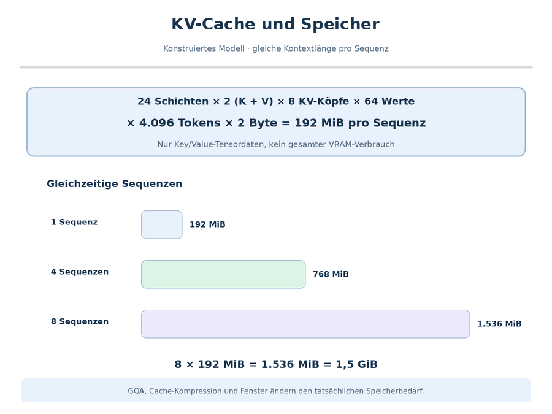
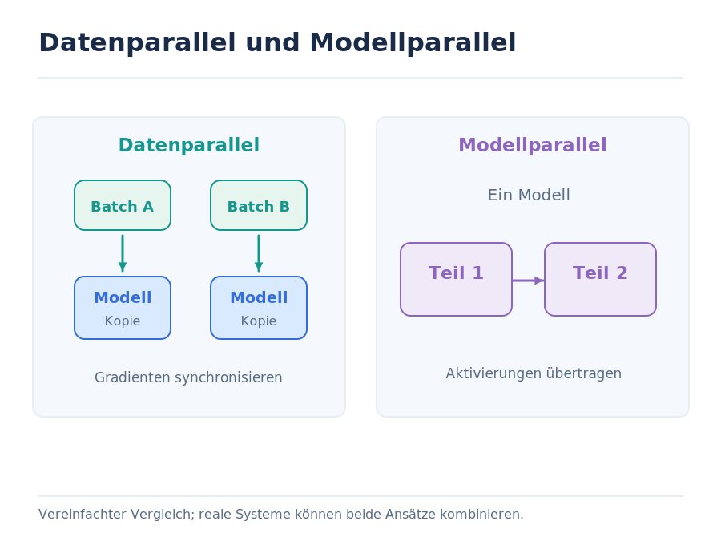

# M6-L6 – KI-Infrastruktur und verteilte Berechnung {#L6}

**Kursbereich:** M6 – Schwerpunkt: KI und Robotik

**Niveau:** Bachelor / Master (Wahl)

**Vorwissen:** Keine festen Voraussetzungen angegeben.

## Lernziel: Warum ein KI-Modell auch ein Rechen- und Betriebsproblem ist {#S1}

In M5-L2 haben wir ein neuronales Netz als mathematische Abfolge von Rechenoperationen kennengelernt. M6-L2 hat gezeigt, wie ein großes Sprachmodell (*Large Language Model*, LLM) eine Antwort Token für Token erzeugt. M6-L3 erklärte Vortraining und Nachtraining; M6-L5 führte uns von Text zu Bild, Ton und Video. Nun betrachten wir die Seite, die man in einer Chatoberfläche kaum sieht: **Wie werden die Modelle überhaupt auf Computern ausgeführt?**

Ein neuronales Netz kann theoretisch als Rechenvorschrift beschrieben werden. Praktisch braucht es Prozessoren, Arbeitsspeicher, Grafikspeicher, Datenträger, Netzwerkverbindungen, Software und bei öffentlichen Diensten eine zuverlässige Auftragsverwaltung. Ein gut trainiertes Modell wird dadurch noch nicht automatisch ein schneller, bezahlbarer oder datenschutzgerechter Dienst.

Die zentrale Frage lautet deshalb nicht: „Wie viele Server kann ich einschalten?“, sondern: **Welcher Teil des Ablaufs benötigt welche Ressource, und an welcher Stelle liegt der tatsächliche Engpass?** Eine kleine Bildanalyse auf einem Heimcomputer verlangt etwas anderes als das Training eines großen Modells oder die gleichzeitige Bedienung vieler Chatnutzer.

Diese Lektion erklärt zuerst Training und Inferenz, dann CPU, GPU, Speicher und Antwortzeiten. Anschließend vergleichen wir mehrere Formen der Parallelisierung, verfolgen eine verteilte KI-Verarbeitungspipeline und entscheiden, wann eine einzelne Maschine ausreicht. Alle Zahlenrechnungen sind didaktische Beispiele, **keine aktuellen Leistungs- oder Preisangaben eines Herstellers**.

## Training und Inferenz sind zwei verschiedene Arbeitsphasen {#S2}

**Training** bedeutet: Ein Modell verarbeitet Beispiele, berechnet einen Fehler und verändert über Optimierungsverfahren seine Parameter. Bei großen neuronalen Netzen umfasst ein Trainingsschritt eine Vorwärtsrechnung, die Rückwärtsrechnung der Gradienten (*Backpropagation*) und eine Aktualisierung der Gewichte. Währenddessen werden zusätzlich zu den Modellgewichten Zwischenergebnisse, Gradienten und häufig Zustände eines Optimierers benötigt. Ein Trainingslauf kann viele solche Schritte umfassen; zu seiner Reproduzierbarkeit gehören Datenversionen, Zufallsinitialisierung, Softwarestände und Sicherungspunkte.

**Inferenz** bedeutet dagegen: Die bereits erlernten Gewichte werden benutzt, um beispielsweise ein Bild einzuordnen, Text zu erzeugen oder eine Audiodatei zu transkribieren. Im Normalfall verändern sich die Modellgewichte durch eine gewöhnliche Chatantwort nicht. Das ist der wichtigste Unterschied zwischen einer Lernphase und der Verwendung des fertigen Modells.

Bei einem autoregressiven Sprachmodell zerfällt die Inferenz grob in zwei Phasen:

1.  **Prefill:** Das Modell verarbeitet die Eingabetokens und berechnet die für spätere Verarbeitung benötigten Zwischendarstellungen.
2.  **Decoding:** Das Modell erzeugt neue Tokens nacheinander; dabei kann ein *Key-Value-Cache (KV-Cache)* wiederverwendbare Attention-Informationen speichern.

``` text
                    MODELLENTWICKLUNG
Trainingsdaten -> Vorwärtsrechnung -> Fehler -> Rückwärtsrechnung
                      ^                         |
                      +--- Gewichte ändern <----+
                                |
                                v
                       Modellversion speichern
                                |
                    PRODUKTIVER MODELLBETRIEB
Nutzerfrage -> Tokenizer -> Prefill -> Decoding -> Antwort
                                    |
                                 KV-Cache
```

Ein Training braucht typischerweise mehr Speicher und zusätzliche Berechnungen gegenüber einer einzelnen Inferenz desselben Modells. Eine Inferenz für viele Menschen kann insgesamt trotzdem erhebliche Ressourcen beanspruchen. **Trainingskosten und Betriebskosten dürfen nicht verwechselt werden.** Wer eine gehostete Modell-API verwendet, muss selbst meist nicht trainieren; der Anbieter trägt die Modellinfrastruktur und rechnet die Nutzung nach seinem jeweiligen Geschäftsmodell ab.

## CPU, GPU und andere Beschleuniger {#S3}

Die **Central Processing Unit (CPU)** ist der allgemeine Hauptprozessor. Sie koordiniert das Betriebssystem, verarbeitet viele unterschiedliche Programmbefehle, führt Datenbank- und Netzwerklogik aus und kann durchaus auch neuronale Netze berechnen. Sie ist flexibel; insbesondere bei kleinen Modellen, geringer Last oder einem vorhandenen Rechner ist eine CPU-Lösung sinnvoll.

Die **Graphics Processing Unit (GPU)** entstand für Grafikberechnungen und ist heute auch für viele gleichartige numerische Operationen ausgelegt. Viele neuronale Netze bestehen aus großen Matrixmultiplikationen und Vektoroperationen, die sich stark parallel bearbeiten lassen. Eine GPU kann hierfür geeignete Recheneinheiten und Spezialfunktionen besitzen. Das heißt jedoch nicht, dass jede KI-Aufgabe auf jeder GPU schneller läuft: Kleine Aufgaben, häufige Datenübertragungen, schlecht unterstützte Operationen und mangelnde Auslastung können Vorteile zunichtemachen.

Daneben existieren spezialisierte KI-Beschleuniger, etwa Tensor Processing Units (TPUs) und Neural Processing Units (NPUs). Welche Software darauf funktioniert, hängt von den jeweiligen Laufzeitbibliotheken, Operatoren und Treibern ab. Der Begriff „KI-Chip“ allein garantiert weder die Eignung eines bestimmten Modells noch eine bestimmte Geschwindigkeit.

Ein typischer Ablauf trennt allgemeine Programmlogik von numerisch aufwendigen Modelloperationen:

``` text
Datei / Nutzeranfrage
        |
        v
CPU: prüfen, decodieren, vorbereiten, Aufträge koordinieren
        |
        v
GPU / Beschleuniger: Modellrechnungen ausführen
        |
        v
CPU: Ergebnis prüfen, speichern, zurückgeben
```

Bei Bild- und Videoverarbeitung können auch Dateidecoder, Videofilter und Datentransfer den Engpass bilden. Bei einem KI-Chat sind Tokenisierung, Datenbankzugriffe und Sicherheit zwar meist nicht der größte Rechenposten, können aber die wahrgenommene Antwortzeit beeinflussen. Man sollte deshalb **den ganzen Ablauf messen**, nicht nur die reine Modellrechnung.

## Speicher: RAM, VRAM, SSD und Bandbreite {#S4}

**Random Access Memory (RAM)** ist der allgemeine flüchtige Arbeitsspeicher eines Rechners. **Video Random Access Memory (VRAM)** bezeichnet den für die GPU verfügbaren Grafikspeicher. Eine **Solid State Drive (SSD)** ist ein dauerhafter Datenträger. Diese drei Orte dienen unterschiedlichen Aufgaben, obwohl Modellgewichte theoretisch zwischen ihnen bewegt werden können.

``` text
SSD / dauerhafter Speicher: Modelldateien, Daten, Checkpoints
              |
              v
RAM / Arbeitsspeicher: Betriebssystem, Vorbereitung, Puffer
              |
       Datenübertragung
              v
VRAM / Grafikspeicher: aktive Gewichte, Zwischentensoren, KV-Cache
              |
              v
GPU führt numerische Operationen aus
```

Manche Computer besitzen gemeinsam nutzbaren Speicher statt einer strikt getrennten RAM-/VRAM-Ausstattung. Manche Programme können Teile eines Modells zwischen CPU, GPU und Datenträger verschieben (*Offloading*). Dennoch gilt: **Dauerhaft auf SSD gespeichert ist nicht dasselbe wie für jede Rechenoperation schnell verfügbar.** Wiederholtes Nachladen kann erhebliche Verzögerungen verursachen.

Zwei Eigenschaften entscheiden mit: **Kapazität** und **Speicherbandbreite**. Kapazität beantwortet die Frage, ob Gewichte und Arbeitsdaten überhaupt hineinpassen. Bandbreite beschreibt, wie viele Daten pro Zeiteinheit zwischen Speicher und Recheneinheiten übertragen werden können. Bei bestimmten Inferenzaufgaben ist der Fluss der Gewichte oder des KV-Caches begrenzend, selbst wenn rechnerisch genügend Recheneinheiten vorhanden sind. Andere Aufgaben sind vor allem durch Rechenoperationen begrenzt. Fachleute sprechen von *memory-bound* beziehungsweise *compute-bound*.

Deshalb kann die bloße Angabe einer theoretischen Rechenleistung irreführend sein. Auch Treiber, Rechenkern-Implementierung, Modellarchitektur, Präzision, Kontextlänge und die Zahl gleichzeitiger Anfragen verändern das Ergebnis.

## Zahlenbeispiel: Passt ein Modell in den Grafikspeicher? {#S5}

Nehmen wir ein rein **fiktives Modell mit sieben Milliarden Parametern** an. Ein Parameter ist ein gespeicherter Zahlenwert, der beim Training gelernt wurde. Für dieses Lehrbeispiel nehmen wir zunächst an, jeder Parameter wird mit zwei Byte gespeichert. Zwei Byte entsprechen 16 Bit; in der Praxis gibt es dafür verschiedene numerische Formate, beispielsweise FP16 oder BF16.

$$
\begin{aligned}
7\,000\,000\,000\,\text{Parameter}\times2\,\mathrm{Byte}
 &=14\,000\,000\,000\,\mathrm{Byte}\\
 &\approx14{,}0\,\mathrm{GB}\quad(\text{dezimal})\\
 &\approx13{,}04\,\mathrm{GiB}\quad(\text{binär})
\end{aligned}
$$

Das ist **nur der rechnerische Umfang der Modellgewichte**. In Wirklichkeit können Token-Embeddings, zusätzliche Modellkomponenten und Speicherverwaltungsdetails sowie der KV-Cache, Zwischentensoren, Laufzeitumgebung und reservierter Speicher hinzukommen. Die exakte Größe hängt von der Architektur und der Implementierung ab. Eine Grafikkarte mit exakt 14 GB nutzbarem Speicher wäre für dieses hypothetische Beispiel deshalb nicht automatisch ausreichend.

Bei einer vereinfachten Vier-Bit-Darstellung reduziert sich die idealisierte reine Gewichtemenge auf ein Viertel:

$$
\begin{aligned}
\frac{7\,000\,000\,000\,\text{Parameter}\times4\,\mathrm{Bit}}{8}
 &=3\,500\,000\,000\,\mathrm{Byte}\\
 &\approx3{,}5\,\mathrm{GB}\quad\text{oder}\quad3{,}26\,\mathrm{GiB}
\end{aligned}
$$

Das ist eine **theoretische Untergrenze für die codierten Gewichte in diesem vereinfachten Modell**, nicht die tatsächliche Gesamtbelegung. Reale Quantisierung benötigt je nach Verfahren zusätzliche Skalierungswerte, Gruppierungsinformationen und Rechenpuffer; manche Schichten bleiben in höherer Präzision. Auch der KV-Cache verschwindet durch eine Quantisierung der Gewichte nicht automatisch.

**Quantisierung** bedeutet, Zahlen in einer Darstellung mit weniger Bits zu speichern oder zu verarbeiten. Das kann Speicher sparen und bei geeigneter Hardware nützlich sein. Allerdings können Genauigkeit, Modellqualität oder Geschwindigkeit je nach Methode leiden oder sich unterschiedlich entwickeln. Eine kleinere Datei ist keine allgemeine Garantie für eine schnellere Antwort.

Für **Training** reicht der Gewichtespeicher meist erst recht nicht: Neben aktiven Parametern müssen unter anderem Gradienten, Optimiererzustände und für die Rückwärtsrechnung benötigte Aktivierungen berücksichtigt werden. Je nach Verfahren können das verschiedene Vielfache des reinen Gewichtsvolumens sein. Es wäre unseriös, einen einzigen festen Multiplikator für alle Trainingsarten zu behaupten.

**Entscheidungsregel:** Zuerst das konkrete Modell und seine Laufzeit messen oder belastbare Ressourcenanforderungen prüfen. Eine reine Parameterzahl ist nur der Anfang einer Speicherabschätzung.

## Latenz, Durchsatz und gleichzeitige Nutzer {#S6}

Bei einem interaktiven KI-Dienst ist nicht nur wichtig, **ob** eine Antwort entsteht, sondern auch, **wann** sie beginnt und wie schnell weitere Textteile folgen.

- **Latenz:** Die Verzögerung einer Anfrage, beispielsweise bis zum ersten sichtbaren Zeichen oder bis zur vollständigen Antwort.
- **Time to First Token (TTFT):** Zeit vom Beginn der Anfrage bis zum ersten erzeugten Ausgabetoken. Eingabeverarbeitung, Warteschlange und Prefill können dazu beitragen.
- **Time per Output Token (TPOT):** Zeit je weiterem Ausgabetoken während des Decodings; in vielen Messungen wird ein Durchschnittswert verwendet.
- **Durchsatz:** Menge erledigter Arbeit je Zeit, beispielsweise Ausgabetokens pro Sekunde über alle laufenden Anfragen oder vollständig beantwortete Anfragen je Minute.
- **Nebenläufigkeit:** Anzahl von Anfragen, die sich gleichzeitig im System befinden; sie ist nicht identisch mit der Anzahl tatsächlich gleichzeitig arbeitender GPU-Kerne.

Ein Dienst kann einen hohen Gesamtdurchsatz liefern und trotzdem einzelne Nutzer lange warten lassen. Umgekehrt kann eine einzelne Anfrage sehr schnell beantwortet werden, während viele parallele Nutzer zusammen eine Warteschlange bilden. Man muss deshalb **beide Ziele** betrachten und für reale Nutzeranforderungen geeignete Grenzwerte festlegen.

### Batching: mehrere Anfragen zusammenfassen

Unter **Batching** versteht man das Zusammenfassen mehrerer Beispiele oder Rechenaufträge zu einer gemeinsamen Verarbeitung. Bei der Modellausführung kann dadurch vorhandene Hardware besser ausgelastet werden. Es gibt einen Unterschied zwischen einem fest zusammengestellten Batch und **Continuous Batching**: Dabei kann ein Inferenzserver neue Anfragen in laufende Arbeit aufnehmen und abgeschlossene Anfragen entfernen, ohne auf das Ende eines starren Gesamtbatches warten zu müssen.

``` text
Anfragen A, B, C eintreffen
          |
          v
Warteschlange / Scheduler
          |
          v
Gemeinsame GPU-Ausführung für passende aktive Anfragen
          |
          +--> A fertig: Platz wird frei
          +--> D kann hinzukommen
          +--> B und C laufen weiter
```

Das ist ein vereinfachtes Architekturprinzip. Ob der Vorgang effizient ist, hängt von Modell, Speicher, Länge der Prompts, neu erzeugten Tokens, Batch-Grenzen und Implementierung ab. Ein hoher Batch kann den Durchsatz erhöhen, aber auch den Speicherbedarf und die Wartezeit einzelner Aufträge verändern.

**Ein Beispiel ohne angebliche Hardwaremessung:** Wenn zehn Aufträge ankommen und ein System nur einen Auftrag gleichzeitig zulässt, werden neun zunächst warten. Ein für mehrere aktive Anfragen ausgelegter Server kann sie anders einplanen. Wie groß der tatsächliche Zeitgewinn ausfällt, lässt sich daraus allein nicht berechnen. Die Rechenleistung, die verfügbare Speicherbandbreite und die Auftragslängen bleiben entscheidend.

## Inferenz effizienter machen: KV-Cache und Modell-Serving {#S7}

Aus M6-L2 kennen wir den **Key-Value-Cache**. Er hält bestimmte Attention-Zwischenergebnisse vorangegangener Tokens bereit, damit ein autoregressives Modell sie beim nächsten Token nicht sämtlich erneut berechnen muss. Die Größe dieses Speichers hängt unter anderem von Modellarchitektur, Zahlenformat, Tokenanzahl und Zahl gleichzeitiger Sequenzen ab.

### Gerechnetes KV-Cache-Lehrbeispiel

Die reine Gewichtemenge aus Abschnitt 4 bleibt bei identischem Modell ungefähr gleich. Der KV-Cache wächst dagegen in einer gewöhnlichen **nicht begrenzten Full-Attention-Cache-Architektur** mit den gespeicherten Tokenpositionen. Für ein einzelnes konstruiertes Decoder-Modell nehmen wir an: **24 Schichten**, **8 Key/Value-Köpfe**, **64 Werte je Kopf**, **4.096 gespeicherte Tokenpositionen**, **2 Byte je Wert** sowie separate Key- und Value-Tensoren. Dann ergibt sich:

$$
\begin{aligned}
 &24\,\text{Schichten}\times2\,(\text{Key und Value})\times8\,\text{KV-Köpfe}\\
 &\quad\times64\,\text{Werte}\times4\,096\,\text{Token}\times2\,\mathrm{Byte}\\
 &=201\,326\,592\,\mathrm{Byte}=192\,\mathrm{MiB}\quad\text{je Sequenz}
\end{aligned}
$$

Acht voneinander unabhängige Sequenzen würden bei denselben Längen und diesem vereinfachten Layout **1.536 MiB = 1,5 GiB** reine KV-Tensordaten benötigen – **zusätzlich** zu Gewichten, Arbeitsspeicher und weiteren Laufzeitpuffern. Der Wert ist **kein Messwert eines bestimmten Modells**. GQA (*Grouped-Query Attention*, gemeinsam genutzte Key/Value-Köpfe), begrenzte Attention-Fenster, quantisierte Caches, Präfix-Wiederverwendung und andere Cache-Strategien ändern den tatsächlichen Speicherbedarf. Reservierte Kapazitäten, Batching und Fragmentierung können ihn umgekehrt vergrößern. Die dokumentierten Tensorabmessungen in Hugging Face Transformers liefern die Grundlage für diese reine Größenrechnung.



*Abbildung: Rechnerische Größenordnung der **reinen Key-Value-Tensordaten** im konstruierten Modell: 192 MiB bei einer Sequenz, 768 MiB bei vier und 1,5 GiB bei acht. Modellgewichte und Laufzeitpuffer sind nicht enthalten. Reale Caching-Verfahren wie GQA, quantisierte Caches oder begrenzte Kontextfenster können die tatsächliche Speicherbelegung verändern.*

Das erklärt ein typisches Problem: Ein Modell passt für einen kurzen Einzeldialog in den Speicher; bei langen Kontexten und vielen parallelen Nutzern reicht derselbe Speicher vielleicht nicht mehr. **Speicherplanung muss daher das reale Nutzungsszenario berücksichtigen.**

Ein spezialisierter **Inferenzserver** oder eine *Serving Engine* übernimmt unter anderem Annahme und Planung der Anfragen, Modellaufbau, Batching, Cache-Verwaltung und Streaming der Ergebnisse. Das Open-Source-Projekt **vLLM** ist ein Beispiel. Es dokumentiert unter anderem *PagedAttention*, also eine blockorientierte Verwaltung von KV-Cache-Speicher, und Continuous Batching. Andere Engines setzen eigene technische Schwerpunkte. Keine dieser Implementierungen ist zwingende Voraussetzung für jede lokale oder produktive KI-Anwendung.

``` text
Chat-App / API
      |
      v
Zugriffsschutz + Ratenlimit
      |
      v
Inference Scheduler -----> Wartende Anfragen
      |
      v
Serving Engine: Modell, Batching, KV-Cache
      |
      v
GPU / CPU / Beschleuniger
      |
      v
Antwortstrom -> Anwendung -> Nutzer
```

Ein *Präfix-Cache* kann bei geeigneten Verfahren wiederholte gemeinsame Promptteile wiederverwenden. Dies erfordert aber passende Cache-Schlüssel und Isolation: Zwischen verschiedenen Kunden dürfen keine vertraulichen Inhalte durch falsch geteilte Zwischenspeicher offengelegt werden. Caches sind außerdem flüchtige Beschleuniger, keine zuverlässige Langzeitspeicherung von Nutzerwissen.

## Nicht jede Parallelisierung bedeutet dasselbe {#S8}

Beim Wort **„verteilt“** muss zunächst klar sein, **was verteilt wird**: unabhängige Aufträge, Trainingsbeispiele, Modellgewichte, einzelne Rechenschritte oder vollständige Modellinstanzen. Daraus entstehen verschiedene Architekturen.

{alt="Gegenüberstellung Datenparallelismus und Modellparallelismus"}


### A: Viele unabhängige Aufträge – Task-Parallelität

Ein Medienarchiv soll hundert Bilder klassifizieren. Wenn jedes Bild unabhängig verarbeitet werden kann, können mehrere Worker jeweils ein eigenes Bild übernehmen. Jeder Worker benötigt die notwendigen Modellressourcen. Es ist nicht nötig, das Modell selbst über Rechner aufzuteilen.

``` text
Job Queue --+--> Worker 1: Bild 1 --> Ergebnis
            +--> Worker 2: Bild 2 --> Ergebnis
            +--> Worker 3: Bild 3 --> Ergebnis
```

Das entspricht dem Queue-/Worker-Prinzip aus M4-L1. Es ist oft der **einfachste Weg zu mehr Durchsatz**. Bei einem einzelnen Computer kann man zuerst mit einer sinnvollen Zahl gleichzeitiger Prozesse arbeiten; zusätzliche Maschinen lohnen sich erst bei ausreichend Last und trennbaren Aufgaben.

### B: Datenparallelität beim Training

**Data Parallelism (Datenparallelität)** bedeutet hier: Mehrere Recheneinheiten besitzen je eine **vollständige Modellkopie** und verarbeiten unterschiedliche Teile der Trainingsdaten. Anschließend werden Gradienten zusammengeführt, damit die Modellkopien konsistent weitertrainieren.

``` text
               Trainingsdaten
                  /      \
                 v        v
             GPU 1       GPU 2
          Modell A      Modell A
          Teilbatch 1   Teilbatch 2
                 \        /
                  Gradienten
                    |
             AllReduce / Austausch
                    |
              Gewichte aktualisieren
```

Eine verbreitete technische Umsetzung ist **Distributed Data Parallel (DDP)** in PyTorch. **AllReduce** bezeichnet ein Kommunikationsverfahren, bei dem die Beteiligten Werte zusammenführen und das zusammengeführte Ergebnis erhalten. Die **NVIDIA Collective Communications Library (NCCL)** bietet dafür optimierte Kommunikationsoperationen auf unterstützter NVIDIA-Hardware.

Datenparallelität kann Training beschleunigen, solange Datenversorgung und Kommunikation nicht den Gewinn aufzehren. **Sie löst aber nicht das Problem, dass die vollständige Modellkopie nicht auf eine einzelne GPU passt.** Vier GPUs mit identischen vollständigen Kopien vervierfachen zunächst die insgesamt gespeicherten Modellgewichte, nicht den Speicherplatz für eine einzelne Modellkopie.

### C: Modellparallelität – eine Modellrechnung auf mehrere Geräte aufteilen

Bei **Model Parallelism** werden Teile der Modellberechnung oder der Parameter auf mehrere Geräte verteilt. Zwei wichtige Varianten:

- **Tensor Parallelism (Tensorparallelität):** Bestimmte große Matrix- und Tensoroperationen werden zwischen Geräten zerlegt; während einer Modellschicht sind oft Datenabgleiche erforderlich.
- **Pipeline Parallelism (Pipelineparallelität):** Unterschiedliche Schichtgruppen liegen auf verschiedenen Geräten; Zwischenergebnisse werden nacheinander weitergegeben. Mehrere Mikrobatches können versetzt die Pipeline durchlaufen.

``` text
Tensorparallelität:
     eine Modellschicht
        /        \
      GPU 1     GPU 2  -> Teilergebnisse zusammenführen

Pipelineparallelität:
  Eingabe -> GPU 1: Schichten A -> GPU 2: Schichten B -> Ausgabe
```

Das Modell ist damit nicht automatisch schneller. Zwischen Geräten müssen Zwischenergebnisse übertragen werden. Je nach Architektur können Synchronisation und Kommunikation erhebliche Kosten verursachen. Besonders bei einer einzelnen kleinen Anfrage kann eine Aufteilung unnötige Verzögerungen erzeugen. Dafür kann sie den Betrieb eines Modells ermöglichen, das auf einem Einzelgerät nicht ausreichend Platz findet.

**Modell-Sharding ist nicht Datenbank-Sharding:** Bei M3-L3 ging es um das Verteilen von Datensätzen auf Datenbankknoten. Bei der Aufteilung eines neuronalen Netzes geht es um Parameter und Rechenoperationen eines einzigen mathematischen Modells. Ein Modell ist keine Sammlung voneinander unabhängiger Kundendatensätze.

### D: Vollständig aufgeteilte Datenparallelität (FSDP)

**Fully Sharded Data Parallelism (FSDP)** verbindet Eigenschaften der Datenparallelität mit einer aufgeteilten Speicherung von Modellparametern und zugehörigen Trainingszuständen. Statt in jedem Prozess jederzeit vollständige Kopien aller Zustände zu halten, werden Teile verteilt. Für benötigte Rechenabschnitte können Parameter gesammelt und anschließend Speicher wieder freigegeben werden.

Das spart je nach Konfiguration Speicher pro Gerät, benötigt aber zusätzliche Übertragung und eine sorgfältige Abstimmung der Rechenphasen. PyTorch dokumentiert dafür die neuere **FSDP2**-Schnittstelle `fully_shard`. FSDP ist keine identische Alternative zu jeder anderen Parallelisierungsstrategie; Trainingssoftware kann mehrere Verfahren kombinieren.

### E: Expertenparallelität bei Mixture-of-Experts

Bei einem **Mixture-of-Experts-Modell (MoE)** gibt es mehrere spezialisierte Teilnetze, sogenannte Experten, und eine Auswahlkomponente, die für einen Rechenschritt bestimmte Experten aktiviert. **Expert Parallelism** kann diese Experten auf verschiedene Geräte verteilen. Das bringt eigene Herausforderungen: ungünstige Lastverteilung, Nachrichtenverkehr zwischen Geräten und Speichervorhaltung. Nicht jedes LLM ist ein MoE-Modell; bei einem klassischen dichten (*dense*) Netz werden keine solchen Experten ausgewählt.

### Was lohnt sich wann?

  Situation                                                        Naheliegende Strategie                                                Wichtige Grenze
  ---------------------------------------------------------------- --------------------------------------------------------------------- ------------------------------------------
  Viele voneinander unabhängige Medienjobs                         Mehr Worker / Task-Parallelität                                       Warteschlange, Speicher je Worker
  Modell passt vollständig, Training soll mehr Daten verarbeiten   Datenparallelität mit Gradientenabgleich                              Jede Kopie braucht Speicher
  Modell passt nicht auf ein Gerät                                 Modell-Sharding, Tensor-/Pipelineparallelität, FSDP je nach Aufgabe   Mehr Kommunikation, komplexer Betrieb
  Viele KI-Chatnutzer mit passendem Modell                         Mehr Serving-Replikate, intelligentes Batching                        Jede Replik beansprucht Modellressourcen
  Expertenbasiertes Modell                                         Gegebenenfalls Expertenparallelität                                   Routing und ungleiche Expertenauslastung

Keine einzelne Strategie ist automatisch die beste für alle Workloads. Vor einer Entscheidung stehen Messungen mit typischen Aufträgen.

## Das Netzwerk wird Teil der Rechenmaschine {#S9}

Bei einem normalen Webdienst verbindet das Netzwerk den Benutzer mit dem Server. Beim verteilten Training kann es **Teil einer einzigen mathematischen Berechnung** werden: Zwischen den Trainingsschritten werden Gradienten, Parameter oder Aktivierungen ausgetauscht. Je häufiger und größer dieser Austausch ist, desto deutlicher wirken Bandbreite und Verzögerung auf die Gesamtdauer.

Innerhalb eines Rechners gibt es Datenwege zwischen CPU, RAM und GPUs. Zwischen mehreren GPUs kommen etwa PCI Express (PCIe), NVLink oder vergleichbare Verbindungen zum Einsatz. Zwischen Rechnern können Hochleistungsnetze, zum Beispiel Ethernet mit geeigneter Infrastruktur oder InfiniBand, verwendet werden. Die tatsächliche Ausführung hängt stark von Geräten und Netzwerktopologie ab; ein bestimmter Anschlussname allein verrät keine End-to-End-Leistung.

Eine auf mehrere Rechner aufgeteilte Modellschicht könnte rechnerisch schneller sein, aber bei jedem Schritt auf eine langsame Verbindung warten. Deshalb werden Aufgaben möglichst so organisiert, dass sie wenig Kommunikation benötigen oder Kommunikation und Berechnung überlappen können.

**Ein wichtiger Fehlerfall:** Wenn ein Knoten ausfällt, ist eine gemeinsam laufende Modellrechnung oder synchronisierte Trainingsgruppe nicht einfach „auf den übrigen Knoten weitergelaufen“. Das konkrete System benötigt ein definiertes Fehlermodell, Wiederanlauf und gegebenenfalls eine neue Verteilung der Rechenarbeit. Auch eine langsame Maschine kann einen ansonsten schnellen Verbund ausbremsen.

## Verteiltes Training: Von Datensatz bis Checkpoint {#S10}

Training mit mehreren Geräten besteht aus mehr als gleichzeitigem Rechnen. Man braucht nachvollziehbare Datenstände, eine Trainingssteuerung und gesicherte Modellzustände.

``` text
Versionierter Datensatz
         |
         v
Vorverarbeitung / Verteilung auf Worker
         |
         v
Trainingssteuerung / Scheduler
         |
         v
GPU-Gruppe: Vorwärts- und Rückwärtsrechnung
         |
         v
Gradientenaustausch / Zustandsaktualisierung
         |
         +--> Metriken und Validierungsprüfung
         |
         +--> Checkpoint in dauerhaften, zugriffsgeschützten Speicher
         |
         v
Geprüfte neue Modellversion
```

Ein **Checkpoint** ist ein Speicherstand, von dem ein Training später möglichst korrekt fortgesetzt werden kann. Für eine echte Wiederaufnahme können neben Gewichten auch Optimiererzustände, Zähler, Zufallszustände und Informationen zur Datenreihenfolge nötig sein. Eine reine Modelldatei ermöglicht möglicherweise Inferenz, aber nicht zwingend die exakte Fortsetzung des Trainings.

Bei verteiltem Training kann der Trainingszustand auf verschiedene Teilnehmer aufgeteilt sein. Frameworks wie PyTorch bieten deshalb **Distributed Checkpointing** an. Damit lassen sich Zustände über mehrere Prozesse hinweg sichern und beim Wiederaufbau gegebenenfalls anders verteilen. Sicherungspunkte müssen geprüft und regelmäßig auf Wiederherstellbarkeit getestet werden. Hier gelten die Grundsätze aus M3-L6: Eine erfolgreich geschriebene Datei beweist noch keine erfolgreich getestete Wiederherstellung.

Auch Datenherkunft und Rechte spielen eine Rolle: Ein Trainingscluster verarbeitet möglicherweise große Mengen personenbezogener oder urheberrechtlich geschützter Inhalte. Technische Parallelität ersetzt keine rechtliche oder ethische Prüfung. Reproduzierbarkeit umfasst deshalb auch Datenfreigaben, dokumentierte Filter, Modellversionen und unabhängige Qualitätskontrolle.

## Verteilte Inferenz: Mehr Replikate oder ein geteiltes Modell? {#S11}

Beim **verteilten Serving** werden fertige Modelle zur Beantwortung von Anfragen bereitgestellt. Hier sind zwei grundverschiedene Lösungen denkbar.

**Variante A: mehrere vollständige Modellinstanzen.** Ein Router verteilt Nutzeranfragen auf verschiedene Server, die je eine Kopie des Modells halten. Das ist häufig attraktiv, wenn das Modell auf einen einzelnen Server passt und die Zahl paralleler Nutzer steigt.

``` text
                  API / Router
                  /          \
            Replik 1        Replik 2
            Modell X        Modell X
            GPU A           GPU B
```

**Variante B: eine Modellinstanz nutzt mehrere Geräte.** Wenn ein Modell zu groß für eine GPU ist, kann die Serving Engine die Rechnung per Tensor- oder Pipelineparallelität aufteilen.

``` text
                 API
                  |
                 Engine
                /     \
           Modellteil A  Modellteil B
              GPU A        GPU B
                  \       /
                  gemeinsames Ergebnis
```

Diese Varianten können kombiniert werden: zum Beispiel zwei vollständige Replikgruppen, deren einzelne Modelle jeweils zwei GPUs benötigen. Damit steigen aber Koordinationsbedarf, Hardwarekosten und Ausfallmöglichkeiten. Eine höhere Anzahl von GPUs garantiert nicht die Halbierung einer Antwortzeit.

Größere Serving-Systeme können die Phasen **Prefill und Decoding** auch getrennt planen, damit unterschiedliche Ressourcen gezielter eingesetzt werden. Plattformen wie Ray Serve LLM dokumentieren entsprechende Architekturen. Das ist eine fortgeschrittene Möglichkeit, keine notwendige Standardausstattung eines kleinen KI-Projekts.

## Queue, Scheduler, Worker: Eine Produktionspipeline {#S12}

Erinnern wir uns an M4-L1: Ein **Worker** ist ein Prozess, der einen Auftrag bearbeitet. Eine **Queue** ist eine Warteschlange. Ein **Scheduler** entscheidet, wann und auf welcher verfügbaren Ressource Arbeit ausgeführt wird. Bei vielen Medienjobs bleibt dieses Prinzip unabhängig vom verwendeten KI-Modell wichtig.

Nehmen wir einen Dienst, der hochgeladene Videos transkribiert, einzelne Szenen bewertet und daraus eine Zusammenfassung erzeugt:

``` text
Web-Anwendung / Upload
        |
        v
Dateispeicher + Metadatenbank
        |
        v
Job Queue / Scheduler
        |
        +--> CPU-Worker: Videospuren decodieren
        |
        +--> GPU-Worker: Spracherkennung
        |
        +--> GPU-Worker: Bild-/Szenenanalyse
        |
        +--> Modell-Worker: Textzusammenfassung
        |
        v
Ergebnisse prüfen, speichern, Auftrag abschließen
        |
        v
Download / Anzeige für berechtigte Nutzer
```

Nicht jeder Schritt benötigt die GPU. Ein einziger Rechner könnte bei kleinen Datenmengen sämtliche Worker beherbergen. Erst eine ausreichend hohe Last oder besondere Anforderungen an Isolation, Verfügbarkeit und Rechenressourcen rechtfertigen weitere Rechner.

**Wichtige Betriebsregeln:**

- Jeder Auftrag bekommt eine nachvollziehbare Kennung und einen Zustand: angenommen, in Bearbeitung, abgeschlossen oder fehlgeschlagen.
- Ein wiederholter Auftrag darf nicht unbemerkt doppelte Abbuchungen, Dateien oder externe Aktionen erzeugen; hier hilft Idempotenz aus M3-L5.
- Bei überfüllter Queue muss das System Anfragen ablehnen, verzögern oder drosseln können. Das ist **Backpressure**, also Rückstaukontrolle.
- Nicht jeder fehlgeschlagene Auftrag sollte endlos wiederholt werden. Beschädigte Dateien und ungültige Berechtigungen erfordern eine andere Behandlung als ein vorübergehender Hardwarefehler.
- CPU-, RAM-, VRAM-, GPU- und Datenträgerverbrauch müssen dem Auftrag oder Mandanten zugeordnet werden können, wenn Kosten und Missbrauch begrenzt werden sollen.

Ein Orchestrierungssystem wie **Kubernetes** kann auf passend eingerichteten Clusterknoten GPUs als planbare Ressourcen bereitstellen. Dazu dienen beispielsweise herstellerspezifische **Device Plugins**. Kubernetes kann nicht von sich aus ein zu großes Modell so umformen, dass es auf irgendeiner GPU läuft; Modellaufteilung und Serving-Strategie sind Aufgaben zusätzlicher Software.

## Monitoring: Was sollte man tatsächlich messen? {#S13}

Ohne Messwerte verführt jede beobachtete Verzögerung zu Spekulationen. Ein KI-Dienst braucht deshalb neben klassischen Servermetriken spezielle Kenngrößen.

  Beobachtung                            Mögliche Bedeutung                                      Warum Vorsicht nötig ist
  -------------------------------------- ------------------------------------------------------- -----------------------------------------------------------------
  Queue-Länge und Wartezeit              Auftragsannahme übersteigt zeitweise die Abarbeitung    Kurze Lastspitze ist noch keine dauerhafte Überlast
  TTFT und TPOT                          Beginn und Fortgang der Textausgabe                     Unterschiedliche Promptlängen ändern die Vergleichbarkeit
  GPU-Auslastung                         Anteil der Zeit mit bestimmten aktiven Rechenarbeiten   Hohe Auslastung bedeutet nicht automatisch gute Gesamteffizienz
  VRAM-Belegung und Cache-Nutzung        Speicherknappheit bei Modell, Kontext und Nutzern       Freier VRAM allein garantiert keine schnelle Inferenz
  Erfolgsquote / Fehlerarten             Stabilität der Pipeline                                 Fachlich falsche Antworten können technisch „erfolgreich“ sein
  Energie- und Rechenzeit pro Ergebnis   Betrieblicher Ressourcenverbrauch                       Unterschiedliche Ergebnisqualität darf nicht ignoriert werden
  Modellversion / Eingabeklasse          Vergleichbarkeit von Qualitätsmetriken                  Ein neues Modell kann in Teilgruppen schlechter sein

Für einen öffentlichen Dienst kommen die üblichen Grundregeln aus M4-L2 und M4-L3 hinzu: Logs ohne unnötige personenbezogene Inhalte, Zugriffskontrolle, Alarmierung, Updates, Backups, Wiederherstellungstests, Berechtigungen und dokumentierte Freigaben. Automatisches Nachstarten kann einen abgestürzten Prozess ersetzen; es behebt aber keine systematische Modellfehlfunktion oder eine falsche Datenfreigabe.

Man sollte außerdem **technische Metriken** von der **Qualität der KI-Ausgabe** unterscheiden. Ein Dienst mit 99,9 % erfolgreichen HTTP-Antworten könnte weiterhin viele fachlich falsche Zusammenfassungen liefern. Qualitätsprüfungen brauchen repräsentative Inhalte und menschliche oder andere unabhängige Referenzen.

## Fünf Bereitstellungsformen im Vergleich {#S14}

  Form                     Typischer Vorteil                               Typische Grenze                                          Sinnvoll, wenn ...
  ------------------------ ----------------------------------------------- -------------------------------------------------------- ------------------------------------------------------
  Lokaler CPU-Rechner      Bereits vorhanden, einfache Datenhoheit         Bei großen Modellen häufig langsam                       Kleine/offline Aufgaben genügen
  Lokaler PC mit GPU       Keine Nutzung einer fremden Modell-API nötig    VRAM, Strom, Anschaffung, Wartung                        Häufiger lokaler Betrieb erwünscht ist
  Gemietete GPU-Maschine   Rechenressource zeitweise abrufbar              Laufzeit-, Speicher- und Transferkosten                  Schwankende, klar kalkulierbare Rechenjobs auftreten
  Verwaltete Modell-API    Kein eigener GPU-Betrieb nötig                  Anbieterabhängigkeit, Preise, Datenfluss, Limits         Der eigene Anwendungsnutzen im Vordergrund steht
  Mehrknoten-KI-Cluster    Große Modelle und hohe parallele Last möglich   Komplexe Orchestrierung, Netzwerk, Ausfälle und Kosten   Nachgewiesene Last oder Modellgröße es rechtfertigt

Ein **Heim-KI-System** ist nicht automatisch günstiger, nur weil keine stündliche GPU-Rechnung anfällt. Hardwareanschaffung, Strom, Kühlung, Ausfälle, Wartung und Geräuschentwicklung sind reale Kosten. Umgekehrt ist die Cloud nicht automatisch günstiger: Ständig laufende Ressourcen können erhebliche Fixkosten erzeugen.

Die datenschutzrechtliche Beurteilung hängt nicht allein am Wort „lokal“ oder „Cloud“. Ein lokaler Rechner kann unzureichend abgesichert sein; ein externer Dienst kann geeignete technische und vertragliche Schutzmaßnahmen bieten. Entscheidend sind konkrete Datenflüsse, Zugriffsrechte, Löschfristen, Verträge und tatsächliche Betriebsweise.

## Wirtschaftlichkeit: Ein bewusst fiktives Kostenbeispiel {#S15}

Nehmen wir einen Bildanalysedienst mit 200 Aufträgen pro Monat an. In einem vereinfachten Szenario benötigt jeder Auftrag durchschnittlich drei Minuten exklusiver GPU-Rechenzeit. Dann gilt:

$$
\begin{aligned}
200\,\text{Aufträge}\times3\,\text{Minuten}&=600\,\text{Minuten}\\
\frac{600\,\text{Minuten}}{60}&=10\,\text{GPU-Stunden}
\end{aligned}
$$

Wenn die gemietete GPU in diesem **frei erfundenen Rechenbeispiel 2 Euro pro Stunde** kostet, wären es rechnerisch 20 Euro reine GPU-Laufzeit. Das ist **kein überprüfter Marktpreis**. Für eine tatsächliche Kalkulation kommen je nach Anbieter Mindestabrechnungszeit, Warte- und Startzeiten, Speicher, Downloads, Datenverkehr, CPU-Worker, Datenbanken, Backup, Abgaben und Support hinzu.

Ein weiterer Unterschied: Ein dauerhaft eingeschalteter Server bezahlt möglicherweise auch in Leerlaufphasen Ressourcen. Ein nur für Jobs gestarteter Worker kann weniger Leerlaufkosten verursachen, dafür längere Anlaufzeiten, andere Speicher- und Datentransferkosten oder ungünstige Mindestlaufzeiten haben.

Deshalb sind mindestens drei Fragen sinnvoll:

1.  Wie viel kostet ein **fachlich erfolgreich abgeschlossenes Ergebnis**, nicht nur ein gestarteter Auftrag?
2.  Wie verändert sich die Rechnung bei niedriger, normaler und hoher Last?
3.  Welche **harten Obergrenzen** für gleichzeitig laufende Aufträge, Rechenzeit und Ausgaben sind technisch durchsetzbar?

Budgetwarnungen allein sind häufig keine harte Sperre. Ratenlimits, Projektquoten, Job-Laufzeitgrenzen und Abschaltmechanismen müssen getrennt geplant und überprüft werden. Für eine kleine Anwendung ist eine geringere technische Auslastung bei klar begrenzten Kosten oft vernünftiger als eine hochkomplexe Infrastruktur.

## Drei Praxisbeispiele {#S16}

### Beispiel 1: Ein privates Medienarchiv auf dem eigenen PC

Eine Person verwaltet viele Fotos und Videos und möchte Motive erkennen, kurze Beschreibungen erstellen oder Sprachspuren in Text umwandeln. Die Dateien sollen nach Möglichkeit das eigene Gerät nicht verlassen.

Die erste Ausbaustufe braucht keinen KI-Cluster. Ein lokales Programm kann nacheinander Dateien decodieren, Modelle auf CPU oder vorhandener GPU ausführen, Ergebnisse im lokalen Index ablegen und bereits bearbeitete Dateien überspringen. Fehlende GPU-Ressourcen können durch kleine Modelle, passende Quantisierung oder langsamere Hintergrundverarbeitung kompensiert werden – nicht jede Methode passt zu jedem Modell.

``` text
Lokale Dateien -> CPU-Vorbereitung -> lokaler KI-Prozess
                                         |
                                         v
                               Metadaten / Suchindex
```

**Grenze:** Bei tausenden hochauflösenden Videodateien kann die Bearbeitung lange dauern. Eine Queue im selben Computer und geplante Hintergrundzeiten sind oft der nächste sinnvolle Schritt. Ein verteilter GPU-Cluster wäre hier zunächst überdimensioniert. Wichtig sind regelmäßige Dateisicherungen, die Möglichkeit, falsche Klassifikationen zu korrigieren, und ein nachvollziehbarer Datenbestand.

### Beispiel 2: Ein kleiner dokumentengestützter Online-Assistent

Ein Dienst beantwortet Fragen zu freigegebenen Fachtexten. M6-L4 hat Retrieval-Augmented Generation (RAG) erklärt: Die Anwendung sucht relevante Dokumente, gibt sie als Kontext an das Modell weiter und kennzeichnet Quellen. Für den Infrastrukturteil sind die Dokumentensuche und die Modellinferenz verschiedene Dienste.

``` text
Nutzer -> API / Rechteprüfung -> Dokumentensuche
                                  |
                                  v
                            Kontextabschnitte
                                  |
                                  v
                  Modell-API oder eigener Inferenzserver
                                  |
                                  v
                         Antwort mit Quellenhinweisen
```

**Entscheidung:** Bei geringer Last und ohne zwingenden Eigenbetrieb kann eine externe, vertraglich passende Modell-API einfacher sein. Für vertrauliche Daten, spezielle Kontrolle oder dauerhafte Nutzung könnte ein eigener Inferenzserver sinnvoll sein, wenn genügend Fachwissen und betriebliche Ressourcen vorhanden sind.

**Fehlerfälle:** Fehlende Quelldokumente, zu langer Kontext, Tokenlimits, Überlast, unzulässige Dokumentenzugriffe und Halluzinationen. Die Rechteprüfung muss bereits vor der Suche entscheiden, welche Dokumente ein Nutzer sehen darf; ein schneller GPU-Server behebt keine unberechtigte Datenweitergabe.

### Beispiel 3: Ein wachsender Medienverarbeitungsdienst mit KI-Workern

Ein Unternehmen erhält gleichzeitig viele Videoaufträge. Jedes Video benötigt Transkription, Szenenklassifikation und einen erklärenden Bericht. Die Arbeit wird in voneinander abhängige Schritte zerlegt: Erst werden die Medien technisch vorbereitet, dann die KI-Modelle ausgeführt, anschließend geprüft und die Ergebnisse gespeichert.

``` text
Upload / Berechtigung
       |
       v
Dauerhafter Dateispeicher + Auftragsdatenbank
       |
       v
Queue -> CPU-Vorverarbeitung
       |
       +--> GPU-Worker-Gruppe A: Transkription
       +--> GPU-Worker-Gruppe B: Bild-/Videoanalyse
       +--> Sprachmodell: Berichtsentwurf
       |
       v
Prüfung / Freigabe / Speicherung / Benachrichtigung
```

Hier kann eine Aufteilung nach **unabhängigen Medienaufträgen** wichtiger sein als komplizierte Tensorparallelität. Unterschiedliche Workergruppen können separat skaliert werden; steigt nur die Zahl der Videos mit langen Audiospuren, muss nicht automatisch die Bildanalyse verdoppelt werden.

**Risiken:** Eine GPU fällt aus; eine Kundendatei ist beschädigt; ein Auftrag wird doppelt zugestellt; eine fehlerhafte Modellversion liefert schlechte Berichte; eine fehlerhafte Rechtezuordnung mischt Kundeninhalte. Dagegen helfen nachvollziehbare Statusübergänge, Testdatensätze, sichere Auftragskennungen, Datenschutzprüfung, Freigaben, Monitoring und geeignete Wiederherstellungsprozesse. Die erhoffte Skalierung muss an echten Warteschlangen und Kosten pro verwertbarem Ergebnis gemessen werden.

## Sicherheit, Datenschutz und organisatorische Grenzen {#S17}

KI-Infrastruktur verarbeitet oft besonders viel und verschiedenartiges Material. Ein einziger Fehler in der Berechtigungsprüfung kann mehr schaden als ein Rechenfehler. Deshalb gehören zur Architektur:

- **Identität und Autorisierung:** Welche Person oder welcher Dienst darf welches Modell verwenden und welche Dateien sehen?
- **Mandantenisolation:** Können sich unterschiedliche Kunden über gemeinsame Speicher, Caches, Protokolle oder Auftragskennungen beeinflussen?
- **Datenminimierung:** Werden nur wirklich benötigte Daten an Modelle, Logs, Fehlerdiagnosen und externe Anbieter weitergegeben?
- **Geheimnisse:** API-Schlüssel und Zugriffsberechtigungen dürfen nicht in Modellantworten, frei zugänglichen Konfigurationen oder Dateien landen.
- **Modell- und Software-Lieferkette:** Woher stammen Gewichte und Containerimages? Sind Versionen und Berechtigungen dokumentiert?
- **Schutz vor Missbrauch:** Können große Eingaben, übermäßig lange Ausgaben oder wiederholte Aufträge unerwartet Kosten auslösen?
- **Betriebliche Wiederherstellung:** Was geschieht nach einem Ausfall der Queue, des Dateispeichers oder einer GPU? Wie wird ein unterbrochener Auftrag korrekt wiederholt?

Ein *Prompt-Injection*-Angriff aus M6-L4 lässt sich nicht allein mit mehr Grafikspeicher verhindern. Ein Sprachmodell darf keine eigenmächtigen Rechte auf Daten oder Werkzeuge erhalten. Ein Scheduler wiederum darf keine Sicherheitsprüfung überspringen, nur um einen Auftrag schneller abzuarbeiten.

## Brücke zur Mathematik und zu Bachelor-/Master-Wahlthemen {#S18}

Die Infrastrukturfrage ist eng mit bereits bekannten Mathematikthemen verbunden:

- **Lineare Algebra:** Matrixmultiplikationen und Tensorzerlegungen erklären, welche Teile auf Beschleunigern parallel laufen.
- **Analysis und Optimierung:** Gradienten, Ableitungen und numerische Verfahren bilden den Trainingsschritt.
- **Wahrscheinlichkeit und Statistik:** Leistungs- und Qualitätsmessungen benötigen geeignete Stichproben und belastbare Vergleiche.
- **Diskrete Mathematik und Graphen:** Abhängigkeiten zwischen Jobs, Ressourcenplanung und Kommunikationsnetze lassen sich als Graphen modellieren.
- **Warteschlangenmodelle:** Ankunftsraten, Bearbeitungszeiten, Rückstau und Auslastung beeinflussen die erlebte Wartezeit.

Das sind **vorläufige fachliche Verbindungen** zum eigenständigen Mathematik-Lernkurs. Dessen tatsächliche Modulkennungen und aktueller Fortschritt sind bislang nicht verifiziert; diese Lektion behauptet keine automatische Synchronisierung.

Für die Informatik-Wahlthemen kann später eine Trennung sinnvoll sein: **Bachelor-Wahlthemen (M8–M10)** vertiefen etwa Rechnerarchitektur, paralleles Programmieren und die Messung einfacher Dienste. **mögliche zusätzliche Master-Wahlthemen** können sich mit verteilter Gradientenoptimierung, Fehlertoleranz, Netzwerktopologien, Modellpartitionierung und belastbaren Leistungsmodellen beschäftigen. Die Wahlthemen bleiben eigenständig; M6-L6 zählt ausschließlich zum Modul M6.

## Zusammenfassung und Übergang zu M6-L7 {#S19}

KI ist nicht nur ein Modell, sondern ein zusammengesetztes technisches System. Training benötigt Rückwärtsrechnung und zusätzliche Zustände; Inferenz nutzt gespeicherte Gewichte, verarbeitet Eingaben und erzeugt Ergebnisse. CPUs organisieren vielfältige Aufgaben, GPUs beschleunigen geeignete parallelisierbare Rechnungen. RAM, VRAM, Datenträger und Datenwege besitzen unterschiedliche Kapazitäten und Geschwindigkeiten.

Mehr Geräte können auf verschiedene Arten genutzt werden: unabhängige Aufträge auf Worker verteilen, beim Training Datenparallelität einsetzen, Parameter und Modelloperationen über mehrere Geräte aufteilen oder viele vollständige Inferenzreplikate betreiben. **Mehr Hardware ist keine automatische Lösung für Speicherengpässe, fachliche Fehler oder unklare Anforderungen.** Ein einfacher Einzelrechner bleibt bei kleinen Aufgaben oft die beste Lösung.

Ein produktiver Dienst braucht außerdem Warteschlangen, Berechtigungen, Kostenlimits, Monitoring, Wiederherstellung und Qualitätsprüfungen. Erst wenn Messungen die Engpässe erkennen lassen, sollte die Architektur wachsen.

**Nächste Lektion [M6-L7 – Robotik: Vom Sprachmodell zur handelnden Maschine](M6-L7.md).** Dort werden wir sehen, wie Computer und KI-Modelle nicht nur Texte und Medien verarbeiten, sondern über Sensoren, Aktoren und Regelkreise in die physische Welt eingreifen. Gerade dort ist die Trennung zwischen langsamer übergeordneter Planung und sicherheitskritischer unmittelbarer Steuerung entscheidend.


## Quellen {#S20}

**Letzte Quellenprüfung:** 04.11.2026

**Fachquellen geprüft am 04.11.2026.** Die Quellen erläutern dokumentierte Architekturprinzipien und Schnittstellen; ihre konkreten Optionen, Versionsstände und Hardwareunterstützung können sich ändern. Die Beispielwerte für Speicher und Kosten sind eigene, ausdrücklich vereinfachte Rechnungen. Es werden keine gegenwärtigen Cloud-Stundenpreise, GPU-Leistungswerte oder internen Implementierungen geschlossener Anbieterprodukte behauptet.

1.  **PyTorch, DistributedDataParallel:** [https://docs.pytorch.org/docs/stable/generated/torch.nn.parallel.DistributedDataParallel.html](https://docs.pytorch.org/docs/stable/generated/torch.nn.parallel.DistributedDataParallel.html) – vollständige Modellreplikate, Gradientenabgleich und Aufgaben der Datenverteilung.
2.  **PyTorch, FSDP2 / `fully_shard`:** [https://docs.pytorch.org/docs/main/distributed/fsdp.fully_shard.html](https://docs.pytorch.org/docs/main/distributed/fsdp.fully_shard.html) – Aufteilung von Modellparametern und dazugehörige Kommunikationsvorgänge.
3.  **PyTorch, Distributed Training Overview:** [https://docs.pytorch.org/tutorials/distributed.html](https://docs.pytorch.org/tutorials/distributed.html) – Daten-, Tensor- und weitere Parallelisierungsstrategien.
4.  **PyTorch, Distributed Checkpoint (DCP):** [https://docs.pytorch.org/tutorials/recipes/distributed_checkpoint_recipe.html](https://docs.pytorch.org/tutorials/recipes/distributed_checkpoint_recipe.html) – Sicherung und Wiederaufnahme von Sharding-basiertem Training.
5.  **NVIDIA, NCCL:** [https://developer.nvidia.com/nccl](https://developer.nvidia.com/nccl) und [https://github.com/NVIDIA/nccl/blob/master/docs/userguide/source/usage/collectives.rst](https://github.com/NVIDIA/nccl/blob/master/docs/userguide/source/usage/collectives.rst) – AllReduce, AllGather und weitere kollektive Kommunikationsoperationen.
6.  **Hugging Face Transformers, Bitsandbytes:** [https://huggingface.co/docs/transformers/main/quantization/bitsandbytes](https://huggingface.co/docs/transformers/main/quantization/bitsandbytes) – ressourcensparende 8-/4-Bit-Quantisierung und ihre implementierungsabhängigen Eigenschaften.
7.  **vLLM, offizielle Dokumentation:** [https://docs.vllm.cc/en/latest/index.html](https://docs.vllm.cc/en/latest/index.html) – Inferenzserver, PagedAttention, Continuous Batching und Serving-Funktionen.
8.  **Ray Serve LLM:** [https://docs.ray.io/en/latest/serve/llm/index.html](https://docs.ray.io/en/latest/serve/llm/index.html) und [https://docs.ray.io/en/latest/serve/llm/architecture/overview.html](https://docs.ray.io/en/latest/serve/llm/architecture/overview.html) – Mehrknoten-Serving und unterschiedliche Parallelisierungsarten.
9.  **Kubernetes, GPU Scheduling:** [https://kubernetes.io/docs/tasks/manage-gpus/scheduling-gpus/](https://kubernetes.io/docs/tasks/manage-gpus/scheduling-gpus/) – GPU-Planung über Device Plugins.
10. **Ray Serve, Autoscaling:** [https://docs.ray.io/en/latest/serve/autoscaling-guide.html](https://docs.ray.io/en/latest/serve/autoscaling-guide.html) – Lastorientierte Skalierung von Serving-Replikaten.

Diese Quellen sind Belege für die beschriebenen Verfahren, **nicht** für die Leistungsfähigkeit eines bestimmten privaten Rechners. Preis- und Speicherbeispiele müssen vor einer echten Anschaffung oder Buchung mit dem konkreten Modell, der tatsächlich verfügbaren Hardware und dem jeweiligen Angebot neu gerechnet werden.

**Ergänzende Fachquelle zur KV-Cache-Rechnung (05.11.2026):** Hugging Face Transformers, *How caching works*, [https://huggingface.co/docs/transformers/cache_explanation](https://huggingface.co/docs/transformers/cache_explanation) ; *Cache strategies*, [https://huggingface.co/docs/transformers/kv_cache](https://huggingface.co/docs/transformers/kv_cache) – mehrdimensionale Key/Value-Tensoren, wachsender Cache und alternative Cache-Strategien.
