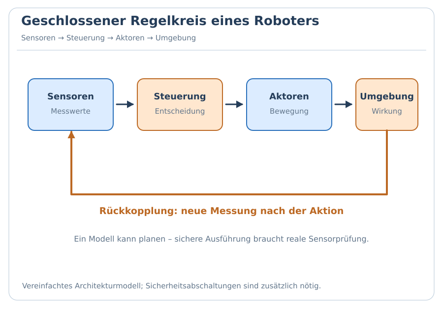
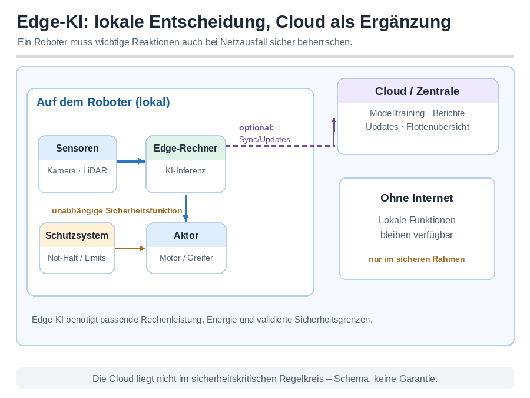

# M6-L7 – Robotik: Vom Sprachmodell zur handelnden Maschine {#L7}

**Kursbereich:** M6 – Schwerpunkt: KI und Robotik

**Niveau:** Bachelor / Master (Wahl)

**Vorwissen:** Keine festen Voraussetzungen angegeben.

## Lernziel: Warum aus einer guten Antwort noch keine sichere Handlung wird {#S1}

Ein Sprachmodell kann erklären, wie ein Roboter ein Glas vom Tisch holen könnte. Ein realer Roboter muss aber **wissen, wo das Glas tatsächlich steht**, seinen Arm dorthin bewegen, auf Widerstände reagieren, Personen ausweichen und das Glas so greifen, dass weder Mensch noch Maschine gefährdet werden. Diese Anforderungen sind physisch: Ein falsch vorhergesagtes Wort lässt sich korrigieren; ein falsch angesteuerter Motor kann bereits Schaden verursachen.

In M5-L2 bis M6-L3 haben wir gelernt, wie neuronale Netze rechnen und Antworten erzeugen. M6-L4 verband KI mit Werkzeugen und überprüfbaren Programmschritten. M6-L5 behandelte Kamera und Audio; M6-L6 die nötigen Rechenressourcen. In dieser letzten Hauptlektion setzen wir alles zusammen. **Robotik** ist nicht einfach ein Sprachmodell mit Rädern oder Armen, sondern eine Verbindung von Mechanik, Elektronik, Informatik, mathematischer Modellierung, Wahrnehmung, Regelung und Sicherheitsentwicklung.

Wir verfolgen den Weg von einem Wunsch wie „Bring mir die rote Schachtel“ über Sensoren und Ortsbestimmung bis zur Bewegung und zur Rückmeldung „Auftrag erledigt“. Dabei sehen wir, welche Entscheidungen ein Modell unterstützen darf, welche zuverlässig berechnet werden müssen und welche Sicherheitseinrichtungen von der KI unabhängig bleiben sollten. Der Text ist ein **Lesekurs**: Man benötigt keine Roboterhardware, ROS-Installation oder Programmierumgebung.

Alle nachstehenden Architektur- und Zahlenbeispiele sind didaktische Modelle, keine konkrete Konstruktions- oder Sicherheitsfreigabe. Die technischen Projekt- und Standardquellen wurden am **04.11.2026** geprüft.

## Automatisierung, Softwareagent und Roboter: drei unterschiedliche Dinge {#S2}

**Automatisierung** heißt zunächst nur, dass ein System eine Aufgabe nach festgelegten Regeln erledigt. Ein Bewässerungsautomat schaltet beispielsweise bei bestimmten Messwerten ein Ventil. Das kann vollständig ohne lernende KI funktionieren.

Ein **Softwareagent** kann Informationen verarbeiten, Ziele verfolgen und über definierte Programmschnittstellen handeln. Ein Terminassistent prüft etwa einen Kalender und schlägt eine Buchung vor. Er greift in einen digitalen Zustand ein, aber nicht unmittelbar in die physische Umwelt. M6-L4 hat gezeigt, warum auch solche Schritte Berechtigungen und Kontrollen benötigen.

Ein **Roboter** ist im hier relevanten Sinn ein programmierbares technisches System, das Sensorinformationen aufnimmt und mittels **Aktoren** – etwa Motoren, Greifern oder Ventilen – physisch wirkt. Ein Industrieroboterarm kann ohne maschinelles Lernen eine hochpräzise, wiederholte Bewegung ausführen. Ein autonomer Transportroboter muss dagegen seine Umgebung erfassen und Entscheidungen unter wechselnden Bedingungen treffen.

  System                     Nimmt wahr                       Handelt                                     Besonderes Risiko
  -------------------------- -------------------------------- ------------------------------------------- ----------------------------------------------------
  Fester Automat             Schalter, feste Messwerte        Vorbestimmter Ablauf                        Fehlfunktion von Hardware oder Regelwerk
  KI-Softwareagent           Dateien, APIs, Texte             Digitale Aktionen                           Falsche Datenänderung, Rechteverletzung
  Klassischer Roboter        Sensoren, Positionswerte         Physische Bewegung                          Kollision, Quetschung, Sachschaden
  KI-unterstützter Roboter   Sensoren plus gelernte Modelle   Physische Bewegung nach geprüfter Planung   Wahrnehmungsfehler und zusätzliche KI-Unsicherheit

Ein Roboter wird also nicht allein dadurch intelligent, dass er einen Chat versteht; und ein einfacher industrieller Roboter ist nicht weniger „Robotik“, weil er kein Sprachmodell benutzt.

## Wie sich Robotik entwickelt hat {#S3}

Frühe mechanische Automaten führten feste Bewegungsfolgen aus. Mit elektrischen Antrieben, digitaler Steuerung und industriellen Manipulatoren wurde aus Automatik eine wiederholbare Maschinensteuerung. Klassische Robotik entwickelte Verfahren für **Kinematik**, **Dynamik**, Lagebestimmung, Regelung und Bewegungsplanung. Diese Grundlagen sind weiterhin gültig, auch wenn moderne Systeme neuronale Netze nutzen.

In einem klassischen Industrieroboter kann ein Ingenieur beispielsweise Zielpositionen, zulässige Geschwindigkeiten und definierte Abläufe einrichten. Die Steuerung führt sie aus und überwacht relevante Rückmeldungen. Ein mobiler Roboter benötigt zusätzlich die Fähigkeit, seine eigene Position in einer Umgebung abzuschätzen und Hindernisse zu berücksichtigen. Moderne Verfahren der Computer Vision, des maschinellen Lernens und später der Sprach- und Bildmodelle erweitern diese Möglichkeiten.

Die zeitliche Entwicklung lässt sich deshalb nicht als Ablösung durch „KI statt Regelung“ beschreiben, sondern als **Schichtenaufbau**:

``` text
Feste Mechanik + Antriebe
          ↓
Elektronische Steuerung + Regelkreise
          ↓
Karten, Sensorfusion, autonome Navigation
          ↓
Gelernte Wahrnehmung und Bewegungsmodelle
          ↓
Sprache, Aufgabenplanung und multimodale KI
```

Die unteren Schichten verschwinden nicht, wenn oben ein leistungsfähiges Modell hinzukommt. Wer einen Chatbot versteht, kennt deshalb erst einen Teil der Voraussetzungen eines beweglichen Roboters.

## Der physische Aufbau: Sensor, Rechner, Aktor, Energie {#S4}

Die Grundarchitektur sieht übersichtlich aus:

``` text
  UMGEBUNG
     │
     ▼
[SENSOREN] ── Messwerte ──► [RECHNER / STEUERUNG]
     ▲                             │
     │                             ▼ Befehle
     └──── Bewegung, Lage ◄── [AKTOREN]
                   ▲                │
                   └──── UMGEBUNG ◄─┘

Separat: Energieversorgung, Not-Halt/Sicherheitsfunktionen,
          Schutzschaltungen und Bedienmöglichkeiten.
```

**Sensoren** wandeln einen physikalischen Zustand in Messsignale um. Ein **Encoder** misst beispielsweise die Drehbewegung eines Motors beziehungsweise Gelenks. Eine **Inertial Measurement Unit (IMU)** erfasst Beschleunigungen und Drehbewegungen, meist mit Beschleunigungs- und Drehratensensoren. Eine Kamera liefert Bilder; ein **LiDAR** (*Light Detection and Ranging*) misst Entfernungen mittels Licht. Ultraschall- oder Kontaktsensoren können bestimmte nahe Hindernisse melden. Kraft- und Drehmomentsensoren helfen, die Wechselwirkung zwischen Greifer und Gegenstand einzuschätzen.

**Aktoren** erzeugen Bewegung oder andere physische Wirkungen: elektrische Motoren drehen Räder oder Gelenke, Greifer schließen sich, Ventile steuern pneumatische oder hydraulische Antriebe. Zwischen einem digitalen Sollwert und der tatsächlichen Bewegung liegen Motortreiber, Mechanik, Trägheit, Reibung und möglicherweise Getriebe. Deshalb ist ein Steuerbefehl nicht mit dem Ergebnis gleichzusetzen.

Ein **Mikrocontroller** ist ein kleiner spezialisierter Rechner, der hardwarenahe Aufgaben übernimmt, etwa das Erfassen eines Encoders und die schnelle Regelung eines Motors. Ein leistungsfähigerer Computer verarbeitet Kamerabilder, berechnet Routen oder führt neuronale Netze aus. Ein System kann mehrere Rechner mit klar verteilten Verantwortlichkeiten kombinieren.

Zuletzt braucht jeder Roboter Energie: Akku, Netzversorgung oder eine andere Quelle. Energieverbrauch, Ladezeit, Wärme, Verschleiß und Wartung sind keine Randthemen. Eine Maschine, die rechnerisch eine perfekte Route findet, aber unterwegs die Stromversorgung verliert, erfüllt ihre Aufgabe nicht.

## Steuern ist nicht Regeln: der geschlossene Regelkreis {#S5}

Bei einer **offenen Steuerung** wird ein Befehl ausgegeben, ohne dass das tatsächliche Ergebnis laufend zurückgemeldet wird. Ein Beispiel wäre: „Motor für zwei Sekunden einschalten.“ Die Maschine weiß damit noch nicht, ob sich das Rad wegen einer Blockade tatsächlich gedreht hat.

Ein **Regelkreis** nutzt dagegen Messwerte und korrigiert Abweichungen zwischen Sollwert und Istwert. Er enthält typischerweise einen Regler, eine zu regelnde Strecke und eine Messrückführung:

``` text
Sollposition: 90°
       │
       ▼
[Vergleich] ── Fehler ──► [Regler] ──► [Motor + Gelenk]
    ▲                                         │
    │                                         ▼
    └──────── Encoder ◄────────────── Tatsächliche Position
```

Steht das Gelenk bei 82°, beträgt die Positionsabweichung gegenüber 90° noch 8°. Der Regler kann darauf reagieren. Ein einfaches **proportionales Regelglied (P-Regler)** erzeugt eine Stellgröße entsprechend der Abweichung. Häufig kommen weitere Anteile hinzu, etwa ein **Proportional-Integral-Differenzial-Regler (PID-Regler)**. Der Integralanteil berücksichtigt angesammelte Abweichungen; der Differentialanteil reagiert auf deren Änderung. Diese Verfahren erfordern geeignete Parametrierung: Zu starke Reaktion kann zu Schwingen führen, zu schwache zu träger Bewegung.

Nicht jeder Roboter benötigt für jede Teilaufgabe einen PID-Regler. Entscheidend ist das Prinzip: **Messung → Vergleich → Korrektur**. Übergeordnete KI entscheidet vielleicht, dass ein Arm einen Gegenstand greifen soll. Die konkrete Gelenkbewegung muss währenddessen durch geeignete, zeitlich zuverlässige Steuerungs- und Regelungstechnik umgesetzt werden.

Eine Sicherheitsüberwachung kann unabhängig davon feststellen, dass ein Geschwindigkeits- oder Arbeitsbereich unzulässig ist, und eine sichere Reaktion auslösen. Ein gewöhnliches Sprachmodell übernimmt diese Sicherheitsfunktion nicht.

## Echtzeit heißt vorhersehbar, nicht bloß schnell {#S6}

Ein Roboter lebt in einer Welt, die nicht wartet. Eine Hand bewegt sich, ein Mensch tritt auf den Weg, ein Gegenstand beginnt zu rutschen. Deshalb zählt neben dem Rechenergebnis der **Zeitpunkt**, zu dem es verfügbar ist.

Unter **Echtzeit** versteht man in diesem Zusammenhang, dass eine Reaktion innerhalb bestimmter zeitlicher Grenzen erfolgen muss. Das heißt nicht automatisch „möglichst wenige Millisekunden“, sondern **vorhersagbare Fristen**. Bei einer harten Echtzeitanforderung gilt eine verpasste Frist bereits als Fehler. Andere Aufgaben vertragen Schwankungen, etwa die nachträgliche Auswertung eines Kamerabildes oder eine Sprachantwort.

Ein theoretischer Ablauf könnte verschiedene Zeitmaßstäbe kombinieren:

- Hardware-Nahbereich: häufig kurze, regelmäßig einzuhaltende Zyklen für Motoren und Sensoren.
- Lokale Navigation: wiederkehrende Wahrnehmung und Anpassung von Bewegungsbefehlen.
- KI-Aufgabenplanung: gelegentliche, vergleichsweise aufwendige Berechnungen, deren Antwortzeit schwanken kann.
- Flottenverwaltung: Berichte und Aufträge über ein Netzwerk, das zeitweise ausfallen darf.

Diese Reihenfolge ist ein **didaktisches Schichtenmodell**, keine Angabe vorgeschriebener Zykluszeiten. Eine gewöhnliche Cloud-API, deren Antwort irgendwann nach einer Netzwerkreise eintrifft, eignet sich nicht als alleinige Instanz für eine zeitkritische Motorregelung. Gerade bei Internetverlust oder hoher Serverlast muss eine lokal verantwortete sichere Reaktion möglich bleiben.

## Ein kleines Zahlenbeispiel: Erkennen allein reicht nicht zum Anhalten {#S7}

Angenommen, ein mobiler Roboter fährt mit **0,8 Metern pro Sekunde**. Zwischen dem Erkennen eines Hindernisses und dem Beginn einer wirksamen Verzögerung vergehen hypothetisch **0,15 Sekunden**. Während dieser Verzögerungszeit fährt er bereits:

{alt="Robotischer Regelkreis: Sensoren liefern Messwerte an Steuerung, die Aktoren beeinflusst die Umgebung und erneute Messung liefert Rückkopplung."}

Vereinfachter robotischer Rückkopplungskreis von Messung zu Handlung und zurück.

$0{,}8\,\mathrm{m/s}\times0{,}15\,\mathrm{s}=0{,}12\,\mathrm{m}$.

Unter der zusätzlichen, stark vereinfachenden Annahme einer gleichmäßigen Verzögerung von **$1{,}6\,\mathrm{m/s}^2$** ergibt sich der reine Bremsweg zu:

$\frac{v^2}{2a}=\frac{{(0{,}8\,\mathrm{m/s})}^2}{2\times1{,}6\,\mathrm{m/s}^2}=0{,}20\,\mathrm{m}$.

Zusammen wären das **mindestens rechnerisch 0,32 Meter bis zum Stillstand** unter den idealisierten Annahmen. **Diese Zahl ist keine zulässige Sicherheitsdistanz.** Reale Sicherheitsabstände müssen unter anderem Sensorerfassungsgrenzen, Messunsicherheit, Personenerkennung, Reibung, Gefälle, Beladung, Fehlerzustände, Sicherheitsaufschläge und geeignete normative Verfahren berücksichtigen. Ein solcher Abstand lässt sich nicht allein aus dieser Schulrechnung für einen echten Roboter festlegen.

Das Beispiel zeigt dennoch etwas Grundsätzliches: Die beste Hinderniserkennung nützt wenig, wenn zwischen Wahrnehmung und Wirkung Zeit verstreicht. Deshalb sind Wahrnehmung, Kommunikation, Steuerung, Bremsmechanik und Sicherheitsarchitektur gemeinsam zu betrachten.

## Die Welt wahrnehmen: von Messpunkten zu Objekten {#S8}

Eine Kamera liefert zunächst Pixel, nicht „eine rote Schachtel in Reichweite“. Ein Bildmodell kann daraus Objektklassen, Konturen, Tiefenhinweise oder Bildbereiche ableiten. Bei bestimmten Anwendungen müssen zusätzlich Größe, Abstand, Orientierung und Unsicherheit geschätzt werden. Die tatsächliche **Pose** eines Objekts beschreibt seine Lage und Orientierung in einem Koordinatensystem.

Ein LiDAR kann Entfernungsmessungen erzeugen. Daraus lassen sich Hindernisse oder geometrische Strukturen ableiten. Ein Encoder liefert Bewegungsinformation, ein IMU-Sensor Informationen zu Beschleunigung und Drehung. Jeder Sensor hat Schwächen: Kameras leiden beispielsweise unter schwierigen Lichtverhältnissen, reflektierende Oberflächen können bestimmte Entfernungsmessungen erschweren, Radodometrie driftet bei Schlupf. Mehr Sensoren beseitigen diese Probleme nicht automatisch.

**Sensordatenfusion** verbindet mehrere Informationsquellen zu einer robusteren Zustandsschätzung. Dabei ist auch wichtig, *wie sicher* eine Schätzung ist. Eine plausible Position ist nicht zwangsläufig eine zuverlässig bekannte Position. Ein System sollte auf hohe Unsicherheit nicht mit unbegründeter Gewissheit reagieren.

``` text
Kamera ─────────────► Objekterkennung ─┐
LiDAR ──────────────► Hindernisse ─────┤
Radencoder ─────────► Bewegung ────────┼──► Zustandsschätzung
IMU ────────────────► Drehung/Neigung ┘            │
                                                  ▼
                                        Karte + Position + Unsicherheit
```

Es macht einen Unterschied, ob ein Modell sagen soll „Auf dem Bild ist vermutlich eine Tasse“ oder ob ein Greifer zentimetergenau zu ihrem Henkel geführt werden soll. In der zweiten Aufgabe treffen Pixelinterpretation, Tiefenschätzung, Koordinatenrechnung und Mechanik zusammen.

## Wo bin ich? Lokalisierung, Karte und SLAM {#S9}

Ein mobiler Roboter muss seine Position in einer Umgebung kennen. **Lokalisierung** bedeutet, aus Sensordaten die eigene Lage relativ zu einer Karte oder einem bekannten Bezugssystem abzuschätzen. **Mapping** bedeutet, eine Karte zu erstellen oder zu aktualisieren. **Simultaneous Localization and Mapping (SLAM)** verbindet beide Aufgaben: Das System schätzt gleichzeitig seine Position und baut eine Darstellung seiner Umgebung auf.

Warum ist das schwierig? Wenn der Roboter fährt, bewegen sich die Radencoder. Aber Räder können durchdrehen. Eine Kamera sieht einen Gang, dessen Struktur auch in anderen Etagen vorkommen könnte. Menschen stellen Kartons ab, Türen öffnen sich, Möbel werden verschoben. Der Roboter darf aus einer alten Karte nicht schließen, die Strecke sei noch frei.

SLAM kann mit Kamerabildern, LiDAR oder anderen Sensoren arbeiten. Die konkreten Verfahren unterscheiden sich stark. Manche kombinieren wiedererkannte Orte mit einer Korrektur der zuvor aufgelaufenen Positionsfehler – beispielsweise beim erneuten Durchfahren einer schon bekannten Stelle. Eine **Belegungskarte** unterscheidet etwa frei, belegt und unbekannt; andere Darstellungen speichern metrische Punkte, Linien, semantische Objekte oder dreidimensionale Geometrie.

Die Karte ist nicht die Welt. Auch wenn eine Route gestern frei war, kann heute jemand einen Stuhl hineingestellt haben. Deshalb brauchen bewegliche Roboter sowohl längerfristige Umgebungserinnerung als auch aktuelle Hinderniswahrnehmung.

## Von einer Zielposition zu einer tatsächlich fahrbaren Bewegung {#S10}

**Pfadplanung** bestimmt eine mögliche Folge räumlicher Positionen vom Start zum Ziel, wobei Hindernisse, Sperrzonen und andere Einschränkungen beachtet werden. Ein Weg auf einer Karte beantwortet aber noch nicht, mit welcher Geschwindigkeit Räder angesteuert werden sollen.

Ein **Bewegungsregler** verfolgt einen geplanten Pfad und passt Geschwindigkeits- oder Lenkbefehle anhand der aktuellen Position an. **Lokale Planung** berücksichtigt neue Hindernisse und kurzfristige Änderungen. Ein übergeordneter Navigator überwacht den Ablauf und entscheidet, ob eine Route neu berechnet oder die Fahrt abgebrochen werden muss.

``` text
Ziel: Lagerregal 4
        │
        ▼
[Lokalisierung + Karte] ──► [Globaler Pfadplaner]
                                  │
                                  ▼
Aktuelle Hindernisse ───────► [Lokale Planung / Regler]
                                  │
                                  ▼
                             [Radantrieb]
                                  │
                                  ▼
                       Position + Sensorrückmeldung
                                  │
                       zurück zu Lokalisierung
```

In der Robotik sind **Kinematik** (Zusammenhang zwischen Gelenkstellungen und Positionen) und **Dynamik** (Kräfte, Beschleunigungen, Trägheit) entscheidend. Ein mobiler Roboter kann nicht beliebig seitwärts fahren, wenn seine Radgeometrie dies nicht erlaubt. Ein Arm kann eine Zielposition vielleicht nicht erreichen, weil seine Gelenke begrenzt sind oder ein Hindernis im Weg steht. Deshalb ist ein Textbefehl „Fahre geradeaus durch die Tür“ keine fertige Bewegungsplanung.

## Manipulation: Greifen ist schwieriger als Bewegen eines Cursors {#S11}

Ein Roboterarm besitzt mehrere **Gelenke** und einen **Endeffektor**, also etwa einen Greifer oder ein Werkzeug. Die **Vorwärtskinematik** berechnet aus Gelenkstellungen die Pose des Endeffektors. Die **inverse Kinematik** versucht umgekehrt, geeignete Gelenkstellungen für eine gewünschte Pose zu finden. Dabei können mehrere Lösungen möglich sein – oder gar keine.

Zusätzlich müssen Kollisionen vermieden werden: mit dem Tisch, dem eigenen Arm, dem Werkstück und den Menschen im Arbeitsbereich. Eine reine geometrische Route reicht möglicherweise nicht, wenn ein schwerer Gegenstand die Dynamik stark verändert. Ein Greifer muss außerdem Material, Form, Reibung und erforderliche Greifkraft berücksichtigen.

Eine verständliche Manipulationskette ist:

``` text
Objekt erkennen
   → Objektpose und Greifmöglichkeiten schätzen
   → Erreichbare Armstellung berechnen
   → Kollisionsgeprüfte Trajektorie planen
   → Bewegung geregelt ausführen
   → Greifkontakt, Kraft und Erfolg kontrollieren
   → Bei Fehler sicher stoppen oder neu planen
```

Hier liegt der Unterschied zwischen **symbolischem Ziel** und **motorischer Umsetzung**. Ein Sprachmodell könnte vorschlagen „Greife die Flasche am Körper, nicht am Deckel“. Das ist eine Aufgabenidee. Die korrekte Stellung, Kraftbegrenzung und Bewegung müssen aber im Robotersystem anhand seiner Sensordaten und validierten Grenzen ermittelt werden.

## ROS 2 als Baukasten für Robotersoftware {#S12}

Das **Robot Operating System 2 (ROS 2)** ist trotz seines Namens kein eigenständiges Betriebssystem wie Windows oder Linux, sondern ein Software-Framework mit Kommunikationsmechanismen, Werkzeugen und wiederverwendbaren Komponenten für Robotik. Es unterstützt die Aufteilung eines Systems in **Knoten (Nodes)**. Jeder Knoten kann beispielsweise Sensorwerte bereitstellen, Bilder auswerten, eine Karte verwalten oder Navigationsaufträge ausführen.

ROS-2-Knoten kommunizieren unter anderem über drei Schnittstellenarten:

1.  **Topics** – laufende Nachrichtenströme nach dem Publish/Subscribe-Prinzip. Beispiel: Ein Sensor veröffentlicht wiederholt Abstandsmessungen; mehrere andere Knoten abonnieren sie.
2.  **Services** – Anfrage und Antwort für eine typischerweise kurze Operation. Beispiel: „Welche Konfiguration ist aktuell eingestellt?“ oder „Berechne eine einzelne inverse Kinematiklösung“.
3.  **Actions** – länger dauernde Aufgaben mit Ziel, Rückmeldung, Ergebnis und Möglichkeit zur Abbruchanforderung. Beispiel: „Navigiere zu dieser Zielposition“ und liefere laufend Fortschrittsmeldungen.

Eine vereinfachte ROS-2-Architektur könnte so aussehen:

``` text
[Kamera-Knoten] ── Topic: Bilder ─► [Objekterkennung]
[LiDAR-Knoten] ── Topic: Scans ──► [Lokalisierung]
                                          │
                            [Navigations-Knoten]
                                          ▲
                               Action: Ziel anfahren
                                          │
                              [Aufgaben-Manager]
                                          │
                              Service: Status prüfen
                                          ▼
                               [Steuerungs-Knoten]
                                          │
                                        Motoren
```

ROS 2 hat darüber hinaus Parameter, Lebenszykluskonzepte, Aufzeichnung und Werkzeuge zur Inspektion. Für eine verlässliche Kommunikation gibt es konfigurierbare **Quality-of-Service-Eigenschaften (QoS)**, etwa wie mit Nachrichtenverlusten oder der Aufbewahrung von Nachrichten umgegangen werden soll. Die richtige Wahl hängt davon ab, ob der Datenstrom beispielsweise schnelle, häufige Messwerte oder seltene wichtige Zustandsinformationen enthält. **QoS garantiert jedoch nicht automatisch funktionale Sicherheit, perfekte Netzwerke oder die Einhaltung aller Echtzeitfristen.**

Die Architekturprinzipien sind allgemeiner als ROS 2: Komponenten sollen definierte Aufgaben und Nachrichtenverträge haben. ROS 2 ist verbreitet, aber nicht die einzige mögliche Middleware oder Steuerungsumgebung. Auch ohne ROS-Installation kann man das System als Graph miteinander kommunizierender Dienste verstehen. Die offizielle ROS-2-Projektdokumentation unterscheidet Topics, Services und Actions ausdrücklich nach Kommunikationsmuster; für Hardware-Anbindung und Regler steht beispielsweise `ros2_control` zur Verfügung.

## Nav2, MoveIt 2 und ros2_control: nicht drei Namen für dasselbe {#S13}

Ein häufiger Anfängerfehler ist die Annahme, ein Robotik-Framework erledige automatisch alles. Tatsächlich erfüllen verschiedene Systeme unterschiedliche Aufgaben:

- **Nav2** (Navigation2) beschäftigt sich insbesondere mit mobiler Navigation: Zustandsschätzung, Umweltrepräsentation, Planung, Regelung und der Ablaufkoordination beispielsweise über **Behavior Trees** (Verhaltensbäume).
- **MoveIt 2** ist auf Manipulation ausgerichtet: Bewegungsplanung für Roboterarme, Kinematik und Kollisionsbetrachtung.
- **ros2_control** verbindet Controller mit Hardware-Schnittstellen und organisiert den Ablauf des Lesens von Zuständen, der Regleraktualisierung und der Ausgabe an Hardware.

Die Grenzen sind nicht absolut; reale Systeme können andere Komponenten einsetzen. Aber die Unterscheidung ist didaktisch hilfreich: **Navigation sagt, wohin man durch die Umgebung fährt; Manipulation plant, wie ein Arm sich bewegt; eine hardwarenahe Reglerarchitektur setzt geeignete Stellgrößen um.** Keines dieser Projekte ist von sich aus die vollständige Sicherheitszulassung eines Roboters.

**Behavior Trees** beschreiben hier nicht das Wachstum eines neuronalen Netzes. Sie strukturieren Handlungsabläufe: „Prüfe Ziel“, „plane Route“, „folge Route“, „bei Misserfolg sichere Alternative“. Ein Verhaltensbaum lässt sich inspizieren und begrenzt oft die unkontrollierte Freiheit einer rein sprachlich erzeugten Handlungskette. Er ersetzt jedoch ebenfalls keine unabhängig ausgelegte Schutzeinrichtung.

## Edge Computing und Cloud: Was gehört wohin? {#S14}

**Edge Computing** meint, dass Berechnungen nahe an der physischen Maschine laufen, beispielsweise auf einem integrierten Rechner oder einer lokalen Steuerung. Die **Cloud** ist für Robotik trotzdem nützlich: Flottenmanagement, langfristige Datenspeicherung, Modelltraining, Analysen und Auftragserteilung können zentral organisiert sein.

{alt="Edge-KI-System: Sensoren und lokale KI-Inferenz leiten Aktionen eines Roboters. Ein getrenntes Schutzsystem überwacht die Hardware. Die Cloud dient optional für Modelltraining, Berichte und Updates."}

Lokale Wahrnehmung, Steuerung und unabhängige Schutzfunktionen bleiben vom Cloudzugang getrennt. Der Offline-Betrieb ist nur innerhalb definierter Grenzen sinnvoll.

Die Verantwortungen sollten jedoch bewusst getrennt werden:

``` text
                     CLOUD / BETRIEBSZENTRALE
               Auftragsverwaltung, Berichte,
               Modellverteilung, Flottenübersicht
                            │
                   zeitweise Netzwerkverbindung
                            │
                            ▼
                         EDGE-RECHNER
             Wahrnehmung, Navigation, lokale Aufgaben
                            │
                 überwachte Steuerbefehle
                            ▼
                 REGELUNG / ROBOTERHARDWARE
              Messwerte, Motoren, definierte Grenzen
                            │
                            ▼
               UNABHÄNGIGE SICHERHEITSFUNKTIONEN
               geeignete Schutz- und Stoppwirkung
```

Wichtig ist die **Offline-Fähigkeit** im richtigen Umfang. Wenn das Internet ausfällt, kann die Cloud den Auftrag nicht mehr koordinieren. Der Roboter sollte dann nicht blind die zuletzt erhaltenen unbefristeten Bewegungsbefehle fortführen. Je nach Aufgabe kann eine sichere Reaktion bedeuten: kontrolliert anhalten, die aktuelle Bewegung nach einem geprüften Verfahren beenden oder in einen sicheren Betriebszustand wechseln. Welche Reaktion korrekt ist, hängt vom konkreten Gefährdungsszenario ab.

Der lokale Rechner muss nicht sämtliche großen KI-Modelle selbst ausführen können. Für manche Aufgaben genügt eine kleine Wahrnehmungskomponente, während eine größere Sprachplanung optional in der Cloud läuft. Eine Netzverbindung darf aber keine stillschweigende Voraussetzung dafür sein, dass ein Roboter auf ein unmittelbar auftretendes Hindernis reagiert.

## Wie ein Sprachmodell einen Roboterauftrag unterstützen kann {#S15}

Betrachten wir die Aussage: **„Bitte bring die rote Schachtel aus dem Regal ins Arbeitszimmer.“** Darin stecken mehrere Fragen. Welche Schachtel? Welches Regal? Wo befindet sich das Arbeitszimmer? Ist der Transport überhaupt erlaubt und physisch möglich?

Ein **Large Language Model (LLM, großes Sprachmodell)** kann die Sprache interpretieren und eine grobe Zielhierarchie vorschlagen. Ein geeignetes multimodales Modell kann außerdem Bilder oder Objektbeschreibungen einbeziehen. Eine Produktionsarchitektur sollte dann aber mehrere überprüfbare Ebenen einsetzen:

``` text
Nutzerwunsch
    │
    ▼
[LLM: Bedeutung und Vorschlag]
    │  "Suche Objekt X an Ort Y, bringe zu Z"
    ▼
[Aufgabenmanager: Rechte, Plausibilität, Zustand]
    │
    ▼
[Objekt- und Ortsprüfung mit Sensoren]
    │
    ▼
[Deterministische Planung + geprüfte Bewegungsgrenzen]
    │
    ▼
[Regler und sichere Hardwareansteuerung]
    │
    ▼
[Rückmeldung: erledigt / nicht möglich / abgebrochen]
```

Das Modell sollte nicht selbst beliebige Motortelegramme erzeugen und ungeprüft an den Antrieb senden. Stattdessen kann es auf **vordefinierte, eng begrenzte Fähigkeiten** zugreifen, etwa „Objekt suchen“, „zu freigegebenem Punkt navigieren“ oder „bestätigte Greifaktion anfordern“. Jede Fähigkeit prüft Voraussetzungen, Grenzen und Erfolg selbstständig.

Das ist die physische Fortsetzung des in M6-L4 behandelten **Tool Calling**: Der Modellvorschlag ist ein Vorschlag, keine Autorisierung. Die Anwendung prüft, ob der Auftrag zulässig ist, ob sich Personen im Gefährdungsbereich befinden könnten und ob die gewünschte Bewegung technisch verantwortbar erscheint.

Moderne Forschungsarbeiten zu **Vision-Language-Action (VLA)-Modellen** gehen teilweise weiter: Sie verbinden visuelle Daten, Sprache und robotische Aktionsrepräsentationen. Ein Beispiel aus der Forschung ist **RT-2**, 2023 von Google DeepMind vorgestellt. Solche Systeme zeigen Forschungsansätze, aus Bild- und Sprachinformation Aktionen abzuleiten. Sie sind kein Nachweis, dass beliebige unbekannte Umgebungen damit sicher autonom beherrscht werden. Auch ein gelerntes Bewegungsmodell benötigt geeignete Grenzen, Überwachung und praktische Validierung.

## Warum physische Sicherheit eine eigene Ebene sein muss {#S16}

**Funktionale Sicherheit** bedeutet, dass Sicherheitsfunktionen im Rahmen einer systematischen Gefährdungs- und Risikobetrachtung auch bei vorgesehenen Fehlern wirksam bleiben sollen. Das ist etwas anderes als IT-Sicherheit oder ein gutes Erkennungsmodell – auch wenn beide Themen zusammenhängen.

Ein **Not-Halt** soll eine vorgesehene Stoppfunktion auslösen können. Er ist nicht einfach ein Button in einem Sprachdialog und ersetzt keine konstruktiven Schutzmaßnahmen. Je nach Maschine können weitere technische Schutzfunktionen erforderlich sein, etwa überwachte Betriebsbereiche, Geschwindigkeitsbegrenzungen, Schutzabstände, sichere Leistungsabschaltung oder andere geeignete Einrichtungen. Welche davon erforderlich sind, lässt sich nur für den konkreten Einsatz und anhand der anwendbaren Regeln beurteilen.

Eine konzeptionelle Sicherheitsarchitektur hält die kritischen Pfade unabhängig von der generativen KI:

``` text
            KI / AUFGABENPLANUNG
                     │
          nur zulässige Zielvorschläge
                     ▼
           NORMALER BEWEGUNGSREGELKREIS
                     │
                     ▼
                   ANTRIEB
                     ▲
                     │ unabhängige Schutzwirkung
         SICHERHEITSÜBERWACHUNG / SCHUTZKREIS
              ▲                   ▲
         Stoppvorrichtung    geeignete Schutzsensorik
```

Die Zeichnung ist ein **Prinzip**, kein elektrischer Sicherheitsplan. Der kritische Grundgedanke lautet: Ein LLM, dessen Antworten probabilistisch erzeugt werden, ist keine hinreichende Instanz zur sicherheitskritischen Stoppentscheidung. Ein Netzwerkfehler oder ein Halluzinationstext darf eine sicherheitsrelevante Funktion nicht außer Kraft setzen.

Für verschiedene Roboterarten gibt es unterschiedliche Standards und Einsatzgrenzen. So behandeln **ISO 10218-1:2025 und ISO 10218-2:2025** industrielle Roboter beziehungsweise deren Integration und Anwendungen. **ISO 13482:2014** betrifft bestimmte persönliche Serviceroboter; eine Nachfolgefassung befand sich bei der Prüfung am 04.11.2026 noch im Normungsverfahren. Solche Standards sind **nicht austauschbar**, und ein allgemeiner Lerntext kann keine produktspezifische Konformitätsprüfung ersetzen. Die jeweils anwendbaren Regeln hängen von Maschine, Umfeld, Land, Einsatzart und Rolle des Herstellers beziehungsweise Betreibers ab.

## Typische Fehler: die Realität ist unordentlicher als eine Simulation {#S17}

Ein echter Roboter trifft auf Situationen, die ein schön gezeichnetes Schema nicht zeigt. Einige Beispiele:

**Verdeckte Hindernisse.** Eine Kamera sieht nur bestimmte Blickrichtungen. Ein Kind kann hinter einer Tür stehen, ein Gegenstand teilweise verdeckt sein. Eine fehlende Erkennung ist kein Beweis für freie Fahrt.

**Sensorabweichungen und Verschleiß.** Mechanische Sensorhalterungen können verrutschen, Räder sich abnutzen, Greifer verklemmen und Messungen ausfallen. Eine Kalibrierung kann nach einem Umbau ungültig werden.

**Falsche Koordinatensysteme.** Ein Objekt wird korrekt erkannt, aber seine Position wird im falschen Bezugsrahmen interpretiert. Eine Bewegung, die in der Simulation zum Tisch zeigt, kann dann in der Realität in eine falsche Richtung führen.

**Unbekannte Gegenstände.** Ein Modell hat vielleicht „Flasche“ erkannt, weiß aber nicht, ob sie leer, voll, zerbrechlich, heiß oder unzulässig zu greifen ist. Gelerntes Bildwissen ersetzt keine Prüfung der tatsächlichen Eigenschaften.

**Netzwerk- und Softwarefehler.** Eine Nachricht kann verspätet eintreffen, ein Rechner neu starten, ein Sensorstrom aussetzen. Das System muss alte Zustände erkennen und darf nicht einfach davon ausgehen, dass zuletzt empfangene Daten aktuell bleiben.

**Ungenügende Trainingsdaten.** Ein Modell kann im Labor mit guter Beleuchtung zuverlässig wirken und bei Staub, schlechter Sicht oder ungewöhnlichen Objekten versagen. Auch nach vielen Tests bleibt die Frage, ob die geprüften Fälle den realen Einsatz ausreichend abdecken. Das US-amerikanische **National Institute of Standards and Technology (NIST)** untersucht solche Probleme bei der Absicherung autonomer Systeme.

**Simulation–Realität-Lücke.** Eine Simulation kann Kräfte, Materialeigenschaften, Licht oder menschliches Verhalten nur angenähert darstellen. Simulation erleichtert das Testen vieler Situationen, darf aber die Prüfung der tatsächlichen Maschine nicht ersetzen.

Deshalb gehören zu Robotik neben Algorithmen auch Messprotokolle, Wartungsintervalle, Fehlersuche, klare Zustandsübergänge und verantwortliche Betreiber.

## Geräteidentität, Netzwerksicherheit und sichere Aktualisierungen {#S18}

Robotik verbindet die physische Welt mit den Sicherheitsproblemen aus M1-L6 und M4-L3. Wenn ein fremdes Gerät im Netzwerk Steuerbefehle senden kann, ist das nicht bloß ein Datenproblem. Deshalb müssen Komponenten und beteiligte Dienste angemessen identifiziert und autorisiert werden.

**Geräteidentität** bedeutet: Die Flottenverwaltung soll unterscheiden können, *welcher konkrete Roboter* sich meldet, welche Software er nutzt und welche Aufgaben er erhalten darf. Geeignete Verfahren umfassen je nach Architektur Geräte-Zertifikate, geschützte Schlüssel, abgesicherte Netzverbindungen und rollenbezogene Freigaben. Sensordaten, Kamerastreams, Standorte und Bewegungsprotokolle können personenbezogene oder betrieblich vertrauliche Informationen enthalten. Zugriff und Aufbewahrung sollten entsprechend begrenzt sein.

**Telemetrie** umfasst Betriebsdaten wie Akkustand, Fehlercodes, geschätzte Position, Verbindungszustand und Wartungsbedarf. Sie hilft, Ausfälle zu entdecken, ist aber keine Garantie, dass ein Roboter unter allen Umständen richtig handelt. Die *Flottenverwaltung* koordiniert mehrere Geräte: Arbeitsaufträge, Ladeplätze, Wartungsfenster, Versionsstände und Engpässe.

Ein **Over-the-Air-Update (OTA-Update)** verteilt neue Software über ein Netzwerk. Es muss geplant sein: Softwareversionen, Signaturprüfung, Kompatibilität zur Hardware, kontrollierte Einführung, sichere Betriebszustände und Wiederherstellung bei fehlgeschlagenem Update sind wichtig. Ein ungeprüftes automatisches Update mitten in einer kritischen Bewegung kann selbst zum Risiko werden. Deshalb unterscheiden sich Robotikupdates von einer gewöhnlichen Websiteaktualisierung.

Das Verhalten bei Kommunikationsverlust muss Bestandteil des Betriebsentwurfs sein. Eine Cloud kann Roboter koordinieren; sie kann aber nicht zuverlässig jedes unmittelbare physische Ereignis rechtzeitig beurteilen. Die Maschine benötigt lokale Schutzfunktionen und einen klar definierten, für die Anwendung sicheren Ausfallzustand.

## Drei Praxisbeispiele, von einfach bis anspruchsvoll {#S19}

### Beispiel A: Stationärer Kameraplatz für ein lokales Medienarchiv

Ein kleiner Tischaufbau fotografiert nacheinander Gegenstände. Eine Kamera und ein Drehteller erzeugen mehrere Ansichten; eine lokale Software ordnet Bilder und Metadaten zu. Ein Spracherkennungssystem könnte Dateinamen vorschlagen, aber der Ablauf ist überwiegend klassische Automatisierung.

**Architektur:**

``` text
Kamera → lokaler Rechner → Bildarchiv / Metadaten
             │
             ▼
      begrenzter Drehteller
      mit einfacher Steuerung
```

**Sinnvoll:** Wenn wiederkehrende Aufnahmen aus festen Positionen gebraucht werden. **Nicht nötig:** Ein großes Sprachmodell für jede einzelne Drehbewegung. **Risiken:** Mechanische Befestigung, Quetschstellen, Beleuchtung, Datei- und Backupschutz sowie Wartung. Die eigentliche Archivsoftware aus M1-L5, M2-L2 und M6-L5 bleibt unabhängig vom Motor verfügbar. Bei einem kleinen System ist die Einfachheit oft ein großer Vorteil.

### Beispiel B: Mobiler Transportroboter in einem kleinen Lager

Ein Gerät fährt zwischen markierten Lagerplätzen. Es benötigt Lokalisierung, eine aktuelle Umgebungskarte, Hinderniswahrnehmung, Fahrplanung, lokale Steuerung und ein abgestimmtes Sicherheitskonzept. Eine zentrale Anwendung vergibt Aufträge, kann aber die motorische Regelung nicht über das Internet steuern.

**Architektur:**

``` text
Lagerverwaltung → Auftrag an Roboter
                         │
               Robotereigener Rechner
            Karte / Position / Navigation
                         │
               lokale Fahrsteuerung
                         │
               Räder + Sensoren
                         │
             Status zurück ans Lager
```

**Sinnvoll:** Bei wiederkehrenden Transportwegen und einer beherrschbaren Umgebung. **Grenzen:** Ladezeiten, enge Gänge, andere Fahrzeuge, Personenverkehr und unvorhersehbare Hindernisse. **Betrieb:** Kartenpflege, Akkuwechsel oder Laden, Inspektion, sichere Routenfreigaben, Funkabdeckung und Störungen. Eine Sprachschnittstelle kann Lageraufträge verständlicher machen, ist aber für die eigentliche Navigation nicht zwingend erforderlich.

### Beispiel C: Mobiler Manipulator mit KI-Aufgabenplanung

Ein komplexeres System kombiniert eine fahrbare Basis mit Roboterarm, Greifer, Kameras und möglicherweise einem multimodalen Modell. Auf die Anweisung „Hole die rote Schachtel aus dem Regal“ folgen viele Teilentscheidungen: Objekt und Ziel eindeutig identifizieren, Transportberechtigung prüfen, Navigation planen, Position zum Regal bestimmen, Greifen und Ablegen kontrollieren.

**Architektur:**

``` text
Anweisung
   │
   ▼
[LLM oder VLA: Aufgabenverständnis]
   │ nur validierte Teilaufträge
   ▼
[Aufgabenmanager / Sicherheitsfreigaben]
   ├──► [Navigation: Basis positionieren]
   └──► [Manipulation: Greifen, transportieren]
                   │
                   ▼
             [Regler / Hardware]
                   │
                   ▼
           [Erfolg oder Fehlerstatus]
```

**Sinnvoll:** Für wechselnde Aufgaben, wenn flexible Sprachplanung einen tatsächlichen Mehrwert bringt. **Nicht automatisch sinnvoll:** Einfache, streng wiederholte Abläufe profitieren häufig stärker von bewährten festen Verfahren. **Grenzen:** Objektverwechslung, Greiffehler, unvorhersehbare Umgebung, hohe Integrations- und Testkosten, zusätzlicher Energieverbrauch und komplexe Verantwortlichkeiten. Vor jedem großflächigen Betrieb sind risikoabhängige Validierung, menschliche Eingriffsmöglichkeiten und Wartungsprozesse nötig.

Das dritte Beispiel verbindet M6-L4 (Werkzeuge und Agenten), M6-L5 (multimodale Wahrnehmung) und M6-L6 (lokale/entfernte KI-Rechenleistung), ersetzt aber keine der klassischen Robotikschichten.

## Kosten, Wartung und Wirtschaftlichkeit {#S20}

Die Anschaffung ist nur ein Teil der Gesamtkosten. Zu einem Robotersystem können gehören: Mechanik, Sensorik, Antriebe, Akku und Ladetechnik, Steuerhardware, Softwareentwicklung, Integration, Sicherheitstechnik, Prüfungen, Ersatzteile, Wartung, Energiekosten, Schulung, Datensicherung, Konnektivität und gegebenenfalls Modell-APIs oder GPU-Betrieb. Hinzu kommen die Kosten einer nicht verfügbaren Maschine und menschlicher Überwachung.

Ein einzelnes Gerät kann aufwendig sein, wenn jede Änderung der Umgebung eine neue Kalibrierung verlangt. Eine ganze Flotte erzeugt zusätzliche Aufgaben: Geräteinventar, koordinierte Auftragsverteilung, sichere Updates, Standort- und Datenverwaltung, Ersatzhardware und Überwachung von Störungen. Die Zahl der Roboter allein bestimmt nicht, ob sich der Betrieb wirtschaftlich lohnt.

**Wann ist Robotik sinnvoll?** Beispielsweise bei häufig wiederholten physischen Aufgaben, gefährlichen Umgebungen oder Arbeitsabläufen, die wegen ihrer Ergonomie eine Maschine rechtfertigen. **Wann ist sie überdimensioniert?** Wenn ein einfacher Softwaredienst, ein fest montierter Sensor oder eine mechanische Vorrichtung dasselbe Ziel mit geringerer Komplexität erreicht. Oft ist der beste erste Schritt nicht „mehr KI“, sondern ein klar definiertes Problem und ein weniger kompliziertes System.

Wie bei M4-L4 gilt: Keine hier genannten Überlegungen sind ein konkretes Angebot oder eine belastbare Anbieterpreisliste. Für eine Beschaffungsentscheidung benötigt man reale Anforderungen, Angebote, technische Validierung und die Einordnung geltender Sicherheits- und Datenschutzpflichten.

## Mathematikverbindungen und mögliche Master-Vertiefungen {#S21}

Robotik zeigt besonders deutlich, wie Mathematik und Informatik zusammenwirken. Die folgenden fachlichen Brücken sind **allgemein**, nicht mit einer tatsächlich eingesehenen Roadmap des separaten Mathematik-Lernkurses abgeglichen:

  Mathematisches Thema                   Anwendung in Robotik
  -------------------------------------- ------------------------------------------------------------
  Lineare Algebra und Geometrie          Koordinatentransformationen, Kameraposen, Gelenkstellungen
  Analysis und Differentialgleichungen   Bewegung, Beschleunigung, zeitliche Entwicklung
  Numerische Mathematik                  Näherungsverfahren für inverse Kinematik und Optimierung
  Wahrscheinlichkeit und Statistik       Sensorrauschen, Lageunsicherheit und Fusion
  Graphen und Optimierung                Routenplanung und Kostenfunktionen
  Regelungstheorie                       Stabilität, Rückkopplung, Beobachter und sichere Reaktion

Im **Bachelor-Wahlbereich M8–M10** passt das Thema besonders zu eingebetteten Systemen und Hardware-/Betriebssystemgrundlagen. Im geplanten **Master-Wahlbereich** ist Regelung und Robotik – eine geeignete spätere Vertiefung; mathematische KI-Optimierung – bietet zusätzliche Bezüge. Dort könnten unter anderem Zustandsraummodelle, Kalman-Filter, Trajektorienoptimierung, Modellprädiktive Regelung und Unsicherheitsquantifizierung vertieft werden. Diese zusätzlichen Vertiefungen sind Themenvorschläge für den Informatikkurs, **keine eigenen fertig ausgearbeiteten Master-Lektionen**.

Die eigenständige Erklärung dieser Lektion bleibt auch ohne Mathematik-Nebenprojekt verständlich. Ein späterer beiderseitiger Abgleich braucht den tatsächlichen Mathematik-Kursindex; es gibt keine automatische Synchronisierung der beiden Chats.

## Gesamtrückblick auf M5-L1 bis M6-L7 {#S22}

Die KI-Reihe begann mit einer historischen Frage (M5-L1), erklärte neuronale Netze und Lernverfahren (M5-L2/M5-L3), führte durch die Transformer-Architektur und die Verarbeitung einer Chat-Anfrage (M6-L1/M6-L2), untersuchte Nachtraining und Qualität (M6-L3), ergänzte externe Informationen und Werkzeuge (M6-L4), erschloss Bild, Ton und Video (M6-L5) und betrachtete den Betrieb der Modelle auf Rechenhardware und Clustern (M6-L6).

**M6-L7 fügt die physische Wirklichkeit hinzu.** Sobald ein Modell nicht nur antwortet, sondern eine Maschine beeinflusst, werden Messunsicherheit, räumliche Geometrie, Zeit, Trägheit, Wartung und Schutzfunktionen unverzichtbar.

Das übergreifende Prinzip lautet:

> **Eine KI kann Ziele vorschlagen und Wahrnehmung unterstützen. Ein Roboter muss diese Ziele anhand aktueller Messwerte, überprüfter Bewegungsverfahren und geeigneter, unabhängig wirksamer Schutzmaßnahmen in die physische Welt übersetzen.**


## Quellen {#S23}

**Letzte Quellenprüfung:** 04.11.2026

Die folgenden Referenzen erläutern technische Prinzipien oder die Existenz und Anwendungsbereiche von Standards. Sie sind **kein Beleg, dass ein bestimmtes Gerät sicher oder rechtskonform ist**. Die offizielle ROS-2-Webdokumentation war bei der Prüfung teilweise zugriffsbeschränkt; deshalb werden zusätzlich öffentlich lesbare Quellen aus dem offiziellen ROS-2-Dokumentationsrepository genannt.

1.  **ROS 2, offizielle Projektdokumentation – Nodes:** [https://github.com/ros2/ros2_documentation/blob/rolling/source/ROS-Framework/About-Nodes.rst](https://github.com/ros2/ros2_documentation/blob/rolling/source/ROS-Framework/About-Nodes.rst) – Aufteilung und Kommunikation von Knoten.
2.  **ROS 2, offizielle Projektdokumentation – Topics, Services, Actions:** [https://github.com/ros2/ros2_documentation/blob/rolling/source/ROS-Framework/Interfaces-Topics-Services-Actions.rst](https://github.com/ros2/ros2_documentation/blob/rolling/source/ROS-Framework/Interfaces-Topics-Services-Actions.rst) – Nachrichtenschnittstellen und ihre unterschiedlichen Muster.
3.  **ROS 2, Node-Lifecycle-Entwurf:** [https://design.ros2.org/articles/node_lifecycle.html](https://design.ros2.org/articles/node_lifecycle.html) – kontrollierte Aktivierungs- und Fehlerzustände von Komponenten.
4.  **ROS 2 / ros2_control, Architektur:** [https://control.ros.org/jazzy/doc/getting_started/getting_started.html](https://control.ros.org/jazzy/doc/getting_started/getting_started.html) – Hardwareabstraktion, Controller Manager und Regelungsablauf.
5.  **Nav2, Navigation Concepts:** [https://docs.nav2.org/rolling/getting_started/navigation_concepts/](https://docs.nav2.org/rolling/getting_started/navigation_concepts/) – Lokalisierung, Karten, globale/lokale Navigation und Verhaltensbäume; laufend aktualisierte Projektdokumentation.
6.  **MoveIt 2, Dokumentation:** [https://moveit.picknik.ai/](https://moveit.picknik.ai/) – Bewegungsplanung, Manipulation, Kinematik und Kollision.
7.  **MoveIt 2, Motion Planning:** [https://github.com/moveit/moveit2_tutorials/blob/main/doc/concepts/motion_planning.rst](https://github.com/moveit/moveit2_tutorials/blob/main/doc/concepts/motion_planning.rst) – Planungsanforderungen, Gelenkräume und Kollisionsprüfung.
8.  **Google DeepMind, RT-2 (2023):** [https://deepmind.google/blog/rt-2-new-model-translates-vision-and-language-into-action/](https://deepmind.google/blog/rt-2-new-model-translates-vision-and-language-into-action/) – Forschung zu Vision-Language-Action-Modellen, keine allgemeine Betriebssicherheitszusage.
9.  **NIST, Autonomous Systems Assurance:** [https://www.nist.gov/programs-projects/autonomous-systems-assurance](https://www.nist.gov/programs-projects/autonomous-systems-assurance) – Schwierigkeiten der Testabdeckung und Verifikation autonomer Systeme.
10. **ISO, ISO 10218-1:2025:** [https://www.iso.org/standard/73933.html](https://www.iso.org/standard/73933.html) – Norm für Sicherheitsanforderungen an industrielle Roboter; der Bereich integrierter Roboteranwendungen ist zusätzlich Gegenstand von ISO 10218-2:2025.
11. **ISO, ISO 13482:2014:** [https://www.iso.org/standard/53820.html](https://www.iso.org/standard/53820.html) – Sicherheitsanforderungen für bestimmte persönliche Serviceroboter; die 2026 in Arbeit befindliche Nachfolgefassung war bei der Prüfung noch nicht veröffentlicht.
12. **ISO, Nachfolgeentwurf ISO/FDIS 13482 (Status November 2026):** [https://www.iso.org/standard/83498.html](https://www.iso.org/standard/83498.html) – im Normungsverfahren, deshalb **nicht als geltender veröffentlichter Standard** ausgewiesen.

**Stand und Grenzen:** Fachquellen geprüft am 04.11.2026. Versionsgebundene Projektfunktionen können sich ändern; grundlegende Regelungs- und Architekturprinzipien sind von konkreten Produkten zu unterscheiden. Die Bremswegmodellrechnung ist selbst gerechnet und **für reale Sicherheitsabstände nicht geeignet**. Keine Installation, Hardwarebeschaffung oder praktische Durchführung wird verlangt.
