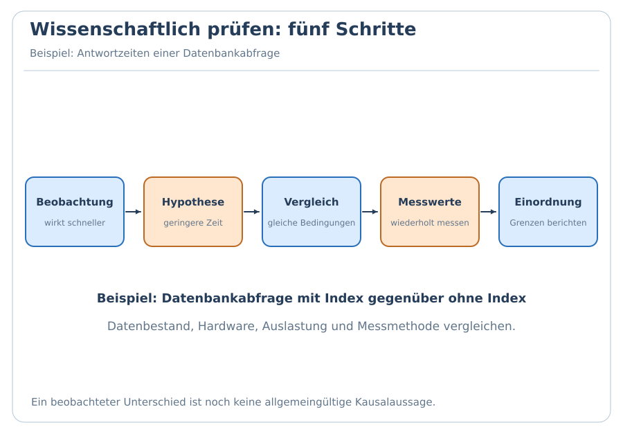

# M7-L1 – Wissenschaftliche Informatik: Modelle, Hypothesen und Begründungen {#L1}

**Kursbereich:** M7 – Masterorientierte Informatik

**Niveau:** Masterorientierung

**Vorwissen:** [M1-L1](M1-L1.md) · [M1-L3](M1-L3.md) · [M8-L1](M8-L1.md) · [M9-L2](M9-L2.md)

## Überblick: Von „es funktioniert“ zu „wie lässt sich das begründen?“ {#S1}

In den bisherigen Modulen M1–M6 wurde beschrieben, **wie** Computer, Algorithmen, Datenbanken, Cloud-Dienste, künstliche Intelligenz und Robotik funktionieren. Die wissenschaftliche Perspektive fragt darüber hinaus: **Was wird genau behauptet? Welche Annahmen gelten? Was wurde gemessen oder logisch bewiesen? Welche Gegenbeispiele wären denkbar?**

Ein Programm verarbeitet beispielsweise 10.000 Datensätze innerhalb weniger Sekunden. Das ist zunächst eine Beobachtung unter bestimmten Bedingungen. Daraus folgt nicht ohne Weiteres, dass das Programm „grundsätzlich schnell“ ist: Wir kennen weder den Datensatz noch die Hardware, die Auslastung, den Zustand der Zwischenspeicher oder ein sinnvolles Vergleichsverfahren. Eine andere Implementierung kann bei 10.000 Datensätzen langsamer, bei zehn Millionen aber schneller sein.

**Wissenschaftliche Informatik** verbindet mathematische Modelle, formale Begründungen, kontrollierte Untersuchungen und transparente Interpretation. Ein Ergebnis darf ausdrücklich lauten, dass eine neue Technik keinen Vorteil brachte oder nur unter eng begrenzten Bedingungen. Der Erkenntniswert besteht darin, diese Bedingungen zu verstehen.

Diese Lektion behandelt Modelle und Abstraktionen, prüfbare Hypothesen, Beweise und Tests, wissenschaftliche Messungen, Versuchsdesign, Kausalität, Unsicherheit, Reproduzierbarkeit, Validität sowie konkrete Beispiele aus Datenbanken, Cloud-Betrieb und KI. Der Master-Kern ist eine **didaktische Vertiefung**, keine Bescheinigung eines akademischen Masterabschlusses.

## Drei Formen der Informatik-Erkenntnis {#S2}

Die Informatik ist nicht allein Mathematik und nicht allein Softwarehandwerk. In der Praxis ergänzen sich mindestens drei Perspektiven:

  Perspektive                       Leitfrage                                          Typischer Nachweis                                                  Grenze
  --------------------------------- -------------------------------------------------- ------------------------------------------------------------------- -----------------------------------------------------------
  **Formale Informatik**            Ist ein Verfahren unter präzisen Regeln korrekt?   Definition, Beweis, Invariante, Gegenbeispiel                       Beweist keine reale Laufzeit auf konkreter Hardware
  **Empirische Informatik**         Wie verhält sich eine Umsetzung tatsächlich?       Beobachtung, Messung, experimenteller Vergleich, Statistik          Deckt nur die untersuchten Situationen ab
  **Software- und Systemtechnik**   Erfüllt die Lösung reale Betriebsanforderungen?    Tests, Architekturprüfung, Monitoring, Risiko- und Kostenabwägung   Betriebserfahrung ist keine vollständige formale Garantie

Ein Algorithmus kann formal korrekt, aber praktisch zu langsam sein. Ein Cloud-Dienst kann auf dem Testsystem sehr schnell reagieren, aber bei Störungen unzuverlässig werden. Ein System, das jahrelang problemlos lief, ist deswegen nicht mathematisch für jeden zukünftigen Eingabefall bewiesen.

Für komplexe Entscheidungen sind deshalb oft **mehrere Arten von Evidenz** nötig. M7-L2 wird sich näher mit Beweisen und Berechenbarkeit befassen; M7-L3 mit den Garantien verteilter Systeme; M7-L4 mit Architekturentscheidungen; M7-L5 mit der Evaluation von KI; M7-L6 mit einer zusammenführenden Forschungs- und Systemperspektive.

## Ein Modell ist nicht die Wirklichkeit {#S3}

Ein **Modell** ist eine vereinfachte Darstellung eines Vorgangs oder Systems, mit der sich bestimmte Fragen beantworten lassen. Ein Modell eines Suchalgorithmus kann die Anzahl der Vergleiche zählen, ohne sich dafür mit Prozessortemperatur, Dateisystem oder Netzwerkprotokollen zu beschäftigen.

Beispiel: Bei einer linearen Suche in einer unsortierten Liste mit `n` Einträgen werden im schlechtesten Fall `n` Positionen geprüft. Eine binäre Suche kann in einer geeigneten sortierten und direkt zugreifbaren Liste den Suchbereich wiederholt halbieren. Das Modell zeigt den Unterschied des asymptotischen Aufwands. Es legt aber nicht direkt fest, wie viele Millisekunden eine konkrete Implementierung braucht, denn Speicherzugriffe, Datentypen und Hardware spielen ebenfalls eine Rolle.

Zu einem brauchbaren Modell gehören:

1.  **Gegenstand:** Was wird dargestellt – Algorithmus, Datenbank, Nutzerverhalten oder verteiltes System?
2.  **Annahmen:** Welche Voraussetzungen gelten, zum Beispiel sortierte Daten oder unabhängige Serverausfälle?
3.  **Abgeleitete Aussage:** Was darf das Modell vorhersagen oder begründen?
4.  **Geltungsbereich:** Für welche Situationen wurde das Modell konzipiert?
5.  **Grenzen:** Welche Vereinfachungen könnten bei realen Anwendungen relevant werden?

``` text
Reales Problem oder System
           |
           v
Gewählte Frage + beobachtbare Eigenschaften
           |
           v
Annahmen und bewusste Vereinfachungen
           |
           v
         Modell
          /  \
         v    v
  Logische   Messbare
  Ableitung  Vorhersage
         \    /
          v  v
Vergleich mit Beobachtungen und Voraussetzungen
           |
           v
  Modell beibehalten, begrenzen, überarbeiten
```

Unterschiedliche Modelle können gleichzeitig sinnvoll sein. Ein **beschreibendes Modell** zeigt etwa die Schritte einer Webanfrage. Ein **Vorhersagemodell** schätzt die Antwortzeit bei zunehmender Last. Ein **normatives Modell** legt fest, welche Zustände eine Bestellung besitzen darf. Eine normative Geschäftsregel ist aber noch kein Nachweis dafür, dass die Software diese Regel tatsächlich einhält.

**Wann sinnvoll?** Wenn man komplexe Systeme verständlich machen, vergleichen oder auf Korrektheit untersuchen möchte. **Wann überdimensioniert?** Wenn ein kleiner einmaliger Vorgang mit direkter Sichtprüfung hinreichend sicher beurteilt werden kann. **Risiko:** Wer die Modellannahmen vergisst, verwechselt eine nützliche Vereinfachung mit einer uneingeschränkten Realität.

## Beobachtung, Frage, Hypothese und Operationalisierung {#S4}

Ein typischer Gedankengang beginnt mit einer Beobachtung:

{alt="Ablaufschema einer Untersuchung: Beobachtung, überprüfbare Hypothese, kontrollierter Vergleich, Messwerte, kritische Einordnung."}

Forschungsschritte am Beispiel eines Datenbankindex: Ein fairer Vergleich benötigt kontrollierte Bedingungen.

- **Beobachtung:** „Nach Einführung eines Datenbankindex wirkte die Suchfunktion schneller.“
- **Frage:** „Wird genau diese Suchabfrage durch den Index bei vergleichbaren Bedingungen messbar schneller?“
- **Hypothese:** „Bei einer festgelegten Tabellen- und Abfragegröße liegt die mittlere Antwortzeit mit Index unter derjenigen ohne Index.“
- **Untersuchung:** „Die Antwortzeit wird wiederholt bei gleichem Datenbestand, dokumentierter Last und kontrollierten sonstigen Faktoren verglichen.“

Eine **Hypothese** ist eine begründete, prinzipiell überprüfbare Vermutung. Die **Operationalisierung** übersetzt abstrakte Begriffe wie „schnell“, „sicher“, „zuverlässig“ oder „intelligent“ in messbare oder anderweitig überprüfbare Merkmale.

  Behauptung                   Messbare Fassung                                                Entscheidende offene Definition
  ---------------------------- --------------------------------------------------------------- --------------------------------------------------------
  „Die Suche ist schnell“      Antwortzeit in Millisekunden                                    Vom Client bis zur Antwort oder nur Datenbanklaufzeit?
  „Der Dienst ist verfügbar“   Anteil erfolgreicher Anfragen pro Zeitraum                      Was zählt als Fehler?
  „Die KI ist genauer“         Fehlerquote auf klar beschriebenen Fällen                       Wie wurden Fälle ausgewählt und etikettiert?
  „Das System skaliert“        Durchsatz, Latenz, Fehlerquote und Kosten bei steigender Last   Bleiben Hardware und Budget konstant?

In der Wissenschaftstheorie wird oft **Falsifizierbarkeit** diskutiert: Eine überprüfbare Behauptung sollte mit bestimmten denkbaren Beobachtungen unvereinbar sein. „Unter allen Bedingungen ist meine Technik irgendwie besser“ lässt kaum eine sinnvolle Prüfung zu. „Unter diesen dokumentierten Bedingungen halbiert Version B die mittlere Latenz“ lässt sich dagegen widerlegen. Karl Poppers Ansatz ist ein wichtiges Werkzeug, aber nicht die einzige Wissenschaftstheorie; reale Messfehler und Hilfsannahmen erschweren die einfache Widerlegung durch ein einzelnes Ergebnis \[1\].

### Nullhypothese und Alternativhypothese {#41-nullhypothese-und-alternativhypothese}

Bei statistischen Untersuchungen bezeichnet **$H_0$ (Nullhypothese)** beispielsweise die Annahme, dass sich zwei Verfahren in einem bestimmten Populationsmerkmal nicht unterscheiden. **$H_1$ (Alternativhypothese)** nimmt einen Unterschied oder eine bestimmte Richtung an. Die Prüfung untersucht, wie stark vorliegende Daten unter den Testannahmen mit $H_0$ vereinbar sind. Ein nicht signifikantes Ergebnis bedeutet üblicherweise nicht, dass beide Verfahren identisch sind.

Die sorgfältige Frage kommt vor der Messung. Wer nach vielen Versuchen seine Hypothese immer wieder an die besten Ergebnisse anpasst, riskiert eine scheinbar präzise Erklärung, die gerade durch die Auswahl der Daten entstanden ist.

## Vier Begründungswege – und was sie wirklich zeigen {#S5}

### Mathematischer Beweis {#51-mathematischer-beweis}

Ein **Beweis** leitet aus festgelegten Voraussetzungen eine Aussage logisch ab. Beispiel: Eine lineare Suche untersucht eine Liste Position für Position. Nach `k` erfolglosen Prüfungen befindet sich der gesuchte Wert nicht unter den ersten `k` Positionen. Diese Aussage ist eine einfache **Schleifeninvariante**. Wird die Liste vollständig und korrekt geprüft, bedeutet das Ergebnis „nicht gefunden“, dass kein entsprechender Eintrag vorkommt.

Der Beweis gilt für das spezifizierte Verfahren. Er beweist nicht, dass eine konkrete Implementierung fehlerfrei ist, jede Speicherzelle funktioniert oder die Suche auf jeder Hardware schnell genug wird.

### Empirischer Test {#52-empirischer-test}

Ein Test verwendet konkrete Eingaben und beobachtet ein reales Ergebnis. Er kann Fehler aufdecken oder eine Hypothese stützen, aber nicht automatisch alle denkbaren Eingaben erfassen. Ein millionenfach erfolgreicher Test ist kein Ersatz für den formalen Beweis einer universellen Eigenschaft.

### Simulation {#53-simulation}

Eine **Simulation** führt ein vereinfachtes Modell aus. Dadurch lassen sich beispielsweise viele Varianten von Netzausfällen vergleichen, ohne reale Server abschalten zu müssen. Die Ergebnisse hängen jedoch von den eingebauten Regeln ab. Ein im Simulationsmodell nicht vorhandener Ausfalltyp kann dort auch nicht entdeckt werden.

### Feldbeobachtung {#54-feldbeobachtung}

Eine **Feldbeobachtung** untersucht ein System im realen Betrieb. Sie kann unerwartete Wechselwirkungen zeigen, ist jedoch weniger gut kontrollierbar. Sinkt nach einem Serverupdate die Fehlerrate, könnten zugleich Nutzerlast, Netzqualität oder Datenbestand geändert worden sein.

**Merksatz:** Beweise benötigen klare Annahmen; Experimente benötigen faire Vergleiche; Simulationen benötigen geeignete Modelle; Feldbeobachtungen benötigen eine vorsichtige Deutung von Ursachen.

## Korrelation, Kausalität und Störgrößen {#S6}

**Korrelation** bedeutet, dass sich zwei beobachtete Größen gemeinsam verändern. **Kausalität** bedeutet, dass eine Ursache eine Wirkung beeinflusst. Wenn nach einem Softwareupdate eine geringere Latenz gemessen wird, ist damit zunächst ein zeitlicher Zusammenhang beobachtet. Eine Ursache ist nicht allein durch diese Reihenfolge bewiesen.

Eine **Störgröße (Confounder)** kann sowohl mit der untersuchten Änderung als auch mit dem Ergebnis zusammenhängen. Beispiele bei einem Serverbenchmark:

- Ein voller Cache statt eines kalten Starts.
- Ein anderer Datensatz oder andere häufige Suchbegriffe.
- Updates, Hintergrundlast oder die Temperatur des Rechners.
- Unterschiedliche Netzlaufzeiten, Uhrzeiten oder Teststandorte.
- Andere Zahl gleichzeitiger Anfragen.
- Veränderte Fehler- und Timeout-Behandlung.

``` text
             Neue Softwareversion
                      |
                      v
                Antwortzeit
                      ^
                      |
    Cache / Last / Hardware / Daten / Netzwerk
```

Ein sauberer Vergleich versucht alternative Erklärungen **zu kontrollieren, zu verteilen oder offenzulegen**. **Randomisierung** bezeichnet eine zufällige Zuordnung von Bedingungen oder Teilnehmern. **Blocking** gruppiert vergleichbare Bedingungen, etwa unterschiedliche Hardwareklassen oder Mess-Tage, bevor die Varianten innerhalb dieser Gruppen verglichen werden. Diese klassischen Methoden reduzieren mögliche Verzerrungen; sie garantieren keine absolute Fehlerfreiheit \[2, 3\].

### Experiment oder bloße Beobachtung? {#61-experiment-oder-blosse-beobachtung}

Bei einer **Beobachtungsstudie** wird etwas untersucht, ohne die Bedingungen vollständig zu bestimmen. Ein **kontrolliertes Experiment** verändert gezielt einen Faktor und hält andere relevante Einflüsse konstant oder verteilt sie geeignet. Ein **A/B-Test** vergleicht zwei Varianten, häufig mit zufälliger Zuordnung. Bei Untersuchungen mit echten Nutzern kommen Fragen des Datenschutzes, der möglichen Schädigung und einer geeigneten Rechtsgrundlage hinzu. Nicht jede Produktoptimierung rechtfertigt einen Live-Versuch.

## Versuchsdesign – die eigentliche Arbeit beginnt vor dem Messen {#S7}

Ein Experiment benötigt eine **Forschungsfrage**, eine **Baseline** (Vergleichsbasis), Messgrößen und einen nachvollziehbaren Versuchsplan. Eine Baseline kann die alte Softwareversion, eine einfache konventionelle Methode oder eine unveränderte Konfiguration sein.

Ein verständlicher Versuchsplan unterscheidet:

1.  **Untersuchungsgegenstand:** Softwareversion, Datensatz, Konfiguration, Hardware.
2.  **Veränderter Faktor:** etwa Index an/aus oder Caching an/aus.
3.  **Messgrößen:** Antwortzeit, Fehlerrate, Durchsatz, Energie- und Speicherbedarf.
4.  **Konstant gehaltene Faktoren:** Eingabedaten, Last, Betriebsumgebung.
5.  **Wiederholungen und Reihenfolge:** um Zufall und zeitliche Veränderungen besser beurteilen zu können.
6.  **Auswertungsregel:** vorab definierte Kennzahlen, Fehlerbehandlung und Ausschlüsse.

Immer erst Variante A und danach Variante B zu testen, kann die zweite Variante systematisch begünstigen: Der Cache ist warm, die Hintergrundlast verändert oder der Rechner läuft inzwischen in einem anderen Energiemodus. Eine randomisierte oder sinnvoll wechselnde Reihenfolge hilft, solche Faktoren zu begrenzen.

Bei einem **faktoriellen Design** werden mehrere Einflussgrößen kombiniert untersucht. Beispielsweise könnte ein Cache bei wenig Last helfen, bei großer Parallelität aber schlechter wirken. Dieser Wechselwirkungseffekt bleibt unsichtbar, wenn jeweils nur ein einziger Idealzustand betrachtet wird. Faktorielles Design kostet zusätzliche Versuche; für einfache Entscheidungen genügt manchmal ein enges, aber sauberes Experiment \[2\].

### Viele Messungen sind nicht immer viele unabhängige Beobachtungen {#71-viele-messungen-sind-nicht-immer-viele-unabhängige-beobachtungen}

Hundert unmittelbar aufeinanderfolgende Antworten teilen sich oft denselben Cache, dieselbe Verbindung und dieselbe Lastphase. Sie sind nicht zwangsläufig **unabhängige** Beobachtungen. Wenn die Hypothese lautet, dass ein System an verschiedenen Tagen zuverlässig schneller ist, müssen möglicherweise mehrere Lastphasen oder Tage berücksichtigt werden. Eine hohe Zahl ähnlicher Einzelanfragen kann eine schlecht ausgewählte Stichprobe nicht heilen.

## Was messen wir – und was bleibt unsichtbar? {#S8}

Selbst scheinbar einfache technische Begriffe benötigen eine eindeutige Definition.

- **Latenz:** verstrichene Zeit zwischen zwei genau benannten Ereignissen; beispielsweise Absenden einer Anfrage und Empfang der Antwort beim Client.
- **Durchsatz:** Anzahl abgeschlossener Vorgänge oder verarbeiteter Bytes pro Zeiteinheit.
- **Fehlerrate:** Anteil bestimmter Fehler innerhalb einer festgelegten Menge von Vorgängen.
- **Verfügbarkeit:** Anteil des betrachteten Zeitraums, in dem der Dienst seine definierte Funktion erfüllt.
- **Ressourcenverbrauch:** unter anderem CPU-Zeit, Arbeitsspeicher, Speichermedienzugriffe, Netztransfer und elektrische Energie.

Diese Größen können einander widersprechen: Ein System verarbeitet doppelt so viele Anfragen pro Sekunde, während die Antwortzeit einzelner Nutzer steigt. Eine neue KI berechnet ihre Ergebnisse schneller, verursacht aber mehr Fehlentscheidungen. Eine doppelte Serverausstattung reduziert bestimmte Ausfälle, erhöht jedoch die laufenden Kosten.

**Deshalb darf man nicht nur eine attraktive Kennzahl präsentieren.** Der Untersuchungsgegenstand bestimmt, welche Kombination von Kennzahlen tatsächlich relevant ist.

### Mittelwert, Median und Rand der Verteilung {#81-mittelwert-median-und-rand-der-verteilung}

Der **arithmetische Mittelwert** ist die Summe aller Werte geteilt durch die Anzahl. Der **Median** ist bei einer geordneten Reihe der mittlere Wert oder bei einer geraden Anzahl der Mittelwert der beiden mittleren Werte. Ein **Perzentil** beschreibt einen Schwellenwert einer Verteilung. Das 99. Perzentil, häufig **p99** geschrieben, ist ungefähr die Grenze, unter der 99 % der beobachteten Werte liegen; bei endlichen Stichproben können Berechnungsverfahren voneinander abweichen.

**Konstruiertes Beispiel:** Die fünf Antwortzeiten `10, 11, 12, 13, 54` Millisekunden ergeben:

- Mittelwert: $\frac{10+11+12+13+54}{5}=20\,\mathrm{ms}$.
- Median: `12 ms`.
- Vier der fünf Antworten brauchen nur 10–13 ms; die fünfte beeinflusst den Mittelwert deutlich.

Aus **nur fünf** Messungen darf man kein verlässliches seltenes p99-Verhalten ableiten. Bei verteilten Anwendungen sind gerade solche langsameren Randbereiche wichtig: Muss eine Gesamtabfrage auf viele Teilantworten warten, können selten langsame Einzelantworten die Gesamtlatenz dominieren. Das wird in der wissenschaftlichen Veröffentlichung *The Tail at Scale* erläutert \[4\].

### Messunsicherheit, Kalibrierung und Messartefakte {#82-messunsicherheit-kalibrierung-und-messartefakte}

Messungen besitzen eine **Auflösung**, statistische Streuung und möglicherweise systematische Fehler. Ein angezeigter Wert von `4,217384 ms` ist deshalb nicht automatisch genauer als `4,2 ms`. Die Genauigkeit hängt vom Messinstrument und von den Bedingungen ab, nicht von der Zahl der Nachkommastellen.

In der Messtechnik beschreibt **Wiederholbarkeit**, ob Messungen unter möglichst gleichen Bedingungen ähnlich ausfallen. **Reproduzierbarkeit im messtechnischen Sinne** betrachtet teils veränderte Bedingungen wie Geräte, Personen oder Labore. Die Begriffe sind von der später beschriebenen *computational reproducibility* zu unterscheiden \[5\].

Auch die Messung selbst kann das System belasten: detailliertes Logging, ein Profiler oder eine Datenbankanalyse benötigt Ressourcen. Bei PostgreSQL führt `EXPLAIN ANALYZE` eine Abfrage tatsächlich aus, zeigt die gemessenen Planbestandteile und kann bei schreibenden Befehlen **Daten verändern**. Die Messung erfasst nicht automatisch dieselbe Gesamtlatenz, die ein Nutzer über Netzwerk und Benutzeroberfläche erlebt \[6\]. `EXPLAIN` ohne `ANALYZE` zeigt dagegen primär geplante, geschätzte Ausführungskosten; diese sind nicht als Millisekunden zu verstehen.

## Vollständig gerechnetes Beispiel: Bringt ein Datenbankindex einen Vorteil? {#S9}

Die nachstehenden Zahlen sind **ausschließlich fiktiv und zu Lernzwecken konstruiert**, keine ausgeführten Benchmarks. Wir denken uns fünf vergleichbare Situationen aus, in denen dieselbe Art von Suchanfrage ohne und mit einem Index betrachtet wird.

  Situation          Ohne Index (ms)   Mit Index (ms)   Differenz (ms)
  ---------------- ----------------- ---------------- ----------------
  1                               12                8                4
  2                               14                9                5
  3                               11                8                3
  4                               13                9                4
  5                               15               10                5
  **Summe**                   **65**           **44**           **21**
  **Mittelwert**            **13,0**          **8,8**          **4,2**

Die absolute Differenz der beiden Mittelwerte beträgt $13{,}0-8{,}8=4{,}2\,\mathrm{ms}$. Relativ zum Ausgangswert ergibt das $\frac{4{,}2}{13{,}0}\times100\approx32{,}3\,\%$. Die fünf Paar-Differenzen betragen `4, 5, 3, 4, 5 ms`; ihr Mittelwert ist ebenfalls `4,2 ms`. Das ist bei vollständig gepaarten Beobachtungen rechnerisch erwartbar.

**Was die Zahlen illustrieren:** In diesen konstruierten Beispieldaten ist die ausgewählte Abfrage mit Index im Mittel 4,2 ms schneller, also gegenüber der Vergleichsbasis ungefähr 32,3 % kürzer. **Was sie nicht zeigen:** dass jeder Index immer hilft, dass der Effekt bei Millionen Datensätzen genauso groß ist oder dass sich daraus bereits eine allgemein gültige statistische Aussage ableiten ließe. Es gibt keine realen zufälligen Messungen und keine Unsicherheitsschätzung.

Ein Index beansprucht Speicherplatz und muss bei Schreibvorgängen gepflegt werden. Eine kleine Tabelle wird möglicherweise ohne Index schneller gelesen. Der Datenbankplaner kann abhängig von Filter, Tabellenstatistik und Datenmenge verschiedene Zugriffswege wählen. Ein wissenschaftlicher Vergleich müsste deshalb auch **Schreibkosten, Datengröße, Abfragehäufigkeit und Nutzeranforderungen** einbeziehen.

Eine angemessene Schlussfolgerung nach einem echten, sorgfältig dokumentierten Versuch könnte lauten:

> Unter den angegebenen Testbedingungen war die mittlere Antwortzeit dieser Suchabfrage mit Index geringer. Andere Datenmengen, Abfragetypen, Lastsituationen und die Kosten zusätzlicher Indexpflege wurden durch diesen Vergleich nicht umfassend untersucht.

Das ist wesentlich aussagekräftiger als die pauschale Behauptung „Indizes machen Datenbanken 32 % schneller“.

## Statistische Unsicherheit: Präzision ist kein absoluter Wahrheitsgrad {#S10}

Wenn reale Messwerte streuen, kann der beobachtete Unterschied durch einen technischen Effekt, Zufall, Störgrößen oder mehrere Ursachen entstehen. Statistik hilft, Unsicherheit **unter benannten Modellannahmen** zu beschreiben. Sie kann methodische Fehler nicht nachträglich wegzaubern.

Die **Standardabweichung** beschreibt die Streuung um einen Mittelwert. Ziehen wir wiederholt Stichproben unter denselben Modellannahmen, enthält ein Verfahren mit 95 % Konfidenzniveau den festen Parameter in ungefähr 95 % der so berechneten Intervalle. Die 95 % beschreiben die langfristige Trefferquote des Verfahrens. Beim konkret berechneten Intervall steht fest, ob es den Parameter enthält, auch wenn uns die Antwort unbekannt ist.

Ein **p-Wert** beschreibt unter der Nullhypothese und den Testannahmen, wie ungewöhnlich ein Ergebnis oder ein noch extremeres wäre. Er ist weder die Wahrscheinlichkeit, dass die Nullhypothese wahr ist, noch ein Nachweis, dass ein Effekt praktisch wichtig ist. Ein großer p-Wert beweist nicht, dass sich zwei Varianten nicht unterscheiden.

Wichtige ergänzende Größen sind:

- **Effektgröße:** Wie groß ist die beobachtete Veränderung?
- **Unsicherheit:** Wie stark kann die Schätzung schwanken?
- **Praktische Relevanz:** Ist die Veränderung für Kosten, Nutzer oder Betrieb überhaupt wichtig?
- **Stichprobenwahl:** Sind die untersuchten Fälle repräsentativ?

Ein Unterschied von 0,1 ms mag bei Millionen Messungen statistisch klar erkennbar und für eine kleine Webanwendung trotzdem unwichtig sein. Ein Unterschied von einer Sekunde ist für Nutzer eher relevant, kann aber auf einer unzuverlässigen Messreihe beruhen. Diese beiden Fragen müssen getrennt werden.

### Risiko und Aufwand gehören zur Bewertung {#101-risiko-und-aufwand-gehören-zur-bewertung}

Stellen wir uns eine neue Softwarearchitektur vor, die normale Anfragen im Durchschnitt um zehn Millisekunden beschleunigt, aber die Fehlerrate von 0,2 % auf 2 % erhöht. Eine fehlerhafte Anfrage erzeugt möglicherweise deutlich mehr Aufwand als die eingesparten zehn Millisekunden. Ob sich die Änderung lohnt, hängt dann wesentlich von der Fehlerfolgenbewertung ab. **Alle Zahlen sind ein Gedankenexperiment**, kein gemessener Cloud-Dienst.

Die wissenschaftlich interessante Frage lautet nicht nur „Ist B schneller?“, sondern auch: **„Welche Vorteile und Nebenwirkungen sind relevant, und wie sicher sind unsere Angaben?“**

## Validität: Untersuchen wir tatsächlich das, was wir behaupten? {#S11}

**Validität** meint die Tragfähigkeit einer Messung oder Schlussfolgerung für eine bestimmte Frage. In der empirischen Forschung werden mehrere typische Gesichtspunkte unterschieden:

  Perspektive                      Leitfrage                                              Fehlbeispiel
  -------------------------------- ------------------------------------------------------ --------------------------------------------------------------------
  **Konstruktvalidität**           Erfasst die Messgröße das gemeinte Konzept?            Codezeilen als einziges Qualitätsmaß
  **Interne Validität**            Ist der behauptete Einfluss tatsächlich die Ursache?   Gleichzeitig neuen Index und neue Hardware eingeführt
  **Externe Validität**            Gilt das Ergebnis in anderen Situationen?              Laborwert auf einem Laptop als Beweis für weltweiten Cloud-Betrieb
  **Schlussfolgerungsvalidität**   Tragen Daten und Analyse die Aussage?                  Zu wenige oder abhängige Beobachtungen; irreführende Auswertung

Ein Experiment kann sehr gut kontrolliert und dennoch nur eingeschränkt übertragbar sein. Das ist kein Widerspruch: Die Kontrolle erleichtert die Ursachensuche, während reale Anwendungen vielfältigere Bedingungen besitzen.

### Stichprobenauswahl und fehlende Fälle {#111-stichprobenauswahl-und-fehlende-fälle}

Bei Datenbank- und KI-Untersuchungen ist die **Auswahl der Daten** Bestandteil des Nachweises. Fragen sind: Woher kommen die Datensätze? Welche Zeiträume decken sie ab? Sind doppelte Einträge vorhanden? Welche Fälle wurden ausgeschlossen? Wie viele Einträge gehören in Wirklichkeit zu denselben Nutzern oder Geräten?

Ein **Selektionsbias** kann zum Beispiel auftreten, wenn bei der Bewertung eines Webdiensts nur erfolgreiche Anfragen betrachtet werden. Die langsamsten und fehlgeschlagenen Aufrufe fehlen dann in der Antwortzeitstatistik. Das Ergebnis sieht gut aus, obwohl die tatsächliche Nutzererfahrung unzuverlässig ist. Ein nachvollziehbarer Bericht dokumentiert auch Timeouts, Abbrüche und die Kriterien für Ausschlüsse.

## Reproduzierbarkeit, Replikation und Generalisierbarkeit {#S12}

Ein wichtiges Qualitätsmerkmal wissenschaftlicher Arbeit ist die Möglichkeit, Ergebnisse unabhängig nachzuvollziehen. Allerdings wurden die Begriffe in verschiedenen Fachtraditionen historisch nicht immer gleich verwendet. **Diese Lektion verwendet ausdrücklich die Definitionen des Berichts der US National Academies von 2019** \[7\]:

- **Computational reproducibility – rechnerische Reproduzierbarkeit:** Mit denselben Eingangsdaten, Rechenschritten, Methoden, Codes und Analysebedingungen werden konsistente Ergebnisse erzielt.
- **Replicability – Replikation:** Eine neue Studie untersucht dieselbe wissenschaftliche Frage, erhebt eigene Daten und erhält innerhalb der erwartbaren Unsicherheit konsistente Ergebnisse.
- **Generalizability – Generalisierbarkeit:** Die Ergebnisse lassen sich auf weitere Kontexte oder Populationen übertragen.

Bei der **Association for Computing Machinery (ACM)** werden zusätzliche Kriterien für Forschungsartefakte und Ergebnisvalidierung verwendet. Im aktuellen Badging-Regelwerk steht „Results Reproduced“ für durch andere Personen unter mindestens teilweiser Nutzung der Autorenartefakte wiedererlangte Hauptergebnisse; „Results Replicated“ bezeichnet unabhängig ohne Autorenartefakte erzielte Hauptergebnisse \[8\]. Solche Begriffe sollten stets mit ihrem **explizit genannten Regelwerk** gelesen werden.

``` text
             Gemeinsame Forschungsfrage
                         |
                   Originalstudie
                    /    |     \
                   v     v      v
          Gleiche Daten Neue Daten Anderer Kontext
           + Schritte   + Studie  / andere Nutzer
                   |     |      |
                   v     v      v
           Reproduzier- Replikation Generalisier-
              barkeit                barkeit
```

Die Möglichkeit, dieselbe Rechnung erneut auszuführen, belegt nicht, dass ein Modell auf fremder Hardware, in einer anderen Sprache oder in einer anderen Nutzergruppe dieselbe Wirkung erzielt.

### Was ist ein wissenschaftliches Artefakt? {#121-was-ist-ein-wissenschaftliches-artefakt}

Ein **Artefakt** ist ein konkretes Arbeitsprodukt einer Untersuchung: Quellcode, Testdaten, Simulationsmodell, Konfiguration, Auswerteskript, Messprotokoll oder beschriebene Versuchsapparatur. Die ACM unterscheidet bei ihrer Artefaktbewertung unter anderem dokumentierte Funktionsfähigkeit, Wiederverwendbarkeit und langfristige Verfügbarkeit \[8\]. Das Teilen solcher Artefakte erleichtert unabhängigen Personen die Prüfung, soweit Rechte und Datenschutz es erlauben.

Ein ausreichend transparenter technischer Bericht benennt:

1.  Die genaue Fragestellung und vorab festgelegten Erfolgskriterien.
2.  Den Versionsstand des untersuchten Systems und die relevanten Konfigurationen.
3.  Auswahl, Herkunft und Menge der Messdaten.
4.  Hardware, Betriebssystem, Umgebung, Last und Messtechnik.
5.  Die Anzahl und Reihenfolge der Untersuchungen sowie dokumentierte Abweichungen.
6.  Die Regeln zur Auswertung, einschließlich Fehlerfällen und Ausreißern.
7.  Die wichtigsten Zahlen und bekannte Unsicherheiten – nicht nur den besten Wert.
8.  Die Grenzen der Übertragbarkeit und konkurrierende Erklärungen.

Dies ist **keine Aufforderung, selbst etwas einzurichten**. Es erklärt, warum eine technische Behauptung durch dokumentierte Voraussetzungen stärker wird. Personenbezogene Daten, geheime Zugangsdaten und Betriebsgeheimnisse dürfen durch ein Reproduzierbarkeitsziel nicht ungeschützt offengelegt werden. Dafür können anonymisierte Daten, kontrollierte Zugänge oder synthetische Beispiele nötig sein.

## Verifikation und Validierung – zwei verschiedene Prüfziele {#S13}

**Verifikation** fragt, ob ein System gemäß seiner Spezifikation umgesetzt wurde: Berechnet das Programm die beabsichtigte Formel? Respektiert die Datenbank die definierte Eindeutigkeit eines Schlüssels? Durchläuft der Parser die vorgesehene Zustandsfolge?

**Validierung** fragt, ob die Spezifikation beziehungsweise das System für seinen tatsächlichen Zweck geeignet ist: Hilft die Bildklassifikation realen Nutzern? Erfasst die Messmethode die gewünschte Qualität? Ist die Datenstruktur für die wirklichen Arbeitsabläufe brauchbar?

Eine Software kann sämtliche definierten Tests der Spezifikation bestehen, aber die falsche Aufgabe lösen. Umgekehrt kann ein Prototyp praktisch brauchbar erscheinen, obwohl seine Korrektheit bei Randfällen ungeklärt ist. Wissenschaftliche Arbeit macht kenntlich, **welche Art von Aussage** jeweils tatsächlich untersucht wurde.

## Gegenbeispiele, Alternativerklärungen und negative Ergebnisse {#S14}

Eine überprüfbare Behauptung sollte an denkbaren **Gegenbeispielen** gemessen werden. Aus „Dieser Index verbessert die Abfrage“ folgt nicht „Jeder Index verbessert jede Abfrage“. Eine kleine Tabelle, ein anderer Filter oder häufiger Schreibzugriff kann die pauschale Behauptung widerlegen.

Ein **negatives Ergebnis** ist ebenfalls Erkenntnis: Eine neue Cache-Strategie hilft nicht, oder eine aufwendige Microservices-Aufteilung vergrößert die Wartungslast. Das kann bedeuten, dass die Technik unter den aktuellen Bedingungen keinen ausreichenden Vorteil besitzt. Unpassende Resultate sollten nicht heimlich verworfen werden.

**Selektive Berichterstattung** liegt vor, wenn nach vielen Varianten nur die günstigsten Ergebnisse veröffentlicht werden. **Publikationsbias** bezeichnet die systematische Bevorzugung bestimmter, häufig positiver Befunde bei der Veröffentlichung. Eine vorab formulierte Fragestellung, transparente Auswertungsregeln und die Dokumentation auch misslungener Versuche reduzieren entsprechende Verzerrungen. Sie ersetzen allerdings keine sachkundige Prüfung der Methode.

## Drei zusammenhängende Praxisbeispiele {#S15}

### Lokales Medienarchiv: Textdatei oder SQLite? {#151-lokales-medienarchiv-textdatei-oder-sqlite}

**Forschungsfrage:** Bringt SQLite bei einem lokalen Medienkatalog gegenüber einer einfachen Datei spürbare Vorteile?

**Modell und Kriterien:** Die Software sucht, filtert und verändert Einträge. Relevante Kriterien sind Suchzeit, Aufwand für Beziehungen, korrekte Änderungen und Wartungsbedarf. Ein gut strukturiertes Textformat ist die einfache Baseline, SQLite die Vergleichsvariante.

**Untersuchungsidee:** Die gleichen Datensätze und Abfragen werden unter vergleichbaren Bedingungen betrachtet. Für den Änderungsfall wird zusätzlich untersucht, ob das System beim Abbruch einer Operation in einem konsistenten Zustand bleibt. Schnellere Suchen beweisen nicht zugleich bessere Wartbarkeit; diese muss gesondert bewertet werden.

**Grenze:** Für hundert selten geänderte Einträge kann eine Datei völlig ausreichen. Ein separater Datenbankserver wäre dann erst recht möglicherweise überdimensioniert. Die wissenschaftlich nützliche Frage lautet nicht „Welche Lösung ist moderner?“, sondern „Welche Lösung erfüllt die echten Anforderungen mit einem angemessenen Gesamtaufwand?“

### Cloud-Anwendung: Zwei Server sind nicht automatisch hochverfügbar {#152-cloud-anwendung-zwei-server-sind-nicht-automatisch-hochverfügbar}

**Forschungsfrage:** Wie verändert eine zweite Serverinstanz die Zuverlässigkeit einer Webanwendung?

**Modell:** Ein Lastverteiler sendet Anfragen an zwei Instanzen. Unter der vereinfachenden Annahme unabhängiger Serverausfälle kann die Wahrscheinlichkeit eines vollständigen gleichzeitigen Ausfalls kleiner sein. Diese Annahme ist aber häufig zu idealisiert: Beide Instanzen könnten dieselbe Datenbank, einen gemeinsamen Lastverteiler, denselben Stromausfall oder dieselbe fehlerhafte Softwareversion teilen.

``` text
                   Nutzer
                     |
                     v
                Lastverteiler
                 /       \
                v         v
            Server 1    Server 2
                \         /
                 v       v
              Gemeinsame Datenbank
```

**Untersuchungsidee:** Verglichen werden Antwortzeiten, Durchsatz und Fehlerraten bei unterschiedlicher Last. Die Testplanung unterscheidet den Ausfall einer einzelnen Instanz vom Ausfall der gemeinsamen Datenbank oder des Verteilers. So wird sichtbar, für welche Ausfallklassen Redundanz tatsächlich hilft.

**Grenze:** Zwei Server erhöhen Betriebskosten und Komplexität. Ein erfolgreiches Fehlerszenario beweist nicht, dass sämtliche denkbaren Störungen abgedeckt sind. Die späteren Kapitel M7-L3 und M7-L4 greifen diese Fragen formaler und architektonischer auf.

### KI-Klassifikation: Hohe Trefferquote und trotzdem unbrauchbar? {#153-ki-klassifikation-hohe-trefferquote-und-trotzdem-unbrauchbar}

**Forschungsfrage:** Ist ein neues Modell besser geeignet, seltene kritische Supportanfragen zu erkennen?

**Modell:** In einem konstruierten Bestand von 1.000 Nachrichten sind nur 10 kritisch. Ein Klassifikator, der stets „unkritisch“ sagt, erreicht $\frac{990}{1\,000}=99\,\%$ **Accuracy** (allgemeine Korrektheitsquote), erkennt aber **keine** der zehn kritischen Nachrichten.

**Bessere Messgrößen:** **Precision** beschreibt den Anteil tatsächlich kritischer Nachrichten unter denen, die das Modell als kritisch kennzeichnet. **Recall** beschreibt den Anteil erkannter kritischer Nachrichten unter allen tatsächlich kritischen. Auch die Folgen von Fehlalarmen und übersehenen Fällen sind zu berücksichtigen. Ein vom Training getrennter, repräsentativer Testbestand ist erforderlich.

**Störfaktoren:** Wenn nahezu gleiche Dokumente im Training und Test vorkommen, kann **Datenleckage** die Leistung überschätzen. Andere Nachrichtenarten oder Sprachgewohnheiten im späteren Betrieb können die Resultate verschlechtern. Hohe Kennzahlen erlauben nicht automatisch den unbeaufsichtigten Einsatz in folgenreichen Entscheidungen. M7-L5 behandelt diese Bewertung ausführlicher.

## Wie formuliert man wissenschaftliche Ergebnisse angemessen? {#S16}

Die Qualität einer Aussage hängt nicht davon ab, wie selbstsicher sie klingt. Die Formulierung muss zur Nachweisart passen:

  Erkenntnisgrundlage                      Tragfähige Formulierung                                   Unzulässige Überdehnung
  ---------------------------------------- --------------------------------------------------------- ------------------------------------------------
  Formaler Beweis                          „Unter den festgelegten Voraussetzungen gilt …“           „Jede konkrete Implementierung ist fehlerfrei“
  Kontrollierte Messung                    „In diesen Versuchen ergab sich …“                        „Dieses Produkt ist immer schneller“
  Beobachtung nach einer Änderung          „Danach wurde … beobachtet“                               „Die Änderung war zweifelsfrei die Ursache“
  Simulation                               „Im untersuchten Simulationsmodell trat … auf“            „So verhält sich jede reale Anlage“
  Keine statistisch auffällige Differenz   „Ein Unterschied konnte nicht belastbar gezeigt werden“   „Die Verfahren sind identisch“

Praktische Entscheidungen müssen trotz Unsicherheit getroffen werden. Man darf eine Lösung wählen und zugleich angeben, welche Gründe bewiesen, gemessen, geschätzt oder bloß angenommen sind.

## Aufwand, Nutzen, Verantwortung und Grenzen {#S17}

**Strenge wissenschaftliche Prüfungen** sind besonders sinnvoll, wenn eine Entscheidung teuer, sicherheitsrelevant, schlecht rückgängig zu machen oder für viele Menschen folgenreich ist. Beispiele sind eine große Datenbankmigration, eine neue verteilte Infrastruktur, medizinisch genutzte Software oder automatisierte Entscheidungen über Personen.

**Überdimensioniert** wäre eine aufwendige Messkampagne möglicherweise bei einem kleinen einmaligen Dateikonverter, dessen Resultate direkt sichtbar und leicht rückgängig zu machen sind. Eine knappe, saubere Begründung kann dort genügen. Wichtig ist die Verhältnismäßigkeit zwischen **Risiko, Unsicherheit und Untersuchungsaufwand**.

Auch wissenschaftliche Transparenz besitzt Grenzen: Rohdaten können personenbezogene Informationen enthalten, Quellcode kann Betriebsgeheimnisse offenlegen, Untersuchungen können produktive Systeme stören. Reproduzierbarkeit muss daher gegebenenfalls durch synthetische Daten, Dokumentation, kontrollierten Zugang oder getrennte Testumgebungen ermöglicht werden. Offenheit bedeutet nicht, Sicherheitsregeln außer Kraft zu setzen.

## Entscheidungskompass {#S18}

  Ausgangsfrage                              Erster sinnvoller Weg                                    Besondere Vorsicht
  ------------------------------------------ -------------------------------------------------------- ------------------------------------------------------------
  Ist ein Algorithmus korrekt?               Spezifikation, Invarianten und Beweis                    Annahmen über Eingaben und Implementierung
  Ist eine Variante schneller?               Vergleichsmessung mit Baseline                           Messpunkt, Streuung, Cache und Last
  Ist eine Architektur zuverlässiger?        Fehlermodell und Ausfallversuche                         Gemeinsame Fehlerursachen
  Sind Ergebnisse nachvollziehbar?           Daten-, Versions- und Methodenprotokoll                  Reproduzierbarkeit ist nicht Generalisierbarkeit
  Hat eine Änderung den Effekt verursacht?   Kontrollierter Vergleich und Alternativerklärungen       Korrelation ist nicht Kausalität
  Ist eine KI im Einsatz brauchbar?          Repräsentative Evaluation und Analyse von Fehlerfolgen   Nicht nur eine Kennzahl optimieren
  Welche Lösung ist insgesamt sinnvoll?      Nutzen, Evidenz, Kosten, Risiken gemeinsam betrachten    Technisches Maximum ist nicht immer optimales Gesamtsystem

## Zusammenfassung und Übergang zu M7-L2 {#S19}

Wissenschaftliche Informatik beginnt mit **klaren Fragen und bewusst begrenzten Modellen**. Eine Hypothese benötigt überprüfbare Begriffe, eine Messung dokumentierte Bedingungen und eine Schlussfolgerung einen ehrlichen Geltungsbereich. **Beweis, Experiment, Simulation und Beobachtung** liefern unterschiedliche Arten von Erkenntnis. Versuchsdesign, Wiederholung, Störgrößenkontrolle und nachvollziehbare Dokumentation verbessern die Qualität empirischer Aussagen, aber sie beseitigen Unsicherheit nicht vollständig.

Der methodische Grundgedanke lautet: **Nicht „Welche Technik wirkt am modernsten?“, sondern „Welche Eigenschaft benötigen wir, wie können wir sie begründet erwarten, und wann gilt die Aussage nicht mehr?“**

**Weiterlesen im abgeschlossenen Kernpfad:** [M7-L2 – Korrektheit, Berechenbarkeit und Analyse komplexer Verfahren](M7-L2.md). Dort werden formale Spezifikation, Beweise, Invarianten, Komplexitätsgrenzen und Unentscheidbarkeit vertieft. Weitere Master-Wahlthemen sind freiwillige Spezialthemen, die erst nach ausdrücklicher Auswahl auszuarbeiten sind.

## Einordnung in die kursweiten Lesewege {#S20}

Dieses Kapitel gehört zum **sechsteiligen Master-Kernbereich**, nicht zu den freiwilligen zusätzlichen Master-Wahlthemen. Navigation: [nächste Master-Kernlektion M7-L2](M7-L2.md); [Lesewege und fachliche Querverweise](pages/pfad.md); [Kursindex](pages/index.md).


## Quellen {#S21}

**Letzte Quellenprüfung:** 05.11.2026

**Prüfdatum:** 05.11.2026. Die nachfolgenden Veröffentlichungen sind wissenschaftliche Nachschlagewerke, Primärpublikationen oder offizielle Fachhandbücher. Die Beispielzahlen dieser Lektion wurden ausdrücklich für didaktische Zwecke konstruiert und sind keine Messergebnisse aus diesen Quellen.

1.  **Stanford Encyclopedia of Philosophy**, *Karl Popper*: Überprüfbare Hypothesen, Falsifizierbarkeit und deren methodische Grenzen. [https://plato.stanford.edu/entries/popper/](https://plato.stanford.edu/entries/popper/)
2.  **NIST/SEMATECH Engineering Statistics Handbook**, *Choosing an Experimental Design*: Forschungsziele, Randomisierung, Blockbildung, faktorielle Designs. [https://www.itl.nist.gov/div898/handbook/pri/section3/pri3.htm](https://www.itl.nist.gov/div898/handbook/pri/section3/pri3.htm)
3.  **NIST/SEMATECH Engineering Statistics Handbook**, *Completely Randomized Designs*: Zufällige Versuchsanordnung und vergleichbare Bedingungen. [https://www.itl.nist.gov/div898/handbook/pri/section3/pri331.htm](https://www.itl.nist.gov/div898/handbook/pri/section3/pri331.htm)
4.  **Jeffrey Dean und Luiz André Barroso**, *The Tail at Scale*, Communications of the ACM 56(2), 2013: Latenzverteilungen und seltene langsame Teilanfragen. [https://research.google/pubs/the-tail-at-scale/](https://research.google/pubs/the-tail-at-scale/)
5.  **NIST**, *Engineering Statistics Handbook, Chapter 2 – Measurement Process Characterization*: Wiederholbarkeit, Stabilität und Messunsicherheit. [https://www.nist.gov/publications/nistsematech-engineering-statistics-handbook-chapter-2-measurement-process](https://www.nist.gov/publications/nistsematech-engineering-statistics-handbook-chapter-2-measurement-process)
6.  **PostgreSQL**, *Using EXPLAIN*: Query-Plan, `EXPLAIN ANALYZE`, Messgrenzen und tatsächliche Ausführung. [https://www.postgresql.org/docs/current/using-explain.html](https://www.postgresql.org/docs/current/using-explain.html)
7.  **National Academies of Sciences, Engineering, and Medicine**, *Reproducibility and Replicability in Science* (2019): begriffliche Unterscheidung zwischen Reproduzierbarkeit, Replikation und Generalisierbarkeit. [https://www.nationalacademies.org/read/25303/chapter/3](https://www.nationalacademies.org/read/25303/chapter/3)
8.  **Association for Computing Machinery (ACM)**, *Artifact Review and Badging – Current*, Version 1.1: Artefakte und Validierung von Forschungsergebnissen. [https://www.acm.org/publications/policies/artifact-review-and-badging-current](https://www.acm.org/publications/policies/artifact-review-and-badging-current)

**Interne Vertiefungen:** [M1-L1 – Informatik als Wissenschaft](M1-L1.md) · [M1-L3 – Algorithmen](M1-L3.md) · [M8-L1 – Logik und Graphen](M8-L1.md) · [M9-L2 – Datenanalyse](M9-L2.md) · [M10-L2 – Datenbankabfragen](M10-L2.md).
