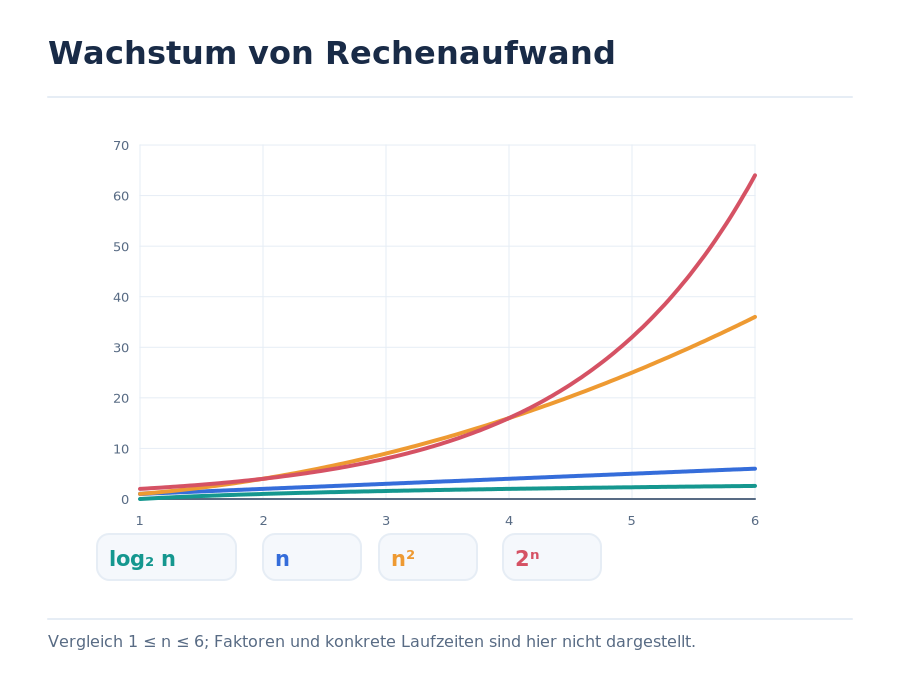

# M7-L2 – Korrektheit, Berechenbarkeit und Analyse komplexer Verfahren {#L2}

**Kursbereich:** M7 – Masterorientierte Informatik

**Niveau:** Masterorientierung

**Vorwissen:** [M7-L1](M7-L1.md) · [M1-L3](M1-L3.md) · [M8-L1](M8-L1.md) · [M8-L2](M8-L2.md)

## Überblick: Drei sehr unterschiedliche Fragen {#S1}

Eine Suchfunktion kann mit den Beispieldaten das richtige Ergebnis liefern und trotzdem einen grundsätzlichen Fehler enthalten. Ein mathematisch bewiesener Algorithmus kann korrekt sein und bei großen Eingaben dennoch länger rechnen, als praktisch akzeptabel ist. Und bei manchen Aufgaben existiert **überhaupt kein Algorithmus**, der für jede mögliche Eingabe eine bestimmte Ja-nein-Frage zuverlässig entscheidet.

Diese Unterschiede sind der Gegenstand der zweiten Master-Kernlektion:

1.  **Korrektheit:** Liefert ein Verfahren unter seinen ausdrücklich genannten Voraussetzungen die vorgeschriebenen Ergebnisse?
2.  **Effizienz:** Wie wachsen Rechenzeit, Speicherbedarf und gegebenenfalls Kommunikation, wenn die Eingabe größer wird?
3.  **Berechenbarkeit:** Ist die verlangte allgemeine Entscheidung mit einem Algorithmus prinzipiell möglich?

Dazu kommt eine vierte, praktische Frage: **Welche Art von Nachweis brauchen wir wirklich?** Eine kleine lokale Suchroutine rechtfertigt nicht denselben Verifikationsaufwand wie eine Zahlungstransaktion oder die Steuerung eines sicherheitskritischen Geräts.

Die Lektion baut auf der Unterscheidung aus M7-L1 zwischen Modell, Beweis, Messung und Betriebsbeobachtung auf. Sie ist keine Aufforderung, die gezeigten Programme auszuführen. Das Pseudocode-Material dient ausschließlich als **lesbares Denkmodell**.

## Vor einem Beweis muss der Auftrag klar sein {#S2}

Ein Programm kann nur relativ zu einer **Spezifikation** als korrekt oder inkorrekt bezeichnet werden. Eine Spezifikation beschreibt, welches Verhalten erwartet wird, ohne jede interne Rechenoperation vorzuschreiben. Der Satz „Suche eine Video-ID“ lässt beispielsweise wichtige Fragen offen:

- Kann die ID mehrfach vorkommen oder ist sie eindeutig?
- Soll ein Fund irgendeine passende Position oder die erste Position zurückgeben?
- Ist die Liste sortiert? Darf das Verfahren sie verändern?
- Was bedeutet „nicht gefunden“ genau?
- Dürfen ungültige Eingaben vorkommen, und wie soll dann reagiert werden?

Eine **Vorbedingung** (*Precondition*) genanntes Merkmal muss vor dem Aufruf gelten. Eine **Nachbedingung** (*Postcondition*) legt fest, was bei regulärer Rückkehr garantiert wird. Zusammen bilden sie einen **Vertrag** (*Contract*): Wer die Vorbedingung einhält, darf sich auf die zugesicherte Nachbedingung verlassen, sofern die Implementierung korrekt ist.

Beispiel: Eine Funktion nimmt eine Folge `a` und eine Kennung `x` entgegen und gibt einen Index `p` zurück.

  Bestandteil                  Präzise Aussage
  ---------------------------- ---------------------------------------------------------------------------------------
  Vorbedingung                 Die Folge ist endlich und zugreifbar; `x` kann mit ihren Einträgen verglichen werden.
  Nachbedingung bei `p >= 0`   `p` ist eine gültige Position und `a[p] = x`.
  Nachbedingung bei `p = -1`   In der gesamten Folge kommt `x` nicht vor.
  Nicht zugesichert            Eine bestimmte Trefferposition bei mehrfach vorkommendem `x`.

Die Nachbedingung verlangt **mehr** als „ein gefundener Wert ist richtig“: Ein Verfahren darf auch keinen vorhandenen Wert unbemerkt übersehen. Genau dieser zweite Teil wird in oberflächlichen Tests häufig vergessen.

### Spezifikation, Implementierung und Umgebung {#21-spezifikation-implementierung-und-umgebung}

``` text
Fachlicher Wunsch
      |
      v
Spezifikation mit Vor-/Nachbedingungen
      |
      v
Algorithmus + Korrektheitsargument
      |
      v
Konkrete Implementierung
      |
      v
Laufzeitumgebung, Daten, Hardware, Nebenläufigkeit
```

Ein mathematischer Beweis auf Algorithmusebene gilt nicht automatisch für ein fehlerhaft programmiertes Verfahren oder eine unzuverlässige Umgebung. Umgekehrt kann eine einzelne reale Anwendung lange störungsfrei funktionieren, ohne dass dadurch jede theoretische Eingabe behandelt wäre.

## Partielle und totale Korrektheit {#S3}

In der formalen Programmanalyse unterscheidet man zwei Aussagen:

- **Partielle Korrektheit:** *Wenn* das Programm regulär endet und die Vorbedingung gilt, erfüllt sein Ergebnis die Nachbedingung.
- **Totale Korrektheit:** Das Programm erfüllt die Nachbedingung **und beendet sich** für alle Eingaben, die seine Vorbedingung erfüllen – im verwendeten Ausführungsmodell.

Eine Funktion, die bei bestimmten Eingaben in einer Endlosschleife bleibt, kann partiell korrekt sein: Sie produziert dann kein falsches reguläres Ergebnis. Total korrekt ist sie nicht.

Die typische Schreibweise stammt aus der **Hoare-Logik**:

``` text
{ P }  C  { Q }

P = Vorbedingung
C = Programm oder Programmabschnitt
Q = Nachbedingung
```

Das sogenannte **Hoare-Tripel** beschreibt üblicherweise eine Aussage über partielle Korrektheit: Falls `P` vor `C` gilt und `C` normal beendet wird, gilt anschließend `Q`. Für totale Korrektheit muss die Terminierung zusätzlich gezeigt werden. Bei Ausnahmen, Nebenwirkungen und Nebenläufigkeit braucht man entsprechend erweiterte Modelle.

**Wichtige Abgrenzung:** „Die Schleife endet“ und „Sie liefert das richtige Resultat“ sind **verschiedene** Beweisziele. Ein schnell abbrechendes Programm kann falsch sein; ein logisch sorgfältig arbeitendes Programm kann niemals fertig werden.

## Schleifeninvarianten: Was bei jedem Durchlauf wahr bleibt {#S4}

Eine **Invariante** bezeichnet eine Aussage, die an definierten Kontrollpunkten einer Berechnung wahr bleibt. Bei einer Schleife ist das typischerweise unmittelbar vor jeder Prüfung der Schleifenbedingung der Fall.

Betrachten wir eine lineare Suche:

``` text
p := 0
solange p < Laenge(a):
    falls a[p] = x:
        gib p zurueck
    p := p + 1
gib -1 zurueck
```

Eine geeignete Invariante lautet:

> Vor jedem weiteren Durchlauf gilt: `0 <= p <= Länge(a)`, und auf den bereits geprüften Positionen `0` bis `p-1` steht nirgends der gesuchte Wert `x`.

Warum ist das nützlich? Die Invariante teilt die Liste in einen bereits überprüften und einen noch nicht überprüften Bereich. Daraus entsteht ein vollständiges Argument in vier Schritten \[1\]:

1.  **Initialisierung:** Vor dem ersten Durchlauf ist `p = 0`. Es wurden noch keine Positionen geprüft. Die Aussage über den leeren geprüften Bereich ist wahr.
2.  **Erhaltung:** Ist `a[p]` gleich `x`, wird ein gültiger Fund zurückgegeben. Ist der Eintrag verschieden, bleibt auch nach `p := p + 1` der gesamte nun geprüfte Bereich frei von `x`.
3.  **Nachbedingung:** Endet die Schleife ohne Treffer, ist `p = Länge(a)` und jeder Index wurde ausgeschlossen. Deshalb ist `-1` korrekt.
4.  **Terminierung:** Solange kein Treffer vorliegt, nimmt die nichtnegative Restgröße `Länge(a) - p` bei jedem Durchlauf um eins ab. Sie kann nicht unendlich oft strikt abnehmen.

Das ist bereits ein kleines Argument für **totale Korrektheit**, soweit die definierten Vergleichs- und Speicheroperationen normal terminieren.

### Durchgerechneter Verlauf {#41-durchgerechneter-verlauf}

Nehmen wir `a = [4, 8, 13, 21]` und `x = 13`:

  Start von Durchlauf     `p` Bereits ausgeschlossene Einträge   Nächste Prüfung
  --------------------- ----- ---------------------------------- -----------------
  1                         0 keine                              `4 = 13`? Nein
  2                         1 `4`                                `8 = 13`? Nein
  3                         2 `4, 8`                             `13 = 13`? Ja

Der Rückgabewert `2` ist gültig, weil `a[2] = 13`. Für `x = 7` endet die Schleife mit `p = 4`; erst die Invariante rechtfertigt den Rückgabewert `-1`.

**Grenze:** Wenn eine Datenquelle während der Suche ohne Synchronisation verändert wird, gelten die Annahmen einer unveränderlichen Folge möglicherweise nicht. Ein auf dem Papier korrekter Suchalgorithmus macht keine gleichzeitigen Schreibzugriffe sicher.

## Binäre Suche: Ein stärkeres Argument für einen schnelleren Algorithmus {#S5}

Die **binäre Suche** nutzt eine zusätzliche Vorbedingung: Die Folge ist gemäß der verwendeten Vergleichsordnung **aufsteigend sortiert**. Damit lässt sich nach einem Vergleich jeweils ungefähr die Hälfte des verbleibenden Bereichs ausschließen.

Eine besonders gut prüfbare Variante verwendet ein **halboffenes Intervall** `[links, rechts)`: Der Index `links` gehört zum Suchbereich, `rechts` nicht.

``` text
links  := 0
rechts := Laenge(a)

solange links < rechts:
    mitte := links + (rechts - links) // 2
    falls a[mitte] < x:
        links := mitte + 1
    sonst:
        rechts := mitte

falls links < Laenge(a) und a[links] = x:
    gib links zurueck
gib -1 zurueck
```

Das Zeichen `//` meint hier ganzzahlige Division mit Abrundung. Das Verfahren bestimmt den **ersten Index, dessen Wert mindestens `x` ist**. Diese Stelle ist als *lower bound* bekannt. Falls dort wirklich `x` steht, ist es die **erste** Fundposition; andernfalls kommt `x` nicht vor.

**Invariante:** Alle Positionen vor `links` enthalten Werte kleiner als `x`. Alle Positionen ab `rechts` enthalten Werte größer oder gleich `x`. Beide Aussagen folgen aus der Sortierung und bleiben bei jedem Schritt erhalten. Der Bereich `[links, rechts)` enthält somit alle noch nicht eingeordneten Kandidaten für die Grenzposition.

- Ist `a[mitte] < x`, liegen auch alle Positionen bis einschließlich `mitte` unter `x`: `links` darf auf `mitte + 1` rücken.
- Ist `a[mitte] >= x`, gehört `mitte` zur rechten Seite: `rechts` darf auf `mitte` rücken.
- Solange `links < rechts`, wird die Intervalllänge `rechts - links` strikt kleiner. Damit terminiert die Schleife.
- Am Ende gilt `links = rechts`. Diese Position ist die erste Stelle mit Wert mindestens `x`, oder das Ende der Folge.

### Beispiel mit mehrfach vorkommendem Schlüssel {#51-beispiel-mit-mehrfach-vorkommendem-schlüssel}

Bei `a = [2, 5, 5, 5, 11, 18, 20, 30]` und `x = 5` ergeben sich folgende halboffenen Suchbereiche:

  Zustand   `[links, rechts)`     Mitte Vergleich   Neuer Bereich
  --------- ------------------- ------- ----------- ---------------
  Start     `[0,8)`                   4 `11 >= 5`   `[0,4)`
  Weiter    `[0,4)`                   2 `5 >= 5`    `[0,2)`
  Weiter    `[0,2)`                   1 `5 >= 5`    `[0,1)`
  Weiter    `[0,1)`                   0 `2 < 5`     `[1,1)`

Die Grenzposition ist `1`, also der erste der drei Treffer. Ein kleiner Detailwechsel – die Entscheidung `>=` statt `>` – verändert hier die garantierte Bedeutung des Ergebnisses.

### Warum die Laufzeit logarithmisch wächst {#52-warum-die-laufzeit-logarithmisch-wächst}

Nach `k` erfolgreichen Halbierungen bleiben größenordnungsmäßig $\frac n{2^k}$ Kandidaten. Der Bereich ist spätestens dann bis auf eine winzige Restgröße reduziert, wenn `2^k` ungefähr `n` erreicht, also `k` in der Größenordnung von $\log_2(n)$ liegt. Die Suchzeit beträgt daher bei konstant teurem Indexzugriff **$O(\log  n)$**.

Beispiel: Bei einer Million Einträgen liegen rund 20 Halbierungsschritte in der richtigen Größenordnung, statt bis zu einer Million linearer Vergleiche. Das ist eine **analytische Aussage über Vergleiche**, keine garantierte Millisekundenangabe. Ist die Liste nicht sortiert oder unterstützt sie keinen effizienten direkten Positionszugriff, gilt die angegebene Methode beziehungsweise Laufzeitannahme nicht unverändert \[2\].

## Rekursion, Induktion und Terminierungsmaße {#S6}

Eine **rekursive** Funktion ruft sich für kleinere Problemvarianten selbst auf. Der Beweis folgt häufig der **vollständigen Induktion**: Wenn ein Verfahren für alle ausreichend kleinen Teilprobleme korrekt ist und aus diesen korrekten Ergebnissen ein korrektes größeres Ergebnis konstruiert, kann es auch insgesamt korrekt sein.

Beispiel **Merge Sort**:

1.  Eine Folge mit null oder einem Element ist bereits sortiert.
2.  Eine längere Folge wird in zwei kürzere Teilfolgen zerlegt.
3.  Beide Teilfolgen werden rekursiv sortiert.
4.  Eine Zusammenführungsprozedur wählt jeweils das kleinere vordere Element, bis alle Elemente ausgegeben sind.

Die wesentliche **Zusammenführungsinvariante** lautet: Die bereits erzeugte Ausgabe ist sortiert und enthält genau die bisher entnommenen Elemente; ihr nächster möglicher Wert kann nur an einer der beiden noch nicht verbrauchten Teilfolgenspitzen liegen. So begründet man die Korrektheit des Zusammenführens; die Induktion begründet die Korrektheit des ganzen Sortierverfahrens.

Für Terminierung genügt, dass die rekursiven Aufrufe bei Eingabegröße $n > 1$ **strikt kleinere** Eingaben erhalten und irgendwann den Basisfall erreichen. Allgemeiner spricht man von einem **wohlfundierten Maß**: Es darf keine unendlich lange Folge strikt fallender Werte geben. Neben natürlichen Zahlen sind geeignete Ordnungen über Tupeln oder Datenstrukturen möglich.

**Achtung:** Ein Aufruf mit „fast demselben“ Problem reicht nicht. Wenn die Aufteilung gelegentlich wieder eine Teilaufgabe der ursprünglichen Größe erzeugt, ist die Terminierung dadurch nicht bewiesen.

## Zeit- und Speicherkomplexität: Was wächst mit der Eingabe? {#S7}

Die **asymptotische Analyse** beschreibt das Wachstum eines Ressourcenaufwands `T(n)` mit der Eingabegröße `n`. Sie blendet – für diese spezielle Fragestellung – konstante Faktoren und kleinere Summanden aus.




  Notation         Typische Aussage                                   Beispiel
  ---------------- -------------------------------------------------- ---------------------------------------------------------
  $O(g(n))$        Asymptotische obere Schranke                       $T(n)\le c\cdot g(n)$ für genügend großes `n`
  $\Omega (g(n))$  Asymptotische untere Schranke                      $T(n)\ge c\cdot g(n)$ für genügend großes `n`
  $\Theta (g(n))$  Obere und untere Schranke gleicher Größenordnung   `T(n)` wächst proportional zur Größenordnung von $g(n)$

Dabei sind die Konstanten jeweils positiv und ab einer geeigneten Schwelle in `n` gültig. $O(n^{2})$ bedeutet als **obere Schranke** nicht, dass der Aufwand zwangsläufig quadratisch wächst: Ein linearer Algorithmus gehört ebenfalls zur Menge $O(n^{2})$. Für eine enge Einordnung wäre `Θ(n)` aussagekräftiger.

### Best Case, Average Case und Worst Case {#71-best-case-average-case-und-worst-case}

Die Komplexität hängt von der betrachteten Eingabeverteilung ab:

- **Best Case:** Besonders günstige Eingabe, zum Beispiel sofortiger Treffer bei linearer Suche.
- **Worst Case:** Schlechteste Eingabe der betrachteten Größe.
- **Average Case:** Durchschnitt über eine **ausdrücklich definierte Wahrscheinlichkeitsverteilung** von Eingaben. Ohne diese Verteilung ist der Durchschnittsfall nicht präzise festgelegt.

Bei einer unindexierten linearen Suche ist der Best Case `Θ(1)`, der Worst Case `Θ(n)`. Wenn ein gesuchter Eintrag gleichwahrscheinlich an allen `n` Positionen vorkommt, liegt die mittlere Zahl der Vergleiche bei $\frac{n+1}{2}$, also `Θ(n)`. Die Verteilungsannahme ist entscheidend.

### Speicher ist eine eigene Ressource {#72-speicher-ist-eine-eigene-ressource}

Ein Verfahren mit guter Laufzeit kann viel Speicher benötigen. Merge Sort braucht bei einer üblichen Array-Implementierung beispielsweise zusätzlichen Speicher von $O(n)$ für das Zusammenführen. Manche In-place-Sortierverfahren benötigen deutlich weniger Zusatzspeicher, haben aber andere Zeit- oder Fehleranforderungen.

Bei Netzwerkanwendungen zählen zusätzlich übertragene Bytes, Anzahl der Nachrichten, Datenbankzugriffe, Energie und Wartezeiten. Eine Funktion, die theoretisch nur $O(1)$ lokale Rechenarbeit durchführt, kann bei jeder Operation eine teure externe Datenbankanfrage auslösen.

## Zwei vollständige Wachstumsvergleiche {#S8}

### $n^{2}$ gegenüber $n\cdot \log_2(n)$ {#81-n²-gegenüber-nlog₂n}

Stellen wir zwei idealisierte Vergleichszahlen nebeneinander, ohne sie mit realen Laufzeiten zu verwechseln:

    Eingabegröße `n`               $n^2$  $n\cdot\log_2(n)$ (gerundet)
  ------------------ ------------------- -----------------------------
               1.000           1.000.000                         9.966
           1.000.000   1.000.000.000.000                    19.931.569

Die Eingabe wird tausendmal größer. Der quadratische Ausdruck wächst dabei um den Faktor **1.000.000**, der $n\cdot \log_2(n)$-Ausdruck nur ungefähr um den Faktor **2.000**.

Das erklärt, warum eine zunächst einfache verschachtelte Schleife bei wachsender Datenmenge zum Problem werden kann. Es beweist nicht, dass eine konkret vorhandene $O(n \log  n)$-Implementierung schon bei 1.000 Datensätzen schneller als eine andere $O(n^{2})$-Implementierung ist: Speicherzugriffe und Konstanten können den kleinen Eingabebereich dominieren.

### Eine Rekurrenz Schritt für Schritt {#82-eine-rekurrenz-schritt-für-schritt}

Für Merge Sort kann man vereinfachend annehmen, dass `n` eine Zweierpotenz ist und das Zusammenführen $c\cdot n$ Zeit kostet:

$$
\begin{aligned}
T(n)&=2\cdot T(n/2)+c\cdot n\\
T(1)&=d
\end{aligned}
$$

Auf der ersten Ebene werden `n` Elemente zusammengeführt; auf der nächsten Ebene sind es insgesamt wieder `n` über zwei Teilprobleme; auf jeder weiteren Ebene ebenfalls ungefähr `n`. Es gibt $\log_2(n)$ solche Ebenen. Die Blätter verursachen zusammen einen linearen Grundaufwand. Damit folgt:

$$
\begin{aligned}
T(n)&=c\cdot n\cdot\log_2(n)+d\cdot n\\
&=\Theta(n\log n)
\end{aligned}
$$

Diese Rechnung setzt ein korrektes Aufteilen und ein linear arbeitendes Merge-Verfahren voraus. Verwendet eine reale Umsetzung langsame Datenstrukturen oder erzeugt zusätzliche Kopien, muss man die Kosten erneut analysieren.

## Untere Schranken: Warum manche Abkürzungen unmöglich sind {#S9}

Die Analyse kann nicht nur zeigen, wie schnell **ein bekanntes** Verfahren ist. Manchmal lässt sich auch beweisen, dass **kein Verfahren einer klar definierten Klasse** eine bestimmte Grenze unterschreiten kann.

Für das Sortieren von `n` verschiedenen Elementen durch **reine Paarvergleiche** gibt es `n!` mögliche Reihenfolgen. Jeder Vergleich hat höchstens zwei Ergebnisse; ein binärer Entscheidungsbaum benötigt für `n!` unterscheidbare Endfälle eine Tiefe von mindestens $\log_2(n!)$. Dieser Ausdruck wächst als `Ω(n log n)`.

Damit benötigen vergleichsbasierte Sortieralgorithmen im schlechtesten Fall `Ω(n log n)` Vergleiche. Verfahren mit $O(n \log  n)$ Vergleichen sind hinsichtlich dieses **Modells** asymptotisch optimal.

**Die Einschränkung ist wesentlich:** Counting Sort oder Radix Sort nutzen zusätzliche Struktur der Schlüssel und sind keine reinen Vergleichssortierverfahren. Sie widerlegen deshalb die Vergleichsuntergrenze nicht. Der Satz „Sortieren kann niemals linear sein“ wäre fachlich falsch.

## Amortisierte Analyse: Eine teure Operation muss nicht teuer im Durchschnitt sein {#S10}

Ein dynamisches Array kann bei voller Kapazität auf eine größere Speicherregion umziehen. Der einzelne Wachstumsschritt kopiert möglicherweise `n` Elemente und kostet $O(n)$. Trotzdem kann das Anhängen über **eine Folge** von Operationen sehr günstig sein.

Nehmen wir idealisiert eine **Verdopplung** der Kapazität an: Beim Wachstum von 1 auf 2, 2 auf 4, 4 auf 8 usw. fallen Kopierkosten von etwa $1+2+4+\ldots$ an. Bis zu `n` Anhängeoperationen bleibt diese Summe unter einer konstanten Vielfachen von `n`. Einschließlich der eigentlichen `n` Einfügungen ergibt sich $O(n)$ Gesamtkosten, also **amortisiert $O(1)$ je Anhang**.

**Amortisiert** bedeutet keine zufällige oder empirisch gemessene Durchschnittszeit. Es ist eine mathematische Aussage über die **gesamte Kostenfolge**, selbst wenn einzelne Operationen teuer sind. Wer eine harte Reaktionszeitgrenze für jeden einzelnen Aufruf einhalten muss, kann sich auf diese Garantie allein nicht verlassen.

## Entscheidungsprobleme und Optimierungsprobleme {#S11}

Die Komplexitätstheorie untersucht häufig **Entscheidungsprobleme** mit Antwort `Ja` oder `Nein`. Ein Optimierungsproblem sucht dagegen eine möglichst gute Lösung. Die Unterscheidung erleichtert präzise Aussagen.

Beispiel einer Route durch einen Graphen:

- **Entscheidung:** „Gibt es eine Rundreise, die jede geforderte Station besucht und höchstens 100 Kosteneinheiten benötigt?“
- **Optimierung:** „Wie groß sind die Kosten der kürzesten solchen Rundreise?“

Die Entscheidungsversion kann als Baustein zur Untersuchung der Optimierungsversion dienen. Beide sind verwandt, aber nicht dieselbe Aufgabenformulierung. Auch die Eingabegröße muss korrekt gemessen werden: Eine Zahl `N` benötigt in Binärdarstellung nur ungefähr $\log_2(N)$ Bits. Ein Algorithmus, dessen Zeit proportional zum **Zahlenwert** `N` wächst, ist daher nicht notwendigerweise polynomial in der **Bitlänge der Eingabe**.

## P, NP, NP-vollständig und NP-schwer {#S12}

**P** umfasst Entscheidungsprobleme, für die auf einem üblichen deterministischen theoretischen Rechenmodell eine Lösung mit einer **polynomiellen** Zahl von Schritten in der Eingabelänge bekannt ist. **NP** umfasst Entscheidungsprobleme, deren Ja-Antworten mit einem geeigneten, polynomial langen **Zertifikat** in polynomieller Zeit geprüft werden können; die formale ursprüngliche Definition nutzt nichtdeterministische Berechnung. Es gilt $P \subseteq  \mathrm{NP}$.

Ein Beispiel: Für die Frage, ob ein Graph einen Weg besitzt, der jeden Knoten genau einmal besucht, kann ein vorgeschlagener Weg leicht geprüft werden. Daraus folgt aber nicht automatisch ein ebenso schnelles Verfahren, um den Weg erst zu finden.

  Klasse/Begriff       Präzise Lesart                                                                    Häufiger Irrtum
  -------------------- --------------------------------------------------------------------------------- -----------------------------------------------------------------------
  **P**                Polynomialzeitlich entscheidbar                                                   „Immer praktisch schnell“ – hohe Polynomgrade können unbrauchbar sein
  **NP**               Ja-Zertifikate sind polynomial prüfbar                                            „Nicht-polynomiell“ – das bedeutet NP gerade nicht
  **NP-schwer**        Mindestens so schwer wie alle Probleme aus NP unter den verwendeten Reduktionen   Muss selbst nicht in NP liegen
  **NP-vollständig**   Gehört zu NP **und** ist NP-schwer                                                Ist nicht durch Definition „unlösbar“

Das berühmte Problem **P versus NP** fragt, ob jede polynomial prüfbare Ja-Lösung auch polynomial gefunden bzw. das Entscheidungsproblem polynomial gelöst werden kann. Zum **Prüfdatum 05.11.2026** wird es vom Clay Mathematics Institute weiterhin als **ungelöst** geführt \[3\]. Insbesondere ist **nicht bewiesen**, dass $P \ne  \mathrm{NP}$. Eine bloße Beobachtung, dass heute kein schneller Algorithmus bekannt ist, ersetzt diesen Beweis nicht.

### Wie man NP-Schwere mittels Reduktion begründet {#121-wie-man-np-schwere-mittels-reduktion-begründet}

Eine **Reduktion** überführt jede Eingabe eines Problems `A` effizient in eine Eingabe von `B`, so dass die Ja-nein-Antwort erhalten bleibt. Schreibweise: $A\le_p B$ für eine polynomielle Reduktion.

``` text
Instanz von A
      |
      v
polynomielle Umwandlung
      |
      v
Instanz von B --> Antwort durch B-Verfahren
      |
      v
  entsprechende Antwort für A
```

Will man zeigen, dass `B` NP-schwer ist, reduziert man ein **bereits als NP-schwer bekanntes** Problem `A` **auf B**. Denn könnte man `B` schnell lösen, ließe sich damit auch `A` schnell lösen. Die Reduktionsrichtung ist wichtig: Wer versehentlich `B` auf ein schweres `A` reduziert, hat damit gerade noch keine NP-Schwere von `B` bewiesen.

**SAT** (*Boolean Satisfiability Problem*, Erfüllbarkeitsproblem der Aussagenlogik) ist ein klassischer NP-vollständiger Ausgangspunkt. Eine Formel ist erfüllbar, wenn es eine Zuordnung von Wahrheitswerten gibt, die sie wahr macht. Ein Zertifikat ist genau diese Zuordnung. Für praktische SAT-Instanzen existieren oft sehr leistungsfähige Solver; die NP-Vollständigkeit bedeutet nicht, dass **jede** konkrete Formel schwer ist \[4\].

## Was tun, wenn die exakte Lösung zu teuer ist? {#S13}

Eine theoretisch schwere Problemklasse macht praktische Arbeit nicht sinnlos. Häufig genügen andere Zielsetzungen:

- **Spezialfälle:** Ein Problem wird unter zusätzlichen Strukturannahmen effizient. Manche Graphenklassen erlauben wesentlich einfachere Verfahren als beliebige Graphen.
- **Heuristiken:** Ein Verfahren liefert häufig brauchbare Lösungen, aber ohne allgemeine Qualitätsgarantie.
- **Approximationsalgorithmen:** Ein Algorithmus garantiert unter angegebenen Voraussetzungen eine definierte Nähe zum Optimum.
- **Parametrisierte Algorithmen:** Schwierigkeit wird zusätzlich in einem Parameter `k` erfasst. Bei **fixed-parameter tractability (FPT)** kann die Laufzeit beispielsweise $f(k)\cdot n^c$ betragen; bei kleinem `k` kann das praktisch günstig sein.
- **Branch and Bound / begrenzte Suche:** Untere bzw. obere Schranken schneiden aussichtslose Teilräume ab. Im schlechtesten Fall kann der Aufwand trotzdem exponentiell bleiben.
- **Zeitlimit mit bestem bisherigen Ergebnis:** Das Verfahren liefert notfalls eine unvollständige oder suboptimale Lösung, die ausdrücklich als solche gekennzeichnet wird.

Bei einer Tourenplanung für zehn Ziele mag exakte Suche gut funktionieren. Für Tausende Ziele und viele Nebenbedingungen kann eine Heuristik die sinnvollere betriebliche Entscheidung sein. Die Ergebnisqualität sollte anhand der Anforderungen und verfügbaren Prüfungen beurteilt werden – nicht allein anhand einer eindrucksvollen Algorithmusbezeichnung.

## Berechenbarkeit: Auch unendlich viel Rechenleistung löst nicht alles {#S14}

Bisher ging es um **schwere**, aber prinzipiell berechenbare Aufgaben. Die **Berechenbarkeitstheorie** fragt grundlegender, ob überhaupt ein allgemeines mechanisches Entscheidungsverfahren existiert.

Eine **Turingmaschine** ist ein abstraktes Berechnungsmodell mit endlicher Steuerung und einem prinzipiell unbegrenzten Band. Sie ist keine Bauanleitung für einen heutigen Rechner. Verschiedene klassische Formalisierungen mechanischer Rechenverfahren führen zu denselben berechenbaren Funktionen. Die **Church-Turing-These** verbindet diese mathematischen Modelle mit dem informellen Begriff einer effektiv ausführbaren Rechenmethode. Sie ist keine einzelne, im üblichen Sinn beweisbare mathematische Gleichung zwischen zwei unabhängig formal definierten Begriffen \[5\].

Die wichtige Begriffsgrenze:

- **Entscheidbar:** Es existiert ein Algorithmus, der bei **jeder** zulässigen Eingabe anhält und die korrekte Ja-nein-Antwort liefert.
- **Semi-entscheidbar / rekursiv aufzählbar:** Ein Algorithmus kann im Ja-Fall irgendwann die Antwort bestätigen; im Nein-Fall darf er unbegrenzt weiterlaufen.
- **Unentscheidbar:** Ein allumfassender, stets terminierender Entscheidungsalgorithmus existiert nicht.

Unentscheidbarkeit meint **nicht**: „Auf heutiger Hardware zu langsam“. Sie meint eine mathematisch bewiesene Grenze des verwendeten Berechnungsmodells.

## Das Halteproblem: Ein überraschendes Gegenbeispiel {#S15}

Das allgemeine **Halteproblem** fragt:

> Gegeben die Beschreibung eines beliebigen Programms `P` und eine beliebige zulässige Eingabe `x`: Hält `P` bei `x` irgendwann an?

Angenommen, ein perfektes Prüfprogramm `HALT(P, x)` könne für **jedes** solche Paar immer korrekt `JA` oder `NEIN` melden und stets selbst terminieren. Dann definieren wir ein Programm `WIDERSPRUCH(Q)`:

``` text
falls HALT(Q, Q) = JA:
    laufe fuer immer
sonst:
    halte sofort an
```

Jetzt fragen wir, was beim Aufruf `WIDERSPRUCH(WIDERSPRUCH)` passiert:

1.  Sagt `HALT` für dieses Programm `JA`, dann lässt die Definition von `WIDERSPRUCH` es gerade **endlos laufen**. Die Vorhersage wäre falsch.
2.  Sagt `HALT` `NEIN`, dann lässt die Definition es **sofort anhalten**. Auch diese Vorhersage wäre falsch.

Beide Möglichkeiten führen zu einem Widerspruch. Deshalb kann es keinen solchen universellen Algorithmus `HALT` geben. Diese Art der Argumentation heißt **Diagonalisierung** \[5\]. Der Beweis setzt voraus, dass das hypothetische Prüfprogramm beliebige Programme des betrachteten universellen Modells – einschließlich der passend konstruierten Selbstanwendung – korrekt behandelt.

### Was diese Aussage nicht bedeutet {#151-was-diese-aussage-nicht-bedeutet}

- Für viele **konkrete** Programme kann man Terminierung sehr wohl beweisen, etwa über eine streng fallende natürliche Zahl.
- Programmierwerkzeuge können häufig Schleifenfehler entdecken oder für bestimmte Programmklassen Terminierung verifizieren.
- Ein Test mit Zeitlimit kann sagen: „Bisher nicht beendet.“ Er kann im Allgemeinen nicht daraus ableiten: „Wird niemals enden.“
- Wenn ein bekannter Programmaufruf anhält, lässt sich die Ja-Antwort durch tatsächliche Ausführung beobachten. Bei einer nicht haltenden Berechnung fehlt dagegen im Allgemeinen ein endlicher Zeitpunkt, an dem man die endgültige Nein-Antwort aus bloßem Warten ableiten könnte.

Die Grenze ist also präzise: **Keine allgemein gültige, stets terminierende Halteentscheidung für alle Programme und Eingaben.** Daraus folgt keinesfalls, dass gewöhnliche Softwareprüfung nutzlos wäre.

## Eine Landkarte der Grenzen {#S16}

  Frage                                                     Beispiel                                         Art der Grenze
  --------------------------------------------------------- ------------------------------------------------ --------------------------------------------------------------
  Ist das Verfahren korrekt?                                Eine Suche darf vorhandene IDs nicht übersehen   Beweis-/Spezifikationsfrage
  Wie viel Arbeit braucht es?                               Sortieren durch Vergleiche                       Komplexitäts- und Modellfrage
  Gibt es einen effizienten allgemeinen Algorithmus?        NP-vollständiges Entscheidungsproblem            Offene Komplexitätsfrage im Allgemeinen, Spezialfälle lösbar
  Gibt es überhaupt einen universellen Entscheider?         Allgemeines Halteproblem                         Bewiesene Unentscheidbarkeit
  Wird das System auf realen Rechnern zuverlässig laufen?   Dienst bei Netzausfall                           Empirische und betriebliche Frage zusätzlich zur Theorie

Diese Einteilung verhindert einen verbreiteten Denkfehler: Ein sehr schwieriges Optimierungsproblem, ein mathematisch unentscheidbares Problem und eine schlicht schlecht programmierte Anwendung sind drei verschiedene Ursachen für „es funktioniert nicht“.

## Formale Methoden in realen Entwicklungsprozessen {#S17}

Nicht jede Korrektheitsaussage muss handschriftlich bewiesen werden. Unter dem Oberbegriff **formale Methoden** stehen verschiedene Techniken zur Verfügung, beispielsweise:

- **Verträge und Assertions:** Vor- und Nachbedingungen sowie zur Laufzeit geprüfte Annahmen. Eine Assertion kann einen Fehler entdecken, aber als laufende Prüfung nicht automatisch jede mögliche Ausführung beweisen.
- **Statische Analyse und Typsysteme:** Untersuchen Code ohne vollständige Programmausführung. Präzision und Garantien hängen vom jeweiligen Verfahren und seinen Annahmen ab.
- **Model Checking (Modellprüfung):** Erkundet systematisch Zustände und Übergänge eines formalen Modells; findet Gegenbeispiele gegen spezifizierte Eigenschaften, wenn solche im untersuchten Modell erreichbar sind.
- **SAT-/SMT-Solver:** SAT löst Aussagenlogik; **SMT** (*Satisfiability Modulo Theories*) berücksichtigt zusätzlich mathematische Theorien etwa über ganze Zahlen, Bitvektoren oder Gleichungen.
- **Interaktive Beweissysteme:** Helfen beim Aufstellen und maschinellen Prüfen formaler Beweise. Der Beweis gilt relativ zu den Formalisierungen, Annahmen und dem vertrauenswürdigen Prüfteil.
- **Tests und Laufzeitbeobachtung:** Prüfen konkrete Fälle oder reale Abläufe. Sie ergänzen formale Methoden, können deren allgemeine Garantien aber nicht ohne weitere Argumente ersetzen.

### Eine kleine Zustandsmaschine {#171-eine-kleine-zustandsmaschine}

Ein Importauftrag könnte die Zustände `neu`, `wartend`, `läuft`, `fertig` und `fehlgeschlagen` haben.

``` text
[neu] --> [wartend] --> [laeuft] --> [fertig]
                            |
                            +----------> [fehlgeschlagen]
```

Ein formales Modell könnte verlangen, dass ein Auftrag **nie zugleich** `fertig` und `fehlgeschlagen` ist. Das ist eine **Sicherheitseigenschaft** (*Safety*): „Etwas Schlechtes passiert nie.“ Eine **Lebendigkeitseigenschaft** (*Liveness*) könnte verlangen, dass jeder angenommene Auftrag unter bestimmten Fairness- und Verfügbarkeitsannahmen irgendwann abgeschlossen wird: „Etwas Gutes passiert schließlich.“ Diese Unterscheidung ist zentral für nebenläufige und verteilte Systeme \[6\].

Ein Model Checker kann bei endlichem, vollständig erfasstem Zustandsraum mögliche Abfolgen systematisch durchsuchen. Bei großen oder unendlichen Zustandsräumen sind Abstraktion, Begrenzungen oder zusätzliche Beweistechniken nötig. **Eine erfolgreiche begrenzte Prüfung ist kein automatischer Beweis für jede unendlich große reale Ausführung.** Bei TLA+ und PlusCal unterscheidet die Dokumentation entsprechend Modellprüfung und formalen Beweis \[7\].

## Drei Praxisarchitekturen mit unterschiedlichen Beweiszielen {#S18}

### Lokales Medienarchiv: Keine verlorenen oder doppelten Datensätze {#181-lokales-medienarchiv-keine-verlorenen-oder-doppelten-datensätze}

Ein lokales Programm liest Dateien ein und schreibt daraus Einträge in einen Medienkatalog. Der Fachwunsch lautet „Import vollständig und ohne Doppelungen“.

``` text
Quelldateien
    |
    v
Pruefung der Kennung
    |
    v
Transaktion --> neuer Katalogeintrag
    |                 |
    +--> Fehler ------+--> Rollback / Protokoll
```

Eine **Korrektheitsinvariante** könnte lauten: Jede externe Kennung kommt in der Zieltabelle höchstens einmal vor. Die Datenbank unterstützt diese Regel durch eine eindeutige Einschränkung (*UNIQUE constraint*). Das Programm muss darüber hinaus entscheiden, wie es denselben bereits importierten Datensatz bei einer Wiederholung behandelt. Die Forderung nach **Idempotenz** betrifft die fachliche Wirkung, nicht die Anzahl eintreffender Nachrichten.

**Was wird bewiesen?** Unter Annahmen über Transaktionen, eindeutige Schlüssel und Fehlerbehandlung lässt sich das Ziel formal spezifizieren. **Was bleibt offen?** Ob Dateien dauerhaft verfügbar sind, ob korrekte Kennungen vergeben werden, ob ein Absturz vor dem Commit zu Datenverlust im Quellsystem führt. Solche Fragen benötigen weitere Systemmodelle und Wiederherstellungstests.

**Wann sinnvoll?** Sobald doppelte oder verschwundene Einträge teuer zu korrigieren wären. **Wann überdimensioniert?** Bei einem einmaligen Katalog aus wenigen leicht überprüfbaren Einträgen.

### Eine Datenbanküberweisung: „Ganz oder gar nicht“ {#182-eine-datenbanküberweisung-ganz-oder-gar-nicht}

Zwei Konten besitzen Guthaben `A` und `B`. Eine Überweisung des Betrags `t` soll bei Erfolg $A'=A-t$ und $B'=B+t$ bewirken. Unter der Annahme, dass keine Gebühren anfallen und keine anderen Vorgänge gleichzeitig auf die Konten zugreifen, gilt als **Erhaltungsinvariante**:

$$
A'+B'=(A-t)+(B+t)=A+B
$$

Dieses einfache Gleichungsargument zeigt die notwendige fachliche Konsistenz der geplanten Änderung. Ein System benötigt aber zusätzlich Regeln für ausreichende Deckung, Rundung, Nebenläufigkeit, Fehler, Wiederholungen, Autorisierung und Dauerhaftigkeit. Eine Datenbanktransaktion unterstützt atomare Änderungen. Ob die gesamte Nutzerhandlung – etwa einschließlich externer Zahlungsbestätigung – atomar wirkt, ist damit noch nicht automatisch bewiesen.

**Betriebsfolge:** Korrekte Sperr- oder Versionsstrategien kosten unter Umständen Durchsatz; zusätzliche Prüfungen und revisionsfähige Protokolle benötigen Entwicklung und Wartung. Für echte Zahlungssysteme sind zudem Sicherheits- und regulatorische Anforderungen relevant, die diese Beispielgleichung nicht abdeckt.

### Cloud-Auftragsverarbeitung: Korrekt bei Wiederholung, aber irgendwann fertig? {#183-cloud-auftragsverarbeitung-korrekt-bei-wiederholung-aber-irgendwann-fertig}

Ein Webdienst nimmt Anfragen an und legt sie in eine Warteschlange. Mehrere Worker lesen und verarbeiten sie. Bei Ausfällen oder Zeitüberschreitungen können Aufträge mehrfach zugestellt werden.

``` text
Web-API --> Warteschlange --> Worker
                |               |
                |               v
                +-- Wiederholung --> Datenbank
```

Eine **Safety-Eigenschaft** wäre: Für dieselbe Auftragskennung entsteht höchstens eine fachliche Ergebnisbuchung. Eine **Liveness-Eigenschaft** wäre: Ein dauerhaft angenommener gültiger Auftrag wird schließlich bearbeitet. Die zweite Eigenschaft benötigt Annahmen über dauerhaft verfügbare Worker, faire Zuteilung und irgendwann erfolgreiche Wiederholungen. Ohne solche Annahmen lässt sich aus einer unbegrenzt ausfallenden Infrastruktur kein Abschluss erzwingen.

**Wann sinnvoll?** Wenn hohe Zuverlässigkeit bei wiederholten Nachrichten wichtig ist. **Wann unnötig?** Bei einem rein lokalen Skript ohne Warteschlange. **Preis der Garantie:** Zusätzliche Zustandsverwaltung, Monitoring, Wiederholungsregeln, Speicher, Betrieb und Fehlerdiagnose.

Die strengere Analyse der verteilten Aspekte folgt in **M7-L3**. Ein lokaler Korrektheitsbeweis lässt sich nicht einfach als Garantie eines über Netzwerke verteilten Gesamtsystems lesen.

## Fehlerquellen, die selbst gute Beweise entwerten können {#S19}

Ein formal korrektes Modell ist nur so brauchbar wie die Übereinstimmung seiner Voraussetzungen mit dem späteren System. Besonders wichtig sind:

  Verborgene Annahme                                 Mögliche Folge
  -------------------------------------------------- --------------------------------------------------------
  Ganzzahlen seien unbegrenzt                        Überlauf bei festen Integer-Datentypen
  Vergleiche seien exakt                             Rundungsfehler bei Gleitkommazahlen
  Alle Eingaben seien gültig                         Absturz oder falsche Ergebnisse bei beschädigten Daten
  Daten blieben während der Berechnung unverändert   Race Condition durch parallele Änderungen
  Aufträge kämen genau einmal                        Doppelte Buchungen durch Wiederholung
  Betriebsmittel seien unbegrenzt                    Zeitüberschreitung, Speichererschöpfung, Ausfall
  Das Modell erfasse alle wichtigen Zustände         Unentdeckter Fehler außerhalb des Modells

Auch Sicherheit ist eine Korrektheitsfrage **unter einem Bedrohungsmodell**: Eine korrekte Funktion kann für reguläre Nutzer richtig arbeiten und bei absichtlich bösartigen Eingaben angreifbar sein. Ein mathematischer Beweis über eine Sortierfunktion ist kein Sicherheitsgutachten über das gesamte Programm.

## Wie viel Formalität ist angemessen? {#S20}

  Vorhaben                                 Sinnvolle Vorgehensweise                                                                  Eher überdimensioniert
  ---------------------------------------- ----------------------------------------------------------------------------------------- --------------------------------------------------------------------
  Kurzes lokales Hilfsprogramm             Klare Eingaben, einfache Tests, verständliche Fehlerfälle                                 Vollständiger formaler Beweis jeder Hilfsroutine
  Umfangreicher Datenimport                Eindeutige Schlüssel, Verträge, Transaktionen, Wiederholbarkeit, Wiederherstellungstest   Vollständige theoretische Analyse des gesamten Betriebssystems
  Anspruchsvolle Optimierung               Ressourcenmodell, Komplexitätsabschätzung, Benchmarks, gegebenenfalls Approximation       Eine universelle exakte Lösung zu jedem Preis
  Verteilte Auftragsverarbeitung           Zustandsmodell, Safety-/Liveness-Eigenschaften, Ausfall- und Wiederholungsannahmen        Behauptung absoluter Zuverlässigkeit ohne Ausfallmodell
  Sicherheits- oder zeitkritisches Gerät   Strengere Spezifikation, überprüfbare Invarianten, Laufzeitgrenzen, unabhängige Prüfung   Ausschließliche Abstützung auf einige erfolgreiche Demonstrationen

**Kostenfrage:** Formale Methoden brauchen präzise Anforderungen, qualifizierte Bearbeitung und kontinuierliche Pflege bei Änderungen. Der Nutzen steigt mit den Folgen eines Fehlers und der Schwierigkeit, Fehler nachträglich zu entdecken. Auch eine perfekte formale Spezifikation kann die **falsche** fachliche Zielsetzung präzise beweisen – deshalb bleibt die Validierung des tatsächlichen Bedarfs aus M7-L1 notwendig.

## Entscheidungskompass: Welcher Nachweis beantwortet welche Frage? {#S21}

``` text
Was soll gezeigt werden?
        |
        +--> "Immer korrekt unter Annahmen?"
        |       -> Spezifikation, Invariante, Beweis
        |
        +--> "Beendet sich?"
        |       -> Terminierungsargument, wohlfundiertes Mass
        |
        +--> "Wie skaliert der Aufwand?"
        |       -> Komplexitaetsmodell + reale Messungen
        |
        +--> "Ist es prinzipiell entscheidbar?"
        |       -> Berechenbarkeitstheorie, ggf. Reduktion
        |
        +--> "Funktioniert die wirkliche Software?"
                -> Implementierungspruefung, Tests, Betrieb
```

Die stärkste Arbeitsweise kombiniert geeignete Antworten, statt eine Methode zur universellen Lösung zu erklären. Man kann gleichzeitig beweisen, dass ein Algorithmus die richtige Lösung berechnet, eine Laufzeitobergrenze herleiten und dann auf echter Hardware kontrollieren, ob diese Lösung unter tatsächlichen Lastbedingungen zweckmäßig ist.

## Zusammenfassung und Übergang zu M7-L3 {#S22}

**Korrektheit** beginnt mit einer präzisen Spezifikation. Vorbedingungen, Nachbedingungen, Schleifeninvarianten und Terminierungsmaße begründen, warum ein Verfahren funktioniert und endet. **Komplexitätsanalyse** beschreibt dagegen den Ressourcenaufwand als Funktion der Eingabegröße. Die asymptotische Obergrenze ist nicht dasselbe wie eine tatsächliche Laufzeitgarantie. **Berechenbarkeitstheorie** zeigt schließlich, dass selbst mit unbegrenzter idealisierter Zeit und Speicher manche allgemeinen Entscheidungen – etwa das Halteproblem – nicht algorithmisch möglich sind.

Drei Merksätze verbinden diese Perspektiven:

1.  **Richtiges Ergebnis ist nicht dasselbe wie garantierter Abschluss.** Partielle und totale Korrektheit unterscheiden sich.
2.  **Schwierig ist nicht gleich unmöglich.** NP-Vollständigkeit und Unentscheidbarkeit bezeichnen verschiedene Phänomene; P versus NP bleibt offen.
3.  **Ein Beweis beweist genau die modellierte Aussage.** Reale Komponenten, Netzwerke, Sicherheitsanforderungen und menschliche Erwartungen müssen zusätzlich betrachtet werden.

**Weiterlesen im abgeschlossenen Kernpfad:** [M7-L3 – Verteilte Systeme als formale und praktische Systemmodelle](M7-L3.md). Dort werden Netzwerkverzögerung, fehlende gemeinsame Uhr, partielle Ausfälle, Replikation, Konsens und Systemgarantien gemeinsam untersucht. Die acht Master-Wahllektionen bleiben organisatorisch getrennt und werden nur nach ausdrücklicher Auswahl ausgearbeitet.

## Einordnung in die kursweiten Lesewege {#S23}

Dieses Kapitel gehört zum **sechsteiligen Master-Kernbereich**, nicht zu den freiwilligen zusätzlichen Master-Wahlthemen. Navigation: [vorherige Master-Kernlektion M7-L1](M7-L1.md); [nächste Master-Kernlektion M7-L3](M7-L3.md); [Lesewege und fachliche Querverweise](pages/pfad.md); [Kursindex](pages/index.md).


## Quellen {#S24}

**Letzte Quellenprüfung:** 05.11.2026

Die folgenden Quellen belegen die behandelten theoretischen Grundlagen und Werkzeuge. Die Datenreihen, Suchbeispiele, Diagramme und die drei Praxisfälle in dieser Lektion sind eigene **didaktische Beispiele**, keine veröffentlichten Mess- oder Forschungsergebnisse. **Prüfstand: 05.11.2026.**

1.  **Cornell University, CS 2110 – Loop Invariants (2026):** Initialisierung, Erhaltung, Fortschritt und Terminierung von Schleifen. [https://courses.cs.cornell.edu/courses/cs2110/2026fa/lectures/lec04/](https://courses.cs.cornell.edu/courses/cs2110/2026fa/lectures/lec04/)
2.  **Cornell University, CS 2110 – Loop Invariants (2022):** Ausführlicher Beweisrahmen für binäre Suche mit Invariante und Terminierungsargument. [https://www.cs.cornell.edu/courses/cs2110/2022fa/lectures/loopinv/](https://www.cs.cornell.edu/courses/cs2110/2022fa/lectures/loopinv/)
3.  **Clay Mathematics Institute – P versus NP:** Der Problemstatus wird weiterhin als *Unsolved* geführt; die Problemstellung ist offen. [https://www.claymath.org/millennium/p-vs-np/](https://www.claymath.org/millennium/p-vs-np/)
4.  **MIT OpenCourseWare, 6.006 – Introduction to Algorithms, Syllabus:** Trennung von Algorithmusbeschreibung, Korrektheitsargument und Zeit-/Speicheranalyse; [https://ocw.mit.edu/courses/6-006-introduction-to-algorithms-fall-2011/pages/syllabus/](https://ocw.mit.edu/courses/6-006-introduction-to-algorithms-fall-2011/pages/syllabus/)
5.  **Stanford Encyclopedia of Philosophy – The Church-Turing Thesis / Entscheidungsproblem:** Effektive Berechnung, Church-Turing-These und Grenzen algorithmischer Entscheidbarkeit. [https://plato.stanford.edu/entries/church-turing/](https://plato.stanford.edu/entries/church-turing/) und [https://plato.stanford.edu/entries/church-turing/decision-problem.html](https://plato.stanford.edu/entries/church-turing/decision-problem.html)
6.  **Leslie Lamport – Safety, Liveness, and Fairness (2019):** Mathematische Unterscheidung von Safety- und Liveness-Eigenschaften. [https://lamport.azurewebsites.net/tla/safety-liveness.pdf](https://lamport.azurewebsites.net/tla/safety-liveness.pdf)
7.  **Leslie Lamport – PlusCal Tutorial und TLA+ Tools:** Beschreibung der Übersetzung von PlusCal zu TLA+, Modellprüfung durch TLC sowie Verhältnis zu Beweiswerkzeugen. [https://lamport.azurewebsites.net/tla/tutorial/intro.html](https://lamport.azurewebsites.net/tla/tutorial/intro.html) und [https://lamport.azurewebsites.net/tla/tools.html](https://lamport.azurewebsites.net/tla/tools.html)

**Einordnung:** Die Quellen \[1\] und \[2\] unterstützen die Beweistechnik; die konkreten Beispielprogramme sind hier unabhängig formuliert. \[3\] bestätigt den zeitabhängigen Forschungsstatus, nicht eine allgemeine Aussage über die praktische Schwierigkeit jeder NP-Instanz. \[6\] und \[7\] erläutern formale Werkzeuge, belegen aber ausdrücklich nicht, dass die drei Beispielsysteme bereits formal verifiziert wären. Die gesamte Darstellung ist ein Lesekurs, kein Softwarezertifikat.
