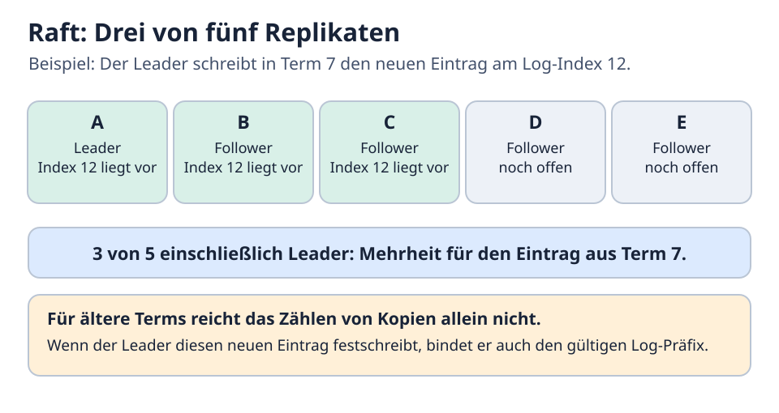

# M7-L3 – Verteilte Systeme als formale und praktische Systemmodelle {#L3}

**Kursbereich:** M7 – Masterorientierte Informatik

**Niveau:** Masterorientierung

**Vorwissen:** [M2-L5](M2-L5.md) · [M3-L2](M3-L2.md) · [M3-L5](M3-L5.md) · [M4-L1](M4-L1.md) · [M7-L1](M7-L1.md) · [M7-L2](M7-L2.md)

**Hinweis:** Ziel: Nicht nur wissen, dass mehrere Rechner zusammenarbeiten können, sondern präzise erkennen, welche Ordnung, Konsistenz, Verfügbarkeit und Fehlertoleranz ein Entwurf unter welchen Annahmen garantiert. Die Unterrichtsdiagramme und Zahlen sind konstruierte Beispiele, keine gemessenen Leistungswerte.

## Die eigentliche Herausforderung: Es gibt keinen gemeinsamen Augenblick {#S1}

Ein einzelnes Programm kann oft so beschrieben werden: Es gibt einen aktuellen Speicherzustand, dann passiert ein Schritt, dann den nächsten. Bei einem verteilten System arbeiten mehrere Prozesse mit eigenen Speichern, Uhren und Fehlern zusammen. Nachrichten benötigen Zeit; sie können verzögert, vertauscht, verdoppelt oder – je nach Übertragung und Fehlerfall – gar nicht zugestellt werden. Ein Prozess sieht daher nur einen Ausschnitt des Gesamtsystems.

``` text
      Dienst A                    Dienst B
  eigener Zustand            eigener Zustand
      |                            |
      | ---- Nachricht 1 --------> |
      |      Verzögerung?          |
      | <---- Nachricht 2 -------- |
      v                            v
   lokale Uhr                   lokale Uhr
```

„Rechner B reagiert nicht“ ist noch keine eindeutige Diagnose. B kann abgestürzt sein; die Verbindung kann gestört sein; B kann arbeiten und nur seine Antwort verlieren; B kann schlicht langsam sein. Dieser Unterschied ist keine Wortklauberei: Aus der Diagnose folgt, ob eine erneute Ausführung Daten dupliziert, eine andere Maschine übernehmen darf oder ein Nutzer vorübergehend keine Entscheidung erhält.

Ein **verteiltes System** ist daher nicht bloß „eine Anwendung auf mehreren Servern“. Es ist ein System, bei dem **unvollständiges Wissen über andere Teilnehmer** selbst zum Entwurfsproblem wird. Der wissenschaftliche Zugang beginnt damit, Beobachtungen, gewünschte Eigenschaften und erlaubte Ausfälle ausdrücklich zu definieren.

## Vom Architekturdiagramm zum prüfbaren Modell {#S2}

Ein Schaubild „API → Datenbank → drei Replikate“ erklärt, *welche Bausteine* existieren, nicht, *wie sie sich bei Fehlern verhalten*. Ein formales Systemmodell ergänzt mindestens fünf Angaben:

1.  **Teilnehmer:** zum Beispiel Clients, drei Datenbankreplikate und ein Koordinator.
2.  **Lokaler Zustand:** Datenwerte, Versionsnummern, noch nicht bestätigte Aufträge.
3.  **Übergänge:** Lesen, Schreiben, Nachrichten senden oder empfangen, Neustart, Absturz.
4.  **Umweltannahmen:** Nachrichtenverzögerung, Uhren, erlaubte Ausfälle, Speicherhaltbarkeit.
5.  **Eigenschaften:** Was darf niemals passieren? Welcher Fortschritt muss unter welchen Bedingungen irgendwann eintreten?

Ein stark vereinfachtes Modell einer replizierten Einstellung lautet:

``` text
Zustand: Wert je Replikat, Versionsnummer je Replikat
Aktionen: Schreibversuch, Replikationsnachricht,
          Empfang, Lesen, Ausfall, Wiederverbindung
Sicherheitsziel: Keine als bestätigt erklärte Änderung
                darf im definierten Fehlermodell verloren gehen
Fortschrittsziel: Bei ausreichend erreichbaren Replikaten
                  kann eine zulässige Änderung bestätigt werden
```

Die Ziele verlangen zusätzliche genaue Definitionen: Was bedeutet „bestätigt“? Wie viele Replikate müssen antworten? Was geschieht, wenn ein Replikat erst nach dem Empfang, aber vor dem dauerhaften Speichern abstürzt? Eine Architekturzeichnung allein kann das nicht entscheiden.

**Wichtig:** Ein Modell darf abstrahieren. Es muss nicht jeden Bytepuffer oder jede CPU-Instruktion enthalten. Es darf jedoch gerade jene Fehler nicht ausblenden, über die es eine Garantie abgeben soll.

## Sicherheits- und Fortschrittseigenschaften unterscheiden {#S3}

Aus M7-L2 stammen zwei Begriffe:

- **Safety (Sicherheitseigenschaft):** Etwas Unerlaubtes geschieht niemals. Beispiel: Zwei gleichzeitig aktive Leiter dürfen nicht beide widersprüchliche, verbindliche Werte für dieselbe Logposition festlegen.
- **Liveness (Fortschrittseigenschaft):** Unter festgelegten Voraussetzungen geschieht irgendwann etwas Erwünschtes. Beispiel: Sobald genügend gesunde Teilnehmer zuverlässig kommunizieren, kann ein Auftrag abgeschlossen werden.

Die Unterscheidung erklärt eine unangenehme Betriebsentscheidung: Ein System kann bei unklarer Lage **stehen bleiben**, um widersprüchliche Buchungen zu verhindern. Es verletzt dann eine Verfügbarkeitsanforderung, bewahrt aber eine Sicherheitsanforderung. Umgekehrt kann ein System Antworten aus voneinander getrennten Regionen liefern und damit verfügbar bleiben, später aber widersprüchliche Änderungen zusammenführen müssen.

**Ein Korrektheitsbeweis ist immer bedingt:** Wer zeigen möchte, dass ein repliziertes System sicher ist, muss sein Fehlermodell und seine Zusagen explizit nennen. Die pauschale Behauptung „hochverfügbar und konsistent“ reicht nicht aus.

## Zeit, Ereignisordnung und „Happened-before“ {#S4}

Leslie Lamport zeigte 1978, warum die Reihenfolge verteilter Ereignisse nicht einfach aus den Uhrzeiten einzelner Rechner abzulesen ist. Entscheidend ist die **kausale Reihenfolge** (*happened-before*, geschrieben `a → b`):

- Zwei Ereignisse im selben Prozess sind entsprechend dessen lokaler Ausführungsreihenfolge geordnet.
- Das Senden einer Nachricht geschieht vor deren Empfang.
- Die Beziehung ist transitiv: Wenn `a → b` und `b → c`, dann `a → c`.

``` text
Prozess A:  a1 --sende M-- a2 -------- a3
                    |                   
                    | Nachricht M
                    v
Prozess B:  b1 ---empfange M-- b2 ----- b3
```

Das Senden von `M` geschieht kausal vor ihrem Empfang. Dagegen kann zwischen `a1` und `b1` keine Kausalbeziehung erkennbar sein. Solche Ereignisse gelten im Modell als **nebenläufig** (*concurrent*): Weder `a1 → b1` noch `b1 → a1` muss gelten. Das heißt nicht, dass man ihre physikalische Reihenfolge nie erfahren könnte, sondern dass sie sich aus den betrachteten Kommunikationsbeziehungen nicht ableiten lässt.

Die Ereignisreihenfolge ist eine **partielle Ordnung**. Eine einzelne globale, durch jeden Teilnehmer unmittelbar bekannte Reihenfolge existiert normalerweise nicht. Eine künstliche Gesamtordnung kann technisch vereinbart werden; sie ist nicht automatisch die tatsächlich kausale Ordnung.

## Logische Uhren und Vektoruhren {#S5}

Eine **Lamport-Uhr** verwendet ganze Zahlen statt der Systemzeit. Vereinfacht gilt: Vor einem lokalen Ereignis erhöht ein Prozess seinen Zähler; eine Nachricht trägt den aktuellen Zähler; beim Empfang setzt der Empfänger seinen Zähler auf `max(lokal, empfangen) + 1`.

``` text
A: Ereignis (1) -- sendet M(2) ----------> (weitere Schritte)
B: Ereignis (1) ------ empfängt M ------>  max(1,2)+1 = 3
```

Daraus folgt: Wenn `a → b`, dann ist der Lamport-Zeitstempel von `a` kleiner als der von `b`. **Die Umkehrung gilt nicht.** Kleinere Zeitstempel beweisen nicht, dass die Ereignisse kausal miteinander verbunden sind.

**Vektoruhren** speichern dagegen eine Zählerkomponente pro betrachteten Prozess. Bei zwei Teilnehmern könnte A nach einem lokalen Ereignis `[1,0]` tragen und B unabhängig davon `[0,1]`. Diese Vektoren sind komponentenweise unvergleichbar: Keiner ist in allen Komponenten kleiner oder gleich dem anderen. Das zeigt die Nebenläufigkeit dieser beiden Ereignisse im üblichen Vektoruhrmodell. Nach Empfang einer von A gesendeten Nachricht würde B die Komponenten zusammenführen und die eigene Komponente erhöhen, beispielsweise auf `[1,2]` – abhängig von der konkreten vorherigen Ereignisfolge.

**Grenze:** Vektoruhren benötigen Metadaten und Teilnehmeridentitäten. In sehr großen oder wechselnden Teilnehmergruppen ist ihre Verwaltung aufwendig. Sie lösen auch nicht automatisch den Konflikt zweier gleichzeitig geänderter Datensätze; sie helfen zunächst, den Konflikt zu *erkennen*.

## Physische Uhren sind nützlich, aber keine magische Ordnung {#S6}

Reale Systeme brauchen Uhrzeiten für Protokolle, Ablaufzeiten, Auditierung und Messungen. Doch Uhren können durch Synchronisationsfehler, Drift, Pausen oder Zeitsprünge voneinander abweichen. Selbst eine genaue Uhr macht aus einem Netz ohne garantierte Nachrichtenlaufzeiten keine verlässliche gemeinsame Beobachterposition.

Ein häufiger Denkfehler: „Die Änderung von Server A hat 10:00:00.100, die von B 10:00:00.090; also war B zuerst.“ Das setzt voraus, dass die Uhren genauer synchronisiert waren als die Zeitdifferenz und dass die Zeitstempel die gewünschten Ereignisse tatsächlich korrekt erfassen. Bei unklarer Unsicherheit ist die Reihenfolge nicht belegt.

Systeme mit eng kontrollierten Uhren und expliziten Unsicherheitsintervallen können stärkere zeitbezogene Garantien aufbauen. Das ist eine eigens entwickelte Architekturentscheidung, keine Eigenschaft gewöhnlicher Serveruhren. Für die meisten Anwendungen ist ein logisch vereinbarter Änderungs- oder Transaktionsverlauf leichter zu begründen als ein vermeintlich perfekter Zeitstempelvergleich.

## Fehlerarten: Nicht jeder Ausfall bedeutet dasselbe {#S7}

  Fehlermodell                  Annahme                                                                          Entwurfsfolge
  ----------------------------- -------------------------------------------------------------------------------- ----------------------------------------------------------------------------
  **Crash-stop**                Ein Prozess fällt aus und kehrt im betrachteten Ablauf nicht zurück              Andere Teilnehmer müssen seinen Ausfall überstehen können
  **Crash-recovery**            Ein Prozess startet später neu                                                   Flüchtiger und dauerhaft gespeicherter Zustand müssen unterschieden werden
  **Omission**                  Nachrichten werden nicht gesendet, empfangen oder verarbeitet                    Wiederholungen und Lückenerkennung können erforderlich sein
  **Verzögerung / Partition**   Kommunikation dauert ungewöhnlich lange oder ist zwischen Gruppen unterbrochen   Man darf Nichterreichbarkeit nicht mit sicherem Tod verwechseln
  **Byzantinisch**              Ein Teilnehmer kann beliebig, auch widersprüchlich oder böswillig handeln        Benötigt andere Protokolle und meist strengere Vertrauensannahmen

Eine **Netzwerkpartition** heißt: Teile eines Netzes können einander nicht zuverlässig erreichen. Sie bedeutet nicht unbedingt, dass das Internet insgesamt ausgefallen wäre. Auch eine einzelne unterbrochene Verbindung zwischen Rechenzentren kann ein Cluster in Gruppen aufteilen.

Ein Modell für zufällige Abstürze beweist keine Sicherheit gegen manipulierte Server. Ebenso garantiert eine Replikation im selben Rechenzentrum keine Unabhängigkeit bei Ausfall der gemeinsamen Stromversorgung. **Fehlerunabhängigkeit ist eine Annahme, keine Eigenschaft der Zahl „drei“.**

## Ein Timeout ist ein Verdacht, kein Beweis {#S8}

Betrachten wir einen Auftrag, der eine Datei verbindlich als „archiviert“ markieren soll:

``` text
Client             Server
  | -- Auftrag 42 --> |
  |                   | verarbeitet 42
  |                   | speichert Ergebnis
  | <-- Antwort X ----|  (Antwort geht verloren)
  |   Timeout         |
  | -- Auftrag 42 --> |  (Wiederholung)
```

Aus Sicht des Clients sieht ein ausgefallener Server genauso aus wie eine verlorene Antwort. Wer nach dem Timeout unkontrolliert denselben Auftrag noch einmal ausführt, kann eine Zahlung doppelt auslösen oder einen Datensatz doppelt anlegen.

Eine **idempotente Operation** ist so konstruiert, dass wiederholte gleichbedeutende Anforderungen keine zusätzliche unerwünschte fachliche Wirkung haben. Häufig wird dafür eine eindeutige *Idempotency Key* (Vorgangskennung) dauerhaft mit dem Ergebnis verwaltet. Die fachliche Verarbeitung und das Registrieren der Kennung müssen für den jeweiligen Fehlerfall atomar beziehungsweise entsprechend geschützt sein. Eine bloße Liste im RAM reicht nach einem Neustart nicht.

**„Wirkung genau einmal“ ist nicht gleich „Nachricht genau einmal zugestellt“.** Wiederholte Übertragung kann beabsichtigt sein; entscheidend ist der korrekte Effekt. Auch die Wirkung auf externe Systeme erfordert eine abgestimmte Transaktions- oder Kompensationsstrategie.

## Konsistenz ist keine einzige Eigenschaft {#S9}

Das Wort **Konsistenz** kann Verschiedenes meinen: gültige Datenbankregeln, gleiche Replikationsstände, eine definierte Reihenfolge gleichzeitig ausgeführter Operationen oder die Sicht eines bestimmten Clients. Es ist daher sinnvoll, das konkrete **Konsistenzmodell** zu benennen.

  Modell / Zusage                            Intuition                                                                                                                               Grenze
  ------------------------------------------ --------------------------------------------------------------------------------------------------------------------------------------- -----------------------------------------------------------------------------------------------
  **Linearizability (Linearisierbarkeit)**   Jede Operation wirkt zu einem Punkt zwischen Aufruf und Antwort; abgeschlossene Operationen werden in Echtzeitreihenfolge respektiert   Kann bei Partitionen Antworten verhindern, wenn kein sicherer aktueller Zustand verfügbar ist
  **Sequential Consistency**                 Es gibt eine gemeinsame Reihenfolge, die die Programmkontrolle jedes Teilnehmers respektiert                                            Diese Ordnung muss nicht die reale Reihenfolge nicht überlappender Operationen abbilden
  **Causal Consistency**                     Kausal abhängige Änderungen erscheinen in richtiger Abhängigkeit                                                                        Unabhängige konkurrierende Änderungen brauchen nicht überall gleich angeordnet zu sein
  **Eventual Consistency**                   Ohne neue Änderungen und bei wieder funktionierender Kommunikation können Replikate schließlich konvergieren                            Keine unmittelbare Frische- oder feste Zeitgarantie allein aus dem Begriff

Diese Begriffe beziehen sich auf jeweils definierte Objekte und Operationen. Eine Datenbank kann unterschiedliche Konsistenzstufen für unterschiedliche Lese- oder Schreiboperationen anbieten. **ACID-Transaktionen** und **Linearizability** sind ebenfalls nicht synonym: ACID beschreibt unter anderem transaktionale Atomarität und Isolation; welche konkrete Sicht über mehrere Knoten entsteht, hängt zusätzlich vom Protokoll und seiner Isolation ab.

### Eine anschauliche Chronologie {#91-eine-anschauliche-chronologie}

``` text
Client A:  schreibt Preis = 20  ---- Antwort: Erfolg
Client B:                           liest Preis ---->  ?
```

Ist der Schreibvorgang bereits vollständig bestätigt, bevor B seinen Leseaufruf startet, verlangt Linearisierbarkeit für dieses Objekt, dass B diesen Schreibvorgang oder einen *später* gültig gewordenen Zustand berücksichtigt. Ein älterer Wert `15` wäre hier nicht zulässig, sofern keine neuere einschlägige Änderung existiert. Bei gleichzeitig überlappenden Operationen sind dagegen mehrere legitime Ordnungen denkbar.

## Konsens: Viele Teilnehmer einigen sich auf einen Verlauf {#S10}

**Konsens (Consensus)** ist die verteilte Einigung auf einen Wert oder eine Operationsreihenfolge trotz definierter Störungen. Ein wichtiger Spezialfall ist das **replizierte Log**: Mehrere Server vereinbaren die Reihenfolge von Einträgen und wenden diese auf ihren lokalen Zustand an.

``` text
               Client: „setze X=7“
                        |
                      Leader
                     /      \
               Replikat 2  Replikat 3
                     \      /
                  bestätigter Logeintrag
                          |
                 Zustandsmaschine: X=7
```

Bei **Raft** werden diese Aufgaben didaktisch klar aufgeteilt: Leader-Wahl, Log-Replikation und Sicherheitsregeln. Ein bestätigter Eintrag ist nicht einfach „eine Nachricht, die jemand erhalten hat“. Der Protokollzustand, die Logposition, die Mehrheitsbestätigung und die Wahlregeln sind wesentlich. Ein abgeschlossener Commit soll bei späterem Leaderwechsel nicht aus dem gültigen Verlauf verschwinden.

**Abgrenzung:** Die Wahl eines Leiters allein schafft noch keinen sicheren Konsens. Ein alter Leiter kann nach einer Pause wieder aufwachen und versuchen weiterzuschreiben. Ein korrektes System muss verhindern, dass veraltete Berechtigungen außerhalb des vereinbarten Protokolls wirksam werden – beispielsweise durch Term-/Epochenprüfung und, bei externen Ressourcen, geeignete *Fencing Tokens*.

## Mehrheiten: Ein kleines, nachvollziehbares Modell {#S11}



*Abbildung: Fünf stimmberechtigte Server und ein neuer Eintrag aus dem aktuellen Term. Die Mehrheit zählt den Leader mit. Raft schreibt einen alten Eintrag über den bestätigten Log-Präfix fest, wenn ein Eintrag aus dem aktuellen Term festgeschrieben wird.*

Angenommen, ein Cluster besitzt **fünf stimmberechtigte Replikate**. Eine einfache Mehrheit ist $\left\lfloor\frac52\right\rfloor+1=3$. Zwei disjunkte Gruppen mit jeweils drei Mitgliedern sind unmöglich: Bei fünf Teilnehmern müssen sich je zwei Dreiermehrheiten in mindestens einem Replikat überschneiden.

Das lässt sich zählen:

``` text
Mehrheit A: {1,2,3}
Mehrheit B: {3,4,5}
Schnitt:     {3}
```

Die Überschneidung ist eine wichtige Zutat der Sicherheit, **aber allein noch kein vollständiger Konsensbeweis**. Die Teilnehmer müssen zusätzlich korrekte Regeln für Versionen, Wahlperioden, Logeinträge und das Ersetzen eines Leaders befolgen.

Ein Cluster mit fünf Stimmen kann bei einfachen Crash-Ausfällen normalerweise **bis zu zwei nicht verfügbaren Stimmen** weiter eine Dreiermehrheit bilden, sofern die verbleibenden Teilnehmer miteinander kommunizieren und weitere Protokollbedingungen erfüllt sind. Bei einer Partition `2 | 3` kann nur die Dreierseite eine Mehrheit bilden; die Zweierseite soll keine neuen verbindlichen Einträge allein bestätigen. Das ist beabsichtigter Schutz vor *Split Brain* (widersprüchlichen aktiven Zuständen), kein Defekt der Mehrheitsrechnung.

Ein kleineres System mit drei Stimmen benötigt zwei. Mehrheitsquoren verändern also die möglichen Fehlerfälle, nicht automatisch die maximale Verarbeitungsgeschwindigkeit.

## Das CAP-Theorem: Was bei einer Partition nicht gleichzeitig geht {#S12}

Das **CAP-Theorem** (Consistency, Availability, Partition Tolerance) wird oft als Auswahl „zwei von drei“ missverstanden. Präziser ist die Frage: Was passiert **während einer Netzwerkpartition**, wenn beide Seiten weiterhin Anfragen erhalten?

In der klassischen Formalisierung bedeutet:

- **C:** ein starkes Konsistenzmodell, nämlich atomare/linearisierbare Sicht auf die betrachteten Daten;
- **A:** jede Anfrage an einen nicht ausgefallenen Teilnehmer erhält unter dem Modell eine gültige Antwort;
- **P:** das Systemmodell lässt den Verlust der Kommunikation zwischen Teilnehmergruppen zu und soll dennoch seine zugesagten Eigenschaften prüfen.

Unter den Voraussetzungen des ursprünglichen Beweises kann ein System in der Partition nicht gleichzeitig die genannte starke Konsistenz **und** vollständige Verfügbarkeit aller betroffenen Anfragen garantieren. Ein Seite weiß gegebenenfalls nicht, ob die andere Seite schon einen neuen Wert bestätigt hat. Will sie jeden Lese- und Schreibaufruf ohne Kommunikation erfolgreich bedienen, kann sie einen widersprüchlichen Verlauf liefern.

**Nicht zulässig** ist die pauschale Aussage „Datenbank X ist CP, Datenbank Y ist AP, also ist X immer konsistent und Y nie“. Reale Systeme kennen unterschiedliche Operationen, mehrere Fehlermodelle, zeitweilig nicht verfügbare Funktionen und konfigurierbare Garantien. Auch **Latenz** und **Haltbarkeit** kommen als eigenständige Entwurfsdimensionen hinzu; das CAP-Theorem allein sagt nichts über normale Antwortzeiten oder eine generelle Produktqualität aus.

## Warum nicht jeder Konflikt Konsens braucht {#S13}

Manche Daten benötigen eine **eindeutige autoritative Reihenfolge**: Bankbuchungen, Rechtevergabe oder die verbindliche Zuteilung einer nur einmal vorhandenen Ressource. Andere Daten können gleichzeitig geändert und später zusammengeführt werden: Zähler für unabhängige Ereignisse, manche kollaborativen Notizen oder Analysemetadaten.

**CRDT** steht für *Conflict-free Replicated Data Type*: eine replizierte Datenstruktur mit definierten Zusammenführungsregeln, die unter passenden Voraussetzungen unabhängig vorgenommene Änderungen ohne zentrale Einzelentscheidung zusammenführen kann. Ein einfaches, wachsendes Mengensystem kann beispielsweise aus beiden Seiten die Vereinigung der enthaltenen Kennungen bilden. Bei Löschen, begrenzten Ressourcen oder zeitabhängiger Reihenfolge steigen die Anforderungen deutlich.

CRDTs ersparen nicht automatisch Netzwerkverkehr, Speicherkosten, Rechtekontrolle oder den Bedarf an eindeutigen Entscheidungen für alle Geschäftsvorgänge. Ihre Stärke liegt darin, dass man **den Konflikt mathematisch durch die Datenstruktur beherrschbar macht**, statt jede Änderung von einer globalen Leitung freigeben zu lassen.

## FLP: Eine formale Grenze der Einigung {#S14}

Das Resultat von **Fischer, Lynch und Paterson (FLP)** betrachtet deterministische Konsensprotokolle in einem vollständig asynchronen System, in dem Nachrichten beliebig lange verzögert werden dürfen und schon ein Prozess ausfallen kann. Unter diesen Annahmen gibt es keine Garantie, dass jede zulässige Ausführung **terminiert** und dabei die verlangte sichere Konsensentscheidung erreicht.

Das ist **keine** Aussage, dass Konsens in realen Systemen unmöglich wäre. Praktische Protokolle arbeiten unter zusätzlichen Annahmen, etwa Perioden ausreichend zuverlässiger Kommunikation, geeigneten Timeouts oder Randomisierung. Sie können Sicherheit auch während schlechter Phasen bewahren, während die Fortschrittsgarantie an günstigere Kommunikationsbedingungen gebunden ist.

Hier wird der Zusammenhang zu M7-L2 sichtbar: **Sicherheitsbeweise und Fortschrittsbeweise haben möglicherweise unterschiedliche Voraussetzungen.** Ein korrektes Protokoll kann vorübergehend keine Entscheidung treffen. Man darf daraus weder „defekt“ noch „garantiert immer verfügbar“ ableiten.

## Replizierte Zustandsmaschine: Gleiches Kommando, gleicher Zustand? {#S15}

Ein verbreitetes Architekturprinzip ist die **replizierte Zustandsmaschine (Replicated State Machine, RSM)**. Die Replikate starten mit demselben Zustand und wenden dieselbe festgelegte Folge deterministischer Befehle an.

``` text
Gemeinsames Log: [ +5, -2, +7 ]
Replikat A: 10 -> 15 -> 13 -> 20
Replikat B: 10 -> 15 -> 13 -> 20
Replikat C: 10 -> 15 -> 13 -> 20
```

Diese Gleichheit setzt unter anderem voraus, dass Befehle **deterministisch** interpretiert werden. Eine Zustandsmaschine, die bei jeder Ausführung spontan die lokale Uhrzeit oder eine unkoordinierte Zufallszahl abfragt, kann auseinanderlaufen. Solche Eingaben müssen bei Bedarf als gemeinsame Befehlsdaten festgehalten werden.

Bei einem realen Cluster können Replikate vorübergehend unterschiedliche Präfixe des Logs kennen. Entscheidend ist, welche Einträge als verbindlich gelten und wann ein Replikat sie anwenden beziehungsweise für Leseantworten nutzen darf.

**Risiko:** Replizierte Logs sind kein Ersatz für Backups. Ein versehentlich gelöschter Datensatz oder ein logisch fehlerhafter Befehl wird sonst sehr zuverlässig auf alle Replikate übertragen. Verfügbarkeit und unabhängige Wiederherstellbarkeit sind unterschiedliche Ziele.

## Drei Arten von „synchron“ sauber auseinanderhalten {#S16}

Im Alltag wird „synchron“ für verschiedene Dinge benutzt:

1.  **Synchroner Aufruf:** Ein Client wartet auf eine Antwort statt den Auftrag nur anzustoßen.
2.  **Synchrone Replikation:** Ein Schreibvorgang wartet auf definierte Rückmeldungen weiterer Replikate, bevor er bestätigt wird.
3.  **Synchrones Systemmodell:** Für Berechnung und Nachrichtenzustellung existieren bestimmte obere Zeitgrenzen.

Diese Bedeutungen sind **nicht austauschbar**. Eine API kann synchron antworten, obwohl die Daten nur asynchron repliziert werden. Ein Raft-Cluster kann Mehrheitsbestätigungen verwenden, ohne dass das Netzwerk eine harte obere Nachrichtenlaufzeit garantiert. Ein System kann in ruhigen Zeiten äußerst schnell sein, aber für seine beweisbare Fortschrittsgarantie auf zusätzliche Timingannahmen angewiesen bleiben.

## Latenz, Durchsatz und die Kosten der Koordination {#S17}

Eine verteilte Architektur fügt Kommunikationswege und Abstimmungen hinzu. Das lässt sich mit **konstruierten Zahlen** illustrieren:

Ein Client führt drei unabhängige, nacheinander abgewartete Remote-Aufrufe aus. Jeder braucht in diesem Lehrmodell 25 Millisekunden Netzwerk- und Verarbeitungszeit. Rein sequenziell entstehen $3\times25\,\mathrm{ms}=75\,\mathrm{ms}$ für diese drei Schritte. Können sie tatsächlich parallel und ohne versteckte Abhängigkeiten stattfinden, wäre die theoretische Untergrenze im Modell ungefähr `max(25,25,25) = 25 ms` plus Koordinationsaufwand. **Das sind keine Messungen.** Die Realität umfasst Warteschlangen, Netzwerkstreuung, Ausreißer und unterschiedliche Antwortzeiten.

**Durchsatz** bezeichnet abgeschlossene Arbeit pro Zeiteinheit; **Latenz** die Dauer einer einzelnen Anfrage. Mehr Parallelität erhöht den Durchsatz nicht unbegrenzt: Gemeinsame Ressourcen und wiederholte Fehlversuche können überlastet werden. Bei starken Konsistenzanforderungen kommen Roundtrips und dauerhaftes Schreiben hinzu; bei schwächeren Garantien können spätere Konfliktbehandlung und Datenkorrekturen Kosten verursachen.

### Mittelwert gegen Randfälle {#171-mittelwert-gegen-randfälle}

Ein Dienst kann im Durchschnitt 20 ms antworten, aber einzelne Anfragen können sehr viel länger benötigen. In einem Vorgang, der gleichzeitig viele Teildienste braucht, kann bereits ein langsamer Teil den Gesamtablauf begrenzen. Darum werden neben Durchschnittswerten häufig Perzentile wie **p95** oder **p99**, Fehlerquoten und Warteschlangenlängen betrachtet.

Die gemeinsame Verteilung ist entscheidend: Man darf einzelne p99-Zeiten nicht einfach addieren und das Ergebnis als p99 des Gesamtsystems ausgeben. Ohne Informationen über Abhängigkeit, Last und Verteilung lässt sich daraus keine belastbare Gesamtwahrscheinlichkeit berechnen.

## Wiederholungen, Backoff und Warteschlangen {#S18}

Bei kurzzeitigen Übertragungsfehlern hilft ein erneuter Versuch. Viele gleichzeitige Wiederholungen können die Ursache einer Störung jedoch verschlimmern. **Backoff** vergrößert den Abstand zwischen Versuchen; **Jitter** verteilt sie zeitlich, damit nicht alle Clients gleichzeitig zurückkommen. Die Amazon Builders' Library dokumentiert diese Gefahr einschließlich kaskadierender Wiederholungen über mehrere Dienstebenen.

Eine **Queue (Warteschlange)** entkoppelt Annahme und Verarbeitung, garantiert aber ohne weitere Regeln weder Reihenfolge über mehrere Verbraucher hinweg noch exakt einmalige Wirkung. In einem typischen *at-least-once*-Zustellmodell kann eine Nachricht mehrfach zugestellt werden. Fachliche Kennungen, atomare Statusübergänge, begrenzte Wiederholungen und eine Behandlung dauerhaft fehlschlagender Aufträge sind deshalb Bestandteil des Entwurfs.

Bei finanziellen oder sicherheitskritischen Vorgängen genügt „wir probieren es einfach noch mal“ nicht. Der Client muss erkennen können, ob der ursprüngliche Auftrag bereits verbindlich abgeschlossen wurde – gegebenenfalls über eine Vorgangskennung und eine Statusabfrage.

## Formale Modellprüfung: Ausführungsmöglichkeiten statt Hoffnung {#S19}

Ein verteiltes System lässt sich als **Zustandsübergangssystem** formulieren:

``` text
Startzustand
  |       \
  |        \ Nachricht verzögert
  v         v
Zustand A  Zustand B
  |          |
  +--> Zustand C <--+
        |
        v
      Zustand D
```

Ein Model Checker wie **TLC für TLA+** kann bei einem *endlichen, konkret begrenzten Modell* mögliche Interleavings untersuchen: Was geschieht, wenn der Leader nach einem Commit abstürzt? Was, wenn eine Nachricht verspätet ankommt? Was, wenn zwei Clients dieselbe Ressource beanspruchen?

Beispiel einer Modellinvariante: `niemals zwei unterschiedliche bestätigte Werte für dieselbe Logposition`. Ein gefundenes Gegenbeispiel liefert einen Ablauf, der den Modellannahmen zufolge zum Verstoß führt. Das ist wertvoller als die Hoffnung, ein solcher Sonderfall werde im Testbetrieb zufällig auftreten.

**Grenzen der Aussage:** Eine erfolgreich geprüfte endliche Modellinstanz beweist nicht automatisch jede beliebig große Konfiguration. Ein Modell kann fehlerhafte Annahmen haben oder reale Implementierungsdetails auslassen. Ergänzend braucht man Implementierungstests, Fehler-Injektion, Messungen, Sicherheitsprüfungen und – für allgemeinere Aussagen – geeignete mathematische Beweise.

## Praxisbeispiel 1: Medienarchiv über zwei Standorte {#S20}

Eine Anwendung verwaltet hunderttausende Medienmetadaten. Ursprünglich reicht eine lokale SQL-Datenbank. Nun sollen Leser aus zwei Städten schnell Titel und Tags durchsuchen, während eine zentrale Redaktion Daten bearbeitet.

``` text
Redaktion -> primäre Datenbank -> Replikation -> Lesekopie Standort B
                  |
                  +------> Backups in getrenntem Schutzbereich
```

**Frage nach dem Modell:** Müssen neue Tags sofort überall sichtbar sein, oder dürfen Suchergebnisse in Standort B wenige Sekunden hinterherlaufen? Wenn eine leichte Verzögerung tolerierbar ist, kann eine asynchrone Lesereplikation sinnvoll sein. Ein Titel, der eine Sekunde später sichtbar wird, ist meist weniger kritisch als eine doppelt vergebene Exklusivberechtigung.

**Ausfallmodell:** Ist Standort B nur Lesekopie, darf er bei getrennter Verbindung keine ungeprüften autoritativen Änderungen entgegennehmen. Sonst drohen Konflikte beim Zusammenführen. Ist Schreibverfügbarkeit beider Standorte wirklich nötig, wird ein klarer Konflikt- oder Konsensmechanismus benötigt.

**Wirtschaftliche Folge:** Zwei Standorte verursachen Datenübertragung, zusätzliche Überwachung, Pflege, Sicherheitsaufwand und Wiederherstellungstests. Die bloße Existenz einer Replik macht das System nicht automatisch sicherer als ein sauber abgesicherter Einzelserver. Für kleine Archive bleibt der Monolith mit Backup häufig die bessere Architektur.

## Praxisbeispiel 2: Ein Auftrag darf nur einmal abgerechnet werden {#S21}

Ein Nutzer startet eine kostenpflichtige Bildanalyse. Ein API-Server nimmt den Auftrag an, ein Worker verarbeitet das Bild, das Abrechnungssystem belastet das Guthaben. Auf dem Weg kann die Verbindung abbrechen.

``` text
Client -- POST /analyse (Vorgangs-ID 4711) --> API
                  |
                  v
           Auftragsdatensatz
                  |
               Job-Queue
                  |
                 Worker ------> Analyseergebnis
                  |
                  v
             Abrechnungsaktion
```

Eine robuste fachliche Regel lautet: **Für dieselbe fest definierte Vorgangs-ID und denselben fachlichen Auftrag höchstens eine verbindliche Guthabenbelastung.** Ein mögliches Design verbindet einen eindeutigen Schlüssel in einer transaktionalen Datenbank mit einem eindeutigen Abrechnungsdatensatz. Bei wiederholter Jobzustellung erkennt das System die bereits abgeschlossene Wirkung. Wenn die Buchung in einem fremden Dienst erfolgt, reicht die lokale Datenbanktransaktion allein nicht; die externe Schnittstelle muss geeignete Idempotenz oder einen Abstimmungs-/Reconciliation-Prozess bieten.

Die Sicherheitsforderung „nicht doppelt belasten“ und die Fortschrittsforderung „bei gesundem System schließlich ein Ergebnis liefern“ müssen getrennt geprüft werden. Weder drei Worker noch ein Load Balancer erfüllen diese Regeln von selbst.

## Praxisbeispiel 3: Steuerungsdatenbank für mehrere Worker {#S22}

Eine Arbeitsplattform nutzt fünf Steuerungsreplikate. Sie bestimmen, welcher Worker welche Aufgabe übernehmen darf. Zwei Replikate werden durch einen Netzfehler von den übrigen drei getrennt.

``` text
        Standort West             Standort Ost
       [R1] [R2]          X       [R3] [R4] [R5]
        zwei Stimmen             drei Stimmen
         keine Mehrheit          Mehrheit erreichbar
```

Wenn die Steuerungslogik ein geeignetes Mehrheits-Konsensprotokoll verwendet, darf die Zweiergruppe keinen neuen verbindlichen Leader-Eintrag beschließen. Die Dreiergruppe kann bei sonst erfüllten Voraussetzungen fortfahren. Bestehende Worker müssen dennoch prüfen, ob ihre frühere Berechtigung noch gültig ist; andernfalls können sie trotz korrektem Steuerungs-Log externe Änderungen vornehmen.

**Entscheidung:** Für einen kritischen Scheduler kann die vorübergehende Nichtverfügbarkeit einiger Steuerungsoperationen den korrekten Zustand schützen. Für rein statistische Telemetrie wäre dieselbe globale Mehrheitskoordination womöglich überdimensioniert. Auch innerhalb *eines* Produkts kann man deshalb verschiedene Konsistenzmodelle für verschiedene Datenarten wählen.

## Was lässt sich beweisen, was lässt sich nur messen? {#S23}

  Behauptung                                                               Passender Nachweis                                                  Was dadurch **nicht** bewiesen ist
  ------------------------------------------------------------------------ ------------------------------------------------------------------- --------------------------------------------------------------------------
  „Nie zwei gültige widersprüchliche Leader-Entscheidungen“                Spezifikation, Protokollinvariante, formaler Beweis/Modellprüfung   Fehlerfreiheit einer abweichenden Implementierung
  „Nach höchstens zwei Crash-Ausfällen kann die Mehrheit weiterarbeiten“   Fehlermodell und Quorumanalyse, zusätzliche Fortschrittsannahmen    Fortsetzung bei beliebiger Netzwerkpartition und ohne Zeitannahmen
  „p99 unter 100 ms bei definierter Last“                                  Kontrollierte Messung mit nachvollziehbarer Last und Messmethode    Eine mathematische Garantie für sämtliche künftigen Lastspitzen
  „Wiederholte Anfrage belastet Guthaben nur einmal“                       Atomaritäts-/Eindeutigkeitsregeln und gezielte Fehlertests          Genau einmalige Netzwerknachricht oder korrekter externer Zahlungsdienst
  „Replikate besitzen übereinstimmende Daten“                              Explizite Konsistenzdefinition und Protokollnachweis                Unabhängige Sicherung gegen Bedienfehler und bösartige Änderungen

M7-L1 hilft, Hypothesen und Messbedingungen zu formulieren. M7-L2 liefert die Grundlagen von Korrektheit, Invarianten und Unentscheidbarkeit. M7-L3 verbindet beides: **Eine verteilte Architektur ist erst dann sachlich bewertet, wenn klar ist, was garantiert, was unter Annahmen wahrscheinlich und was bloß beobachtet wurde.**

## Entscheidungskompass: Wann lohnt sich Verteilung? {#S24}

  Situation                                Häufig zweckmäßiger Beginn                                                Warnsignal für mehr Komplexität
  ---------------------------------------- ------------------------------------------------------------------------- -------------------------------------------------------
  Privater Medienkatalog, ein Nutzer       Lokale Datei oder SQLite mit verifiziertem Backup                         Replikationscluster ohne Mehrnutzer-/Ausfallbedarf
  Kleine Webanwendung                      Ein gut betriebener Server plus Backup, Monitoring und Wiederanlaufplan   Ungeprüfte Aufteilung in zahlreiche Dienste
  Große leseintensive Plattform            Caching, Indizes, ggf. Lesereplikate                                      Unklare Aktualitätsanforderungen an Kopien
  Kritische gemeinsame Steuerung           Autoritative Zustandsquelle, ggf. Konsens mit klarer Mehrheit             Zwei unabhängige „Leader“, die beide schreiben dürfen
  Unabhängig zusammenführbare Ereignisse   Ereignislog oder geeignete CRDT-Struktur                                  Globale Sperre für jede unkritische Änderung
  Abrechnung und Zugriffserlaubnisse       Eindeutige fachliche Schlüssel, Transaktionen, Reconciliation             „Exactly once“ als unbewiesenes Marketingversprechen

Das beste verteilte System ist nicht das mit den meisten Rechenzentren, sondern das **kleinste System, das die erforderlichen Garantien unter realistischen Fehlern überprüfbar erfüllt**. Dabei zählen auch Wartbarkeit, Datenschutz, Kosten und die menschliche Fähigkeit, Störungen zu diagnostizieren.

## Schlussfolgerung und Übergang zu M7-L4 {#S25}

Verteilte Systeme sind anspruchsvoll, weil kein Teilnehmer den Gesamtzustand sofort vollständig kennt. Kausale Ereignisordnung ersetzt naives Sortieren nach Uhrzeit. Konsistenzmodelle machen sichtbar, welche Beobachtung Nutzer erwarten dürfen. Konsens ordnet verbindliche Entscheidungen unter definierten Ausfällen. CAP und FLP markieren Grenzen – nicht als pauschale Verbote, sondern als Aussagen unter präzisen Annahmen. Messungen ergänzen formale Modelle, ersetzen sie jedoch nicht.

[M7-L4 – Daten-, Sicherheits- und Architekturentscheidungen](M7-L4.md) knüpft daran an. Dort wird untersucht, wie konkurrierende Qualitätsziele – Korrektheit, Verfügbarkeit, Datenschutz, Sicherheit, Kosten, Latenz und Wartbarkeit – ausdrücklich gegeneinander abgewogen und dokumentiert werden können.

## Einordnung in die kursweiten Lesewege {#S26}

Dieses Kapitel gehört zum **sechsteiligen Master-Kernbereich**, nicht zu den freiwilligen zusätzlichen Master-Wahlthemen. Navigation: [vorherige Master-Kernlektion M7-L2](M7-L2.md); [nächste Master-Kernlektion M7-L4](M7-L4.md); [Lesewege und fachliche Querverweise](pages/pfad.md); [Kursindex](pages/index.md).


## Quellen {#S27}

**Letzte Quellenprüfung:** 05.11.2026

Die folgenden Originalpublikationen und technischen Fachtexte wurden am **05.11.2026** für die Begriffe und Modellgrenzen geprüft. Sie stützen die wissenschaftlichen Definitionen; die Fallbeispiele und Zahlen in M7-L3 sind didaktisch konstruiert und werden nicht als Ergebnisse dieser Quellen ausgegeben.

1.  **Leslie Lamport (1978), „Time, Clocks, and the Ordering of Events in a Distributed System“:** Kausalordnung und logische Uhren. [https://lamport.azurewebsites.net/pubs/time-clocks.pdf](https://lamport.azurewebsites.net/pubs/time-clocks.pdf)
2.  **Maurice Herlihy / Jeannette Wing (1990), „Linearizability: A Correctness Condition for Concurrent Objects“:** formale Bedeutung der Linearisierbarkeit. [https://www.cs.cmu.edu/\~wing/publications/HerlihyWing90.pdf](https://www.cs.cmu.edu/~wing/publications/HerlihyWing90.pdf)
3.  **Seth Gilbert / Nancy Lynch (2002), „Brewer’s Conjecture and the Feasibility of Consistent, Available, Partition-Tolerant Web Services“:** genaues CAP-Fehlermodell. [https://www.cs.princeton.edu/courses/archive/spr22/cos418/papers/cap.pdf](https://www.cs.princeton.edu/courses/archive/spr22/cos418/papers/cap.pdf)
4.  **Michael Fischer / Nancy Lynch / Michael Paterson (1985), „Impossibility of Distributed Consensus with One Faulty Process“:** asynchrone Konsens- und Fortschrittsgrenzen. [https://groups.csail.mit.edu/tds/papers/Lynch/jacm85.pdf](https://groups.csail.mit.edu/tds/papers/Lynch/jacm85.pdf)
5.  **Diego Ongaro / John Ousterhout (2014), „In Search of an Understandable Consensus Algorithm“:** Raft, Leader-Wahl, Logreplikation und Sicherheitsargumente. [https://raft.github.io/raft.pdf](https://raft.github.io/raft.pdf)
6.  **Amazon Builders' Library, „Timeouts, Wiederholungsversuche und Backoff mit Jitter“:** partielle Ausfälle, Lastverstärkung und Idempotenz im Betrieb. [https://aws.amazon.com/de/builders-library/timeouts-retries-and-backoff-with-jitter/](https://aws.amazon.com/de/builders-library/timeouts-retries-and-backoff-with-jitter/)
7.  **Amazon Builders' Library, „Leader-Auswahl in verteilten Systemen“:** Lease-Grenzen, veraltete Leader und Modellierung. [https://aws.amazon.com/de/builders-library/leader-election-in-distributed-systems/](https://aws.amazon.com/de/builders-library/leader-election-in-distributed-systems/)
8.  **Shapiro, Preguiça, Baquero, Zawirski (2011), „A comprehensive study of Convergent and Commutative Replicated Data Types“:** Prinzipien und Gültigkeitsgrenzen von CRDTs. [https://dsf.berkeley.edu/cs286/papers/crdt-tr2011.pdf](https://dsf.berkeley.edu/cs286/papers/crdt-tr2011.pdf)
9.  **TLA+ Wiki, „TLC Model Checker“:** Zustandsraumprüfung endlicher Modelle und ihre Reichweite. [https://docs.tlapl.us/using%3Atlc%3Astart](https://docs.tlapl.us/using%3Atlc%3Astart)

**Querverweise im Kurs:** [M7-L1](M7-L1.md), [M7-L2](M7-L2.md), [M3-L2 – Replikation](M3-L2.md), [M3-L5 – Verteilte Transaktionen](M3-L5.md), [M4-L1 – Verteilte Verarbeitung](M4-L1.md).
