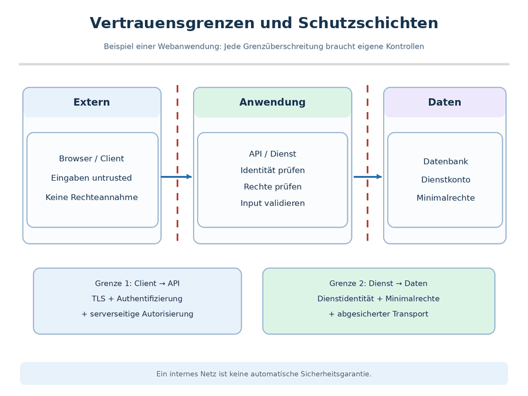

# M7-L4 – Daten-, Sicherheits- und Architekturentscheidungen {#L4}

**Kursbereich:** M7 – Masterorientierte Informatik

**Niveau:** Masterorientierung

**Vorwissen:** [M1-L4](M1-L4.md) · [M1-L5](M1-L5.md) · [M3-L2](M3-L2.md) · [M3-L6](M3-L6.md) · [M4-L2](M4-L2.md) · [M4-L4](M4-L4.md) · [M7-L1](M7-L1.md) · [M7-L2](M7-L2.md) · [M7-L3](M7-L3.md)

**Lernziel:** Architekturentscheidungen als begründete, überprüfbare Abwägungen verstehen: Welche Daten müssen in welcher Qualität erhalten bleiben? Welche Schäden sind plausibel? Welche Schutzmaßnahmen sind angemessen? Wie hängen Korrektheit, Wartbarkeit, Leistung, Verfügbarkeit, Datenschutz und Kosten zusammen?

Die Beispiele, Skalen und Geldbeträge in dieser Lektion sind **ausdrücklich konstruierte Unterrichtsszenarien**. Sie bezeichnen weder reale Produktpreise noch tatsächlich gemessene Sicherheits- oder Ausfallwahrscheinlichkeiten. Referenzen am Ende nennen die fachlichen Grundlagen; ein Architekturvorschlag ist damit noch keine Sicherheitszertifizierung.

## Die Architekturfrage ist keine Produktfrage {#S1}

Bei der Entwicklung eines Systems werden oft zuerst Produkte aufgezählt: eine bestimmte Datenbank, ein Cloudanbieter, Container, ein API-Gateway oder ein Nachrichtenbroker. Diese Gegenstände sind jedoch mögliche **Antworten**, keine präzise Beschreibung des Problems. Eine belastbare Architekturentscheidung beginnt mit Fragen wie: Wer benötigt die Anwendung? Was darf auf keinen Fall passieren? Wie viel Verzögerung ist akzeptabel? Welche Daten wären bei Verlust unwiederbringlich? Welche Personen könnten durch unbefugte Einsicht geschädigt werden? Wer pflegt das System in drei Jahren?

Eine Architektur lässt sich daher als Bündel miteinander verknüpfter Entscheidungen beschreiben. Die Datenstruktur beeinflusst Abfragen und Änderungen. Die Verteilung der Daten verändert Konsistenz und Ausfallverhalten. Die gewählten Zugriffsgrenzen bestimmen mögliche Sicherheitsvorfälle. Betriebs- und Wiederherstellungsaufwand erzeugen langfristige Kosten.

``` text
Fachliches Ziel
     |
     v
Anforderungen + Randbedingungen + Risiken
     |
     v
Denkbare Architekturvarianten
     |
     v
Abwägung -> Entscheidung -> beobachtbarer Betrieb
                     ^                |
                     +-- neue Evidenz-+
```

**Grundsatz:** Eine Architektur ist nicht deshalb gut, weil sie besonders modern oder aufwendig ist, sondern weil sie ihre **benannten Anforderungen bei vertretbaren Risiken und Folgekosten** erfüllt. Ein sauber modularisierter Monolith kann angemessener sein als zehn Dienste. Eine lokale Datei kann besser passen als ein Datenbankcluster. Andererseits kann ein kleines System mit sensiblen Personendaten strenge Sicherheitskontrollen benötigen, obwohl seine Last gering ist.

## Funktionale und nichtfunktionale Anforderungen auseinanderhalten {#S2}

Eine **funktionale Anforderung** beschreibt eine Fähigkeit: Nutzer können ein Bild hochladen; die Anwendung zeigt den dazugehörigen Titel; eine Zahlung aktualisiert einen Saldo. Eine **Qualitätsanforderung** beschreibt, wie verlässlich, schnell, nachvollziehbar oder geschützt diese Fähigkeit bereitgestellt werden muss. Häufig spricht man von nichtfunktionalen Anforderungen; tatsächlich bestimmen sie einen erheblichen Teil des Systementwurfs.

Beispiele für Qualitätsmerkmale sind **Korrektheit**, **Zuverlässigkeit**, **Sicherheit**, **Performance** (Leistungsfähigkeit), **Wartbarkeit**, **Benutzbarkeit**, **Portabilität** und **Wiederherstellbarkeit**. Viele dieser Ziele stehen in Spannung zueinander. Eine zusätzliche Sicherheitsprüfung kann Aufwand und Antwortzeit erhöhen. Mehr Replikate können Ausfälle abfangen, aber Kosten, Fehlerszenarien und Angriffsflächen vergrößern. Eine starke Normalisierung kann Widersprüche vermeiden, aber bestimmte Abfragen komplexer machen.

Die Aussage „soll schnell sein“ reicht für einen nachprüfbaren Entwurf nicht. Besser ist beispielsweise: „Unter einem ausdrücklich beschriebenen Lastprofil sollen 95 Prozent der erfolgreichen Leseanfragen innerhalb von 300 Millisekunden beantwortet werden.“ Der **95. Perzentilwert (p95)** ist ein statistischer Grenzwert; er garantiert **nicht**, dass jede Anfrage unterhalb dieser Zeit bleibt. Die verwendete Messmethode, der betrachtete Zeitraum und die Definition der Antwortzeit müssen angegeben sein.

Ebenso muss „zuverlässig“ konkretisiert werden: Geht es um die Häufigkeit von Ausfällen, um die maximal tolerierte Unterbrechung oder darum, wie viele Datenänderungen bei einem vollständigen Standortausfall verlorengehen dürfen? Das sind verschiedene Anforderungen.

## Randbedingungen, Annahmen und Invarianten {#S3}

Eine **Randbedingung (Constraint)** begrenzt die zulässigen Lösungen: etwa eine gesetzlich verlangte Datenverarbeitung, ein vorhandenes Budget, fehlendes Betriebspersonal, Offline-Nutzung oder eine zwingende technische Schnittstelle. Eine **Annahme** ist dagegen eine noch ungesicherte Einschätzung, die sich als falsch erweisen kann: „Die Anwendung wird nie mehr als hundert gleichzeitige Nutzer haben.“ Annahmen müssen sichtbar bleiben, damit man sie später überprüfen kann.

Eine **Invariante** ist eine Regel, die bei allen zulässigen Zustandsänderungen erhalten bleiben soll. Zum Beispiel:

- Eine bezahlte Bestellung darf nicht zugleich den Status „niemals bezahlt“ tragen.
- Ein Nutzer darf keine private Datei eines anderen Nutzers lesen, wenn keine entsprechende Freigabe besteht.
- Ein bestätigter Betrag darf durch einen wiederholten identischen Verarbeitungsschritt nicht ein zweites Mal abgebucht werden.

Diese Regeln beeinflussen Datenmodell, Transaktionen, Zugriffskontrolle, Schnittstellen und Fehlertests. In M7-L2 wurden Invarianten als Teil der Korrektheitsargumentation eingeführt. M7-L4 setzt sie als **Entwurfsgrenzen** ein: Eine Architekturvariante, die eine erforderliche Invariante nicht sichern kann, wird nicht allein wegen geringerer Kosten gewählt.

## Die Daten zuerst nach fachlicher Bedeutung verstehen {#S4}

Bevor ein Speichersystem ausgewählt wird, lohnt ein **fachliches Datenmodell**: Welche Objekte existieren? Welche Beziehungen gelten? Wer ist für die Richtigkeit zuständig? Welche Informationen können geändert oder gelöscht werden? Was muss unveränderbar protokolliert bleiben?

Für einen Medienkatalog ergeben sich beispielsweise `Medium`, `Quelle`, `Schlagwort` und `Zuordnung`. Ein Medium kann mehrere Schlagwörter besitzen. Eine Quelle kann mehreren Medien zugeordnet sein. Ein getrenntes Modell verhindert, dass Quelle und Schlagwort fälschlich als feste Eigenschaften einer einzigen großen Tabellenzeile behandelt werden.

``` text
Quelle 1 ---- n Medium n ---- n Schlagwort
                  |
                  +--- Metadaten
                  +--- Datei-Referenz
                  +--- Rechte / Sichtbarkeit
```

Die **Datei-Referenz** ist dabei nicht die Datei selbst. Ein Eintrag in der Datenbank kann auf ein Objekt im Dateisystem oder Objektspeicher zeigen. Damit entstehen neue Konsistenzfragen: Was passiert, wenn ein Datenbankeintrag gelöscht wird, die Mediendatei aber bleibt? Was geschieht, wenn der Dateiupload erfolgreich ist, der Datenbankeintrag jedoch fehlschlägt? Ein fachlich guter Entwurf behandelt solche Zustände ausdrücklich.

## Datenklassen und Lebenszyklus statt alles gleich behandeln {#S5}

Daten unterscheiden sich hinsichtlich Vertraulichkeit, Integritätsbedarf, Lebensdauer und Wiederherstellbarkeit:

  Klasse im Unterrichtsbeispiel   Typischer Schutzbedarf                 Praktische Entwurfsfolge
  ------------------------------- -------------------------------------- ----------------------------------------------------------------
  Öffentliche Metadaten           Korrektheit, Verfügbarkeit             Indexierung, einfache Wiederherstellung
  Private Kontodaten              Vertraulichkeit, Zugriffskontrolle     Autorisierung, geringe Datenweitergabe
  Abrechnungsereignisse           Hohe Integrität, Nachvollziehbarkeit   Transaktionsregeln, revisionsgerechte Prozesse je nach Pflicht
  Kurzlebiger Cache               Geringerer Haltbarkeitsbedarf          Neuaufbau statt aufwendiger Sicherung
  Zugangsschlüssel                Sehr hohe Vertraulichkeit              Spezialisierte Geheimnisverwaltung, Rotation

Ein **Datenlebenszyklus** beschreibt Erhebung, Verarbeitung, Weitergabe, Aufbewahrung, Archivierung und Löschung. Er verhindert das verbreitete Muster „Wir speichern alles für immer, vielleicht brauchen wir es noch“. Die richtige Aufbewahrung hängt vom Zweck, von rechtlichen Vorgaben und von berechtigten betrieblichen Interessen ab. Der Lernkurs ersetzt dabei keine rechtliche Prüfung für ein konkretes Vorhaben.

Bei der EU-Datenschutz-Grundverordnung (DSGVO) sind unter anderem Zweckbindung, Datenminimierung, Speicherbegrenzung und angemessene Sicherheit zentrale Prinzipien (Artikel 5); Artikel 25 behandelt Datenschutz durch Technikgestaltung und datenschutzfreundliche Voreinstellungen. \[Q7\] Die genaue rechtliche Zulässigkeit hängt vom Verarbeitungskontext ab.

## Welche Datenbank für welchen Sachverhalt? {#S6}

Eine **relationale Datenbank** mit expliziten Tabellen, Schlüsseln und Transaktionen bietet sich an, wenn Beziehungen und Konsistenzregeln wichtig sind. Ein **Dokumentenspeicher** kann bei variablen, weitgehend eigenständig bearbeiteten Dokumenten nützlich sein. Ein **Key-Value-Speicher** eignet sich häufig für einfache Schlüsselzugriffe, beispielsweise bestimmte Cache-Anwendungen. Ein **Objektspeicher** ist besonders für Dateien oder unveränderliche Binärobjekte interessant. Das sind Verwendungsmuster, keine zwingenden Produktgrenzen.

Eine Anwendung darf unterschiedliche Speicherklassen kombinieren. Jede zusätzliche Speicherart bringt jedoch eigenen Betrieb, Berechtigungsregeln, Sicherungen, Fehlerfälle und mögliche Dateninkonsistenzen mit sich. Der Satz „Wir nutzen für jede Aufgabe die technisch optimale Datenbank“ ist daher nur dann eine gute Entscheidung, wenn der zusätzliche Nutzen die Systemkomplexität rechtfertigt.

**Entscheidungsfrage:** Muss eine Änderung an mehreren fachlich verbundenen Datensätzen als eine unteilbare Einheit erfolgen? Wenn ja, sind die verfügbaren Transaktionsgrenzen besonders wichtig. Kann eine Information im Notfall aus einer verlässlichen Quelle neu aufgebaut werden, darf ihre Haltbarkeit weniger aufwendig gestaltet sein.

## Transaktionen sind eine fachliche, nicht nur technische Entscheidung {#S7}

Eine Transaktion soll eine definierte Menge von Änderungen gemeinsam durchführen oder verwerfen. Beispiel: Eine bezahlte Bestellung und eine zugehörige Lagerbestandsänderung müssen fachlich zusammenpassen. Ob sie in **einer** Datenbanktransaktion liegen können, hängt von der Systemgrenze ab. Werden sie auf unterschiedliche Dienste verteilt, entstehen Koordinierungs- und Fehlerprobleme.

**ACID** beschreibt Atomarität, Konsistenz, Isolation und Dauerhaftigkeit im Rahmen des gewählten Datenbanksystems und seiner Konfiguration. „ACID-konform“ ist jedoch keine vollständige Garantie dafür, dass die fachlichen Regeln richtig modelliert sind. Auch eine technisch korrekte Transaktion kann einen unzulässigen Preis berechnen, wenn die Anwendungslogik falsch ist.

``` text
Auftrag prüfen
    |
    +--> Buchungsdatensatz anlegen
    +--> Bestand / Berechtigung ändern
    |
  COMMIT -- nur bei erfüllten Regeln
    |
Bestätigung an den Nutzer
```

Wird dagegen ein externer Bezahldienst beteiligt, reicht eine lokale Datenbanktransaktion nicht aus, um sämtliche möglichen Kommunikationsfehler „magisch“ atomar zu machen. Es braucht fachliche Zustände, verlässliche Ereigniszuordnung, Wiederholungsregeln und Abstimmung mit dem externen System. Die gewünschte Invariante muss an der richtigen Systemgrenze durchgesetzt werden.

## Verteilung löst Lastprobleme und schafft Koordinierungsprobleme {#S8}

M7-L3 zeigte, dass Netzwerkpartitionen, Verzögerungen und unvollständiges Wissen in verteilten Systemen dazugehören. Für M7-L4 folgt daraus ein entscheidendes Prinzip: **Eine zusätzliche Serverinstanz ist keine kostenlos verfügbare Kopie einer einzelnen Maschine.** Sie verändert Ausfall- und Sicherheitsmodelle, Synchronisation und Betrieb.

Bei ausschließlich gelesenen, selten geänderten Medienmetadaten sind verzögerte Replikate häufig akzeptabel. Bei einer verbindlichen Reservierung derselben einzigartigen Ressource durch zwei Nutzer kann eine starke koordinierte Entscheidung nötig sein. Es ist nicht sinnvoll, jede Information nach demselben Konsistenzmodell zu behandeln.

  Datenvorgang                    Typische gewünschte Eigenschaft   Möglicher Zielkonflikt
  ------------------------------- --------------------------------- --------------------------------------------
  Öffentliche Trefferliste        Hohe Lesegeschwindigkeit          Kurzzeitig ältere Ergebnisse
  Kontostand nach Zahlung         Eindeutige fachliche Buchung      Verfügbarkeit bei Partitionsfehlern
  Profilbild-Vorschau             Schnelle Darstellung              Verzögerte Cache-Aktualisierung
  Einmalige Gutscheinverwendung   Keine doppelte Einlösung          Zusätzliche Koordination und Datenbanklast

Daraus ergibt sich keine automatische technische Vorgabe. Eine Architekturentscheidung muss definieren, **welche** Abweichung für **welchen** Vorgang hinnehmbar ist.

## Sicherheitsziele: Vertraulichkeit, Integrität und Verfügbarkeit {#S9}

Drei klassische Schutzziele sind:

- **Vertraulichkeit:** Unberechtigte sollen Informationen nicht erfahren.
- **Integrität:** Informationen und Systemzustände dürfen nicht unerlaubt verändert werden.
- **Verfügbarkeit:** Berechtigte Nutzung soll im erforderlichen Umfang möglich bleiben.

Ein einzelner Entwurf kann diese Ziele unterschiedlich stark gewichten. Eine öffentliche Bildersammlung braucht vor allem verlässliche Lesbarkeit und korrekte Inhalte. Eine private Dokumentensammlung benötigt deutlich stärkere Vertraulichkeit. Ein Buchungssystem kann durch eine falsche Doppelbuchung schwerer geschädigt werden als durch einige Minuten Nichtverfügbarkeit.

Sicherheit wird deshalb nicht sinnvoll als allgemeiner Punktestand „8 von 10“ beschrieben. Zuerst müssen die gefährdeten **Werte (Assets)** und konkrete unerwünschte Ereignisse feststehen. Dazu gehören ausdrücklich auch Schlüssel, Zugriffsrechte, Metadaten, Backups, Auditspuren und die Betriebsverwaltung.

## Vertrauensgrenzen erkennen {#S10}

Eine **Vertrauensgrenze (Trust Boundary)** liegt dort, wo eine neue Sicherheitsannahme gelten soll: vom Browser zum Server, zwischen externem Dienst und eigener Anwendung oder vom Anwendungsprozess zur Datenbank. Eine Verbindung über das interne Netz ist nicht automatisch vertrauenswürdig; die Lage eines Geräts allein begründet keine Berechtigung.

``` text
[Browser / nicht vertrauenswürdige Eingaben]
                 |
          TLS + API-Grenze
                 v
[Anwendung / authentifizierte Identität]
                 |
       Autorisierungsentscheidung
                 v
[Datenzugriff mit begrenzten Rechten]
                 |
                 v
[Private Datensätze / gesonderte Backups]
```

An jeder Grenze gehören eigene Fragen dazu: Wie wird Identität festgestellt? Ist die übermittelte Datenstruktur gültig? Darf diese Person die angefragte Ressource benutzen? Wird ein Fehler nach außen mit zu vielen Informationen beantwortet? Kann eine Eingabe als Daten behandelt werden, statt unbeabsichtigt als Befehl? **Verschlüsselte Übertragung** schützt nicht gegen eine falsch getroffene Autorisierungsentscheidung.



*Abbildung: Schematische **Trust Boundaries** einer Webanwendung. An der Clientgrenze werden Identität, Eingaben und Berechtigungen serverseitig geprüft; zwischen Anwendungsdienst und Datenbank gelten zusätzlich eigene Dienstidentitäten, Minimalrechte und geeigneter Transportschutz. Auch interne Netzverbindungen sind nicht automatisch vertrauenswürdig.*

## Bedrohungsmodellierung: Von abstrakter Angst zu konkreten Szenarien {#S11}

Ein **Bedrohungsmodell (Threat Model)** beschreibt schützenswerte Werte, mögliche Angreifer oder Fehlquellen, Eintrittspfade und Gegenmaßnahmen. Die OWASP-Anleitung zur Bedrohungsmodellierung empfiehlt für technische Entwürfe unter anderem **STRIDE** als Strukturierungshilfe. \[Q2\]

  STRIDE-Kategorie         Bedeutung                      Beispiel
  ------------------------ ------------------------------ -----------------------------------------------------
  Spoofing                 Identität vortäuschen          Fremdes Sitzungstoken benutzen
  Tampering                Daten unberechtigt verändern   Eine Datei auf dem Übertragungsweg manipulieren
  Repudiation              Handlung bestreiten            Kritische Änderung ohne nachvollziehbaren Auditpfad
  Information Disclosure   Informationen offenlegen       Private Datei über eine erratene Kennung abrufen
  Denial of Service        Dienst blockieren              Teure Anfragen überlasten den Server
  Elevation of Privilege   Rechte ausweiten               Normale Rolle nutzt Administratorfunktion

STRIDE ist keine vollständige Liste sämtlicher realer Angriffe und ersetzt keine fachliche Priorisierung. Bei Datenschutzrisiken sind zusätzliche Perspektiven erforderlich: Eine rechtmäßig berechtigte Verarbeitung kann für Betroffene dennoch unangemessen, übermäßig oder unverständlich sein. Ebenso müssen unbeabsichtigte Bedienfehler und technische Störungen betrachtet werden, auch wenn kein böswilliger Angreifer beteiligt ist.

## Risiko: Wahrscheinlichkeit, Auswirkung und Unsicherheit {#S12}

Ein Risiko entsteht aus einem **Szenario** und dessen möglicher **Auswirkung**, verbunden mit einer Einschätzung, ob und unter welchen Bedingungen das Szenario eintreten kann. NIST SP 800-30 bietet hierzu einen methodischen Rahmen für Risikobeurteilungen. \[Q1\]

Eine didaktisch nützliche Näherung ist:

$\text{Erwarteter Schaden}=\text{angenommene Ereigniswahrscheinlichkeit}\times\text{angenommene Schadenshöhe}$.

Angenommen, ein ausdrücklich fiktiver Dienst bewertet einen bestimmten Datenverlust mit **12.000 € Schaden**, die geschätzte Wahrscheinlichkeit für den betrachteten Zeitraum beträgt **2 %**. Daraus ergeben sich **240 € rechnerischer Erwartungswert**. Eine zweite Gegenmaßnahme, die den Schaden eines solchen Vorfalls auf 3.000 € senken könnte, ergäbe unter unveränderter Wahrscheinlichkeit **60 €**. Die scheinbare Differenz von **180 €** ist nur so belastbar wie die zugrunde gelegten Annahmen.

Das Beispiel erklärt das Rechenprinzip, **keine reale Versicherungsmathematik**. Seltene schwere Schäden, unsichere Wahrscheinlichkeiten, rechtliche Pflichten und betroffene Menschen lassen sich nicht verantwortbar ausschließlich auf einen Mittelwert reduzieren. Eine Maßnahme kann auch dann erforderlich sein, wenn ihr erwarteter Geldwert unsicher ist. Risikoentscheidungen brauchen deshalb qualitative Begründungen, Sensitivitätsanalysen und klare Grenzen akzeptabler Folgen.

## Authentifizierung, Autorisierung und Identitäten {#S13}

**Authentifizierung** beantwortet: Wer oder was meldet sich an? **Autorisierung** beantwortet: Darf diese Identität die konkrete Handlung an der konkreten Ressource ausführen? Ein gültiges Login ist keine Erlaubnis, sämtliche Dateien abzurufen. **Accounting beziehungsweise Auditierung** hält, soweit angemessen und zulässig, wichtige Vorgänge nachvollziehbar fest.

Ein robustes Modell prüft Rechte serverseitig an der tatsächlichen Ressource. Eine reine Prüfung der Bedienoberfläche („Schaltfläche wird versteckt“) ist kein Zugriffsschutz, weil Anfragen auch auf anderen Wegen an die Schnittstelle gelangen können. Im OWASP Top 10:2025 bleibt **Broken Access Control** eine zentrale Risikokategorie; weitere Kategorien betreffen unter anderem Konfiguration, Software-Lieferketten, Kryptografie, Injection und Authentifizierung. \[Q3\]

Das Prinzip **Least Privilege** (geringstmögliche Berechtigung) bedeutet: Ein Dienst erhält nur die Rechte, die er für seine Aufgabe benötigt, und möglichst nur für den erforderlichen Zeitraum. Bei **Zero Trust** wird nicht allein wegen der internen Netzlage Vertrauen vorausgesetzt. NIST SP 800-207 beschreibt diesen Ansatz für Identitäten, Geräte und Ressourcen. \[Q4\] Zero Trust bedeutet nicht, dass man jede Anfrage zwangsläufig durch einen neuen externen Anmeldedienst schicken muss; die konkreten Kontrollpunkte richten sich nach der Architektur.

## Autorisierung kann Teil des Datenmodells sein {#S14}

Für eine Plattform mit mehreren unabhängigen Kunden (**Mandanten**, *Tenants*) genügt es nicht, jedem Datensatz eine `tenant_id`-Spalte hinzuzufügen. Der entscheidende Punkt ist, dass **jede** Lese- und Schreiboperation die richtige Mandantengrenze durchsetzt – auch bei Suchen, Exports, Hintergrundjobs und administrativen Funktionen.

``` text
Anfrage: Nutzer U will Dokument D lesen
    |
    v
Identität des Nutzers prüfen
    |
    v
Mandant + Freigabe + Ressource D abgleichen
    |
    +-- zulässig --> Datensatz lesen
    |
    +-- unzulässig -> verweigern
```

Ein relationales Datenbanksystem kann den Anwendungszugriff zusätzlich beschränken. PostgreSQL unterstützt beispielsweise **Row-Level Security (RLS)**, also Richtlinien pro Tabellenzeile. Solche Richtlinien müssen explizit aktiviert und korrekt konfiguriert werden; Eigentümer und privilegierte Rollen können unter bestimmten Bedingungen Ausnahmen besitzen. RLS ist deshalb **eine zusätzliche Schutzschicht**, kein automatischer Ersatz für korrektes Rollen- und Rechtekonzept. \[Q8\]

Unabhängig von der Speicherung sollten auch Suchindizes, Caches und Exportdateien die Mandantengrenzen respektieren. Eine korrekt geschützte SQL-Tabelle hilft wenig, wenn ein gemeinsamer Cache eine bereits entschlüsselte Antwort an den falschen Kunden ausliefert.

## Mehrere Schutzschichten und die Grenzen der Verschlüsselung {#S15}

**Defense in Depth** bedeutet, nicht alles von einer einzigen Schranke abhängig zu machen. Für ein Websystem können mehrere Schichten zusammenwirken: minimierte öffentliche Schnittstellen, TLS für die Transportverbindung, sichere Sitzungsverwaltung, serverseitige Autorisierung, eingeschränkte Datenbankrollen, geeignete Verschlüsselung ruhender Daten, abgesicherte Sicherungen und aussagefähige Protokolle.

Kryptografie ist notwendig, aber kein Ersatz für korrektes Design. **TLS** schützt Daten während der Übertragung zwischen den jeweiligen Kommunikationsendpunkten. Eine **Verschlüsselung ruhender Daten** schützt je nach Bedrohungsmodell vor bestimmten Zugriffen auf Datenträger und Backups. Wenn ein kompromittierter Anwendungsprozess gültig entschlüsseln darf, kann er weiterhin Daten missbrauchen. **Passwörter** werden bei üblicher Serverauthentifizierung nicht einfach reversibel verschlüsselt gespeichert, sondern mittels geeigneter, speziell für Passwörter entwickelter Hash-Verfahren samt individuellen Salts überprüft.

**Schlüsselverwaltung** ist selbst eine Architekturaufgabe: Wer darf Schlüssel ausgeben? Wie werden sie rotiert? Was passiert bei Verlust? Wie kann man eine kompromittierte Berechtigung widerrufen? Eine Anwendung, die Verschlüsselung verspricht, ihre Schlüssel aber offen in einem Quellcode-Repository speichert, hat ihr wesentliches Schutzziel verfehlt.

## Datenschutz durch Entwurf und Löschung {#S16}

Datenschutz sollte bereits beim fachlichen Modell begonnen werden. Ist eine genaue Wohnadresse erforderlich oder genügt die Stadt? Muss ein Geburtsdatum dauerhaft gespeichert werden, wenn nur eine einmalige Altersprüfung vorgesehen ist? Kann eine Statistik ohne Personenbezug berechnet werden? Werden Protokolle unnötig mit Zugangsdaten, Suchbegriffen oder sensiblen Dokumentinhalten angereichert?

Eine besonders schwierige Entwurfsfrage ist die Löschung: Die primäre Datenbank kann einen Eintrag sofort entfernen, aber was geschieht mit Suchindizes, Replikaten, Cacheeinträgen, exportierten Kopien und Backups? Ein System sollte nachvollziehbare Fristen und technische Abläufe für diese Datenbestände besitzen. Ein vorhandenes Backup macht ein Löschkonzept nicht entbehrlich; es benötigt ein eigenes Wiederherstellungs- und Aufbewahrungsverfahren.

Die DSGVO ist kein pauschales Verbot von Backups oder Protokollen, sondern verlangt eine rechtlich tragfähige, zweckgebundene und verhältnismäßige Verarbeitung. Die konkrete Gestaltung kann von gesetzlichen Pflichten und der Situation abhängen. \[Q7\]

## Datenhaltbarkeit, Wiederanlauf und der Unterschied zwischen RPO und RTO {#S17}

**Backup** bezeichnet eine Sicherung, aus der sich Daten in einem geeigneten Zustand wiederherstellen lassen. **Replikation** hält Kopien für Betrieb oder Ausfallsicherung synchron bzw. zeitversetzt. Eine versehentliche Löschung kann auch repliziert werden; Replikation ist kein Ersatz für ein unabhängiges Backup. Umgekehrt garantiert das Vorhandensein einer Backupdatei noch keine erfolgreiche Wiederherstellung.

Zwei Kennzahlen strukturieren die Planung:

- **Recovery Point Objective (RPO):** Welchen Datenstand muss man nach einem Ausfall mindestens wiederherstellen können? Ein RPO von einer Stunde bedeutet ein angestrebtes maximal zulässiges Zeitfenster verloren gehender Änderungen von einer Stunde – keine Aussage über die Dauer der Wiederherstellung.
- **Recovery Time Objective (RTO):** Innerhalb welcher Zeit soll eine ausgefallene Funktion nach dem Ereignis wieder nutzbar sein? Das ist ein Ziel, keine ohne Tests belegte Zusage.

Beispiel: Ein kleiner Katalog erlaubt **RPO = 24 Stunden** und **RTO = 12 Stunden**. Dafür können tägliche überprüfte Sicherungen und ein dokumentierter Wiederanlauf angemessen sein. Eine verbindliche Zahlungsfunktion mit viel engerem RPO erfordert möglicherweise fortlaufende Protokollierung, zusätzliche Datenhaltbarkeit und ein anderes Fehlermodell. Zahlenwerte im Beispiel sind rein hypothetisch. Kosten, Betrieb und Restore-Tests entscheiden darüber, ob das Ziel realistisch erreichbar ist.

**Besonders wichtig:** Wiederherstellen bedeutet nicht nur „Datei entpacken“, sondern gegebenenfalls auch Schlüssel, Konfiguration, Berechtigungen, Datenbankversionen, externe Identitäten und Reihenfolge abhängiger Dienste wieder in einen funktionierenden, konsistenten Zustand zu bringen.

## Modularer Monolith, Dienste und Betriebsfähigkeit {#S18}

Eine **modulare monolithische Anwendung** vereint verschiedene fachliche Module in einer gemeinsam ausgerollten Einheit. Das kann lokale Transaktionen und Fehlersuche vereinfachen. **Microservices** trennen fachliche Dienste samt Schnittstellen und häufig mit eigener Datenhoheit. Sie können unabhängige Änderungen und Skalierung erleichtern, erhöhen aber Netzwerkkommunikation, Protokollierung, Fehlerbehandlung, Deployment-Koordination und Abstimmungsbedarf.

``` text
Variante M – modularer Monolith
  Ein Dienst: [Nutzer | Medien | Rechte | Abrechnung]
                           |
                        Datenbank

Variante S – getrennte Dienste
  [Nutzerdienst] <--> [Mediendienste] <--> [Abrechnung]
      |                      |                 |
  eigene Daten          eigene Daten        eigene Daten
```

Keine Darstellung ist allgemein überlegen. Ein kleines Team, das selten veröffentlicht, kann von einer klar modularisierten Anwendung stärker profitieren als von einem verteilten System. Wenn unabhängige Entwicklungsteams, verschiedene Lastprofile oder besondere Isolationsanforderungen bestehen, kann eine Aufteilung sinnvoll sein. Die neue Grenze sollte einen echten organisatorischen oder fachlichen Nutzen schaffen, nicht nur ein Architekturdiagramm eindrucksvoller machen.

**Operabilität** – die Fähigkeit, ein System sicher zu betreiben, zu beobachten, zu ändern und wiederherzustellen – ist ein eigenes Qualitätsmerkmal. Architekturentscheidungen ohne Verantwortliche, Alarmierungswege und Wiederherstellungswissen sind unvollständig.

## Eine Entscheidungsmatrix: hilfreich, aber kein mathematisches Urteil {#S19}

Betrachten wir **zwei hypothetische Varianten** für einen kleinen Onlinedienst: M (modularer Monolith) und S (mehrere Microservices). Fünf Kriterien erhalten ein Gewicht, dessen Summe 100 % beträgt. Die Bewertungen von 1 (schwach) bis 5 (gut) sind **frei erfundene didaktische Einschätzungen**, keine Messdaten.

  Kriterium                                     Gewicht   M   S
  ------------------------------------------- --------- --- ---
  Einfache Wartung im Zweierteam                   30 %   5   2
  Unabhängiges Skalieren von Teilfunktionen        20 %   2   5
  Durchgängige Transaktionen                       20 %   5   2
  Einfache Fehlerdiagnose                          20 %   4   2
  Unabhängige Veröffentlichungen                   10 %   2   5

Für M ergibt sich als gewichteter Mittelwert $0{,}30\times 5 + 0{,}20\times 2 + 0{,}20\times 5 + 0{,}20\times 4 + 0{,}10\times 2 = 3{,}90$. Für S lautet dieselbe Rechnung $0{,}30\times 2 + 0{,}20\times 5 + 0{,}20\times 2 + 0{,}20\times 2 + 0{,}10\times 5 = 2{,}90$.

**Schluss nur unter diesen Annahmen:** M passt im konstruierten Szenario besser. Die Punktwerte sind nicht objektiv. Ändert sich die Teamgröße, das Lastprofil oder die fachliche Trennbarkeit, können Gewichtungen und Ergebnisse anders ausfallen. Eine Entscheidungsmatrix zeigt transparent, **welche Ziele bevorzugt werden**; sie beweist nicht die Richtigkeit der Präferenzen.

**Ausschlusskriterien** kommen zuerst: Wenn eine Variante eine zwingende Datenschutz- oder Korrektheitsanforderung nicht erfüllen kann, darf ein guter Durchschnittswert sie nicht „freikaufen“. Eine nützliche Sensitivitätsprüfung fragt anschließend, wie stark sich das Ergebnis verändert, wenn die Gewichte oder Bewertungen um einen Punkt verschoben werden.

## Trade-offs als Pareto-Frage verstehen {#S20}

Ein **Trade-off** ist ein Zielkonflikt: Eine Verbesserung in einer Dimension kann Nachteile an anderer Stelle erzeugen. Von **Pareto-Dominanz** spricht man vereinfacht, wenn eine Variante in sämtlichen betrachteten Kriterien mindestens ebenso gut und in mindestens einem besser ist. Existiert kein solcher eindeutiger Sieger, muss man Prioritäten festlegen.

Eine besonders lehrreiche Gegenüberstellung ist:

- Höhere Replikationszahl kann die Verfügbarkeit unter bestimmten Fehlerannahmen steigern, erhöht aber Kosten und Angriffsoberfläche.
- Mehr Sicherheitstests können Veröffentlichungen verlangsamen, zugleich aber die Wahrscheinlichkeit späterer Störungen reduzieren.
- Umfangreiche Protokolle erleichtern Fehlersuche, können aber Kosten und Datenschutzrisiken verursachen.
- Starke Konsistenz kann fachliche Fehlbuchungen verhindern, zugleich bei einer Partition bestimmte Schreibvorgänge blockieren.

Architekturleitfäden wie das Microsoft Azure Well-Architected Framework behandeln ausdrücklich Zuverlässigkeit, Sicherheit, Kosten, betriebliche Qualität und Leistung als miteinander abzuwägende Ziele. Diese Prinzipien sind allgemein verständlich, auch wenn die konkreten Empfehlungen eines Anbieters nicht automatisch für jeden anderen Betreiber gelten. \[Q5\]

## Architecture Decision Records: Warum eine Entscheidung nachvollziehbar sein muss {#S21}

Ein **Architecture Decision Record (ADR)** ist ein kurzer, dauerhaft lesbarer Entscheidungseintrag. Er dokumentiert nicht bloß „Wir nehmen Produkt X“, sondern die Ausgangslage, erwogene Alternativen, Kriterien, Konsequenzen und Bedingungen einer späteren Neubewertung. Ohne diese Begründung wirkt eine Architektur in zwei Jahren oft zufällig oder „historisch gewachsen“.

Ein schematischer, **nicht auszuführender** Entscheidungsvermerk könnte so aussehen:

``` text
ADR-04: Datenhaltung für einen privaten Medienkatalog
Status: angenommen für die angenommene Einzelnutzung
Kontext: kleiner Datenbestand, lokale Nutzung, wenige Schreibzugriffe
Entscheidung: eingebettete relationale Datenbank
Alternativen: CSV-Datei, eigener Datenbankserver
Begründung: Beziehungen und Transaktionen ohne eigenen Serverbetrieb
Folgen: Sicherungsroutine, Schemaänderungen, begrenzte Parallel-Schreiblast
Neu bewerten bei: Mehrbenutzerbetrieb oder stark gestiegenem Schreibaufkommen
```

Eine Entscheidung muss nicht für immer richtig bleiben. **Reversibilität** gehört zur Qualität: Lassen sich Daten exportieren? Ist die Anwendung über klar benannte Schnittstellen entkoppelt? Können Sicherheitsmaßnahmen erweitert werden? Eine vorsichtige Architektur legt sich dort fest, wo fachliche Anforderungen klar sind, und vermeidet unnötige Festlegungen an Stellen mit hoher Unsicherheit.

## Anwendungsszenario I: Lokaler Medienkatalog {#S22}

Ein lokaler Medienkatalog verwaltet etwa 20.000 Videodateien und Metadaten für einen einzelnen Nutzer. Typische Anforderungen: verlässliche Suche nach Datum und Schlagwort, einfache Korrektur von Titeln, Wiederherstellung nach einem Festplattenausfall, kein externer Internetzugriff. Die Zahl ist angenommen.

Eine passende Architektur könnte so aussehen:

``` text
Lokale Oberfläche
      |
      v
Kataloglogik ----> eingebettete relationale Datenbank
      |                          |
      +----> Medienverzeichnis  +--> unabhängige Sicherung
```

**Datenentscheidung:** Eine eingebettete relationale Datenbank kann Beziehungen und Transaktionen verwalten, ohne einen Serverdienst zu erfordern. **Sicherheitsentscheidung:** Die Anwendung bindet keine öffentliche Schnittstelle, Zugriffsrechte richten sich nach lokalem Nutzerkonto und Dateisystem. **Betriebsentscheidung:** Datenbank und Medienverzeichnis werden mit überprüfbarem, konsistentem Verfahren gesichert. **Grenze:** Wenn mehrere Nutzer gleichzeitig von verschiedenen Rechnern schreiben sollen, müssen Zugriffs- und Synchronisationsmodell erneut betrachtet werden.

Ein unnötiger Dreiserver-Cluster würde hier den Aufwand steigern, ohne eine nachgewiesene Anforderung besser zu erfüllen. Der Nutzen einer einfachen Architektur besteht gerade darin, dass Risiken, Datenflüsse und Wiederherstellung überschaubar bleiben.

## Anwendungsszenario II: Öffentliche Medienplattform mit Nutzerkonten {#S23}

Eine Webplattform erlaubt Uploads und öffentliche sowie private Medien. Nun entstehen mehrere Vertrauensgrenzen, Datenschutzpflichten und unterschiedliche Lastprofile. Das System benötigt beispielsweise Benutzeridentitäten, Freigaberegeln, einen Metadatenspeicher, Objektspeicher und Hintergrundverarbeitung für Vorschaubilder.

``` text
Internet
   |
HTTPS / Rate-Limit
   |
Web-API -- Identität / Berechtigung
   |                         |
   +--> Metadatenbank        +--> Auditereignis
   |
   +--> Objektspeicher (private und öffentliche Objekte)
   |
   +--> Auftragsschlange --> Worker für Vorschaubilder
```

**Datenentscheidung:** Metadaten und Dateien können getrennt verwaltet werden. Öffentliche Listen dürfen aus Cache oder Lesereplikat kommen, private Zugriffskontrolle muss für jede Ressourcenanfrage gelten. **Sicherheitsentscheidung:** Eine erratbare Datei-ID darf keine Leseberechtigung ersetzen; besonders die Ausgabe von Objekt-URLs und Vorschaubildern muss gegen den Freigabestatus geprüft werden. **Betriebsentscheidung:** Fehlgeschlagene Worker-Aufträge brauchen Wiederholungs- und Idempotenzregeln. Der Zeitversatz zwischen Upload und verfügbarer Vorschau wird den Nutzern erkennbar gemacht.

Eine zunächst modulare Anwendung ist oft ausreichend. Erst bei tatsächlich unterschiedlichen Skalierungs- oder Organisationsanforderungen wird der Nutzen eigenständiger Dienste gegen ihre Betriebsfolgen abgewogen. Eine „Cloudplattform“ zu nutzen bedeutet nicht automatisch, alle denkbaren Cloudprodukte einzusetzen.

## Anwendungsszenario III: Verbindliches Buchungs- oder Guthabensystem {#S24}

Ein verbindliches Buchungssystem muss strenger zwischen **anzeigen**, **vormerken** und **rechtswirksam bestätigen** unterscheiden. Eine schnell aktualisierte Anzeige kann nebensächlich sein; eine doppelte verbindliche Buchung wäre dagegen ein fachlicher Fehler. Für jeden Statusübergang sind Regeln und eine eindeutige Transaktionsgrenze erforderlich.

``` text
Anfrage mit eindeutiger Auftrags-ID
      |
Validieren + Berechtigung prüfen
      |
Transaktion: Reservierung / Buchungsregel
      |
Bestätigten Zustand dauerhaft speichern
      |
Quittung oder eindeutig abfragbaren Status liefern
```

**Datenentscheidung:** Eindeutige Schlüssel und Transaktionen verhindern definierte Doppelverarbeitungen innerhalb der Datenbankgrenze. **Sicherheitsentscheidung:** Buchungen dürfen nur durch berechtigte Identitäten ausgelöst werden; kritische Änderungen sind nachvollziehbar zu protokollieren. **Architekturentscheidung:** Ein externer Dienst oder ein zweites Datenbanksystem schafft neue Ausfall- und Abstimmungsfälle. **Betriebsentscheidung:** Das Wiederherstellungsziel und der Umgang mit unklar abgeschlossenen Aufträgen müssen vor dem Start geklärt sein.

Bei einer Zeitüberschreitung ist der Zustand nicht zwangsläufig „fehlgeschlagen“. Die Anfrage kann verarbeitet worden sein und nur die Quittung fehlt. Der Client darf daher nicht einfach eine zweite unabhängige Buchung auslösen. Stattdessen kann er den Status derselben Auftrags-ID erfragen. Genau hier greifen die in M7-L3 behandelten Ungewissheiten verteilter Systeme in eine konkrete Architekturentscheidung ein.

## Typische Fehlentscheidungen und ihre Ursachen {#S25}

**Technik vor Anforderung:** Erst Kubernetes und Microservices auswählen, danach nach einem Problem suchen. Das erhöht die Gefahr unnötiger Komplexität.\
**Alles auf einen Schutzmechanismus setzen:** Ein Benutzerkonto ist nicht automatisch ein wirksames Berechtigungssystem für jeden Datensatz.\
**Datenbankreplikat mit Backup verwechseln:** Replikation kann versehentliche Änderungen weitergeben.\
**Niemals löschen:** Dauerhafte Aufbewahrung ohne Zweck verschärft Datenschutz- und Sicherheitsrisiken.\
**Scheinpräzise Kennzahlen:** Risikomatrizen und Verfügbarkeitsprozente ohne Daten, Zeitraum und Fehlermodell vermitteln unbegründete Gewissheit.\
**Unklare Verantwortung:** Ein komplexes System ohne Wartungszeit, Dokumentation und Wiederanlaufplan ist nicht nachhaltig betreibbar.\
**Zu früh optimieren:** Zusätzliche Caches oder Dienste ohne gemessenen Engpass schaffen neue Konsistenz- und Fehlerszenarien.\
**Trade-offs verbergen:** Die Aussage „schneller, billiger und sicherer“ ohne benannte Annahmen ist keine technische Begründung.

Die gemeinsame Ursache ist nicht mangelnde Produktkenntnis, sondern ein **ungesicherter Übergang von Ziel, Annahme und Evidenz zu einer endgültigen Designentscheidung**.

## Wie Entscheidungen überprüfbar bleiben {#S26}

Aus M7-L1 lässt sich ein wissenschaftliches Vorgehen ableiten: Eine Architekturbehauptung wird als Hypothese formuliert. Beispiel: „Bei dem erwarteten Leseprofil verkürzt ein Cache die p95-Antwortzeit, ohne die zulässige Datenfrische zu verletzen.“ Daraus folgen zwei Prüfgrößen – Antwortzeit und Datenalter – und eine Beschreibung des Last- und Fehlerprofils.

Aus M7-L2 stammt die formale Seite: „Ein privater Datensatz darf nur für berechtigte Nutzer zurückgeliefert werden“ ist eine **Sicherheitseigenschaft**, die in Schnittstellen-, Datenbank- und Anwendungstests geprüft werden muss. Aus M7-L3 folgt die Störungsdimension: Was gilt, wenn eine Datenbankantwort ausbleibt, eine Nachricht wiederholt wird oder ein Replikat veraltet ist?

Keine Einzelmethode reicht allein:

  Behauptung                            Geeigneter Nachweis                            Grenze
  ------------------------------------- ---------------------------------------------- ---------------------------------------------------
  Fachregel bleibt stets erhalten       Modell, Invariante, gezielte Tests             Implementierung kann von Modell abweichen
  Anfragezeit unter definierter Last    Reproduzierbares Benchmarkprotokoll            Zukunftslast kann anders sein
  Unerlaubter Zugriff wird verhindert   Bedrohungsmodell, Berechtigungstests, Review   Unbekannte Fehler bleiben möglich
  Backup ist verwertbar                 Wiederherstellungstest                         Nicht jeder denkbare Katastrophenfall ist erfasst
  Betrieb ist wirtschaftlich            Vollkostenmodell und Sensitivitätsprüfung      Kosten und Last verändern sich

Die Architektur wird damit nicht „endgültig bewiesen“. Sie wird **begründbar, überprüfbar und bei neuer Evidenz korrigierbar**.

## Zusammenfassung und Übergang zu M7-L5 {#S27}

Daten-, Sicherheits- und Architekturentscheidungen sind Teile desselben Problems. Die Datenstruktur bestimmt, welche Konsistenzregeln einfach durchgesetzt werden können. Die Systemgrenzen definieren, wo Berechtigungen gelten und welche Fehler auftreten können. Das Fehlermodell bestimmt, welche Verfügbarkeits- und Wiederherstellungszusagen realistisch sind. Kosten entstehen nicht nur durch Server, sondern auch durch Pflege, Schutz, Überwachung und Wiederanlauf.

Eine wissenschaftlich tragfähige Architektur macht **Anforderungen, Annahmen, Risiken, Alternativen, Zielkonflikte und Nachweise** sichtbar. Sie lässt unnötige Komplexität weg, ohne zwingende Korrektheits- oder Schutzanforderungen zu relativieren. Sie erlaubt die spätere Revision, wenn die Beobachtungen den ursprünglichen Erwartungen widersprechen.

**Verbindung im Kurs:** [M7-L1 – Wissenschaftliche Modelle](M7-L1.md) erklärt überprüfbare Hypothesen; [M7-L2 – Korrektheit](M7-L2.md) formale Garantien; [M7-L3 – Verteilte Systeme](M7-L3.md) Fehler und Konsistenz bei mehreren Teilnehmern. Die anschließende [M7-L5 – KI-Systeme wissenschaftlich bewerten](M7-L5.md) überträgt diese Kriterien auf Datensätze, Modellgüte, Verteilungsverschiebung, Robustheit und Verantwortung.

## Einordnung in die kursweiten Lesewege {#S28}

Dieses Kapitel gehört zum **sechsteiligen Master-Kernbereich**, nicht zu den freiwilligen zusätzlichen Master-Wahlthemen. Navigation: [vorherige Master-Kernlektion M7-L3](M7-L3.md); [nächste Master-Kernlektion M7-L5](M7-L5.md); [Lesewege und fachliche Querverweise](pages/pfad.md); [Kursindex](pages/index.md).


## Quellen {#S29}

**Letzte Quellenprüfung:** 05.11.2026

Die folgenden Quellen begründen die fachlichen Grundprinzipien; die beschriebenen Architekturen, Zahlen und Bewertungsmatrizen sind ausdrücklich eigene **didaktische Konstruktionen**.

- **\[Q1\] NIST SP 800-30 Rev. 1**, *Guide for Conducting Risk Assessments* (2012): [https://csrc.nist.gov/pubs/sp/800/30/r1/final](https://csrc.nist.gov/pubs/sp/800/30/r1/final)
- **\[Q2\] OWASP Cheat Sheet Series**, *Threat Modeling Cheat Sheet*: [https://cheatsheetseries.owasp.org/cheatsheets/Threat_Modeling_Cheat_Sheet.html](https://cheatsheetseries.owasp.org/cheatsheets/Threat_Modeling_Cheat_Sheet.html)
- **\[Q3\] OWASP Top 10:2025**, Risikoübersicht Webanwendungen: [https://top10.owasp.org/2025/](https://top10.owasp.org/2025/)
- **\[Q4\] NIST SP 800-207**, *Zero Trust Architecture* (2020): [https://csrc.nist.gov/pubs/sp/800/207/final](https://csrc.nist.gov/pubs/sp/800/207/final)
- **\[Q5\] Microsoft**, *Azure Well-Architected Framework*, Qualitätssäulen und Trade-offs: [https://learn.microsoft.com/en-us/azure/well-architected/what-is-well-architected-framework](https://learn.microsoft.com/en-us/azure/well-architected/what-is-well-architected-framework)
- **\[Q6\] Microsoft**, *Cost Optimization Tradeoffs*, Verfügbarkeit/Sicherheit/Betriebsfolgen: [https://learn.microsoft.com/en-us/azure/well-architected/cost-optimization/tradeoffs](https://learn.microsoft.com/en-us/azure/well-architected/cost-optimization/tradeoffs)
- **\[Q7\] Europäische Union**, *DSGVO, Verordnung (EU) 2016/679*, insbesondere Artikel 5 und 25: [https://eur-lex.europa.eu/eli/reg/2016/679/](https://eur-lex.europa.eu/eli/reg/2016/679/)
- **\[Q8\] PostgreSQL**, *Row Security Policies* (aktuelle Dokumentation): [https://www.postgresql.org/docs/current/ddl-rowsecurity.html](https://www.postgresql.org/docs/current/ddl-rowsecurity.html)

**Stand der Quellenabfrage:** 05.11.2026. Technische Produktseiten und normative Rechtslagen sind veränderlich und für konkrete Anwendungen erneut zu prüfen.
