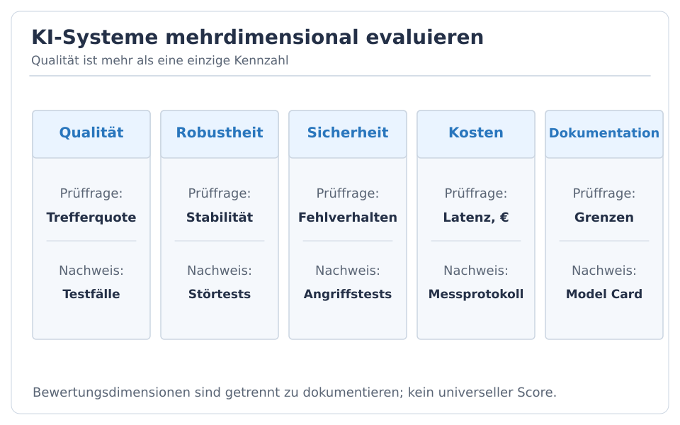

# M7-L5 – KI-Systeme wissenschaftlich bewerten {#L5}

**Kursbereich:** M7 – Masterorientierte Informatik

**Niveau:** Masterorientierung

**Vorwissen:** [M7-L1](M7-L1.md) · [M7-L2](M7-L2.md) · [M7-L4](M7-L4.md) · [M5-L2](M5-L2.md) · [M6-L6](M6-L6.md) · [M9-L2](M9-L2.md)

**Leitfrage:** Wann ist die Aussage „Dieses KI-System ist gut, zuverlässig oder sicher“ tatsächlich begründet – und wann ist sie nur eine unzureichend überprüfte Behauptung?

**Hinweis zur Evidenz:** Alle Zahlen, Messreihen, Personen- und Systembeispiele in dieser Lektion sind ausdrücklich **didaktisch konstruiert**. Sie stammen nicht aus realen Benchmarkstudien. Verifizierte Fachbegriffe und methodische Leitlinien sind im Quellenabschnitt nachvollziehbar belegt. Eine demonstrative Rechnung beweist keine reale Modellleistung.

## Ausgangspunkt: Was wird überhaupt bewertet? {#S1}

Ein KI-Modell ist zunächst eine Rechenvorschrift mit erlernten Parametern. Ein **KI-System** umfasst mehr: Vorverarbeitung, Datenquellen, Modell, Abfrageschnittstelle, eventuell Suchwerkzeuge oder eine Datenbank, Regeln, Benutzeroberfläche und den menschlichen Umgang mit Ergebnissen. Es kann beispielsweise ein leistungsfähiges Sprachmodell geben, dessen Anwendung trotzdem unzuverlässig ist, weil sie veraltete Dokumente sucht oder ungeprüft externe Aktionen ausführt.

{alt="Fünf Spalten zu Qualität, Robustheit, Sicherheit, Kosten und Dokumentation mit beispielhaften Prüffragen und Nachweisen."}

KI-Evaluation benötigt getrennte Kriterien und nachvollziehbare Belege.

Drei verschiedene Aussagen müssen auseinandergehalten werden:

1.  **Das Modell kann eine Aufgabe unter Testbedingungen lösen.** Das lässt sich für ausgewählte Aufgaben mit Messdaten begründen.
2.  **Die gesamte Anwendung arbeitet in einer bestimmten Umgebung verlässlich.** Dazu gehören Datenqualität, Betrieb und Fehlerbehandlung.
3.  **Die Anwendung sollte in dieser Umgebung eingesetzt werden.** Das verlangt zusätzlich eine Bewertung der Folgen von Fehlern, des Datenschutzes und der Verantwortung.

Eine einzelne Prozentzahl beantwortet keine dieser Fragen vollständig. Schon die Frage, *welche* Eingaben als typisch gelten, ist eine fachliche Entscheidung. Der Unterschied zwischen einem freiwilligen Foto-Tagger und einem System zur Prüfung medizinischer Befunde ist nicht nur die Schwierigkeit der Daten, sondern vor allem die Bedeutung einer falschen Entscheidung.

``` text
Anwendungsziel und Risiken
           |
           v
Testaufgaben + geeignete Daten + Referenzantworten
           |
           v
      KI-System testen
           |
           v
Ergebnisqualität + Unsicherheit + Fehlerarten
           |
           v
   Eignung für genau diesen Einsatz?
```

Die wissenschaftliche Beurteilung ist damit keine Rangliste, sondern eine begrenzte, begründete Aussage über *System, Aufgabe, Datengrundlage, Zeitraum und Bedingungen*.

## Von einer Werbeaussage zur prüfbaren Hypothese {#S2}

„Das neue Modell versteht unsere Kunden besser“ klingt überzeugend, ist aber ohne überprüfbare Begriffe nicht testbar. Woran wird „versteht“ erkannt? Geht es um die richtige Zuordnung eingehender Nachrichten, die Qualität formulierten Texts oder darum, welche Fälle an Menschen weitergegeben werden?

Eine prüfbare Aussage kann lauten: „Für deutschsprachige Anfragen aus unserem Supportarchiv erkennt System B die richtige von sechs vereinbarten Themenklassen häufiger als System A, ohne dass die Anzahl schwerwiegender Fehlzuordnungen steigt.“ Darin sind Zielgruppe, Vergleichsmaßstab und Fehlerart wenigstens grundsätzlich bestimmbar.

Für eine belastbare Evaluation werden vorab dokumentiert: **Zweck, Population, Ein- und Ausschlüsse, Erfolgsmaß, Sicherheitsgrenzen, Vergleichssystem, Testdesign und Entscheidungsregel.** Erst anschließend wird getestet. Das reduziert die Gefahr, nachträglich nur die Zahlen zu präsentieren, die das gewünschte Ergebnis stützen.

**Einordnung zu M7-L1:** Eine Hypothese ist nicht deshalb stark, weil sie mathematisch aussieht. Sie muss anhand geeigneter Beobachtungen widerlegbar sein. Eine richtige Berechnung mit ungeeigneten Daten liefert keine tragfähige Schlussfolgerung.

**Wann überdimensioniert?** Für die private Sortierung weniger unkritischer Fotos wäre eine Forschungsstudie unnötig. Ein kleines dokumentiertes Stichprobenverfahren kann dort reichen. **Wann unverzichtbar?** Wenn Fehler rechtliche, finanzielle, medizinische oder erhebliche gesellschaftliche Folgen haben können.

## Evaluation ist ein Vergleich unter Bedingungen {#S3}

**Evaluation** bezeichnet die systematische Beurteilung anhand begründeter Kriterien. Eine **Metrik** ist eine definierte Messgröße; ein **Benchmark** ist ein standardisiertes Vergleichsverfahren mit Aufgaben, Daten und Auswertungsvorschrift. Weder Metrik noch Benchmark sind automatisch objektiv für alle Zwecke.

Ein gutes Experiment trennt mindestens fünf Ebenen:

  Ebene         Frage                            Mögliche Schwäche
  ------------- -------------------------------- ----------------------------------------------
  Zielaufgabe   Was soll funktionieren?          Ziel zu unklar oder zu eng
  Datensatz     Welche Fälle sind vertreten?     Relevante Fälle fehlen
  Referenz      Was gilt als korrekt?            Uneinige oder fehlerhafte Bewertung
  Metrik        Welche Fehler zählen wie viel?   Wichtige Fehlkosten bleiben unsichtbar
  Übertragung   Gilt das Ergebnis später noch?   Anderer Betrieb, andere Nutzer, andere Daten

Das wissenschaftliche Ziel ist nicht „möglichst große Zahl“, sondern **größtmögliche Aussagekraft für die reale Frage**. Ein universeller Testsieger kann bei einer einzelnen Aufgabe deutlich hinter einem kleineren Spezialmodell zurückbleiben.

Die Forschungslinie **Holistic Evaluation of Language Models (HELM)** betont deshalb, dass Sprachmodelle unter vielen Szenarien und entlang mehrerer Dimensionen bewertet werden sollten, beispielsweise Genauigkeit, Kalibrierung, Robustheit, Fairness und Effizienz. Die zugehörige Open-Source-Umgebung wurde laut Projektdokumentation im Juni 2026 in einen Wartungsmodus überführt; die methodische Idee bleibt unabhängig davon relevant \[Q4, Q5\].

## Grundgesamtheit, Stichprobe und Repräsentativität {#S4}

Die **Grundgesamtheit** oder Population besteht aus den Fällen, über die eine Aussage gemacht werden soll. Eine **Stichprobe** enthält tatsächlich untersuchte Fälle. Ein Modell kann auf 10.000 öffentlichen Beispieltexten hervorragend funktionieren und bei 100 echten, stark abweichenden Supportanfragen versagen.

Beispiel: Eine Bildsuche soll private Fotoarchive ordnen. Die Nutzer besitzen Nachtaufnahmen, alte gescannte Papierfotos, unscharfe Mobilbilder und digitale Illustrationen. Ein Test mit ausschließlich hellen, hochwertigen Studiobildern wäre zwar bequem, aber kaum repräsentativ. Eine größere Zahl ähnlicher Studiobilder behebt diese Auswahlverzerrung nicht.

Zu dokumentieren sind deshalb die Herkunft der Daten, ihr Erfassungszeitraum, enthaltene Sprachen oder Formate, Messfehler, Mehrfachvorkommen und fehlende Fälle. Ein **Datasheet** für einen Datensatz hält Motivation, Zusammensetzung, Erfassung und empfohlene Nutzung fest \[Q6\]. Gerade übersehene Nicht-Beispiele können wichtig sein: Ein System zur Erkennung beschädigter Mediendateien muss auch seltene Codecs und Grenzfälle sehen.

**Repräsentativ** bedeutet nicht zwangsläufig exakt proportional. Sehr seltene, besonders gefährliche Fälle können für Sicherheitsprüfungen absichtlich überrepräsentiert werden. Dann darf aus diesen Prüfdaten allerdings nicht ohne passende Gewichtung eine reale Fehlerhäufigkeit der Gesamtpopulation berechnet werden.

## Training, Validierung und Test: Drei unterschiedliche Rollen {#S5}

Beim **Training** werden Modellparameter aus Beispielen gelernt. Die **Validierung** unterstützt die Auswahl von Einstellungen und Modellvarianten. Ein zuvor zurückgehaltener **Testsatz** soll die gewählte Lösung abschließend auf unbekannten Fällen bewerten. Diese Trennung funktioniert nur, wenn der Testsatz nicht über viele kleine Anpassungen indirekt zum Trainingssignal wird \[Q7\].

``` text
Gesamtdaten
   |
   +--> Training: Parameter lernen
   |
   +--> Validierung: Modell und Schwellen wählen
   |
   +--> Test: vorab festgelegte Endbewertung
```

Ein häufiger Fehler ist **Data Leakage**, also das unzulässige Einfließen von Informationen, die unter den späteren Einsatzbedingungen nicht zur Verfügung stünden. Duplikate, nahezu gleiche Textabschnitte oder Bilder aus derselben Serie können auf beiden Seiten einer zufälligen Aufteilung landen. Ein Foto aus derselben kurzen Aufnahmeserie ist oftmals weniger unabhängig als ein Foto aus einem völlig anderen Bestand.

Je nach Aufgabe ist daher eine Aufteilung nach **Person, Gerät, Gebäude, Dokumentfamilie oder Zeit** sinnvoller als eine rein zufällige Zeilentrennung. Bei zeitlichen Vorhersagen dürfen Informationen aus der Zukunft nicht unbemerkt im Training auftauchen. Auch eine Skalierung oder Auswahl von Merkmalen, die vor der Trennung über sämtliche Daten berechnet wurde, kann die Testgüte künstlich verbessern.

**Grenze:** Bei öffentlichen Sprachmodellen ist die exakte Zusammensetzung der Trainingsdaten oft nicht nachvollziehbar. Ein öffentlich bekanntes Testset kann in Vortraining, Nachtraining oder indirekten Optimierungsschleifen aufgetaucht sein. Eine hohe Benchmarkpunktzahl allein ist daher keine Garantie für unbeeinflusste Generalisierung.

## Referenzantworten sind selbst eine Fehlerquelle {#S6}

Ein **Label** ist eine Zuordnung wie „Spam“, „kein Spam“ oder „Gerät beschädigt“. Die **Ground Truth** bezeichnet die als richtig zugrunde gelegte Referenz. In manchen Aufgaben ist sie objektiv prüfbar, etwa bei einer exakten Rechnung mit klaren Voraussetzungen. In anderen Aufgaben gibt es berechtigte unterschiedliche Beurteilungen: Ist eine Zusammenfassung vollständig? Ist ein Kommentar ironisch? Ist ein Bild „ästhetisch überzeugend“?

Bei schwierigen Aufgaben braucht die Evaluation eine **Bewertungsrubrik**: Welche Eigenschaften müssen vorhanden sein, welche Fehler sind kritisch, wann ist eine Antwort unklar oder nicht bewertbar? Mehrere fachkundige Bewertende können unabhängig urteilen. Die Übereinstimmung zwischen Bewertenden ist selbst eine aufschlussreiche Größe, aber kein Wahrheitsbeweis. Eine gemeinsame fehlerhafte Regel kann zu hoher Übereinstimmung und dennoch falscher Referenz führen.

Bei automatisch bewerteten Sprachmodellantworten werden teilweise andere Sprachmodelle als Beurteiler eingesetzt. Das spart Arbeit, kann aber **Positions-, Stil-, Längen- oder Modellpräferenzen** einführen. Solche Bewertungen sollten gegen menschliche Urteile kalibriert und bei wichtigen Fällen stichprobenartig kontrolliert werden.

Wichtig ist die Trennung zwischen **objektiver Übereinstimmung** und **fachlicher Nützlichkeit**: Zwei unterschiedlich formulierte Antworten können sachlich gleichwertig sein. Umgekehrt kann eine sprachlich ähnliche Antwort einen entscheidenden Sachfehler enthalten.

## Klassifikation: Die Verwechslungsmatrix {#S7}

Für ein Modell, das zwischen zwei Klassen unterscheidet, ist die **Konfusionsmatrix** (Verwechslungsmatrix) ein guter Ausgangspunkt. Wir betrachten ein **rein erfundenes** Prüfbeispiel: Unter 10.000 Nachrichten sind tatsächlich 200 unerwünscht und 9.800 erwünscht. Ein Filter markiert 160 der unerwünschten Nachrichten richtig, übersieht 40 und markiert 196 erwünschte Nachrichten fälschlich.

  Tatsächlicher Zustand     Als unerwünscht markiert               Nicht markiert        Summe
  ----------------------- -------------------------- ---------------------------- ------------
  Unerwünscht               160 richtig positiv (TP)       40 falsch negativ (FN)          200
  Erwünscht                  196 falsch positiv (FP)   9.604 richtig negativ (TN)        9.800
  **Summe**                                  **356**                    **9.644**   **10.000**

**TP** steht für *True Positive*, **FP** für *False Positive*, **FN** für *False Negative* und **TN** für *True Negative*. Diese Begriffe beziehen sich immer auf die vorher festgelegte „positive“ Klasse. Positiv bedeutet hier nicht gut oder wünschenswert, sondern schlicht die gesuchte Kategorie.

Warum ist die Matrix wertvoller als eine einzelne Quote? Weil sie erkennen lässt, **welche** Fehler entstehen. Fälschlich als unerwünscht markierte persönliche Nachrichten könnten erheblich störender sein als einige durchgerutschte Werbenachrichten. Ein anderer Betrieb kann dieselbe Matrix genau umgekehrt gewichten.

## Genauigkeit, Precision, Recall und M7-L1 – vollständig gerechnet {#S8}

Aus der Matrix ergeben sich verschiedene Größen:

- **Accuracy** (Gesamtgenauigkeit): $\frac{\mathrm{TP}+\mathrm{TN}}N=\frac{160+9\,604}{10\,000}=97{,}64\,\%$.
- **Precision** (Präzision der positiven Vorhersage): $\frac{\mathrm{TP}}{\mathrm{TP}+\mathrm{FP}}=\frac{160}{356}\approx44{,}94\,\%$.
- **Recall** (Sensitivität/Erkennungsrate): $\frac{\mathrm{TP}}{\mathrm{TP}+\mathrm{FN}}=\frac{160}{200}=80\,\%$.
- **Spezifität** (Erkennungsrate der negativen Fälle): $\frac{\mathrm{TN}}{\mathrm{TN}+\mathrm{FP}}=\frac{9\,604}{9\,800}=98\,\%$.
- **F1-Score**, das harmonische Mittel von Precision und Recall: $\frac{2\mathrm{TP}}{2\mathrm{TP}+\mathrm{FP}+\mathrm{FN}}=\frac{320}{556}\approx57{,}55\,\%$.

Das irritierende Ergebnis: Eine triviale Lösung, die **jede** Nachricht als erwünscht betrachtet, erreicht in diesem Datensatz **98 % Accuracy**, erkennt aber **keine einzige** unerwünschte Nachricht. Unser Filter erreicht 97,64 % Accuracy und ist nach dieser Kennzahl sogar schlechter, obwohl er einen großen Teil der unerwünschten Nachrichten entdeckt.

Der Grund ist die unausgewogene **Basisrate**: Positive Fälle sind selten. Bei seltenen Ereignissen ist eine hohe Gesamtgenauigkeit oft wenig aussagekräftig. Precision beantwortet die Frage „Wie oft stimmt eine positive Markierung?“; Recall beantwortet „Wie viele der tatsächlich positiven Fälle werden erkannt?“ Beide reagieren unterschiedlich auf Schwellenwerte und Häufigkeiten.

**F1 ist keine universelle Lösung:** Es berücksichtigt weder richtig negative Fälle noch die konkreten Kosten verschiedener Fehler. Es eignet sich nur dann gut, wenn der gewünschte Ausgleich zwischen Precision und Recall zur Aufgabe passt. Für medizinische Entscheidungen wären andere Anforderungen und fachliche Prüfungen nötig.

## Schwellenwerte, Basisraten und die Kosten falscher Entscheidungen {#S9}

Viele Klassifikatoren liefern einen Score. Ab einem festgelegten **Schwellenwert** wird eine positive Entscheidung ausgelöst. Ein hoher Grenzwert kann falsche Alarme reduzieren, aber mehr echte Fälle übersehen. Folgende Zahlen sind eine zweite **erfundene** mögliche Auswertung desselben 10.000er-Testbestands:

  Einstellung            TP    FP   FN      TN   Precision   Recall
  ------------------- ----- ----- ---- ------- ----------- --------
  Streng                120    30   80   9.770      80,0 %   60,0 %
  Mittlere Schwelle     160   196   40   9.604      44,9 %   80,0 %
  Locker                180   500   20   9.300      26,5 %   90,0 %

Bei strengem Schwellenwert sind Markierungen zuverlässiger, aber 80 unerwünschte Nachrichten bleiben unentdeckt. Bei lockerem Schwellenwert steigt der Recall, jedoch werden 500 erwünschte Nachrichten fälschlich beanstandet. Welcher Wert sinnvoll ist, lässt sich nicht allein aus der Tabelle ableiten.

Ein System kann daher statt automatischer Löschung drei Wege verwenden: klar unauffällige Nachrichten durchlassen, mittlere Verdachtsfälle in einen überprüfbaren Ordner verschieben und nur eindeutig schädliche Eingänge automatisch blockieren. Die **Abstufung der Folgen** ist Teil der Architektur, nicht bloß eine Optimierung der Statistik.

Hinzu kommt eine Verschiebung der Basisrate: Dieselbe Sensitivität und Spezifität können bei einer anderen Häufigkeit unerwünschter Nachrichten zu einer anderen Precision führen. Ein Testergebnis darf nicht unverändert in eine neue Population umgerechnet werden, ohne deren Verteilung zu berücksichtigen.

## Wahrscheinlichkeiten und Kalibrierung {#S10}

Ein Modell gibt möglicherweise „80 %“ aus. Das kann unterschiedlich gemeint sein: eine echte geschätzte Wahrscheinlichkeit, eine umskalierte interne Kennzahl oder nur eine sprachliche Selbstbewertung. Erst eine definierte Messvorschrift und deren Prüfung machen die Zahl interpretierbar.

**Kalibrierung** bedeutet für probabilistische Vorhersagen vereinfacht: Von vielen Fällen mit vorhergesagter Wahrscheinlichkeit 0,8 sollte unter passenden Bedingungen ungefähr 80 % das bezeichnete Ereignis eintreten. Bei einer konstruierten Gruppe von 100 Vorhersagen mit jeweils 0,8, von denen 72 korrekt sind, beträgt der beobachtete Anteil 72 %. Das weist auf eine mögliche Überkonfidenz hin – ist bei nur 100 Fällen aber noch kein abschließender Nachweis eines systematischen Fehlers.

Eine **Reliability Diagram** genannte Kalibrierungsgrafik gruppiert Vorhersagen nach geschätzter Wahrscheinlichkeit und vergleicht Prognose mit beobachtetem Anteil. Mögliche Kennzahlen sind **Brier Score** oder **Log Loss**; sie bewerten Wahrscheinlichkeiten, nicht nur harte Klassenentscheidungen. Eine hohe Klassifikations-Accuracy impliziert keine gute Kalibrierung.

Besonders wichtig bei generativer KI: Die sprachliche Formulierung „Ich bin zu 90 % sicher“ ist nicht ohne Weiteres mit einer kalibrierten Wahrscheinlichkeit gleichzusetzen. Ein Modell kann sehr bestimmt falsch antworten; es kann umgekehrt eine richtige Antwort vorsichtig formulieren. Konfidenzaussagen müssen separat und auf einer klar definierten Aufgabenverteilung geprüft werden.

## Messunsicherheit: Warum 88 % nicht einfach besser als 86 % ist {#S11}

Jeder endliche Test enthält Zufallsschwankungen und mögliche systematische Verzerrungen. Nehmen wir wieder ein **konstruiertes** Beispiel: 350 richtige Vorhersagen bei 400 unabhängigen, gleichartig gezogenen Fällen ergeben $\frac{350}{400}=87{,}5\,\%$.

Für eine Binomialquote ist der vereinfachte **Standardfehler** näherungsweise $\sqrt{\frac{p(1-p)}n}$. Hier: $\sqrt{\frac{0{,}875\times0{,}125}{400}}\approx0{,}0165$, also rund 1,65 Prozentpunkte. Mit der einfachen Normalapproximation ergibt sich ein grobes 95-%-Intervall von $87{,}5\,\%\pm1{,}96\times1{,}65\,\text{Prozentpunkte}$, mithin etwa **84,3 % bis 90,7 %**.

Diese Näherung setzt unter anderem unabhängige, vergleichbar verteilte Beobachtungen und eine angemessene Stichprobenziehung voraus. Für kleine Anzahlen, extreme Quoten oder abhängige Daten sind andere Verfahren angemessener, etwa Wilson-Intervalle oder clusterbewusste Auswertungen. Ein 95-%-Konfidenzintervall ist bei häufig verwendeter frequentistischer Deutung **nicht** die Aussage, dass der unbekannte feste Parameter nachträglich mit 95 % Wahrscheinlichkeit im konkreten Intervall liegt.

Bei zwei Modellen auf **denselben** Fällen sind die Fehlerpaare besonders aufschlussreich: Welche Beispiele löst nur A, welche nur B? Ein **gepaarter Vergleich** ist oft präziser als zwei isolierte Einzelquoten. Werden viele Varianten ausprobiert und nur der beste Wert veröffentlicht, steigt zudem das Risiko einer zufälligen Scheinverbesserung. Vorab definierte Hauptmetriken und getrennte Bestätigungsdaten helfen dagegen.

## Generalisierung: Gute Testzahlen sind kein Naturgesetz {#S12}

**Generalisierung** bezeichnet die Fähigkeit, ein gelerntes Verhalten auf geeignete, zuvor nicht gesehene Fälle zu übertragen. Ein Datensatz ist aber nur eine Auswahl möglicher Eingaben. Wenn sich sein Kontext verändert, kann sich auch die Leistung verändern.

Man unterscheidet beispielsweise:

- **Covariate Shift:** Die Verteilung der Eingaben verändert sich, etwa andere Kameras oder Sprachstile.
- **Label Shift:** Die Häufigkeiten der Zielklassen verändern sich, zum Beispiel weniger Spam.
- **Concept Drift:** Die Beziehung zwischen Eingabe und Ziel verändert sich, etwa neue Betrugsmuster.

Die Begriffe setzen definierte Variablen und Aufgaben voraus; in der Praxis können mehrere Effekte zusammen auftreten. Ein altes Textklassifikationsmodell wird nicht automatisch unbrauchbar, aber ein Benchmark von gestern garantiert nicht die Qualität im nächsten Jahr.

**Außerhalb der Verteilung (Out-of-Distribution, OOD)** meint Eingaben, die von der geprüften Datenwelt wesentlich abweichen. Dazu gehören fehlerhafte Dateiformate, Dialekte, ungewöhnliche Lichtverhältnisse oder stark veränderte Nutzeranfragen. Ein vernünftiges System erkennt nicht nur möglichst viel, sondern kennzeichnet, wenn es unter ungewohnten Bedingungen seine Grenzen erreicht.

**Wann sinnvoll?** Bei längeren Betriebszeiten, veränderlichen Datenquellen oder Entscheidungen mit Folgen. **Wann wenig hilfreich?** Ein ständiges Retraining ohne nachgewiesenen Drift kann unnötig Kosten und neue Fehler erzeugen.

## Robustheit: Wie reagiert ein Modell auf kleine Veränderungen? {#S13}

Ein **robustes** System behält seine erwünschten Eigenschaften bei relevanten, erwartbaren Störungen möglichst bei. Eine harmlose Umformulierung der Frage, leichte Bildkompression oder ein Tippfehler sollte nicht völlig andere Ergebnisse erzeugen, sofern sich die fachliche Bedeutung nicht verändert hat.

Robustheit muss **gegen konkrete Veränderungsarten** geprüft werden. Ein Modell kann gegenüber Bildrauschen unempfindlich, gegenüber ungünstigem Zuschnitt aber empfindlich sein. Bei Texten können Synonyme, Satzreihenfolge, Fremdsprachen, Ironie oder absichtlich irreführende Passagen relevant sein.

Es gibt einen entscheidenden Unterschied zwischen **natürlichen Störungen** und **gezielten adversarialen Angriffen**. Bei letzteren versucht jemand aktiv, ein Modell auszutricksen. Der NIST-Bericht zur Sicherheit maschinellen Lernens unterscheidet unter anderem Umgehungsangriffe, Manipulation von Trainingsdaten und Datenschutzangriffe \[Q3\].

``` text
Ursprüngliche, korrekte Eingabe
       |
       +--> normale Variante: Rechtschreibfehler, anderes Licht
       |
       +--> gezielte Variante: Angriff, falsche eingebettete Anweisung
       |
       v
Ausgaben vergleichen: korrekt? sicher? gleiche Bedeutung?
```

„Robust“ darf nicht als universelle Sicherheitsgarantie gelesen werden. Eine gemessene Widerstandsfähigkeit gegenüber fünf Störtypen beweist nichts über einen sechsten bislang ungeprüften Angriff.

## Untergruppen, Fairness und verdeckte Mittelwerte {#S14}

Eine Gesamtmetrik kann strukturelle Unterschiede verdecken. Ein Transkriptionssystem erreicht möglicherweise bei klar gesprochenem Standarddeutsch eine andere Fehlerquote als bei Dialekten oder starkem Hintergrundgeräusch. Entscheidend ist, ob die betroffenen Gruppen für die vorgesehene Nutzung relevant sind und ob das System für sie angemessen funktioniert.

Eine **Slice-Analyse** teilt Testergebnisse in fachlich sinnvolle Untergruppen. In einem reinen Lehrbeispiel erzielt ein Modell insgesamt 90 % richtige Antworten. Für eine Gruppe von 900 häufig vertretenen Standardfällen seien es 855 richtige (95 %), für 100 seltene Spezialfälle nur 45 (45 %): zusammen $\frac{855+45}{1\,000}=90\,\%$. Der Gesamtwert verschleiert die sehr schwache zweite Gruppe.

Untergruppen dürfen nicht leichtfertig als stabile Aussagen verstanden werden. Bei kleinen Fallzahlen sind Unsicherheiten größer; durch viele nachträgliche Teilungen können Zufallsmuster entstehen. Schutzbedürftige Merkmale und personenbezogene Informationen erfordern zudem rechtlich und ethisch sorgfältige Behandlung. Manche Fairnesskriterien können mathematisch miteinander in Konflikt geraten, wenn Gruppen unterschiedliche Basisraten besitzen.

Die wissenschaftlich sinnvolle Frage ist nicht bloß „Ist das Modell fair?“, sondern: **Welche relevante Benachteiligung soll ausgeschlossen werden, anhand welcher Daten und Kriterien, mit welcher Unsicherheit und unter welchen Abwägungen?** Ein hoher Mittelwert ist kein Ersatz für eine Prüfung der Fehlerfolgen.

## Sprachmodelle: Warum „richtig“ häufig schwer zu messen ist {#S15}

Ein **Large Language Model (LLM)** oder großes Sprachmodell erzeugt Sprachsequenzen anhand seiner trainierten Parameter und eines Kontexts. Die Eingaben sind offen, und oft gibt es mehrere gute Antworten. Deshalb reicht eine exakte Übereinstimmung mit einer einzigen Musterlösung nicht immer aus.

Für eine sachliche Frage kann eine Rubrik verlangen: fachliche Richtigkeit, Vollständigkeit, Beachtung der Instruktion, korrektes Eingeständnis fehlender Informationen und begründete Quellenverwendung. Bei einem Textentwurf werden dagegen Lesbarkeit, Zweckmäßigkeit und Stil wichtiger; bei einer Softwareänderung können ausführbare Tests und überprüfte Randbedingungen stärker zählen als eine schöne Erklärung.

Unterschiedliche Aufgaben brauchen unterschiedliche Verfahren:

  Aufgabe           Sinnvolle Bewertungsdimension                    Typischer blinder Fleck
  ----------------- ------------------------------------------------ ----------------------------------------
  Faktenfrage       Sachliche Richtigkeit mit überprüfbarem Beleg    Ein korrekter Satz mit falschem Beleg
  Zusammenfassung   Wesentliche Inhalte, keine Erfindungen           Oberflächliche Wortähnlichkeit
  Code              Verhalten unter Tests, Sicherheit, Wartbarkeit   Nur syntaktische Gültigkeit
  Dialog            Zielerreichung, Rückfragen, Unsicherheit         Einzelne Antwort ohne Gesprächskontext
  Werkzeugnutzung   Zulässige und erfolgreiche Aktion                Erfolgstext ohne tatsächliche Wirkung

Ein LLM kann bei Multiple-Choice-Fragen gut abschneiden und bei der Zusammenfassung langer, ungewöhnlicher Dokumente unzuverlässig sein. Die Bewertung muss daher auf den *beabsichtigten Arbeitsablauf* zugeschnitten sein.

## Halluzination, Quellenbindung und wissensgestützte Systeme {#S16}

Als **Halluzination** wird bei generativer KI häufig eine sachlich nicht gestützte, aber plausibel formulierte Ausgabe bezeichnet. Weil der Begriff unscharf ist, ist es in Studien besser, konkrete Fehlklassen zu unterscheiden: falscher Fakt, unbelegte Behauptung, erfundene Quelle, irreführende Schlussfolgerung oder Widerspruch zum vorgelegten Material.

Bei **Retrieval-Augmented Generation (RAG)**, also durch Dokumentensuche ergänzter Textgenerierung, kommt eine weitere Fehlerkette hinzu:

``` text
Frage -> Dokumentensuche -> gefundene Textstellen -> Sprachmodell
              |                      |                 |
         falscher Treffer      relevante Stelle?   korrekte Nutzung?
                                                       |
                                                       v
                                              Antwort + Belege
```

Ein falsches Ergebnis kann an der Suche, an unvollständigen Dokumenten, am Kontextfenster oder an der eigentlichen Antwortformulierung liegen. Deshalb bewertet man **Retrieval-Qualität**, **Belegtreue** und **Antwortnützlichkeit** getrennt. Eine formal vorhandene Quellenangabe ist noch keine korrekte Begründung. Der zitierte Abschnitt muss die konkrete Aussage tatsächlich tragen.

Ein sinnvolles Beispiel ist ein interner Dokumentenassistent: Er soll eine Gebührenregel aus dem aktuell gültigen Dokument beantworten. Ein veraltetes, aber leicht auffindbares Dokument darf nicht stillschweigend Vorrang erhalten. Metadaten, Versionierung, Suchfilter und die Möglichkeit „nicht ausreichend belegt“ zu antworten gehören zum getesteten Gesamtsystem.

## Prompt-Varianten, Zufall und faire Vergleichsbedingungen {#S17}

Bei generativer KI kann dieselbe Frage wegen stochastischer Auswahl mehrfach unterschiedliche Antworten auslösen. Die **Temperatur** beeinflusst in vielen Sprachmodellumgebungen die Streuung der Token-Auswahl; konkrete Parameterwirkungen hängen vom Modell und der verwendeten Schnittstelle ab. Auch Kontextlänge, Systemanweisungen, verfügbare Werkzeuge und der Zustand externer Wissensquellen verändern Ergebnisse.

Ein fairer Vergleich dokumentiert darum mindestens: Modellbezeichnung und möglichst konkrete Version, Datum, Eingabetexte, Systemkontext, Werkzeuge, Ausgabebeschränkungen, Sampling-Einstellungen, Promptvarianten und Kostenbedingungen. Eine einzige besonders gelungene Antwort ist keine zuverlässige Qualitätsmessung.

**Mehrfaches Testen** kann die Streuung sichtbar machen. Bei teuren Aufgaben muss allerdings entschieden werden, wie viele Wiederholungen den zusätzlichen Erkenntniswert rechtfertigen. Gleiche Seeds oder deterministische Einstellungen verbessern teilweise Reproduzierbarkeit, garantieren sie jedoch nicht in jedem Backend und jeder Hardwarekonfiguration.

Eine neue Formulierung eines Prompts kann ein Modell stark begünstigen. Das ist nicht immer Manipulation – Promptentwurf gehört zu realen Anwendungen. Unfair wird es, wenn ein Modell umfangreich auf den Testsatz optimiert wurde und der andere Kandidat nicht oder wenn diese Optimierung verborgen bleibt. Bewertet werden sollte der **jeweils tatsächlich eingesetzte Gesamtprozess**, einschließlich Prompttechnik und Werkzeugeinsatz.

## Modell als Beurteiler: Nützlich, aber nicht letzte Instanz {#S18}

Wenn hunderte Antworten nicht einzeln von Fachpersonen geprüft werden können, nutzen manche Evaluationen automatische **LLM-as-a-Judge**-Verfahren. Ein Sprachmodell beurteilt dann andere Ausgaben entlang einer Rubrik. Das ist kostengünstig und kann bei klar definierten Kriterien nützlich sein.

Die Gefahr ist, dass der Beurteiler bestimmte Antwortstile, längere Texte oder eine eigene Modellfamilie bevorzugt. Auch die Reihenfolge zweier verglichener Antworten kann Einfluss haben. Die Zahl „8 von 10“ wird dadurch nicht automatisch zu einem objektiven Qualitätswert.

Eine sorgfältige Anwendung kombiniert feste Bewertungsregeln mit **blinder Reihenfolge**, zufälliger Variation der Anordnung, unabhängigen menschlichen Stichproben und einer Kontrolle, bei welchen Fehlerarten automatische Beurteilungen systematisch abweichen. Ein besonders heikler Grenzfall ist die Beurteilung von Antworten aus einer Domäne, in der das Richtermodell selbst häufig Fehler macht.

Bei eindeutigen Aufgaben sollte nach Möglichkeit die direkte Prüfung Vorrang haben: Ein arithmetisches Ergebnis kann nachgerechnet, ein Programm getestet, ein angegebener Link geöffnet und eine Datenbankabfrage gegen definierte Beispieldaten ausgeführt werden. Ein Richtermodell kann solche Belege ergänzen, aber nicht ersetzen.

## Multimodale Systeme: Bild, Audio und Video {#S19}

Bei **multimodalen Modellen** werden unterschiedliche Datentypen verarbeitet, etwa Text und Bild, Ton und Transkript oder Video und Beschreibung. Ein System kann auf einer Modalität stark und auf einer anderen schwach sein. Für Bildmodelle sind beispielsweise Bildqualität, Übereinstimmung mit dem Prompt, Erhalt vorgegebener Details, Robustheit und mögliche Verzerrungen getrennte Dimensionen \[Q8\].

Ein Generator, der schöne Bilder erzeugt, muss eine präzise räumliche Anweisung nicht zuverlässig erfüllen. Ein Videomodell kann den Stil gut treffen, aber Gegenstände zwischen Frames unkontrolliert verändern. Und ein Audiomodell, das Sprache flüssig transkribiert, kann bei Eigennamen oder Zahlen häufiger versagen.

Mögliche Prüfbedingungen sind:

- **Bild:** Objekte zählen, Farben und Positionen vergleichen, Bildinhalte im Zielkontext beurteilen.
- **Video:** Zeitliche Konsistenz, Bewegungsabläufe, Objektidentität, Übergänge und physikalisch relevante Fehler.
- **Audio:** Wortfehlerrate, Sprachvariationen, Hintergrundgeräusche, Sprecherwechsel und korrekte Zahlen.
- **Gemischte Systeme:** Bleibt eine Bildaussage an tatsächlich sichtbare Merkmale gebunden? Werden Eingaben aus unterschiedlichen Kanälen richtig zusammengeführt?

Die ästhetische Einschätzung kann subjektiv sein; deshalb sollten ästhetische Urteile nicht ohne Weiteres als Tatsachen über Genauigkeit oder Sicherheit verwendet werden.

## Sicherheit: Das Modell ist nur ein Teil der Angriffsfläche {#S20}

KI-Risiken umfassen unbeabsichtigte Fehler und gezielte Angriffe. Zu beachten sind beispielsweise **Prompt Injection** (fremde Texte versuchen, Anweisungen an das System einzuschleusen), schädliche oder manipulierte Trainingsdaten (**Poisoning**), täuschende Eingaben zur Umgehung eines Erkenners (**Evasion**), unerwünschte Offenlegung privater Informationen und missbräuchliche Werkzeugaufrufe \[Q3\].

Eine besonders wichtige **Vertrauensgrenze** verläuft zwischen einer Anweisung des berechtigten Benutzers und dem Inhalt einer fremden Webseite oder Datei. Ein Dokument kann Wörter enthalten wie „Ignoriere alle bisherigen Regeln“, ohne dadurch selbst zur legitimen Steuerinstanz zu werden. Bei einem Werkzeugagenten sollte die Bewertung auch prüfen, ob das System aus solchem Text unerlaubte Aktionen ableitet.

Dafür sind isolierte Testumgebungen sinnvoll: Leserechte begrenzen, unerwünschte Aktionen verhindern, Versuche protokollieren und die Grenzen des Evaluationssystems selbst beachten. Ein Test, der eine kritische Aktion ausführt, ist kein harmloser Chatversuch mehr.

**Keine Sicherheit durch Benchmark allein:** Ein erfolgreich bestandener bekannter Angriffssatz besagt nicht, dass eine Anwendung gegen bisher unbekannte Angriffe immun ist. Schutz entsteht aus Systemarchitektur, Berechtigungen, Überwachung, sicheren Standards und wiederholten Prüfungen, nicht aus einer pauschalen Aussage „Das Modell ist sicher“.

## Vom Modell zum laufenden Betrieb: Drift, Monitoring, Rückfall {#S21}

Eine einmalige Modellprüfung ist eine **Momentaufnahme**. Im Produktivbetrieb können sich Eingaben, rechtliche Bedingungen, technische Abhängigkeiten und der verfügbare Dokumentenbestand ändern. Auch ein Austausch des Modellendpunkts, eine andere Suchkonfiguration oder ein neues Prompttemplate kann Ergebnisse verändern.

**Monitoring** sollte nicht nur Antwortzeiten und Kosten beobachten. Fachlich aussagekräftig sind unter anderem: Anteil falsch zugeordneter Fälle, manuelle Korrekturen, Häufigkeit fehlender Belege, Unterschied zwischen Untergruppen, unerwartete Tool-Aktionen und der Anteil von Fällen, in denen das System berechtigt keine Entscheidung trifft.

Eine **Regression** bezeichnet eine Verschlechterung zuvor bestätigter Eigenschaften. Eine sinnvolle Regressionstestsammlung enthält deshalb gerade die schwierigen oder häufig fehlerhaften Fälle. Sie darf aber den unabhängigen Testbestand nicht vollständig ersetzen: Sobald die Entwicklung ständig auf denselben Fehlerfällen optimiert wird, steigt die Gefahr einer Überanpassung.

Für kritische Änderungen kann eine **stufenweise Einführung** geeignet sein: Zunächst nur beobachten, dann in begrenzten unkritischen Fällen einsetzen, Ergebnisse vergleichen und bei auffälligen Fehlern auf einen überprüften Zustand zurückgehen. Rückfallplan, menschliche Eskalation und dokumentierte Grenzen sind Bestandteile der Evaluation des Gesamtsystems.

## Aufwand, Effizienz und ökologische Folgekosten {#S22}

Ein Modell kann etwas bessere Antworten liefern, aber deutlich mehr Zeit, Speicher, Energie oder finanzielle Ressourcen verbrauchen. Darum gehört **Effizienz** als eigenständige Bewertungsdimension dazu. Relevante Größen sind Latenzverteilungen (etwa p50 und p95), Durchsatz, Speicherbedarf, Kosten pro gültig gelöstem Fall und Aufwand für menschliche Nachkontrolle.

Eine **didaktische Modellrechnung**, keine aktuelle Anbieterpreisangabe: System A löst von 1.000 Fällen 900 fachlich korrekt bei Gesamtkosten von 40 Recheneinheiten; System B löst 930 korrekt bei 100 Einheiten. Der reine Rechenaufwand pro fachlich richtig gelöstem Fall beträgt bei A $\frac{40}{900}\approx0{,}0444$ und bei B $\frac{100}{930}\approx0{,}1075$ Einheiten. B ist etwas genauer, verursacht aber im Beispiel mehr als doppelt so hohen Rechenaufwand je richtigem Fall.

Welches System vorzuziehen ist, hängt von Fehlerkosten, menschlichem Aufwand, Geschwindigkeit und Risiken ab. Bei einer kostenlosen Fotoempfehlung ist ein Unterschied von drei Prozentpunkten möglicherweise wenig wert; bei einer hohen Fehlfolge kann dieselbe Verbesserung sehr wichtig sein. Zudem können große Modelle durch intelligenten Werkzeugeinsatz, Caching oder abgestufte Aufrufe effizienter eingebunden werden.

**Grenze:** Energie- und Kostenwerte hängen stark von Hardware, Auslastung, Standort, Anbieterbedingungen und Systemgrenzen ab. Ohne definierte Messmethode sind pauschale Aussagen zur Umweltwirkung ungeeignet.

## Architekturbeispiel I: Ein lokaler Medienkatalog {#S23}

Ein privater Medienkatalog soll Tausende Fotos und Videos nach Motiv, Aufnahmesituation und technischen Eigenschaften sortieren. Ein kleines lokales Modell erzeugt Bild-Tags; eine Suchfunktion kombiniert diese mit Dateimetadaten.

``` text
Dateiarchiv -> Metadatenanalyse ----+
                                    +--> Tag-/Suchindex --> Ergebnisliste
            -> Bildmodell ---------+
                     |
                     v
              Unsichere Tags markieren
```

Die wissenschaftliche Prüfung fragt nach klaren Kategorien. „Hund“, „Katze“ oder „Auto“ können relativ objektiv geprüft werden; „stimmungsvoll“ erfordert eine andere Referenz. Der Test sollte nicht nur attraktive neue Fotos, sondern auch alte Scans, starke Kompression und schwer zu erkennende Objekte enthalten. Mehrere Aufnahmen derselben Szene gehören möglichst gemeinsam in Training oder Test.

Eine sinnvolle Bewertungskette wäre: Stichprobenartige, unabhängige Referenztags; Precision und Recall je Kategorie; Fehlerraten für alte und neue Dateien; Laufzeit bei großen Archiven; dokumentiertes Verhalten bei unsicheren Ergebnissen. Das System könnte Vorschläge liefern, ohne Originaldateien automatisch zu löschen oder umzubenennen.

**Wann lohnt sich die Technik?** Wenn manuell gepflegte Tags für große Archive nicht mehr praktikabel sind. **Wann ist sie überdimensioniert?** Bei wenigen gut benannten Ordnern oder wenn eine einfache Schlagwortsuche genügt. **Betriebsfolgen:** Modellupdates, Index-Neuberechnung, Speicherplatz und lokale Datenschutzeigenschaften müssen berücksichtigt werden.

## Architekturbeispiel II: Ein dokumentengestützter Fachassistent {#S24}

Ein Fachassistent beantwortet Fragen ausschließlich anhand freigegebener, versionierter Dokumente. Technisch besteht er aus einer Dokumentverwaltung, Suchkomponente, Sprachmodell und einer Ausgabeschicht, die Belege sichtbar macht.

``` text
Aktuell freigegebene Dokumente ---> Suche ---+
                                            +--> Sprachmodell --> Antwort
Frage --------------------------------------+                  +--> Belege
                                                                  |
                                                                  v
                                                             Prüfbarkeit
```

Ein bewusst kleiner Testsatz könnte aus vier Typen bestehen: eindeutig belegte Antworten; mehrdeutige Fragen; Fragen mit widersprüchlichen Dokumentversionen; und Fragen, auf die das Archiv keine Antwort enthält. Ein gutes System muss **nicht nur antworten**, sondern bei fehlender Grundlage **korrekt begrenzen oder ablehnen**.

Hier wären getrennt zu messen: Trefferquote der Dokumentensuche, sachliche Richtigkeit, korrekte Zuordnung von Aussagen zu Quellen, Anteil unberechtigt erfundener Antworten und Verhalten bei manipulierten Dokumenttexten. Außerdem sind Zugriffsrechte zu prüfen: Eine gute Antwort, die vertrauliche Dokumentinhalte preisgibt, ist betrieblich nicht akzeptabel.

**Zentrale Erkenntnis:** Eine neue Modellversion kann bessere Formulierungen liefern, während ein schlechter Suchindex den Gesamtassistenten weiterhin unzuverlässig macht. Aus einem Modellbenchmark folgt deshalb nicht die Qualität des dokumentengestützten Systems.

## Architekturbeispiel III: Automatische Ticket-Vorsortierung {#S25}

Eine Organisation empfängt zahlreiche technische Anfragen. Ein Klassifikationsmodell schlägt die zuständige Fachgruppe vor, entscheidet aber nicht selbst über Erstattungen, Sperren oder finanzielle Schritte. Die Aufgabe erscheint einfacher als allgemeiner Dialog, hat jedoch präzise betriebliche Zielgrößen.

``` text
Eingehendes Ticket
       |
       v
  Vorprüfung -> Klassifikationsmodell -> Konfidenz + Fachgruppe
                                           |
                           +---------------+--------------+
                           |                              |
                       hohe Sicherheit                unklar/neu
                           |                              |
                     Vorschlag übernehmen           Mensch prüft
                           +--------------+---------------+
                                          |
                                   Korrekturen erfassen
```

Die Prüfung kann je Fachgruppe eine Verwechslungsmatrix, die besonders teuren Fehlweiterleitungen und den Anteil notwendiger manueller Nachbearbeitung untersuchen. Ein zufälliger Testsatz aus einer einzigen Woche wäre möglicherweise ungeeignet, wenn bestimmte Themen nur selten auftreten oder saisonabhängig sind. Eine zusätzliche zeitlich spätere Stichprobe würde die Aussagekraft stärken.

**Begrenzung der Automatik:** Die Fachkraft soll einen Vorschlag korrigieren können, ohne dass das System ihre Änderung unkontrolliert als neues Trainingslabel übernimmt. Sonst kann eine Rückkopplungsschleife entstehen: Falsche Vorschläge beeinflussen spätere Daten, auf denen das nächste Modell wieder trainiert wird.

**Architekturabgleich zu M7-L4:** Rollen, Korrekturpfade, Monitoring, Kosten und menschliche Zuständigkeiten sind genauso wichtig wie die Klassifikationsquote. Gute Modellleistung ist eine notwendige, aber keine hinreichende Bedingung für guten Betrieb.

## Dokumentation: Was muss ein Ergebnisbericht enthalten? {#S26}

Ein **Model Card** (Modellkarte) beschreibt ein Modell, seinen Zweck, die vorgesehene und ungeeignete Verwendung, Datenkontext, Evaluation und bekannte Grenzen. Die Grundidee wurde als systematischer Dokumentationsansatz vorgeschlagen \[Q9\]. Ein solcher Bericht ersetzt keine Prüfung, macht deren Reichweite aber besser nachvollziehbar.

Ein tragfähiger Evaluationsbericht nennt zumindest:

1.  **System und Version:** Modell, Prompt, Werkzeuge, Datenquellen, Datum und relevante Konfiguration.
2.  **Zweck und Risikoklasse:** Was soll entschieden oder erzeugt werden, was darf nicht automatisch geschehen?
3.  **Daten und Referenz:** Woher stammen Fälle, wie wurden sie ausgewählt und bewertet?
4.  **Versuchsverfahren:** Unabhängige Tests, Vergleichsmaßstab, Wiederholungen, definierte Hauptmetriken.
5.  **Ergebnis und Unsicherheit:** Fehlertypen, Streuung, Untergruppen und relevante Ausfälle.
6.  **Betrieb:** Latenz, Kosten, Sicherheitsvorkehrungen, Aktualisierungs- und Rückfallwege.
7.  **Grenzen:** Welche Aussagen sind gerade **nicht** durch die Untersuchung gedeckt?

Ein Bericht mit einer genauen Fehlerquote und benannten Einschränkungen ist wissenschaftlich ehrlicher als die Behauptung „nahezu fehlerfrei“, selbst wenn die zweite Aussage professioneller klingt. Besonders wertvoll sind nachvollziehbare **Negativergebnisse**: Sie zeigen, bei welchen Aufgaben das System nicht verwendet werden sollte.

## NIST-Risikomanagement: Evaluation über das gesamte Systemleben {#S27}

Das **National Institute of Standards and Technology (NIST)** hat mit dem **AI Risk Management Framework (AI RMF)** ein freiwillig anwendbares Rahmenwerk für die Bewertung und Steuerung von Risiken durch KI-Systeme veröffentlicht. Die Funktionen **GOVERN**, **MAP**, **MEASURE** und **MANAGE** verbinden organisatorische Zuständigkeit, Kontextverständnis, Messung und konkrete Risikobehandlung \[Q1\]. Das generative KI-Profil **NIST AI 600-1** ergänzt diese Perspektive um Besonderheiten generativer Systeme \[Q2\].

In einfacher Sprache:

``` text
GOVERN: Wer entscheidet und trägt Verantwortung?
   |
MAP: In welchem Zusammenhang kann was schiefgehen?
   |
MEASURE: Wie erfassen wir Leistung, Schäden und Unsicherheit?
   |
MANAGE: Welche Schutzmaßnahmen und Grenzen folgen daraus?
   |
   +------> erneute Bewertung bei Änderungen
```

Wichtig: Ein Rahmenwerk ist **keine Zertifizierung** eines konkreten Modells. Ein Dokument mit der Überschrift „NIST-konform“ ist ohne geprüfte Umsetzung und klaren Geltungsbereich kein Nachweis, dass ein System sicher oder für eine bestimmte Anwendung geeignet ist. Das AI RMF ist nach NIST-Angaben zudem Gegenstand einer Weiterentwicklung; der hier dargestellte Bezugsstand ist die öffentlich dokumentierte Fassung 1.0 und das Profil von 2024 (Quellenprüfung 05.11.2026).

## Wo wissenschaftliche Schlussfolgerungen enden {#S28}

Selbst eine sorgfältige Evaluation beantwortet nur einen Teil aller Fragen. Sie kann zeigen, dass System A auf einem bestimmten Testsatz bei einem bestimmten Kriterium besser abschneidet als B. Sie kann nicht automatisch beweisen, dass A *alle* denkbaren Eingaben richtig verarbeitet, vor *allen* Angriffen schützt oder gesellschaftlich die beste Wahl ist.

Man sollte deshalb vier Aussagearten trennen:

- **Direkt gemessen:** „Im definierten Test wurden 160 von 200 positiven Fällen erkannt.“
- **Statistisch geschätzt:** „Unter den angegebenen Annahmen dürfte die Erkennungsrate in einer größeren vergleichbaren Population ungefähr in diesem Bereich liegen.“
- **Plausibel übertragen:** „Ähnliche Betriebsdaten könnten zu vergleichbaren Ergebnissen führen“ – diese Übertragung benötigt weitere Prüfung.
- **Nicht belegt:** „Das System arbeitet generell fehlerfrei, diskriminierungsfrei und sicher.“

Die Forschung kann Grenzen verkleinern und Zweifel präzisieren, aber Unsicherheit nicht abschaffen. Gerade anspruchsvolle Informatik besteht darin, **den Geltungsbereich einer Aussage kenntlich zu machen**. Ein verantwortliches System darf unter geeigneten Bedingungen auch „nicht entscheidbar anhand der vorliegenden Informationen“ ausgeben oder an eine fachkundige Person übergeben.

## Zusammenfassung und Brücke zu M7-L6 {#S29}

M7-L5 verbindet die wissenschaftlichen Methoden aus [M7-L1](M7-L1.md) mit den Beweisgrenzen aus [M7-L2](M7-L2.md) und den Architekturabwägungen aus [M7-L4](M7-L4.md). Die leitenden Erkenntnisse lauten:

1.  Ein **Modell** ist nicht das gesamte **KI-System**; gute Modellnoten garantieren keinen guten Betrieb.
2.  Aussagekräftige Tests beginnen bei **Zweck, Population, Referenz und Fehlerfolgen**, nicht bei einer Ranglistenzahl.
3.  **Accuracy, Precision, Recall, F1 und Kalibrierung** beantworten unterschiedliche Fragen und dürfen nicht verwechselt werden.
4.  **Stichprobenfehler, Datenleckage, Drift, Untergruppenunterschiede und Angriffe** begrenzen die Übertragbarkeit.
5.  Bei generativer und multimodaler KI müssen **Faktenbindung, Bewertungskriterien, Werkzeugverhalten und Systemfolgen** ausdrücklich geprüft werden.
6.  Wissenschaftliche Seriosität zeigt sich daran, dass **ungeprüfte Behauptungen, Unsicherheit und Nichtwissen** klar gekennzeichnet sind.

**Weiterlesen im abgeschlossenen Kernpfad:** [M7-L6 – Systemübergreifende Synthese und Forschungsmethoden](M7-L6.md) verknüpft die Teile M7-L1–M7-L5 zu einem begründeten Vorgehen für Architektur- und Forschungsentscheidungen. M7-L6 ist inzwischen vollständig als Lesektion vorhanden.

## Einordnung in die kursweiten Lesewege {#S30}

Dieses Kapitel gehört zum **sechsteiligen Master-Kernbereich**, nicht zu den freiwilligen zusätzlichen Master-Wahlthemen. Navigation: [vorherige Master-Kernlektion M7-L4](M7-L4.md); [nächste Master-Kernlektion M7-L6](M7-L6.md); [Lesewege und fachliche Querverweise](pages/pfad.md); [Kursindex](pages/index.md).


## Quellen {#S31}

**Letzte Quellenprüfung:** 05.11.2026

**Prüfdatum:** 05.11.2026. Verlinkt sind wissenschaftliche Veröffentlichungen beziehungsweise offizielle Projekt- und Institutsseiten. Die Quellen stützen Begriffe, Verfahren und methodische Einschränkungen, **nicht** die erfundenen Tabellenwerte dieses Unterrichtstextes.

- **\[Q1\] NIST – AI Risk Management Framework 1.0 (2023):** Freiwilliges Rahmenwerk für GOVERN/MAP/MEASURE/MANAGE und Bewertungsaufgaben. [https://www.nist.gov/itl/ai-risk-management-framework](https://www.nist.gov/itl/ai-risk-management-framework)
- **\[Q2\] NIST – Generative AI Profile, NIST AI 600-1 (2024):** Risikoprofil generativer KI. [https://www.nist.gov/publications/artificial-intelligence-risk-management-framework-generative-artificial-intelligence](https://www.nist.gov/publications/artificial-intelligence-risk-management-framework-generative-artificial-intelligence)
- **\[Q3\] NIST – Adversarial Machine Learning, AI 100-2e2025:** Angriffsklassen und Sicherheitsbegriffe. [https://www.nist.gov/publications/adversarial-machine-learning-taxonomy-and-terminology-attacks-and-mitigations-0](https://www.nist.gov/publications/adversarial-machine-learning-taxonomy-and-terminology-attacks-and-mitigations-0)
- **\[Q4\] Liang et al., Holistic Evaluation of Language Models (2023):** Mehrdimensionale systematische Modellevaluation. [https://openreview.net/forum?id=iO4LZibEqW](https://openreview.net/forum?id=iO4LZibEqW)
- **\[Q5\] Stanford CRFM – HELM-Projekt:** Dokumentation, Szenarien, Metriken, Wartungsmodus seit 01.06.2026. [https://crfm-helm.readthedocs.io/en/latest/](https://crfm-helm.readthedocs.io/en/latest/)
- **\[Q6\] Gebru et al., Datasheets for Datasets (2021):** Datensatzdokumentation und Nutzungskontext. [https://www.microsoft.com/en-us/research/publication/datasheets-for-datasets/](https://www.microsoft.com/en-us/research/publication/datasheets-for-datasets/)
- **\[Q7\] Google Machine Learning Crash Course – Training/Validation/Test:** Trennung von Datenbeständen und Probleme bei wiederholter Testnutzung. [https://developers.google.com/machine-learning/crash-course/overfitting/dividing-datasets](https://developers.google.com/machine-learning/crash-course/overfitting/dividing-datasets)
- **\[Q8\] Stanford CRFM – HEIM, Holistic Evaluation of Text-to-Image Models:** Dimensionen für Bildgeneratoren. [https://crfm.stanford.edu/helm/heim/v1.0.0/](https://crfm.stanford.edu/helm/heim/v1.0.0/)
- **\[Q9\] Mitchell et al., Model Cards for Model Reporting (2019):** Transparente Modelldokumentation und Grenzen. [https://research.google/pubs/model-cards-for-model-reporting/](https://research.google/pubs/model-cards-for-model-reporting/)
- **\[Q10\] scikit-learn – Model Evaluation Guide:** Definitionen und Grenzen von Klassifikationsmetriken. [https://scikit-learn.org/stable/modules/model_evaluation.html](https://scikit-learn.org/stable/modules/model_evaluation.html)

**Einschränkung:** Dies ist ein wissenschaftlich orientierter Lesekurs, keine externe Modellzertifizierung, keine konkrete Compliance-Prüfung und kein eigenständig durchgeführtes empirisches Forschungsprojekt. Zahlen und Abläufe sind didaktische Modelle; reales Systemverhalten muss jeweils gesondert überprüft werden.
