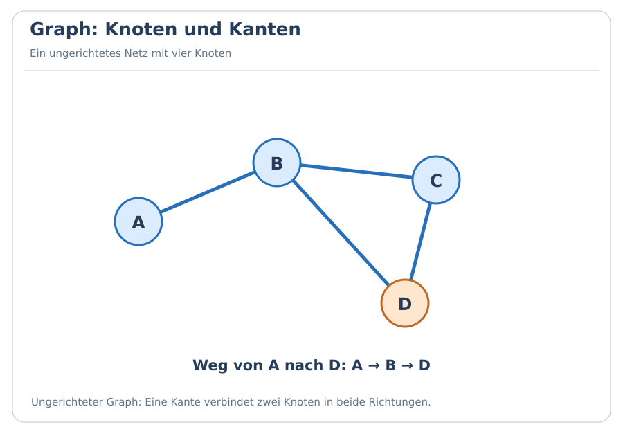

# M8-L1 – Diskrete Informatik: Logik, Mengen, Relationen und Graphen {#L1}

**Kursbereich:** M8 – Bachelor: Kerngebiete

**Niveau:** Bachelor

**Vorwissen:** Keine festen Voraussetzungen angegeben.

## Lernziel: Die unsichtbare Mathematik hinter Software erkennen {#S1}

Eine Anwendung entscheidet, ob jemand eine Datei lesen darf. Ein Shop führt Artikel in Kategorien. Eine Datenbank verknüpft Kunden mit Bestellungen. Ein Navigationssystem sucht einen Weg durch ein Straßennetz. Diese Aufgaben wirken zunächst ganz verschieden. Dennoch lassen sie sich mit wenigen gemeinsamen Ideen beschreiben: **Aussagen mit Wahrheitswerten**, **Mengen von Dingen**, **Beziehungen zwischen Dingen** und **Netze aus Knoten und Verbindungen**.

Mit solchen Strukturen beschäftigt sich die *diskrete Mathematik*. „Diskret“ bedeutet hier: Wir betrachten unterscheidbare Zustände, Objekte und Schritte – etwa eine endliche Menge von Konten oder einen Graphen mit klar benannten Knoten. Das Gegenstück ist die kontinuierliche Betrachtung, beispielsweise einer sich stetig ändernden Geschwindigkeit. In der Informatik sind beide wichtig, aber diskrete Modelle besonders allgegenwärtig: Speicher besteht aus unterscheidbaren Bitzuständen, Programme führen definierte Schritte aus, und Datenbanken verwalten einzelne Datensätze.

**M8-L1 ist ein freiwilliges Bachelor-Wahlthema**, kein zusätzliches Pflichtkapitel des 33-teiligen Hauptkurses. Es vertieft die Grundlagen aus [M1-L1 – Was ist Informatik?](M1-L1.md), [M1-L3 – Algorithmen und Datenstrukturen](M1-L3.md) und [M1-L5 – Daten und Datenbanken](M1-L5.md). Die Lektion ist ohne Softwareinstallation, Programmierung und Übungsaufgaben lesbar.

Am Ende kann man die Frage „Welche Datenstruktur oder Regel brauche ich?“ präziser beantworten: Ist das ein logischer Ausdruck, eine Menge, eine Funktion, eine Relation oder ein Graph? Und wo reicht eine einfache Liste völlig aus?

## Aussagenlogik: Aus klaren Bedingungen klare Entscheidungen machen {#S2}

### Was ist eine Aussage? {#11-was-ist-eine-aussage}

Eine **Aussage** ist ein Satz, der unter einer festgelegten Interpretation entweder **wahr** oder **falsch** ist. „Die Rechnung ist bezahlt“ kann beispielsweise wahr oder falsch sein. „Bezahle die Rechnung!“ ist dagegen ein Befehl und keine Aussage mit Wahrheitswert.

Wir können eine Aussage abkürzen:

- `P`: Die Person ist angemeldet.
- `Q`: Die Person besitzt Leserechte.
- `R`: Die angeforderte Datei darf geöffnet werden.

Für einen einfachen Zugriff könnte gelten: $R=P\land Q$. Diese Regel lässt sich unabhängig von einer bestimmten Programmiersprache verstehen.

Die üblichen logischen Verknüpfungen heißen **Negation** (`NICHT P`), **Konjunktion** (`P UND Q`), **Disjunktion** (`P ODER Q`) und **Implikation** (`P → Q`). Bei der üblichen *inklusiven* Bedeutung von ODER ist die Verknüpfung auch dann wahr, wenn beide Aussagen wahr sind. Das ist etwas anderes als ein „entweder … oder“ im Alltag.

  P        Q        P UND Q   P ODER Q   NICHT P   P → Q
  -------- -------- --------- ---------- --------- --------
  falsch   falsch   falsch    falsch     wahr      wahr
  falsch   wahr     falsch    wahr       wahr      wahr
  wahr     falsch   falsch    wahr       falsch    falsch
  wahr     wahr     wahr      wahr       falsch    wahr

Die letzte Spalte überrascht oft: `P → Q` ist in der klassischen Aussagenlogik nur dann falsch, wenn **P wahr und Q falsch** ist. Die Implikation behauptet nicht, dass P die Ursache von Q ist. Sie beschreibt eine logische Bedingung. Wenn P nie eintritt, ist die Implikation innerhalb dieser Definition nicht widerlegt.

### Drei typische Denkfehler {#12-drei-typische-denkfehler}

**Erstens: „Wenn P, dann Q“ bedeutet nicht „wenn Q, dann P“.** Wenn ein Premiumkonto bestimmte Funktionen nutzen darf, folgt daraus nicht, dass jeder Nutzer dieser Funktionen ein Premiumkonto haben muss. Vielleicht besitzen Administratoren dieselben Rechte.

**Zweitens: Ein ODER ist nicht immer exklusiv.** „Datei ist öffentlich ODER die Person hat eine Freigabe“ lässt beide Bedingungen zugleich zu. Eine exklusiv gemeinte Entscheidung muss anders formuliert werden.

**Drittens: Eine fehlende Information ist nicht automatisch falsch.** In einer Programmiersprache mag eine boolesche Variable zwei Zustände annehmen. In SQL können Bedingungen mit `NULL` hingegen auch den dritten Wahrheitswert *unbekannt* ergeben. Die klassischen Tabellen oben erklären die Zwei-Werte-Logik; man darf sie nicht unbesehen auf jede Datenbankabfrage übertragen. Die Bedeutung von `NULL` wurde im Hauptkurs M1-L5 vorbereitet.

### Negation und die De-Morgan-Regeln {#13-negation-und-die-de-morgan-regeln}

Betrachten wir die Regel: „Ein Auftrag darf starten, wenn der Dienst verfügbar ist **und** genügend Guthaben vorhanden ist.“ Das Gegenteil lautet nicht „Dienst nicht verfügbar und Guthaben fehlt“, sondern: **Mindestens eine der beiden Voraussetzungen fehlt.**

``` text
NICHT (P UND Q) = (NICHT P) ODER (NICHT Q)
NICHT (P ODER Q) = (NICHT P) UND (NICHT Q)
```

Das sind die **De-Morgan-Gesetze**. Sie helfen, eine komplexe Bedingung in eine gleichwertige Form zu verwandeln. Gerade bei Sicherheitsprüfungen sind sie nützlich: Eine fehlerhafte Negation kann einen unzulässigen Zugriff ermöglichen oder einen rechtmäßigen blockieren.

Eine *logische Äquivalenz* bedeutet: Zwei Ausdrücke haben für jede Belegung ihrer Ausgangsaussagen denselben Wahrheitswert. Man kann das mit einer Wahrheitstabelle prüfen. Für sehr viele Variablen wächst eine vollständige Wahrheitstabelle allerdings schnell: Bei zehn unabhängigen Aussagen wären bereits $2^{10}=1\,024$ Belegungen möglich.

### Von der Alltagsregel zur überprüfbaren Zugriffskontrolle {#14-von-der-alltagsregel-zur-überprüfbaren-zugriffskontrolle}

Die Zugriffsregel eines kleinen Online-Archivs lautet:

> Ein Dokument ist lesbar, wenn es veröffentlicht wurde **oder** wenn die anfragende Person angemeldet ist und für dieses Dokument eine passende Freigabe besitzt.

``` text
                [Dokument veröffentlicht?] ── JA ───┐
                         │ NEIN                     │
                         ▼                          ▼
                  [Angemeldet?]                 [Zugriff]
                         │ JA                       ▲
                         ▼                          │
                 [Freigabe gültig?] ── JA ──────────┘
                         │ NEIN
                         ▼
                 [Zugriff verweigert]
```

Als Formel: `Lesbar = Veröffentlicht ODER (Angemeldet UND Freigabe)`. Die Klammer ist entscheidend. Ohne saubere Gruppierung kann eine andere Regel herauskommen. In der Praxis wird eine solche Prüfung serverseitig durchgeführt; ein bloß ausgeblendeter Knopf in der Benutzeroberfläche ist keine Zugriffssperre. Auch ein formal korrekter Ausdruck schützt nicht, wenn die zugrunde liegende Freigabeinformation veraltet oder manipuliert ist.

## Prädikatenlogik: Aussagen über einzelne Objekte {#S3}

Die Aussagenlogik behandelt ganze Sätze als wahr oder falsch. Häufig möchten wir aber präziser über viele Objekte sprechen: „Jede Bestellung gehört zu genau einem Kunden“ oder „Es existiert mindestens ein Auftrag mit einem Fehler“.

Eine Aussage mit einer Variablen heißt **Prädikat**. `Bezahlt(x)` kann beispielsweise bedeuten: „Bestellung x ist bezahlt.“ Zwei wichtige Zeichen sind:

- `∀` – **für alle**: `∀x` bedeutet „für jedes x“ im vereinbarten Betrachtungsbereich.
- `∃` – **es existiert**: `∃x` bedeutet „für mindestens ein x“ im Betrachtungsbereich.

Die Aussage `∀x: Bezahlt(x)` ist nur dann sinnvoll, wenn klar ist, worüber x läuft – etwa alle Bestellungen im Tagesbericht. Die Aussage `∃x: Fehlgeschlagen(x)` meldet dagegen, dass mindestens ein Fehlerauftrag existiert.

Ein besonders wichtiger Unterschied betrifft die Reihenfolge:

``` text
∀ Kunde k: ∃ Supportperson s: Betreut(s, k)
```

Jeder Kunde hat mindestens eine betreuende Person. Diese kann von Kunde zu Kunde verschieden sein.

``` text
∃ Supportperson s: ∀ Kunde k: Betreut(s, k)
```

Es gibt eine einzige Supportperson, die alle Kunden betreut. Das ist eine deutlich stärkere Forderung. Dieselben Zeichen in anderer Reihenfolge beschreiben also einen anderen Betrieb.

In Datenbanksystemen erscheinen solche Ideen als Filter, Existenzprüfungen und Einschränkungen; in Programmen als Schleifenbedingungen oder Prüfregeln. Auf einer noch abstrakteren Ebene dienen sie dazu, Softwareanforderungen eindeutig zu formulieren. **Formale Sprache macht eine Anforderung nicht automatisch wahr**, hilft aber, Mehrdeutigkeiten sichtbar zu machen.

## Mengen: Dinge eindeutig zusammenfassen {#S4}

### Eine Menge zählt Zugehörigkeit, nicht Reihenfolge {#31-eine-menge-zählt-zugehörigkeit-nicht-reihenfolge}

Eine **Menge** ist eine Sammlung unterscheidbarer Elemente. Bei der Menge `{rot, blau, grün}` ist die Reihenfolge unerheblich. Ein Element erscheint mathematisch nicht „zweimal“: `{rot, rot, blau}` ist dieselbe Menge wie `{rot, blau}`.

Ein Fotoarchiv besitzt die folgenden Sammlungen:

``` text
A = {Foto1, Foto2, Foto4}       # Bilder mit dem Merkmal „Natur“
B = {Foto2, Foto3, Foto4}       # Bilder mit dem Merkmal „Abend“
```

Wichtige Operationen:

  Operation      Schreibweise      Ergebnis im Beispiel
  -------------- ----------------- -----------------------------------------
  Vereinigung    $A \cup  B$       `{Foto1, Foto2, Foto3, Foto4}`
  Schnittmenge   $A \cap  B$       `{Foto2, Foto4}`
  Differenz      `A \ B`           `{Foto1}`
  Teilmenge      $A \subseteq  C$  Jedes Element von A kommt auch in C vor
  Leere Menge    `∅`               Keine Elemente

Die **Mächtigkeit** `|A|` ist die Anzahl der unterschiedlichen Elemente in A. Hier gilt `|A| = 3`, `|B| = 3`, $|A \cap  B| = 2$ und $|A \cup  B| = 4$.

Die Rechnung zeigt eine oft übersehene Regel:

$$
\begin{aligned}
|A\cup B|&=|A|+|B|-|A\cap B|\\
&=3+3-2\\
&=4
\end{aligned}
$$

Wir ziehen die Schnittmenge einmal ab, weil ihre Elemente beim bloßen Addieren doppelt gezählt würden. Diese **Inklusions-Exklusions-Regel** ist nützlich bei Nutzermengen, Suchergebnissen, Zielgruppen und Berechtigungslisten.

### Grundmenge, Komplement und Filter {#32-grundmenge-komplement-und-filter}

Ein *Komplement* braucht eine klar definierte **Grundmenge U**: `U \ A` sind diejenigen Elemente aus U, die nicht in A liegen. Ohne U ist „alle Bilder, die nicht Natur zeigen“ mehrdeutig – sind auch noch nicht importierte Dateien oder gelöschte Fotos gemeint?

Das ist ein praktischer Datenbankfehler: Ein Bericht zählt „nicht bezahlte“ Bestellungen, ohne zu klären, ob stornierte, nie bestätigte oder archivierte Bestellungen dazugehören. Die Mengenlehre zwingt uns, den betrachteten Bereich ausdrücklich festzulegen.

Eine Datenbanktabelle ist nicht schlicht eine mathematische Menge. SQL arbeitet in vielen Fällen mit **Mehrfachvorkommen** von Zeilen; ein `SELECT` kann Duplikate ausgeben, und `DISTINCT` verändert diese Semantik. Trotzdem sind Mengen ein gutes Denkmodell für eindeutige Identitäten und Mengenoperationen.

### Kartesisches Produkt und die Ausgangsbasis von Beziehungen {#33-kartesisches-produkt-und-die-ausgangsbasis-von-beziehungen}

Aus zwei Mengen A und B entsteht das **kartesische Produkt** $A \times  B$: die Menge aller geordneten Paare `(a, b)`, in denen a aus A und b aus B stammt.

``` text
Kunden = {K1, K2}
Pakete = {P1, P2, P3}

Kunden × Pakete enthält 2 × 3 = 6 mögliche Paare.
```

Das bedeutet nicht, dass es wirklich sechs Lieferbeziehungen gibt. Es sind zunächst nur **alle denkbaren Kombinationen**. Die tatsächlichen Beziehungen sind eine Auswahl daraus. Dieser Unterschied führt uns zu den Relationen.

Die Zahl möglicher Teilmengen einer Menge mit n Elementen ist `2^n` (einschließlich leerer Menge und der ganzen Menge). Für zehn verschiedene Funktionen gäbe es somit 1.024 mögliche Aktivierungs-Kombinationen. Schon einfache Konfigurationsoptionen können enorme Testflächen erzeugen. In der Praxis werden deshalb Regelmäßigkeiten, Risikoklassen und repräsentative Kombinationen genutzt, statt stets alle Fälle durchzutesten.

## Funktionen und Relationen: Was gehört wozu? {#S5}

### Eine Funktion hat für jede erlaubte Eingabe genau eine Ausgabe {#41-eine-funktion-hat-für-jede-erlaubte-eingabe-genau-eine-ausgabe}

Eine **Funktion** `f: A → B` ordnet jedem Element der Eingabemenge A **genau ein** Element der Zielmenge B zu. Mehrere Eingaben dürfen dieselbe Ausgabe haben; für eine einzelne Eingabe sind jedoch nicht mehrere verschiedene Ausgaben im selben Funktionsmodell erlaubt.

Beispiel: `Speicherort(Foto-ID)` gibt denjenigen Objektpfad zurück, unter dem eine Bilddatei gespeichert ist. Wenn manche Foto-IDs keinen Pfad haben, liegt entweder eine **partielle Funktion** vor, oder wir müssen das Modell um einen ausdrücklichen Zustand wie „nicht gespeichert“ erweitern.

Drei nützliche Eigenschaften:

- **Injektiv:** Verschiedene Eingaben führen stets zu verschiedenen Ausgaben. Beispielsweise muss eine eindeutige, einmalige Kundenkennung verschiedenen Kunden verschiedene IDs zuordnen.
- **Surjektiv:** Jedes Element der gewählten Zielmenge wird von mindestens einer Eingabe getroffen. Ob das gilt, hängt ausdrücklich davon ab, was wir als Zielmenge festlegen.
- **Bijektiv:** Eine Funktion ist gleichzeitig injektiv und surjektiv; damit ist eine eindeutige Rückzuordnung möglich.

Ein Hashwert als Schlüssel ist **nicht automatisch injektiv**, denn bei einer endlichen Hashwertmenge und unbegrenzt vielen möglichen Eingaben sind Kollisionen unvermeidbar. Ebenso darf aus einer Dokument-ID nicht ungeprüft geschlossen werden, dass ihre Ausgabe dauerhaft unverändert ist – Dateien können verschoben werden, und die Zuordnung muss gepflegt werden.

### Relationen sind erlaubte Paare {#42-relationen-sind-erlaubte-paare}

Eine **Relation** zwischen A und B ist eine Teilmenge von $A \times  B$. Im Beispiel kann die Relation `Besitzt(Kunde, Paket)` aus den Paaren `(K1, P1)`, `(K1, P2)` und `(K2, P3)` bestehen. Kunde K1 besitzt zwei Pakete; es handelt sich deshalb nicht um eine Funktion von *Kunde nach Paket*. Andersherum könnte unter passenden Fachannahmen jedes Paket genau einem Kunden gehören – dann wäre die Zuordnung vom Paket zum Kunden eine Funktion.

Das beschreibt anschaulich den Unterschied zwischen **1:n**- und **n:m**-Beziehungen in Datenbanken:

``` text
[KUNDE] ─── bestellt ───> [BESTELLUNG]
   K1                         B17
   K1                         B18
   K2                         B19
```

Ob eine Bestellung genau einem Kunden gehört, ob anonyme Bestellungen zulässig sind und ob mehrere Kunden gemeinsam bestellen können, sind *Geschäftsregeln*. Mathematik ersetzt diese Entscheidungen nicht; sie macht deren Konsequenzen prüfbar.

### Eigenschaften einer Relation auf derselben Menge {#43-eigenschaften-einer-relation-auf-derselben-menge}

Für eine Relation R auf einer Menge A unterscheiden wir unter anderem:

- **Reflexiv:** Für jedes x aus A gilt `x R x`.
- **Symmetrisch:** Aus `x R y` folgt `y R x`.
- **Transitiv:** Aus `x R y` und `y R z` folgt `x R z`.
- **Antisymmetrisch:** Wenn `x R y` und `y R x`, dann müssen x und y identisch sein.

**Symmetrisch und antisymmetrisch sind keine Gegenteile.** Zum Beispiel ist die Gleichheitsrelation auf einer Menge beides. Eine Relation darf auch keines von beidem sein.

Eine **Äquivalenzrelation** ist reflexiv, symmetrisch und transitiv. „Hat denselben Kontoinhaber wie“ könnte unter einer eindeutig definierten Kontoinhaberschaft eine Äquivalenzrelation sein. Sie zerlegt alle betrachteten Konten in **Äquivalenzklassen**: Jedes Konto gehört genau zu einer Klasse von Konten mit demselben Inhaber. Wenn Konten mehrere Inhaber haben können, muss die Definition entsprechend präzisiert werden; eine bloße Teilüberschneidung wäre im Allgemeinen nicht transitiv.

Eine **partielle Ordnung** ist reflexiv, antisymmetrisch und transitiv. „Ist Teilmenge von“ (`⊆`) ist eine solche Ordnung. Nicht alle Elemente müssen miteinander vergleichbar sein: Die Mengen `{A}` und `{B}` enthalten sich gegenseitig nicht. Das erklärt, warum manche Abhängigkeiten, Berechtigungsrollen oder Projektaufgaben **nicht in eine einzige natürliche Rangliste passen**.

### Was Relationen im Betrieb schwierig macht {#44-was-relationen-im-betrieb-schwierig-macht}

Ein fachlich sauberes Datenmodell braucht dennoch praktische Entscheidungen: eindeutige Identitäten, Fremdschlüssel, Löschregeln, Indizes und Transaktionsgrenzen. Wenn ein Datensatz gelöscht wird, kann eine Relation auf ein nicht mehr vorhandenes Ziel zeigen. Beim Verteilen über mehrere Server kommen Netzwerkfehler und zeitweise widersprüchliche Kopien hinzu. Diese Themen vertiefen [M1-L5](M1-L5.md) sowie [M3-L3](M3-L3.md) und [M3-L5](M3-L5.md).

## Wie man mathematische Aussagen begründet {#S6}

Informatik benötigt nicht nur plausible Beispiele, sondern manchmal eine Aussage für **alle zulässigen Fälle**. Das ist der Unterschied zwischen „mein Programm hat im Test funktioniert“ und „das Verfahren erfüllt die geforderte Eigenschaft unter angegebenen Voraussetzungen“.

**Direkter Beweis:** Wir starten bei bekannten Annahmen und folgern Schritt für Schritt die Behauptung. Beispiel: Ist eine Zahl `n` gerade, so gibt es ein ganzzahliges k mit $n = 2k$; deshalb ist $n^{2} = 4k^{2} = 2\cdot (2k^{2})$ ebenfalls gerade.

**Gegenbeispiel:** Eine einzige zulässige Ausnahme widerlegt eine allgemeine Aussage. „Jeder Graph hat eine Verbindung zwischen allen Knoten“ ist falsch, sobald wir einen Graphen mit zwei getrennten Knoten angeben. Tausend zusammenhängende Beispiele würden die allgemeine Behauptung dagegen nicht beweisen.

**Widerspruchsbeweis:** Wir nehmen das Gegenteil einer Aussage an und zeigen, dass daraus eine Unmöglichkeit folgt. Dieses Verfahren ist besonders in Theorie und Korrektheitsbeweisen nützlich.

**Vollständige Induktion:** Wir zeigen eine Aussage zuerst für einen Anfangswert und anschließend: Wenn sie für n gilt, gilt sie auch für $n+1$. Als verständliches Beispiel die Summe der Zahlen von 1 bis n:

$$
1+2+\ldots+n=\frac{n(n+1)}2
$$

Für $n=1$ erhalten wir $1=\frac{1\cdot2}{2}$. Wenn die Formel für n gilt, dann ist die Summe bis $n+1$ gleich $\frac{n(n+1)}2+(n+1)=\frac{(n+1)(n+2)}2$. Damit ist der nächste Schritt nachgewiesen. Das ist keine Sammlung einzelner Stichproben, sondern ein Schluss über alle positiven ganzen n.

Solche Denkweisen begegnen später bei Rekursion, Automaten, Protokollen, Sicherheitseigenschaften und Algorithmen. Dabei bleibt wichtig: Ein formal korrekter Beweis gilt **nur für das mathematische Modell und seine Voraussetzungen**. Fehlerhafte Hardware, schlechte Eingangsdaten oder eine unpassende Modellierung können das reale Ergebnis trotzdem unbrauchbar machen.

## Graphen: Beziehungen als Netz denken {#S7}



Graphen modellieren Beziehungen; A → B → D ist hier ein möglicher Weg.

### Knoten und Kanten {#61-knoten-und-kanten}

Ein **Graph** besteht aus einer Menge von **Knoten** (*Vertices*) und **Kanten** (*Edges*) zwischen ihnen. In einem sozialen Netz sind Menschen Knoten und Kontakte Kanten. In einem Computernetz sind Router Knoten und Verbindungen Kanten. In einem Softwareprojekt können Dateien Knoten sein und Abhängigkeiten gerichtete Kanten.

Bei einem **ungerichteten** Graphen verbindet eine Kante A und B in beiden Richtungen. Bei einem **gerichteten** Graphen bezeichnet `A → B` eine Richtung – etwa „Aufgabe A muss vor Aufgabe B abgeschlossen sein“. Eine **gewichtete** Kante trägt einen Wert wie Strecke, Zeit oder Kosten.

Ein übersichtliches Beispiel:

``` text
A --(2)-- B --(4)-- D
|         |         |
(5)      (1)       (2)
|         |         |
+---------C---------+
```

Die Skizze ist absichtlich schematisch; für exakte Auswertungen verwenden wir besser eine **Kantenliste**:

  Kante     Gewicht
  ------- ---------
  A–B             2
  A–C             5
  B–C             1
  B–D             4
  C–D             2

Wir betrachten diesen Graphen als ungerichtet. Die Gewichte könnten Fahrtzeiten in einer fiktiven Einheit sein.

### Wege, Zyklen und Bäume {#62-wege-zyklen-und-bäume}

Ein **Weg** ist eine Folge miteinander verbundener Knoten. Ein **Zyklus** führt über Kanten zu einem bereits besuchten Knoten zurück. Ein **Baum** ist ein zusammenhängender, ungerichteter Graph ohne Zyklen. Bei n Knoten enthält ein solcher Baum genau $n-1$ Kanten.

Eine Baumstruktur kann ein Dateiverzeichnis oder eine Hierarchie veranschaulichen. Allerdings ist nicht jede reale Dateiverknüpfung ein Baum: symbolische Links, Mehrfachzuordnungen oder gemeinsam genutzte Komponenten können zusätzliche Verbindungen und Zyklen erzeugen. Deshalb ist die Modellwahl wichtig.

Ein **gerichteter azyklischer Graph** – englisch *Directed Acyclic Graph* (**DAG**) – ist ein gerichtetes Netz ohne gerichtete Zyklen. DAGs beschreiben etwa Verarbeitungs- und Bauaufträge:

``` text
[Daten laden] ──► [Daten prüfen] ──► [Modell auswerten]
                                      │
[Berechtigung prüfen] ─────────────────┤
                                      ▼
                                [Ergebnis freigeben]
```

Die Pfeile bedeuten hier: Der Zielschritt darf erst nach dem Vorgängerschritt erfolgen. Wenn gleichzeitig mehrere unabhängige Schritte möglich sind, muss ihre Reihenfolge nicht künstlich festgelegt werden. Ein gerichteter Zyklus bei zwingenden Vorbedingungen wäre problematisch: A wartet auf B und B auf A.

### Wie ein Graph gespeichert wird {#63-wie-ein-graph-gespeichert-wird}

Zwei klassische Darstellungen sind:

- **Adjazenzliste:** Für jeden Knoten wird eine Liste seiner Nachbarn aufbewahrt. Das eignet sich häufig für Netze mit relativ wenigen Kanten.
- **Adjazenzmatrix:** Eine Tabelle beschreibt für jedes Knotenpaar, ob eine Verbindung besteht. Sie bietet schnelle direkte Nachschläge, benötigt bei n Knoten aber typischerweise Speicher für $n^{2}$ mögliche Paare.

Ein soziales Netzwerk mit einer Million Personen hat nicht zwangsläufig Kontakt zu jeder anderen Person. Eine dichte Matrix wäre sehr groß; eine nachbarschaftsorientierte Darstellung ist in solchen Fällen oft sparsamer. Für kleine, dichte Graphen kann eine Matrix trotzdem sinnvoll sein.

### Breitensuche und Tiefensuche {#64-breitensuche-und-tiefensuche}

Die **Breitensuche**, englisch *Breadth-First Search* (**BFS**), untersucht zuerst alle unmittelbar benachbarten Knoten, danach deren Nachbarn usw. Sie verwendet konzeptionell eine Warteschlange. In einem ungewichteten Graphen findet sie Wege mit möglichst wenigen Kanten.

Die **Tiefensuche**, englisch *Depth-First Search* (**DFS**), folgt zunächst einem erreichbaren Pfad weiter und kehrt dann zu noch nicht untersuchten Alternativen zurück. Sie eignet sich unter anderem, um Erreichbarkeit, Komponenten und bestimmte Zyklen zu untersuchen.

Mit einer Adjazenzliste können BFS und DFS einen Graphen mit V Knoten und E Kanten in Zeitordnung **$O(V + E)$** durchlaufen, wenn die üblichen Annahmen zu Zugriffen und Markierungen gelten. Das bedeutet: Der Aufwand wächst grob mit der Zahl der Knoten und gespeicherten Kanten. Die genaue Laufzeit hängt zusätzlich von Speicherstruktur, Datenverteilung und Umgebung ab.

### Der Unterschied zwischen wenigsten Stationen und geringsten Kosten {#65-der-unterschied-zwischen-wenigsten-stationen-und-geringsten-kosten}

Unser Beispielgraph enthält folgende Wege von A nach D:

  Weg         Zahl der Kanten       Gesamtgewicht
  --------- ----------------- -------------------
  A–B–D                     2             $2+4=6$
  A–C–D                     2             $5+2=7$
  A–B–C–D                   3       $2+1+2=$**5**

Ein Algorithmus, der nur die **Anzahl der Kanten** minimiert, bevorzugt einen Weg mit zwei Kanten – obwohl der dreistufige Weg über B und C insgesamt günstiger ist. Ein kürzester Weg nach **Gewicht** ist hier `A–B–C–D` mit Kosten 5.

Für nichtnegative Kantengewichte ist beispielsweise der **Dijkstra-Algorithmus** ein geeignetes Verfahren zur Bestimmung kürzester Wege von einem Startknoten. Negative Gewichte verlangen besondere Vorsicht; die gewöhnliche Dijkstra-Variante liefert dafür keine allgemeine Korrektheitsgarantie. Was „optimal“ heißt, hängt ohnehin vom Ziel ab: minimale Zeit, geringe Kosten, wenig Umstiege oder besonders robuste Verbindungen sind verschiedene Optimierungsprobleme.

Diese kleine Rechnung zeigt, warum die Festlegung eines **Modells und einer Zielgröße** oft wichtiger ist als die Wahl des bekanntesten Algorithmus.

## Kombinatorik: Wie viele Möglichkeiten entstehen? {#S8}

**Kombinatorik** beschäftigt sich mit dem Zählen endlicher Anordnungen und Auswahlmöglichkeiten.

Bei zwei unabhängigen Entscheidungen mit drei beziehungsweise vier Möglichkeiten entstehen $3 \cdot  4 = 12$ Kombinationen. Das ist die **Produktregel**. Wenn sich alternative Fälle nicht überschneiden und fünf Möglichkeiten im ersten sowie drei im zweiten Fall existieren, haben wir $5 + 3 = 8$ Möglichkeiten – die **Summenregel**.

Die Reihenfolge macht ebenfalls einen Unterschied:

- Drei verschiedene Plätze mit drei verschiedenen Objekten besetzen: $3! = 3\cdot 2\cdot 1 = 6$ Anordnungen.
- Zwei von vier verschiedenen Objekten auswählen, ohne Reihenfolge: $\frac{4\cdot3}{2}=6$ Auswahlen.

Die Zahl der ungeordneten Auswahlen von k verschiedenen Elementen aus n verschiedenen Elementen lautet:

$$
C(n,k)=\frac{n!}{k!\cdot(n-k)!}
$$

Bei einer Testplanung mit fünf ein- oder ausschaltbaren Funktionen gibt es $2^5 = 32$ mögliche Belegungen. Bei zwanzig Funktionen sind es bereits $2^{20}=1\,048\,576$. Diesen **kombinatorischen Zuwachs** bezeichnet man manchmal bildhaft als Explosion. Es ist kein Beweis, dass alle Kombinationen getestet werden müssen; er verdeutlicht, warum man Testfälle anhand von Risiken und Wechselwirkungen auswählen sollte.

Ein weiteres Prinzip heißt **Schubfachprinzip**: Werden $n+1$ Objekte auf n Schubfächer verteilt, muss mindestens ein Schubfach mehr als ein Objekt enthalten. Genau diese Idee erklärt auch, warum bei endlich vielen Hashwerten und mehr möglichen Eingaben irgendwann zwei verschiedene Eingaben denselben Hashwert besitzen müssen. Sie sagt jedoch nicht, *wie häufig* solche Kollisionen bei einem konkreten Hashverfahren auftreten.

## Modulare Arithmetik, Invarianten und Zustände {#S9}

Manchmal interessiert nicht der vollständige Zahlenwert, sondern sein Rest bei Division durch m. $17 \bmod  5 = 2$; $22 \bmod  5 = 2$. Die Zahlen liegen in derselben **Restklasse modulo 5**. Das wird beim Verteilen von Daten auf eine feste Zahl von Speicherbereiche, bei zyklischen Zählern und in vielen mathematischen Verfahren verwendet.

Ein einfaches Sharding-Modell könnte lauten:

``` text
shard = Kundennummer mod 4
```

Kundennummern mit Rest 0 landen dann in einer anderen Gruppe als solche mit Rest 1, 2 oder 3. Die Formel verteilt jedoch **nicht automatisch gleichmäßig**, und beim Ändern der Shardzahl wechseln viele Zuordnungen. Deshalb sind reale Datenbanksysteme komplexer; [M3-L3](M3-L3.md) erklärt Hotspots, Routing und Umverteilung.

Eine **Invariante** ist eine Eigenschaft, die während bestimmter Abläufe erhalten bleiben soll. Beispiel: „Ein Lagerbestand darf niemals negativ werden.“ Die Aussage kann mathematisch einfach sein, ihre sichere Durchsetzung bei parallelen Buchungen ist aber schwierig. Eine Prüfung „Ist der Bestand noch ausreichend?“ gefolgt von einer nicht gesicherten Aktualisierung kann einen Wettlauf erzeugen. Logische Regeln und Transaktionsmechanismen aus M3-L5 müssen zusammenarbeiten.

In einer **Zustandsmaschine** werden klar definierte Zustände und erlaubte Übergänge festgelegt:

``` text
[Neu] ──► [Bezahlt] ──► [Versendet]
   └───────────────► [Storniert]
```

Eine scheinbar harmlose Statusliste wird damit zu einer überprüfbaren Prozessbeschreibung. Eine mögliche Regel lautet: „Versenden nur nach Bezahlt.“ Ob Rückerstattungen oder Ausnahmefälle neue Zustände benötigen, muss die Fachseite festlegen. Die ausführliche Automaten- und Compilerperspektive ist bereits in [M8-L2 – Formale Sprachen, Automaten und Compiler](M8-L2.md) ausgearbeitet.

## Drei Praxisbilder: von der Formel zur Architektur {#S10}

### Lokales Medienarchiv mit mehreren Merkmalen {#91-lokales-medienarchiv-mit-mehreren-merkmalen}

Ein Medienarchiv enthält Fotos, Videos und Schlagwörter. Die Frage „Welche Dateien zeigen **Natur UND Abend**, aber sind **NICHT gelöscht**?“ kann als Schnittmenge und Differenz formuliert werden. Die Tags bilden Mengen, und die Zuordnung eines Fotos zu mehreren Tags ist eine Relation.

``` text
[Dateien] ──► [Foto-ID / Metadaten]
                     │
                     ├──► [Tag: Natur]
                     ├──► [Tag: Abend]
                     └──► [Status: gelöscht?]
```

Bei einem kleinen lokalen Archiv reicht eine gewöhnliche relationale Datenbank mit Indizes meist aus. Eine separate Graphdatenbank wäre häufig überdimensioniert. Wenn man aber zusätzlich Bildähnlichkeiten, Personenbeziehungen und Herleitungen verknüpft, kann die Graphsicht die Analyse erleichtern. **Privatsphäre:** Schon Beziehungen zwischen Bildern, Orten und Personen können sensible Informationen verraten; ein scheinbar anonymes Netz muss nicht anonym bleiben.

### Online-Dienst mit mehreren Rollen {#92-online-dienst-mit-mehreren-rollen}

Ein bezahlter Online-Dienst besitzt die Rollen „Gast“, „Kunde“ und „Support“. Zugriff ist eine logische Regel; die Zuordnung von Personen zu Rollen ist eine Relation. Ein Kunde kann mehrere Rechte haben, und ein Recht kann vielen Kunden gehören. Eine Rollenliste allein definiert noch nicht, ob ein konkreter Datensatz dieser Person zugeordnet ist.

Ein sicheres Modell trennt mindestens:

``` text
[Identität festgestellt?] ─► [Rolle/Berechtigung?]
                                   │
                                   ▼
                         [Datenobjekt zugeordnet?]
                                   │
                                   ▼
                         [Serverseitige Entscheidung]
```

Die **Zugehörigkeit zum Datenobjekt** muss auch dann geprüft werden, wenn eine Person allgemein Zugriff auf den Dienst hat. Das ist für mandantenfähige Anwendungen entscheidend. Fehlen diese Prüfungen, kann ein korrekt angemeldeter Kunde womöglich fremde Daten lesen. Diese Sicherheitsanforderung wurde in M4-L3 bereits praktisch erklärt.

### KI-Verarbeitungsauftrag als Abhängigkeitsgraph {#93-ki-verarbeitungsauftrag-als-abhängigkeitsgraph}

Ein KI-Dienst soll ein Video transkribieren, Untertitel erzeugen und anschließend eine Zusammenfassung liefern. Die Schritte bilden einen DAG:

``` text
[Upload] ──► [Virenscan] ──► [Audio extrahieren]
                                      │
                                      ▼
                                [Transkribieren]
                                      │
                           ┌──────────┴──────────┐
                           ▼                     ▼
                    [Untertitel]          [Zusammenfassung]
                           └──────────┬──────────┘
                                      ▼
                                [Paket freigeben]
```

Untertitel und Zusammenfassung können nach der Transkription parallel laufen, wenn ihre Ergebnisse unabhängig sind. Die Freigabe wartet auf beide. Die Informatik beschreibt das mit Knoten und Abhängigkeiten; die reale Ausführung benötigt Warteschlangen, Worker, Fehlerbehandlung und Autorisierung wie in M4-L1 und M6-L4 erklärt. Ein Graph ist hier ein **Planungsmodell**, noch kein vollständiger Scheduler.

Ein unerwarteter Ausfall kann einen Teilauftrag wiederholen. Dann muss der Ablauf anhand gespeicherter Zustände erkennen, was bereits erledigt wurde. Außerdem muss er mit personenbezogenen Uploads vertraulich umgehen, Speicherung begrenzen und geeignete Löschprozesse vorsehen. Das sind Betriebseigenschaften, keine zusätzlichen Graphkanten allein.

## Wann sind diese Modelle hilfreich – und wann nicht? {#S11}

**Aussagenlogik** ist besonders sinnvoll für Bedingungen, Zugriffsregeln und korrektheitskritische Entscheidungen. Sie ersetzt allerdings keine fachliche Freigabe und kein Sicherheitskonzept.

**Mengen** sind gut für Zuordnungen, Schnittmengen, Suchfilter und eindeutige Identitäten. Bei geordneten Zeitreihen, mehrfach auftretenden Ereignissen oder Ranglisten genügt eine reine Mengenauffassung nicht.

**Relationen** erklären Beziehungen und ihre Eigenschaften; sie helfen bei Datenmodellierung und Konsistenzregeln. Ein reales Datenbanksystem muss zusätzlich Indizes, Speicher, Zugriffe und Transaktionen organisieren.

**Graphen** sind geeignet, wenn Verbindungen, Erreichbarkeit oder Abhängigkeiten im Mittelpunkt stehen. Für eine einfache Artikelliste ist ein Graphverfahren unnötig. Nicht jeder Datensatz, der in einem Graphen modelliert werden *kann*, braucht deshalb eine spezielle Graphdatenbank.

Komplexität kostet: Entwurf, Tests, Wartung, Erklärbarkeit und bei großen Netzen vor allem Speicher und Rechenzeit. Wer ein einfaches Problem mit einer großen technischen Plattform löst, schafft möglicherweise mehr Fehlerquellen als Nutzen. Im Zweifel ist das kleinste verständliche Modell oft das beste.

**Datenschutz und Sicherheit:** Ein mathematisches Modell enthält zunächst keine automatische Zugriffskontrolle. Personenbezogene Knoten, Beziehungen und Suchergebnisse müssen vor unberechtigtem Zugriff geschützt werden. Verbindungsdaten können sensible Rückschlüsse ermöglichen; bei Graphanalysen sind Zugriffsprotokolle, Aufbewahrungsregeln und gegebenenfalls Löschung besonders zu bedenken.

## Verbindung zum Mathematik-Lernkurs und zu den nächsten Stufen {#S12}

Im Mathematikkurs führt Universität M1-L1 in Mengen und Aussagenlogik ein. Schule M1-L12 vertieft das Zählen, Universität M2-L1 behandelt Graphen und diskrete Strukturen. Schule M1-L18 ergänzt das Thema Funktionen, und Universität M2-L13 führt von der Logik zur Berechenbarkeit.

Für den Informatikkurs entstehen folgende Verbindungen:

- **M1-L3** nutzt Graphen und Wachstumsraten, um Algorithmen zu verstehen.
- **M1-L5 / M3-L1 / M10-L2** nutzen Mengen und Relationen für Datenmodelle und Abfragen.
- **M1-L6 / M2-L5 / M10-L1** nutzen Netze, logische Prüfregeln und Erreichbarkeit.
- **M4-L1 / M6-L4** nutzen gerichtete Abhängigkeitsgraphen für Aufgabenverarbeitung und Agentenabläufe.
- **M8-L2** (geplant) vertieft Zustandsautomaten, formale Sprachen und Compiler.
- **Mögliche Master-Vertiefungen** betreffen algorithmische Beweise und formale Verifikation auf Master-Niveau.

Die noch nicht vorhandenen Wahllektionen werden bewusst **nicht** als funktionierende Dateiverweise gesetzt. Wenn später ein tatsächliches Mathematik-Modul mit einem verwandten Thema belegt ist, können beide Kursarchive getrennt und versioniert mit gegenseitigen Querverweisen aktualisiert werden.

## Zusammenfassung {#S13}

Diskrete Informatik beginnt nicht mit einem komplizierten Programm, sondern mit einer präzisen Frage: **Welche Dinge gibt es, welche Aussagen gelten, welche Beziehungen bestehen und was soll berechnet werden?** Die Aussagenlogik formuliert Bedingungen. Mengen beschreiben Zugehörigkeit. Funktionen ordnen eindeutige Ausgaben zu. Relationen drücken beliebige Beziehungen aus. Graphen zeigen Verbindungen und Abhängigkeiten. Kombinatorik erklärt die Zahl möglicher Fälle; Beweistechniken helfen, Aussagen über alle zulässigen Fälle zu begründen.

Damit ist M8-L1 als **erste freiwillige Bachelor-Wahllektion** abgeschlossen. Der nächste Wahlbaustein ist **M8-L2 – Formale Sprachen, Automaten und Compiler**. Die zusätzlichen Master-Wahlthemen und der Master-Kern M7 werden dadurch weder automatisch begonnen noch in die 33 Hauptlektionen eingerechnet.

## Einordnung in die kursweiten Lesewege {#S14}

Dies ist eine **freiwillige Bachelor-Wahllektion**, keine zusätzliche Hauptkurslektion. Die inhaltliche Brücke führt unter anderem zu [M7-L2 im Master-Kern](M7-L2.md). Weitere Routen: [kursweite Lesewege](pages/pfad.md) und [Kursindex](pages/index.md).


## Quellen {#S15}

**Letzte Quellenprüfung:** 04.11.2026

**Geprüft am 04.11.2026.** Die nachstehenden Lehr- und Curriculumsquellen bestätigen die fachliche Themenauswahl und die grundsätzlichen Definitionen. Die Zahlen, Figuren, Beispiele und fachlichen Anwendungen dieser Lektion wurden als eigene didaktische Darstellungen erstellt; sie sind keine unverändert übernommenen Aufgaben oder Grafiken aus den Quellen.

1.  **ACM / IEEE Computer Society / AAAI:** *Computer Science Curricula 2023*, Bereich „Mathematical and Statistical Foundations“ mit Logik, Mengen, Relationen, Funktionen, Kombinatorik, Beweisen und Graphen: [https://csed.acm.org/wp-content/uploads/2025/11/CS2023-Report.htm](https://csed.acm.org/wp-content/uploads/2025/11/CS2023-Report.htm)
2.  **Massachusetts Institute of Technology (MIT) OpenCourseWare:** *Mathematics for Computer Science*, Kurs 6.042J, Kursübersicht und Lehrmaterialien zu Logik, Beweisen, Mengen, Relationen, Graphen und Zählverfahren: [https://ocw.mit.edu/courses/6-042j-mathematics-for-computer-science-fall-2010/](https://ocw.mit.edu/courses/6-042j-mathematics-for-computer-science-fall-2010/)
3.  **Stanford University, CS103:** *Mathematical Foundations of Computing*, thematische Gliederung mit Mengenlehre, Aussagenlogik, Prädikatenlogik, Funktionen, Relationen und Graphen: [https://web.stanford.edu/class/archive/cs/cs103/cs103.1172/](https://web.stanford.edu/class/archive/cs/cs103/cs103.1172/)
4.  **Pat Morin:** *Open Data Structures*, Abschnitt „Graphs / Graph Traversal“, Herleitung von Breitensuche und Aufwand $O(V+E)$ mit Adjazenzlisten: [https://opendatastructures.org/newhtml/ods/latex/graphs.html](https://opendatastructures.org/newhtml/ods/latex/graphs.html)

**Reichweite der Prüfung:** Es handelt sich um statische theoretische Grundlagen. Aktuelle Preise, konkrete Herstellerzusicherungen oder rechtliche Einzelfallbewertungen werden nicht aus diesen Quellen abgeleitet.
