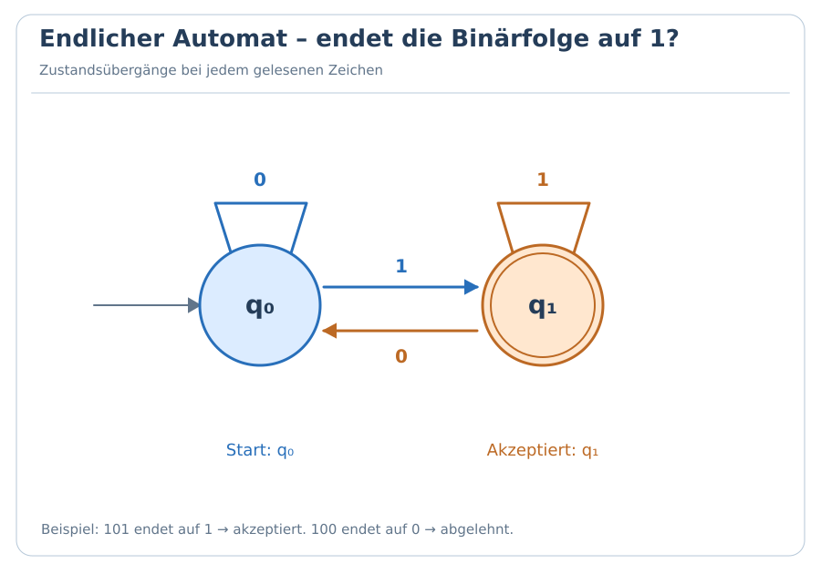

# M8-L2 – Formale Sprachen, Automaten und Compiler {#L2}

**Kursbereich:** M8 – Bachelor: Kerngebiete

**Niveau:** Bachelor

**Vorwissen:** Keine festen Voraussetzungen angegeben.

**Bachelor-Wahlthema · eigenständige Leselektion · keine Installation oder Programmieraufgabe erforderlich**

## Die Leitfrage: Wie erkennt ein Computer eine Sprache? {#S1}

Ein Mensch liest `anzahl = 2 + 3 * 4` und ahnt, dass hier eine Zahl berechnet und gespeichert werden soll. Für einen Rechner sind das zunächst Zeichen: Buchstaben, Leerzeichen, ein Gleichheitszeichen, Ziffern und Rechenoperatoren. Wie wird daraus eine eindeutige Anweisung? Und woran erkennt die Maschine, dass `anzahl = + * 4` keine gültige Rechnung ist?

Diese Fragen führen in zwei miteinander verbundene Gebiete: **Formale Sprachen** beschreiben, welche Zeichenfolgen zulässig sind. **Automaten** sind mathematische Modelle von Systemen, die Zeichen verarbeiten und Entscheidungen treffen. **Compiler** und **Interpreter** nutzen solche Ideen, um Programmtexte zu prüfen, zu verstehen und auszuführen beziehungsweise in eine andere Darstellung zu übersetzen.

Hier geht es nicht nur um Programmiersprachen. Dieselben Grundideen begegnen uns bei Suchmustern, Netzwerkprotokollen, Konfigurationsdateien, Datenformaten, Benutzereingaben, Dialogzuständen und den kontrollierten Werkzeugaufrufen von KI-Agenten.

In der [Bachelor-Wahllektion M8-L1](M8-L1.md) wurden Mengen, Relationen, Graphen und logische Bedingungen eingeführt. M8-L2 verwendet diese Bausteine, um präzise festzulegen, welche Eingaben ein System annehmen darf und wie es sie verarbeitet. Eine mögliche zusätzliche Master-Vertiefung zur formalen Verifikation könnte das Thema auf höherem Niveau behandeln. Das ist eine **inhaltliche Vorschau**, kein Verweis auf eine bereits vorhandene eigene Lektion.

## Alphabet, Wort und Sprache: Aus Zeichen werden Regeln {#S2}

In der Theorie bezeichnet ein **Alphabet** eine endliche Menge von Symbolen. Es muss nicht aus menschlichen Buchstaben bestehen. Das Alphabet `Σ = {0, 1}` enthält zum Beispiel zwei Zeichen. Ein **Wort** über diesem Alphabet ist eine endliche Folge daraus: `0`, `101` oder `00011`. Das leere Wort heißt oft `ε` (Epsilon). Es enthält kein Symbol, hat also die Länge null.

Eine **formale Sprache** ist eine Menge solcher Wörter. Beispielsweise könne die Sprache `L` aus allen binären Wörtern bestehen, die auf `01` enden:

``` text
Alphabet Σ = {0,1}
L = {01, 001, 101, 0001, 1101, ...}

"101"  gehört zu L.
"010"  gehört nicht zu L.
"01"   gehört zu L.
""     gehört nicht zu L.
```

Es ist nicht notwendig, alle Wörter aufzuschreiben. Viel eleganter ist eine **Regel**, die für jedes mögliche Wort entscheidet, ob es dazugehört. Im Alltag nennen wir das eine Prüfung oder Validierung. In der Theorie untersuchen wir, welche Arten von Regeln eine bestimmte Klasse von Maschinen erkennen kann.

Eine Sprache kann unendlich viele Wörter enthalten, obwohl ihr Alphabet endlich ist. Beispielsweise entsteht aus zwei Symbolen durch beliebig lange Folgen eine unbegrenzte Zahl verschiedener Wörter. Das ist der erste wichtige Perspektivwechsel: Eine kurze formale Beschreibung kann eine unendliche Menge zulässiger Eingaben festlegen.

Eine natürliche Sprache wie Deutsch hat Mehrdeutigkeiten, Ausnahmen und Bedeutungen, die sich nicht vollständig mit einem einfachen Parser erfassen lassen. Eine formale Sprache ist dagegen **durch eine ausgewählte Definition festgelegt**. Ein Compiler muss nicht erraten, was eine zulässige Eingabe wahrscheinlich bedeuten soll.

## Reguläre Sprachen und reguläre Ausdrücke {#S3}

Eine einfache, aber wichtige Klasse sind die **regulären Sprachen**. Sie lassen sich durch endliche Automaten erkennen und durch reguläre Ausdrücke beschreiben.

Für unsere binäre Beispielsprache lautet ein abstraktes reguläres Muster:

``` text
(0|1)*01
```

Die Zeichen bedeuten hier: `0|1` erlaubt eine Null **oder** Eins; der Stern `*` bedeutet null oder beliebig viele Wiederholungen des vorherigen Ausdrucks; `01` muss am Ende folgen. Bei einer vollständigen Übereinstimmungsprüfung erkennt dieser Ausdruck genau die Wörter, die auf `01` enden.

**Wichtig:** Im mathematischen Sinn beschreibt ein regulärer Ausdruck eine reguläre Sprache. Die *Regex-Engines* realer Programmiersprachen bieten teils zusätzliche Funktionen, beispielsweise Rückverweise. Solche Erweiterungen sind nicht automatisch durch denselben einfachen Automatentyp erklärbar. Außerdem unterscheiden sich Regex-Dialekte beim Umgang mit Zeilenumbrüchen, Unicode, Mehrdeutigkeit und dem Suchen nach Teiltreffern. „Regex“ ist im Betrieb daher nicht in jeder Umgebung exakt dasselbe Werkzeug.

### Typische Anwendungen {#31-typische-anwendungen}

Ein reguläres Muster kann zum Beispiel prüfen, ob eine einfache interne Kennung aus drei Großbuchstaben und vier Ziffern besteht. Es kann außerdem Logzeilen nach bestimmten Präfixen durchsuchen oder Schlüsselwörter im Quelltext erkennen. Für ein echtes E-Mail-Adressfeld, eine juristische Identität oder ein sicherheitskritisches Dateiformat reichen ein paar Zeichenklassen und ein einziger Regex dagegen oft nicht aus. Die syntaktische Form beweist weder die Existenz einer Adresse noch die Berechtigung zur Verwendung.

**Nicht zu verwechseln:** *Passend zum Muster* bedeutet **syntaktisch zulässig**, nicht automatisch *fachlich sinnvoll*, *autorisiert* oder *sicher*.

## Der endliche Automat als Zustandsmaschine {#S4}

Ein **deterministischer endlicher Automat** (englisch *Deterministic Finite Automaton*, DFA) liest ein Wort Symbol für Symbol. Er besitzt eine endliche Menge von Zuständen, einen Startzustand, eine Übergangsregel und eine Menge akzeptierender Endzustände. „Deterministisch“ bedeutet: Für einen Zustand und ein Eingabesymbol ist der nächste Zustand eindeutig festgelegt.

Für die Endung `01` benötigen wir nur drei Zustände:

- `S0`: Noch keine relevante Endung erkannt.
- `S1`: Das zuletzt gelesene Zeichen war `0`; die gewünschte Endung könnte gleich vollständig sein.
- `S2`: Die zuletzt gelesenen Zeichen waren `01`; **akzeptierend**, sofern jetzt die Eingabe endet.

Die Übergänge lauten:

  Zustand      Nächstes Zeichen `0`   Nächstes Zeichen `1`   Akzeptierend bei Eingabeende?
  ------------ ---------------------- ---------------------- -------------------------------
  S0 (Start)   S1                     S0                     Nein
  S1           S1                     S2                     Nein
  S2           S1                     S0                     **Ja**

Schematisch:

``` text
Eingabe "101":
Start S0 --1--> S0 --0--> S1 --1--> S2
                                       ✓ Ende: gültig

Eingabe "010":
Start S0 --0--> S1 --1--> S2 --0--> S1
                                       ✗ Ende: ungültig
```

Diese Tabelle ist bereits ein vollständiges Maschinenmodell. Es braucht kein trainiertes neuronales Netz, keine große Bibliothek und keinen weiteren Server, um sie zu verstehen oder auszuführen. Die eigentliche Leistung steckt in der **präzisen Beschreibung des Zustands**.

### Warum drei Zustände genügen {#41-warum-drei-zustände-genügen}

Der Automat muss sich nicht das ganze bereits gelesene Wort merken. Er braucht nur die Information, die für das zukünftige Erkennen entscheidend ist: Endet die bisherige Folge gerade mit `0`, mit `01` oder mit keinem dieser relevanten Muster? Ein endlicher Automat speichert diesen Wissensstand als einen von endlich vielen Zuständen.

Ein **nichtdeterministischer endlicher Automat** (englisch *Nondeterministic Finite Automaton*, NFA) erlaubt konzeptionell mehrere mögliche Folgezustände und, je nach Definition, Übergänge ohne Eingabezeichen. Das bedeutet nicht, dass ein realer Rechner zufällig raten muss. Ein NFA lässt sich so in einen DFA umwandeln, dass **beide dieselbe Sprache erkennen**. Der DFA kann bei dieser Umwandlung allerdings wesentlich mehr Zustände benötigen.

### Zustandsautomaten außerhalb von Compilern {#42-zustandsautomaten-ausserhalb-von-compilern}

Ein Download kann die Zustände `angefordert`, `wird geladen`, `abgeschlossen` und `fehlgeschlagen` durchlaufen. Eine Bestellung die Zustände `offen`, `bezahlt`, `versendet` und `storniert`. In einer realen Anwendung gelten zusätzliche Regeln für Berechtigungen, Zahlungsausgleich und dauerhafte Speicherung. Ein formaler Zustandsautomat macht den zulässigen **Kontrollfluss** sichtbar; er ersetzt nicht die vollständige Geschäftslogik oder eine Datenbanktransaktion.

## Wo endliche Automaten an Grenzen stoßen {#S5}

Betrachten wir korrekt geklammerte Ausdrücke:

``` text
()        gültig
(())      gültig
()()      gültig
(()())    gültig
(()       ungültig
())       ungültig
```

Für beliebig tiefe Klammerung müssen wir wissen, wie viele öffnende Klammern noch geschlossen werden müssen. Ein endlicher Automat besitzt nur endlich viele Zustände; er kann diesen beliebig großen Zählstand nicht im Allgemeinen exakt speichern. Die Sprache **aller korrekt ausbalancierten Klammerfolgen** ist daher nicht regulär.

Manche realen Regex-Implementierungen bieten Rekursion oder andere Erweiterungen; das ändert nichts an der Aussage über **klassische reguläre Sprachen**. Bei einer festen maximalen Klammerungstiefe ist die Situation anders: Dann könnte ein endlicher Automat die begrenzten Fälle durchaus darstellen.

Für unbeschränkte Verschachtelung verwenden wir ein stärkeres Modell: den **Kellerautomaten** (englisch *Pushdown Automaton*, PDA). Er besitzt neben dem endlichen Kontrollzustand einen **Stapel** (*Stack*). Bei `(` legt er ein Symbol auf den Stapel; bei `)` nimmt er eines herunter. Ein Schließen ohne passende Öffnung ist ein Fehler; am Ende muss der Stapel wieder leer sein.

``` text
Zeichen:       (   (   )   (   )   )
Stapelhöhe:    1   2   1   2   1   0
Ergebnis:                                  gültig
```

Das ist keine tatsächliche Darstellung der Arbeitsweise jedes Sprach-Parsers, sondern ein einfaches **theoretisches Modell**. Es erklärt, weshalb verschachtelte Ausdrücke eine andere Art von Struktur besitzen als die Prüfung eines festen Suffixes.

## Grammatiken: Wie ein Satz aufgebaut sein darf {#S6}

Eine **Grammatik** beschreibt, nach welchen Regeln zulässige Wörter oder Programme entstehen können. Besonders wichtig sind **kontextfreie Grammatiken** (englisch *Context-Free Grammars*, CFG). Sie eignen sich unter anderem zur Beschreibung geschachtelter Rechenausdrücke.

Eine sehr einfache Grammatik für korrekte Klammerfolgen lautet:

``` text
S → "(" S ")" S
S → ε
```

`S` ist ein **Nichtterminal**: ein Platzhalter für einen noch auszubauenden Teil. Die Zeichen `(` und `)` sind **Terminale**: tatsächlich im Ergebnis erscheinende Symbole. `ε` steht für die leere Folge. Die erste Regel erzeugt ein Klammerpaar mit möglichem Inhalt und anschließend weiteren zulässigen Paaren. Die zweite Regel erlaubt, die Ableitung zu beenden.

Die Schreibweise `→` heißt hier: „darf ersetzt werden durch“. Ein Grammatikregelwerk ist keine Maschinenanweisung, sondern eine **Definition aller erlaubten Strukturen**.

### Die Rechensprache als durchgehendes Beispiel {#61-die-rechensprache-als-durchgehendes-beispiel}

Für Ausdrücke mit `+`, `*`, Zahlen und Klammern benutzen wir eine weitere kleine Grammatik:

``` text
Ausdruck → Ausdruck "+" Term | Term
Term     → Term "*" Faktor | Faktor
Faktor   → ZAHL | "(" Ausdruck ")"
```

`ZAHL` steht für ein Zahlentoken, nicht für eine beliebige Zeichenfolge. Der Unterschied zwischen `Ausdruck`, `Term` und `Faktor` bildet die **Operatorpriorität** ab: Eine Multiplikation befindet sich innerhalb eines `Terms` und wird strukturell enger zusammengefasst als eine Addition.

Die Regeln sind absichtlich linksrekursiv und dienen hier der Beschreibung. Ein naiver rekursiver Abstieg, der `Ausdruck` sofort wieder als `Ausdruck` aufruft, würde nicht terminieren. Für bestimmte Parsermethoden muss man die Grammatik umformen oder einen geeigneten Algorithmus für Operatorvorrang verwenden. Die Grammatik und das konkrete Parserverfahren sind also unterschiedliche Entwurfsentscheidungen.

Ein einfacher **Ableitungsbaum** für `2 + 3 * 4` sieht vereinfacht so aus:

``` text
                  Ausdruck
                 /   |   \
            Ausdruck +   Term
               |        / | \
              Term    Term * Faktor
               |       |       |
             Faktor  Faktor    4
               |       |
               2       3

Zuerst: 3 * 4 = 12
Dann:   2 + 12 = 14
```

Die Darstellung ist didaktisch vereinfacht. Der vollständige konkrete Parsebaum enthält alle Zwischenregeln; der in einem Compiler übliche **abstrakte Syntaxbaum** lässt viele dieser rein grammatischen Zwischenknoten weg.

## Von Zeichen zu Tokens: der Lexer {#S7}

Ein **Lexer** (*lexical analyzer*, lexikalischer Analysator) liest die Zeichen und bündelt sie zu **Tokens**, also Einheiten mit einer grammatischen Rolle. Im Ausdruck `anzahl = 2 + 3 * 4` könnte er Folgendes liefern:

  Zeichenfolge   Tokentyp
  -------------- ------------
  `anzahl`       BEZEICHNER
  `=`            ZUWEISUNG
  `2`            ZAHL
  `+`            PLUS
  `3`            ZAHL
  `*`            MAL
  `4`            ZAHL

Leerzeichen dienen hier der Trennung und werden, soweit keine Rolle vorgesehen ist, verworfen. In anderen Sprachen tragen Einrückung, Zeilenenden oder Leerraum selbst Bedeutung. Ein Lexer darf deshalb nicht pauschal beliebige Zeichen ignorieren.

Bei `23` bildet der Lexer normalerweise ein Zahlentoken aus **zwei Ziffern**; die beiden Zeichen werden nicht automatisch als die Zahlen 2 und 3 verstanden. In `gesamtpreis` kann er einen Bezeichner erkennen, statt Buchstaben einzeln zu verarbeiten.

Lexikalische Regeln werden häufig durch reguläre Muster definiert. Ein Lexer kann diese Muster mit effizienten Automaten umsetzen. Konflikte sind möglich: Soll `if` ein Schlüsselwort oder ein erlaubter Bezeichner sein? Viele Sprachen ordnen Schlüsselwörtern Vorrang zu und wählen bei anderen Konflikten die längste passende Zeichenfolge. Das sind **Sprachdesignentscheidungen**, keine universellen Naturgesetze.

### Fehler in dieser Phase {#71-fehler-in-dieser-phase}

Ein unbekanntes Sonderzeichen, ein unvollständiges Zeichenkettenliteral oder eine ungültige Escape-Sequenz können bereits im Lexer scheitern. Der Parser hat dann noch keine Chance zu entscheiden, ob die gesamte Anweisung fachlich sinnvoll gewesen wäre. Gute Fehlermeldungen sollten möglichst die Fundstelle und die erwartete Zeichenklasse benennen.

## Der Parser und der abstrakte Syntaxbaum {#S8}

Der **Parser** bekommt Tokens und überprüft, ob ihre Anordnung zu den Grammatikregeln passt. Aus einer bloßen Folge von Symbolen wird eine **Struktur**. Für unser Rechenbeispiel ergibt sich ein abstrakter Syntaxbaum (englisch *Abstract Syntax Tree*, AST):

``` text
        ZUWEISUNG
        /       \
    anzahl      PLUS
                /   \
               2    MAL
                   /   \
                  3     4
```

Der Baum drückt aus: Berechne zuerst `3 * 4`; addiere danach `2`; weise das Ergebnis dem Bezeichner `anzahl` zu. Die Form ist nicht nur für die Ausführung nützlich. Sie erlaubt Fehlerprüfungen, Optimierungen, Formatierung, automatische Dokumentation und verständlichere Fehlermeldungen.

**Syntax ist nicht Semantik:** `anzahl = 2 + 3 * 4` besitzt eine plausible Struktur. Aber die Zeichenfolge `anzahl = "Hallo" * 4` könnte in einer hypothetischen Sprache syntaktisch korrekt und dennoch semantisch unzulässig sein, wenn das Multiplizieren von Text ausdrücklich nicht definiert ist. In manchen realen Sprachen *ist* das Vervielfachen von Zeichenketten erlaubt. Ob etwas ein Typfehler ist, hängt folglich vom **Regelwerk der konkreten Sprache** ab.

### Parsing-Verfahren im Vergleich {#81-parsing-verfahren-im-vergleich}

Beim **Top-down Parsing** beginnt der Parser mit einer erwarteten obersten Regel und arbeitet sich zu den Tokens vor. Eine häufige Form ist der **rekursive Abstieg**. Beim **Bottom-up Parsing** werden aus den Tokens schrittweise größere Struktureinheiten aufgebaut, bis ein vollständiger Startausdruck entstanden ist.

**LL-Parser** arbeiten typischerweise top-down, **LR-Parser** bottom-up. Das Kürzel bezeichnet Familien von Algorithmen und bestimmte grammatische Voraussetzungen; nicht jede kontextfreie Grammatik ist ohne Anpassung für jedes Verfahren geeignet. Parsergeneratoren wie **GNU Bison** können aus einer geeigneten Grammatik einen Parser erzeugen. **Pratt Parsing** ist ein weiteres, oft anschauliches Verfahren für Ausdrücke mit verschiedenen Operatorprioritäten.

Für einen Leser ist vor allem die Trennung wichtig: **Die Grammatik beschreibt, was gültig ist. Der Parser ist ein Verfahren, das diese Struktur erkennt oder konstruiert.**

## Semantische Analyse: Mehr als gültige Satzzeichen {#S9}

Nach der Syntaxprüfung folgt bei vielen Compilern die **semantische Analyse**. Sie beantwortet beispielsweise:

- Ist `anzahl` im aktuellen Gültigkeitsbereich (*Scope*) bekannt?
- Hat `anzahl` einen passenden Datentyp?
- Ist eine aufgerufene Funktion definiert und mit passenden Argumenten versehen?
- Darf an dieser Stelle eine Variable überschrieben werden?
- Ist ein Rückgabewert mit der Funktionsdefinition vereinbar?

Eine **Symboltabelle** ordnet Namen ihren bekannten Eigenschaften zu, etwa Typ, Gültigkeitsbereich oder Speicherort. Ein Typprüfer kann dann unzulässige Kombinationen erkennen. Bei dynamisch typisierten Sprachen finden manche Prüfungen erst während der Ausführung statt; die Einteilung der Arbeit auf Compiler- und Laufzeitphasen unterscheidet sich von Sprache zu Sprache.

Ein Beispiel: `ergebnis = unbekannt + 2` kann alle grammatischen Regeln erfüllen. Wenn `unbekannt` jedoch weder definiert noch anderweitig zulässig ist, ergibt sich ein **Namens- oder Bedeutungsfehler**. Er lässt sich nicht allein aus den Zeichenabständen oder dem Vorhandensein eines Pluszeichens erkennen.

Eine weitere Grenze: Ein Programm kann lexikalisch, syntaktisch und typmäßig gültig sein und trotzdem eine falsche Rechnung ausführen, private Daten preisgeben oder in einer Endlosschleife laufen. **Formal gültig** bedeutet nicht automatisch **korrekt, zweckmäßig oder sicher**.

## Was ein Compiler danach erzeugt {#S10}

Ein **Compiler** übersetzt eine Darstellung eines Programms in eine andere. Das Ziel kann direkt Maschinencode, Bytecode oder eine **Zwischenrepräsentation** (englisch *Intermediate Representation*, IR) sein. Ein **Interpreter** führt dagegen meist Anweisungen nach einer Sprachsemantik aus, oft auf Basis von Syntaxbäumen oder Bytecode, ohne zwingend vorab ein eigenständiges Maschinenprogramm zu erstellen.

Eine typische, vereinfachte Compilerarchitektur:

``` text
Quelltext
   │
   ▼
[Lexer: Zeichen → Tokens]
   │
   ▼
[Parser: Tokens → AST]
   │
   ▼
[Semantische Analyse: Namen, Typen, Regeln]
   │
   ▼
[Zwischenrepräsentation (IR)]
   │
   ▼
[Optimierung / weitere Prüfungen]
   │
   ▼
[Codegenerator: Zielcode]
   │
   ▼
[Laufzeitumgebung / Betriebssystem / Hardware]
```

Dies ist **kein vorgeschriebener Einheitsablauf**. Manche Umgebungen führen Zwischencode aus, andere übersetzen mehrere Sprachen in ein gemeinsames IR, wieder andere verbinden Analyse und Ausführung. Auch Parser können direkt einen AST aus Zeichen erzeugen, ohne den Lexer als separat sichtbares Programm.

### Wozu eine Zwischenrepräsentation? {#101-wozu-eine-zwischenrepräsentation}

Die IR ist eine strukturierte Form zwischen Programmquelltext und Maschinenbefehlen. Sie erleichtert es, mehrere Quellsprachen mit verschiedenen Prozessorarchitekturen zu verbinden. **LLVM** dokumentiert diesen Ansatz anhand der kleinen Lehrsprache „Kaleidoscope“: Lexer und Parser bauen eine Struktur auf; daraus wird LLVM IR erzeugt, die anschließend für weitere Analysen, Optimierungen und Codegenerierung genutzt werden kann.

Vereinfacht könnte unsere Rechnung von `2 + 3 * 4` in eine abstrakte Folge überführt werden:

``` text
t1 = 3 * 4
t2 = 2 + t1
anzahl = t2
```

Das ist **didaktischer Pseudocode**, keine korrekte LLVM-IR-Syntax. Er verdeutlicht nur, dass ein komplizierter Ausdruck in kleinere Rechenoperationen zerlegt werden kann.

### Optimierung und ihre Grenzen {#102-optimierung-und-ihre-grenzen}

Wenn sämtliche Operanden bekannte Konstanten sind, könnte ein Compiler `2 + 3 * 4` bereits während der Übersetzung zu `14` zusammenfassen. Das nennt man **Konstantenfaltung**. Bei realen Programmen muss der Compiler aber die genaue Sprachsemantik beachten: Ganzzahlüberlauf, Rundungsregeln, Seiteneffekte oder Ausnahmen können scheinbar einfache Umformungen einschränken.

„Optimierung“ heißt auch nicht, dass der Code immer schneller wird. Abhängig von Zielhardware und Nutzung können größere Binärdateien, zusätzlicher Speicherbedarf oder längere Übersetzungszeit entstehen. Eine Optimierung muss daher zum vorgesehenen Laufzeitverhalten passen.

### Ahead-of-Time, Just-in-Time und Interpretation {#103-ahead-of-time-just-in-time-und-interpretation}

**Ahead-of-Time-Kompilierung** (AOT) erzeugt Zielcode vor der späteren Nutzung. **Just-in-Time-Kompilierung** (JIT) übersetzt Teile eines Programms erst während der Ausführung. **Interpretation** verarbeitet Befehle anhand einer Laufzeitsemantik. Diese Verfahren sind nicht immer sauber getrennt: Eine Umgebung kann zunächst Bytecode kompilieren, ihn interpretieren und häufig benutzte Teile später zusätzlich per JIT in Maschinencode umwandeln.

Für Nutzer entstehen praktische Unterschiede bei Startzeit, Laufzeitgeschwindigkeit, Speicherbedarf, Plattformabhängigkeit, Fehlersuche und Bereitstellung. Weder „kompiliert“ noch „interpretiert“ ist pauschal das beste oder sicherste Verfahren.

## Vollständiger Weg eines kleinen Programms {#S11}

Wir setzen die bisherigen Bausteine zusammen. Die Lehrsprache erlaube eine Zuweisung, Zahlen und die Operatoren `+` und `*`. Ihre Regeln legen fest, dass Multiplikation stärker bindet. Die Eingabe sei:

``` text
anzahl = 2 + 3 * 4
```

  Stufe                             Ergebnis                                              Was wurde geprüft?
  --------------------------------- ----------------------------------------------------- ----------------------------------------------
  Zeichen lesen                     `a n z a h l ...`                                     Gibt es einen Textstrom?
  Lexikalische Analyse              `BEZEICHNER`, `=`, `ZAHL`, `+`, `ZAHL`, `*`, `ZAHL`   Bilden die Zeichen zulässige Tokens?
  Syntaktische Analyse              `Zuweisung(anzahl, Plus(2, Mal(3, 4)))`               Passen die Tokens zur Grammatik?
  Semantische Analyse               `anzahl` ist zulässig und kann eine Zahl aufnehmen    Stimmt die Bedeutung nach den Sprachregeln?
  Übersetzung oder Interpretation   Multiplikation vor Addition; danach Zuweisung         Welche Operationen werden ausgeführt?
  Laufzeit                          `anzahl = 14`                                         Ergebnis unter den angenommenen Rechenregeln

Hier steckt eine wichtige Denkleistung: Der Rechner muss nicht die menschliche Absicht hinter `2 + 3 * 4` erraten. Die **formale Definition der Sprache** entscheidet eindeutig, welche Struktur und Reihenfolge gemeint sind.

Zum Vergleich sei die Eingabe `anzahl = (2 + 3) * 4`. Nun erzwingen die Klammern eine andere Gruppierung. Ergebnis: `20`. In beiden Fällen sind die Zeichen ähnlich; die **Syntaxstruktur** ist verschieden. Würde ein System den Ausdruck bloß von links nach rechts auswerten und die Grammatik ignorieren, könnte es falsche Ergebnisse erzeugen.

## Grenzen der Berechenbarkeit: Nicht alles lässt sich entscheiden {#S12}

Ein endlicher Automat kennt nur endlich viele Zustände. Ein Kellerautomat kann zusätzlich verschachtelte Strukturen über einen Stapel verarbeiten. Als noch allgemeineres theoretisches Modell dient die **Turingmaschine**, die über einen veränderbaren Speicherbereich und festgelegte Übergangsregeln verfügt. Sie hilft zu definieren, was ein allgemeines Berechnungsverfahren überhaupt leisten kann.

Ein klassisches Ergebnis der theoretischen Informatik ist das **Halteproblem**: Es gibt **kein allgemeines Verfahren**, das für jedes beliebige Programm und jede beliebige Eingabe immer korrekt entscheiden kann, ob das Programm irgendwann anhält. Das bedeutet **nicht**, dass wir für ein konkretes Programm niemals eine Beendigung beweisen können. Es bedeutet, dass kein universeller, stets erfolgreicher Entscheider für *alle* Programme existiert.

Ebenso ist es wichtig, **Berechenbarkeit** von **Aufwand** zu unterscheiden. Eine Aufgabe kann grundsätzlich berechenbar sein, ihre Lösung für sehr große Eingaben aber unpraktisch viel Zeit oder Speicher benötigen. Fragen nach solchen Aufwandsklassen gehören unter anderem in die Komplexitätstheorie und spätere Master-Vertiefungen. Ein Compiler kann beispielsweise manche Eigenschaften eines Programms beweisen oder widerlegen, aber nicht automatisch jede gewünschte Sicherheits- oder Terminierungseigenschaft entscheiden.

Der praktische Nutzen dieser Grenze ist groß: Wenn ein Prüfwerkzeug eine Eigenschaft nicht allgemein garantiert, ist das nicht immer ein Zeichen schlechter Programmierung des Werkzeugs. Mitunter existiert eine prinzipielle mathematische Grenze.

## Drei Praxisbeispiele {#S13}

### Ein Medienarchiv nimmt Suchfilter entgegen {#131-ein-medienarchiv-nimmt-suchfilter-entgegen}

Ein lokaler Katalog ermöglicht Eingaben wie `genre:science-fiction UND jahr>=2020`. Zunächst muss klar sein, welche Syntax überhaupt erlaubt ist: Schlüssel, Doppelpunkt, Vergleichszeichen, Werte und logische Verknüpfungen.



Ein endlicher Automat erkennt Binärfolgen, die mit 1 enden.

``` text
Suchtext
   ▼
[Lexer: Schlüssel, Operatoren, Werte]
   ▼
[Parser: Filter-Ausdruck]
   ▼
[Prüfung: bekannte Felder, gültige Vergleiche]
   ▼
[Übersetzung in parametrisierte Datenbankabfrage]
   ▼
[SQLite / PostgreSQL]
```

Ein Parser kann verhindern, dass eine Suchbedingung versehentlich als unstrukturierte Zeichenfolge weitergereicht wird. Für die Datenbank muss die Anwendung trotzdem **Parameterbindung**, erlaubte Feldnamen und Zugriffsbeschränkungen verwenden. Ein selbst gebauter Parser allein schützt nicht gegen SQL-Injection; man darf ungeprüfte Ausdrücke nicht einfach zu SQL-Quelltext verketten. Bei wenigen festen Filtern ist eine gewöhnliche Formularmaske einfacher, günstiger und wartbarer als eine eigene Abfragesprache.

**Fehlerfall:** `jahr>=morgen` ist vielleicht grammatisch zulässig, aber als numerischer Jahresvergleich semantisch falsch. Gute Systeme melden deshalb „Jahr muss eine Zahl sein“, statt die ganze Suche unverständlich scheitern zu lassen. Das Beispiel setzt ein lokal betriebenes Archiv voraus; bei einem Onlinedienst kommen Nutzeridentität, Rate Limits und personenbezogene Daten hinzu.

### Ein Online-Dienst verarbeitet Konfigurationsregeln {#132-ein-online-dienst-verarbeitet-konfigurationsregeln}

Ein kleiner Dienst könnte Administratorregeln wie `wenn rolle=redaktion dann darf=veroeffentlichen` lesen. Schon wenige unklare Formulierungen können dazu führen, dass Rechte falsch verstanden werden. Eine begrenzte formale Grammatik macht die erlaubten Bestandteile explizit.

Der Ablauf ist ähnlich wie bei einem Compiler: Zeichen lesen, Tokens bilden, Regelstruktur prüfen, Rollenbezeichner gegen vorhandene Rollen abgleichen und anschließend eine kontrollierte interne Berechtigungsdarstellung erstellen. Ein **Zustandsautomat** kann außerdem steuern, wann eine Regel erstellt, geprüft, freigegeben und aktiviert werden darf.

``` text
[Entwurf] → [Syntaxprüfung] → [fachliche Prüfung]
                                  │
                                  ▼
                            [Freigabe]
                                  │
                                  ▼
                              [Aktiv]
```

**Betriebliche Grenze:** Selbst ein vollständig korrekter Parser kann nicht wissen, ob die Fachentscheidung „Redaktion darf veröffentlichen“ organisatorisch erlaubt ist. Hier bleiben menschliche Freigabe, Protokollierung, Rechteprüfung und eine Rücknahmemöglichkeit notwendig. Bei sehr wenigen Regeln ist eine feste, strukturierte Verwaltungsoberfläche häufig sicherer als eine frei editierbare Regelsprache.

### Ein KI-Agent soll Werkzeuge kontrolliert aufrufen {#133-ein-ki-agent-soll-werkzeuge-kontrolliert-aufrufen}

Ein Sprachmodell kann den Wunsch „Erstelle eine Zusammenfassung und lege sie im Projektordner ab“ interpretieren. Das Ergebnis des Modells ist aber **keine vertrauenswürdige Befehlsquelle**. Die Anwendung sollte einen begrenzten Werkzeugaufruf mit einem klaren Schema akzeptieren, beispielsweise eine Aktion `speichern` mit einer zulässigen Dokumentkennung und einem Textfeld.

``` text
[Nutzeranfrage] → [Sprachmodell]
                         │ Vorschlag für Werkzeugaufruf
                         ▼
               [Schema-/Typprüfung]
                         ▼
              [Rechte- und Pfadprüfung]
                         ▼
           [Freigabe / Ausführungsgrenze]
                         ▼
               [Dateidienst schreibt]
                         ▼
                [Ergebnis melden]
```

Das Schema stellt syntaktische und einfache strukturelle Anforderungen sicher; die Anwendung prüft zusätzlich, ob die Zielkennung wirklich zum berechtigten Projekt gehört. Ein gültiges JSON-Objekt kann eine unzulässige Aktion anfordern. Prompt Injection, missbräuchliche Dateipfade und sensible Inhalte verschwinden deshalb nicht durch eine Grammatik. Für riskante Schreib- oder Löschoperationen braucht es geeignete Bestätigungen und einen klar abgegrenzten Ausführungsbereich.

Die Verbindung zu [M6-L4 – KI mit Wissen, Werkzeugen und Agenten](M6-L4.md) ist direkt: **Das Modell schlägt vor; eine kontrollierte Softwarekomponente prüft und führt aus.** Der Parser kann bei dieser Grenze helfen, aber er ist nur eine Schicht der Sicherheit.

## Sicherheit, Wartung, Kosten und Fehlerverhalten {#S14}

Ein formal beschriebenes Eingabeformat erleichtert Tests und Fehlersuche. Wer die Grammatik kennt, kann für jede Regel Beispiele gültiger und ungültiger Eingaben zusammenstellen. Änderungen an der Grammatik sind allerdings ähnlich wie API-Änderungen: Bisher zulässige Konfigurationsdateien können nach einem Update plötzlich abgewiesen werden. **Versionierung und rückwärtskompatible Migration** gehören daher zum Betrieb einer ernsthaft genutzten Sprache.

**Laufzeitrisiken:** Manche Backtracking-Regex-Engines können bei ungünstigen Mustern und Eingaben unverhältnismäßig lange brauchen; dieses Problem wird oft als *Regular Expression Denial of Service* (ReDoS) bezeichnet. Ob ein Muster problematisch ist, hängt von der Engine, dem Muster und der Eingabe ab. Abhilfe schaffen begrenzte Eingabelängen, bewusste Musterwahl, gegebenenfalls Zeitlimits und geeignete deterministische Implementierungen. Bei Parsersystemen müssen zudem übertiefe Verschachtelung, riesige Tokens oder ressourcenintensive Fehlermeldungen berücksichtigt werden.

**Sicherheitsgrenzen:** Syntaxprüfung ersetzt keine Authentifizierung, Autorisierung, Datenvalidierung auf fachlicher Ebene, SQL-Parameterbindung oder Isolation von ausführbarem Fremdcode. Eine Sprache, die Dateizugriffe oder Systembefehle zulässt, benötigt ein entsprechend enges Sicherheitsmodell.

**Datenschutz:** Logdateien mit abgewiesenen Eingaben können Zugangstoken, Namen, private Suchbegriffe oder Dokumentinhalte enthalten. Protokollierung sollte möglichst nur die benötigten Diagnoseinformationen erfassen und eine passende Löschfrist haben. Die Tatsache, dass ein Parser „nur Text prüft“, macht den verarbeiteten Inhalt nicht automatisch unbedenklich.

**Kosten und Wartung:** Für einfache Textfelder ist eine standardisierte Bibliothek fast immer sinnvoller als ein eigener Sprachprozessor. Ein eigener Parser braucht Spezifikation, Versionsmanagement, Tests, Dokumentation und Fehlerbehandlung. Der Vorteil einer eigens definierten Sprache entsteht erst, wenn komplexe, wiederkehrende Regeln in einem klaren Format beschrieben werden müssen.

## Verbindung zu Informatik, Mathematik und Master-Themen {#S15}

Die mathematischen Voraussetzungen dieses Wahlmoduls sind bewusst überschaubar: Mengen für Alphabete und Sprachen, Funktionen für Zustandsübergänge, Relationen und gerichtete Graphen für Automaten sowie Rekursion und Induktion für Grammatiken und ihre Ableitungen. Diese Begriffe stammen aus [M8-L1](M8-L1.md). Eine zusätzliche Pflichtübung oder Softwareinstallation ist nicht notwendig.

Zum separaten **Mathematik-Lernkurs** bestehen fachliche Bezüge zu Mengenlehre, Logik, Relationen, Induktion, rekursiven Definitionen und Beweisverfahren. **Die dort tatsächlich verwendeten Modulnamen und Fortschrittsstände sind weiterhin nicht zugänglich.** Deshalb werden hier bewusst keine konkreten Mathematik-Lektionsnummern behauptet. Der geplante Abgleich steht in dokumentation/08-ABGLEICH-MATHEMATIK.md.

Im Hauptkurs vertieft M8-L2 besonders [M1-L2 – Computer und Softwareausführung](M1-L2.md), [M1-L3 – Algorithmen und Datenstrukturen](M1-L3.md) und [M1-L7 – Weitere Informatikgebiete](M1-L7.md). Der Parser-Blick hilft außerdem bei APIs aus M2-L2 und Datenbankabfragen aus M1-L5.

Der inzwischen ausgearbeitete [Master-Kern M7-L2](M7-L2.md) vertieft Korrektheit, Berechenbarkeit, Komplexität und formale Methoden. Typentheorie oder ein vollständiges Spezialstudium der Automatentheorie sind dadurch nicht automatisch abgedeckt. Der Kurs ist kein akkreditierter Studiengang.

## Zusammenfassung: Sechs Unterscheidungen, die bleiben sollten {#S16}

Eine **formale Sprache** ist eine Menge genau festgelegter zulässiger Zeichenfolgen. Ein **Automat** ist ein Modell, das solche Zeichenfolgen nach Zustandsregeln verarbeitet. Eine **Grammatik** beschreibt, wie gültige Strukturen aufgebaut sind. Ein **Lexer** zerlegt Zeichen in Tokens, ein **Parser** erkennt daraus Satzstrukturen und kann einen Syntaxbaum erzeugen. Ein **Compiler** übersetzt diese Darstellung weiter, während ein Interpreter eine definierte Ausführungssemantik umsetzt.

Drei weitere Unterschiede sind besonders wichtig: **Reguläre Muster** eignen sich für bestimmte lokale Zeichenstrukturen, **kontextfreie Grammatiken** auch für beliebig verschachtelte Formen. **Syntaxfehler** betreffen die Form, **semantische Fehler** die Bedeutung nach den Regeln der Sprache. Und **gültiger Quelltext** ist nicht automatisch ein korrektes, sicheres oder wirtschaftlich sinnvolles Programm.

Damit ist die erste Brücke zwischen mathematischer Informatik und dem tatsächlichen Aufbau von Programmiersprachen geschlagen. Die Anschlusslektion [M8-L3 – Betriebssysteme und Nebenläufigkeit vertieft](M8-L3.md) ist inzwischen ebenso abgeschlossen wie die weiteren Bachelor-Wahllektionen bis M10-L2 und der Master-Kern M7-L1–M7-L6. Zusätzliche Master-Wahlthemen werden nur nach Themenwahl ausgearbeitet.

## Einordnung in die kursweiten Lesewege {#S17}

Dies ist eine **freiwillige Bachelor-Wahllektion**, keine zusätzliche Hauptkurslektion. Die inhaltliche Brücke führt unter anderem zu [M7-L2 im Master-Kern](M7-L2.md). Weitere Routen: [kursweite Lesewege](pages/pfad.md) und [Kursindex](pages/index.md).


## Quellen {#S18}

**Letzte Quellenprüfung:** 04.11.2026

**Geprüft am 04.11.2026.** Die Definitionen und Themenauswahl stützen sich auf universitäre Lehrangebote und offizielle Dokumentationen. Automaten, Beispielgrammatiken, Rechenwege, Architekturdiagramme und Praxisfälle sind eigenständig für diesen Lesekurs entworfen; sie behaupten keine Übernahme konkreter Universitätsübungen.

1.  **MIT CSAIL – Theory of Computation:** *6.045J Automata, Computability, and Complexity*, institutionelle Kursbeschreibung zu endlichen Automaten, Berechenbarkeit und theoretischen Grenzen: [https://toc.csail.mit.edu/node/193](https://toc.csail.mit.edu/node/193)
2.  **Stanford University – CS143 Compilers:** Offizieller Kursüberblick zu lexikalischer Analyse, Parsing, Symboltabellen, Typprüfung, Zwischenrepräsentation und Codegenerierung: [https://bulletin.stanford.edu/courses/1056721](https://bulletin.stanford.edu/courses/1056721)
3.  **Stanford University – CS143 Course:** Vorlesungsgliederung von Lexing und Automaten über Top-down-/Bottom-up-Parsing bis zu Optimierung und JIT: [https://web.stanford.edu/class/cs143/](https://web.stanford.edu/class/cs143/)
4.  **LLVM-Projekt:** *Kaleidoscope: My First Language Frontend*, offizielles Tutorial zu Lexer, Parser, AST, LLVM IR und JIT: [https://llvm.org/docs/tutorial/MyFirstLanguageFrontend/](https://llvm.org/docs/tutorial/MyFirstLanguageFrontend/)
5.  **GNU-Projekt:** *Bison Manual – Introduction*, Parsergeneratoren und kontextfreie Grammatiken: [https://www.gnu.org/software/bison/manual/html_node/Introduction.html](https://www.gnu.org/software/bison/manual/html_node/Introduction.html)

**Einordnung:** Diese Quellen belegen Theorie, Compilerarchitektur und gängige Verfahren. Die Beispiele sind vereinfachte Modelle; sie ersetzen keine vollständige Sprachspezifikation, Sicherheitsprüfung oder produktspezifische Betriebsanleitung. Cloudpreise, Versionsversprechen und Studienabschlüsse werden nicht behauptet.
