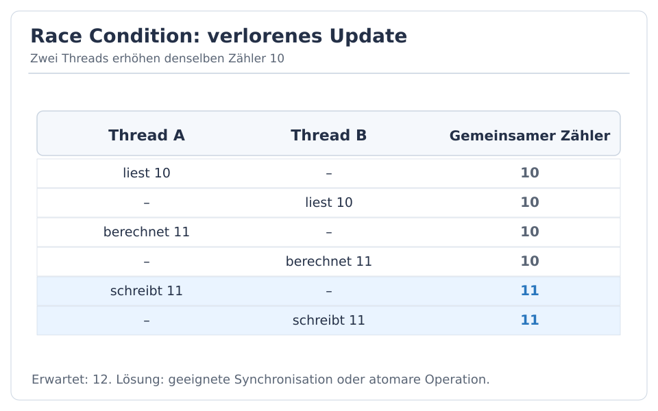

# M8-L3 – Betriebssysteme und Nebenläufigkeit vertieft {#L3}

**Kursbereich:** M8 – Bachelor: Kerngebiete

**Niveau:** Bachelor

**Vorwissen:** Keine festen Voraussetzungen angegeben.

**Einordnung:** freiwilliges Bachelor-Wahlthema

**Lernziel:** Verstehen, wie ein Betriebssystem mehrere Programme verwaltet, warum selbst auf einem einzigen Prozessor mehrere Tätigkeiten gleichzeitig *wirken*, wie Arbeit auf Rechenkerne verteilt wird, wie sich Programme Speicher und Daten sicher teilen und weshalb Synchronisationsfehler oft nur sporadisch auftreten. Die Lektion verlangt weder Installation noch Programmierung.

## Ausgangsfrage: Wer entscheidet, was der Computer als Nächstes tut? {#S1}

Auf einem Computer laufen gleichzeitig Musik, Browser, Bildbearbeitung, Dateisynchronisation und manchmal eine KI-Anwendung. Alle benötigen Rechenzeit, Arbeitsspeicher, Dateien und Netzwerkzugriff. Ohne eine koordinierende Instanz würden sie gegenseitig Speicher überschreiben, Geräte unkontrolliert bedienen oder die Rechenleistung vollständig beanspruchen. Diese koordinierende Instanz ist das **Betriebssystem** (*Operating System*, OS), insbesondere sein **Kernel**: der privilegierte Systemkern.

Der Kernel verwaltet Prozesse, Threads, Speicher, Geräte, Dateisysteme und Zugriffsrechte. Er vermittelt zwischen Programmen und Hardware. Ein Betriebssystem besteht aber nicht nur aus dem Kernel: Bibliotheken, Systemdienste, Benutzeroberflächen und Verwaltungswerkzeuge ergänzen ihn. Linux bezeichnet streng genommen zunächst einen Kernel; eine Linux-Distribution enthält darüber hinaus das nutzbare Betriebssystem. Windows kombiniert ebenfalls einen Kernel mit zahlreichen Systemkomponenten.

Die entscheidende Einsicht: **Gleichzeitigkeit ist nicht dasselbe wie parallele Ausführung.** Ein Computer kann mehrere Tätigkeiten koordinieren, auch wenn gerade nur eine davon tatsächlich rechnet. Ein Betriebssystem sorgt dafür, dass aus vielen konkurrierenden Anforderungen eine brauchbare Reihenfolge entsteht.

``` text
Benutzerprogramme
  Browser    Musik     Dateisuche    KI-Verarbeitung
      \        |           |             /
       \       |           |            /
        Betriebssystem: Kernel + Dienste
        - Scheduler: Wer erhält CPU-Zeit?
        - Speicherverwaltung: Wer darf wohin?
        - Dateisystem und Gerätetreiber
        - Sicherheit und Kommunikation
                         |
              CPU / RAM / SSD / Netzwerk
```

Mit diesem Grundbild lässt sich verstehen, warum „mehr Threads“ nicht immer „schneller“ bedeutet, warum ein blockierter Prozess nicht zwangsläufig Rechenzeit verschwendet und warum ein fehlerfreier Algorithmus bei gleichzeitigem Zugriff dennoch falsche Ergebnisse liefern kann.

## Programme, Prozesse und Threads: Drei verschiedene Ebenen {#S2}

Ein **Programm** ist zunächst gespeicherter Code, beispielsweise eine Anwendung auf einer SSD (*Solid-State Drive*). Wird es gestartet, entsteht mindestens ein **Prozess**: ein konkreter Ausführungskontext mit eigenem virtuellen Adressraum, Ressourcen und Zugriffsrechten. Ein Prozess kann ein oder mehrere **Threads** (*Ausführungsfäden*) besitzen. Threads sind die Einheiten, deren Ausführung das Betriebssystem normalerweise plant.

Ein Prozess besitzt typischerweise eine Prozesskennung, offene Dateien, eine Sicherheitsidentität, Speicherzuordnungen und mindestens einen Thread. Jeder Thread führt seine eigene Abfolge von Befehlen aus und hat unter anderem eigene Registerwerte und einen eigenen Stack. Threads **desselben Prozesses teilen sich dagegen den virtuellen Adressraum** und weitere Prozessressourcen. Das erleichtert die gemeinsame Datenverarbeitung, schafft aber neue Fehlerquellen. Microsoft dokumentiert diese Trennung ausdrücklich für Windows; der konzeptionelle Unterschied gilt auch für übliche Linux-Prozesse und -Threads \[1\].

``` text
Prozess: Medienanwendung
  Gemeinsamer virtueller Adressraum
  Gemeinsame geöffnete Datenbank-/Dateiverbindungen

  Thread 1: Benutzeroberfläche   eigener Stack / Register
  Thread 2: Vorschau berechnen  eigener Stack / Register
  Thread 3: Suchindex aufbauen eigener Stack / Register
```

Warum drei Threads? Die Benutzeroberfläche soll auf Eingaben reagieren, während eine große Datei gelesen und eine Vorschau berechnet wird. Eine Alternative wären drei separate Prozesse, die über definierte Nachrichten miteinander sprechen. Das isoliert Fehler oft besser: Stürzt ein Hilfsprozess ab, kann die Hauptanwendung möglicherweise weiterlaufen. Der Datenaustausch ist dafür aufwendiger, weil Speicher und Datenstrukturen nicht einfach gemeinsam beschreibbar sind.

**Wichtige Abgrenzung:** Ein Thread ist kein eigener Prozessor und auch nicht automatisch ein eigener CPU-Kern. Er ist eine vom Betriebssystem verwaltete Folge von Arbeit. Mehrere Threads können auf einem Kern abwechseln oder auf mehreren Kernen tatsächlich parallel laufen. Manche Laufzeitumgebungen verwenden zudem leichtgewichtige Anwender-Threads beziehungsweise Coroutines, die durch eine Bibliothek auf weniger Betriebssystem-Threads abgebildet werden. Die Begriffe sollten nicht vermischt werden.

## Nebenläufigkeit, Parallelität und Asynchronität {#S3}

**Nebenläufigkeit** (*Concurrency*) bedeutet, dass mehrere Tätigkeiten in überlappenden Zeiträumen voranschreiten und koordiniert werden müssen. **Parallelität** (*Parallelism*) bedeutet, dass mehrere Berechnungen physisch zur gleichen Zeit stattfinden, beispielsweise auf verschiedenen CPU-Kernen. **Asynchronität** beschreibt eine Programmorganisation, bei der eine aufgerufene Tätigkeit nicht zwingend abgeschlossen sein muss, bevor die nächste Tätigkeit beginnt; das Ergebnis kommt später zurück.

Ein einziges CPU-Kern kann zwei Threads zeitlich verschachteln:

``` text
Zeit  ----->
Kern 1: [A rechnet] [B rechnet] [A rechnet] [B rechnet]
```

Das ist nebenläufig, aber nicht gleichzeitig rechnend. Mit zwei Kernen kann echte Parallelität entstehen:

``` text
Zeit  ----->
Kern 1: [A rechnet.......................]
Kern 2: [B rechnet.......................]
```

Eine asynchrone Anwendung kann während eines Netzwerkzugriffs andere Aufgaben erledigen, ohne für jede Anfrage einen zusätzlichen Thread bereitstellen zu müssen. Das reduziert bei vielen wartenden Verbindungen den Ressourcenbedarf. **Asynchroner Code rechnet jedoch nicht automatisch schneller:** Wenn ein einzelner Thread eine minutenlange, CPU-intensive Bildanalyse ohne Unterbrechung ausführt, hilft eine asynchrone Oberfläche allein nicht. Dann sind zusätzliche ausführbare Threads, Prozesse oder Rechenressourcen gefragt.

Beispiel für die Unterscheidung: Ein Webserver, der auf Tausende Netzwerkantworten wartet, benötigt vor allem gute Ein-/Ausgabeorganisation. Ein Videokonverter, der in jedem Bild viele Millionen Operationen ausführt, profitiert eher von tatsächlicher Parallelisierung, solange Datentransfer und Speicher nicht zum Engpass werden. Ein einzelner langer Vorgang kann also *nebenläufig organisiert* sein, ohne auf mehrere Kerne aufgeteilt zu werden.

## Scheduling: Wem gibt der Kernel Rechenzeit? {#S4}

Der **Scheduler** ist der Planer des Betriebssystems. Er wählt aus den ausführungsbereiten Threads aus, welcher als Nächstes auf einem CPU-Kern laufen soll. Das Verfahren heißt **Scheduling**. Für unterschiedliche Anwendungen sind dabei verschiedene Ziele relevant: kurze Reaktion auf Tastendruck, fairer Anteil an CPU-Zeit, hoher Durchsatz, Energieersparnis oder möglichst geringe Verzögerungen bei zeitkritischen Aufgaben.

Ein Thread befindet sich vereinfacht in einem dieser Zustände:

``` text
                   Anforderung erfüllt
   +-----------+  --------------------> +-----------+
   | Wartend   |                        | Bereit    |
   | (blockiert)| <--- Warten ----------|           |
   +-----------+                        +-----------+
                                             |
                                        Scheduler wählt
                                             v
                                         +---------+
                          Unterbrechung  | Laufend |
                          ----------->   +---------+
                                zurück zu Bereit
```

Das Diagramm abstrahiert reale Kernelzustände. Entscheidend ist die Unterscheidung zwischen *bereit* und *wartend*: Ein Thread, der auf eine Datei oder Netzwerkdaten wartet, ist häufig gerade nicht bereit und belegt keinen Kern durch aktives Rechnen. Ein Thread in einer unnötigen Abfrageschleife dagegen kann dauerhaft CPU-Zeit verbrauchen.

### Unterbrechung und Kontextwechsel {#41-unterbrechung-und-kontextwechsel}

Beim **präemptiven Scheduling** kann der Scheduler einem laufenden Thread den Prozessor entziehen, etwa wenn eine höher priorisierte Aufgabe bereit wird. Er speichert den Ausführungskontext des bisherigen Threads – Register, Programmposition und weitere relevante Zustände – und setzt einen anderen fort. Das heißt **Kontextwechsel** (*Context Switch*).

Kontextwechsel kosten Zeit: Register- und Verwaltungszustände müssen behandelt werden, und der CPU-Cache passt möglicherweise schlechter zur neuen Aufgabe. Besonders viele Wechsel können daher Leistung verlieren lassen. Trotzdem ermöglichen sie eine reaktionsfähige Benutzeroberfläche und gerechtere Ressourcenverteilung. Zu wenige Unterbrechungen lassen dagegen zeitkritische Arbeit warten. **Eine einzige optimale Zeitscheibe für alle Anwendungen gibt es nicht.**

### Ein Zahlenbeispiel für Round Robin {#42-ein-zahlenbeispiel-für-round-robin}

Das Verfahren **Round Robin** gibt bereiten Aufgaben nacheinander eine Zeitscheibe. Für ein bewusst vereinfachtes Beispiel gelten folgende Voraussetzungen: ein Kern, drei CPU-intensive Threads A, B und C, alle von Beginn an bereit, keine Ein-/Ausgabe, kein Wechselaufwand, identische Priorität. Jeder braucht 6 Millisekunden (ms) reine CPU-Zeit. Die Zeitscheibe beträgt 2 ms.

``` text
Zeit in ms      0  2  4  6  8 10 12 14 16 18
Kern           | A| B| C| A| B| C| A| B| C|

Fertig: A bei 14 ms, B bei 16 ms, C bei 18 ms.
Gesamte CPU-Arbeit = 3 * 6 ms = 18 ms.
```

Der Computer erledigt dadurch **nicht mehr Gesamtarbeit** als bei serieller Ausführung. Der Gewinn liegt in der gleichmäßigeren Reaktionschance: Jeder Thread erhält schon früh ein Zeitfenster. Wenn jeder der **acht Übergänge zwischen den neun Zeitscheiben** im vereinfachten Modell zusätzliche 0,1 ms benötigt, wächst die Gesamtdauer von 18,0 auf **18,8 ms**. Das setzt weiterhin voraus, dass kein zusätzlicher Start- oder Endaufwand anfällt; tatsächliche Kontextwechselkosten sind nicht konstant. In realen Systemen bestimmen zusätzliche Faktoren wie Prioritäten, Wartezeiten, CPU-Affinität und Cacheverhalten die Reihenfolge. Die hier genannten Zeiten sind **rein didaktische Modellannahmen**, keine Messung eines Betriebssystems.

### Linux und Windows: Gleiches Ziel, andere Mechanismen {#43-linux-und-windows-gleiches-ziel-andere-mechanismen}

Unter Linux wurde der faire Scheduler lange durch **Completely Fair Scheduler** (CFS) geprägt. Die Linux-Kerneldokumentation beschreibt den Übergang zu **Earliest Eligible Virtual Deadline First** (EEVDF), das für bereite Aufgaben unter anderem virtuelle Laufzeit, Rückstand gegenüber ihrem fairen Anteil und virtuelle Fristen betrachtet \[2, 3\]. Deshalb wäre die Aussage „Linux nutzt heute einfach nur den alten CFS-Algorithmus“ zu ungenau. Kernelversion und Scheduling-Klasse spielen eine Rolle. Diese interne Berechnungsweise ist zudem **keine harte Echtzeitgarantie**.

Windows arbeitet für reguläre Threads mit Prioritätsstufen und kann die Priorität zeitweilig anpassen, etwa damit eine Benutzeroberfläche zügig reagiert. Hohe Prioritätsklassen können andere wichtige Systemarbeit verdrängen; Microsoft rät besonders zur Zurückhaltung bei der höchsten Echtzeit-Prioritätsklasse \[4\]. Das heißt nicht, dass sich Windows generell durch ein einziges starres Round-Robin-Modell vollständig erklären ließe: Prioritätsklassen, dynamische Anhebungen und verschiedene Systemzustände beeinflussen die tatsächliche Entscheidung.

Der praktische Vergleich ist wichtiger als die Namen einzelner Scheduler: Beide Betriebssystemfamilien möchten viele konkurrierende Aktivitäten nutzbar koordinieren. Unterschiede in Scheduling-Algorithmen, Energiemanagement, Treibern und Anwendungslaufzeiten bestimmen das tatsächliche Verhalten. Als Benutzer erkennt man die Folgen etwa an flüssiger Fensterbedienung trotz laufender Hintergrundberechnung oder an Verzögerungen bei voll ausgelasteten Kernen.

## Speicher: Warum jeder Prozess eine eigene Sicht erhält {#S5}

Der physische **Arbeitsspeicher** (*Random Access Memory*, RAM) ist eine begrenzte Ressource. Programme sollen ihn nutzen können, ohne zu wissen, welche physische Speicherstelle gerade frei ist. Die Lösung heißt **virtueller Speicher**: Ein Prozess sieht Adressen in einem eigenen virtuellen Adressraum. Die **Memory Management Unit** (MMU) der Hardware und vom Betriebssystem verwaltete **Seitentabellen** (*Page Tables*) übersetzen diese virtuellen Adressen in physische Speicherbereiche.

``` text
Prozess A              Seitentabellen               Physischer RAM
virtuelle Adresse  ----> Übersetzung / Rechte ----> Speicherseite X

Prozess B              andere Zuordnung             Physischer RAM
virtuelle Adresse  ----> Übersetzung / Rechte ----> Speicherseite Y
```

Derselbe numerische virtuelle Adresswert kann in zwei Prozessen auf unterschiedliche physische Speicherseiten zeigen. Das schützt die Prozesse vor zufälligem Überschreiben fremder Daten. Schutzmechanismen erlauben außerdem Regeln wie „lesbar, aber nicht schreibbar“ oder „ausführbarer Code statt Daten“. Virtuelle Speicherverwaltung ist damit **Ressourcenorganisation und ein Sicherheitsmechanismus**, aber keine absolute Garantie gegen alle Hardware- und Softwareangriffe.

### Speicherseiten und Page Faults {#51-speicherseiten-und-page-faults}

Ein **Page Fault** entsteht, wenn der Prozessor beim Speicherzugriff eine Ausnahme auslöst, weil die gewünschte Zuordnung fehlt oder nicht zum Zugriff passt. Das kann völlig normal sein, beispielsweise wenn eine Datei erst beim ersten Zugriff in den Arbeitsspeicher geholt wird. Es kann aber auch einen unzulässigen Zugriff anzeigen. Man muss daher einen harmlosen Seitenfehler zur Nachladung von einem Schutzfehler unterscheiden.

Linux dokumentiert unter anderem Demand Paging, Speicherabbildungen von Dateien und die Verwaltung virtuellen Speichers \[5\]. Vereinfacht kann der Kernel eine benötigte Speicherseite bereitstellen, eine Datei nachladen oder bei einem unzulässigen Zugriff einen Prozessfehler auslösen. **Nicht jeder Page Fault bedeutet, dass Daten von der SSD gelesen werden.** Manchmal muss nur eine bereits im RAM vorhandene Seite neu zugeordnet werden.

### Page Cache, Swap und Speicherknappheit {#52-page-cache-swap-und-speicherknappheit}

Betriebssysteme nutzen ungenutzten RAM häufig als **Page Cache**, beispielsweise für Dateiinhalte. So muss dieselbe Datei nicht bei jedem Lesen erneut vom Speichermedium geholt werden. Ein hoher RAM-Verbrauch durch Cache ist deshalb allein noch kein Speicherproblem: Der Kernel kann viele solcher Seiten bei Bedarf freigeben.

Bei Speicherknappheit kann das System je nach Konfiguration weniger genutzte, auslagerbare Speicherinhalte in einen Bereich auf Massenspeicher verschieben. Unter Linux spricht man oft von *Swap*, unter Windows ist die Auslagerungsdatei (*Pagefile*) ein Teil des virtuellen Speichersystems. **Swap erweitert nicht den physischen RAM.** Aufwendiges ständiges Auslagern und Nachladen kann Prozesse massiv ausbremsen; das heißt **Thrashing**. Zusätzlich können Betriebssysteme bei extremer Knappheit Prozesse beenden oder Speicheranforderungen ablehnen. Betriebssystemversion und Einstellungen bestimmen die Details.

Ein typischer Denkfehler lautet: „Die SSD ist schnell genug, also brauche ich wenig RAM.“ Zwar kann eine schnelle SSD manche Wartezeit verkürzen, aber Speicherzugriff über RAM bleibt grundsätzlich anders als Nachladen über einen Massenspeicher. Bei KI-Inferenz kommt noch Grafikspeicher (VRAM) hinzu, der wiederum eigene Beschränkungen hat. Ein Modell kann auf dem Datenträger klein erscheinen und dennoch während des Betriebs viele Zwischenspeicher benötigen.

### Warum isolierte Prozesse trotzdem zusammenarbeiten können {#53-warum-isolierte-prozesse-trotzdem-zusammenarbeiten-können}

Zwei Prozesse können über ausdrücklich freigegebene **Shared-Memory-Bereiche** denselben physischen Speicher nutzen. Das ist schneller als das wiederholte Kopieren großer Datenmengen, aber jede gemeinsame, veränderliche Datenstruktur muss korrekt synchronisiert werden. Die Speicherisolation wird nicht „abgeschaltet“; vielmehr richtet das System eine kontrollierte gemeinsame Zuordnung ein.

Für geringere Datenmengen bieten sich oft **Pipes**, lokale **Sockets** oder strukturierte Nachrichten an. Diese Verfahren sind Teil der **Interprozesskommunikation** (*Interprocess Communication*, IPC). Sie schaffen eine definierte Schnittstelle, über die Programme statt direkter Manipulation fremden Speichers zusammenarbeiten. Microsoft dokumentiert für Windows unter anderem Pipes, Shared Memory und Remote Procedure Calls als IPC-Möglichkeiten \[6\].

## Race Conditions: Wenn die Reihenfolge das Ergebnis verändert {#S6}

Die größte Schwierigkeit gemeinsamer Daten liegt darin, dass mehrere Threads **denselben Wert lesen und verändern** können. Eine **Race Condition** entsteht, wenn das Ergebnis davon abhängt, in welcher Reihenfolge nicht ausreichend koordinierte Operationen stattfinden. Nicht jeder zeitabhängige Ablauf ist automatisch fehlerhaft; problematisch ist ein Ablauf, bei dem erforderliche Korrektheitsbedingungen verletzt werden.

{alt="Zwei Threads lesen denselben Zählerwert 10 und schreiben beide 11 zurück. Das Resultat 11 ist falsch, da nach zwei Erhöhungen 12 erwartet wird."}

Verlorenes Update: Aus zwei unkoordinierten Inkrementen wird nur eines sichtbar.

Angenommen, ein Medienarchiv speichert einen gemeinsamen Zähler für fertig analysierte Bilder. Der Zähler steht zunächst auf 10. Zwei Threads sollen jeweils genau ein Bild abschließen. Die scheinbar einfache Anweisung „Zähler um eins erhöhen“ lässt sich gedanklich in drei Schritte zerlegen: Wert lesen, eins addieren, neuen Wert schreiben.

  Zeitpunkt   Thread A       Thread B         Gemeinsamer Zähler
  ----------- -------------- -------------- --------------------
  1           liest 10       –                                10
  2           –              liest 10                         10
  3           berechnet 11   –                                10
  4           –              berechnet 11                     10
  5           schreibt 11    –                                11
  6           –              schreibt 11                      11

Am Ende steht **11 statt 12**. Das ist ein *verlorenes Update*. Beide Threads haben ihre Arbeit erledigt, doch nur eine Erhöhung ist sichtbar. Werden die Schritte zufällig anders verschachtelt, kann auch das richtige Ergebnis 12 entstehen. Genau deshalb sind solche Fehler schwer nachzustellen.

Eine Lösung besteht darin, den ganzen kritischen Abschnitt gegen gleichzeitige Änderungen zu schützen:

``` text
Zähleränderung als geschützter Abschnitt:
  Sperre erwerben
  aktuellen Zähler lesen
  neuen Zähler berechnen und schreiben
  Sperre freigeben
```

Alternativ gibt es für geeignete einfache Operationen **atomare Operationen** (*Atomics*): Mechanismen, bei denen eine Änderung aus Sicht anderer Threads als unteilbarer Vorgang erfolgt. Die tatsächlichen Garantien hängen von Hardware, Programmiersprache und Speicherordnungsmodell ab. „Atomic“ bedeutet weder automatisch „beliebig große Transaktion“ noch, dass mehrere zusammengehörige Felder ohne weitere Koordination gemeinsam korrekt aktualisiert werden.

Bei einer Datenbank wäre ein eigener Zähler im Arbeitsspeicher häufig ohnehin die falsche Lösung, wenn die Zahl zuverlässig und nach einem Neustart erhalten bleiben muss. Dort sind Datenbanktransaktionen und passende Abfrageoperationen sinnvoll, wie in [M3-L5 – Verteilte Korrektheit](M3-L5.md) beschrieben. Betriebssystem-Sperren schützen **lokalen gemeinsamen Speicher**, nicht automatisch den Zustand einer verteilten Datenbank auf mehreren Servern.

## Die wichtigsten Mittel zur Synchronisation {#S7}

**Synchronisation** heißt, zeitliche Abhängigkeiten und gemeinsame Ressourcen bewusst zu koordinieren. Das Betriebssystem und die Programmiersprache stellen verschiedene Werkzeuge zur Verfügung. Sie haben ähnliche Ziele, aber unterschiedliche Eigenschaften.

### Mutex – einer zur gleichen Zeit {#71-mutex-einer-zur-gleichen-zeit}

Ein **Mutex** (aus *Mutual Exclusion*, gegenseitiger Ausschluss) erlaubt typischerweise nur einem Thread gleichzeitig den Zugriff auf einen bestimmten kritischen Bereich. Andere Threads warten, bis die Sperre freigegeben wird. Wichtig ist das Konzept der **Sperren-Eigentümerschaft**: Ein Thread erwirbt und gibt einen Mutex nach den Regeln der jeweiligen Programmierschnittstelle wieder frei.

Ein guter Mutex schützt nur den tatsächlich gemeinsamen Zustand und bleibt möglichst kurz gehalten. Sperrt eine Anwendung ausgerechnet während einer minutenlangen Netzwerkabfrage, blockiert sie möglicherweise alle anderen Nutzer derselben Datenstruktur. Locking ist also ein Korrektheitsmittel, aber auch ein möglicher Engpass.

### Semaphore – eine begrenzte Anzahl Zugänge {#72-semaphore-eine-begrenzte-anzahl-zugänge}

Ein **Semaphore** verwaltet vereinfacht eine Zahl verfügbarer Genehmigungen. Damit kann man beispielsweise höchstens vier aufwendige Hintergrundaufträge gleichzeitig zulassen. Anders als ein typischer Mutex muss ein zählender Semaphore nicht dieselbe Eigentümerschaftssemantik besitzen. Der Semaphore begrenzt damit die **Gleichzeitigkeit**, garantiert aber nicht automatisch die Korrektheit gemeinsam veränderter Daten.

Eine häufige Anwendung ist ein kleiner Pool knapper Ressourcen, etwa vier Decoder oder Datenbankverbindungen. Ist der Pool voll, warten weitere Anfragen. Das schützt vor Überlast, solange wartende Arbeit und Warteschlangen ebenfalls begrenzt werden. Wird unbegrenzt aufgestaut, verschiebt man das Problem nur.

### Condition Variables und Ereignisse {#73-condition-variables-und-ereignisse}

Eine **Bedingungsvariable** (*Condition Variable*) lässt Threads darauf warten, dass sich ein bestimmter Zustand verändert, beispielsweise „die Warteschlange enthält einen Auftrag“. Oft verwendet man sie zusammen mit einem Mutex, der die dazugehörige Bedingung schützt. Nach einem Aufwecken sollte die Bedingung erneut geprüft werden, denn andere Threads können sie inzwischen verändert haben; auch scheinbar unerwartete Aufweckvorgänge sind in verbreiteten Schnittstellen möglich.

**Events** oder Signale innerhalb einer Anwendung lösen ein ähnliches Organisationsproblem: Es gibt etwas Neues zu tun. Die genauen Garantien unterscheiden sich jedoch. Ein Ereignis signalisiert noch nicht automatisch, wem ein Auftrag gehört oder dass dessen Verarbeitung einmalig erfolgt.

### Read/Write Locks und atomare Variablen {#74-readwrite-locks-und-atomare-variablen}

Eine **Leser-Schreiber-Sperre** kann mehrere gleichzeitige Leser, aber für gewöhnlich nur einen exklusiven Schreiber zulassen. Das hilft bei Daten, die selten verändert und häufig gelesen werden. Bei vielen Schreibzugriffen oder langen Leserphasen kann das Verfahren jedoch schlechter skalieren; Fairness und mögliche Verdrängung hängen von der konkreten Implementierung ab.

**Atomare Variablen** eignen sich für einzelne Zustandswerte und bestimmte Koordinationsmuster. Werden mehrere Änderungen miteinander verknüpft, braucht man möglicherweise weiter einen Mutex, eine Transaktion oder ein sorgfältig konstruiertes lockfreies Verfahren. Das Schlagwort **lock-free** bedeutet nicht automatisch schneller oder einfacher: Komplexe Speicherordnungsregeln und Probleme bei der Speicherfreigabe können die Wartung erschweren.

Die Linux-Kerneldokumentation unterscheidet beispielsweise schlafende Sperren, drehende Sperren (*Spinlocks*) und Varianten mit besonderen Echtzeiteigenschaften \[7\]. Ein Spinlock wartet, indem er zunächst wiederholt prüft, ob die Ressource frei ist – was bei sehr kurzen Wartezeiten sinnvoll, bei langem Blockieren aber teuer sein kann. Anwendungscode sollte nicht ohne Not eigene Synchronisationsprimitive erfinden.

## Deadlocks, Livelocks und Starvation {#S8}

Eine **Verklemmung** (*Deadlock*) entsteht, wenn Beteiligte dauerhaft auf Ressourcen warten, die von anderen Beteiligten gehalten werden, und keiner fortschreiten kann.

Nehmen wir einen Dateimanager mit zwei Datenstrukturen: einer Metadatenliste und einer Vorschauliste. Zwei Threads benötigen beide Sperren, aber in unterschiedlicher Reihenfolge.

``` text
Thread A                       Thread B
--------                       --------
Sperre M erwerben              Sperre V erwerben
Sperre V anfordern ---+   +--- Sperre M anfordern
                      |   |
                      v   v
              A wartet auf B
              B wartet auf A
              => Deadlock
```

Die vereinfachte Darstellung zeigt einen Kreis: A hält M und wartet auf V; B hält V und wartet auf M. Solange niemand eine Ressource freigibt oder ein externer Abbruch eingreift, kommen beide nicht weiter. Dieser Ablauf ist ein Beispiel für die vier klassischen Bedingungen, die gemeinsam Deadlocks ermöglichen: exklusiv gehaltene Ressource, Halten und zusätzliches Warten, keine erzwungene Wegnahme sowie zyklisches Warten.

**Eine wirksame Vorbeugung ist eine einheitliche Sperrreihenfolge.** Wenn beide Threads stets zuerst M und anschließend V erwerben, kann diese konkrete zyklische Wartekonstellation nicht entstehen. Weitere Mittel sind kurze kritische Abschnitte, Timeouts, kontrollierte Rückgaben bei Fehlern und gegebenenfalls die Verwendung einer einzigen Sperre für eng zusammengehörige Daten. Timeouts helfen beim Abbruch, beweisen aber nicht, dass ein komplexes System generell deadlockfrei ist.

Nicht alles, was sich „aufhängt“, ist ein Deadlock. Beim **Livelock** reagieren Threads ständig aufeinander, arbeiten aber nicht sinnvoll voran. Bei **Starvation** (Verhungern) erhält eine einzelne Aufgabe auf Dauer zu wenig Zugriff auf eine Ressource, obwohl andere Aufgaben weiterlaufen. Hohe Prioritäten und einseitige Sperrbevorzugung können so etwas begünstigen. Das Ziel von Scheduling und Synchronisation ist daher nicht nur hohe Geschwindigkeit, sondern auch vorhersehbarer Fortschritt.

### Prioritätsumkehr als Sonderfall {#81-prioritätsumkehr-als-sonderfall}

Eine überraschende Form von Verzögerung entsteht, wenn ein Thread mit niedriger Priorität eine Sperre hält, die ein hochpriorisierter Thread braucht. Kommt ein dritter Thread mittlerer Priorität dazwischen, kann er die Freigabe verzögern: Der niedrig priorisierte Sperrenbesitzer erhält selbst nicht genügend CPU-Zeit. Das heißt **Prioritätsumkehr** (*Priority Inversion*).

**Priority Inheritance** (Prioritätsvererbung) ist eine Gegenmaßnahme: Der Sperrenbesitzer erhält vorübergehend die höhere Priorität des Wartenden, damit er seine kurze Arbeit beenden kann. Linux beschreibt solche Mechanismen für spezielle Echtzeit-Mutexe \[8\]. Sie lösen jedoch nicht jede Form ungeeigneter Sperrenarchitektur.

## Kommunikation zwischen Prozessen: lieber Nachrichten als unkontrollierter Zugriff? {#S9}

Getrennte Prozesse teilen gewöhnlich nicht einfach ihre privaten Variablen. Sie tauschen Informationen über **Interprozesskommunikation (IPC)** aus. Für die Auswahl hilft die Frage, was ausgetauscht wird und welche Fehlertoleranz benötigt wird.

  Verfahren                  Typische Idee                                          Vorteil                                 Grenze
  -------------------------- ------------------------------------------------------ --------------------------------------- ----------------------------------------------------------
  Pipe                       Ein Byte-/Nachrichtenstrom zwischen Prozessen          Relativ einfache lokale Kopplung        Protokoll und Ende des Datenstroms müssen definiert sein
  Lokaler Socket             Kommunikationsendpunkt auf demselben Rechner           Gute Entkopplung                        Serialisierung, Puffer und Berechtigungen
  Shared Memory              Beide Prozesse sehen bewusst freigegebenen Speicher    Effizient bei großen Daten              Synchronisation, Zugriffsschutz, Lebensdauer
  Nachrichtenwarteschlange   Aufträge werden geordnet gespeichert bzw. zugestellt   Entkoppelt Verarbeitungsschritte        Doppelte Nachrichten, Rückstau, Ausfälle
  Datei oder Datenbank       Austausch über dauerhafte Speicherung                  Wiederherstellbar und nachvollziehbar   Zusätzliche Ein-/Ausgabe, Konfliktregeln

Eine lokale Nachricht ist nicht automatisch **dauerhaft** gespeichert. Und eine zuverlässige Warteschlange garantiert nicht zwangsläufig, dass eine fachliche Aktion exakt einmal ausgeführt wird. Die Grenzen von wiederholter Verarbeitung, Quittierung und Idempotenz werden in [M4-L1 – Verteilte Verarbeitung](M4-L1.md) erklärt.

Für kleine Desktop-Programme kann ein Prozess mit wenigen Threads ausreichen. Für eine Anwendung, die instabile Bilddecoder oder fremde Dateiformate verarbeitet, kann ein isolierter Hilfsprozess dagegen sinnvoller sein. Er schafft eine Fehlergrenze: Ein fehlerhafter Decoder soll nicht die gesamte Hauptanwendung mitreißen. **Zusätzliche Prozesse und IPC sind Architekturentscheidungen mit Wartungsaufwand**, keine automatische Qualitätssteigerung.

## Synchronisation und Geschwindigkeit: Warum mehr Threads langsamer sein können {#S10}

Angenommen, die seriell auszuführende Arbeit benötigt 30 Prozent der gesamten Rechenzeit, während 70 Prozent ideal parallelisierbar wären. Unter der vereinfachten Annahme von vier gleich schnellen Kernen, ohne Zusatzkosten, beträgt die neue Laufzeit relativ zur alten:

$$
\begin{aligned}
\text{Serieller Anteil:}\quad&0{,}30\\
\text{Paralleler Anteil:}\quad&\frac{0{,}70}{4}=0{,}175\\
\text{Gesamtlaufzeit:}\quad&0{,}475\,\text{der ursprünglichen Zeit}\\
\text{Idealisiertes Speedup:}\quad&\frac{1}{0{,}475}=2{,}105\ldots
\end{aligned}
$$

Das ist eine Anwendung von **Amdahls Gesetz**: Selbst vier Kerne liefern hier höchstens ungefähr **2,11-fache Beschleunigung**, solange der 30-Prozent-Anteil unverändert seriell bleibt. Reale Programme schneiden wegen Synchronisation, Datenkopien, Cache-Konkurrenz, Scheduling und Ein-/Ausgabe häufig noch schlechter ab. Umgekehrt kann eine bessere Datenstruktur oder ein schnellerer serieller Algorithmus mehr bewirken als zusätzliche Threads.

**Lock Contention** bedeutet, dass viele Threads dieselbe Sperre benötigen und deshalb warten. Erhöht man ihre Zahl, wachsen Warteschlangen oder Kontextwechsel möglicherweise stärker als der Nutzen. Die Frage lautet daher nicht „Wie viele Threads kann ich starten?“, sondern „Welcher Anteil der Arbeit kann unabhängig gerechnet werden, und welche Ressourcen begrenzen den Fortschritt?“

Wesentliche Messgrößen wären CPU-Auslastung pro Kern, Wartezeiten, I/O-Durchsatz, Speicherbelegung, Seitenfehler und die Dauer kritischer Abschnitte. Eine einzelne Gesamt-CPU-Anzeige ist kein zuverlässiger Beweis für effiziente Parallelität. Man kann alle Kerne mit nutzloser Wartearbeit auslasten und trotzdem wenig erledigen.

## Echtzeit: Die richtige Antwort muss rechtzeitig kommen {#S11}

Im Alltag bedeutet „Echtzeit“ oft „sehr schnell“. In der Informatik meint **Echtzeit** hingegen, dass ein Ergebnis **innerhalb einer festgelegten Frist** zur Verfügung stehen muss. Eine Berechnung mit 5 ms Laufzeit kann ungeeignet sein, wenn der späteste zulässige Zeitpunkt bei 2 ms liegt. Ein langsamerer, aber zuverlässig begrenzter Ablauf kann für eine Steuerung geeigneter sein als ein durchschnittlich sehr schneller Ablauf mit gelegentlichen langen Verzögerungen.

- **Harte Echtzeit:** Verpasste Fristen können eine Systemfunktion unzulässig oder gefährlich machen. Die tatsächlichen Sicherheitsanforderungen müssen fachlich geprüft werden.
- **Weiche Echtzeit:** Verzögerungen verschlechtern die Qualität, sind aber nicht in jedem Einzelfall ein Totalausfall, etwa bei manchen Medienwiedergaben.

Für zeitkritische Systeme gibt es spezielle Scheduling-Verfahren, Echtzeitbetriebssysteme (*Real-Time Operating Systems*, RTOS) und unter Linux beispielsweise den **PREEMPT_RT**-Ansatz zur Verbesserung der Vorhersagbarkeit von Reaktionszeiten \[9\]. Solche Verfahren verkleinern bestimmte Verzögerungen, sind aber **keine pauschale Garantie für die Einhaltung jeder Frist**. Dazu müssen die komplette Hardware, Gerätetreiber, Speicherzugriffe, Aufgabenlast, Unterbrechungen und Fehlerfälle berücksichtigt werden.

Ein Sprachmodell, das bei einer Roboterbewegung eine Handlungsanweisung formuliert, ist normalerweise nicht das System, das millisekundengenau den Motorstrom regeln sollte. Die sichere Bewegungsregelung gehört in einen gesondert entworfenen, geeigneten Steuerungspfad. [M6-L7 – Robotik](M6-L7.md) erläutert diese Trennung.

## Drei praktische Architekturbeispiele {#S12}

### Lokales Medienarchiv mit flüssiger Benutzeroberfläche {#121-lokales-medienarchiv-mit-flüssiger-benutzeroberfläche}

Ein privates Medienarchiv besitzt eine Suchansicht und soll große Bilder einlesen, Prüfsummen bilden und Miniaturen erzeugen. Würden sämtliche Dateizugriffe und Berechnungen im Benutzeroberflächen-Thread erfolgen, reagierte das Programm möglicherweise während einer großen Operation nicht mehr auf Eingaben.

``` text
Benutzeroberfläche (Thread 1)
        |
        v
  begrenzte Auftragswarteschlange
        |
   +----+--------+
   |             |
Worker A      Worker B       (Threads oder Prozesse)
  liest          dekodiert
  Datei          Bild
   |             |
   +----+--------+
        |
   Ergebnisnachricht
        |
   UI aktualisieren
```

Die wartende Benutzeroberfläche verarbeitet Ergebnisse, ohne lange auf Decoder zu blockieren. Eine Begrenzung auf wenige Worker schützt CPU, RAM und Festplattenzugriffe vor Überlast. Wenn fremde Mediendateien potenziell fehlerhaft sind, kann man kritische Decoder in separate Prozesse auslagern. Die Dateiergebnisse werden über Nachrichten oder eine Datenbank koordiniert, statt dass alle Threads ungeschützt dieselbe Sammlung verändern.

**Wann unnötig?** Bei einem kleinen Archiv mit wenigen, schnell zu lesenden Dateien kann ein einfacher Hintergrund-Thread ausreichen. Ein umfangreiches Prozess- und Nachrichtenmodell kann die Fehlersuche dann nur erschweren. **Betrieb und Datenschutz:** Private Dateipfade, Vorschaubilder und Logdaten verbleiben lokal; unnötige Diagnoseprotokolle sollten keine persönlichen Dateinamen offenlegen.

### Analyse-Webdienst auf einem virtuellen Server {#122-analyse-webdienst-auf-einem-virtuellen-server}

Ein kleiner Webdienst nimmt Berechnungsaufträge entgegen. Netzwerkanfragen dauern kurz, die eigentliche Statistikberechnung möglicherweise Sekunden. Wird jede Anfrage direkt im Web-Thread vollständig durchgerechnet, blockiert sie andere Benutzer.

``` text
Nutzer -> Webserver (asynchrone Ein-/Ausgabe)
             |
             v
       Auftragsdatenbank/Queue
             |
       begrenzter Worker-Pool
             |
        Ergebnis speichern
             |
       Antwort auf Abfrage
```

Die Trennung zwischen Netzwerkanfragen und Hintergrundarbeit reduziert blockierende Wartezeit. Der Worker-Pool darf nur so viele CPU-intensive Aufträge gleichzeitig ausführen, wie tatsächlich sinnvoll sind. Bei einem VPS (*Virtual Private Server*) teilen sich Prozesse die zugeteilten CPU- und RAM-Ressourcen; außerdem kann ein Hypervisor die verfügbaren physischen Rechenkerne über mehrere Kunden aufteilen. Das ist eine weitere Scheduling-Ebene, nicht automatisch ein Defekt der Anwendung.

**Ausfallfragen:** Was geschieht mit halb bearbeiteten Aufträgen nach einem Neustart? Eine rein lokale In-Memory-Warteschlange kann verloren gehen. Persistente Auftragsdaten, Wiederholungsregeln und eindeutige Kennungen müssen je nach Zuverlässigkeitsziel vorgesehen werden. **Kosten:** Mehr CPU-Kerne oder ein größerer Server können Wartezeiten reduzieren, ersetzen aber keine Korrektheit bei gemeinsamem Datenzugriff. **Datenschutz:** Mandantendaten müssen logisch und durch Berechtigungen getrennt bleiben; eine Prozessgrenze allein ist kein vollständiges Mandantenkonzept.

### Echtzeitnahe Steuerung plus KI-Analyse {#123-echtzeitnahe-steuerung-plus-ki-analyse}

Ein mobiler Roboter erfasst fortlaufend Sensordaten, entscheidet über seine Bewegung und kann zusätzlich von einem KI-Dienst eine Beschreibung seiner Umgebung erhalten. Diese Aufgaben haben unterschiedliche Zeitansprüche.

``` text
Sensoren -> Lokale zeitkritische Regelung -> Motoren
                 ^
                 |
       feste Grenzen / Not-Halt

Kamera ----> Bildanalyse / KI-Worker ----> Vorschlag
                                   |
                   geprüftes, langsameres Planungsmodul
```

Die Regelung darf nicht darauf warten, dass ein großer Bildanalyse-Worker oder ein entferntes Sprachmodell antwortet. Solche Ergebnisse können **geprüfte Planungshinweise** liefern; die unmittelbare Bewegungsgrenze und Sicherheitsabschaltung müssen separat funktionieren. Ein niedrig priorisierter Protokollierungsdienst darf eine zeitkritische Steuerung nicht durch unnötige Sperren blockieren. Echtzeitbetrieb, Sensorfusion und Sicherheitsarchitektur erfordern mehr als das Setzen einer besonders hohen Thread-Priorität.

**Wann unnötig?** Für eine reine Simulation ohne physische Auswirkungen reichen oft die normalen Scheduling- und Messverfahren. **Betrieb:** Echtzeitaufgaben benötigen festgelegte Lastgrenzen, regelmäßige Tests unter Überlast und Fehlerannahmen. **Sicherheit:** Eine Software-Sicherheitsfunktion ist nur so verlässlich wie ihre vollständige Auslegung; dieses Lesebeispiel ist keine Freigabe für eine reale Robotiksteuerung.

## Entscheidungshilfe: Welche Architektur passt? {#S13}

  Ausgangslage                            Zuerst prüfen                                 Eher geeignet                                     Häufig unnötig oder problematisch
  --------------------------------------- --------------------------------------------- ------------------------------------------------- ---------------------------------------------------------
  Ein kleines lokales Programm            Wo blockiert die Oberfläche?                  Ein UI-Thread und wenige Hintergrundaufgaben      Viele gegenseitig abhängige Threads
  Viele wartende Netzverbindungen         Warten auf I/O statt Rechnen?                 Asynchrone I/O und begrenzte Worker               Für jede Verbindung dauerhaft ein CPU-intensiver Thread
  CPU-intensive unabhängige Datenarbeit   Parallelisierbarer Anteil und Datenbewegung   Begrenzter Thread-/Prozesspool                    Mehr Worker als nutzbare Ressourcen
  Fehleranfällige externe Komponenten     Wie groß muss die Fehlergrenze sein?          Separate Hilfsprozesse mit IPC                    Ungeschützter Shared Memory
  Gemeinsame veränderliche Daten          Welche Invarianten müssen gelten?             Mutex, Atomics oder Transaktionen je nach Ebene   Bloßes Hoffen auf „richtige“ Ausführungsreihenfolge
  Zeitkritische Maschine                  Welche Fristen und Ausfallfolgen gelten?      Geeignete Echtzeit-/Sicherheitsarchitektur        LLM-Antworten direkt als Motorregler

Die Tabelle ersetzt keine Messung. Sie hilft, zunächst die **Art des Problems** zu erkennen. Ein hoher CPU-Verbrauch kann auf sinnvolle Arbeit, zu viele Worker, eine Polling-Schleife oder schlechten Speicherzugriff zurückgehen. Gleiche Symptome können unterschiedliche Ursachen haben.

### Kosten, Wartung und Sicherheit {#131-kosten-wartung-und-sicherheit}

Nebenläufige Software ist anspruchsvoller zu testen, weil die Reihenfolge der Operationen schwankt. **Zeitlich seltene Bugs** können unter hoher Last erst nach langer Laufzeit sichtbar werden. Monitoring und Tests sollen deshalb nicht nur den Normalfall betrachten, sondern auch Prozessabbrüche, hohe Speicherlast, Unterbrechungen, verzögerte Geräteantworten und Fehler beim Freigeben von Sperren.

Ein Betriebssystem verwaltet Sicherheitskontexte, doch eine Anwendung muss selbst korrekte Berechtigungen einsetzen: Wer darf auf eine Pipe zugreifen? Welche Daten landen in Shared Memory? Werden temporäre Dateien gelöscht? Ist der Prozess mit unnötigen Administratorrechten gestartet? Der Ressourcenvorteil eines einzigen Prozesses kann durch die größere gemeinsame Fehlerdomäne ausgeglichen werden.

Auch das Auslagern in viele Container macht lokale Race Conditions nicht automatisch unwahrscheinlicher. Container sind keine eigenen Hardwaremaschinen und verwenden unter Linux üblicherweise denselben Host-Kernel. Ein Fehler in einer gemeinsam genutzten Datenbank oder einem externen Speicher bleibt über Prozess- und Containergrenzen hinweg ein gemeinsames Problem. Damit verknüpft M8-L3 die Betriebssystemebene mit den späteren Themen zu verteilten Datenbanken und Cloud-Betrieb.

## Verbindung zum Mathematik-Lernkurs und zu späteren Studienmodulen {#S14}

Das formale Hintergrundwissen lässt sich an drei grundlegenden Mathematikthemen festmachen: **Aussagenlogik** beschreibt Bedingungen wie „Sperre ist frei“, **Zustandsübergänge** modellieren das Verhalten eines Threads, und **gerichtete Graphen** helfen, Warteabhängigkeiten und mögliche Deadlocks darzustellen. In M8-L1 wurden diese Werkzeuge konzeptionell eingeführt. Für Amdahls Gesetz genügt einfache Bruchrechnung.

Die Verbindungen zum eigenständigen Projekt *Lernkurs Mathematik* sind hier **inhaltliche Vorschläge**. Dessen aktuelle Roadmap und Modulkennungen wurden für diese Lektion nicht eingesehen; es werden deshalb keine angeblich passenden Mathematik-Dateien oder Fortschrittsstände behauptet. Wer später die Theorie vertiefen möchte, kann Zustandsräume, Invarianten, formale Verifikation und Scheduling-Beweise studieren. Formale Verifikation ist als mögliche zusätzliche Master-Vertiefung vorgemerkt, aber noch keine eigene Wahllektion dieses Kurses.

## Zusammenfassung und Ausblick {#S15}

Ein Betriebssystem vermittelt zwischen konkurrierenden Programmen und begrenzter Hardware. Es sorgt durch Scheduling für Fortschritt, durch virtuelle Speicherverwaltung für geordnete Adressräume und durch Schnittstellen für kontrollierte Zusammenarbeit. Threads erleichtern die gemeinsame Bearbeitung von Daten, schaffen aber Risiken wie Race Conditions, Deadlocks und unbeabsichtigte Wartezeiten. Mehr Parallelität hilft nur, wenn ein nennenswerter Teil der Arbeit unabhängig ausführbar ist und Synchronisations- sowie Speicheraufwand den Gewinn nicht aufzehren.

Die wichtigsten Unterschiede zum Mitnehmen sind: **Nebenläufigkeit ist nicht zwingend Parallelität; blockiert ist nicht dasselbe wie CPU-ausgelastet; atomar ist nicht automatisch transaktional; priorisiert ist nicht garantiert echtzeitfähig.** Diese Unterscheidungen tauchen bei Desktopanwendungen, Webdiensten, KI-Verarbeitung und Robotik immer wieder auf.

Die bereits fertige Anschlusslektion [M9-L1 – Benutzeroberflächen, Barrierefreiheit und Softwareergonomie](M9-L1.md) wechselt vom Innenleben des Betriebssystems zur Mensch-Computer-Interaktion. Die inzwischen fertig ausgearbeiteten Master-Kernlektionen [M7-L2](M7-L2.md) und [M7-L3](M7-L3.md) greifen Korrektheit und verteilte Fehlermodelle auf; spezielle Master-Wahlthemen bleiben unbegonnen.

## Einordnung in die kursweiten Lesewege {#S16}

Dies ist eine **freiwillige Bachelor-Wahllektion**, keine zusätzliche Hauptkurslektion. Die inhaltliche Brücke führt unter anderem zu [M7-L3 im Master-Kern](M7-L3.md). Weitere Routen: [kursweite Lesewege](pages/pfad.md) und [Kursindex](pages/index.md).


## Quellen {#S17}

**Dokumentierter Quellenstand:** 04.11.2026

**Fachlicher Quellenabgleich: 04.11.2026.** Die folgenden Dokumentationen stützen Definitionen und betriebssystemspezifische Aussagen; Zahlen, Diagramme und Architekturfälle sind eigens konstruierte didaktische Beispiele. Betriebssystemdetails können sich zwischen Versionen ändern. Das Register unter `../../quellen/QUELLEN-WAHLTHEMEN.md` führt dieselben Quellen mit Einordnung.

1.  **Microsoft Learn**, *About Processes and Threads*: [https://learn.microsoft.com/en-us/windows/desktop/ProcThread/about-processes-and-threads](https://learn.microsoft.com/en-us/windows/desktop/ProcThread/about-processes-and-threads) — Prozesse, Threads, Adressräume und Ressourcen.
2.  **The Linux Kernel Documentation**, *EEVDF Scheduler*: [https://docs.kernel.org/scheduler/sched-eevdf.html](https://docs.kernel.org/scheduler/sched-eevdf.html) — virtueller Rückstand und Deadline-basiertes Scheduling bei fairen Klassen.
3.  **The Linux Kernel Documentation**, *CFS Scheduler*: [https://docs.kernel.org/scheduler/sched-design-CFS.html](https://docs.kernel.org/scheduler/sched-design-CFS.html) — historischer fairer Linux-Scheduler und sein Übergang zu EEVDF.
4.  **Microsoft Learn**, *Scheduling Priorities*: [https://learn.microsoft.com/en-us/windows/win32/procthread/scheduling-priorities](https://learn.microsoft.com/en-us/windows/win32/procthread/scheduling-priorities) — Prioritätsstufen und Warnungen vor überhöhten Threadprioritäten.
5.  **The Linux Kernel Documentation**, *Memory Management*: [https://docs.kernel.org/admin-guide/mm/](https://docs.kernel.org/admin-guide/mm/) — virtueller Speicher, Demand Paging und weitere Speicherverwaltung.
6.  **Microsoft Learn**, *Interprocess Communications*: [https://learn.microsoft.com/en-us/windows/win32/ipc/interprocess-communications](https://learn.microsoft.com/en-us/windows/win32/ipc/interprocess-communications) — Pipes, Dateizuordnung, Prozesskommunikation.
7.  **The Linux Kernel Documentation**, *Lock types and their rules*: [https://docs.kernel.org/locking/locktypes.html](https://docs.kernel.org/locking/locktypes.html) — Mutex, Semaphore, Spinlocks, Locking unter PREEMPT_RT.
8.  **The Linux Kernel Documentation**, *RT-mutex subsystem with PI support*: [https://origin.kernel.org/doc/html/latest/locking/rt-mutex.html](https://origin.kernel.org/doc/html/latest/locking/rt-mutex.html) — Prioritätsvererbung und ihre Grenzen.
9.  **The Linux Kernel Documentation**, *Theory of operation (PREEMPT_RT)*: [https://docs.kernel.org/core-api/real-time/theory.html](https://docs.kernel.org/core-api/real-time/theory.html) — Grundprinzipien der Echtzeit-Preemption.
