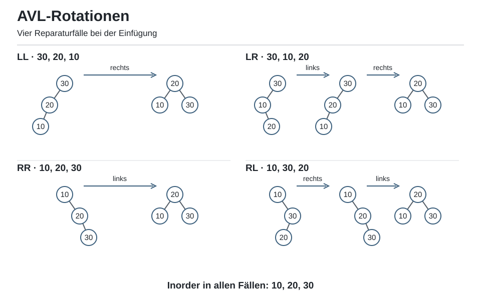
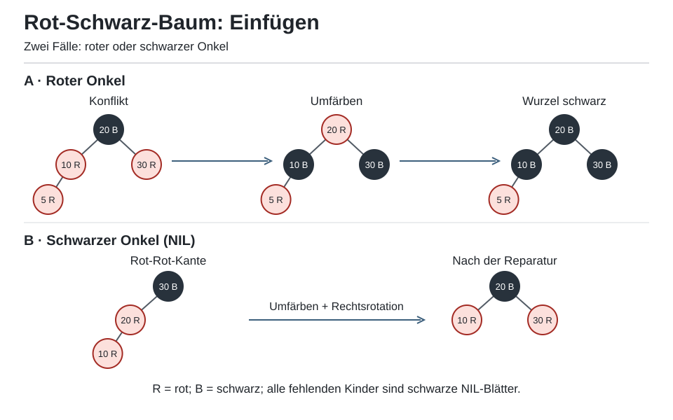
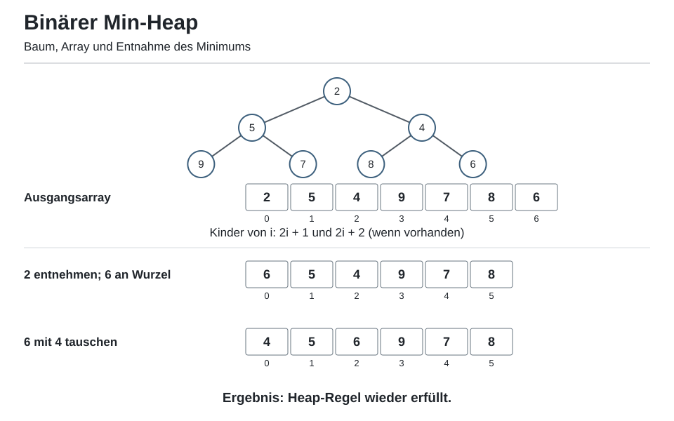

# M8-L4 – Algorithmen und Datenstrukturen vertieft: balancierte Bäume und Heaps {#L4}

**Kursbereich:** M8 – Bachelor: Kerngebiete

**Niveau:** Bachelor

**Vorwissen:** [M1-L3 – Algorithmen und Datenstrukturen](M1-L3.md) · [M8-L1 – Diskrete Informatik](M8-L1.md)

**Weiterführend:** [M7-L2 – Korrektheit, Berechenbarkeit und Analyse komplexer Verfahren](M7-L2.md) · [M3-L1 – Eine Datenbank auf einem Server](M3-L1.md) · [M4-L1 – Verteilte Verarbeitung](M4-L1.md)

## Ausgangsfrage: Wie garantieren wir einen kurzen Suchweg? {#S1}

Eine Anwendung führt ein Verzeichnis von Aufträgen. Neue Aufträge kommen fortlaufend hinzu, manche werden entfernt, andere müssen über ihre Kennung schnell gefunden werden. Zusätzlich soll stets der Auftrag mit der kleinsten Prioritätszahl als Nächstes verarbeitet werden.

Eine sortierte Folge, eine Hash-Tabelle und ein Suchbaum lösen nicht dieselben Aufgaben gleich gut. In dieser Lektion betrachten wir deshalb nicht nur die Laufzeit einer Operation, sondern auch die **Eigenschaft der Datenstruktur, die diese Laufzeit garantiert**, sowie die Arbeit, die bei Änderungen zur Erhaltung dieser Eigenschaft nötig ist.

Nach der Lektüre solltest du asymptotische Schranken formal lesen, einen einfachen Algorithmus mit einer Schleifeninvariante begründen, die Höhe eines Suchbaums abschätzen, Rotationen nachvollziehen und zwischen Suchbaum, Heap und anderen Strukturen unterscheiden können. Die Pseudocode-Beispiele sind als Lesemodelle gedacht; keine Installation oder Programmieraufgabe ist erforderlich.

## Landau-Symbole: von einer Vermutung zu einer mathematischen Aussage {#S2}

Die Wachstumsgrafik aus [M7-L2 – Zeit- und Speicherkomplexität](M7-L2.md#S7) veranschaulicht die Größenordnungen.

Seien $f,g$ nichtnegative Funktionen auf den natürlichen Zahlen; $g(n)$ sei für hinreichend große $n$ positiv. Wir betrachten eine festgelegte Größe, etwa die Anzahl von Vergleichen bei Eingaben der Länge $n$.

**Obere Schranke:**

$$
f\in O(g)\iff \exists c>0\;\exists n_0\in\mathbb{N}\;\forall n\ge n_0:\quad f(n)\le c\,g(n).
$$

**Untere Schranke:**

$$
f\in\Omega(g)\iff \exists c>0\;\exists n_0\in\mathbb{N}\;\forall n\ge n_0:\quad f(n)\ge c\,g(n).
$$

**Asymptotisch enge Schranke:**

$$
f\in\Theta(g)\iff \exists c_1,c_2>0\;\exists n_0\in\mathbb{N}\;\forall n\ge n_0:\quad c_1 g(n)\le f(n)\le c_2 g(n).
$$

Die Konstanten dürfen nicht von $n$ abhängen. Die Schwelle $n_0$ erlaubt uns, endlich viele kleine Eingaben bei der asymptotischen Aussage auszuklammern. Häufig schreibt man auch $f(n)=O(g(n))$; die Mengenschreibweise zeigt präziser, dass die rechte Seite eine Klasse von Funktionen bezeichnet.

### Ein vollständig begründetes Beispiel

Für $T(n)=3n^2+5n+7$ gilt bei $n\ge 1$, dass $5n\le 5n^2$ und $7\le 7n^2$. Somit

$$
3n^2\le T(n)\le 15n^2.
$$

Mit $c_1=3$, $c_2=15$ und $n_0=1$ ist $T\in\Theta(n^2)$ bewiesen. Dagegen wäre $T\in O(n^3)$ zwar ebenfalls richtig, aber weniger aussagekräftig. $T\in O(n)$ ist falsch: Aus $3n^2\le cn$ müsste für alle hinreichend großen $n$ die unmögliche Bedingung $3n\le c$ folgen.

**Wichtig:** $O$ bedeutet nicht automatisch Worst Case und $\Omega$ nicht automatisch Best Case. Zuerst bestimmen wir die betrachtete Kostenfunktion – etwa Worst-Case-Kosten –, dann ihre mathematische Schranke.

## Korrektheit: binäre Suche mit Beweis {#S3}

Wir suchen einen Schlüssel $x$ in einem nicht absteigend sortierten Array $A$ der Länge $n$. Bei mehreren Treffern genügt irgendein passender Index. Die Ausgabe ist entweder ein gültiger Trefferindex oder `-1`, falls kein Treffer existiert. Indizes beginnen bei null; der obere Rand des Suchintervalls ist ausgeschlossen.

``` text
binarySearch(A, x):
    lo = 0
    hi = length(A)
    while lo < hi:
        mid = lo + floor((hi - lo) / 2)
        if A[mid] == x:
            return mid
        if A[mid] < x:
            lo = mid + 1
        else:
            hi = mid
    return -1
```

**Schleifeninvariante:** Vor jedem Schleifendurchlauf gilt $0\le lo\le hi\le n$. Kein Index außerhalb des halb offenen Intervalls $[lo,hi)$ kann einen Treffer enthalten.

**Initialisierung:** Bei $lo=0$ und $hi=n$ umfasst das Intervall alle möglichen Indizes. Die Aussage gilt auch bei leerem Array.

**Erhaltung:** Ist $A[mid]=x$, liefert das Verfahren einen gültigen Treffer. Ist $A[mid]<x$, sind wegen der Sortierung alle Einträge bis einschließlich `mid` kleiner als $x$. Ist $A[mid]>x$, sind alle Einträge ab `mid` größer als $x$. In beiden Fällen bleibt jeder mögliche Treffer im neuen Intervall.

**Nachbedingung:** Bei regulärem Schleifenende gilt $lo=hi$. Das Intervall enthält keinen Index mehr. Nach der Invariante kann außerhalb ebenfalls kein Treffer liegen. `-1` ist damit korrekt.

**Terminierung:** Die nichtnegative ganze Zahl $hi-lo$ wird in jedem Durchlauf ohne Rückgabe strikt kleiner. Eine unendliche Folge solcher Abnahmen existiert nicht. Zusammen mit der Nachbedingung ist die totale Korrektheit begründet.

Bei einem Durchlauf wird die Intervalllänge höchstens auf die Hälfte (abgerundet) reduziert. Unter der Annahme konstant teurer Arrayzugriffe und Schlüsselvergleiche ergeben sich für $n\ge1$ höchstens $\lfloor\log_2 n\rfloor+1$ Durchläufe. Für den Worst Case ist die Ordnung $\Theta(\log n)$, im Best Case $\Theta(1)$; der zusätzliche Speicher ist $\Theta(1)$. Ein Beweis ersetzt keine Implementierungstests, zeigt aber, warum die angegebene Methode unter ihren Voraussetzungen funktioniert.

## Binäre Suchbäume: Ordnung ist noch keine Balance {#S4}

Bei einem binären Suchbaum mit eindeutigen Schlüsseln gilt für jeden Knoten: Alle Schlüssel im linken Teilbaum sind kleiner, alle im rechten größer. Die Regel betrifft den ganzen Teilbaum, nicht nur die unmittelbaren Kinder. Für gleichwertige Schlüssel benötigen wir eine zusätzliche Repräsentation, etwa eine Liste von Datensätzen pro Schlüssel.

``` text
Ausgewogen                 Durch sortierte Einfügung entartet
       40                   10
     /    \                   \
   20      60                  20
  /  \    /  \                   \
10   30  50   70                  30
                                    \
                                     40 ... 70
```

Wir zählen die Höhe $h$ in Kanten, mit Höhe $-1$ für den leeren Baum und $0$ für ein Blatt. Bei einem nichtleeren Baum kostet eine Suche höchstens $h+1$ Knotenbesuche. Ein gewöhnlicher Suchbaum kann bei aufsteigend eingefügten Schlüsseln Höhe $n-1$ erreichen. Ein Suchbaum mit garantierter Höhe $O(\log n)$ vermeidet diese Entartung.

Eine Inorder-Traversierung (linker Teilbaum, Knoten, rechter Teilbaum) gibt alle Schlüssel in sortierter Reihenfolge aus. Sie besucht jeden Knoten einmal und benötigt $\Theta(n)$ Zeit. Suche, Einfügen und Löschen müssen dabei nicht jede Position besuchen.

## Rotationen: die Ordnung erhalten, die Gestalt verändern {#S5}

Betrachte eine Rechtsrotation um den Knoten `y`. Sein linkes Kind `x` übernimmt die Wurzel des betroffenen Teilbaums. Die drei Teilbäume `A`, `B` und `C` dürfen leer sein.

``` text
Vorher                    Nachher
       y                       x
      / \                     / \
     x   C                   A   y
    / \                         / \
   A   B                       B   C
```

In beiden Darstellungen gilt dieselbe Inorder-Reihenfolge: `A, x, B, y, C`. Alle Schlüsselbeziehungen bleiben erhalten. Die Rotation verändert die Verbindungen, nicht die Schlüssel. Eine Linksrotation ist die inverse Operation.

``` text
rotateRight(y):
    x = y.left
    y.left = x.right
    x.right = y
    updateHeight(y)
    updateHeight(x)
    return x
```

Voraussetzung ist, dass `y.left` existiert. Die Rückgabe muss vom Aufrufer mit dem Elternknoten oder der Gesamtwurzel verbunden werden. Werden Elternzeiger oder weitere Metadaten gespeichert, müssen sie ebenfalls gepflegt werden. Sind die Höhen der Kinder gespeichert, braucht `updateHeight` konstante Zeit. Die Strukturänderung selbst kostet damit $O(1)$.

## AVL-Bäume: strenge Höhenbalance {#S6}



*AVL-Rotationen.*

Ein AVL-Baum ist ein binärer Suchbaum, bei dem für jeden Knoten $v$ der Balancefaktor

$$
b(v)=h(v_{\mathrm{links}})-h(v_{\mathrm{rechts}})
$$

einen der Werte $-1,0,1$ annimmt. Nach einer normalen Einfügung können auf dem Rückweg zur Wurzel Faktoren von $2$ oder $-2$ auftreten. Rotationen beheben die jeweilige Verletzung.

| Fall am unausgeglichenen Knoten | Richtung des schwereren Kindes | Korrektur |
| --- | --- | --- |
| links-links (LL) | links, Kind links-lastig oder ausgeglichen | Rechtsrotation |
| links-rechts (LR) | links, Kind rechts-lastig | erst links am Kind, dann rechts am Knoten |
| rechts-rechts (RR) | rechts, Kind rechts-lastig oder ausgeglichen | Linksrotation |
| rechts-links (RL) | rechts, Kind links-lastig | erst rechts am Kind, dann links am Knoten |

Bei der Einfügung `30, 10, 20` tritt der LR-Fall auf. Zuerst wird am Knoten `10` nach links, anschließend am Knoten `30` nach rechts rotiert:

``` text
    30          30           20
   /           /            /  \
 10           20           10  30
   \         /
    20      10
```

Nach der Doppelrotation bleibt die Folge `10, 20, 30` unverändert, die Wurzel ist jedoch `20`.

### Warum ist die Höhe logarithmisch?

Sei $N(h)$ die kleinste Zahl echter Knoten eines AVL-Baums mit Höhe $h$. Es gilt $N(-1)=0$ und $N(0)=1$. Bei Höhe $h\ge1$ muss ein Kind Höhe $h-1$ und das andere mindestens Höhe $h-2$ besitzen. Daher

$$
N(h)=1+N(h-1)+N(h-2).
$$

Die Folge beginnt für $h=-1,0,1,2,3,4$ mit $0,1,2,4,7,12$. Sie lässt sich auf Fibonacci-Zahlen zurückführen und wächst exponentiell in $h$. Ein konkreter Induktionsschritt: Für $h\ge2$ ist $N(h)\ge2N(h-2)+1$. Mit $N(0)=1$ und $N(1)=2$ ergibt sich durch wiederholte Anwendung $N(h)\ge2^{\lfloor h/2\rfloor}$. Somit kann die Höhe bei $n\ge1$ Knoten höchstens logarithmisch in $n$ wachsen. Suche, Einfügung und Löschung haben im Worst Case Zeitaufwand $O(\log n)$.

## AVL-Einfügung: lesbarer Pseudocode {#S7}

Wir behandeln eindeutige Schlüssel; eine wiederholte Einfügung desselben Schlüssels verändert die Menge nicht. Für jeden Knoten speichern wir seine aktuelle Höhe. `rotateLeft` ist spiegelbildlich zu `rotateRight`.

``` text
height(v):
    if v == null: return -1
    return v.height

updateHeight(v):
    v.height = 1 + max(height(v.left), height(v.right))

balance(v):
    return height(v.left) - height(v.right)

rebalance(v):
    updateHeight(v)
    if balance(v) > 1:
        if balance(v.left) < 0:
            v.left = rotateLeft(v.left)
        return rotateRight(v)
    if balance(v) < -1:
        if balance(v.right) > 0:
            v.right = rotateRight(v.right)
        return rotateLeft(v)
    return v

insertAVL(v, k):
    if v == null: return newLeaf(k)  // height = 0
    if k < v.key:
        v.left = insertAVL(v.left, k)
    else if k > v.key:
        v.right = insertAVL(v.right, k)
    else:
        return v
    return rebalance(v)
```

Der Aufrufer übernimmt stets die zurückgegebene Wurzel. Beim rekursiven Abstieg gilt die Suchbaumordnung; die Rotationen bewahren sie. Beim Rückweg ist jeder rekursiv bearbeitete Teilbaum ausgeglichen, bevor sein Elternknoten überprüft wird. Die vier Fälle stellen am betroffenen Knoten wieder Höhenbalance her. Für eine reguläre AVL-Einfügung genügt höchstens eine Einzel- oder Doppelrotation an der ersten verletzten Stelle von unten; Höhenpflege läuft weiter. Beim Löschen kann eine verringerte Höhe weitere Verletzungen nach oben auslösen. Eine vollständige Löschimplementierung wird hier nicht vorausgesetzt; sie beginnt mit der üblichen Suchbaumlöschung und balanciert sämtliche betroffenen Vorfahren neu aus.

## Rot-Schwarz-Bäume: Balance über Farbinvarianten {#S8}

Ein Rot-Schwarz-Baum ist ebenfalls ein binärer Suchbaum. Statt die Höhendifferenz an jedem Knoten unmittelbar zu begrenzen, speichert er eine zusätzliche Farbe pro Knoten. Wir verwenden die klassische Variante mit schwarzen virtuellen `NIL`-Blättern für fehlende Kinder.

Die Regeln lauten:

1. Jeder echte Knoten ist rot oder schwarz; `NIL` ist schwarz.
2. Die Wurzel ist schwarz.
3. Ein roter Knoten hat nur schwarze Kinder.
4. Von jedem Knoten aus enthalten alle abwärts führenden Pfade zu `NIL` gleich viele schwarze Knoten (bei einheitlicher Zählkonvention).

Definieren wir die Schwarz­höhe $b(v)$ als Zahl schwarzer Knoten auf einem Pfad von `v` bis `NIL`, wobei der Ausgangsknoten `v` nicht und das abschließende `NIL` nur dann mitzählt, wenn es nicht selbst `v` ist, dann hat ein Teilbaum mit Wurzel `v` mindestens $2^{b(v)}-1$ echte Knoten. Beweis per Induktion über die Teilbaumhöhe: Für `NIL` gilt $b=0$ und es gibt keinen echten Knoten. Die Schwarzhöhen der beiden Kinder sind mindestens $b(v)-1$. Damit ergeben ihre minimalen Knotenzahlen zusammen mit `v` mindestens $1+2(2^{b(v)-1}-1)=2^{b(v)}-1$ Knoten. Auf jedem Wurzel-zu-`NIL`-Pfad kann wegen des Verbots benachbarter roter Knoten höchstens etwa die Hälfte der Knoten rot sein. Für die Länge $H$ dieses Pfads in Kanten gilt $H\le 2b(\mathrm{root})$ (die Wurzel ist schwarz). Aus $n\ge2^{b(\mathrm{root})}-1$ folgt die bekannte Höhenschranke

$$
H\le2\log_2(n+1).
$$

Für einen nichtleeren Baum ist die Höhe in Kanten zwischen echten Knoten um eins kleiner als die maximale Pfadlänge bis `NIL`. Einfügungen und Löschungen erhalten die Farbinvarianten durch Umfärbungen und Rotationen; Suche benötigt keine Farben. Für alle drei Operationen gilt Worst-Case-Aufwand $O(\log n)$.

## Rot-Schwarz-Einfügung: wann Farben, wann Rotationen? {#S9}



*Rot-Schwarz-Baum: Einfügen.*

Der neu eingefügte Knoten `z` ist zunächst rot, wodurch die Zahl schwarzer Knoten auf einem Pfad unverändert bleibt. Nur eine rote Wurzel oder eine Rot-Rot-Kante kann die Regeln verletzen. Ist der Elternknoten schwarz, ist keine Reparatur dieser Kante nötig. Ist er rot, bezeichnen wir seinen Bruder als Onkel von `z`.

### Fall A: roter Onkel

Elternknoten und Onkel werden schwarz, der Großelternknoten rot. Die Schwarzhöhen bleiben gleich; eventuell entsteht weiter oben eine neue Rot-Rot-Kante. Dann wird die Reparatur dort fortgesetzt.

``` text
Vorher                         Nachher (lokal)
         20(S)                       20(R)
        /     \                     /     \
     10(R)   30(R)              10(S)   30(S)
     /                          /
   5(R)                       5(R)
```

`S` = schwarz, `R` = rot. Ist `20` die Gesamtwurzel, färben wir sie am Ende schwarz.

### Fall B: schwarzer Onkel

Ist der neue Knoten ein inneres Kind (Dreiecksform), rotiert man zuerst um den Elternknoten, um eine äußere Form zu erhalten. Danach werden Eltern- und Großelternknoten passend umgefärbt und am Großelternknoten rotiert. Die gespiegelten Fälle gelten genauso. Beispiel für die äußere Form (LL), bei fehlendem rechtem Kind von `30`:

``` text
Vorher                       Nachher
       30(S)                     20(S)
      /     \                   /     \
   20(R)   NIL               10(R)   30(R)
   /
10(R)
```

Alle fehlenden Kinder stehen für schwarze `NIL`-Blätter. Die beiden lokalen Schritte stellen die Farbinvarianten wieder her. Im klassischen Einfügeverfahren sind höchstens zwei Rotationen notwendig, während Umfärbungen bis zur Wurzel fortgesetzt werden können. Die Löschung ist anspruchsvoller: Wird effektiv ein schwarzer Knoten entfernt, kann eine Seite eine schwarze Ebene verlieren. Die Reparatur gleicht die Schwarzhöhe über Geschwisterfälle wieder aus. Ihre vollständige Fallunterscheidung bleibt weiterführender Lektüre vorbehalten.

## Binäre Heaps: der kleinste Schlüssel zuerst {#S10}



*Binärer Min-Heap.*

Ein **Min-Heap** ist eine vollständige binäre Baumstruktur: Alle Ebenen bis auf eventuell die letzte sind gefüllt; auf der letzten stehen Knoten möglichst weit links. Jeder Elternschlüssel ist höchstens so groß wie die Schlüssel seiner Kinder. Daraus folgt, dass die Wurzel ein Minimum enthält. Das ist schwächer als die Suchbaumordnung: Zwischen linkem und rechtem Teilbaum gibt es keine allgemeine Sortierbeziehung.

``` text
              2
           /     \
          5       4
        /   \    / \
       9     7  8   6

Array:  [2, 5, 4, 9, 7, 8, 6]
Index:   0  1  2  3  4  5  6
```

Für Index $i$ (nullbasiert) liegen die möglichen Kinder bei $2i+1$ und $2i+2$. Ein nicht zur Wurzel gehörender Knoten hat Elternindex $\lfloor(i-1)/2\rfloor$. Die Kinder existieren nur, wenn ihre Indizes kleiner als die Arraylänge sind. Dadurch ist eine kompakte Speicherung ohne eigene Baumzeiger möglich.

Einfügen: Schlüssel an das Array anhängen und nach oben tauschen, solange er kleiner als der Elternschlüssel ist (*sift-up*). Minimum entnehmen: den letzten Schlüssel an die Wurzel setzen, das Array verkürzen und den Schlüssel mit dem kleineren Kind nach unten tauschen, solange die Heap-Regel verletzt ist (*sift-down*).

``` text
siftDown(A, i):
    while 2*i + 1 < length(A):
        j = 2*i + 1
        if j + 1 < length(A) and A[j+1] < A[j]:
            j = j + 1
        if A[i] <= A[j]: return
        swap(A[i], A[j])
        i = j

extractMin(A):
    if length(A) == 0: error "empty heap"
    result = A[0]
    last = removeLast(A)
    if length(A) > 0:
        A[0] = last
        siftDown(A, 0)
    return result
```

Das Nach-unten-Verschieben setzt voraus, dass beide Kindteilbäume bereits Heaps sind. Der Tausch mit dem kleineren Kind repariert die Regel am alten Elternknoten; nur an der neuen Position kann noch eine Verletzung bestehen. Die Höhe begrenzt die Zahl der Schritte, und die Abwärtsbewegung garantiert die Terminierung.

## Prioritätswarteschlangen und Heapsort {#S11}

Eine Prioritätswarteschlange ist ein abstrakter Datentyp: Sie erlaubt Einfügen, Abfragen und Entnehmen eines Elements höchster Priorität. Beim Min-Heap entspricht die höchste Priorität dem kleinsten Schlüssel. Gleiche Prioritäten sind ohne zusätzliche Regel nicht stabil; für FIFO-Reihenfolge bei Gleichstand kann ein fortlaufender zweiter Schlüssel verwendet werden.

Das Minimum lässt sich in $O(1)$ lesen, Einfügen und Entnehmen benötigen $O(\log n)$ Zeit im Worst Case (bei bereits hinreichend reserviertem Array; ein einzelnes dynamisches Arraywachstum kann zusätzliche lineare Kopierkosten haben). Ein beliebiger Schlüssel kann dagegen ohne Zusatzindex eine lineare Suche erfordern. Für `decreaseKey` in $O(\log n)$ muss die Position bekannt oder über eine gepflegte Zuordnung auffindbar sein.

Ein Heap lässt sich bottom-up in $O(n)$ aufbauen: Beginne beim letzten inneren Knoten und führe `siftDown` rückwärts bis zur Wurzel aus. Obwohl ein einzelner Abstieg logarithmisch lang sein kann, liegen viele Knoten nahe den Blättern. In einem vollständigen Binärbaum besitzen höchstens $\lfloor n/2^k\rfloor$ Knoten eine Höhe von mindestens $k$. Summieren wir für jedes $k\ge1$ die Knoten, die mindestens $k$ mögliche Abwärtsschritte besitzen, zählen wir jeden Knoten genau entsprechend seiner Höhe. Damit ist die Summe aller maximalen Abstiegslängen höchstens

$$
\sum_{k\ge1}\left\lfloor\frac{n}{2^k}\right\rfloor\le n\sum_{k\ge1}\frac{1}{2^k}=n.
$$

Die Schleife über die inneren Knoten kostet zusätzlich $O(n)$ Zeit; insgesamt ergibt sich $O(n)$. Das ist anders als die grobe Abschätzung $n\cdot O(\log n)$.

Heapsort verwendet üblicherweise einen Max-Heap für aufsteigende Sortierung im selben Array. Er legt nach jedem Schritt das Maximum an die letzte noch unsortierte Stelle. Aufbau und $n$ Entnahmen bzw. Verschiebungen führen zu einer Worst-Case-Laufzeit $O(n\log n)$. Die iterative Standardvariante benötigt konstanten Zusatzspeicher und ist nicht stabil. Prioritätswarteschlangen sind außerdem ein wichtiger Baustein für Dijkstras Kürzeste-Wege-Algorithmus bei nichtnegativ gewichteten Kanten sowie für Ereignissimulation und lokale Auftragsauswahl.

## Entscheidungshilfe: welche Struktur für welche Operation? {#S12}

Die Tabelle beschreibt übliche Worst-Case-Zeitkosten unter dem Modell konstant teurer Schlüsselvergleiche, direkter Arrayzugriffe und – wo relevant – bereits reservierter Kapazität. Bei AVL und Rot-Schwarz ist die logarithmische Höhe eine Garantie. $k$ sei die Zahl der ausgegebenen Schlüssel einer Bereichsanfrage.

| Struktur | Exakte Suche | Einfügen | Löschen eines bekannten Schlüssels | Minimum | Bereichsausgabe |
| --- | --- | --- | --- | --- | --- |
| Sortiertes Array | $O(\log n)$ | $O(n)$ | $O(n)$ | $O(1)$ | $O(\log n+k)$ |
| Gewöhnlicher Suchbaum | $O(n)$ | $O(n)$ | $O(n)$ | $O(n)$ | $O(n)$ |
| AVL-Baum | $O(\log n)$ | $O(\log n)$ | $O(\log n)$ | $O(\log n)$ | $O(\log n+k)$ |
| Rot-Schwarz-Baum | $O(\log n)$ | $O(\log n)$ | $O(\log n)$ | $O(\log n)$ | $O(\log n+k)$ |
| Binärer Min-Heap | $O(n)$ | $O(\log n)$ | $O(n)$ ohne Positionsindex | $O(1)$ | $O(n)$ |

Für leere Strukturen verwenden wir entsprechend eine konstante Prüfung; asymptotische Angaben beziehen sich auf große Eingaben. Bei AVL und Rot-Schwarz ist eine Bereichsausgabe durch einen Suchbeginn und fortgesetzte geordnete Traversierung möglich. Eine Hash-Tabelle bietet bei geeignetem Hashing und kontrollierter Auslastung oft erwartete konstante Kosten für exakte Schlüsselabfragen, aber keine sortierte Traversierungsgarantie.

Ein B-Baum bzw. B+-Baum optimiert eine andere Ressource: blockweisen Speicherzugriff. In Datenbanken reduziert eine große Verzweigung die Zahl zu lesender Seiten. Bei einem kleinen lokalen Prioritätsdienst kann dagegen ein Array-Heap die einfachere Wahl sein. Bei ständig wechselnden geordneten Schlüsseln kommen balancierte Suchbäume in Betracht. Asymptotische Effizienz ersetzt jedoch keine Messung von Cacheverhalten, Speicherverbrauch oder Implementierungskosten.

## Freiwillige Selbstkontrolle mit Lösungen {#S13}

Die folgenden Fragen dienen dem stillen Nachvollziehen. Sie sind kein verpflichtender Aufgabenteil.

**1. Schranken:** Ist $T(n)=7n+20$ in $O(n^2)$, $\Theta(n)$ und $\Omega(n^2)$?

**Lösung:** Die ersten beiden Aussagen sind wahr. Für $n\ge1$ gilt $7n\le T(n)\le27n$. Die dritte Aussage ist falsch, da $T(n)/n^2=7/n+20/n^2$ gegen null geht.

**2. Suchinvariante:** Warum ist in der binären Suche bei $A[mid]>x$ die Zuweisung `hi = mid` statt `hi = mid - 1` richtig?

**Lösung:** `hi` ist ausgeschlossen. Der Index `mid` wird entfernt, der noch mögliche Index `mid-1` bleibt enthalten. Würde man `hi = mid - 1` wählen, könnte man einen gültigen Treffer überspringen.

**3. AVL:** Welche Rotation ist nach Einfügen von `10, 30, 20` notwendig?

**Lösung:** RL: Rechtsrotation an `30`, dann Linksrotation an `10`. Ergebnis ist die Wurzel `20` mit Kindern `10` und `30`.

**4. Rot-Schwarz:** Eine schwarze Wurzel hat ein rotes linkes und ein rotes rechtes Kind. Ein roter Knoten wird unter dem linken Kind eingefügt. Welche lokale Reparatur ist nötig?

**Lösung:** Der Onkel ist rot. Beide Kinder der Wurzel werden schwarz; die Wurzel wird zunächst rot und abschließend schwarz. Alle Wurzel-zu-`NIL`-Pfade haben danach weiterhin gleich viele schwarze Knoten.

**5. Heap:** Entnimm das Minimum aus `[2, 5, 4, 9, 7, 8, 6]`.

**Lösung:** `2` wird zurückgegeben. Die `6` ersetzt die Wurzel; Tausch mit `4` führt zu `[4, 5, 6, 9, 7, 8]`. Unter `6` liegt nur `8`, die Heap-Regel gilt wieder.

**6. Architektur:** Ein Dienst braucht sowohl eine geordnete Bereichsausgabe nach Kundennummer als auch das nächste Element nach einer unabhängigen Deadline. Reicht ein Min-Heap aus?

**Lösung:** Nicht für beide Anforderungen effizient. Ein geordneter Suchindex und eine separate Prioritätswarteschlange können gemeinsam sinnvoll sein. Beide müssen bei Änderungen konsistent gehalten werden; zusätzliche Strukturen erhöhen Pflege- und Speicheraufwand.

## Zusammenfassung und Lernanschlüsse {#S14}

Die zentrale Erkenntnis ist, dass jede Effizienzgarantie auf Voraussetzungen beruht. Ein Suchbaum ist erst bei garantierter kurzer Höhe logarithmisch; Rotationen halten die Sortierordnung fest. AVL-Bäume sichern die Höhe streng, Rot-Schwarz-Bäume über Farbinvarianten. Heaps verzichten auf die vollständige Suchbaumordnung, um ein Extremum effizient verwalten zu können. Formale Schranken beschreiben die Größenordnung einer genau benannten Kostenfunktion, während Korrektheitsbeweise die Erfüllung einer Spezifikation begründen.

Für formale Verifikation, Berechenbarkeit und Rekurrenzanalyse führt der Weg über [M7-L2](M7-L2.md). Die Verbindung zu datenbankorientierten Baumstrukturen vertiefen [M3-L1](M3-L1.md) und [M10-L2](M10-L2.md). Praktische Auftragsverarbeitung und Betriebssystem-Scheduling sind in [M4-L1](M4-L1.md) und [M8-L3](M8-L3.md) eingeordnet.

## Quellen {#S15}

**Letzte Quellenprüfung:** 19.11.2026 (Webseiten und Lehrübersichten; keine fremden Abbildungen übernommen).

1. [**MIT OpenCourseWare, 6.006 – Introduction to Algorithms, Spring 2020:** Undergraduate-Kurs, insbesondere Lecture 6–8 zu binären Bäumen, AVL und binären Heaps. (Lecture Notes)](https://ocw.mit.edu/courses/6-006-introduction-to-algorithms-spring-2020/pages/lecture-notes/) · Thematischer Bezug zur Lektion: S6: AVL-Bäume: strenge Höhenbalance (Übersichts-/Metadatenseite) · Zuletzt abgerufen: 2026-11-22
2. [**Freie Universität Berlin – Algorithms, Data Structures and Data Abstraction, WS 2018/19:** Lehrübersicht zu Suchbäumen, AVL-Rotationen und Rot-Schwarz-Bäumen. (Kursseite)](https://www.inf.fu-berlin.de/lehre/WS18/ALP3/) · Thematischer Bezug zur Lektion: S5: Rotationen: die Ordnung erhalten, die Gestalt verändern · Zuletzt abgerufen: 2026-11-22
3. [Princeton University / Sedgewick, Wayne – Algorithms and Data Structures Cheatsheet (Algorithms, 4th Edition)](https://algs4.cs.princeton.edu/cheatsheet/) · Tabellen zu Laufzeiten, Heaps, Prioritätswarteschlangen und Suchbäumen · Zuletzt abgerufen: 2026-11-25
4. [**Yale University, James Aspnes – Notes on Data Structures and Programming Techniques, CPSC 223:** Balancierte Suchbäume, Rot-Schwarz-Invarianten und Einfügekorrekturen. (Vorlesungsnotizen)](https://cs.yale.edu/homes/aspnes/classes/223/notes.html) · Thematischer Bezug zur Lektion: S8: Rot-Schwarz-Bäume: Balance über Farbinvarianten (Übersichts-/Metadatenseite) · Zuletzt abgerufen: 2026-11-22
