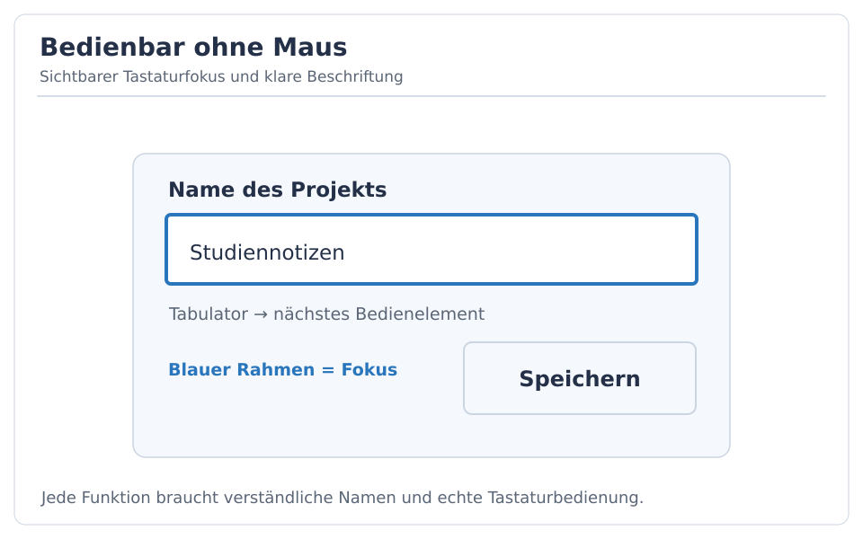

# M9-L1 – Benutzeroberflächen, Barrierefreiheit und Softwareergonomie {#L1}

**Kursbereich:** M9 – Bachelor: Wahl- und Praxisgebiete

**Niveau:** Bachelor (Wahl / Anwendung)

**Vorwissen:** Keine festen Voraussetzungen angegeben.

**Einordnung:** Freiwilliges Bachelor-Wahlthema (M9-L1)

**Lesepfad:** Hilfreich sind M1-L4 (Softwaretechnik), M1-L7 (weitere Informatikgebiete), M4-L3 (Sicherheit und Datenschutz) und M6-L4 (KI-Agenten). Dieses Kapitel ist jedoch eigenständig verständlich. Es verlangt weder Programmierung noch die Installation eines Entwurfswerkzeugs. Zur statistischen Vertiefung eignen sich im Mathematik-Lernkurs die Lektionen Schule M2-L16 und Universität M1-L7.

## Warum die Bedienoberfläche ein Teil des Systems ist {#S1}

Eine Anwendung kann technisch korrekt programmiert sein und trotzdem ihre Aufgabe verfehlen. Ein Textverarbeitungsprogramm, das Dokumente zuverlässig speichert, hilft wenig, wenn seine Nutzer den Speichern-Knopf nicht finden. Ein Online-Dienst kann hervorragend skalieren und trotzdem Bestellungen verlieren, weil seine Formulare unverständlich sind. Ein KI-Assistent kann eine gute Antwort erzeugen und dennoch Schaden anrichten, wenn die Oberfläche eine Vermutung als geprüfte Tatsache darstellt.

**Benutzeroberfläche** (*User Interface*, UI) bezeichnet die sichtbaren, hörbaren oder anderweitig wahrnehmbaren Mittel, durch die Menschen mit einem System interagieren: Schaltflächen, Menüs, Textfelder, Meldungen, Spracheingaben oder physische Bedienelemente. **User Experience** (UX) bezeichnet das umfassendere Nutzungserlebnis: Erwartungen, Verstehen, Erfolg, Aufwand und Gefühle vor, während und nach der Nutzung. Ein ästhetisch schönes UI garantiert keine gute UX; umgekehrt kann eine schlichte Oberfläche außergewöhnlich zuverlässig bedienbar sein.

**Mensch-Computer-Interaktion** (*Human–Computer Interaction*, HCI) erforscht das Zusammenspiel von Mensch, Aufgabe und Technik. **Usability** beziehungsweise *Gebrauchstauglichkeit* beschreibt, wie gut definierte Menschen ihre Ziele in einem bestimmten Nutzungskontext wirksam, effizient und zufriedenstellend erreichen. **Barrierefreiheit** (*Accessibility*) fragt zusätzlich, ob Menschen mit unterschiedlichen körperlichen, sensorischen, kognitiven oder situativen Voraussetzungen gleichberechtigt Zugang zu den Funktionen erhalten. **Softwareergonomie** untersucht die menschen- und aufgabengerechte Gestaltung der Arbeit mit Software.

Man kann diese Ebenen getrennt betrachten:

``` text
Mensch mit Ziel und Voraussetzungen
       |
       v
Oberfläche: Navigation, Eingaben, Rückmeldungen
       |
       v
Anwendungslogik: Regeln, Berechtigungen, Vorgänge
       |
       v
Datenbank, Dienste, externe Systeme
       |
       v
Ergebnis + verständliche Rückmeldung an den Menschen
```

Eine Verbesserung an der Oberfläche darf die Geschäftslogik nicht außer Kraft setzen. Beispielsweise ersetzt ein ausgegrauter Menüpunkt **keine** serverseitige Zugriffsprüfung. Ebenso ist ein freundlicher Hinweis keine sichere Datenlöschung. Gute Gestaltung macht Regeln verständlich; die eigentliche Durchsetzung bleibt Aufgabe des Systems.

## Vom Nutzerziel zum Bedienablauf {#S2}

Eine schlechte Ausgangsfrage lautet: „Welche Buttons sollen wir bauen?“ Besser ist: „Was möchte die Person erreichen, unter welchen Umständen, und woran erkennt sie den Erfolg?“ Der Unterschied wirkt klein, verändert aber den gesamten Entwurf.

Angenommen, jemand möchte in einer Medienbibliothek alle Fotos eines bestimmten Jahres finden, drei davon auswählen und in einer Sammlung speichern. Die fachliche Aufgabe besteht aus *Suchen, Prüfen, Auswählen, Speichern*. Eine bestimmte Seitenleiste, Symbolfarbe oder Kartenansicht ist dafür zunächst nicht erforderlich. Eine andere Person könnte dasselbe Ziel mit der Tastatur, einem Screenreader oder einer großen Schrift erreichen wollen.

Die **Aufgabenanalyse** beschreibt den Weg vom Ausgangszustand zum erwünschten Ergebnis. Dafür helfen vier Fragen: Was weiß die Person schon? Welche Information fehlt? Welchen Schritt erwartet sie? Welche Konsequenzen haben Fehler? Ein einmaliges Versehen beim Sortieren ist meist harmlos; eine versehentliche öffentliche Freigabe eines privaten Albums kann erheblichen Schaden verursachen.

Ein *Nutzungsszenario* beschreibt einen konkreten Vorgang. Eine *Persona* ist eine verdichtete, hypothetische Beschreibung einer Nutzergruppe. Personas können Gespräche strukturieren, sind aber **keine empirischen Beweise** für tatsächliche Bedürfnisse. Sie dürfen nicht anhand von Stereotypen an die Stelle realer Nutzungsforschung treten. Aussagekräftiger sind beobachtete Arbeitsschritte, nachvollziehbare Beschwerden, Supportanfragen und Gespräche mit Menschen aus der Zielgruppe.

### Mentale Modelle und Vorhersagbarkeit {#21-mentale-modelle-und-vorhersagbarkeit}

Menschen bringen **mentale Modelle** mit: Vorstellungen davon, wie Software funktioniert. Ein Papierkorb bedeutet meistens „später wiederherstellbar“, ein Download-Symbol „Datei speichern“, ein Zurück-Pfeil „vorherigen Schritt ansehen“. Weicht die Anwendung davon ab, muss sie die Abweichung deutlich erklären.

Ein konsistentes Produkt verwendet für dieselbe Handlung dieselben Wörter und Symbole. Wenn ein Knopf „Archivieren“ bedeutet und an anderer Stelle „Löschen“, entstehen unnötige Fehler. Konsistenz umfasst auch Systemkonventionen: Tastaturkürzel, Tab-Navigation, Scrollverhalten und Dialogfenster sollten möglichst erwartbar sein.

**Affordanz** bezeichnet in der Gestaltung die wahrnehmbare Handlungsmöglichkeit eines Elements; ein deutlich gezeichneter Schalter legt das Umschalten nahe. Ein **Signifier** ist ein Hinweis auf diese Möglichkeit, etwa eine Beschriftung oder ein sichtbarer Griff. Beides kann täuschen: Ein blau unterstrichenes Wort wirkt wie ein Link, obwohl es vielleicht nicht anklickbar ist. Gute Oberflächen lassen die beabsichtigte Handlung erkennen, statt ihre Nutzer zum Raten zu zwingen.

## Orientierung, Navigation und Informationsarchitektur {#S3}

Bei kleinen Anwendungen reicht oft eine einzige Seite. Größere Systeme benötigen eine **Informationsarchitektur**: nachvollziehbare Gruppen, Kategorien, Suchwege und Hierarchien. Gute Navigation beantwortet fortlaufend drei Fragen: *Wo bin ich? Was kann ich hier tun? Wie komme ich zurück?*

Ein Beispiel mit einer Medienbibliothek:

``` text
Bibliothek
 |-- Alle Medien
 |     |-- Suche und Filter
 |     +-- Detailansicht
 |-- Meine Sammlungen
 |-- Importaufträge
 |     +-- Fortschritt und Fehler
 +-- Einstellungen
       |-- Datenschutz
       +-- Barrierefreiheit / Darstellung
```

Die Kategorien sollten sich an der Sicht der Nutzenden orientieren. „Importaufträge“ kann für technische Nutzer passend sein; bei einer allgemeinen Zielgruppe ist „Dateien hinzufügen“ eventuell verständlicher. Manchmal braucht eine Oberfläche unterschiedliche Bezeichnungen in Experten- und Einfachansicht. Solche Entscheidungen sollten überprüft, nicht bloß nach Geschmack getroffen werden.

**Progressive Disclosure** bedeutet, erweiterte Möglichkeiten erst dann zu zeigen, wenn sie relevant werden. Ein einfacher Fotoimport könnte zunächst nur „Dateien wählen“ und „Starten“ anbieten; technische Optionen wie Metadatenstrategie, Hash-Prüfung oder Stapelgröße bleiben in einem Abschnitt „Erweiterte Einstellungen“. Die versteckten Funktionen müssen auffindbar bleiben; „weniger anzeigen“ darf nicht „wichtige Informationen verschweigen“ bedeuten.

Eine Suchfunktion sollte erklären, **worin** sie sucht. „Suche“ ohne erkennbare Bedeutung erzeugt falsche Erwartungen. Sucht sie in Dateinamen, Beschreibungen oder auch per KI erkannten Bildinhalten? Besteht ein Filter auf „nur eigene Sammlungen“? Versteckte Filter können dazu führen, dass eine Person fälschlich glaubt, ihre Daten seien verschwunden.

## Rückmeldungen, Fehler und sichere Entscheidungen {#S4}

Die **Sichtbarkeit des Systemstatus** ist eines der von Jakob Nielsen beschriebenen Usability-Prinzipien \[1\]. Nach einer Handlung sollte der Mensch möglichst verstehen, ob sie angenommen, in Bearbeitung, abgeschlossen oder fehlgeschlagen ist. Besonders bei Cloud-Diensten ist das wesentlich: Ein Klick auf „Hochladen“ kann nur die Übergabe des Auftrags auslösen; Verarbeitung und Speicherung dauern länger.

Ein guter Ablauf unterscheidet die Zustände:

``` text
Dateien ausgewählt
        |
        v
Upload läuft --------> Übertragungsfehler / Wiederholen
        |
        v
Upload beendet
        |
        v
Verarbeitung läuft ---> Fehlerbericht / erneuter Versuch
        |
        v
Sammlung aktualisiert / Ergebnis sichtbar
```

„Erfolgreich“ sollte erst angezeigt werden, wenn **die bezeichnete Operation** tatsächlich erfolgreich war. „Auftrag angenommen“ und „Auftrag vollständig ausgeführt“ sind unterschiedliche Zusagen. Das passt zu M4-L1 und M4-L2: Im Hintergrund können Warteschlangen, Worker und Datenbanken beteiligt sein.

### Verständliche Fehlermeldungen {#41-verständliche-fehlermeldungen}

Die Meldung „Fehler 500“ benennt ein technisches Symptom, hilft der betroffenen Person aber kaum. Nützlicher ist: „Die Änderungen konnten nicht gespeichert werden. Ihre Eingaben sind noch vorhanden. Versuchen Sie es erneut.“ Ein technischer Fehlercode kann ergänzend angeboten werden, damit Support oder Administratoren den Vorfall zuordnen können.

Eine Fehlermeldung sollte nach Möglichkeit benennen: *Was ist passiert? Welche Wirkung hat es? Was kann ich tun?* Bei einem zu großen Dateiupload ist „Datei überschreitet 50 MB“ hilfreicher als „Ungültige Eingabe“. Die genannte Grenze muss natürlich der tatsächlich geltenden Serverkonfiguration entsprechen.

**Fehlervorbeugung** ist oft besser als eine bloße Fehlermeldung. Wenn jemand fünf Sammlungen endgültig löschen möchte, kann die Oberfläche die Anzahl und Namen zusammenfassen, eine Wiederherstellungsmöglichkeit anbieten oder vor unwiderruflichen Folgen gezielt warnen. Ein Dialog für jede harmlose Handlung wirkt dagegen störend. Je schwerwiegender und schlechter rückgängig zu machen die Konsequenz ist, desto angemessener ist eine zusätzliche Sicherheitsstufe.

Eine **Undo-Funktion** nimmt eine frühere Handlung zurück, soweit das fachlich möglich ist. Bei lokalem Sortieren ist dies leicht; bei bereits versendeten E-Mails oder externen Zahlungen nur begrenzt. Die Oberfläche darf nicht „Rückgängig“ versprechen, wenn der ursprüngliche Vorgang bereits unumkehrbar geworden ist.

## Barrierefreiheit beginnt bei unterschiedlichen Nutzungsbedingungen {#S5}

Barrierefreiheit wird häufig zu eng mit Blindheit oder Rollstuhlnutzung verbunden. Tatsächlich können Menschen unter anderem eine Seh-, Hör-, Bewegungs- oder Lernbeeinträchtigung haben; sie können auf Spracheingabe, Vergrößerung, Tastatursteuerung oder vereinfachte Sprache angewiesen sein. Auch Menschen ohne dauerhafte Behinderung stoßen auf Barrieren: ein gebrochener Arm, grelles Sonnenlicht, eine schlechte Internetverbindung, ein lautes Zugabteil oder eine Hand, die gerade ein Kind festhält.

Eine funktionierende barrierefreie Oberfläche eröffnet **gleichwertige Wege** zur selben Aufgabe. Es genügt nicht, wenn die Startseite mit einer Tastatur bedienbar ist, der entscheidende Speichern-Dialog aber nur per Maus erreicht werden kann. Die gesamten relevanten Abläufe müssen zugänglich sein: anmelden, suchen, auswählen, bezahlen, Fehler beheben und Hilfe finden.

Für Webangebote sind die **Web Content Accessibility Guidelines (WCAG)** des World Wide Web Consortium (W3C) ein zentraler technischer Standard. Die Fassung **WCAG 2.2** definiert überprüfbare *Erfolgskriterien* auf den Konformitätsstufen A, AA und AAA \[2\]. AA ist in vielen Projekten ein verbreitetes Ziel, aber welche rechtliche Anforderung konkret gilt, hängt vom Angebot und Rechtsraum ab. Die Kriterien sind Mindestanforderungen an die jeweilige Stufe, keine Garantie, dass alle Menschen alles problemlos nutzen können.

### Wahrnehmbar, bedienbar, verständlich, robust {#51-wahrnehmbar-bedienbar-verständlich-robust}

Die vier WCAG-Prinzipien heißen:

1.  **Wahrnehmbar:** Informationen und Bedienelemente können über geeignete Sinneskanäle erfasst werden, etwa durch Textalternativen für informative Bilder oder Untertitel für relevante Videos.
2.  **Bedienbar:** Menschen können interaktive Elemente bedienen, etwa über die Tastatur und mit erkennbarer Fokusposition.
3.  **Verständlich:** Inhalte und Abläufe sind nachvollziehbar; Bedienelemente verhalten sich möglichst erwartbar.
4.  **Robust:** Die technische Struktur funktioniert mit verschiedenen Browsern und unterstützenden Technologien, beispielsweise Screenreadern.

Ein vollständig automatisierter Test kann diese Eigenschaften **nicht umfassend nachweisen**. Das W3C betont ausdrücklich, dass Werkzeuge nur helfen und fachkundige menschliche Prüfung notwendig ist \[3\]. Dazu kommen, wann immer möglich, Tests mit unterschiedlichen tatsächlich betroffenen Nutzern.

## Konkrete Barrierefreiheitsentscheidungen {#S6}

{alt="Bedienelemente einer zugänglichen Weboberfläche mit sichtbarem Tastaturfokus, textlichen Feldbeschriftungen und einer klar benannten Speichern-Schaltfläche."}

Sichtbarer Fokus, klare Beschriftung und Tastaturbedienung sind konkrete Zugänglichkeitsmerkmale.

### Schrift, Kontrast und Farbe {#61-schrift-kontrast-und-farbe}

Texte benötigen ausreichenden Kontrast zum Hintergrund. WCAG 2.2 verlangt auf Stufe AA für gewöhnlichen Text im Regelfall ein Kontrastverhältnis von **mindestens 4,5:1**, für großen Text **mindestens 3:1**, jeweils mit definierten Ausnahmen \[2\]. Diese Zahlen beziehen sich auf den berechneten Helligkeitskontrast, nicht auf gefühlte Farbunterschiede. Kontrast ist kein Ersatz für gut lesbare Schriftgrößen, ausreichenden Zeilenabstand und verständliche Wortwahl.

**Beispiel:** Ein hellgraues „Speichern“ auf weißem Grund kann elegant aussehen, aber schwer erkennbar sein. Ein stärkerer Helligkeitsunterschied verbessert die Lesbarkeit. Wenn eine Fehlermeldung zusätzlich nur durch rote Schrift erkennbar ist, fehlt eine zweite Informationsspur. Besser: Warnsymbol, aussagekräftige Überschrift, roter Akzent und klarer Text zusammen.

Farben können Orientierung fördern, dürfen aber nicht die **einzige** Information tragen. Ein Diagramm mit „grün = bestanden, rot = fehlgeschlagen“ sollte die Werte ebenso beschriften oder Muster verwenden. Das hilft bei Farbsehschwächen, Schwarzweißdruck und Situationen mit schlechter Farbdarstellung.

### Tastatur, Fokus und Ziele {#62-tastatur-fokus-und-ziele}

Ein Mensch muss die Bedienelemente in sinnvoller Reihenfolge mit der Tastatur erreichen können. Der **Tastaturfokus** zeigt, welches Element beim nächsten Tastendruck angesprochen wird. Entfernt eine Gestaltung dessen Umrandung ersatzlos, ist die aktuelle Position oft nicht mehr erkennbar. Auch eine feststehende Kopfzeile darf den gerade fokussierten Knopf nicht komplett verdecken; WCAG 2.2 hat hierzu eigene Kriterien \[2, 4\].

Die WCAG-2.2-Erfolgsvorgabe **2.5.8 Target Size (Minimum)** verlangt auf Stufe AA grundsätzlich, dass ein Zeigerziel ein achsenparallel liegendes **$24\times24$-CSS-Pixel-Quadrat vollständig aufnehmen kann** \[2\]. Ein rundes Ziel mit lediglich 24 Pixeln Durchmesser erfüllt diese Größenvariante daher nicht automatisch. Eine wichtige Ausnahme ist **ausreichender Abstand**: Bei einem zu kleinen Ziel wird ein gedachter Kreis mit 24 Pixeln Durchmesser um die Mitte seiner Umgrenzung gelegt; er darf andere Ziele beziehungsweise deren entsprechende Kreise nicht schneiden. Weitere Ausnahmen gelten unter anderem für gleichwertige Bedienelemente, Inline-Links und unverändert übernommene Browsersteuerelemente. **$24\times24$ ist kein allgemeines Ergonomieoptimum:** Die gesonderte WCAG-2.2-Stufe AAA nennt mit Ausnahmen **$44\times44$ CSS-Pixel** (Kriterium 2.5.5), und großzügige Bedienflächen können darüber hinaus sinnvoll sein. Die reale Einhaltung hängt von Größe, Form, Abständen und dem konkreten Nutzungskontext ab.

Eine Oberfläche, die Drag-and-Drop verlangt, braucht für betroffene Funktionen nach WCAG 2.2 auf Stufe AA in der Regel eine alternative Bedienung ohne Ziehbewegung, sofern keine Ausnahme greift. Bei einer Sortierliste wären beispielsweise „Nach oben“ und „Nach unten“ mögliche Alternativen.

### Beschriftung, Formulare und Screenreader {#63-beschriftung-formulare-und-screenreader}

Ein **Screenreader** liest eine strukturierte Darstellung der Benutzeroberfläche vor oder stellt sie über eine Braillezeile bereit. Dafür benötigen interaktive Elemente eine verständliche **Rolle**, einen zugänglichen **Namen** und gegebenenfalls ihren aktuellen **Zustand**. Ein Kontrollkästchen sollte beispielsweise als Kontrollkästchen mit Beschriftung und Status erkennbar sein, nicht als namenloses Symbol.

Im Web besitzen viele native **HTML**-Elemente (*Hypertext Markup Language*, die Markupsprache für Webseiten) solche Eigenschaften von Haus aus: `button`, `input`, `label`, Überschriften und Listen. Die W3C-Empfehlung zum Einsatz von **Accessible Rich Internet Applications (ARIA)** lautet sinngemäß: Vorhandene native HTML-Funktionen bevorzugen, bevor man eigene ARIA-Rollen nachbaut \[5\]. ARIA ergänzt Bedeutungen; es erzeugt nicht automatisch Tastatursteuerung, Fokusführung oder korrektes Verhalten.

Eine reine Eingabeaufforderung innerhalb eines Felds (*Placeholder*) ist kein verlässlicher Ersatz für eine bleibende sichtbare Beschriftung. Bei Fehlern sollten Nutzer erfahren, **welches Feld** betroffen ist und **wie** es zu korrigieren ist. Wichtig ist außerdem, dass die Meldung mit dem Feld technisch verknüpft und für assistive Technologien zugänglich ist \[5, 6\].

### Bewegungen, Zeitlimits und Medien {#64-bewegungen-zeitlimits-und-medien}

Unkontrollierte Animationen können ablenken oder gesundheitlich belasten. Animationen sollten funktional begründet sein; bei starken Bewegungen sind nutzerseitige Präferenzen zum Reduzieren von Bewegung zu berücksichtigen. Automatisch startende Audioinhalte sind häufig störend, besonders mit Screenreader oder im Büro.

Zeitlimits können bei langen Formularen oder langsamer Bedienung zum Problem werden. Wo möglich, kündigt die Anwendung ein nahendes Sitzungsende an, erlaubt eine Verlängerung und erhält Eingaben sicher. Authentifizierung und Sicherheitskontext setzen Grenzen: Eine abgelaufene Sitzung darf nicht allein aus Komfortgründen unbegrenzt offen bleiben.

Für Videos sind abhängig vom Inhalt und dem einschlägigen Erfolgskriterium Untertitel, Audiodeskriptionen oder andere Alternativen relevant. Ein rein dekoratives Hintergrundvideo benötigt nicht dieselbe textliche Aufbereitung wie eine fachliche Gebrauchsanleitung. Die konkrete Bewertung richtet sich nach dem Zweck des Inhalts \[2\].

## Responsive Design und verschiedene Geräte {#S7}

**Responsive Design** bedeutet, dass sich ein Layout an verfügbare Darstellungsflächen und Eingabebedingungen anpasst. Eine große Desktop-Tabelle mit 30 Spalten funktioniert auf einem Smartphone kaum. Ein sinnvolles mobiles Layout könnte zunächst Titel, Status und die wichtigsten Aktionen zeigen und Details auf Wunsch öffnen.

Responsive Gestaltung ist mehr als das Verkleinern aller Elemente. Sie berücksichtigt Schriftvergrößerung, Hoch-/Querformat, unterschiedliche Dichte und Touch-Bedienung. Die Reihenfolge im Quelltext sollte weiterhin Sinn ergeben, auch wenn Spalten visuell nebeneinander angezeigt werden.

Ein typischer Fehler: Auf großen Bildschirmen zeigt die Anwendung ein Seitenmenü; mobil wird es in ein Symbol ohne Text verwandelt, das weder auffindbar noch für Screenreader verständlich ist. Der Platzgewinn wird dann durch Bedienprobleme erkauft. Eine knappe sichtbare Beschriftung oder ein klar erkennbares Menü kann besser sein als ein abstraktes Icon.

**Offline- und Langsamnetzbedingungen** sind ebenfalls Teil der Gebrauchstauglichkeit. Eine Weboberfläche sollte erkennen lassen, ob eine Aktion noch wartet, ob Daten lokal zwischengespeichert sind oder ob eine Verbindung erforderlich ist. Sie darf nicht ungeprüft behaupten, alle Änderungen seien bereits auf dem Server angekommen.

## Gestaltungssysteme und technische Architektur {#S8}

Eine wachsende Software benötigt ein gemeinsames Vokabular für Bedienelemente. Ein **Designsystem** beschreibt beispielsweise Schriften, Abstände, Farben, Schaltflächen, Formularfelder, Statusmeldungen und Zustände wie „deaktiviert“, „lädt“ oder „Fehler“. Dies erleichtert konsistente Nutzung und spart spätere Pflegearbeit.

Ein Designsystem ist jedoch nur so gut wie die tatsächliche Umsetzung. Ein zentral definiertes „Barrierefreies Dialogfenster“ ist wertlos, wenn eine Sonderseite einen unzugänglichen eigenen Dialog verwendet. Gemeinsame Komponenten können typische Fehler reduzieren, aber die konkrete Nutzung muss geprüft werden: Ist der Dialogtext verständlich? Ist der Fokus korrekt? Kann man ihn verlassen? Werden Daten beim Schließen verworfen?

Eine gedankliche Architektur:

``` text
Gemeinsames Designsystem
  |-- Navigation und Überschriften
  |-- Formulare und Fehlermeldungen
  |-- Statusanzeigen und Dialoge
  +-- Tastatur-/Screenreader-Verhalten
             |
             v
       Fachliche Seiten
  |-- Medienimport
  |-- Sammlungen
  +-- KI-Analyse
             |
             v
       API und Geschäftslogik
  |-- Rechte prüfen
  |-- Vorgänge speichern
  +-- Status korrekt bereitstellen
```

Die Architektur verdeutlicht eine Grenze: Ein Designsystem kann sichtbare und semantische Konsistenz fördern. **Vertraulichkeit, Transaktionskorrektheit oder Berechtigungslogik** entstehen dadurch nicht automatisch. Diese Aufgaben liegen weiter in den nachgelagerten Diensten (vgl. M4-L3 und M3-L5).

## Usability messen, ohne Menschen auf Zahlen zu reduzieren {#S9}

Gebrauchstauglichkeit lässt sich gezielt untersuchen. Vor einem Test sollte feststehen, **welche Aufgabe** geprüft wird und **welches Erfolgskriterium** gilt: etwa „Eine Person findet ein hochgeladenes Dokument und kann die Zugriffsrechte kontrollieren“. Die Aufgabe sollte nicht bereits verraten, welche Schaltfläche sie verwenden soll.

Wichtige Messgrößen sind:

- **Aufgabenerfolg:** Wie viele Personen erreichen das definierte Ziel tatsächlich?
- **Bearbeitungszeit:** Wie lange benötigen die Personen für dieselbe Aufgabe?
- **Fehlerquote:** Wie häufig treten relevante Fehlhandlungen auf?
- **Hilfebedarf:** Wie oft müssen Beobachtende eingreifen oder Erklärungen geben?
- **Subjektive Einschätzung:** Wie verständlich, anstrengend oder zuverlässig erleben die Personen den Ablauf?

Eine längere Bearbeitungszeit ist nicht immer schlechter. Wenn eine Prüfung wichtiger Berechtigungen zehn Sekunden zusätzlich benötigt, dadurch aber gefährliche Fehlfreigaben verhindert, kann dies sinnvoll sein. Bei Menschen, die assistive Technik verwenden, sind direkte Zeitvergleiche ohne Kontext besonders leicht irreführend.

### Durchgerechnetes Beispiel {#91-durchgerechnetes-beispiel}

Eine fiktive Studie betrachtet zehn Personen, die eine Bildsammlung mit eingeschränkten Zugriffsrechten anlegen sollen. Im ersten Entwurf schaffen sechs Personen die Aufgabe ohne Unterstützung; im überarbeiteten Entwurf schaffen es neun.

  Kennzahl                   Entwurf A           Entwurf B
  ------------------------ ----------- -------------------
  Teilnehmende                      10                  10
  Erfolgreich ohne Hilfe             6                   9
  Erfolgsquote                    60 %                90 %
  Differenz                          –   +30 Prozentpunkte

Die Erfolgsquote ist $\frac{\text{Erfolgreiche}}{\text{Teilnehmende}}\times100$. Für A also $\frac6{10}\times100=60\,\%$; für B $\frac9{10}\times100=90\,\%$. Die **relative Verbesserung** beträgt $\frac{90-60}{60}\times100=50\,\%$, während die **absolute Verbesserung** 30 Prozentpunkte beträgt. Diese beiden Aussagen sind nicht austauschbar.

**Was folgt daraus?** Bei diesen beobachteten zehn Personen war B erfolgreicher. **Was folgt nicht daraus?** Dass B für alle Menschen immer um 50 % besser funktioniert. Zehn Personen sind eine kleine Stichprobe. Die Durchführung, Aufgabenreihenfolge, Vorkenntnisse, Auswahl der Personen und mögliche Lerneffekte können das Ergebnis beeinflussen. Falls dieselben Menschen beide Entwürfe nutzen, kann der zweite allein durch Übung leichter wirken. Faire Vergleiche nutzen deshalb eine begründete Testplanung, zum Beispiel eine ausgewogene Reihenfolge.

Dies ist die fachliche Brücke zu Statistik und Versuchsplanung im Mathematik-Lernkurs; **keine** konkrete dortige Lektionsnummer wird ohne Einsicht behauptet.

### Qualitative Beobachtung und quantitative Messung {#92-qualitative-beobachtung-und-quantitative-messung}

Zahlen zeigen, **dass** eine Aufgabe misslingt, aber oft nicht, **warum**. Beobachtungen und Nachfragen können aufdecken, dass Personen die Bedeutung eines Wortes falsch verstehen oder zwei verschiedene Speichern-Funktionen verwechseln. Ein guter Test kombiniert gezielte Beobachtung mit einfachen Kennzahlen. Standardisierte Befragungen können Vergleiche ergänzen, sollten aber nicht als Ersatz für beobachtete Aufgaben dienen.

**Heuristische Evaluation** bedeutet, dass fachkundige Personen eine Oberfläche anhand anerkannter Gestaltungsprinzipien beurteilen. Die zehn Heuristiken nach Nielsen umfassen unter anderem Statussichtbarkeit, verständliche Begriffe, Kontrolle/Rückgängigmachen, Konsistenz, Fehlervorbeugung und hilfreiche Fehlermeldungen \[1\]. Das ist eine kostengünstige Erstprüfung, aber keine vollständige Prüfung mit realen Nutzenden.

## Barrierefreiheitsprüfung ist kein einzelner Knopfdruck {#S10}

Ein brauchbarer Prüfprozess beginnt bereits vor der Programmierung: klare Aufgaben und zugängliche Standardkomponenten wählen, Tastaturführung durchdenken und mit verständlichen Texten entwerfen. Im laufenden System folgen technische und menschliche Prüfungen.

1.  **Struktur prüfen:** Stimmen Überschriftenhierarchie, Feldbeschriftungen, Alternativtexte, Fehlerzuordnungen und Tastaturreihenfolge?
2.  **Darstellung prüfen:** Bleiben Inhalte mit vergrößerter Schrift, auf engen Bildschirmen und bei hohem Kontrast lesbar und nutzbar?
3.  **Bedienung prüfen:** Lassen sich alle kritischen Wege mit Tastatur, Screenreader und – wo sinnvoll – Sprachsteuerung durchführen?
4.  **Fehlerfälle prüfen:** Was geschieht bei falschen Eingaben, abgebrochener Verbindung oder einem unterbrochenen Upload?
5.  **Mit Menschen prüfen:** Personen mit unterschiedlichen Bedürfnissen beobachten und Rückmeldungen ernst nehmen.

Automatische Prüfprogramme sind hilfreich, etwa um fehlende Feldnamen oder bestimmte Kontrastprobleme zu entdecken. Sie können aber nicht feststellen, ob ein Warntext verständlich ist oder ob eine alternative Handlung wirklich denselben Zweck erfüllt \[3\]. **„Scanner meldet null Fehler“ bedeutet deshalb nicht „Produkt ist vollständig barrierefrei“.**

Auch Barrierefreiheit kann sich nach Updates verschlechtern. Eine neue Menüstruktur, geänderte Farben oder ein zusätzliches Bestätigungsfenster können bekannte Abläufe erneut unzugänglich machen. Deshalb gehören wiederkehrende Prüfungen, dokumentierte Zuständigkeiten und Rückmeldemöglichkeiten zum Betrieb.

## Rechtlicher Kontext in Europa: Ziele und Geltungsbereich unterscheiden {#S11}

Im europäischen Recht ist der **European Accessibility Act (EAA)**, Richtlinie (EU) 2019/882, für bestimmte Produkte und Dienstleistungen wichtig. Dazu gehören unter anderem bestimmte digitale Geräte, Bankdienstleistungen und **elektronischer Geschäftsverkehr**. Die einschlägigen Vorschriften werden grundsätzlich seit dem **28. Juni 2025** angewendet; die Mitgliedstaaten setzen die Richtlinie in nationales Recht um \[7, 8\]. In Deutschland ist das **Barrierefreiheitsstärkungsgesetz (BFSG)** dafür besonders relevant.

Daraus folgt **nicht**, dass jede privat betriebene Website oder jede interne Software pauschal exakt dieselben Pflichten erfüllt haben muss. Der Anwendungsbereich hängt von Dienstleistung, Vertragssituation, Anbieter, Übergangsregeln und gesetzlichen Ausnahmen ab. Für bestimmte Kleinstunternehmen, die Dienstleistungen erbringen, sieht die Richtlinie Ausnahmen vor; diese sind nicht mit einer allgemeinen Befreiung jeder kleinen Organisation gleichzusetzen \[7\]. Für öffentliche Stellen können andere Vorschriften gelten.

**WCAG 2.2 und das Gesetz sind ebenfalls nicht identisch.** Die WCAG sind eine technische Richtlinie, während die rechtliche Verpflichtung sich aus den geltenden Rechtsakten und referenzierten Standards ergibt. Wer einen echten Shop, eine Bankanwendung oder eine öffentliche Dienstleistung betreibt, muss den konkreten Geltungsbereich fachkundig klären. Diese Lektion vermittelt die technischen Konzepte und keine Einzelfall-Rechtsberatung.

Unabhängig vom Mindestrecht ist Zugänglichkeit häufig wirtschaftlich sinnvoll: Eine klare Struktur reduziert Rückfragen, Fehler und Supportaufwand. Zugleich kann sie mehr Menschen die Nutzung ermöglichen. Eine konkrete Umsatzsteigerung lässt sich daraus ohne belastbare Daten jedoch nicht ableiten.

## Drei praktische Szenarien {#S12}

### Szenario A: Ein lokales Medienarchiv auf einem privaten Computer

Das Archiv soll Tausende Fotos und Videos verwalten. Häufige Aufgaben sind Importieren, Suchen, Kategorisieren und Aussortieren. Die technische Verarbeitung kann auf einem leistungsfähigen lokalen Rechner ablaufen. Die Oberfläche muss jedoch auch dann reagieren, wenn im Hintergrund mehrere Dateien indiziert werden.

**Geeigneter Ablauf:** Beim Import zeigt das System Anzahl und Art der ausgewählten Dateien, den Fortschritt der Übertragung in das Archiv, die noch laufende Verarbeitung und mögliche Fehler getrennt an. Die Suche erlaubt Tastaturbedienung, lesbare Filter und einen deutlichen Hinweis, wenn die Indexierung noch unvollständig ist. Vor endgültigem Entfernen kann die Person erkennen, ob nur ein Katalogeintrag gelöscht oder die Originaldatei auf dem Datenträger entfernt wird.

**Barrierefreiheit:** Vorschaubilder erhalten sinnvolle Dateibezeichnungen oder, falls zuverlässige Beschreibungen vorliegen, zusätzliche Bildbeschreibungen. Automatisch generierte KI-Tags werden als Vorschläge gekennzeichnet, nicht als garantierte Tatsachen. Die Auswahl vieler Bilder darf nicht ausschließlich durch Ziehen mit der Maus möglich sein.

**Kosten und Grenzen:** Eine elegante Oberfläche ersetzt keine Backups (siehe M3-L6). Aufwendige Animationen und große Vorschaurenderings können CPU, GPU und RAM zusätzlich belasten. Die Software sollte Leistung für die eigentliche Archivaufgabe reservieren.

### Szenario B: Ein Online-Analysedienst mit Kundenkonten

Ein Webdienst nimmt Dokumente entgegen, analysiert sie und zeigt ein Ergebnis-Dashboard an. Das System verwendet eine API, eine Datenbank und Worker im Hintergrund. Die Bedienoberfläche verbindet diese Komponenten mit den Erwartungen der Kunden.

**Geeigneter Ablauf:** Der Kunde sieht eine verständliche Meldung „Analyse gestartet“, danach den tatsächlichen Bearbeitungsstatus und am Ende das Ergebnis mit Quellen oder Erklärungen. Bei Fehlschlag wird deutlich, ob ein erneuter Versuch Kosten auslösen kann. Eine fehlgeschlagene Zahlung und eine fehlgeschlagene Dokumentenanalyse werden als unterschiedliche Vorgänge behandelt.

**Barrierefreiheit:** Formulare haben dauerhaft sichtbare Beschriftungen, nachvollziehbare Fehlermeldungen und werden in logischer Reihenfolge per Tastatur erreicht. Diagramme enthalten neben Farbflächen Textinformationen oder tabellarische Werte. Statusänderungen sind für Screenreader geeignet verfügbar, ohne durch jede Kleinigkeit dauernd den Lesefluss zu unterbrechen.

**Sicherheit und Datenschutz:** Ein ausgeblendeter Exportknopf genügt nicht zur Rechtebegrenzung. Der Server prüft Berechtigungen, Protokolle enthalten möglichst keine unnötigen personenbezogenen Inhalte und Analyseergebnisse werden nur dem berechtigten Konto angezeigt. Für ein kommerzielles Angebot ist zusätzlich die tatsächliche barrierefreiheitsrechtliche Einordnung zu prüfen.

### Szenario C: Ein KI-Assistent mit Werkzeugaufrufen

Ein Assistent soll Dokumente zusammenfassen, einen Kalender lesen und nach Freigabe eventuell einen Termin erstellen. Die kritische Frage lautet, wie Nutzende zwischen **KI-Vorschlag**, **ausgeführter Aktion** und **bestätigtem Ergebnis** unterscheiden.

``` text
Nutzer: "Plane den Termin für Freitag."
                 |
                 v
KI: interpretiert Wunsch + formuliert Vorschlag
                 |
                 v
Oberfläche zeigt Datum, Uhrzeit, Teilnehmer, Zugriff
                 |
         Mensch prüft und bestätigt
                 |
                 v
Server prüft Berechtigungen und führt Aktion aus
                 |
                 v
Kalender liefert echten Erfolg oder Fehlermeldung
                 |
                 v
Oberfläche zeigt bestätigten Status
```

**Verständlichkeit:** Der vorgeschlagene Termin wird nicht als „eingetragen“ dargestellt, solange die Kalender-API die Ausführung nicht bestätigt hat. Unsichere Daten oder offene Rückfragen bleiben sichtbar. Eine falsch interpretierte Uhrzeit kann vor dem endgültigen Eintrag korrigiert werden.

**Zugänglichkeit:** Der Bestätigungsdialog funktioniert per Tastatur und Screenreader; Informationen sind als Text vorhanden und nicht nur durch farbige Hervorhebungen. Sprachbedienung kann ergänzen, darf aber nicht der einzige Zugang sein. Mehrstufige Aufgaben brauchen klare Zwischenstände und Abbruchmöglichkeiten.

**Sicherheit:** Fremde Dokumentinhalte dürfen keine versteckten Anweisungen zur Umgehung von Bestätigungen liefern. Gegen **Prompt Injection** und unerlaubte Aktionen helfen insbesondere getrennte Berechtigungsprüfungen, fest definierte Werkzeuggrenzen und menschliche Freigaben (siehe M6-L4). Barrierefreiheit und Sicherheit sind hier keine Gegensätze: Eine gut lesbare, überprüfbare Bestätigung kann beide Ziele stärken.

## Wann welcher Aufwand angemessen ist {#S13}

Nicht jedes Projekt benötigt ein großes UX-Team oder ein umfangreiches Designsystem. Eine einmalig privat genutzte Anwendung kann mit wenigen konsistenten Seiten auskommen. Entscheidend ist, dass die Kernaufgaben verständlich und sicher funktionieren. Sobald viele Menschen, wiederkehrende Geschäftsprozesse oder gefährliche Fehlhandlungen beteiligt sind, steigt der Nutzen systematischer Nutzungs- und Barrierefreiheitsprüfungen deutlich.

  Situation                        Sinnvoller Schwerpunkt                                                Häufig unnötiger Aufwand
  -------------------------------- --------------------------------------------------------------------- ------------------------------------------------------------
  Einfache lokale Notizanwendung   klare Navigation, Speichern, Wiederfinden                             groß angelegtes Designsystem ohne mehrere Produkte
  Öffentliches Formular            eindeutige Felder, Tastatur, Fehlerbehandlung, Datenschutz            aufwendige Animationen ohne Zweck
  Komplexes Fach-Dashboard         Informationsarchitektur, Filter, Status, zugängliche Datenansichten   alle Informationen gleichzeitig anzeigen
  KI-Agent mit externen Aktionen   transparente Vorschläge, Freigaben, Ergebnisstatus                    Entscheidungen ohne verständliche Kontrolle automatisieren

**Wartung und Wirtschaftlichkeit:** Zugängliche Standardbausteine und konsistente Texte verursachen anfangs etwas Planungsaufwand, können spätere Fehler und Änderungen aber erleichtern. Ein vollständig eigenes Interaktionssystem kostet dauerhaft Entwicklung, Test, Dokumentation und Pflege. Bei beschränktem Budget sind gut unterstützte Standardtechniken oft günstiger und verlässlicher als neu erfundene Bedienelemente. Für konkrete Kosten wären jedoch Aufwandsschätzungen des tatsächlichen Projekts nötig.

**Performance:** Nutzer erleben auch eine technisch schnelle Anwendung als langsam, wenn sie keine Rückmeldung erhalten. Umgekehrt kann ein sichtbarer Ladeindikator Wartezeiten besser verständlich machen, ohne diese physikalisch zu verkürzen. Eine Animation darf niemals einen fehlgeschlagenen Vorgang verschleiern.

**Datenschutz:** Nutzungsanalysen können helfen, Stolperstellen zu entdecken. Sie müssen aber sparsam, zweckgebunden und transparent gestaltet werden. Einzelne Tastaturereignisse, sensible Formulareingaben oder vollständige Chatnachrichten ungeprüft zur UX-Auswertung aufzuzeichnen, kann unverhältnismäßig sein. Aggregierte Statistiken und freiwillige Rückmeldungen können in vielen Fällen genügen.

## Häufige Irrtümer und die eigentlichen Lehren {#S14}

**„Schönes Design ist schon gutes UX.“** Nicht unbedingt. Eine visuell beeindruckende Oberfläche kann Orientierung, Fehlerschutz und Barrierefreiheit vernachlässigen. Gestaltung wird an konkreten Nutzungszielen gemessen, nicht nur am Erscheinungsbild.

**„Barrierefreiheit ist ein Sondermodus für wenige Menschen.“** Nein. Zugängliche Strukturen helfen vielen unterschiedlichen Menschen; es geht um gleichwertige Teilhabe. Eine spätere Sonderansicht kann Probleme der eigentlichen Anwendung verdecken, statt sie zu lösen.

**„Mit ARIA kann man jedes Element barrierefrei machen.“** ARIA beschreibt unter anderem Rollen und Zustände; ein selbstgebauter Knopf benötigt trotzdem Tastaturbedienung, Fokusmanagement und zuverlässiges Verhalten. Native Komponenten sind häufig die robustere Ausgangsbasis \[5\].

**„Ein automatischer Scanner hat alles bestanden.“** Scanner können relevante Probleme identifizieren, aber nicht alle Aspekte automatisch bewerten. Echte Nutzungswege und fachkundige Prüfung bleiben notwendig \[3\].

**„WCAG 2.2 schreibt 24 Pixel für jede Schaltfläche auf jeder Plattform vor.“** Die genannte Größe gehört zu einem bestimmten Web-Erfolgskriterium auf Stufe AA, mit Ausnahmen und definierten Messregeln. Sie ist kein pauschales Betriebssystemgesetz und nicht immer eine gute Komfortgröße \[2\].

**„Eine mehrsprachige KI versteht alle Nutzenden automatisch.“** Sprachmodelle können verständliche Texte unterstützen, aber auch unklare Formulierungen, falsche Übersetzungen oder unbelegte Behauptungen erzeugen. Die Nutzungsoberfläche muss Unsicherheit darstellen, einen Abbruch ermöglichen und kritische Aktionen unabhängig validieren.

**„Eine Bedieneinschränkung lässt sich durch Verstecken des Knopfes absichern.“** Nein. Ein Angreifer kann die API direkt ansprechen. Sicherheit benötigt serverseitige Kontrolle (siehe M4-L3).

## Zusammenfassung und fachliche Einordnung {#S15}

Benutzeroberflächen sind ein Verbindungsglied zwischen Menschen, fachlichen Aufgaben und technischer Infrastruktur. Eine gute Oberfläche macht Handlungsmöglichkeiten, Systemzustände und Konsequenzen sichtbar. Sie hilft, Fehler zu vermeiden, bietet sichere Korrekturmöglichkeiten und schließt möglichst niemanden durch unnötige Bedienbarrieren aus.

**Die zentrale Denkregel:** Nicht „Welche Oberfläche wäre eindrucksvoll?“, sondern „Kann eine reale Person ihre Aufgabe unter ihren tatsächlichen Bedingungen erfolgreich, verständlich und sicher erledigen?“ Von dieser Frage aus werden Navigation, Statusmeldungen, Kontraste, Tastaturbedienung, Formulare, Testverfahren und Softwarearchitektur planbar.

M9-L1 baut auf M1-L4 (Softwareentwurf), M1-L7 (HCI), M4-L3 (Sicherheit/Datenschutz), M4-L2 (Statusüberwachung) und M6-L4 (KI-Agenten) auf. Für die Planung und Auswertung von Nutzungsstudien vertiefen Schule M2-L16 und Universität M1-L7 im Mathematikkurs die statistischen Grundlagen.

## Einordnung in die kursweiten Lesewege {#S16}

Dies ist eine **freiwillige Bachelor-Wahllektion**, keine zusätzliche Hauptkurslektion. Die inhaltliche Brücke führt unter anderem zu [M7-L1 im Master-Kern](M7-L1.md). Weitere Routen: [kursweite Lesewege](pages/pfad.md) und [Kursindex](pages/index.md).


## Quellen {#S17}

**Dokumentierter Quellenstand:** 04.11.2026

Die folgenden Fach- und Primärquellen wurden am **04.11.2026** abgeglichen. Sie begründen die technischen und didaktischen Aussagen; die genannten Medienarchive, Messwerte und KI-Abläufe sind **eigens konstruierte Lehrbeispiele**, keine dokumentierten Produktuntersuchungen.

1.  **Nielsen Norman Group (Jakob Nielsen):** *10 Usability Heuristics for User Interface Design*, ursprünglich 1994, zuletzt überprüft 2024. [https://www.nngroup.com/articles/ten-usability-heuristics/](https://www.nngroup.com/articles/ten-usability-heuristics/)
2.  **World Wide Web Consortium (W3C):** *Web Content Accessibility Guidelines (WCAG) 2.2*, Empfehlung; Erfolgskriterien zu Kontrast, Tastatur, Fokus, Zielgröße und Eingaben. [https://www.w3.org/TR/WCAG22/](https://www.w3.org/TR/WCAG22/)
3.  **W3C Web Accessibility Initiative:** *Evaluating Web Accessibility Overview*. [https://www.w3.org/WAI/test-evaluate/](https://www.w3.org/WAI/test-evaluate/)
4.  **W3C WAI:** *What's New in WCAG 2.2*. [https://www.w3.org/WAI/standards-guidelines/wcag/new-in-22/](https://www.w3.org/WAI/standards-guidelines/wcag/new-in-22/)
5.  **W3C:** *Using ARIA* sowie *Accessible Rich Internet Applications (WAI-ARIA) 1.2*. [https://www.w3.org/TR/using-aria/](https://www.w3.org/TR/using-aria/) und [https://www.w3.org/TR/wai-aria/](https://www.w3.org/TR/wai-aria/)
6.  **W3C WAI ARIA Authoring Practices Guide:** *Providing Accessible Names and Descriptions*; native Beschriftungen und verständliche Namen. [https://www.w3.org/WAI/ARIA/apg/practices/names-and-descriptions/](https://www.w3.org/WAI/ARIA/apg/practices/names-and-descriptions/)
7.  **Europäische Kommission:** *European Accessibility Act (EAA)*, Richtlinie (EU) 2019/882. [https://commission.europa.eu/strategy-and-policy/policies/justice-and-fundamental-rights/disability/european-accessibility-act-eaa_en](https://commission.europa.eu/strategy-and-policy/policies/justice-and-fundamental-rights/disability/european-accessibility-act-eaa_en)
8.  **EUR-Lex:** *Accessibility of products and services*, Zusammenfassung von Geltungsbereichen, Zeitpunkt und Ausnahmen. [https://eur-lex.europa.eu/EN/legal-content/summary/accessibility-of-products-and-services.html](https://eur-lex.europa.eu/EN/legal-content/summary/accessibility-of-products-and-services.html)

Diese Lektion vermittelt technische Grundlagen und eine allgemeine Einordnung; **sie ist keine individuelle rechtliche Konformitätsprüfung**. Einzelheiten von gesetzlichen Pflichten sind anhand aktueller Vorschriften und des konkreten Dienstes zu prüfen.
