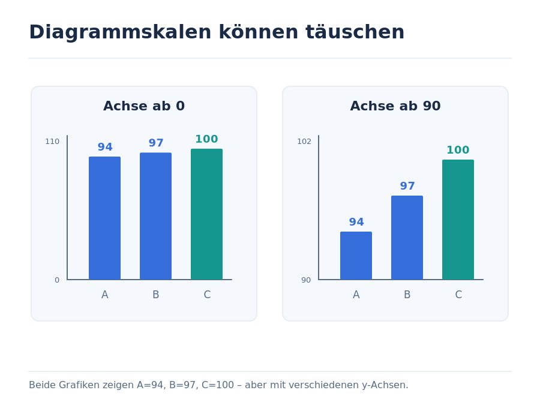

# M9-L2 – Datenanalyse, Visualisierung und statistisches Denken {#L2}

**Kursbereich:** M9 – Bachelor: Wahl- und Praxisgebiete

**Niveau:** Bachelor (Wahl / Anwendung)

**Vorwissen:** Keine festen Voraussetzungen angegeben.

**Einordnung:** Freiwilliges Bachelor-Wahlthema (M9-L2)

**Lesepfad:** Hilfreich sind M1-L5 (Daten und Datenbanken), M8-L1 (diskrete Strukturen), M9-L1 (Usability) und M5-L3 (maschinelles Lernen). Die Lektion ist trotzdem eigenständig lesbar. Sie verlangt keine Statistiksoftware, Programmierung oder Übungen. Im Mathematikkurs bietet Schule M1-L6 einen Einstieg in deskriptive Statistik. Schule M2-L16 und Universität M1-L7 vertiefen Zufallsvariablen, Stichproben und statistische Tests.

## Daten sind nicht automatisch Wissen {#S1}

Ein Computer kann Millionen Zeilen erfassen und dennoch die falsche Antwort liefern. Eine Website meldet 20.000 Seitenaufrufe. Sind damit 20.000 Menschen gemeint? Nicht unbedingt: Eine Person kann zehn Seiten laden, ein Programm kann wiederholt zugreifen und einige Aufrufe können durch die Messung verloren gehen. Die Zahl ist technisch plausibel, aber ihre Bedeutung ist ohne **Definition** unklar.

**Datenanalyse** bedeutet, gesammelte Beobachtungen gezielt zu prüfen, aufzubereiten, zusammenzufassen und zu interpretieren, um eine begrenzte Frage zu beantworten. **Statistik** stellt Begriffe und Verfahren bereit, um Muster zu beschreiben und Unsicherheit einzuschätzen. **Datenvisualisierung** macht ausgewählte Zusammenhänge sichtbar. **Statistisches Denken** heißt vor allem: fragen, *was* gemessen wurde, *bei wem*, *unter welchen Bedingungen* und *welche Schlussfolgerung daraus zulässig ist*.

Die gesamte Kette lässt sich als Architektur lesen:

``` text
Wirklicher Vorgang (Mensch, Maschine, Ereignis)
                 |
                 v
Messung / Erfassung / Ereignisprotokoll
                 |
                 v
Rohdaten + Definitionen + Erhebungszeitpunkt
                 |
                 v
Qualitätsprüfung und nachvollziehbare Bereinigung
                 |
                 v
Kennzahlen / Vergleiche / statistische Modelle
                 |
                 v
Diagramm + Interpretation + Unsicherheit
                 |
                 v
Entscheidung, Beobachtung oder neue Fragestellung
```

Jeder Übergang kann Fehler erzeugen. Wird etwa der Zeitzonenwechsel übersehen, können stündliche Nutzungszahlen falsch gruppiert werden. Eine verdoppelte Datenzeile macht aus einem Auftrag plötzlich zwei. Ein Grafikprogramm kann einen winzigen Unterschied optisch dramatisch erscheinen lassen. Darum ist Datenanalyse kein einmaliges „Diagramm erstellen“, sondern ein kontrollierbarer Prozess.

## Eine Frage bestimmt die Auswertung {#S2}

Vor jeder Rechnung steht eine überprüfbare Frage. „Wie gut läuft die Anwendung?“ ist unpräzise. „Wie viele von den gestarteten Importaufträgen endeten in den vergangenen sieben Tagen erfolgreich?“ ist prüfbar. Der zweite Satz nennt *Einheit* (Importauftrag), *Ergebnis* (erfolgreich abgeschlossen), *Grundgesamtheit* (gestartete Aufträge) und *Zeitraum*.

Drei Fragen sollten getrennt bleiben:

1.  **Beschreibung:** Wie viele Aufträge gab es, und wie lange dauerten sie?
2.  **Erklärung:** Hängen längere Laufzeiten mit Dateigröße oder Auslastung zusammen?
3.  **Wirkungsfrage:** Würde eine zusätzliche Maschine die Laufzeit tatsächlich verkürzen?

Die dritte Frage verlangt stärkere Belege als die erste. Zwei Werte können gemeinsam steigen, ohne dass einer den anderen verursacht. Beispielsweise nehmen an warmen Tagen sowohl die Besuche einer Badestelle als auch der Verkauf von Getränken zu. Daraus folgt nicht, dass der Getränkeverkauf die Besucherzahl verursacht.

Vor einer Auswertung sollte auch feststehen, *welche Entscheidung* sie unterstützen soll. Wenn ein Bericht keine Handlung verändert, genügt manchmal eine kleine Übersicht statt eines dauerhaften Analyseclusters. Umgekehrt können bei rechtlich oder sicherheitsrelevanten Entscheidungen mehrere Prüfverfahren notwendig sein.

## Was genau ist eine Datenzeile? {#S3}

Eine Tabelle wirkt eindeutig, bis man ihre **Beobachtungseinheit** hinterfragt. Ein Datensatz kann eine Person, Bestellung, Datei, Sitzung, Geräte-Messung oder einen Verarbeitungsschritt darstellen. Werden diese Ebenen vermischt, entstehen falsche Summen.

Betrachten wir ein fiktives Medienarchiv:

  Datei-ID   Typ       Größe (MiB)   Importdauer (s) Ergebnis
  ---------- ------- ------------- ----------------- ----------------
  M001       Foto               12                 2 erfolgreich
  M002       Video             240                18 erfolgreich
  M003       Foto                8                 3 erfolgreich
  M004       Audio              70                 7 fehlgeschlagen

Hier repräsentiert **eine Zeile einen Importversuch**. Falls dieselbe Datei erneut importiert wird, sollte es einen neuen Versuch mit eigener ID geben. Eine Summe aller Versuche ist nicht dasselbe wie die Zahl unterschiedlicher Dateien.

Die Eigenschaften einer Zeile heißen **Variablen** oder **Merkmale**. `Typ` und `Ergebnis` sind kategoriale Merkmale; `Größe` und `Importdauer` sind quantitative Merkmale. Eine ID ist keine sinnvoll zu mittelnde Zahl, auch wenn sie nur aus Ziffern bestünde. Ein Datumsfeld gehört zur Zeitachse; ein Freitext kann erst nach klar definierten Regeln kategorisiert werden.

Bei **nominalen Kategorien** gibt es keine natürliche Reihenfolge, etwa Foto, Audio, Video. **Ordinale Kategorien** besitzen eine Reihenfolge, etwa niedrig, mittel, hoch; der Abstand zwischen ihnen ist jedoch nicht automatisch messbar. Quantitative Werte erlauben arithmetische Aussagen, wenn die Einheit und Messskala dazu passen.

**Metadaten** beschreiben die Daten: Messmethode, Einheit, Quelle, Erhebungszeit, Version, Berechnung und etwaige Filter. Ohne sie ist eine Zahl wie „75“ weder 75 Millisekunden noch 75 Euro noch 75 Prozent. Ein gutes Datenmodell hält die Bedeutung selbst dann fest, wenn später andere Menschen den Bericht lesen.

## Datenqualität: Vor der Rechnung kommt die Prüfung {#S4}

Typische Probleme sind doppelte Zeilen, fehlende Werte, widersprüchliche Kategorien, ungültige Zeitstempel, gemischte Einheiten und Beobachtungen, die nicht zu der festgelegten Grundgesamtheit gehören.

**Datenbereinigung** (*Data Cleaning*) ist das dokumentierte Erkennen und Behandeln solcher Probleme. Sie sollte nicht heimlich die Wirklichkeit „glätten“:

- Eine Importdauer `-3 Sekunden` ist für eine einzelne abgeschlossene Verarbeitung physikalisch unplausibel. Sie kann auf Uhrfehler oder falsche Berechnung hindeuten.
- Ein fehlender Preis ist **nicht** automatisch ein Preis von null Euro. `NULL`, „unbekannt“ und `0` beschreiben unterschiedliche Zustände.
- Die Werte `DE`, `Deutschland` und `Germany` lassen sich möglicherweise derselben Länderkategorie zuordnen; die Entscheidung gehört in eine Zuordnungstabelle.
- Zwei identische Zeilen können echte doppelte Ereignisse sein oder ein mehrfach eingelesenes Log. Löschen ist erst sinnvoll, wenn die **Ereignis-ID** oder der Erhebungsweg geklärt ist.
- Ein überraschend großer Wert ist nicht automatisch ein Messfehler. Vielleicht trat tatsächlich eine seltene große Datei auf.

Fehlende Angaben können zufällig entstehen, sich aber auch systematisch auf bestimmte Gruppen konzentrieren. Wenn Nutzer mit langsamen Verbindungen ihre Uploads häufig abbrechen und genau diese Versuche im Erfolgsbericht fehlen, wird die durchschnittliche Leistung zu positiv dargestellt. **Imputation** bedeutet, fehlende Werte durch begründete Schätzungen zu ersetzen. Das ist eine Modellannahme und sollte sichtbar bleiben, nicht mit einer echten Messung verwechselt werden.

Ein praktikabler Ablauf ist: Rohdaten unverändert behalten, Prüfschritte protokollieren, bereinigte Tabelle getrennt erzeugen und fragliche Fälle kennzeichnen. Wer später eine andere Bereinigungsentscheidung trifft, kann damit den Bericht reproduzieren.

## Deskriptive Statistik: Wie sieht eine Verteilung aus? {#S5}

Die **deskriptive Statistik** beschreibt vorhandene Daten. Zu ihren Werkzeugen gehören Häufigkeiten, Anteile, Mittelwerte, Median, Streuung, Quantile und grafische Darstellungen. Beschreiben bedeutet noch nicht, von einer Gruppe auf alle Menschen oder zukünftigen Ereignisse schließen zu dürfen.

### Ein vollständig gerechnetes Beispiel {#51-ein-vollständig-gerechnetes-beispiel}

Sieben Importaufträge benötigen in einem fiktiven Beispiel folgende Sekunden:

`2, 3, 3, 4, 5, 7, 18`

Der **arithmetische Mittelwert** ist die Summe geteilt durch die Zahl der Beobachtungen:

$\frac{2+3+3+4+5+7+18}{7}=\frac{42}{7}=6\,\text{Sekunden}$

Der **Median** ist der mittlere Wert der sortierten Liste. Hier steht an vierter Position die `4`, also **Median = 4 Sekunden**. Der **Modus** ist der am häufigsten vorkommende Wert: `3 Sekunden` (zweimal).

Warum liegen Mittelwert und Median auseinander? Der Auftrag mit 18 Sekunden zieht den Mittelwert nach oben. Entfernte man diesen Wert für einen *separaten* Vergleich, läge der Mittelwert der übrigen sechs Aufträge bei $\frac{24}{6}=4\,\text{Sekunden}$. Diesen Auftrag einfach zu löschen wäre aber nicht gerechtfertigt. Er kann ein seltener, echter Schwerlastfall sein, den der Betreiber gerade verstehen muss.

**Spannweite** heißt größter minus kleinster Wert: $18-2=16\,\text{Sekunden}$. Sie reagiert stark auf Extremwerte. **Quartile** teilen sortierte Werte in Abschnitte. In einer hier ausdrücklich verwendeten Konvention wird der Median bei ungerader Anzahl von der Quartilsberechnung ausgeschlossen: Untere Hälfte `2, 3, 3` ergibt **Q1 = 3**, obere Hälfte `5, 7, 18` ergibt **Q3 = 7**. Der **Interquartilsabstand** beträgt $\mathrm{IQR}=7-3=4\,\text{Sekunden}$. Andere statistische Programme verwenden teils andere Quantilkonventionen; Grenzwerte können deshalb leicht abweichen.

Nach einer häufig verwendeten *Faustregel* liegt eine obere Ausreißergrenze bei $Q_3+1{,}5\times\mathrm{IQR}=7+6=13\,\text{Sekunden}$. Der Wert 18 wäre damit **markierungswürdig**, nicht automatisch falsch. Die Regel ist eine Untersuchungshilfe, keine Löschanweisung.

### Standardabweichung und Streuung {#52-standardabweichung-und-streuung}

Die **Varianz** mittelt quadrierte Abstände vom Mittelwert; die **Standardabweichung** ist ihre Quadratwurzel. Dadurch besitzt sie wieder die Einheit Sekunden. In unserer vollständigen Siebenerliste liegt der Mittelwert bei 6. Die quadrierten Abstände summieren sich zu:

$16+9+9+4+1+1+144=184\,\text{Sekunden}^2$.

Wenn die sieben Aufträge als **die vollständige betrachtete Population** gelten, ist die Populationsvarianz $\frac{184}{7}\approx26{,}29\,\text{Sekunden}^2$ und die Populationsstandardabweichung $\approx5{,}13\,\text{Sekunden}$. Würde dieselbe Liste als **Stichprobe** für eine größere Population ausgewertet, verwendet die einfache unverzerrte Stichprobenvarianz unter den üblichen Voraussetzungen den Nenner $n - 1 = 6$ und ergäbe $\approx30{,}67\,\text{Sekunden}^2$ beziehungsweise eine Stichprobenstandardabweichung von $\approx5{,}54\,\text{Sekunden}$.

Die zwei Berechnungen beantworten unterschiedliche Fragen; man darf die Nenner nicht unbemerkt austauschen. Auch eine Standardabweichung sagt allein nicht, ob eine Verteilung symmetrisch ist oder wenige Extremfälle enthält. Deshalb ergänzen Median, Quantile und ein Verteilungsdiagramm den Mittelwert häufig sinnvoll \[1\].

## Prozente, Bezugsgrößen und sinnvolle Kennzahlen {#S6}

Eine Prozentzahl muss stets ihren **Nenner** erkennen lassen. Von 100 gestarteten Importen gelingen 90: **90 % Erfolgsquote**. Wenn aber 20 Versuche noch laufen, wäre die Aussage „90 von 100 endgültig erfolgreich“ verfrüht. Man könnte den Status *90 erfolgreich, 10 fehlgeschlagen, 20 ausstehend* für insgesamt 120 Starts berichten oder die abgeschlossenen Aufträge bewusst gesondert betrachten.

Die **Rate** setzt Ereignisse zu einer Zeit- oder Mengeneinheit in Beziehung: beispielsweise 30 Importfehler pro 10.000 Aufträge, nicht einfach „30 Fehler“. Bei Zeitreihen gehört das Messfenster dazu: 100 Aufträge in einer Stunde sind eine andere Last als 100 Aufträge an einem Tag.

Prozent und **Prozentpunkte** sind nicht dasselbe. Steigt eine Erfolgsquote von 60 auf 75 Prozent, beträgt der absolute Anstieg **15 Prozentpunkte**. Relativ zur Ausgangsquote sind das $\frac{75-60}{60}=25\,\%$. Beide Beschreibungen sind rechnerisch korrekt; die alleinige Angabe „25 % besser“ kann aber leicht übertrieben wirken, wenn nicht klar ist, welche Basis gemeint ist.

### Das gewichtete Mittel {#61-das-gewichtete-mittel}

Ein Analysebericht zeigt zwei Auftragsklassen: 90 kleine Aufträge dauern im Mittel 1 Sekunde, 10 große Aufträge im Mittel 10 Sekunden. Wer die Klassenmittel schlicht mittelt, erhält $\frac{1+10}{2}=5{,}5\,\text{Sekunden}$ und liegt für die **durchschnittliche Dauer eines zufällig ausgewählten Auftrags** falsch.

Das **gewichtete Mittel** berücksichtigt die unterschiedlich großen Gruppen:

$\frac{90\times1+10\times10}{90+10}=\frac{190}{100}=1{,}9\,\text{Sekunden}$.

Die Zahl `5,5` wäre allenfalls der Durchschnitt *zweier Klassenmittel bei gleicher Klassengewichtung* – eine andere Fragestellung. Deshalb müssen Tabellen, Diagramme und Berichte immer offenlegen, ob nach Personen, Aufträgen, Dateien oder Gruppen gewichtet wurde.

## Häufigkeiten, Verteilungen und Wahrscheinlichkeiten {#S7}

Eine **Häufigkeitsverteilung** zählt, wie oft Werte oder Kategorien auftreten. Bei diskreten Kategorien kann man direkt zählen; bei vielen unterschiedlichen numerischen Werten werden Wertebereiche gebildet. Die Grenzen müssen eindeutig festgelegt sein, zum Beispiel **$0 \le  t < 2$, $2 \le  t < 5$, $5 \le  t < 10$, $t \ge  10$ Sekunden**. In dieser Konvention gehört ein Auftrag mit genau 2 Sekunden zur zweiten Klasse und einer mit genau 10 Sekunden zur letzten. Die Intervalle überlappen sich nicht und lassen innerhalb des nichtnegativen Messbereichs keine Lücke. Andere Klassengrenzen sind möglich; wie breit sie sind, verändert den Eindruck der Verteilung.

**Wahrscheinlichkeit** behandelt das Modell möglicher Ereignisse, **relative Häufigkeit** die tatsächlich beobachtete Quote. Wenn neun von zehn Dateien erfolgreich importiert wurden, ist die beobachtete Erfolgsquote 90 %. Daraus folgt nicht, dass der nächste Import mit exakt 90 % Wahrscheinlichkeit gelingt. Dazu müssten die Bedingungen hinreichend stabil und die Stichprobe aussagekräftig sein.

**Bedingte Wahrscheinlichkeit** bedeutet: Wie wahrscheinlich ist ein Ereignis, *wenn* eine zusätzliche Bedingung gilt? Beispielsweise kann die Fehlerrate für Videos größer sein als für Fotos. Eine Gesamtquote verschleiert diese Unterschiede. Umgekehrt müssen kleine Gruppen vorsichtig gelesen werden: Ein einziger Fehler bei zwei Aufträgen ergibt 50 %, bei 2.000 Aufträgen hätte derselbe einzelne Fehler nur 0,05 %.

Beim Beurteilen seltener Ereignisse spielt die **Basisrate** eine wichtige Rolle. Ein fiktiver Klassifikator soll 100 verdächtige unter 10.000 Vorgängen erkennen. Er erkennt 90 von 100 tatsächlich verdächtigen Vorgängen (90 % Trefferquote) und markiert fälschlich 5 % der 9.900 unverdächtigen Vorgänge: **495 falsche Alarme**. Insgesamt meldet er $90 + 495 = 585$ Verdachtsfälle. Von diesen sind nur $\frac{90}{585}\approx15{,}38\,\%$ tatsächlich verdächtig. Obwohl die Trefferquote hoch klingt, ist eine positive Meldung also meist ein Fehlalarm. **Präzision** und **Recall/Trefferquote** beantworten unterschiedliche Fragen – ein Bezug zu M5-L3.

## Grundgesamtheit, Stichprobe und Auswahlverzerrung {#S8}

Die **Grundgesamtheit** ist die Menge, über die wir eine Aussage machen möchten: etwa alle Kunden, alle Anfragen dieses Monats oder alle künftig zu verarbeitenden Videos. Eine **Stichprobe** ist der beobachtete Ausschnitt. Nicht jede Stichprobe repräsentiert die Grundgesamtheit.

Eine **Zufallsstichprobe** verwendet eine dokumentierte Auswahlregel mit bekannten Auswahlchancen; das ermöglicht unter passenden Annahmen statistische Fehlerabschätzungen. Eine freiwillige Online-Umfrage zieht dagegen möglicherweise besonders zufriedene oder besonders unzufriedene Personen an. Mehr Antworten beseitigen diesen **Auswahlbias** nicht automatisch.

Man unterscheidet **Stichprobenfehler**: Unterschiede aufgrund der zufälligen Auswahl, und **Nichtstichprobenfehler**: etwa falsche Fragen, Messfehler, fehlende Antworten, unvollständige Abdeckung oder fehlerhafte Verarbeitung. Auch eine Vollerhebung kann Nichtstichprobenfehler enthalten \[2\].

Ein Beispiel: Von 100 zufällig ausgewählten, voneinander unabhängigen Fällen sind 60 erfolgreich. Die geschätzte Quote ist $p = 0{,}60$. Unter den Voraussetzungen eines einfachen Binomialmodells liegt der geschätzte **Standardfehler** bei $\sqrt{\frac{0{,}6\times0{,}4}{100}}\approx0{,}049$, also etwa 4,9 Prozentpunkten. Eine grobe Normalapproximation für ein 95%-**Konfidenzintervall** ergibt $60\,\%\pm1{,}96\times4{,}9\,\text{Prozentpunkte}$, also ungefähr **50,4 % bis 69,6 %**. Die genauen Grenzen hängen vom gewählten Verfahren ab.

Diese Rechnung ist **keine Garantie** dafür, dass die wahre Quote in genau diesem berechneten Intervall liegt. Vereinfacht ausgedrückt: Bei sehr häufig wiederholter, gleichartiger zufälliger Ziehung würden ungefähr 95 % der mit diesem Verfahren gebildeten Intervalle den festen wahren Parameter überdecken, sofern die Voraussetzungen stimmen. Systematische Auswahlfehler und schlechte Messmethoden werden vom Intervall nicht geheilt.

## Zusammenhang ist nicht Ursache {#S9}

**Korrelation** beschreibt, wie zwei Größen gemeinsam variieren. Eine positive Korrelation bedeutet tendenziell: Wenn eine Größe höher liegt, liegt die andere ebenfalls höher. Eine negative Korrelation bedeutet die entgegengesetzte Richtung. Der **Pearson-Korrelationskoeffizient** `r` nimmt Werte zwischen `-1` und `+1` an; $r = 0$ bedeutet keinen *linearen* Zusammenhang, aber nicht zwingend Unabhängigkeit oder das Fehlen nichtlinearer Beziehungen.

Drei mögliche Erklärungen für einen beobachteten Zusammenhang müssen auseinandergehalten werden:

- **A verursacht B:** Eine längere Dateigröße kann unter sonst gleichen Bedingungen zu längeren Übertragungszeiten beitragen.
- **B beeinflusst A:** Auch die umgekehrte Richtung kann in anderen Situationen plausibel sein.
- **C beeinflusst A und B:** Ein dritter Faktor wie hohe Serverauslastung kann sowohl Fehlerquote als auch Antwortzeit erhöhen.

Auch Zufall, verzerrte Auswahl oder ein gemeinsamer zeitlicher Trend kommen infrage. **Kausalität** ist eine Aussage über Ursache und Wirkung. Für überzeugende Kausalaussagen braucht es passende Vergleichsgruppen, zeitliche Reihenfolge und eine Kontrolle möglicher Störfaktoren; randomisierte Experimente sind in manchen Situationen besonders aufschlussreich, aber nicht immer möglich oder ethisch vertretbar.

### Simpsons Paradoxon: Alle Gruppen besser – insgesamt schlechter? {#91-simpsons-paradoxon-alle-gruppen-besser-insgesamt-schlechter}

Ein fiktiver Test vergleicht zwei Algorithmen. Algorithmus B ist **innerhalb beider Schwierigkeitsgruppen** erfolgreicher, wird aber überproportional für schwere Fälle eingesetzt:

  Schwierigkeit      Algorithmus A   Erfolgsquote A    Algorithmus B   Erfolgsquote B
  --------------- ---------------- ---------------- ---------------- ----------------
  Einfach                81 von 90             90 %        19 von 20             95 %
  Schwer                  1 von 10             10 %        16 von 80             20 %
  **Insgesamt**     **82 von 100**         **82 %**   **35 von 100**         **35 %**

**In jeder Gruppe liegt B vorn**, doch die Gesamtquote von A ist höher. Der Widerspruch verschwindet, wenn man die **unterschiedliche Zusammensetzung** betrachtet: A bearbeitet überwiegend einfache Fälle, B überwiegend schwierige. Das heißt *Simpsons Paradoxon*. Ohne Kenntnis der Gruppenzugehörigkeit könnte ein Dashboard die falsche technische Entscheidung nahelegen.

Die richtige Frage lautet deshalb nicht nur „Welche Quote ist größer?“, sondern auch „Sind die Fälle in beiden Gruppen vergleichbar?“ Die Gruppierung darf wiederum nicht beliebig nachträglich so gewählt werden, dass ein gewünschtes Ergebnis erscheint.

## Zeitreihen, Saisonalität und sich verändernde Systeme {#S10}

Eine **Zeitreihe** ordnet Messungen nach Zeit. Webseitenaufrufe pro Tag, GPU-Auslastung pro Stunde und Fehlerraten pro Woche sind typische Beispiele. Solche Messungen haben besondere Eigenschaften: Wochenrhythmen, Feiertage, Wachstum, kurzfristige Ausfälle und geänderte Messverfahren.

Ein **Trend** ist eine längerfristige Richtung, **Saisonalität** ein wiederkehrendes Muster und **Rauschen** kurzfristige Schwankung. Ein **gleitender Mittelwert** glättet Werte über ein fortlaufendes Zeitfenster. Er kann einen Trend sichtbarer machen, verdeckt aber womöglich kurze Sicherheitsvorfälle. Ein Alarm sollte nicht allein auf einem geglätteten Monatsmittel basieren, wenn Ausfälle innerhalb von Sekunden kritisch sind.

Außerdem sind **Bestand** und **Fluss** zu unterscheiden: „Der Speicher enthält 500 GiB“ ist ein Bestand zu einem Zeitpunkt; „Heute wurden 20 GiB hochgeladen“ ein Fluss über ein Zeitintervall. Beide gehören nicht ohne Weiteres in dieselbe Summenlogik \[3\].

Bei Cloud-Diensten müssen Berichte die korrekte **Zeitzone**, Sommerzeitwechsel, verspätet eintreffende Ereignisse und wiederholte Nachrichten berücksichtigen. Sonst entsteht scheinbares Nutzerwachstum nur, weil eine neue Logquelle hinzugefügt wurde. Vergleichbare Zeiträume und konsistente Zähldefinitionen sind die Voraussetzung einer belastbaren Veränderungsanalyse.

## Gute Datenvisualisierung: Welche Grafik passt zur Frage? {#S11}

Ein Diagramm soll eine konkrete Beziehung verständlich zeigen. Die **Office for National Statistics** (ONS), das britische Statistikamt, empfiehlt die Wahl nach Datentyp und Aussageziel sowie möglichst einfache, vertraute Darstellungen \[3\].




  Fragestellung                               Geeignete Darstellung                        Typische Falle
  ------------------------------------------- -------------------------------------------- -------------------------------------------------------
  Welche Kategorie ist größer?                Balkendiagramm                               Abgeschnittene Nullachse
  Wie verändert sich etwas über Zeit?         Liniendiagramm                               Ungleichmäßige Zeitabstände als gleichmäßig behandeln
  Wie sind Zahlen verteilt?                   Histogramm oder Boxplot                      Unpassende Klassenbreite
  Wie hängen zwei Zahlen zusammen?            Streudiagramm                                Korrelation als Ursache lesen
  Welchen Anteil am Ganzen hat eine Gruppe?   Gestapelter Balken oder einfache Tabelle     Überladene Torten mit vielen Kategorien
  Wo treten Ereignisse auf?                   Karte, falls Raum tatsächlich relevant ist   Flächengröße statt normierter Rate vergleichen

**Balkendiagramme** verwenden ihre Länge als Mengenmaß und sollten auf einer Nullbasis starten. Werden zwei Balken für 98 und 102 Einheiten ab 95 statt ab null gezeichnet, wirkt der Unterschied riesig: Die sichtbaren Längen wären dann 3 und 7 statt 98 und 102. Die Zahlen sind nur rund **4,08 %** verschieden ($\frac4{98}\times100$), nicht mehr als doppelt so groß. Für **Liniendiagramme** können begründete Ausschnitte der y-Achse hilfreich sein, sofern Beschriftung und Kontext den Ausschnitt deutlich machen. Das ist etwas anderes als ein manipulativ abgeschnittenes Balkendiagramm \[4\].

**Histogramme** unterscheiden sich von gewöhnlichen Balkendiagrammen: Ihre Klassen sind Intervalle numerischer Werte. Die Wahl der Klassenbreite kann scheinbar zwei Gipfel erzeugen oder verbergen. **Boxplots** zeigen typische Lage und Streuung, verschweigen aber möglicherweise die genaue Form einer mehrgipfligen Verteilung. Wer kritische Einzelereignisse sucht, braucht ergänzende Angaben.

**Streudiagramme** zeigen Wertepaarungen und helfen, nichtlineare Zusammenhänge oder Gruppenunterschiede zu erkennen. Überlappende Punkte können die Häufigkeit verdecken; transparente Punkte oder aggregierte Dichten sind dann mögliche Hilfen. Farbige Punkte müssen auch ohne Farbwahrnehmung unterscheidbar sein.

## Gute Grafiken sind auch zugänglich und nachvollziehbar {#S12}

Eine Visualisierung benötigt einen sachlichen Titel, klare Achsen, **Einheiten**, Zeitraum, Datenquelle und nötigenfalls Hinweise zu Schätzungen oder fehlenden Werten. Ein Titel wie „Uploads nach Wochen, Januar bis März 2026“ ist aussagekräftiger als „Performance“.

**Barrierefreiheit** gehört dazu: ausreichend Kontrast, nicht nur Farbe zur Unterscheidung, erklärende Beschriftungen und eine Tabelle beziehungsweise Textzusammenfassung der zentralen Werte. Ein Screenreader kann aus einer bloßen Grafik ohne zugängliche Informationen wenig entnehmen; die Erkenntnis sollte daher auch in Textform verfügbar sein. Das verbindet dieses Wahlfach mit M9-L1 \[5\].

Eine **logarithmische Achse** kann mehrere Größenordnungen zeigen, ist aber für viele Leser schwerer zu verstehen und sollte ausdrücklich gekennzeichnet sein. Zwei y-Achsen mit unterschiedlichen Skalen können einen scheinbar engen Zusammenhang herstellen, den es rechnerisch nicht gibt. Eine Reihe von 2D-Grafiken ist oftmals besser lesbar als eine dekorative 3D-Darstellung.

Bei Karten darf die Größe einer Region nicht mit der Häufigkeit eines Ereignisses verwechselt werden. Eine große Region kann absolut mehr Fälle haben und dennoch eine niedrigere **Rate pro Einwohner** als eine kleine Region. Ein Bericht sollte also oft sowohl absolute Zahlen als auch normierte Raten zeigen.

Vor jeder Veröffentlichung lohnt die Kontrollfrage: *Welche Interpretation macht die Grafik beim ersten Blick wahrscheinlich – und ist diese Interpretation durch die Daten gerechtfertigt?*

## Explorative Analyse, Hypothesentests und Signifikanz {#S13}

**Explorative Datenanalyse** (*Exploratory Data Analysis*, EDA) sucht nach Strukturen und überraschenden Beobachtungen. Das ist legitim und nützlich, aber eine nachträglich gefundene Auffälligkeit sollte nicht so behandelt werden, als sei sie vor der Datensichtung vorhergesagt worden.

Ein **Hypothesentest** prüft eine klar formulierte Annahme anhand eines statistischen Modells. Der **p-Wert** beschreibt – unter der angenommenen Nullhypothese und den Modellbedingungen – wie ungewöhnlich die Daten oder extremere Ergebnisse wären. Er ist **nicht** die Wahrscheinlichkeit, dass die Nullhypothese wahr ist, und **nicht** die Wahrscheinlichkeit, dass der Befund „nur Zufall“ sei \[6\].

Die verbreitete Schwelle $p < 0{,}05$ ist kein Wahrheitsstempel. Wer hundert Diagramme oder Gruppenvergleiche durchprobiert und nur das auffälligste Ergebnis berichtet, begünstigt **Mehrfachtestprobleme** und *p-Hacking*. Eine saubere Darstellung benennt untersuchte Hypothesen, Auswahlregeln, Effektgrößen, Unsicherheit und mögliche Einschränkungen. **Statistische Signifikanz** ist nicht dasselbe wie **praktische Relevanz**: Eine winzige Verbesserung kann bei sehr großen Datenmengen statistisch auffallen und trotzdem weniger Nutzen bringen als die Betriebs- und Entwicklungskosten.

Für Entscheidungen ist oft wichtiger: Wie groß ist der geschätzte Unterschied? Welche Unsicherheit besteht? Wie teuer ist eine Fehlentscheidung? Können wir den Versuch wiederholen? Eine gute Analyse darf mit „Die Daten reichen dafür noch nicht“ enden.

## Vom A/B-Test zur verlässlichen Entscheidung {#S14}

Bei einem **A/B-Test** erhalten möglichst vergleichbare Gruppen zufällig unterschiedliche Varianten. Zum Beispiel sehen Benutzer zufällig eine alte oder neue Importoberfläche. Gemessen wird nicht nur, wie viele auf „Starten“ klicken, sondern ob die Aufgabe wirklich erfolgreich abgeschlossen wird und ob Fehler oder Abbrüche auftreten.

Vorab werden festgelegt: Zielgröße, Zielgruppe, Laufzeit, geplante Vergleichsmethode und **Abbruchbedingungen**. Die zufällige Zuweisung sollte dauerhaft pro Person oder Sitzung definiert sein, damit dieselbe Person nicht ständig die Variante wechselt. Werden Geräte, Länder oder Nutzungszeiten ungleich verteilt, können die Ergebnisse verzerrt sein.

Ein oft übersehener Punkt: **Der Messwert muss zur Entscheidung passen.** Wenn Variante B mehr Klicks auslöst, aber weniger erfolgreiche Uploads, ist die höhere Klickrate kein Erfolg. Ebenso darf eine Verbesserung bei durchschnittlicher Wartezeit nicht mit schweren Ausfällen oder schlechterer Barrierefreiheit erkauft werden.

Bei wiederholten täglichen Blicken auf ein Testergebnis können zufällige Schwankungen verführerisch sein. Ein Test sollte nicht allein deshalb gestoppt werden, weil ein gewünschter Zwischenstand kurzzeitig signifikant erscheint. Auch eine Beobachtungsstudie kann wertvoll sein, wenn man sie nicht fälschlich als randomisiertes Experiment ausgibt.

## Datenanalyse und künstliche Intelligenz: Gleiche Probleme, größere Folgen {#S15}

Ein KI-Modell verarbeitet dieselben Arten von Datenqualitätsproblemen in größerem Maßstab. Ein **Trainingsdatensatz** liefert Lernbeispiele; ein **Validierungsdatensatz** unterstützt Modellauswahl und Abstimmung; ein **Testdatensatz** soll die abschließende Prüfung an zuvor nicht verwendeten Fällen ermöglichen. Die Aufteilung darf keine Informationen aus dem Testdatensatz in das Training durchsickern lassen.

Dieses Problem heißt **Data Leakage** oder *Datenleck zwischen Trainings- und Prüfphasen*: Wenn etwa die Standardisierung einer Variablen bereits mit dem Mittelwert sämtlicher Daten einschließlich der Testfälle berechnet wird, beeinflussen Testinformationen die Modellvorbereitung. Das kann die gemessene Qualität künstlich erhöhen. Die offizielle scikit-learn-Dokumentation empfiehlt deshalb, zuerst korrekt aufzuteilen und Vorverarbeitung nur auf den Trainingsdaten zu *lernen* \[7\].

Auch scheinbar eindeutige Modellmetriken sind kontextabhängig. In M5-L3 wurde bereits gezeigt, wie hohe Gesamtgenauigkeit bei seltenen Ereignissen täuschen kann. Beim Vergleich zweier Sprachmodelle sollte zusätzlich feststehen, ob die gleichen Aufgaben, identischen Bewertungsregeln, Modellversionen, Ausgabegrenzen und Zufallsbedingungen verwendet wurden. Eine Veränderung der Datenzusammensetzung kann den Mittelwert verbessern, obwohl das Modell in einer fachlich entscheidenden Gruppe schlechter wird.

**Data Drift** beschreibt Veränderungen in der Verteilung der Eingabedaten, beispielsweise wenn aus kleinen Fotos plötzlich überwiegend hochauflösende Videos werden. **Concept Drift** bezeichnet eine Veränderung des Zusammenhangs zwischen Eingaben und dem vorherzusagenden Ergebnis. Beides kann ein früher gutes Modell schwächen. Monitoringsysteme können auffällige Veränderungen melden, müssen jedoch zwischen echten Problemen, saisonalen Mustern und geändertem Logging unterscheiden.

Ein Sprachmodell kann Kennzahlen formulieren oder Grafiken beschreiben. Es ersetzt jedoch **keine nachvollziehbare Datenberechnung**. Werden Zahlen in einer KI-Antwort genannt, sollten sie aus überprüften Datenabfragen oder Rechenwerkzeugen stammen. Ein automatisch formulierter Managementbericht braucht daher klare Quellen, Datumsangaben, Rundungsregeln und gegebenenfalls menschliche Freigabe.

## Praxisarchitektur 1: Das lokale Medienarchiv verstehen {#S16}

Ein privates Archiv speichert Dateien, Kategorien und Importvorgänge. Sein Betreiber will wissen, warum das Einlesen großer Videos länger dauert als das Einlesen kleiner Bilder. Dafür benötigt er nicht zwingend Cloud-Analytik.

``` text
Lokale Dateien / Importprotokolle
             |
             v
SQLite oder andere lokale Datenbank
             |
             v
Prüfung: Einheiten, doppelte Versuche, Zeitstempel
             |
             v
Gruppierung nach Dateityp und Größenklasse
             |
             v
Median + Quantile + seltene Fehlerfälle
             |
             v
Tabelle / einfacher Bericht / Diagramm
```

Der Median der Importdauer pro Dateityp zeigt typische Laufzeiten, während hohe Quantile und Extremfälle auf Engpässe hindeuten können. Eine reine Durchschnittszahl würde den großen Videoimport möglicherweise verdecken. Wenn dieselbe Datei mehrmals importiert wurde, entscheidet die Fragestellung, ob jeder Versuch oder nur die erste erfolgreiche Übernahme gezählt werden soll.

**Nützlich**, wenn viele Dateien verarbeitet werden und Engpässe nicht mehr aus Einzelbeobachtungen erkennbar sind. **Unnötig aufwendig**, wenn lediglich zehn manuell verwaltete Dateien vorhanden sind. Eine lokale Datenbank mit regelmäßig erzeugtem Bericht kann reichen; Cluster, verteilte Datenverarbeitung und GPU-Modelle würden mehr Wartung als Erkenntnis schaffen. Private Dateinamen und Metadaten müssen nicht für bloße Statistik an einen fremden Dienst übertragen werden.

## Praxisarchitektur 2: Online-Dienst mit ehrlichen Kennzahlen {#S17}

Ein kostenpflichtiger Online-Analysedienst möchte wissen, wie viele Aufträge ankommen, wie viele bezahlt werden und welche wirklich erfolgreich enden. Ein typischer Ablauf:

``` text
Website / API / Abrechnung
          |
          v
Ereignisse mit eindeutiger Auftrags-ID
          |
          v
Auftragsdatenbank / kontrolliertes Ereignisprotokoll
          |
          v
Bereinigte periodische Auswertung
          |
          +--> technische Kennzahlen: Fehler, Latenz, Last
          |
          +--> fachliche Kennzahlen: bezahlt, abgeschlossen
          |
          v
Dashboard mit Zeitraum, Nenner, Quelle, Filter
```

Ein Zahlungsereignis darf nicht dreifach gezählt werden, weil der Zahlungsdienst dieselbe Benachrichtigung wiederholt gesendet hat. Ebenso ist ein abgeschlossener Auftrag nicht automatisch ein zufriedener Kunde. Technische Erfolgsquoten, Umsatzkennzahlen und Benutzerzufriedenheit messen verschiedene Dinge.

**Nützlich** sind kleinste, nachvollziehbare Kennzahlen: Anzahl eindeutig bezahlter Aufträge, Abschlussquote je gestarteten Auftrag, 95. Perzentil der Laufzeit und klar definierte Fehlerraten. Ein **Perzentil** gibt an, welcher Anteil der Werte eine Grenze nicht übersteigt – bei einer geeigneten Definition liegen etwa 95 % unter oder bei dem 95. Perzentil. Die genauen Berechnungskonventionen und Messfenster gehören in die Dokumentation.

**Betriebsrisiken:** Ein öffentliches Dashboard kann Geschäftsgeheimnisse verraten; kleine Kundengruppen können unter Umständen wiedererkennbar sein. Zugriffsschutz, Löschregeln, Datenminimierung und eine Trennung zwischen Rohdaten und aggregierten Berichten sind wichtig. Eine zusätzliche Analyseplattform lohnt sich erst, wenn Datenumfang, Nutzerbedarf und Aktualitätsanforderungen es rechtfertigen.

## Praxisarchitektur 3: Ein KI-Dienst überwacht seine Qualität {#S18}

Ein dokumentengestützter KI-Assistent gibt Antworten aus Unternehmensunterlagen. Die Betreiber wollen wissen, ob neue Versionen **korrekter** werden und wie oft sie nicht belegte Behauptungen erzeugen. Ein einfaches „Nutzer haben 4,6 Sterne gegeben“ kann dazu wenig aussagen: Zufriedene Nutzer bewerten vielleicht nur die sprachliche Freundlichkeit, nicht die sachliche Richtigkeit.

``` text
Versioniertes Set geprüfter Fragen und Belege
                    |
                    v
Testlauf Modellversion A und Modellversion B
                    |
                    v
Bewertung: Belegtreue, Richtigkeit, Verweigerung,
          Laufzeit, Kosten und problematische Ausgaben
                    |
                    v
Vergleich nach Fragegruppen und Schwierigkeitsgrad
                    |
                    v
Interpretation + Unsicherheiten + Freigabeentscheidung
```

Die **Evaluationsdaten** sollten nicht zugleich als Trainingslösung bekannt und zum Abstimmen des Modells genutzt worden sein. Außerdem dürfen Fachfragen mit hohem Risiko nicht im Durchschnitt einer großen Zahl einfacher Fragen untergehen. Beispielsweise kann die gemittelte Qualität steigen, während seltene, aber wichtige Sicherheitsfragen häufiger falsch beantwortet werden.

**Nützlich** sind versionierte Prüfsätze, definierte Bewertungskriterien, dokumentierte Modellparameter und menschliche Prüfung kritischer Ausgaben. **Nicht sinnvoll** wäre es, nur eine einzige Gesamtpunktzahl zur Grundlage weitreichender Sicherheitsbehauptungen zu machen. Sensible Originaldokumente oder Nutzerdaten sollten nicht ungeprüft in öffentliche Auswertungsdienste kopiert werden. Rechen- und Tokenkosten steigen mit Häufigkeit und Umfang der Tests; eine gezielte Auswahl aussagekräftiger Prüffälle ist deshalb oft wirtschaftlicher als endloses Messen.

## Kosten, Wartung, Datenschutz und Verantwortlichkeit {#S19}

Analyse hat **laufende Kosten**: Datensammlung, Speicherung, Bereinigung, Rechenzeit, Visualisierung, Kontrolle, Zugriffsverwaltung und spätere Anpassungen. Die technische Qualität hängt außerdem davon ab, wer eine Kennzahl langfristig definiert und wer ihre Änderungen überprüft.

Ein **Datenkatalog** oder ein knappes **Kennzahlenhandbuch** kann festhalten: Name, Definition, Zähler/Nenner, Einheiten, Filter, Zeitfenster, Datenquelle, Aktualisierungsrhythmus, Verantwortliche und offene Einschränkungen. Ein solcher Eintrag ist oft wichtiger als ein teures Dashboard, dessen Zahlen niemand zuverlässig erklären kann.

Für personenbezogene Informationen gelten die Grundsätze der **Datenschutz-Grundverordnung (DSGVO)**, etwa Zweckbindung und Datenminimierung. Nicht jede technische Kennung ist harmlos: IP-Adressen, Gerätekennungen oder pseudonyme Nutzer-IDs können Personenbezug haben. **Anonymisiert** bedeutet nicht einfach „Name entfernt“. Gruppenstatistiken können bei sehr kleinen Fallzahlen individuelle Informationen preisgeben. Datenaufbewahrung und Zugriff sollten deshalb auf den legitimen Zweck abgestimmt sein. Für konkrete rechtliche Fragen ist eine gesonderte Prüfung erforderlich; diese Lektion ersetzt keine Rechtsberatung.

Auch **Fairness** und **Verantwortung** gehören dazu. Eine Gesamtauswertung kann systematische Nachteile einzelner Nutzergruppen verstecken. Zugleich kann eine sehr kleinteilige Gruppenauswertung selbst Datenschutzprobleme erzeugen. Gute Praxis sucht den begründeten Ausgleich: relevante Probleme erkennen, ohne dafür unnötige persönliche Profile aufzubauen.

Bei Datenänderungen sind Vergleichbarkeit und **Versionierung** entscheidend. Wurde die Definition „aktiver Nutzer“ geändert, muss eine Zeitreihe möglicherweise neu berechnet oder klar unterbrochen werden. Ein alarmierender Sprung im Diagramm kann nur die Einführung eines neuen Trackings widerspiegeln. Ein Datenanalyseprozess sollte darum Prüfprotokolle, bekannte Einschränkungen und Rückfragen zulassen.

## Wann reicht eine Tabelle – und wann braucht man mehr? {#S20}

Nicht jede Datenfrage verlangt maschinelles Lernen, einen zentralen Data Lake oder ein komplexes Dashboard. Für wenige hundert lokale Datensätze reichen oft eine SQL-Abfrage, eine Tabelle und ein sorgfältig erklärtes Diagramm. Eine **SQL-Abfrage** (*Structured Query Language*) kann beispielsweise Aufträge nach Zustand gruppieren und zählen; die inhaltliche Frage ist jedoch unabhängig von einer Programmiersprache.

Größere Analyseumgebungen werden interessant, wenn Daten aus vielen Systemen zusammengeführt, Änderungen laufend nachvollzogen oder zahlreiche Berichte konsistent erzeugt werden müssen. Dann kommen Datenpipelines, geplante Verarbeitung, Versionierung und eventuell verteilte Rechenverfahren aus M4-L1 ins Spiel. **Skalierung** schafft dabei keine korrekten Definitionen: Eine Milliarde falsch zugeordneter Ereignisse ergibt einen sehr großen, aber nicht automatisch richtigen Bericht.

Eine sinnvolle Entscheidungsfolge lautet:

1.  Gibt es eine klar formulierte Frage und eine sinnvolle Bezugsgröße?
2.  Sind die Daten vollständig genug und korrekt definiert?
3.  Welche einfache Kennzahl oder Tabelle würde die Frage beantworten?
4.  Was lässt sich daraus *nicht* schließen?
5.  Hilft eine Grafik, oder erzeugt sie nur Dekoration?
6.  Müssen die Ergebnisse regelmäßig überwacht, geprüft und geschützt werden?
7.  Ist der zusätzliche Betriebsaufwand durch den tatsächlichen Erkenntnisgewinn gerechtfertigt?

## Einordnung, Merksätze und Verbindung zur Mathematik {#S21}

**Daten sind Messungen mit einer Herkunft und einer Bedeutung.** Der richtige Durchschnitt hängt von der Fragestellung ab. Eine Prozentzahl ist ohne Nenner unvollständig. Ausreißer verlangen Prüfung statt reflexhaftes Löschen. Kleine Stichproben erzeugen größere Unsicherheit; systematische Fehler verschwinden auch durch sehr große Stichproben nicht. Eine Korrelation belegt keine Ursache, und eine statistisch signifikante Zahl ist nicht automatisch praktisch wichtig.

**Gute Visualisierung** macht Vergleiche lesbar, wahrt die Größenverhältnisse und benennt Quelle, Zeitraum und Unsicherheit. **Gute KI-Evaluation** berücksichtigt repräsentative Prüffälle, Datenlecks, seltene Fehler, verschiedene Nutzergruppen und tatsächliche Betriebskosten. Der gleiche kritische Blick hilft bei Nachrichtenstatistiken, Produktentscheidungen und wissenschaftlichen Veröffentlichungen.

Für die mathematische Vertiefung bieten sich außerdem Schule M1-L12 zur Kombinatorik, Schule M1-L22 zur bedingten Wahrscheinlichkeit und Universität M1-L5 zur linearen Algebra an. Informatik M8-L1 führt in Mengen und Funktionen ein. Diese Lektion konzentriert sich auf Datenpipelines, Systemgrenzen und die Interpretation der Ergebnisse.

**Ausblick:** M9-L3 wendet Informatik auf eingebettete Geräte, Sensoren und Mikrocontroller an. Dort entsteht eine direkte Verbindung zwischen Messfehlern, Sensordaten und der in diesem Kapitel gelernten Datenprüfung.

## Einordnung in die kursweiten Lesewege {#S22}

Dies ist eine **freiwillige Bachelor-Wahllektion**, keine zusätzliche Hauptkurslektion. Die inhaltliche Brücke führt unter anderem zu [M7-L5 im Master-Kern](M7-L5.md). Weitere Routen: [kursweite Lesewege](pages/pfad.md) und [Kursindex](pages/index.md).


## Quellen {#S23}

**Letzte Quellenprüfung:** 04.11.2026

**Überprüft am 04.11.2026.** Die folgenden Original- beziehungsweise amtlichen Fachquellen stützen die Begriffe, Grundregeln und Interpretationsgrenzen. Sämtliche Zahlenbeispiele dieser Lektion sind ausdrücklich **eigene, fiktive Lehrdaten** und keine Messungen aus diesen Quellen.

1.  **NIST / SEMATECH:** *Engineering Statistics Handbook*, „Measures of Location“ (Mittelwert, Median, Modus). [https://itl.nist.gov/div898/handbook/eda/section3/eda351.htm](https://itl.nist.gov/div898/handbook/eda/section3/eda351.htm)
2.  **U.S. Census Bureau:** *Survey of Construction – How the Data are Collected*, Abschnitt „Reliability of Data“ (Stichproben- und Nichtstichprobenfehler). [https://www.census.gov/construction/soc/methodology.html](https://www.census.gov/construction/soc/methodology.html)
3.  **UK Office for National Statistics (ONS):** *Choosing a chart type* (Beziehung zur Frage, Zeitreihen, Bestand/Fluss). [https://service-manual.ons.gov.uk/data-visualisation/chart-types/choosing-a-chart-type](https://service-manual.ons.gov.uk/data-visualisation/chart-types/choosing-a-chart-type)
4.  **ONS:** *Axes and gridlines* (Nullbasis für Balkendiagramme, konsistente Skalen, Grenzen doppelter Achsen). [https://service-manual.ons.gov.uk/data-visualisation/guidance/axes-and-gridlines](https://service-manual.ons.gov.uk/data-visualisation/guidance/axes-and-gridlines)
5.  **ONS:** *Using colours in charts* (Zugänglichkeit und verständliche Farbcodierung). [https://service-manual.ons.gov.uk/data-visualisation/colours/using-colours-in-charts](https://service-manual.ons.gov.uk/data-visualisation/colours/using-colours-in-charts)
6.  **American Statistical Association (ASA):** Wasserstein/Lazar (2016), *The ASA Statement on p-Values: Context, Process, and Purpose*, DOI: 10.1080/00031305.2016.1154108. [https://doi.org/10.1080/00031305.2016.1154108](https://doi.org/10.1080/00031305.2016.1154108)
7.  **scikit-learn:** *Common pitfalls and recommended practices* (Datenlecks bei Vorverarbeitung und Modellprüfung). [https://scikit-learn.org/stable/common_pitfalls.html](https://scikit-learn.org/stable/common_pitfalls.html)

**Grenzen der Lektion:** Die Konfidenzintervallrechnung setzt ein einfaches Modell voraus; Simpsons Paradoxon ist ein didaktisches Konstrukt; keine Zahl beschreibt reale Anbieter, Nutzer oder Systemleistungen. Für echte Forschung sind Studiendesign, Qualitätskontrolle und passende statistische Spezialverfahren erforderlich.
