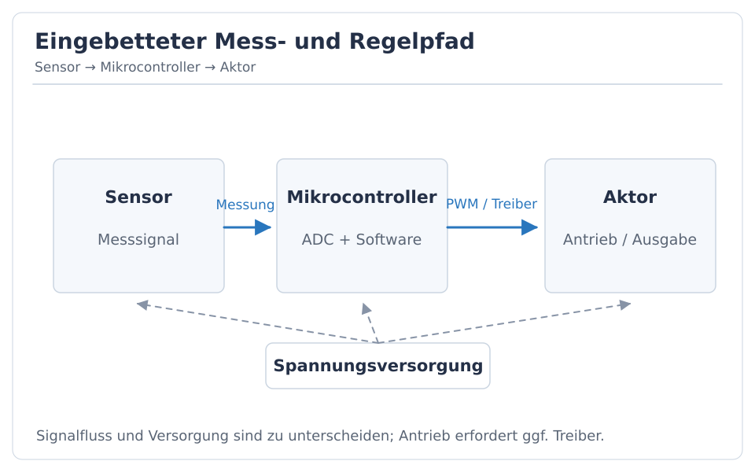

# M9-L3 – Eingebettete Systeme, Sensoren und Mikrocontroller {#L3}

**Kursbereich:** M9 – Bachelor: Wahl- und Praxisgebiete

**Niveau:** Bachelor (Wahl / Anwendung)

**Vorwissen:** Keine festen Voraussetzungen angegeben.

**Einordnung:** Freiwilliges Bachelor-Wahlthema (M9-L3)

**Lesepfad:** Nützlich sind M1-L2 (Computerarchitektur), M1-L6 (Netze), M8-L3 (Betriebssysteme und Nebenläufigkeit) und M6-L7 (Robotik). Die Lektion ist jedoch ohne diese Texte lesbar. Sie verlangt keine Elektronikanschaffung, Programmierübung oder Installation. Die Mathematikbrücke betrifft Funktionen, Größen und Einheiten, Vektoren, einfache Änderungsraten und später Differentialgleichungen. Konkrete Modulkennungen des eigenständigen Mathematik-Lernkurses sind nicht verifiziert.

## Ein Computer, der etwas Bestimmtes tun soll {#S1}

Eine Waschmaschine soll einen Motor kontrollieren und Wasserstände beachten. Ein Rauchmelder soll bei einem bestimmten Ereignis reagieren. Eine digitale Kamera muss den Bildsensor auslesen, lange bevor das Bild möglicherweise auf einem anderen Computer bearbeitet wird. In solchen Geräten steckt Informatik, auch wenn sie keinen Schreibtisch, Bildschirm oder Webbrowser besitzen.

Ein **eingebettetes System** (englisch *embedded system*) ist ein Rechnersystem, das in ein größeres technisches Gerät oder einen Prozess integriert ist und dort bestimmte Aufgaben erfüllt. Die Aufgabe begrenzt, welche Hardware und Software sinnvoll ist. Manche eingebetteten Systeme laufen jahrelang mit wenigen Milliwatt; andere verarbeiten Kamerabilder auf leistungsfähigen Chips. Sie müssen daher nicht klein sein, haben aber meist klarere Aufgaben und Randbedingungen als ein Universal-PC.

Der **Mikrocontroller** ist eine häufige, aber nicht die einzige Grundlage solcher Systeme. Er vereint Prozessor, Arbeitsspeicher und viele Ein-/Ausgabefunktionen auf einem einzigen Chip. Ein **Sensor** erfasst eine physikalische Größe wie Temperatur, Licht oder Bewegung. Ein **Aktor** beeinflusst die Umgebung, beispielsweise ein Motor, eine Heizung oder ein Ventil. Dazwischen liegen Software, elektrische Schnittstellen, Energieversorgung und oft Schutzmechanismen.

``` text
Physikalische Umgebung
       |                      ^
       v                      |
  Sensor / Schalter       Aktor / Motor
       |                      ^
       v                      |
Messung / Eingang -> Mikrocontroller -> Steuersignal
                       |
                  Programmzustand
                       |
               optional: Netz / Cloud
```

Die wichtigste Perspektive ist die **Rückkopplung**: Nicht nur Daten verarbeiten, sondern mit Folgen in der realen Welt umgehen. Wenn ein Rechner falsche Zahlen ausgibt, ist das ärgerlich. Wenn er ein Ventil zur falschen Zeit öffnet, kann der Schaden physisch sein. Deshalb gehören Fehlerzustände, Stromversorgung und sichere Abschaltung zur Architektur, nicht bloß zur Dokumentation.

## Mikrocontroller, Mikroprozessor und Einplatinencomputer {#S2}

Ein gewöhnlicher Desktop-Prozessor benötigt meist externe Speichermodule, einen komplexen Chipsatz und ein Betriebssystem. Ein Mikrocontroller ist stärker integriert. Sein Programm kann beim Einschalten ohne grafische Oberfläche direkt beginnen. Ein **Einplatinencomputer** (*Single-Board Computer*, SBC) wie ein Raspberry Pi mit Linux ähnelt hingegen einem kleinen vollständigen PC. Beide können Sensoren auslesen, aber ihre Stärken unterscheiden sich.

  Architektur                    Typische Stärke                                                     Häufige Einschränkung
  ------------------------------ ------------------------------------------------------------------- -----------------------------------------------------------------------------------
  Mikrocontroller (MCU)          Wenig Energie, direkte Peripherie, gut kontrollierbare Reaktionen   Wenig RAM und Rechenleistung, eingeschränkte Softwareumgebung
  Mikroprozessor/SoC mit Linux   Große Anwendungen, Netzwerkdienste, Bildverarbeitung                Komplexerer Start, höherer Energiebedarf, gewöhnlich keine harte Echtzeitgarantie
  Spezialisierte Schaltung       Sehr präzise oder schnelle Einzelaufgabe                            Weniger flexibel, Änderung teurer

**MCU** ist die Abkürzung für *Microcontroller Unit*. **SoC** bedeutet *System on a Chip*, also ein Chip, auf dem mehrere Rechen- und Funktionsblöcke integriert sind. Die Begriffe überschneiden sich: Manche moderne SoCs enthalten sowohl leistungsfähige Prozessorkerne als auch kleine Echtzeitkerne. Eine starre Grenze gibt es nicht.

Als konkretes, kein vorgeschriebenes Produktbeispiel dient der **RP2040** von Raspberry Pi. Nach dem offiziellen Datenblatt besitzt er zwei Arm-Cortex-M0+-Kerne, 264 KiB On-Chip-SRAM und Hardwareblöcke für unter anderem I²C, SPI, UART und PWM. Das Programm liegt typischerweise in externem Flash-Speicher. Die genaue Ausführung eines Boards hängt von dessen Beschaltung ab. Diese Zahlen beschreiben **dieses eine Produkt**, nicht alle Mikrocontroller. [Quelle: Raspberry Pi, RP2040-Spezifikation, geprüft 04.11.2026](https://www.raspberrypi.com/products/rp2040/specifications/).

**Wann ist ein Mikrocontroller unnötig?** Für eine bereits laufende Website, die Daten sammelt und Diagramme anzeigt, genügt häufig ein Server. Ein zusätzlicher Sensorchip löst dort kein Problem. Umgekehrt wäre ein vollständiger Linux-Rechner für einen einzelnen batteriebetriebenen Türkontaktsensor oft unnötig komplex.

## Was auf dem Chip steckt {#S3}

Ein Mikrocontroller verfügt normalerweise über einen Prozessorkern, Register, Arbeitsspeicher und verschiedene **Peripherieblöcke**. Peripherie sind Spezialfunktionen, die nicht als allgemeiner Programmcode ausgeführt werden müssen. Beispielsweise zählt ein Timer Taktimpulse, während der Prozessor andere Dinge erledigt. Ein Kommunikationsblock überträgt Bits nach einem festgelegten Protokoll. Ein Analog-Digital-Wandler verarbeitet Spannungen.

{alt="Sensor liefert Messsignal an einen Mikrocontroller; dieser schickt ein Steuersignal zum Aktor. Stromversorgung getrennt durch gestrichelte Linien dargestellt."}

Sensor, Mikrocontroller und Aktor bilden einen Mess- und Steuerpfad.

``` text
                 MIKROCONTROLLER
 +------------------------------------------------+
 | CPU-Kern(e)      RAM       Flash / Flash-Zugang |
 |      |             |              |              |
 |      +----------- interner Bus ---+              |
 |                         |                        |
 | GPIO    Timer/PWM    ADC    I²C/SPI/UART         |
 |  |         |          |        |                 |
 +--|---------|----------|--------|-----------------+
    |         |          |        |
 Schalter   Motor-      analoger  digitaler
 /LED       treiber     Sensor    Sensor
```

**RAM** (*Random Access Memory*) ist der flüchtige Arbeitsspeicher. **Flash** ist nichtflüchtiger Speicher für Programme und dauerhafte Daten. Nicht jeder Chip besitzt internen Programmspeicher; beim genannten RP2040 liegt der Code üblicherweise in externem Flash. Manche Mikrocontroller haben zusätzliche nichtflüchtige Speicherzellen, andere nicht. Häufig ist der verfügbare RAM so klein, dass ungeprüftes Zwischenspeichern ganzer Dateien nicht infrage kommt.

**Register** sind kleine, schnell erreichbare Speicherplätze. Bestimmte Register steuern Hardware: Ein Bit kann beispielsweise festlegen, ob ein Pin Eingang oder Ausgang ist. In der Praxis verwenden Anwendungen dafür oft Treiberbibliotheken. Der Treiber übersetzt eine allgemeine Anweisung wie „lies Sensorwert“ in die benötigten Registerzugriffe und Übertragungen.

Software muss dadurch nicht jede elektrische Einzelheit selbst verwalten. Trotzdem bleibt die Kenntnis der Hardwaregrenzen wichtig: Zwei Pins können möglicherweise dieselbe interne Funktion beanspruchen; ein Kommunikationsblock kann gerade beschäftigt sein; ein Speicherpuffer kann voll sein. Solche Engpässe lösen sich nicht allein durch schnelleres Programmieren.

## Elektrische Signale: digital und analog {#S4}

Computer rechnen mit diskreten Zuständen. Die physikalische Welt ändert sich dagegen häufig kontinuierlich. Eine Lampe kann heller werden, die Temperatur steigt langsam und ein Motor dreht mit unterschiedlicher Geschwindigkeit.

Ein **digitales Eingangssignal** wird als logischer Zustand interpretiert, beispielsweise „0“ oder „1“. Das bedeutet nicht zwingend exakt null oder eine bestimmte andere Spannung. Der Chip unterscheidet anhand elektrischer Schwellwerte zwischen zulässigem Niedrig- und Hochpegel. Unklare Pegel, überhöhte Spannungen oder fehlende Masseverbindungen können zu Fehlfunktionen beziehungsweise Schäden führen. Die Grenzwerte stehen im konkreten Datenblatt, nicht in einer allgemeingültigen 3,3-Volt-Regel.

**GPIO** steht für *General-Purpose Input/Output*, also universell nutzbare Ein-/Ausgangspins. Ein GPIO kann beispielsweise einen Tasterzustand lesen oder ein digitales Signal setzen. **Pull-up- oder Pull-down-Widerstände** legen einen definierten Standardzustand fest, damit ein unbeschalteter Eingang nicht zufällig schwankt. Ein mechanischer Taster kann beim Drücken kurz „prellen“: Der Kontakt wechselt in sehr kurzer Zeit mehrfach. Deshalb kann die Software oder zusätzliche Schaltung das Signal **entprellen**.

Ein **analoges Signal** kann innerhalb eines Bereichs viele Spannungswerte annehmen. Der **Analog-Digital-Wandler (ADC, Analog-to-Digital Converter)** macht daraus einen digitalen Messcode. Er wird durch Auflösung, Eingangsbereich, Abtastrate, Rauschen und weitere Eigenschaften begrenzt. Ein höher aufgelöster Wandler misst nicht automatisch genauer. Umgekehrt kann ein digitaler Temperatursensor seinen Messwert selbst berechnen und über I²C übertragen; dann muss der Hauptcontroller keine analoge Spannung einlesen.

Das Prinzip kann man ohne Hardware nachvollziehen:

``` text
Temperatur -> Sensorelement -> elektrische Größe
                              |
              +---------------+---------------+
              |                               |
              v                               v
       Analoge Spannung                Digitaler Sensor
              |                               |
        ADC im Controller              Messchip mit eigener
              |                        Wandlung und Protokoll
              +---------------+---------------+
                              |
                           Messwert
```

Ein Messwert wird erst dann zur physikalischen Aussage, wenn seine **Einheit, Skalierung und Kalibrierung** bekannt sind. „Wert 1800“ könnte eine ADC-Zahl sein, aber keine Temperatur. Auch eine korrekte Software kann einen falsch montierten, erhitzten oder schlecht kalibrierten Sensor nicht magisch verbessern.

## Zahlenbeispiel: Was bedeuten zwölf Bit Messauflösung? {#S5}

Stellen wir uns einen idealisierten ADC mit **12 Bit** und einem Referenzbereich von **0 bis 3,3 Volt** vor. Zwölf Bit erlauben $2^{12}=4\,096$ verschiedene Codes, üblicherweise von 0 bis 4095. Der rechnerische Abstand benachbarter Quantisierungsstufen beträgt:

$\frac{3{,}3\,\mathrm{V}}{4\,096}=0{,}0008056640625\,\mathrm{V}$, also rund **0,806 Millivolt**.

Misst der Wandler beispielsweise Code 2048, ergibt eine einfache idealisierte Zuordnung ungefähr:

$\frac{2\,048\times3{,}3\,\mathrm{V}}{4\,096}=1{,}65\,\mathrm{V}$.

Die Zahl 2048 bedeutet also *etwa halbe Referenzspannung*. Das ist nicht der Beweis, dass am Eingang exakt 1,650000 Volt anliegen. Bei echten ADCs kann die **effektive Bitzahl (ENOB, Effective Number of Bits)** wegen Rauschen und Verzerrungen unter der nominellen 12-Bit-Auflösung liegen. ENOB ist eine Kennzahl der dynamischen Wandlerleistung unter bestimmten Messbedingungen, nicht bloß die Anzahl ausgegebener Bits; bei Präzisionsmessungen sind weitere Größen wie Rauschen und Kalibrierung gesondert zu betrachten. Die tatsächliche Umrechnung kann je nach Datenblatt, Kalibrierverfahren, Endpunktsdefinition und Schaltung anders ausgeführt werden; Sensor- und Wandlerfehler kommen hinzu. Der Beispielschritt beschreibt zunächst nur eine **theoretische Auflösung**, keine zugesicherte **Messgenauigkeit**.

Hier stecken drei Begriffe, die man nicht verwechseln sollte:

- **Auflösung:** Wie fein lässt sich der Messbereich digital unterteilen?
- **Genauigkeit:** Wie nahe liegt die Messung am wirklichen Wert?
- **Präzision/Wiederholbarkeit:** Wie stark schwanken wiederholte Messungen unter vergleichbaren Bedingungen?

Rauschen, Versorgungsspannung, Temperaturdrift, Leitungslänge, Störungen eines Motors und Quantisierung können die Messung beeinflussen. Mehrmals messen und mitteln kann zufällige Schwankungen vermindern, aber einen systematischen Kalibrierfehler nicht automatisch beseitigen.

**Abtastrate** ist die Anzahl der Messungen pro Zeit. Ein Temperaturfühler benötigt womöglich nur einen Wert pro Minute. Zur Auswertung schneller Schwingungen sind sehr viel häufigere Messungen nötig. Nach dem Abtasttheorem von Nyquist-Shannon müssen für ein geeignet bandbegrenztes Signal theoretisch mehr als zwei Abtastwerte pro höchster enthaltener Frequenz vorliegen, damit eine vollständige Rekonstruktion prinzipiell möglich wird. Praktische Systeme benötigen darüber hinaus geeignete Filter, ausreichende Qualität und oft Sicherheitsabstand.

## Ausgänge, PWM und Aktoren {#S6}

Ein Mikrocontrollerpin kann digitale Signale liefern, aber **nicht beliebige Lasten versorgen**. Ein Motor, Magnetventil oder eine leistungsstarke Heizung benötigt typischerweise einen passenden Treiber, ein separates Leistungsteil und Schutzschaltungen. Ein direkt an einen ungeeigneten Pin angeschlossener Motor kann den Mikrocontroller beschädigen. Für ein reines Lesekonzept reicht die Einsicht: Zwischen „Software will Bewegung“ und „Motor bewegt sich“ liegt notwendige Leistungselektronik.

**PWM** steht für *Pulsweitenmodulation (Pulse Width Modulation)*. Dabei schaltet ein Ausgang sehr schnell zwischen zwei Zuständen. Der Anteil der Einschaltzeit innerhalb einer Periode heißt **Tastgrad** (*duty cycle*). Bei einem idealen 25-Prozent-Tastgrad ist der Ausgang ein Viertel jeder Periode eingeschaltet. Bei geeigneter Schaltung und Last kann man damit beispielsweise die mittlere Energiezufuhr und damit die Helligkeit einer Leuchtdiode beeinflussen.

``` text
PWM-Periode:   |---------|---------|
Signal an:     |██       |██       |
Signal aus:    |  _______|  _______|
                20 % an   20 % an
```

Das gezeichnete Signal dient nur als Anschauung. Der Tastgrad muss zur tatsächlichen Breite der Pulse passen. Bei Motoren hängt die Wirkung zusätzlich von Induktivität, Treiber, Last und Regelung ab. Die PWM-Frequenz ist eine eigene Größe: Ein 50-Prozent-Tastgrad verrät nicht, ob hundert oder zehntausend Perioden pro Sekunde auftreten.

Eine **Regelung** unterscheidet sich von einer einfachen Steuerung. Bei der Steuerung wird ein Ausgang vorgegeben. Die Regelung erfasst zusätzlich die Wirkung und passt den Ausgang wiederholt an. Ein Thermostat vergleicht Temperatur und Sollwert. Eine Motorregelung vergleicht gemessene und gewünschte Drehzahl. Wird der Sensor unplausibel, muss das System überlegen, welche Reaktion sicher ist. Das ist je nach Gerät verschieden und erfordert eigene Sicherheitsanalyse.

## Wie Geräte miteinander sprechen: GPIO, UART, I²C, SPI und CAN {#S7}

Viele Bauteile sind nicht als isolierte Einheit nützlich. Ein Mikrocontroller muss Sensoren, Displays, Speicherchips und andere Steuergeräte erreichen. Dafür gibt es elektrische Schnittstellen und **Kommunikationsprotokolle** – Vereinbarungen, wie Bits übertragen und verstanden werden.

**UART** bedeutet *Universal Asynchronous Receiver-Transmitter*. Es handelt sich um eine verbreitete serielle Übertragung ohne gemeinsam übertragene Taktleitung. Sender und Empfänger müssen kompatible Einstellungen verwenden, beispielsweise Datenrate und Rahmenformat. Die UART-Elektronik allein legt noch nicht fest, welche Bedeutung ein empfangenes Byte hat.

**I²C** steht für *Inter-Integrated Circuit*. Es ist ein gemeinsamer Bus mit normalerweise einer Daten- und einer Taktleitung. Ein Controller spricht adressierte Geräte an. Mehrere Sensoren können sich Leitungen teilen, sofern Adressen, Busbelastung und elektrischer Aufbau passen. Die Ausdrücke „Controller“ und „Target“ entsprechen der aktuellen Dokumentation; ältere Texte sprechen häufig von „Master“ und „Slave“.

**SPI** bedeutet *Serial Peripheral Interface*. Es nutzt in üblichen Varianten Takt, Datenleitungen und eine Auswahlleitung pro angesprochenem Gerät. Viele SPI-Verbindungen eignen sich für schnelle Peripherie; sie sind allerdings nicht automatisch für lange Leitungen geeignet.

**CAN** steht für *Controller Area Network*. Es ist in Fahrzeug- und Industrieumgebungen wichtig, weil mehrere Teilnehmer über einen gemeinsam genutzten Bus kommunizieren und Nachrichten priorisieren können. Für die physische Verbindung, Datenintegrität und Fehlersignalisierung gelten eigene Spezifikationen. Eine CAN-Nachricht ist nicht von selbst verschlüsselt oder gegen böswillige Teilnehmer authentisiert.

  Schnittstelle   Grobe Stärke                                   Typische Grenze
  --------------- ---------------------------------------------- ------------------------------------------------------------
  GPIO            Direktes einfaches Signal                      Kein vollständiges Datenprotokoll
  UART            Unkomplizierte Punkt-zu-Punkt-Daten            Framing und Nutzdatenformat müssen vereinbart sein
  I²C             Mehrere Peripheriegeräte auf gemeinsamem Bus   Adressen, elektrische Last und Leitungslänge beachten
  SPI             Oft zügige Peripheriekommunikation             Zusätzliche Leitungen; genaue Eigenschaften geräteabhängig
  CAN             Robuste Buskommunikation im passenden Umfeld   Schnittstellenhardware und höhere Protokolle nötig

Die Wahl hängt vom **Sensor und der Umgebung** ab, nicht von einer universellen Siegertechnologie. Zephyrs offizielle Treiberübersicht beschreibt beispielsweise getrennte APIs für GPIO, ADC, I²C, SPI, CAN und PWM. [Quelle: Zephyr Project, Peripherals, geprüft 04.11.2026](https://docs.zephyrproject.org/latest/hardware/peripherals/index.html).

## Polling, Interrupts und DMA {#S8}

Ein Programm könnte hundertmal pro Sekunde prüfen: „Wurde der Taster gedrückt?“ Das heißt **Polling**, also wiederholtes Abfragen. Es ist einfach, verbraucht aber bei ungünstiger Gestaltung Rechenzeit und kann kurze Ereignisse verpassen. Ein **Interrupt** ist dagegen eine Unterbrechungsanforderung an den Prozessor, etwa wenn ein Eingang seinen Zustand ändert oder ein Timer abläuft. Dann führt die CPU einen passenden kurzen **Interrupt-Handler** aus und setzt die normale Arbeit fort.

``` text
Normalbetrieb: Messwerte auswerten ----> Speicher aktualisieren
                              |
Tasterereignis --------------+----> Interrupt
                                     |
                                     v
                              Ereignis vormerken
                                     |
                                     v
                              Normale Arbeit weiter
                                     |
                                     v
                              Ereignis sicher behandeln
```

Wichtig ist die Trennung zwischen **schneller Reaktion** und **umfangreicher Verarbeitung**. Ein Interrupt-Handler sollte im Regelfall kurz bleiben, kritische Daten sichern und die weitere Arbeit an einen normalen Programmteil oder eine Betriebssystemaufgabe übergeben. Lange Berechnungen oder unkontrollierte Wartezeiten im Interrupt können andere Ereignisse blockieren. Welche Funktionen in einem Interrupt erlaubt sind, bestimmt die konkrete Softwareumgebung.

Viele Arm-Cortex-M-Prozessoren verwenden dafür den **Nested Vectored Interrupt Controller (NVIC)**. Er unterstützt die Zuordnung von Interruptquellen und Prioritäten; die Details unterscheiden sich zwischen Cortex-M-Varianten. [Quelle: Arm CMSIS-Core, Interrupts and Exceptions, geprüft 04.11.2026](https://arm-software.github.io/CMSIS_6/main/Core/group__NVIC__gr.html).

**DMA** steht für *Direct Memory Access*: Geeignete Hardware überträgt Daten zwischen Peripherie und Speicher, ohne dass der Prozessor jedes Byte einzeln kopieren muss. Das kann Rechenzeit sparen. Es erfordert aber eine korrekte Abstimmung von Puffern, Datenkonsistenz und Übertragungsende. DMA macht eine fehlerhafte Anwendung nicht automatisch sicher.

## Zeit ist nicht nur Geschwindigkeit: Echtzeit {#S9}

Ein System ist nicht allein deshalb **echtzeitfähig**, weil es gewöhnlich schnell reagiert. In der Echtzeitinformatik zählen **zeitliche Grenzen**, bis zu denen eine Reaktion benötigt wird. Beispielsweise soll eine Messung spätestens nach einer festgelegten Zeit ausgewertet sein. Eine schlechte Reaktionszeit ist dabei möglicherweise schwerwiegender als ein durchschnittlich langsamerer Algorithmus.

Eine **Deadline** ist ein solcher Termin. **Latenz** bezeichnet die Verzögerung zwischen Ereignis und Reaktion. **Jitter** ist die Schwankung dieser Verzögerung. Man unterscheidet häufig **harte Echtzeit**, bei der das Überschreiten einer Deadline als Systemversagen gilt, von **weicher Echtzeit**, bei der einzelne verspätete Ergebnisse unter Umständen toleriert werden.

Das lässt sich an drei zeitlichen Ebenen unterscheiden:

``` text
Sensor erkennt Hindernis
        |
        v
lokaler Interrupt / Messung      möglichst kurz und begrenzt
        |
        v
lokale Sicherheitsfunktion       feste Anforderungen, unabhängig von Cloud
        |
        v
Motorsteuerung / Treiber         definierte Reaktionskette
        |
        +----> optional: Protokollierung -> WLAN -> Cloudanalyse
```

Die Cloud kann Zustände sammeln oder eine Route empfehlen. Sie darf bei einer entsprechend sicherheitskritischen Maschine aber nicht die einzige Stelle sein, die bei plötzlich auftretender Gefahr das Stoppen verantwortet. Netzwerkverzögerung und Funkabbrüche lassen sich nicht grundsätzlich ausschließen. Ein Sprachmodell liefert ebenfalls keine allgemein zugesicherte Echtzeitreaktion.

In der Praxis entsteht eine maximale Antwortzeit aus mehreren Anteilen: Erkennung im Sensor, Datenübertragung, Scheduling, Verarbeitung, Ausgangstreiber und mechanischer Wirkung. Selbst wenn die CPU in einer Millisekunde reagiert, benötigt ein bewegter Mechanismus eventuell deutlich länger zum Anhalten. Ein echtes Sicherheitskonzept braucht Messungen, Schutzeinrichtungen, Normenprüfung und spezialisierte Fachkompetenz; diese Lektion liefert **keine** Freigabe für reale Maschinensteuerungen.

## Braucht ein Mikrocontroller ein Betriebssystem? {#S10}

Nicht immer. Ein einfaches Programm kann nach dem Einschalten in einer Hauptschleife laufen: Es liest den Sensor, aktualisiert Zustände, steuert Ausgänge und beginnt von vorn. Das nennt man oft **Bare Metal**, weil die Anwendung direkt auf der Hardware läuft. Eine kleine **Zustandsmaschine** kann bereits alle relevanten Abläufe ordnen, etwa `RUHE -> MESSEN -> PRUEFEN -> MELDEN`.

Sobald mehrere Tätigkeiten verschiedene Reaktionszeiten benötigen, kann ein **Echtzeitbetriebssystem (RTOS, Real-Time Operating System)** sinnvoll sein. Es verwaltet Aufgaben (*Tasks*), Prioritäten, Timer und Synchronisationsmittel. Im Unterschied zu einem umfangreichen Desktopbetriebssystem konzentriert sich ein kleines RTOS häufig auf gut kontrollierbare eingebettete Aufgaben.

**FreeRTOS** verwendet in der dokumentierten Standardkonfiguration auf einem einzelnen Kern präemptive Prioritätsplanung und Zeitscheiben für gleich priorisierte Aufgaben. Das ist konfigurierbar und unterscheidet sich bei Mehrkernvarianten. Eine hoch priorisierte Aufgabe kann andere verhungern lassen, wenn sie ständig bereit bleibt, statt auf Ereignisse zu warten. [Quelle: Espressif, ESP-IDF v5.5, SMP Scheduler](https://docs.espressif.com/projects/esp-idf/en/v5.5/esp32/api-reference/system/freertos_idf.html).

**Zephyr** ist ein anderes Echtzeitbetriebssystem-Ökosystem mit Hardwareabstraktionen, Gerätetreibern, Netzwerkfunktionen und Stromsparmechanismen. Seine APIs decken unter anderem GPIO, ADC, I²C, SPI und Sensoren ab. Es ist ein Beispiel dafür, wie Software unterschiedliche Hardwareplattformen über gemeinsame Schnittstellen unterstützen kann. [Quelle: Zephyr Project, API-Dokumentation, geprüft 04.11.2026](https://docs.zephyrproject.org/latest/doxygen/html/).

Das RTOS nimmt einer Anwendung nicht jede Verantwortung ab. **Race Conditions**, gesperrte Ressourcen, blockierende Treiber und falsche Prioritäten können weiterhin vorkommen. Auch ein Task-Scheduler ist kein formeller Beweis, dass jede Deadline eingehalten wird. Hier knüpft M9-L3 direkt an M8-L3 über Betriebssysteme und Nebenläufigkeit an.

## Energieversorgung und Schlafmodi {#S11}

Ein Netzteil versorgt ein Gerät dauerhaft; ein batteriebetriebener Sensor muss dagegen mit einem begrenzten Energievorrat auskommen. Das führt zu einer anderen Optimierungsfrage: Nicht unbedingt „Wie schnell rechnet der Prozessor?“, sondern „Wie kurz muss er überhaupt wach sein?“.

Typischerweise unterscheidet man **aktiven Betrieb**, **Leerlauf**, **Sleep** und tiefere Energiesparmodi. Im Schlaf sind Teile des Chips abgeschaltet. Ein Timer oder ein geeignetes externes Signal kann ihn später wecken. Dabei müssen die Speicherinhalte, Weckquellen und Zeiten zum Neustart berücksichtigt werden. Manche Geräte besitzen einen stromsparenden Coprozessor oder eine getrennte Echtzeituhr.

Das grundlegende Modell lautet:

$\text{Mittlerer Strom}=\text{Anteil aktiv}\times\text{Strom aktiv}+\text{Anteil Schlaf}\times\text{Strom Schlaf}$

**Zahlenbeispiel, ausdrücklich fiktiv:** Ein Sensor ist jede Minute eine Sekunde aktiv und benötigt dabei 20 Milliampere (mA). Die restlichen 59 Sekunden schläft er mit 0,05 mA. Dann ergibt sich:

$I_{\mathrm{mittel}}=\frac1{60}\times20\,\mathrm{mA}+\frac{59}{60}\times0{,}05\,\mathrm{mA}$

$I_{\mathrm{mittel}}=0{,}3333\,\mathrm{mA}+0{,}0492\,\mathrm{mA}\approx0{,}3825\,\mathrm{mA}$.

Eine idealisierte Batterie mit 2000 Milliamperestunden (mAh) ergäbe:

`2000 mAh / 0,3825 mA = rund 5229 Stunden`, also **etwa 218 Tage**.

Die reale Laufzeit kann deutlich abweichen: Batterien liefern bei Kälte, Alterung oder hohen Stromspitzen nicht immer die nominelle Kapazität. Ein Funkmodul, eine leuchtende Anzeige, ein Sensorheizer oder ein Spannungswandler kann mehr Energie verbrauchen als der Mikrocontroller selbst. Schlaf- und Aufwachphasen müssen außerdem zu Sicherheitsanforderungen passen. Ein Gerät, das jederzeit ein gefährliches Ereignis erkennen muss, darf den entsprechenden Sensor nicht einfach abschalten.

**Wichtige Unterscheidung:** Milliampere (mA) messen Strom; Milliamperestunden (mAh) beschreiben eine Ladungsmenge. Für eine korrekte Energiebetrachtung braucht man zusätzlich die Spannung und die tatsächlichen Verluste. Der Quotient aus mAh und mA ist nur unter den angegebenen vereinfachten Annahmen eine Nutzungsdauer.

## Zustandsautomaten, Zeitgeber und robuste Software {#S12}

Viele eingebettete Programme lassen sich besser als **Zustandsmaschinen** verstehen denn als eine lange Liste von Befehlen. Ein Wassermelder könnte die Zustände `NORMAL`, `VERDACHT`, `ALARM` und `STOERUNG` besitzen. Für jeden Zustand ist festgelegt, was das System tun darf und wie es bei neuen Ereignissen reagiert.

``` text
NORMAL -- Messwert auffällig --> VERDACHT
   ^                              |
   |                              | Messwert bestätigt
   |                              v
   +-- stabiler Normalwert ---- ALARM
                                  |
                               quittiert?
                                  |
                                  v
                               NORMAL

Jeder Zustand -- ungültiger Sensorwert --> STOERUNG
```

Das Diagramm ist didaktisch vereinfacht; in einem echten Alarmgerät hängt die Rückkehr aus einem Alarm von der Sicherheitsanforderung ab. Ein fehlender Sensorwert darf nicht zwingend als „alles normal“ interpretiert werden. **Plausibilitätsprüfungen** können erkennen, wenn die Temperatur über einen physikalisch unplausiblen Betrag springt, Daten ausbleiben oder zwei Sensoren sich stark widersprechen.

Timer ersetzen unzuverlässige Schleifenwartezeiten. Ein **Watchdog** ist eine Überwachungseinrichtung, die einen ausgefallenen Programmablauf erkennen und einen Neustart auslösen kann. Ein Watchdog verhindert aber nicht alle Fehler. Wenn ein defektes Gerät nach jedem Neustart dieselbe falsche Aktion ausführt, ist automatischer Neustart keine sichere Lösung.

Beim **Brownout** fällt die Versorgungsspannung unter eine kritische Grenze. Eine geeignete Unterspannungsüberwachung soll verhindern, dass der Prozessor unter unzulässigen Bedingungen weiterarbeitet. Auch Speicherung ist zu bedenken: Ein Stromausfall mitten im Schreiben kann Daten beschädigen. Strategien reichen von Prüfsummen und doppelten Datensätzen bis zu transaktionsähnlichen Speichermustern. Solche Maßnahmen müssen zum jeweiligen Flash-Speicher und dessen begrenzten Schreibzyklen passen.

Ein guter Entwurf fragt bei jedem Ausfall: **Was merkt der Benutzer? Was bleibt gespeichert? Welcher sichere Zustand ist anschließend möglich?**

## Sensorfusion und Kalibrierung {#S13}

Ein Sensor ist eine Beobachtung, keine absolute Wahrheit. Eine Lichtsensoranzeige hängt von Blickrichtung, Verschmutzung und Beleuchtung ab. Ein Beschleunigungssensor misst unter anderem die Auswirkungen von Gravitation und Bewegung. Eine einzelne Entfernungsmessung kann von Reflexionen oder verdeckten Flächen beeinflusst werden.

**Sensorfusion** kombiniert unterschiedliche Informationen, um den Zustand eines Systems verlässlicher einzuschätzen. In einem beweglichen Gerät können beispielsweise Gyroskop, Beschleunigungssensor und Radencoder zusammenwirken. Ein **Gyroskop** erfasst Drehbewegungen, ein **Encoder** kann Rad- oder Motorbewegungen in Zählimpulse umsetzen. Die mathematische Zusammenführung reicht von einfachen gewichteten Mittelwerten bis zu Kalman-Filtern und nichtlinearen Verfahren. Diese fortgeschrittenen Methoden eignen sich für eine zusätzliche Master-Vertiefung zur Robotik und Regelungstechnik.

**Kalibrierung** bringt Sensorwerte in Bezug auf bekannte Größen. Ein Temperaturfühler kann einen systematischen Offset haben; eine Messbrücke kann auf veränderte Versorgungsspannung reagieren. Mehr Sensoren helfen nur, wenn ihre Fehler hinreichend unabhängig und ihre Einbaubedingungen sinnvoll sind. Zwei gleich falsch montierte Sensoren ergeben keine zuverlässige doppelte Prüfung.

Schon eine einfache Unterscheidung vermeidet viele Missverständnisse: **Rohdaten** sind die unmittelbaren Messcodes; **Messwerte** sind interpretierte Größen mit Einheiten; **Zustandsschätzungen** kombinieren Messungen und Modellannahmen; **Steuerentscheidungen** sind Schlussfolgerungen mit Wirkung. Diese Ebenen sollten in der Dokumentation getrennt bleiben.

## Kommunikation über das lokale Gerät hinaus {#S14}

Ein Mikrocontroller kann vollkommen offline arbeiten. Ist er jedoch vernetzt, gehört er möglicherweise zum **Internet der Dinge (IoT, Internet of Things)**. Das bedeutet nicht, dass jedes IoT-Gerät direkt aus dem öffentlichen Internet erreichbar sein sollte. Oft ist ein lokales Gateway die bessere Lösung: Es übersetzt Geräteprotokolle, sammelt Messwerte und stellt nur ausgewählte Informationen einem Server zur Verfügung.

``` text
Sensoren -> Mikrocontroller -> lokales Gateway
                                 |
                         authentisierte Verbindung
                                 |
                                 v
                           Server / Datenbank
                                 |
                                 v
                              Dashboard
```

Man muss zwei Wege unterscheiden: **Telemetrie** übermittelt Messwerte nach außen; **Steuerbefehle** verändern das Gerät. Für einen einfachen Temperaturverlauf genügt gelegentliches Senden von Daten. Für eine Heizungs- oder Türsteuerung benötigt man strengere Regeln, wer Befehle geben darf, wie alte Befehle erkannt werden und was bei Ausfall der Verbindung passiert.

Für Gerätemeldungen eignet sich beispielsweise **MQTT**: Ein Gerät veröffentlicht Nachrichten zu einem Thema, und interessierte Teilnehmer abonnieren dieses Thema. Je nach Zustellstufe kann dieselbe Meldung mehrfach eintreffen. Das Protokoll ersetzt weder eine Identitätsprüfung noch eine fachliche Plausibilitätskontrolle. Die Prinzipien von Idempotenz, Sequenznummern und Zustandsabgleich aus den Kurslektionen zu verteilten Systemen gelten auch hier.

Besonders gefährlich ist die Annahme: „Wenn der Server nichts meldet, wird schon alles in Ordnung sein.“ Bei Netzausfall muss das Gerät wissen, was es lokal weiterhin tun darf. Ein rauchmeldendes Gerät darf nicht auf eine Cloudantwort angewiesen sein, um eine notwendige lokale Alarmfunktion auszulösen.

## Sicherheit, Updates und Datenschutz über Jahre {#S15}

Eingebettete Geräte bleiben oft lange im Einsatz. Das ist ihre Stärke und zugleich ein Sicherheitsproblem. Ein ausgeliefertes Gerät benötigt möglicherweise Jahre später noch Fehlerkorrekturen. **Firmware** bezeichnet hier die gerätenahe Software, die üblicherweise nicht wie ein gewöhnliches Desktopprogramm im Alltag ausgetauscht wird.

Ein solides Sicherheitskonzept betrachtet nicht nur die verschlüsselte Netzwerkverbindung, sondern auch **Geräteidentitäten, sichere Konfiguration, geschützte Zugangsdaten, Updateverfahren, Protokollierung und physische Zugriffe**. Ein veraltetes Standardpasswort oder eine offen zugängliche Wartungsschnittstelle kann die übrigen Maßnahmen unterlaufen. Wo die Hardware es unterstützt, können sicherer Bootvorgang und signierte Updates helfen, manipulierte Software zu erkennen; daraus folgt aber nicht, dass jeder Chip automatisch sichere Schlüsselaufbewahrung bietet.

**Over-the-Air-Updates (OTA)** sind Softwareaktualisierungen über eine Verbindung. Sie müssen mit unterbrochenen Downloads, unerwartetem Neustart und defekten Paketen umgehen. Ein Gerät kann dafür zwei Firmwarebereiche verwenden, um bei einem fehlerhaften Update auf eine vorherige Fassung zurückzuwechseln. Diese Technik kostet Speicher und sorgfältige Implementierung. Bei kritischen Anwendungen sind Freigaben und kontrollierte Wartungsfenster zusätzlich wichtig.

Das US-amerikanische **National Institute of Standards and Technology (NIST)** beschreibt in seiner IoT-Sicherheitsbasis unter anderem Geräteidentifikation, Konfiguration, Datensicherung, logische Zugriffsbeschränkung, Updates und die Beobachtung von Sicherheitszuständen. Diese Baseline ist ein Ausgangspunkt, **keine automatische Zertifizierung und keine universelle Rechtsvorschrift**. [Quelle: NIST IR 8259A, 2020, geprüft 04.11.2026](https://csrc.nist.gov/pubs/ir/8259/a/final).

Datenschutz wird relevant, sobald Geräte personenbezogene Informationen erfassen: etwa Anwesenheit, Bewegungsmuster, Stimmen oder Bildmaterial. Häufig lässt sich die Datenmenge reduzieren: Messwerte zunächst lokal aggregieren, nur notwendige Ereignisse übertragen und Speicherdauern begrenzen. **Nicht jedes Temperatursignal ist personenbezogen**, doch in Verbindung mit Raum, Zeit und Bewohner kann selbst ein scheinbar harmloser Sensorverlauf Rückschlüsse ermöglichen. Konkrete rechtliche Pflichten hängen vom Anwendungsfall und Rechtsraum ab.

## Praxisarchitektur I: Das lokale Medienarchiv und sein Umgebungssensor {#S16}

Ein privates Medienarchiv bewahrt Bilder, Datenträger und eventuell ältere Elektronik auf. Soll die Temperatur in einem Geräteschrank beobachtet werden, braucht man kein KI-Modell und nicht zwingend einen Cloudanbieter. Ein Mikrocontroller mit Temperatursensor kann lokal messen und eine Warnlampe oder einen Summer auslösen.

``` text
Temperatursensor
       |
       v
Mikrocontroller ----> Status-LED / Summer
       |
       +----> optionales lokales Protokoll
       |
       +----> optionaler PC: Messwerte anzeigen
```

**Warum diese Architektur?** Der Mikrocontroller kann unabhängig vom großen Computer laufen. Er kann auch dann melden, wenn der Archiv-PC ausgeschaltet ist. **Wann ist er unnötig?** Wenn das Archiv ausschließlich aus digitalen Dateien besteht und kein physikalisches Risiko überwacht werden soll, löst der zusätzliche Sensor kein relevantes Problem.

**Grenzen:** Ein Sensor im warmen Luftstrom misst vielleicht nicht die Temperatur aller gelagerten Geräte. Ein verstaubter Lüfter, fehlende Versorgung oder ein unterbrochenes Kabel bleibt möglich. Für einen sicherheitsrelevanten Brandschutz wären zertifizierte und dafür ausgelegte Systeme erforderlich. Der selbstgebaute Messsensor ist **kein Ersatz für Rauchmelder oder Sicherheitsanlagen**. Wartung umfasst Batteriezustand, Sensorposition und gelegentliche Plausibilitätsprüfung. Bei rein lokaler Datensammlung sind Datenschutzfragen vergleichsweise gering; bei Fernzugriff steigen sie.

## Praxisarchitektur II: Ein vernetzter Gebäudesensor {#S17}

In einem größeren Gebäude sollen mehrere Räume auf Temperatur und Luftfeuchte beobachtet werden. Ein Sensorgerät pro Raum wäre sinnvoll, wenn Leitungen unpraktisch sind und Messungen über lange Zeit autonom erfolgen sollen. Die Geräte senden nicht fortlaufend, sondern beispielsweise periodisch aggregierte Werte an ein Gateway.

``` text
Raum A: Sensor + MCU --+
Raum B: Sensor + MCU --+--> lokales Gateway
Raum C: Sensor + MCU --+          |
                                v
                       Datenbank / Analyse
                                |
                                v
                         Verwaltungsansicht
```

**Wieso nicht einfach alles in die Cloud?** Ein lokales Gateway erlaubt Pufferung bei Internetausfall und trennt interne Geräte von öffentlich erreichbaren Schnittstellen. Zugleich schafft das Gateway eine neue mögliche Ausfallstelle: Seine Speicherung, Backups und Wartung müssen geplant werden. Das gesamte System sollte Messungen mit Zeitstempeln versehen, deren Herkunft nachvollziehbar halten und Lücken als Lücken anzeigen, statt nicht gelieferte Werte zu erfinden.

**Betrieb und Kosten:** Kosten entstehen für Geräte, Batteriewechsel, Montage, Netz und gegebenenfalls Fernwartung. Diese Betriebskosten können größer sein als der Einkaufspreis eines Mikrocontrollers. Die Datenqualität hängt von Kalibrierung und Platzierung der Sensoren ab. Bei Anwesenheitserkennung oder personenbeziehbaren Raumverläufen sind Zugangsbeschränkung und Löschkonzept notwendig.

**Sinnvolle Erweiterung:** Ein lokaler Grenzwertalarm kann selbstständig arbeiten, während die langfristige Analyse erst auf dem Server erfolgt. **Unnötige Erweiterung:** Ein großes KI-Cluster zur Vorhersage einfacher Grenzwertüberschreitungen wäre häufig überdimensioniert.

## Praxisarchitektur III: Ein mobiler Roboter {#S18}

Ein mobiler Roboter verbindet fast alle Themen der Lektion. Er benötigt Sensoren, lokale Motorregelung, Energieversorgung, eine Navigation und eventuell übergeordnete KI. Die Aufgaben sollten klar getrennt werden:

``` text
Kamera / LiDAR / Auftragsbeschreibung
                 |
                 v
      Navigation / Aufgabenplanung
                 |
                 v
       Sollbewegung und Grenzen
                 |
                 v
      Lokale Echtzeitsteuerung <---- Encoder / IMU
                 |
                 v
       Motortreiber und Motoren
                 |
                 v
              Bewegung

Unabhängige Schutzfunktionen überwachen die Bewegung.
```

Eine **Inertial Measurement Unit (IMU)** erfasst Bewegungsgrößen wie Beschleunigung und Winkelgeschwindigkeit. **LiDAR** (*Light Detection and Ranging*) misst Abstände mittels Licht. Beide helfen bei der Orientierung, ersetzen aber nicht eine sichere Bewegungsplanung. Ein leistungsfähigerer Rechner kann Karten erstellen; ein lokaler Mikrocontroller übernimmt die näher am Motor liegende Steuerung.

**Warum diese Aufteilung?** Die Navigation darf mehr Rechenzeit brauchen als eine interne Motorregelung. Ein Sprachmodell könnte die Aufgabe „Fahre zum Regal“ in einen geplanten Auftrag übersetzen; es sollte aber nicht unmittelbar aus Freitext Motorstromwerte bestimmen. Bei Netzwerkausfall muss ein geeigneter lokaler Betriebszustand verfügbar bleiben.

**Risiken:** Messfehler, blockierte Räder, unvorhersehbare Hindernisse, mechanische Trägheit und Akkuprobleme. Eine Simulation ist nützlich, ersetzt aber keine Prüfung auf dem tatsächlichen Gerät. **Kosten:** Mechanik, sichere Sensorik, Tests und Wartung können den Mikrocontrollerpreis weit übersteigen. Bei realen mobilen Maschinen sind zusätzlich anwendbare Sicherheitsnormen und unabhängige Schutzsysteme maßgeblich. Das Beispiel bleibt eine Architekturbetrachtung, keine Bauanleitung.

## Wann welcher Ansatz wirtschaftlich und technisch passt {#S19}

Man kann die Entscheidung mit vier Fragen beginnen: **Muss das System physisch reagieren? Wie schnell? Wie viel Energie steht zur Verfügung? Was passiert beim Ausfall?** Die Antwort verhindert, dass ein teurer Mini-PC dort eingesetzt wird, wo ein sparsamer Controller genügt, oder umgekehrt ein zu schwacher Chip komplexe Bildverarbeitung leisten soll.

  Anwendung                      Oft vernünftiger Ausgangspunkt                          Was zusätzliche Komplexität rechtfertigen könnte
  ------------------------------ ------------------------------------------------------- ----------------------------------------------------
  Ein einzelner Taster mit LED   Mikrocontroller ohne Betriebssystem                     Mehrere zeitkritische Aufgaben oder Fernverwaltung
  Periodischer Umweltsensor      MCU mit Schlafmodus, lokaler Pufferung                  Vernetzung vieler Geräte, langfristige Analysen
  Kleine vernetzte Anlage        MCU plus Gateway                                        Gemeinsame Verwaltung, Sicherheitsupdates
  Videoanalyse an der Maschine   Leistungsfähiger Edge-Computer plus lokale Steuerung    Hoher Bilddurchsatz, komplexe ML-Modelle
  Roboter mit Navigation         Getrennte Planung, Regelung und Sicherheitsfunktionen   Viele Sensoren, anspruchsvolle Umgebungen

Es hilft, **Kaufkosten**, **Entwicklungsaufwand** und **Lebenszykluskosten** getrennt zu betrachten. Der billigste Controller muss nicht die billigste Gesamtlösung sein, wenn ein verlässlicher Treiber fehlt oder ständig Wartung nötig ist. Umgekehrt schafft ein komplexes Betriebssystem neue Angriffsflächen und Updateaufwand. Auch Ersatzteilverfügbarkeit, Dokumentation und Fehlersuche gehören zur langfristigen Entscheidung.

Die Unterscheidung zwischen „verbunden“ und „abhängig“ ist zentral: Ein Sensor darf an ein Dashboard angebunden sein, aber für eine wichtige lokale Schutzfunktion nicht von dessen Erreichbarkeit abhängen. Das ist derselbe architektonische Gedanke wie die Trennung von transaktionskritischen Datenbankfunktionen und nachgelagerter Analyse.

## Die Mathematik hinter eingebetteten Geräten {#S20}

M9-L3 nutzt Mathematik nicht als Selbstzweck, sondern zur Beschreibung der realen Welt. **Funktionen** ordnen Messspannungen physikalischen Größen zu. **Verhältnisse und Einheitenrechnung** helfen bei der ADC-Auflösung und Batterielaufzeit. **Mittelwerte** vermindern unter passenden Annahmen zufälliges Messrauschen. **Änderungsraten** beschreiben, wie schnell eine Temperatur steigt oder ein Motor beschleunigt. **Vektoren** sind für räumliche Sensorik und Robotik wichtig.

In weiterführenden Modulen werden aus Änderungsraten **Differentialgleichungen** für dynamische Systeme. In der Regelungstechnik beschreibt man, wie sich ein System über die Zeit verändert und welche Eingriffe einen stabilen Zustand erhalten. **Wahrscheinlichkeit** wird wichtig, wenn Sensoren rauschen oder sich mehrere Schätzungen widersprechen. Damit ist M9-L3 eine natürliche Brücke zu einer zusätzlichen Master-Vertiefung in fortgeschrittener Robotik, Regelung und Sensordatenfusion.

Der genaue Stoff- und Versionsabgleich mit dem separaten Mathematik-Lernkurs ist noch offen. Deshalb sind dies **fachlich begründete Themenverbindungen**, keine bestätigten gegenseitigen Lektionsempfehlungen.

## Zusammenfassung und Ausblick {#S21}

Ein eingebettetes System verknüpft Informatik mit konkreten Eigenschaften einer Maschine oder ihrer Umgebung. Ein Mikrocontroller führt kleine, klar begrenzte Programme aus und nutzt Hardwareblöcke für Ein- und Ausgaben. Sensoren verwandeln physikalische Vorgänge in Messwerte; Treiber und Schnittstellen transportieren diese Werte. Aktoren verwandeln Entscheidungen in reale Auswirkungen.

Die wichtigsten technischen Unterschiede sind: **digital ist nicht analog**, **Auflösung ist nicht Genauigkeit**, **Interrupt ist nicht Echtzeitgarantie**, **Steuerung ist nicht Regelung**, **Cloudverbindung ist nicht Sicherheitsfunktion** und **automatischer Neustart ist kein Sicherheitsnachweis**. Ein guter Entwurf beachtet diese Grenzen und beginnt bei den tatsächlichen Anforderungen, nicht bei der maximal möglichen Anzahl von Komponenten.

Die Beispiele haben gezeigt, dass einfache lokale Technik häufig der zuverlässigste Ausgangspunkt ist. Vernetzung, Betriebssysteme und KI sind sinnvolle Erweiterungen, wenn sie eine konkrete Aufgabe besser lösen und ihre Wartungs- und Sicherheitsfolgen getragen werden können.

**Weiterführende Informatik:** [M1-L2](M1-L2.md) (Rechnerarchitektur), [M1-L6](M1-L6.md) (Netzwerke), [M8-L3](M8-L3.md) (Nebenläufigkeit), [M4-L3](M4-L3.md) (Sicherheit) und [M6-L7](M6-L7.md) (Robotik). **Nächste Bachelor-Wahllektion:** [M10-L1 – Netzwerke und praktische IT-Sicherheit](M10-L1.md). **Master-Brücke:** Robotik, Regelungstechnik und Sensordatenfusion; bisher nur geplant.

## Einordnung in die kursweiten Lesewege {#S22}

Dies ist eine **freiwillige Bachelor-Wahllektion**, keine zusätzliche Hauptkurslektion. Die inhaltliche Brücke führt unter anderem zu [M7-L4 im Master-Kern](M7-L4.md). Weitere Routen: [kursweite Lesewege](pages/pfad.md) und [Kursindex](pages/index.md).


## Quellen {#S23}


**Fachlicher Abgleich am 04.11.2026.** Das sind technische Referenzquellen, keine Bauanleitungen oder Produktkaufempfehlungen. Beispiele und Zahlenrechnungen dieser Lektion sind eigenständig formulierte didaktische Modelle.

1.  [Raspberry Pi – RP2040 Specifications](https://www.raspberrypi.com/products/rp2040/specifications/) · Prozessor, Speicher und integrierte Peripherie · Zuletzt abgerufen: 2026-11-22
1.  [Raspberry Pi – RP2040 hardware description (Repository)](https://github.com/raspberrypi/documentation/blob/master/documentation/asciidoc/microcontrollers/microcontroller-chips/rp2040.adoc) · Hardwarebeschreibung und externer Flash (Abruf der Übersichts-/Metadatenseite) · Zuletzt abgerufen: 2026-11-22
2.  [Arm – CMSIS-Core – Interrupts and Exceptions (NVIC)](https://arm-software.github.io/CMSIS_6/main/Core/group__NVIC__gr.html) · Interruptarchitektur und Ausnahmen. · Zuletzt abgerufen: 2026-11-22
3. [Espressif – ESP-IDF Programming Guide v5.5: FreeRTOS (IDF)](https://docs.espressif.com/projects/esp-idf/en/v5.5/esp32/api-reference/system/freertos_idf.html) · Abschnitt SMP Scheduler: Prioritäten, Präemption, Zeitscheiben und Unterschiede der ESP-IDF-Mehrkernimplementierung; Bezug zu S10: Braucht ein Mikrocontroller ein Betriebssystem? · Zuletzt abgerufen: 2026-11-25
1. [FreeRTOS Kernel Book, Chapter 4](https://github.com/FreeRTOS/FreeRTOS-Kernel-Book/blob/main/ch04.md) · § 4.12.2–4.12.4: konfigurierbare Präemption und Zeitscheiben auf einem Kern; ergänzender Kernel-Originalbeleg · Zuletzt abgerufen: 2026-11-25
4.  [Zephyr Project – Peripherals](https://docs.zephyrproject.org/latest/hardware/peripherals/index.html) · Hardwareabstraktion: Peripherieübersicht (Abruf der Übersichts-/Metadatenseite) · Zuletzt abgerufen: 2026-11-22
4.  [Zephyr Project – GPIO](https://docs.zephyrproject.org/latest/hardware/peripherals/gpio.html) · Hardwareabstraktion: GPIO · Zuletzt abgerufen: 2026-11-22
4.  [Zephyr Project – ADC](https://docs.zephyrproject.org/latest/hardware/peripherals/adc.html) · Hardwareabstraktion: ADC (Abruf der Übersichts-/Metadatenseite) · Zuletzt abgerufen: 2026-11-22
4.  [Zephyr Project – I²C](https://docs.zephyrproject.org/latest/hardware/peripherals/i2c.html) · Busse: I²C · Zuletzt abgerufen: 2026-11-22
4.  [Zephyr Project – API documentation](https://docs.zephyrproject.org/latest/doxygen/html/) · API-Übersicht zur Hardwareabstraktion (Abruf der Übersichts-/Metadatenseite) · Zuletzt abgerufen: 2026-11-22
5.  [NIST IR 8259A – IoT Device Cybersecurity Capability Core Baseline](https://csrc.nist.gov/pubs/ir/8259/a/final) · Technische Gerätesicherheit (Abruf der Übersichts-/Metadatenseite); PDF nicht geprüft · Zuletzt abgerufen: 2026-11-22
5.  [NIST IR 8259 Series – Foundational Cybersecurity Activities for IoT Product Manufacturers (Rev. 1)](https://www.nist.gov/itl/applied-cybersecurity/nist-cybersecurity-iot-program/nistir-8259-series) · Langfristige Herstellerverantwortung; Publikationsreihe (Abruf der Übersichts-/Metadatenseite) · Zuletzt abgerufen: 2026-11-22
